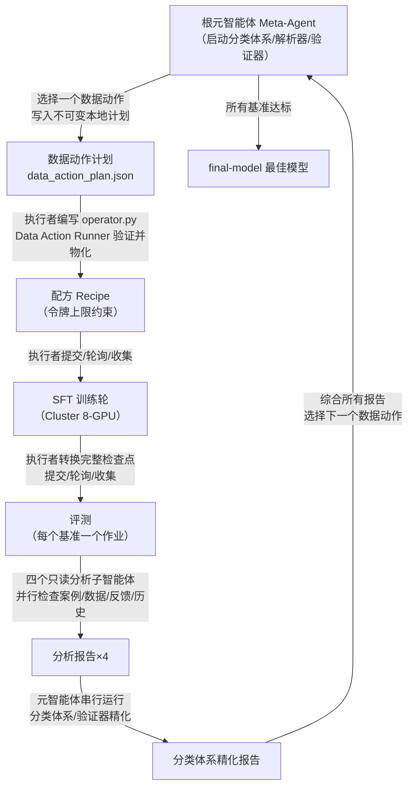
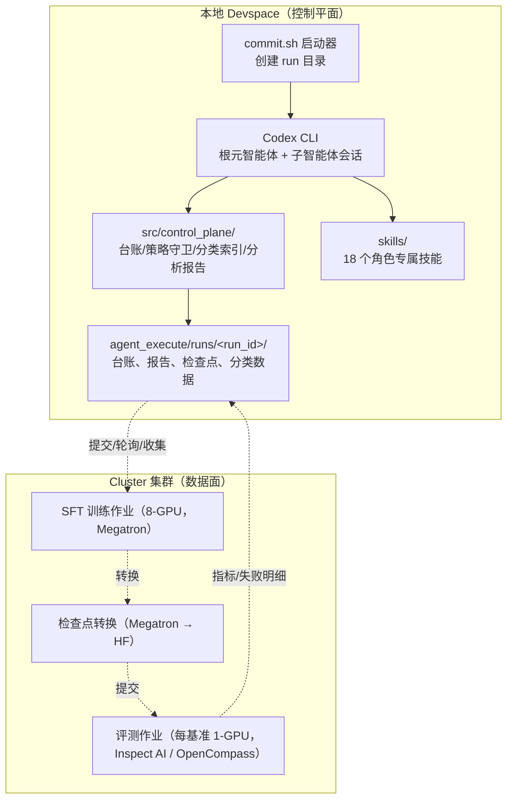

你是否想过：**让 AI 智能体自己当"后训练研究员"**，不需要人类干预，它就能自己发现问题、设计实验、提交训练、分析结果，然后不断迭代直到达成目标分数？AutoSFT 正是这样一个实验系统——它是一个**由智能体驱动的 SFT（监督微调）研究闭环**，用来测试"编程智能体能否胜任一名轻量级后训练研究员的工作"。给定一个目标能力（当前是指令遵循）、固定的训练/评测接口、以及一条"只许改数据"的研究策略，系统会自主选择数据动作、把计划物化为配方、执行训练与评测、分析反馈、然后循环迭代。本页是整个知识库的第一站，将带你看清 AutoSFT 的定位、动机与整体骨架，而不陷入任何单一模块的实现细节。

> **📖 小白导读**
> - 这篇讲什么：AutoSFT 项目的"顶层地图"——它是什么、为什么被设计成这样、整个研究闭环由哪几块组成。
> - 读之前先知道：**SFT（监督微调）**＝拿"问题＋标准答案"格式的数据继续训练一个已有模型，让它学会特定能力；**智能体（agent）**＝能自主调用工具、多步推理的 AI 程序，不只是聊天；**token**＝模型读写的最小文本单位（一个汉字或半个英文单词），训练量按 token 计；**benchmark（基准）**＝一套标准化考题，用来给模型打分。
> - 读完你能明白：为什么这个项目"锁死一切变量、只允许改训练数据"；整个系统由哪几个角色协作（元智能体、执行者、分析子智能体）；一轮实验从数据决策到分数产出是怎么转起来的。
> - 阅读建议：本页只需建立全局印象，具体模块细节在后面对应各页展开；遇到不懂的术语不用急，后面每一页都会再解释。

Sources: [README.md](README.md#L1-L5)

## AutoSFT 是什么：一句话与三层拆解

AutoSFT（**Auto**mated **SFT**）的自我定义是：*"an agent-driven SFT research loop for testing whether coding agents can act as a lightweight post-training researcher"*。用初学者能理解的话说，它回答的问题是：**如果我给一个 AI 智能体足够的工具、技能说明书和硬性规则，它能不能像一个初级研究员那样，通过反复调数据把一个模型在某项基准上的分数刷上去？**

这个定义里藏着三个关键限定，理解了它们就理解了整个项目的设计哲学：

| 限定条件 | 具体含义 | 对设计的影响 |
|---|---|---|
| **目标能力** | 当前为"指令遵循"（instruction following），基准是 IFEval + IFBench | 所有数据、分析、分类体系都围绕该能力构建 |
| **固定 SFT/评测接口** | `sft_train.py`、`convert_checkpoint.py`、`evaluate.py` 三个入口不可改动 | 智能体无法通过"调超参"作弊，研究变量被锁死在数据上 |
| **只改数据策略** | 学习率、批大小、训练轮数等超参全部固定；不许做 DPO/RLHF/合成数据 | 每一轮实验的差异**只能**来自训练数据本身 |

这种"**固定一切、只开放一个变量**"的设计，本质上是把机器学习研究中最难以归因的混杂因素排除掉了：如果这轮分数涨了，那一定是数据配方变了，而不是因为学习率偷偷调了 10%。

Sources: [README.md](README.md#L1-L5), [AGENTS.md](AGENTS.md#L1-L7)

### 为什么固定接口与超参如此重要：一个科学实验的视角

传统后训练实验中，一个研究员面对"为什么这轮分数变了"的问题，往往要在学习率、数据配比、随机种子、训练步数等几十个维度里排查。AutoSFT 把这个问题转化成了一个**因果干净的实验设计**：每一轮 SFT 都从 `Qwen/Qwen3-1.7B-Base` 独立初始化，训练数据恰好跑满三个 epoch，优化器步数由公式自动推导——`train_iters = 3 × ceil(total_tokens / (global_batch_size × seq_length))`。由于步数跟随每一轮实际分词后的数据量，**等量的行数并不等价**（池中单行可从几十 token 跨到上万 token），因此真正决定每轮计算量的，是物化数据的实际 token 总量。智能体唯一的研究变量，是喂给模型的数据与配比。

Sources: [README.md](README.md#L161-L160), [sft_train.py](sft_train.py#L31-L44)

### 为什么需要"智能体"来做：把研究员的隐性知识显式化

一个真正的研究员在迭代时会做哪些事？翻评测失败案例、检查训练数据质量、观察 loss 曲线、回顾上一轮的假设是否被验证——这些动作在 AutoSFT 里被**结构化为四个并行的只读分析子智能体**（失败案例研究、数据供给检查、学习动力学/干扰分析、历史轮次分析），每一个都产出带证据、可证伪的数据动作建议。而"决定下一步做什么实验"这个研究员的核心职责，被交给了根智能体（meta-agent）。把研究员的工作拆解成角色，是这个项目的根本动机之一：**让每个决策都有明确的出处、明确的证据链、明确的可证伪条件**。

Sources: [AGENTS.md](AGENTS.md#L27-L50)

## 研究闭环全景：从数据决策到分数达标的完整循环

理解 AutoSFT 的最快方式是看清它的一圈闭环。README 用一个文本图描述了这个循环，这里将其转化为流程图（阅读前请了解：菱形代表判断分支，圆角矩形代表智能体角色，直角矩形代表系统动作）：



这个循环有四个值得注意的结构特征。**第一，控制面与数据面分离**：本仓库只是控制平面（control plane），所有 GPU 训练和基准评测都在远端 Cluster 集群上运行，本地 devspace 不需要任何 GPU。**第二，分析与执行彻底隔离**：执行者（executor）只做机械的物化与提交，从不读取分数值或做数据决策；分析团队只读不写，只提建议不执行。**第三，建议与决策分离**：四个分析报告各自最多提出 0-3 条有证据支撑、可证伪的数据动作建议——**零条建议是完全合法的**（证据不足时不该硬凑），而最终选择哪条、甚至不选任何建议（记录为 `meta-originated`），是元智能体独有的职责。**第四，决策全部入账**：每一次数据决策都要通过结构化的台账命令记录所选建议 ID、主假设、预期效果与证伪条件，使得后续任何一轮都能回溯"当时为什么这么选"。

Sources: [README.md](README.md#L10-L24), [AGENTS.md](AGENTS.md#L1-L25)

### 停止条件与外层运行器：智能体不达目标不罢休

这个闭环不是无限转圈的。它在两个层面被精确控制：在**智能体契约层**，停止条件被写进 `AGENTS.md` 的 Goal contract——只有当每个目标基准的最佳 `primary_score` 都达到阈值，且最佳模型被固化到 `final-model` 目录后，运行才算完成；在此之前智能体"永不停手"。在**基础设施层**，外层运行器（runner）负责在智能体异常退出、策略违规或瞬时错误后**自动重启它**，并通过 `executor_handoff.json` 这个紧凑状态文件告诉新会话"当前在第几轮、哪个阶段、下一步该做什么"，从而实现断点续跑而不重复提交。

Sources: [AGENTS.md](AGENTS.md#L349-L416)

## 十一阶段系统流水线：智能体的"施工图"

AGENTS.md 定义了整个系统的十一阶段流水线，这是理解执行顺序的权威来源。下图将其按执行者分组（注意：每一阶段都标注了唯一拥有它的技能 skill，智能体不得跨角色调用技能）：

```mermaid
flowchart LR
    subgraph Meta["元智能体 Meta"]
        direction TB
        S1["① 启动/恢复分类体系与验证器"]
        S2["② 构建/恢复分类索引"]
        S3["③ 获取数据（在线:HF发现 / 本地:动态索引）"]
        S4["④ 选择数据动作并写计划"]
    end
    subgraph Exec["执行者 Executor"]
        direction TB
        S5["⑤ 物化计划并提交一轮 SFT"]
        S6["⑥ 监控/收集 Cluster 作业"]
        S7["⑦ 转换检查点为 HF 格式"]
        S8["⑧ 提交 IFEval/IFBench"]
        S9["⑨ 监控/收集评测作业"]
    end
    subgraph Team["分析团队+分类角色"]
        direction TB
        S10["⑩ 四个只读分析者并行运行并持久化报告"]
        S11["⑪ 从报告精化分类体系/验证器，然后做下一个决策"]
    end
    S1 --> S2 --> S3 --> S4 --> S5 --> S6 --> S7 --> S8 --> S9 --> S10 --> S11
```



对于初学者，最重要的认知是：**这个流水线描述的是整个系统，而不是元智能体一个人的工作**。当运行以"非 goal 多智能体 Codex"模式启动时，根线程是元智能体，它只拥有阶段 ③④ 和 ⑪ 中的决策部分；阶段 ⑤-⑨ 全部委托给 `autosft_executor` 子智能体；阶段 ⑩ 是四个并行子智能体；阶段 ① 和 ⑪ 的分类体系精化则串行委托给 `autosft_capability_taxonomy_verifier`。

Sources: [AGENTS.md](AGENTS.md#L13-L25), [tools/codex_exec/agent_prompt_online.md](tools/codex_exec/agent_prompt_online.md#L1-L25)

### 为什么阶段 ⑦-⑨（评测）必须在训练完成后才开始

一个容易被忽略但意义重大的规则：评测**只能**在 SFT 轮完成后启动，绝不能与训练并行。原因是 8-GPU 训练作业与评测作业竞争同一批显卡。每轮只保存最终检查点，评测时先转换该检查点，再为每个基准各提交一个单 GPU 作业（常见的 1×2=2 个作业并行）。这个细节体现了 AutoSFT 对集群资源调度的务实考量。

Sources: [AGENTS.md](AGENTS.md#L251-L260)

## 三级指令架构：契约、智能体定义与技能

智能体如何"知道"自己该做什么？AutoSFT 把指令拆成三层，每一层的作用和边界都严格定义：

| 层级 | 载体 | 内容 | 作用域 |
|---|---|---|---|
| **always-on 契约** | `AGENTS.md` | 硬性规则、十一阶段流水线、角色所有权、停止条件、重启行为 | 所有智能体任何时刻都必须遵守 |
| **项目级智能体定义** | `.codex/agents/*.toml` | 执行者、四个只读分析者、可写的分类体系/验证者工作者的角色边界 | 各自的角色线程 |
| **角色专属技能** | `skills/<name>/SKILL.md` | 单一角色拥有的自包含操作说明书（可含 scripts/references/assets） | 恰好一个拥有者 |

三层设计的核心原则是**单一所有权**：每个技能恰好属于一个角色，智能体不得阅读其他角色的技能（例如元智能体只许读 `huggingface-dataset-discovery` 和 `sft-data-recipe-authoring`，不许读执行者或分析技能）。技能之间也**禁止互相移交控制**——编排顺序始终由根提示词拥有。这避免了"技能链调用"造成的职责模糊与不可预测行为。

Sources: [README.md](README.md#L29-L57), [skills/README.md](skills/README.md#L1-L50)

### 角色与技能的完整分工表

下表是 README 中权威角色分工表的结构化呈现（每个角色只列技能名，完整说明见对应技能的 `SKILL.md`）：

| 角色 | 拥有的技能 | 边界 |
|---|---|---|
| **Meta（元智能体）** | `huggingface-dataset-discovery`、`sft-data-recipe-authoring` | 数据/动作计划决策与编排 |
| **Executor（执行者）** | `data-action-execution`、`cluster-sft-job-submission`、`cluster-job-lifecycle`、`megatron-hf-checkpoint-conversion`、`cluster-eval-job-submission` | 机械的计划实现/物化，加上固定基座初始化的 SFT/评测；从不做数据决策或读分数 |
| **Analysis team（分析团队，4 个并行只读）** | `failure-case-study-analysis`、`training-data-examination`、`learning-dynamics-interference-analysis`、`history-round-analysis` | 并行只读报告：行为修复、数据供给、学习/干扰、保留分支的实验历史；每个最多提 0-3 条建议 |
| **Taxonomy design（分类体系设计）** | `taxonomy-design` | 分类体系必须覆盖什么：冻结的范围契约、类目树、叶子语义、args 模式 |
| **Taxonomy/verifier（分类体系/验证器）** | `taxonomy-verifier-implementation` | 针对该契约的确定性叶子验证器、LLMGateway 解析器契约、全轮索引、覆盖缺口 |
| **Analysis utilities（分析工具，手动/遗留）** | `sft-loss-health-analysis`、`benchmark-metrics-failure-analysis` | 供手动或遗留单智能体流使用的通用只读 loss/指标事实 |

一个精妙之处在于 `taxonomy-design` 与 `taxonomy-verifier-implementation` 的**刻意分离**：设计者决定"分类体系必须覆盖什么"时，**永远不知道实现它要付出多少代价**（比如某个约束检查器很难写）；实现者只负责对着冻结的契约写验证器。项目注释直言不讳地说明了原因——"同一个智能体既画树又写验证器，会在画树时就为了省事而裁剪范围，而产物中不会有任何记录表明这个选择被做过"。

Sources: [README.md](README.md#L43-L51), [skills/README.md](skills/README.md#L89-L113)

## 基准与目标：IFEval 与 IFBench 的双轨设计

AutoSFT 当前的研究对象是**指令遵循能力**，默认基准组合为 `ifeval,ifbench`，每次评测阶段两者都跑（每个基准一个独立的 Cluster 评测作业）。选择这对基准不是偶然：

- **IFEval**（Google Research）检验**可验证的指令遵循约束**——格式、长度、关键词、大小写、标点、结构等。
- **IFBench**（`allenai/IFBench`，NeurIPS 2025）新增 58 个**刻意与 IFEval 不相交**的新约束。

两者搭配的实验意义是：IFEval 衡量**分布内**（in-distribution）表现，IFBench 衡量**分布外/泛化**（out-of-distribution）能力。两个基准共享一套指标模式，主分数为 `primary_score = overall_accuracy`（strict/loose × prompt/instruction 四个准确率的均值）。项目文档同时强调：智能体**不许针对私有基准答案做优化**（防止 reward hacking），反馈只能用于选择合法的指令遵循数据与设置。

Sources: [README.md](README.md#L60-L62), [AGENTS.md](AGENTS.md#L302-L310)

## 基础设施全景：控制平面 + Cluster GPU 层

AutoSFT 的物理形态是**两层结构**：本地 devspace 只承担控制平面职责（智能体会话、数据决策、配方物化、作业状态轮询、报告分析），所有计算密集型工作（SFT 训练、基准评测）都提交到 Cluster 集群。这带来一个对初学者极其友好的事实：**本地开发不需要任何 GPU**，运行 `pip install -r containers/requirements-local.txt` 即可满足控制平面依赖（该文件刻意与包含 PyTorch/vLLM/CUDA 的 `requirements-direct.txt` 分离）。



本地仓库的目录结构本身就体现了这种角色分层，顶层关键目录如下（生成数据被 git 忽略）：

```text
PostTrainBench/
├── AGENTS.md                  # 永远生效的智能体契约（规则、循环、停止条件）
├── README.md                  # 项目主文档
├── .codex/                    # 多智能体深度/线程限制 + 角色定义（*.toml）
├── agent_execute/             # 运行记录：runs/ 下每次运行一个目录
├── skills/                    # 技能库：18 个技能，各有唯一拥有者
├── src/
│   ├── control_plane/         # 共享控制平面逻辑（台账、策略守卫、分类索引等）
│   ├── commit_utils/          # 启动器（commit.sh）、共享环境、有界重试
│   └── eval/                  # IFEval/IFBench 任务封装 + OpenCompass 桥接
├── sft_train.py               # 固定入口①：SFT 训练（3 epoch，基座初始化）
├── convert_checkpoint.py      # 固定入口②：Megatron → HF 检查点转换
├── evaluate.py                # 固定入口③：基准评测提交
├── tools/                     # 本地基线工具、SSTable 转换（SSTable＝训练引擎消费的按键排序数据文件格式）、Megatron 转换器
├── third_party/               # 内嵌的 IFEval/IFBench 规则库与 Inspect AI 运行时
├── containers/                # Cluster 运行时镜像定义与依赖清单
└── tests/                     # 28 个测试文件（契约、幂等性（幂等＝同一操作重复执行结果不变）、门禁行为）
```

Sources: [README.md](README.md#L440-L517), [agent_execute/README.md](agent_execute/README.md#L1-L20)

## 硬性规则：为什么这个系统能被信任

如果只记一件事，请记住：**AutoSFT 的一切自由都建立在硬性规则之上**。`AGENTS.md` 用一整节列出了由 `src/control_plane/policy_guard.py` 强制执行的禁令，违规即退出码 3。对初学者最核心的几条：

| # | 规则 | 一句话解读 |
|---|---|---|
| 1 | 不得编辑仓库源码（`sft_train.py`、`evaluate.py`、技能文件等任何 `.py/.sh/.yaml`） | 可写区域只有 `${AUTO_SFT_RUN_DIR}` 和 `${AUTO_SFT_DATASETS_DIR}` |
| 2 | 不得运行 DPO/偏好优化/奖励模型/RLHF/合成数据 SFT | 所有 SFT 必须走"配方 YAML + `sft_train.py`"这条唯一通道 |
| 3 | 不得更改训练配置（学习率、批大小、并行度、seq-length、三 epoch 调度等全部固定） | 不得设置任何 `AUTO_SFT_SFT_*` 环境变量 |
| 4 | 在线模式下每个数据集 source 必须是真实的 HuggingFace id（`org/name`） | 永不使用合成/自生成数据 |
| 5 | 不得针对私有基准答案优化（防 reward hacking） | 反馈只能用于选择合法数据与设置 |
| 6 | 运行局部验证器/operator Python 是控制平面代码，不是训练数据 | 必须通过安全/金样/红队检查才能激活，绝不进入 SFT 配方 |

这些规则回答了本页标题的后半段——"为什么存在"：**AutoSFT 的存在前提，是它必须产出一个因果可解释、可审计、不可作弊的实验记录**。如果没有这些护栏，智能体可能通过调超参、用合成数据、甚至拟合基准答案来"达标"，那样的分数毫无科学价值。

Sources: [AGENTS.md](AGENTS.md#L302-L337)

### policy_guard 与目标契约：规则如何落地

规则不只是文字——`policy_guard.py` 会在每次尝试开始前对仓库做快照（`policy_baseline.json`），运行中持续检测违规并写入 `policy_feedback.json` 与 `policy_violations.jsonl`。而整个运行被组织为一个**持久目标（durable goal）**而非一次性任务：它有明确的期望终态（每个基准的 `primary_score` 达标且最佳模型固化到 `final-model`）、明确的验证方式（`python -m src.control_plane.ledger best-scores` 对照阈值）、以及明确的重启协议（重启后先恢复台账、清单、事件日志，绝不重复已尝试的配方）。当一个策略违规发生时，它意味着**这次尝试失败**，而不是"差一点就完成目标"。

Sources: [AGENTS.md](AGENTS.md#L349-L368), [src/commit_utils/commit.sh](src/commit_utils/commit.sh#L84-L100)

## 一个真实运行的样貌：两轮迭代实例

文档提供了一个具体的实例帮助建立直觉：一次双迭代的 Codex IFEval 运行中，第 1 轮（800 个 SFT 步）达到 `strict_prompt_accuracy = 0.4806`；第 2 轮（1600 步）达到 `0.5176`。第 2 轮在全部四个 IFEval 指标上均有提升，并最终被提升（promote）为该运行目录下的 `final-model`。这个例子说明了两点：**迭代确实在单调改进目标能力**，且每一轮的历史（配方、检查点、评测、分析）都被完整保留，最终用于挑选最佳历史模型。

Sources: [README.md](README.md#L520-L523)

## 实验台账：整个闭环的"科学记录本"

贯穿所有轮次的，是一本结构化的**实验台账**（experiment ledger，`${AUTO_SFT_RUN_DIR}/iterations.jsonl` + `iterations.md`）。它的作用可以用研究员的实验记录本来类比：每次 SFT 轮与评测都被配对记录——物化的配方、数据动作谱系与结果的配对。智能体在决定下一个动作前必须先读它（`python -m src.control_plane.ledger summarize`），并用结构化命令记录自己的推理：

```bash
python -m src.control_plane.ledger note --rationale "..." \
  --selected-recommendation-id "<id-or-meta-originated>" \
  --primary-hypothesis "..." --planned-action "..." \
  --expected-effect "..." --falsification "..." [--deviation "..."]
```

注意其中的**可证伪条件（falsification）**字段——这是把波普尔式科学方法编码进智能体指令的直接体现。台账的决策记录会标注选择了哪条分析建议（或 `meta-originated` 表示纯元智能体发起），历史分析角色正是据此区分"已测试/未尝试/有支持/被证伪/混合/不确定/混杂"的分支，并为未来的决策保留可回溯的兄弟分支。

Sources: [AGENTS.md](AGENTS.md#L128-L142)

## 数据动作语义：闭环中流动的"通货"

四个分析角色共享一套规范化的数据动作类型定义，这是整个系统中"建议 → 决策 → 执行"三段式的通用语言：

| 动作类型 | 语义 | 本地动态运行时是否可执行 |
|---|---|---|
| `filter` | 对现有数据施加可复现的行级包含/排除谓词，需明确说明补充行为 | ✅ |
| `remove` | 将已识别的行/来源/类目/切片的训练暴露设为零，需明确 token 预算重分配 | ✅ |
| `reweight` | 不改行内容，仅改变现有数据的相对采样或 token 暴露 | ✅ |
| `rewrite` | 为现有行创建谱系链接的替代（改最终 assistant 内容但保留任务身份与父谱系） | ✅ |
| `synthesize` | 创建非谱系保留变换的新训练内容 | ❌ 仅建议性，必须 `executable_now=false` |
| `replay` | 按稳定行身份、指定暴露量，刻意重放先前轮次的精确既有行 | ✅ |

元智能体在写下一个动作计划前，必须先选定**恰好一个** `action_type`，然后选择一条或多条 `executable_now=true` 且类型匹配的建议（或一条都不选）。这条"单一动作类型"约束鼓励每轮只改变一个因果上可解释的数据变量；若多个变量必须捆绑改变，需在台账中记录为何不可分离。

Sources: [AGENTS.md](AGENTS.md#L71-L100)

## 运行模式一览：三种启动路径

AutoSFT 支持三种启动路径，对应不同的数据获取与检索能力组合。启动器 `commit.sh` 会为每次运行在 `agent_execute/runs/` 下创建独立的运行记录目录（命名形如 `codex_ifeval+ifbench_<timestamp>`），并从当前检出直接启动智能体（无需容器）：

| 模式 | 启动脚本 | 数据来源 | 网络检索 | 智能体架构 |
|---|---|---|---|---|
| **标准多智能体（非 goal）** | `src/commit_utils/commit.sh` | 在线 HuggingFace 发现 | ✅ 有 | 根元智能体 + 执行者 + 4 并行分析者 |
| **本地基线** | `src/commit_utils/commit_local_baseline.sh` | 本地未分类原始池 + 动态分类索引 | ❌ 无 | 同上（无网络检索工具） |
| **遗留单根智能体** | `commit_codex_goal.sh` / `commit_claude_goal.sh` 等 | 视脚本而定 | 视脚本而定 | 单一根智能体流 |

本知识库的后续页面会对各模式展开专门讲解。此处只需建立认知：**`AUTO_SFT_TARGET_SCORES` 是唯一无默认值的必填项**（启动命令行必须传入，格式如 `ifeval=0.8,ifbench=0.5`），它同时定义了停止条件与研究目标。

Sources: [README.md](README.md#L64-L89), [README.md](README.md#L145-L152), [src/commit_utils/commit.sh](src/commit_utils/commit.sh#L14-L28)

## 结语与推荐阅读路径

到这里，你应该能回答最初的问题了：**AutoSFT 是一个用智能体替代人类研究员执行 SFT 数据实验的平台，它存在的理由是验证"编程智能体能否胜任轻量级后训练研究"这一命题，而它可信的前提是把一切不可控变量钉死、把一切决策记录在案。** 它的本质不是"自动调参工具"，而是一次把研究方法论本身（假设-实验-证伪-迭代）工程化的尝试。

作为初学者，建议按以下顺序继续阅读，逐步从"跑起来"深入到"看懂每个子系统"：

1. **先跑通一次** — [快速开始：环境准备、Codex CLI 配置与首次智能体运行（commit.sh 启动指南）](2-kuai-su-kai-shi-huan-jing-zhun-bei-codex-cli-pei-zhi-yu-shou-ci-zhi-neng-ti-yun-xing-commit-sh-qi-dong-zhi-nan)：安装、认证、启动你的第一个 AutoSFT 运行。
2. **理解无网络场景** — [本地基线模式：离线原始池构建与无网络检索运行（commit_local_baseline.sh 流程）](3-ben-di-ji-xian-mo-shi-chi-xian-yuan-shi-chi-gou-jian-yu-wu-wang-luo-jian-suo-yun-xing-commit_local_baseline-sh-liu-cheng)：当你没有外网检索条件时的替代路径。
3. **掌握全部旋钮** — [运行配置与环境变量详解：目标分数、评测后端、令牌预算与重试策略](4-yun-xing-pei-zhi-yu-huan-jing-bian-liang-xiang-jie-mu-biao-fen-shu-ping-ce-hou-duan-ling-pai-yu-suan-yu-zhong-shi-ce-lue)：理解每个环境变量控制什么。
4. **看懂产物** — [运行产物目录全解：agent_execute/runs 下的台账、报告、检查点与分类数据布局](6-yun-xing-chan-wu-mu-lu-quan-jie-agent_execute-runs-xia-de-tai-zhang-bao-gao-jian-cha-dian-yu-fen-lei-shu-ju-bu-ju)：运行结束后磁盘上每个文件的含义。
5. **脱开智能体手动执行** — [手动执行单阶段流程：脱离智能体循环直接调用 sft_train / convert_checkpoint / evaluate](5-shou-dong-zhi-xing-dan-jie-duan-liu-cheng-tuo-chi-zhi-neng-ti-xun-huan-zhi-jie-diao-yong-sft_train-convert_checkpoint-evaluate)：用于调试或理解固定接口本身。
6. **深入多智能体架构** — [多智能体控制平面：元智能体、执行者、四路并行分析与分类体系子智能体的分工设计](7-duo-zhi-neng-ti-kong-zhi-ping-mian-yuan-zhi-neng-ti-zhi-xing-zhe-si-lu-bing-xing-fen-xi-yu-fen-lei-ti-xi-zi-zhi-neng-ti-de-fen-gong-she-ji) 与 [智能体契约与硬性规则：AGENTS.md 的十一步流水线、角色所有权与停止条件](8-zhi-neng-ti-qi-yue-yu-ying-xing-gui-ze-agents-md-de-shi-bu-liu-shui-xian-jiao-se-suo-you-quan-yu-ting-zhi-tiao-jian)：本页概念的完整展开。