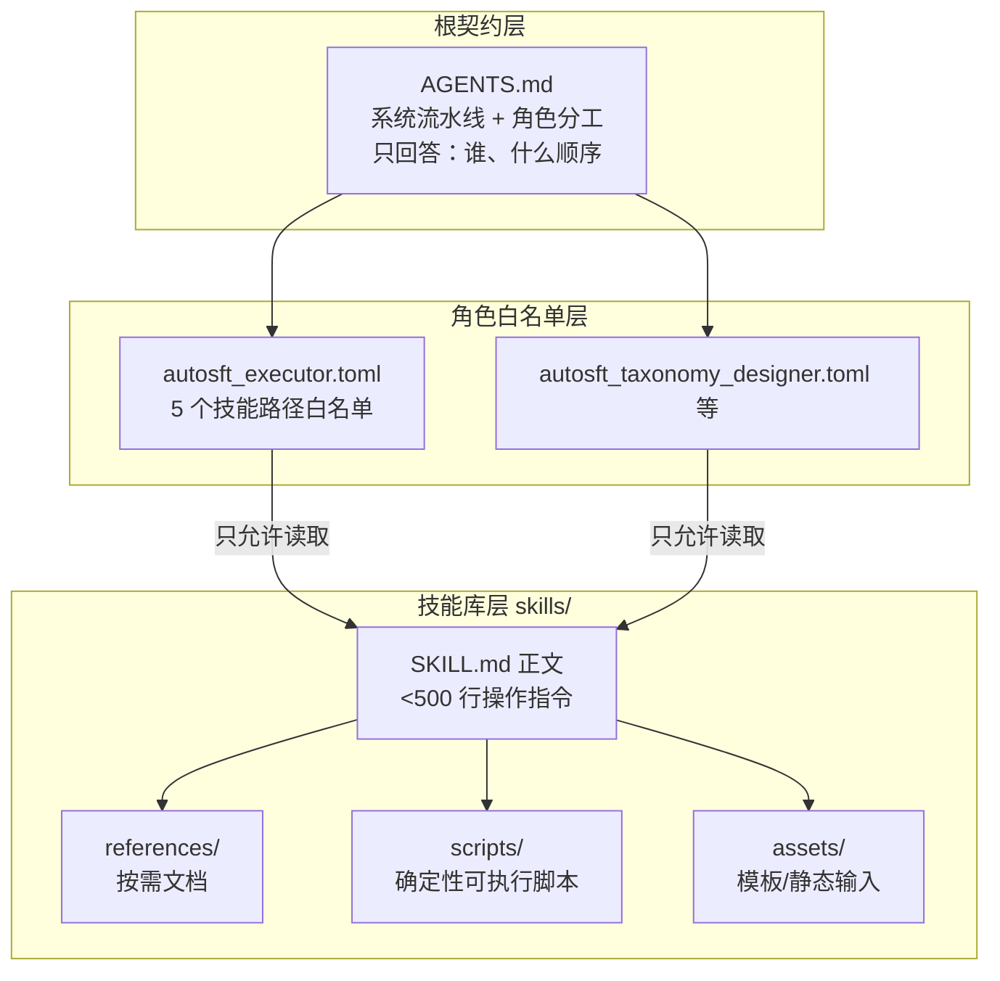
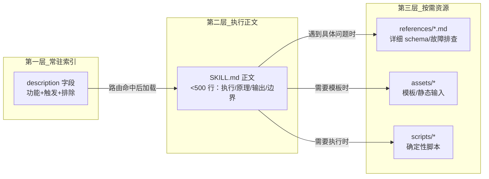

技能库（`skills/`）是 AutoSFT 多智能体系统的**知识层**：它不包含任何可被系统直接调用的代码入口，而是以 16 个自包含的 SKILL.md 文档，向每个智能体角色声明"你能做什么、何时做、以及明确不做什么"。本页解释这套技能库的三大设计支柱——遵循 Agent Skills 开放规范的**前置元数据契约**、每个技能只属于一个角色的**单一所有权**原则、以及将细节推迟到按需加载文件的**渐进式披露**结构，并说明它们如何与角色白名单（`.codex/agents/`）和触发校准工具（`skills/triggering/`）共同构成完整的技能治理体系。

> **📖 小白导读**
> - 这篇讲什么：`skills/` 技能库——16 份 SKILL.md 文档如何向各角色声明"你能做什么、何时做、明确不做什么"。
> - 读之前先知道：**SKILL.md**＝一份自包含的技能说明书（Markdown 文档，Markdown＝用井号/星号等标记格式的文本写法）；**前置元数据**＝文件开头一段 YAML 格式的"名片"（名称/触发条件/所有权）；**渐进式披露**＝先只给智能体看摘要、要用时再展开全文的省 token 设计；**白名单**＝明确列出"谁有权用"的名单。
> - 读完你能明白：技能如何与角色绑定、如何被触发；为什么技能库里没有一行可执行代码；想新增一个技能该遵守什么格式。
> - 提醒：本页偏设计规范，改动技能库前必读，纯使用者可略读。

Sources: [README.md](skills/README.md#L1-L48)

## 技能库在系统中的位置与消费方式

技能库的消费者不是人类开发者，而是智能体本身。AGENTS.md 作为根契约声明整个系统流水线，并在第 9-11 行明确分工原则："本文件陈述规则与全系统流水线；至于*如何执行*某个自有阶段，请阅读该角色在 `skills/<name>/SKILL.md` 下匹配的技能"。也就是说，AGENTS.md 只回答"谁在什么顺序做什么"，而"怎么做"的完整操作知识下沉到各技能文档中。十一步流水线的每个可委派步骤都在 AGENTS.md 中标注了对应的技能名，例如第 4 步"选择数据动作并编写其计划 → 技能：`sft-data-recipe-authoring`"，第 5 步则拆分为 `data-action-execution` 与 `cluster-sft-job-submission` 两个技能。

Sources: [AGENTS.md](AGENTS.md#L9-L25)

第二层消费发生在角色配置层面。`.codex/agents/` 下的每个 TOML 文件定义一个子智能体的硬边界，并以**技能白名单**的形式强制执行所有权。以执行者配置为例，它明确列出执行者"只可阅读这些技能指令"——5 个执行者技能的精确路径——随后立即收紧："不要阅读任何其他技能。不要 spawn 另一个智能体或做数据决策"。这解释了 skills/README.md 中一个看似奇怪的设计决定：前置元数据刻意省略 `allowed-tools` 字段，因为共享规范中的该字段仍是实验性的，而 AutoSFT 已通过 `.codex/agents/` 角色配置与策略钩子实现了更强的工具边界控制。

Sources: [autosft_executor.toml](.codex/agents/autosft_executor.toml#L11-L23)



这张图揭示了关键架构事实：**技能之间没有调用关系**。skills/README.md 第 3-5 行规定"每个技能有且仅有一个 owning agent 角色。技能是自包含的参考：它不调用、不移交、也不指示读者加载另一个技能。根编排提示拥有排序权"。排序逻辑完全由 AGENTS.md 和根元智能体持有，任何 SKILL.md 都不试图编排兄弟技能——这避免了知识层的循环依赖与职责漂移。

Sources: [README.md](skills/README.md#L3-L5)

## 前置元数据契约：name、description、compatibility 与 metadata 四元组

每个 SKILL.md 必须以 YAML 前置元数据开头，这是整个技能库最核心的机器可读契约。规范定义了四个必填键：`name`（技能标识符）、`description`（做什么 + 何时触发 + 明确排除项）、`compatibility`（运行时、工具、网络与产物要求）、以及 `metadata` 三元组（`autosft-role`、`autosft-stage`、`version`）。

| 字段 | 内容 | 设计意图 |
|---|---|---|
| `name` | 与目录名完全一致的技能标识 | 无别名原则的基础；重命名后必须重启在飞会话 |
| `description` | 功能 + 触发场景 + **明确排除项** | 包含全部触发信息；是路由判断的唯一依据 |
| `compatibility` | 运行时/工具/网络/产物要求 | 前置声明环境前提，避免执行中途失败 |
| `autosft-role` | `meta` / `executor` / `analysis` / `taxonomy-verifier` 等 | 声明唯一所有权归属 |
| `autosft-stage` | 流水线阶段位置 | 可与技能名不同（见下文 data-materialization 案例） |
| `version` | 技能版本号 | 支持技能演化（如 failure-case-study-analysis 已到 2.0） |

`description` 字段的写法值得仔细考察，因为它承担了远超"简介"的职责。以 `huggingface-dataset-discovery` 为例，其描述先陈述能力（"查找、审查并下载真实的 HuggingFace SFT 数据集"），再给出精确触发条件（"当在线元智能体需要候选数据、数据集卡片事实、许可或门控细节时使用"），最后用否定句划出边界："不要在 local-catalog 模式、配方编写、作业执行或评测分析中使用"。正面触发词与负面排除项共存于同一段描述，这是让单次路由判断即可区分近似技能的关键。

Sources: [huggingface-dataset-discovery/SKILL.md](skills/huggingface-dataset-discovery/SKILL.md#L1-L16)

`metadata.autosft-stage` 是一个容易误解的字段：它不等于技能名，而是**流水线中的逻辑位置**。最典型的例子是 `data-action-execution` 技能——其 `autosft-role` 为 `executor`，但 `autosft-stage` 是 `data-materialization`（数据物化），而非技能名本身。这个设计使得阶段标识可以独立于技能命名演化，同时 `compatibility` 字段前置声明了执行所需的全部环境前提：`AUTO_SFT_RUN_DIR`、`AUTO_SFT_DATASETS_DIR`、活动的动态分类索引、原始池与令牌长度清单，以及上游供给的 `data_action_plan.json`。

Sources: [data-action-execution/SKILL.md](skills/data-action-execution/SKILL.md#L1-L16)

`taxonomy-design` 技能的前置元数据还展示了一个更深层的设计原则——**成本盲区**被直接写进了 description：该技能"在任何验证器存在之前运行，且永远不知道构建一个验证器的成本是多少。它不编写验证器、案例或 bundle，也不选择配方、数据或检查点"。把角色边界写进机器可读的元数据，意味着即使一个智能体被错误地授予了该技能，其自述的能力边界也会立即暴露矛盾。

Sources: [taxonomy-design/SKILL.md](skills/taxonomy-design/SKILL.md#L1-L18)

## 渐进式披露：三层上下文结构与 500 行纪律

渐进式披露（progressive disclosure）解决的核心问题是**上下文预算**：智能体的注意力窗口有限，不可能在一次加载中消化全部领域细节。AutoSFT 的实现遵循 Agent Skills 规范的标准三层结构，每个技能目录固定为：

```text
skill-name/
├── SKILL.md       必需：元数据与精炼操作指令
├── scripts/       可选：确定性可执行脚本
├── references/    可选：按需文档
└── assets/        可选：模板或静态输入
```

第一层是前置元数据中的 `description`——它常驻智能体的技能索引，包含全部触发判断所需的信息；第二层是 SKILL.md 正文，规范要求**操作指令保持在 500 行以内**，正文解释执行方式、原理、输出与边界情况；第三层是深度细节，"详细的 schema 与故障排查存放在一层深的资源文件中，以诸如 `[reference](references/reference.md)` 的路径链接"。三层结构对应三种加载时机：路由时只读描述、执行时读正文、遇到具体问题时才打开引用文件。

Sources: [README.md](skills/README.md#L14-L48)

`sft-data-recipe-authoring` 的 Resources 节展示了第三层的标准写法——不只是罗列链接，而是为每个资源标注**何时加载**的判断条件：配方模板（assets）在"创建新配方时"作为起点；recipe schema 引用在需要字段定义时读；local-catalog 引用则带有明确的限制性触发条件——"仅为遗留的 `/goal` 或手动静态目录运行而读"。这种"链接 + 加载时机指引"的模式是 README 约定的直接实现："从 SKILL.md 链接每个捆绑的脚本、引用与资产，并给出何时加载或执行它的指引"。

Sources: [sft-data-recipe-authoring/SKILL.md](skills/sft-data-recipe-authoring/SKILL.md#L146-L158)

渐进式披露的深度在技能库中并不均匀，而是与技能复杂度成正比。对比可见清晰的梯度：四个分析技能（如 `failure-case-study-analysis`）只有单个 SKILL.md，无任何子目录，因为它们是纯只读推理任务；执行者技能普遍带 `scripts/` 与 `references/`（如 `cluster-job-lifecycle` 携带 6 个状态/停止/收集脚本与 2 个引用文档）；而最复杂的 `taxonomy-verifier-implementation` 则同时拥有 assets 下的提示词模板、参考 bundle（含构建脚本、JSON 清单、验证器目录）与三个引用文档。披露深度是复杂度驱动的结果，而非形式化的要求。

Sources: [README.md](skills/README.md#L159-L173)



## 单一所有权：四角色划分与不可交叉的技能边界

所有权表是 skills/README.md 的核心治理工具。每个技能精确归属一个角色，四个运行时角色构成完整的技能分区：

| 角色 | 技能 | 边界特征 |
|---|---|---|
| **Meta-agent（元智能体）** | `huggingface-dataset-discovery`、`sft-data-recipe-authoring` | 数据发现与配方决策；不执行作业、不解读指标 |
| **Executor subagent（执行者）** | `data-action-execution`、`cluster-sft-job-submission`、`cluster-job-lifecycle`、`megatron-hf-checkpoint-conversion`、`cluster-eval-job-submission` | 机械执行固定配置；报告状态与类型化产物，但不读取指标值、不做数据决策 |
| **Analysis team（分析团队）** | `failure-case-study-analysis`、`training-data-examination`、`learning-dynamics-interference-analysis`、`history-round-analysis` | 只读分析 + 一次运行内报告写入；返回 0-3 条证据支撑的建议，建议只供参考、从不决策 |
| **Taxonomy/verifier subagent** | `taxonomy-design`、`taxonomy-verifier-implementation` | 只可在运行内 taxonomy 目录写入；运行于首次配方之前与每轮四份分析报告之后 |

所有权表之外还有三个**遗留/手动专用技能**被明确隔离在常规编排之外：`sft-loss-health-analysis` 与 `benchmark-metrics-failure-analysis` 是"对手动或遗留单智能体流程仍可用的额外只读分析工具"；`sft-checkpoint-resume-control` 则"仅为提供显式 `--resume-from` 或 `--load-ckpt` 契约的手动/遗留调用者保留，它不属于常规 AutoSFT 编排，也不定义无标志行为"。这种显式降级标注防止遗留能力被误认为活跃编排的一部分。

Sources: [README.md](skills/README.md#L50-L127)

单一所有权在 AGENTS.md 中以"agent id / 技能名"的映射形式再次确认，并处理了演化遗留问题：分析团队列出了 `autosft_failure_case_study` / `failure-case-study-analysis` 与 `autosft_evaluation_feedback_analysis` / `learning-dynamics-interference-analysis` 两对映射，并注明"agent id 为既有运行而保留"——这是技能重命名历史在系统中的化石记录，也印证了 README 中"技能 id 不设别名。重命名后重启任何在飞智能体会话，使其提示与技能路径从当前检出重新生成"的规则。

Sources: [AGENTS.md](AGENTS.md#L36-L47)

## 命名规范：动词后缀即边界声明

AutoSFT 的技能命名遵循"对象 + 动作"的显式语法，且**每个后缀都携带可执行的边界语义**，README 将其总结为一张后缀-行为对照表：

| 命名模式 | 明确的行为边界 |
|---|---|
| `*-job-submission` | 创建一个 Cluster 任务；**不**监控、不分析它 |
| `cluster-job-lifecycle` | 轮询、停止、收集既有任务；**不**提交 SFT 或评测作业 |
| `*-analysis` | 读取已完成的产物；**不**执行作业 |
| `*-examination` | 读取已物化的数据产物；**不**下载、重写或选择训练数据 |
| `*-recipe-authoring` | 编写 SFT 数据配方；**不**发现线上数据、不启动训练 |
| `*-checkpoint-conversion` | 改变模型格式；**不**选择检查点 |
| `*-resume-control` | 执行调用者已提供的手动/遗留检查点模式；常规轮次不调用 |
| `*-verifier-construction` | 编写并验证运行内 taxonomy/verifier 产物；**不**自我归类为只读分析 |

命名即契约的一个典型实例是 `cluster-job-lifecycle` 与两个 `*-job-submission` 技能的分离：提交与监控被拆成互不重叠的技能，README 明确表述"`cluster-job-lifecycle` 轮询、停止并收集既有任务；它不提交 SFT 或评测作业"。当一个智能体只被授予其中之一时，命名本身就在阻止它越界。

Sources: [README.md](skills/README.md#L129-L149)

## 刻意分离的典范：taxonomy-design 与 taxonomy-verifier-implementation

技能库中最能体现设计深度的决策，是把分类体系工作拆成两个互不可读的技能，其理由在 README 中被直接陈述："两者刻意分离为不同技能。一个既画树又写验证器的智能体会在设计时为自己的未来省钱，因此设计者永远不读实现技能，永远不知道一项检查的构建成本。"这不是工程便利的产物，而是一个**防止动机污染**的认知隔离设计。

Sources: [README.md](skills/README.md#L104-L107)

`taxonomy-design` 的正文将这一原理展开为完整的论证链："这个角色在任何人知道覆盖它的成本之前决定覆盖范围。本技能中没有任何内容描述验证器如何编写、存在哪些库、或一项检查的运行成本；那些材料属于 `taxonomy-verifier-implementation` 技能，而本角色不读它。一个得知哪里构建便宜的设计者会开始按成本选择类目，设计会漂向任何易于检查的东西，且没有任何记录表明曾做出过选择。"换言之，成本信息本身被当作需要隔离的污染源——设计者一旦知晓成本，就会系统性偏向低成本类目，而这种偏移将无法从任何产物中追溯。

Sources: [taxonomy-design/SKILL.md](skills/taxonomy-design/SKILL.md#L34-L40)

两个技能的正文各自维护着一份"谁拥有什么/绝不触碰什么"的对照表，且表格内容互补：`taxonomy-design` 的表声明设计者拥有冻结的 `taxonomy_contract.json`，绝不触碰验证器源码、包列表、validator/preflight 输出；`taxonomy-verifier-implementation` 的表则覆盖五个智能体的完整分工——设计者、作者（`autosft_verifier_author`）、能力验证器、红队（`autosft_verifier_red_team`）与降级裁决者（`autosft_demotion_adjudicator`），每个角色一行"Owns / Never touches"。值得注意的是，实现技能明确声明"分类工作分裂给五个智能体；本技能属于构建与发布的四个，设计者读 `taxonomy-design`"——即便是刻意分离的技能，也通过各自的正文声明边界而非相互引用。

Sources: [taxonomy-design/SKILL.md](skills/taxonomy-design/SKILL.md#L42-L52)

## 触发校准：用路由评估验证 description 的区分度

前置元数据中 `description` 的质量直接决定智能体能否在正确时机打开正确技能，因此技能库配备了专门的校准工具链——`skills/triggering/`。这个目录本身是一个有趣的边界案例：其 README 第一句即声明"工具（非技能）"，它没有 SKILL.md，不遵循技能格式，仅为维护者服务。这与"每个直接子目录就是一个技能"的结构规则形成了显式的例外标注。

Sources: [triggering/README.md](skills/triggering/README.md#L1-L18)

校准机制的原理是**用生产路由器做代理测试**：`eval_queries.jsonl` 中每行是一个 `{"id", "query", "expected", "note"}` 对象，`expected` 为技能名或 `none`；`route_eval.py` 从所有 `skills/*/SKILL.md` 解析出 name 与 description（缺失 YAML 前置元数据、或缺少 name/description 的文件会被警告并跳过），据此构建路由提示词，让路由模型为每个查询选择一个技能，最后输出准确率与混淆列表。其设计文档明确陈述了代理逻辑："如果描述对一个单发路由器足够有区分度，它们对读 AGENTS.md + 技能索引的智能体也足够有区分度"，且默认路由命令与生产环境完全一致（`codex exec`）。

Sources: [route_eval.py](skills/triggering/route_eval.py#L1-L73)

校准数据集特别包含三类查询：应触发的正例、**近似负例**（与兄弟技能共享词汇但应路由到别处的查询）与 `none` 查询（任何阶段技能都不应认领的维护/运维任务）。README 列出了已知的易混淆技能对，每一对都对应一条需要打磨的描述边界：`cluster-eval-job-submission` vs `failure-case-study-analysis`（提交 vs 诊断已完成的评测行为）、`cluster-sft-job-submission` vs `sft-checkpoint-resume-control`（新轮次 vs 恢复/回溯）、`training-data-examination` vs `taxonomy-verifier-implementation`（检查现有行 vs 演化 taxonomy/验证器）、以及 `taxonomy-design` vs `taxonomy-verifier-implementation`（决定覆盖范围 vs 构建验证器）。

Sources: [triggering/README.md](skills/triggering/README.md#L46-L56)

## 工程约定与验证闭环

技能库的最后一层规范是一组工程约定，将"技能是仓库源码"这一属性落到实处：资源链接必须相对于技能根且**只允许一层深**；一个技能拥有的脚本保留在该技能的 `scripts/` 目录中；共享 shell 基础设施放在 `src/commit_utils/` 而"绝不在另一个技能之下"；固定 Python 入口保留在仓库根；脚本从仓库根运行。最关键的约束是写入时机——"技能文件是仓库源码，必须在受防护的运行开始之前编辑"。这与策略守卫机制（见[策略守卫机制](9-ce-lue-shou-wei-ji-zhi-policy_guard-de-yuan-ma-bao-hu-jin-yong-xun-lian-liu-jian-ce-yu-wei-gui-shen-ji-policy_guard_check-sh)）形成呼应：运行期间的源码保护覆盖了技能文件本身。

Sources: [README.md](skills/README.md#L159-L173)

格式合规通过外部 `skills-ref` 工具验证："如果安装了外部 `skills-ref` 命令，对每个变更的技能执行 `skills-ref validate skills/<skill-name>`"。配合 triggering 路由评估（验证 description 语义边界）与 `.codex/agents/` 白名单（运行时强制读取边界），技能库形成了三道互补的验证关卡：结构合规、语义区分度、运行时隔离。

Sources: [README.md](skills/README.md#L175-L182)

## 设计启示与延伸阅读

这套技能库规范展示了一个可迁移的模式：**当文档成为智能体的运行时输入时，文档结构必须被当作 API 来设计**。前置元数据是机器可读的接口签名，description 是路由判别式，500 行纪律与一层深链接是上下文预算管理，单一所有权与命名后缀是防越界的类型系统，而 triggering 评估则是对"接口区分度"的回归测试。成本盲区（taxonomy 设计者不知验证成本）更进一步表明，信息隔离本身可以成为治理工具。

若要深入理解这套体系的相邻机制，建议按以下顺序阅读：[智能体契约与硬性规则：AGENTS.md 的十一步流水线、角色所有权与停止条件](8-zhi-neng-ti-qi-yue-yu-ying-xing-gui-ze-agents-md-de-shi-bu-liu-shui-xian-jiao-se-suo-you-quan-yu-ting-zhi-tiao-jian)解释了根契约如何消费技能库并持有排序权；[多智能体控制平面：元智能体、执行者、四路并行分析与分类体系子智能体的分工设计](7-duo-zhi-neng-ti-kong-zhi-ping-mian-yuan-zhi-neng-ti-zhi-xing-zhe-si-lu-bing-xing-fen-xi-yu-fen-lei-ti-xi-zi-zhi-neng-ti-de-fen-gong-she-ji)展开四角色协作的完整运行时图景；[分类体系设计契约：taxonomy_contract 冻结、类目树语义与设计/实现分离原则](15-fen-lei-ti-xi-she-ji-qi-yue-taxonomy_contract-dong-jie-lei-mu-shu-yu-yi-yu-she-ji-shi-xian-fen-chi-yuan-ze)与[验证器沙箱运行时：ALLOWED_IMPORTS 白名单、CPU 秒限制与离线确定性执行](16-yan-zheng-qi-sha-xiang-yun-xing-shi-allowed_imports-bai-ming-dan-cpu-miao-xian-zhi-yu-chi-xian-que-ding-xing-zhi-xing)则深入那对刻意分离的 taxonomy 技能所产出的下游契约。