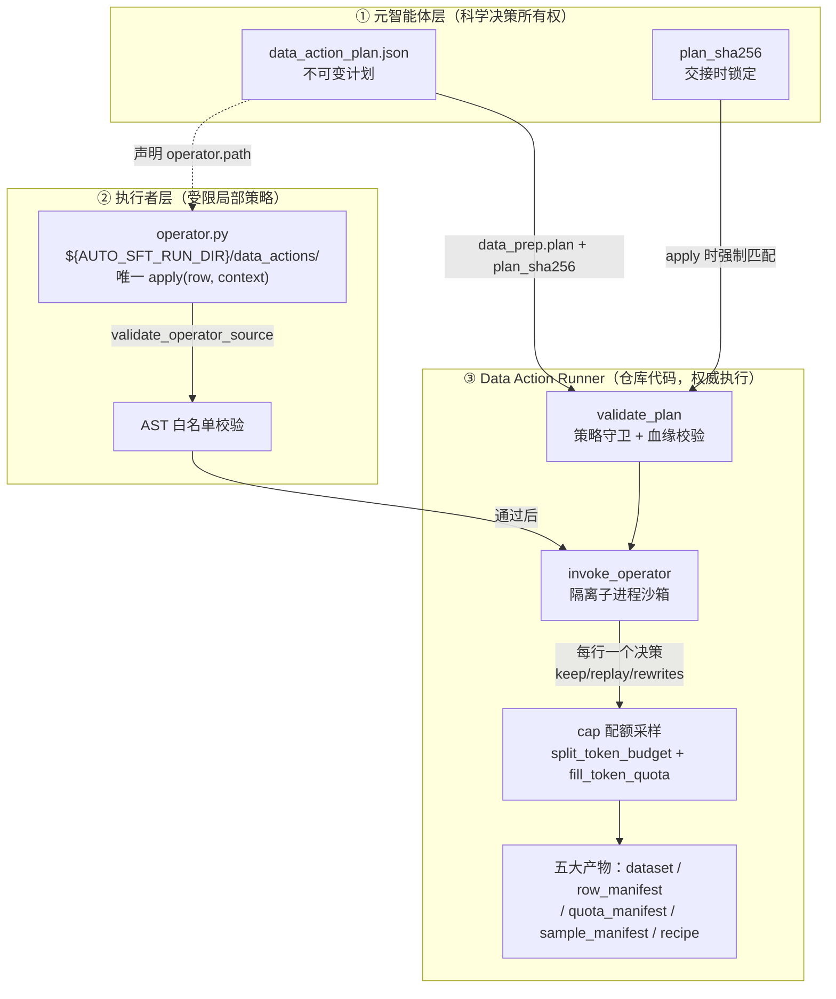

本文剖析 AutoSFT 研究闭环中"数据决策落地"的核心子系统：当一个训练轮次需要改变训练数据时，元智能体产出一份**不可变的数据动作计划**（data action plan），执行者智能体最多编写一个**受 AST 级约束的运行本地 operator.py**，而最终的数据选择权始终归属于**仓库代码 Data Action Runner**——它独自完成行选择、血缘记录、令牌重计数、cap 整行采样与配方生成。这三者构成一条"意图声明 → 受限局部策略 → 权威确定性执行"的信任降级链，任何一层都无法越权改写上一层的决定。

> **📖 小白导读**
> - 这篇讲什么：数据决策落地的三层信任链——元智能体写"意图书"（数据动作计划）、执行者写"受限脚本"（operator.py）、仓库代码做"权威执行"（Data Action Runner）。
> - 读之前先知道：**数据动作**＝一次改变训练数据的操作（如"从类目 X 抽 2000 行"）；**AST（抽象语法树）**＝代码的语法结构树，可在不运行代码的情况下静态检查它"都干了什么"；**血缘记录**＝记录"每行数据从哪个池行来"的溯源信息。
> - 读完你能明白：为什么行选择权最终归仓库代码而不是智能体；执行者写的脚本被允许/禁止做什么；这条信任链如何层层降权防止越权。
> - 提醒：本页概念密度高，建议先记住三层名字与各自权限，再往下读细节。

## 信任链总览：三层所有权的精确切分

在深入实现前，先建立整体心智模型。该系统的设计前提是：执行者智能体不可信（它可能被提示注入或产生幻觉），元智能体的计划是唯一合法的科学决策载体，而确定性代码是唯一合法的执行引擎。理解这一点，后续所有看似严苛的校验都会显得必然。



三层所有权的边界在 SKILL 文档中被明确文字化：**"The meta-agent owns the immutable scientific plan... Execute that plan mechanically. Do not reinterpret analysis reports, choose another action, or modify the plan. The Data Action Runner is repository code, not another agent."**（元智能体拥有不可变的科学计划——动作类型、目标、阈值、类目混合、cap 策略、选定推荐 ID 与证伪条件；执行者只是机械执行；Runner 是仓库代码而非另一个智能体，它独自拥有最终行选择、血缘、令牌重计数、基于 cap 的整行打包、容量核算、清单与配方生成）。这一句话就是整个子系统的宪法。

Sources: [SKILL.md](skills/data-action-execution/SKILL.md#L20-L40)

## 不可变元计划：结构、锁定与策略守卫前置

数据动作计划是一个 JSON 文件，必须存放在 `AUTO_SFT_RUN_DIR` 之下。它声明五个运行时动作之一——`filter`、`remove`、`reweight`、`rewrite`、`replay`——同时显式排除两个动作：`curriculum` 已被移出运行时动作空间（静态难度调整应改用 `reweight`），`synthesize` 仅为咨询性质、进入运行时计划即被拒绝。`schema_version` 固定为 `"1.0"`，计划不得覆写三个固定运行时字段（`sstable_code_dir`、`sstable_python`、`tokenizer`）——这三者是"基础设施意志"，不属于智能体决策域。

不可变性通过 **SHA-256 锁**实现：元智能体在 executor_handoff 中记录 `data_prep.plan_sha256`，执行者运行 `validate` 或 `apply` 时必须传入 `--expected-plan-sha256`；Runner 重新计算计划文件哈希，不一致即抛出 "data action plan changed after the meta-agent handoff"。此外 `validate` 在解析 JSON **之前**就先调用 `policy_guard.data_action_plan_violations` 执行独立于解析逻辑的策略审计——即使计划本身格式损坏，策略违规也会优先暴露。

Sources: [data_action.py](src/control_plane/data_action.py#L384-L451) · [data_action.py](src/control_plane/data_action.py#L414-L432)

### 策略守卫的五条硬规则

`data_action_plan_violations` 是嵌入在 Runner 入口处的独立审计器，它检查五类违规并返回结构化记录（`rule_id` + `message` + 路径），Runner 取第一条违规即中止：

| 规则 ID | 检查内容 | 设计意图 |
|---|---|---|
| `data_action_plan_outside_run` | 计划必须位于 `AUTO_SFT_RUN_DIR` 下 | 防止计划引用仓库外路径 |
| `unsupported_data_action` | `action_type` 为单字符串且不得为 `synthesize`/`curriculum` | 收缩动作空间到可实现集合 |
| `unapproved_dataset_source` | `dataset_source` 必须命名空间化（含 `/`、非相对路径），不得描述合成/DPO/偏好/RLHF/奖励模型数据 | 确保实验只在本地已分类池上迭代 |
| `data_action_token_budget_override` | 计划**不得**设置 `token_budget` | 预算唯一来源是运行级环境变量 `AUTO_SFT_SFT_TOKEN_BUDGET` |
| `data_action_operator_outside_run` / `unsafe_data_action_operator` / `data_action_output_outside_allowlist` | operator 必须在 `run_dir/data_actions/` 下且通过 `validate_operator_source`；outputs 中除 `dataset` 外都必须在 run_dir 下（dataset 允许落入 datasets_dir） | 输出落点白名单 |

其中 operator 路径检查与源码校验会**递归调用** `data_action_operator.validate_operator_source`——策略守卫与 Runner 共用同一套 AST 校验逻辑，避免两套标准漂移。

Sources: [policy_guard.py](src/control_plane/policy_guard.py#L516-L661)

### 血缘三方指纹一致性校验

计划声明的 `lineage` 指向三个独立构建的索引：原始池 manifest（`unclassified_messages` 类型）、动态分类索引（`dynamic_taxonomy` + `eligible_only` 准入）、令牌长度索引（`pool_token_lengths` 类型）。Runner 强制三者的 `pool_sha256` **完全一致**——任何一个索引是针对不同池快照构建的，动作即被拒绝。令牌索引还不得声明 `system_prompt`（训练配方不含系统提示，计数基线必须一致），并通过 `validate_token_index_fingerprint` 校验其与 SSTable 转换代码及 tokenizer 的指纹匹配；`pool_rows` 必须与偏移文件实际行数、令牌长度数组实际长度逐一对账。分类索引层面则逐类目文件校验：行 ID 唯一、不越界 `[0, pool_rows)`、与 `per_category_counts` 声明吻合、文件路径不逃逸索引根目录——防止受损索引静默重复行或越界读取。

Sources: [data_action.py](src/control_plane/data_action.py#L494-L595) · [data_action.py](src/control_plane/data_action.py#L290-L381)

### 稠密 category_weights：显式零权重的完整向量

现代计划（dense 格式）携带 `category_weights` 对象，必须为当前分类索引的**每一个类目**各声明一个非负权重，含显式零——缺失或多余类目都会被拒绝。dense 计划必须同时声明 `quota_mode: "cap"` 与 `underfill_policy: "clip_and_drop"`；而旧式 `base_mix`（legacy 格式，`quota_mode: "hard"`）则要求所有值为正且欠填时报错。两种格式不可混用，`params.fractions` 在 dense 计划下被全面禁用（`reweight` 的 dense 变体、`remove` 的 dense 变体、`filter`/`rewrite`/`replay` 均有独立禁令）——**dense 语义下 `category_weights` 就是完整终态混合，不存在"再分配"这个概念**。dense `remove` 还要求被移除类目的权重必须已为零，进一步强化"移除 = 在权重向量中置零"的单向推理路径。

Sources: [data_action.py](src/control_plane/data_action.py#L649-L683) · [data_action.py](src/control_plane/data_action.py#L696-L775)

## operator.py 约束执行：AST 白名单与资源受限子进程

当计划声明 `operator.path` 时，执行者智能体在 `${AUTO_SFT_RUN_DIR}/data_actions/` 下精确该路径编写唯一一个 Python 模块，导出唯一函数 `apply(row, context) -> dict`。Runner 对该源码执行**解析前双闸门**：

**闸门一：体积与顶层结构**。源码 ≤ 128 KB；AST 顶层只允许 `Import`/`ImportFrom`/`FunctionDef`/`Assign`/`AnnAssign` 与文档字符串表达式——任何其他顶层可执行语句（类定义、循环、条件、`try`）直接拒绝，确保模块被导入时不产生副作用。

**闸门二：全树遍历的黑名单**。import 根模块必须在 12 个纯计算库白名单内（`collections`、`functools`、`hashlib`、`itertools`、`json`、`math`、`random`、`re`、`statistics`、`string`、`unicodedata`、`__future__`）；禁止相对 import；禁止调用 13 个危险内建（`__import__`、`eval`、`exec`、`open`、`getattr`、`setattr`、`compile`、`globals`、`locals`、`vars`、`breakpoint`、`input`、`delattr`）；禁止任何以 `__` 开头的名字或属性访问（封死反射逃逸面）；**禁止自行播种随机数**——不得 `from random import Random/SystemRandom/seed`，不得调用 `random.Random(...)`/`SystemRandom`/`seed()`，operator 必须使用 Runner 预播种的 `random` 模块以保持确定性。校验通过后返回路径、源码 SHA-256 与实际 import 列表，供策略守卫与动作 manifest 双重记录。

Sources: [data_action_operator.py](src/control_plane/data_action_operator.py#L17-L51) · [data_action_operator.py](src/control_plane/data_action_operator.py#L66-L158)

### 沙箱子进程：进程级隔离与 rlimit 四重限制

通过校验的 operator 不是在 Runner 进程内 `exec`，而是在**完全隔离的子进程**中运行。Runner 生成一段固定的引导脚本，以 `sys.executable -I`（隔离模式：忽略环境变量与用户 site-packages）启动，环境被置换为最小集（空 `PATH`、`PYTHONHASHSEED=0`、单线程 BLAS/OMP/MKL），工作目录为 operator 所在目录。引导脚本逐行读取 JSONL 候选流，对每一行执行：

```python
random.seed(int(item["context"]["seed"]) ^ int(item["row"]["pool_row_id"]))
result = module.apply(item["row"], {**item["context"], "params": params})
```

即**每行独立播种**——种子由计划级 seed 与 `pool_row_id` 异或派生，保证同一计划对同一行永远得到相同决策（决策只依赖该行内容），且行的处理顺序不影响结果。进程资源由 `preexec_fn` 中的四重 `setrlimit` 硬性封顶：

| 资源限制 | 值 | 防御目标 |
|---|---|---|
| `RLIMIT_CPU` | 计划声明的 `timeout_seconds`（上限 1800s，默认 300s） | CPU 燃烧/死循环 |
| `RLIMIT_AS` | 2 GB | 内存耗尽攻击 |
| `RLIMIT_FSIZE` | 512 MB | 输出洪水 |
| `RLIMIT_NOFILE` | 16 | 文件描述符耗尽（结合 FORBIDDEN 的 `open` 双保险） |

Runner 侧另设墙钟 `timeout`，超时或非零退出码都转化为结构化 `DataActionOperatorError`；输出超过 512 MB 同样拒绝。operator 产生的输出经二次校验：每行必须含合法且唯一的 `pool_row_id`、必须在候选成员集合内、且**恰好每输入行一个决策**——多解、漏解、解错行均中止。

Sources: [data_action_operator.py](src/control_plane/data_action_operator.py#L161-L205) · [data_action_operator.py](src/control_plane/data_action_operator.py#L208-L270) · [data_action.py](src/control_plane/data_action.py#L777-L800)

### 决策域的四字段契约

operator 决策经 `_validate_operator_decision` 白名单化：只允许 `keep`（布尔）、`replay`（布尔，仅 replay 动作可用）、`assistant_rewrites`（消息索引→替换文本，仅 rewrite 动作可用）、`metadata`（诊断对象）。**动作类型与能力硬绑定**——`keep=False` 只在 `filter`/`remove` 下合法，`replay=True` 只在 `replay` 下合法，`assistant_rewrites` 只在 `rewrite` 下合法。改写还有一条深刻的语义约束：**只允许改写最后一个 assistant 轮次**——索引必须指向 assistant 消息、内容非空字符串、且 `index == final_assistant_index`。原因写在错误消息里："preserve every earlier turn's classification context"（保留所有更早轮次的分类上下文）：改写非末轮会破坏该行当初被分类进类目的判定依据。合法改写随后走双保险验证：`_count_rewritten_rows` 调用与 SSTable 转换同源的 `trans_sstable_v2.py --count-only` 重计数令牌，`_verify_rewritten_rows` **重跑已发布的确定性验证器**确认改写后的行仍通过其原类目的全部验证边。

Sources: [data_action.py](src/control_plane/data_action.py#L1068-L1148) · [data_action.py](src/control_plane/data_action.py#L1196-L1258) · [data_action.py](src/control_plane/data_action.py#L1261-L1387)

## Data Action Runner 的权威采样：cap 配额与 clip-and-drop

Runner 的采样内核不在 `data_action.py` 本身，而在 `sampler_core.py`——其模块文档说明了拆分动机："Both the legacy local sampler and the data-action runner use these functions. Keeping one implementation prevents action execution from silently changing the launcher-cap semantics"（旧本地采样器与数据动作 Runner 共用同一实现，防止动作执行静默改变 launcher-cap 语义）。

### 配额推导：最大余数法的精确有理算术

`split_token_budget` 将运行级令牌预算 B 按权重向量切分为**精确和等于 B** 的类目 cap。关键实现细节：它先将每个浮点权重经最短十进制表示转为 `Fraction` 精确有理数，再做 `budget * w_i / sum(w)` 与最大余数凑整——注释解释了原因：纯浮点 `budget * weight` 在超大预算下会溢出或丢失低位令牌。切分后每个 `q_i` 是类目 i 的**名义上限**，函数本身不做任何再分配。

### 整行采样：fill_token_quota 的贪心装箱

`fill_token_quota` 对候选行做单次 `rng.shuffle`（`random.Random(seed)`，seed 来自计划），然后线性装箱：行长 ≤ 剩余配额则选入并扣减，否则记入跳过列表；当剩余配额低于全局最短行长时提前终止。装箱结束后若存在跳过行且仍有剩余，做一次**贪心回补**——在跳过行中选能装下的最长者补入。返回四元组 `(selected, taken, overflow_skipped, shortest)`；池不足时 `taken < quota_tokens`，差额由调用方作为未用预算处理，函数绝不越出候选集。

Sources: [sampler_core.py](src/control_plane/sampler_core.py#L1-L90) · [sampler_core.py](src/control_plane/sampler_core.py#L93-L168)

### apply_plan：候选构建、决策融合与独立采样循环

`apply_plan` 先以幂等短路开始（幂等＝同一计划重复执行，结果和执行一次相同）：若 action manifest 已存在且其 `plan_sha256` 与 operator `sha256` 均匹配、五项产物文件齐全，直接返回既有结果——同计划重复 apply 天然幂等。随后构建候选：对 `token_quota` 中每个类目取分类索引行集，同时建立行→类目成员反向映射（一行可属多类目）。计划级过滤子句（`exclude_row_ids`、`include_row_ids`、`min_tokens`/`max_tokens`、`source_datasets`、operator 的 `keep=False`）统一汇入 `exclude_ids`；显式改写清单与 operator 改写合并；replay 行经独立校验（必须在候选成员内、若非唯一类目则需显式 `category_by_row` 指派、不得与排除集相交）后**钉入**（pin）其指派类目。

采样主循环按 `sorted(token_quota)` 顺序独立处理每个类目：钉入的 replay 行先消耗其类目配额（钉入令牌超过类目配额即报错），剩余配额交给 `take_rows` → `fill_token_quota` 独立采样。`remaining_candidates` 会屏蔽已钉入、已选行，若 `dedupe_cross_category` 为真还屏蔽跨类目全局已见集合与全部 replay 行——实现跨类目去重。每个类目在采样瞬间记录 `available_token_capacity`（钉入令牌 + 当前可入选行令牌总和），这是后续容量缺口核算的基准。**核心不变量**（代码注释明示）："Never redistribute a category's unavailable quota. Pinned rows consume their assigned category quota and the remainder is sampled independently."（绝不重分配类目的不可用配额）。

Sources: [data_action.py](src/control_plane/data_action.py#L1436-L1477) · [data_action.py](src/control_plane/data_action.py#L1588-L1710) · [data_action.py](src/control_plane/data_action.py#L1837-L1967)

### 欠填语义：capacity_limited / packing_limited / zero_weight 三态

cap 语义下每个类目产出三态状态码，这是理解采样审计的关键对比：

| 状态 | 判定条件 | 含义 | 后续处理 |
|---|---|---|---|
| `ok` | 无容量缺口、无打包缺口 | 类目足额填充 | 正常 |
| `capacity_limited` | `requested > available_token_capacity` | **候选池根本供不起配额**（动作过滤/去重把行删光了） | 差额进入 `capacity_shortfall`，欠填合法 |
| `packing_limited` | `requested ≤ available` 但 `returned < effective_target` | 池够大但整行装箱无法精确填满 | 差额进入 `packing_slack_tokens`，欠填合法 |
| `zero_weight` | dense 权重为 0 | 类目被计划显式排除 | 返回全零记录，`status: "zero_weight"` |

与旧式 hard 模式形成对照：hard 计划下若 `gap > max(shortest_row_tokens, 1)` 直接抛 "action leaves category X underfilled" 异常；cap 计划则把同样的欠填转化为**合法且可审计的欠填状态**。全局层面三重硬校验兜底：`realized_tokens <= 0` 报错、`realized_tokens > token_budget` 报错、任一类目 `returned > requested`（过配额）报错——Runner 绝不超发任何配额。`redistributed_tokens` 恒为空对象：注释说明该字段仅为消费历史 manifest 的兼容者保留，"but never report or perform redistribution"（永不报告或执行重分配）。最终差额统一记入 `unused_budget_tokens = token_budget - realized_tokens`；SKILL 文档对使用者的指令与之呼应："A successful under-cap result is valid; do not substitute another data operation to fill its unused budget"（成功的欠配额结果有效；不得用另一个数据操作填补其未用预算）。

Sources: [data_action.py](src/control_plane/data_action.py#L1963-L1974) · [data_action.py](src/control_plane/data_action.py#L1988-L2070) · [data_action.py](src/control_plane/data_action.py#L2073-L2128)

## 产物清单与交接闭环

`apply` 成功后一次性落盘五个产物，全部路径受策略守卫白名单约束（dataset 落 `datasets_dir`，其余落 `run_dir`）：物化 JSONL 数据集、行级血缘 `row_manifest.jsonl`（逐行记录 `pool_row_id`/`category`/`replay`/`rewritten`/`source_fingerprint`/`source_dataset`/`source_index`/`total_tokens`/`loss_tokens`）、配额 manifest（schema 4.0）、采样 manifest（schema 3.0，含 `per_category` 明细与 `expected_iters_per_epoch` 推导）、以及 `_write_recipe` 生成的训练配方 `data-recipe.yaml`。最终动作 manifest 记录计划与 operator 的双重 SHA-256、全部配额核算字段与 `status: "succeeded"`，成为幂等判定锚点。

执行者随后按 SKILL 规程刷新 `executor_handoff refresh --action-plan`：`_data_prep_state` 读取动作 manifest，验证 `status == "succeeded"` 且其 `plan_sha256` 与当前计划文件哈希一致、四项必要产物（dataset/sample_manifest/row_manifest/recipe）文件齐全，才将 `data_prep.complete` 置真——任何产物缺失或哈希漂移都会让交接停留在未完成态，训练阶段无法启动。值得注意的是，执行者的修复路径被刻意收窄：SKILL 规定 "Fix implementation-only errors at most twice. Never modify the plan to make validation pass"（仅允许修复实现类错误至多两次；绝不为通过验证而修改计划）——operator 写错了可以改 operator（新 SHA-256 会因与 action manifest 不符而触发重做），但计划本身动一个字节就会被 `--expected-plan-sha256` 拦下。

Sources: [data_action.py](src/control_plane/data_action.py#L2179-L2350) · [executor_handoff.py](src/control_plane/executor_handoff.py#L81-L163) · [SKILL.md](skills/data-action-execution/SKILL.md#L82-L131)

## 设计剖析：为什么要把决策与执行彻底分离

从架构视角复盘，这个子系统解决了智能体驱动研究闭环中最危险的一类风险：**决策漂移**。若让同一个智能体既决定"要什么数据"又执行"怎么选数据"，分析报告的措辞、运行的即时状态、甚至数据本身的分布都可能诱导它偏离科学假设。该系统的答案是把这两种智能分配给三种主体：

- **元智能体**只写声明式意图（五动作之一 + 稠密权重向量 + 阈值），意图一经交接即被 SHA-256 冻结，不可回改；
- **执行者智能体**的创造空间被压缩到一个纯函数 `apply(row, context)`——输入只读、输出四字段白名单、AST 级禁令封死一切副作用（无文件、无网络、无子进程、无自播种随机数、无创建新行或提示词的能力、无改非末轮 assistant 的能力）；
- **Runner** 是无智能的确定性代码，它对 operator 决策只做机械采纳（`keep=False` → 排除、`replay=True` → 钉入、`assistant_rewrites` → 应用+重验证），采样、计数、血缘、配方一律自己完成，且与旧本地采样器共享 `sampler_core` 防止语义分叉。

测试套件在 `tests/test_data_action.py` 中以真实的 operator 源码字符串（`"def apply(row, context):\n..."`）反复驱动这条链路，锁定其行为契约；而 `tests/test_policy_hook_shell_writes.py` 等文件则守护策略守卫侧的边界。当出现"operator 无法实现计划、改写令牌计数失败、物化行超出类目或全局 cap、无可用行、策略拒绝"这六种情况时，SKILL 要求执行者返回 `blocked` 而非自行寻找替代动作——**系统的每一次数据变更都因此可归因、可重放、可证伪**，这正是 AutoSFT 作为科学闭环而非工程黑箱的根本保证。

Sources: [test_data_action.py](tests/test_data_action.py#L420-L712) · [SKILL.md](skills/data-action-execution/SKILL.md#L126-L131)

理解本页之后，自然的深入方向是：采样上游的[分类索引与原子解析器：LLMGateway 结构化标注、逐轮验证与内容寻址缓存](12-fen-lei-suo-yin-yu-yuan-zi-jie-xi-qi-llmgateway-jie-gou-hua-biao-zhu-zhu-lun-yan-zheng-yu-nei-rong-xun-zhi-huan-cun)（候选池从何而来）、令牌计数的来源与一致性保证[令牌长度索引：与 SSTable 转换同源的计数路径、指纹校验与预算一致性](13-ling-pai-chang-du-suo-yin-yu-sstable-zhuan-huan-tong-yuan-de-ji-shu-lu-jing-zhi-wen-xiao-yan-yu-yu-suan-zhi-xing)、cap 语义在训练步数上的下游影响[类目容量与整行采样：cap 配额、clip-and-drop 欠填策略与三轮 epoch 训练步数推导](14-lei-mu-rong-liang-yu-zheng-xing-cai-yang-cap-pei-e-clip-and-drop-qian-tian-ce-lue-yu-san-lun-epoch-xun-lian-bu-shu-tui-dao)，以及把计划塞进执行者状态的[执行者交接与容错恢复：executor_handoff 紧凑状态、断点续跑与防重复提交注册表](25-zhi-xing-zhe-jiao-jie-yu-rong-cuo-hui-fu-executor_handoff-jin-cou-zhuang-tai-duan-dian-xu-pao-yu-fang-zhong-fu-ti-jiao-zhu-ce-biao)。