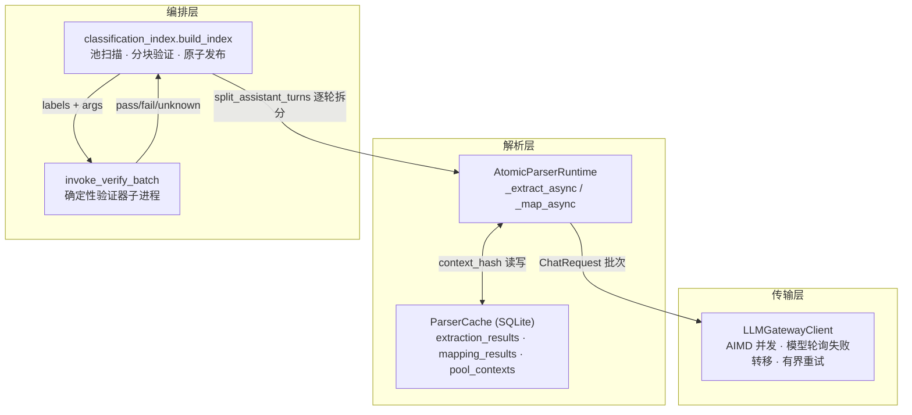
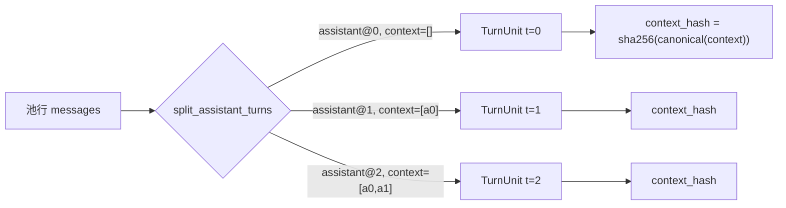
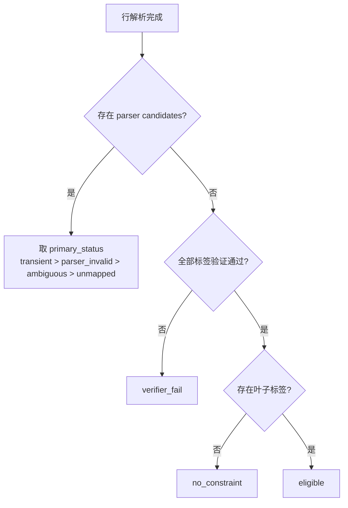
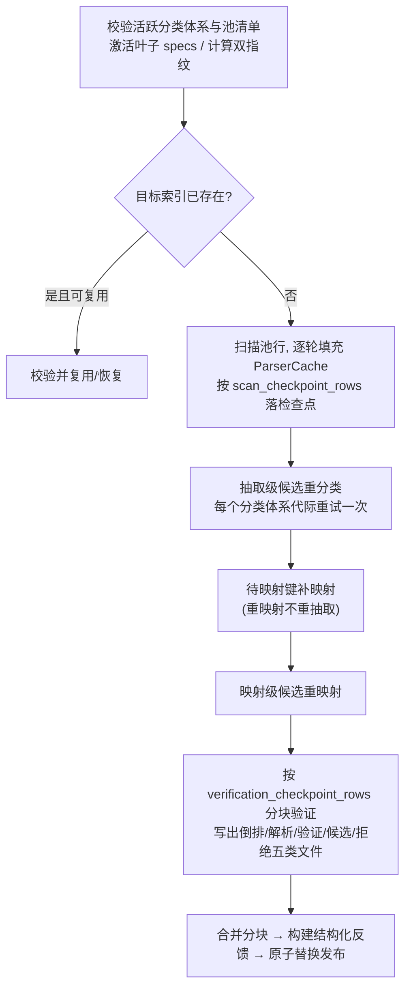

本页聚焦 AutoSFT 数据决策系统中的**分类索引构建子系统**：它如何借助 LLMGateway 网关把海量原始对话逐轮地拆分为"原子约束"，如何通过**两阶段解析**（抽取 + 映射）将语义稳定的约束与随分类体系演化的标签解耦，如何用**内容寻址**（`context_hash`）而非行号来缓存结果，以及最终如何通过**确定性的逐轮验证器**产出可被采样消费的版本固化索引。本页只讨论"从原始池到分类索引"这条链路，不涉及类目容量采样与训练配方（另见 [类目容量与整行采样](14-lei-mu-rong-liang-yu-zheng-xing-cai-yang-cap-pei-e-clip-and-drop-qian-tian-ce-lue-yu-san-lun-epoch-xun-lian-bu-shu-tui-dao)），也不涉及分类体系的冻结契约本身（另见 [分类体系设计契约](15-fen-lei-ti-xi-she-ji-qi-yue-taxonomy_contract-dong-jie-lei-mu-shu-yu-yi-yu-she-ji-shi-xian-fen-chi-yuan-ze)）。

> **📖 小白导读**
> - 这篇讲什么：分类索引构建链路——海量原始对话如何被逐轮拆成"原子约束"、打上分类标签、缓存复用、最终变成可供采样的固化索引。
> - 读之前先知道：**原子约束**＝对一条回答提出的可单独检验的要求（如"必须用英文回复"）；**两阶段解析**＝先抽取"说了什么约束"（与分类无关、可永久缓存），再映射"归哪个类目"（随体系变化、需重跑）——两步分开是省钱关键；**内容寻址（context_hash）**＝用对话内容的 SHA-256 哈希值当唯一 ID（哈希＝把任意内容算成固定长度指纹的算法），相同对话天然去重；**SQLite**＝一个文件就是一个数据库的轻量存储。
> - 读完你能明白：修订分类体系后为什么不用重新读全部对话；缓存怎么命中；验证器如何逐轮把关索引质量。
> - 提醒：本页是"深水区"文章，读不完不慌——记住"两阶段 + 内容寻址缓存"两个关键词即可先行。

## 架构概览：三模块分层与两条解耦轴

整个子系统由三个协作模块构成，形成清晰的分层：**传输层**（`llmgateway_client.py`）只负责与 OpenAI 兼容网关通信，刻意不含任何解析或验证语义；**解析层**（`atomic_parser.py`）负责两阶段标注与缓存；**编排层**（`classification_index.py`）负责池扫描、验证与发布。解析层的核心设计是引入两条正交的解耦轴——**"抽取 vs 映射"阶段轴**与**"内容寻址的缓存代际"轴**——使得修订分类体系时只需重跑简短且已缓存的约束文本映射，而无需重新读取每一个原始对话上下文。

这一套设计的直接收益在于：**分类体系是可重映射的**，而**原始对话只需解析一次**。`atomic_parser.py` 的模块文档字符串明确点出其意图——抽取阶段缓存"与分类体系无关、有证据支撑的约束描述"，映射阶段则选定一个活跃叶子或 `unmapped` 哨兵值并直接产出验证器参数，从而"让分类体系修订能够重映射简短的缓存约束，而不必重读每个原始对话上下文"。

Sources: [atomic_parser.py](src/control_plane/atomic_parser.py#L1-L8), [llmgateway_client.py](src/control_plane/llmgateway_client.py#L1-L7), [classification_index.py](src/control_plane/classification_index.py#L1-L2)

## LLMGateway 传输层：AIMD 并发、模型轮询与流式结果

传输层由 `LLMGatewayClient` 实现，它把"如何高效、稳定地调用 LLM"这一横切关注点与解析语义完全隔离。客户端从环境变量 `LLMGATEWAY_SYN_KEY` 读取密钥（缺失即抛错），可选地覆盖基础地址、模型列表（逗号分隔，支持多模型轮询）、`providerId`、推理档位 `reasoning_effort` 与思考开关 `enable_thinking`；其 `public_config` 属性以 `sha256:` 摘要形式暴露认证指纹，而不泄露明文密钥。

并发控制采用 **AIMD（加性增、乘性减，一种借鉴网络拥塞控制的自适应限流算法：顺畅时逐步放开并发，遇到失败立刻减半）** 限流器 `AdaptiveLimiter`：默认从 16 起步，范围钳制在 `[1, 88]`，每成功释放一次在满足最小增长间隔后加 1，遇到 429 或 5xx 响应、超时或传输错误时通过 `note_pushback` 将上限乘性衰减 0.5。核心调用 `_one_call` 在 `retries + 1` 次尝试内按轮询序切换模型，对 429/5xx 响应尊重 `retry-after` 头或退避 `min(2**attempt, 30)` 秒，对 400/401/403 等致命状态码则立即 `break` 不再重试。`run_batch` 则以固定大小的 worker 池消费请求队列，**边完成边 `yield` 结果**，无需物化全部响应——单个请求异常也不会杀死整个批次。

| 维度 | 设计选择 | 关键参数 |
|------|----------|----------|
| 并发模型 | AIMD 自适应限流 + 固定 worker 池 | `start=16, min_c=1, max_c=88, inc=1, dec=0.5` |
| 模型容错 | 多模型轮询失败转移 | `LLMGATEWAY_MODEL`（逗号分隔） |
| 重试策略 | 429/5xx 退避重试，4xx 致命即止 | `retries=3`, `min(2**attempt, 30)` |
| 结果交付 | 异步生成器流式产出 | `AsyncIterator[dict]` |
| 认证暴露 | 仅公开 sha256 指纹 | `auth_fingerprint` |

返回结构统一为 `{id, ok, contents, usage, attempts, latency, model}`，失败时则给出 `{id, ok: False, error, attempts, latency}`，这一约定化的结果形状正是上层解析器能够幂等地（幂等＝重复执行结果不变）按 `id`（即 `context_hash`）归并结果的前提。

Sources: [llmgateway_client.py](src/control_plane/llmgateway_client.py#L62-L121), [llmgateway_client.py](src/control_plane/llmgateway_client.py#L123-L184), [llmgateway_client.py](src/control_plane/llmgateway_client.py#L186-L266), [llmgateway_client.py](src/control_plane/llmgateway_client.py#L267-L335)

## 逐轮拆分与内容寻址键：为何以 context_hash 而非行号寻址

解析的基本单位不是"池行"，而是**每一个 assistant 消息**。`split_assistant_turns` 遍历一条池行的消息列表，凡遇到 `role == "assistant"` 便生成一个 `TurnUnit`，其 `context` 是该 assistant 消息**之前**的所有消息（`list(normalized)` 的快照），`completion` 为该消息内容，`turn_index` 是 assistant 轮次的序号。若一行没有 assistant 轮次则抛错。`TurnUnit` 被声明为冻结数据类（`@dataclass(frozen=True)`），携带 `pool_row_id, turn_index, message_index, context, completion, context_hash, query`。

寻址键 `context_hash` 由 `context_hash()` 计算：对 `context`（消息字典列表）做**规范 JSON 序列化**——`sort_keys=True, ensure_ascii=False, separators=(",", ":")`——再取 SHA-256 十六进制摘要。这一"规范化后哈希"的做法带来一项关键性质：**相同前缀的对话共享同一缓存键**，无论它们出现在池中的哪一行、第几个 assistant 轮次。因此缓存天然跨行、跨轮次去重。

以内容而非行号寻址的深层理由是**重映射的经济性**：分类体系修订后，只要抽取产物（`normalized_description` + `evidence`）仍在缓存中，就可以仅凭 `context_hash` 重新映射标签，无需在 `pool_contexts` 中保留原始上下文文本。缓存正是据此在抽取成功后**主动清空**已缓存的上下文文本。

Sources: [atomic_parser.py](src/control_plane/atomic_parser.py#L130-L159), [atomic_parser.py](src/control_plane/atomic_parser.py#L161-L199)

## 两阶段解析：税基无关的抽取与税基相关的映射

`AtomicParserRuntime` 是两阶段流程的核心调度器，构造时接收抽取提示词、映射提示词、活跃叶子规格 `specs`、缓存 `cache` 以及可注入的 `client_factory`（默认即 `LLMGatewayClient`，便于测试替换）。其公开入口 `classify_contexts` 组合调用 `_extract_async` 与 `_map_async`，分别对应两个阶段。

**第一阶段——约束抽取（taxonomy-independent）**：请求消息由固定系统提示词加一条用户消息构成，用户消息是 `{"conversation_context": context}` 的规范 JSON。模型需返回仅含 `atomic_constraints` 与 `unresolved_constraints` 两个键的对象。每个原子约束必须是带证据的 `normalized_description`（非空字符串）+ `evidence`；每个未解决约束带 `status`（`ambiguous` / `invalid`）、`reason` 与证据。`parse_extraction_response` 会校验证据跨度，并为每条约束派生稳定的 `constraint_id = "ac_" + sha256(canonical(base))[:20]`，同时按规范 JSON 去重。抽取状态由 `_extraction_status` 归一为 `ok` / `partial` / `no_constraint` / `ambiguous` / `invalid`。

**第二阶段——分类映射（taxonomy-dependent）**：请求消息为映射提示词 + `{"atomic_constraints": mapper_constraints}`（去掉 `constraint_id` 后的约束）。响应必须是仅含 `constraint_mappings` 的对象，每一项带 `constraint_index`、`status`（`mapped` / `unmapped` 闭集）、`category_id`、`args`、`reason`。`parse_mapping_response` 的容错哲学是"**在坏决策旁保留好决策**"：重复或畸形的决策被标记为 `parser_invalid` 而非整体失败；对 `mapped` 项逐一做 JSON Schema 校验并执行**接地校验**（`_ungrounded_arg_paths`），确保 mapper 给出的 `args` 值在规范化描述中确有字面依据，否则判为 `parser_invalid`。

| 阶段 | 输入 | 输出核心字段 | 缓存表 | 依赖分类体系 |
|------|------|--------------|--------|:---:|
| 抽取 | `{conversation_context}` | `normalized_description`, `evidence` | `extraction_results` | 否 |
| 映射 | `{atomic_constraints}` | `labels`（`category_id`+`args`）, `candidates` | `mapping_results` | 是 |

两阶段的最终状态由 `_final_mapping_status` 综合 `labels` 与 `candidates` 得出：有标签有候选为 `partial`，仅标签为 `mapped`，无候选为 `no_constraint`，否则按 `transient` → `parser_invalid` → `invalid` → `ambiguous` → `unmapped` 的优先级取最可操作的状态。

Sources: [atomic_parser.py](src/control_plane/atomic_parser.py#L2295-L2378), [atomic_parser.py](src/control_plane/atomic_parser.py#L775-L891), [atomic_parser.py](src/control_plane/atomic_parser.py#L1260-L1505), [atomic_parser.py](src/control_plane/atomic_parser.py#L1232-L1257)

## 接地校验：让映射参数有据可依

映射阶段的质量闸门是 `_ungrounded_arg_paths`，它对 `args` 中的每个值做递归校验，确认其可在约束的 `normalized_description` 中找到字面依据。字符串按"完整字面量"（永不匹配更长 token 的子串）搜索，支持反引号与单引号包裹形式；枚举值额外允许下划线/连字符归一后的短语匹配；布尔值仅对 `case_sensitive` 有意义，通过一组正反短语识别；整数/浮点数接受数字或英文基数/序数词形（`_integer_word_forms` 覆盖 0–100 的拼写形式）。此外还校验 `prefix`/`suffix` 的语义线索、以及 `min/max` 上下界的一致性。凡不接地的参数路径都会被收集并在映射候选上标记为 `parser_invalid`，附上具体未接地的路径列表。

这一层"抽取保证字面保真、映射不得凭空生成参数"的约束，是把 LLM 自由生成转化为**可验证断言**的关键。正如模块内注释所强调的——抽取器被要求精确保留字面值，"不要因为 mapper 选择的 `case_sensitive` 标志而削弱接地校验"。

Sources: [atomic_parser.py](src/control_plane/atomic_parser.py#L1016-L1230)

## ParserCache：SQLite 内容寻址缓存与缓存代际

`ParserCache` 实现内容和 SQLite 双层持久化。**内容层**是四个仅追加的 JSONL 流（`extraction.raw.stream.jsonl` / `extraction.parsed.jsonl` / `mappings/<fp>/raw.stream.jsonl` / `parsed.jsonl`），用于崩溃恢复；**数据库层**是 `cache.sqlite3`，以 WAL 模式与 `synchronous=NORMAL` 打开，含四张表：

| 表 | 主键 | 用途 |
|----|------|------|
| `extraction_results` | `context_hash` | 抽取阶段的约束与未解决项 |
| `mapping_results` | `(mapping_fingerprint, context_hash)` | 映射阶段的标签与候选 |
| `pool_contexts` | `context_hash` | 首次发现的上下文文本（抽取后退化为空串） |
| `metadata` | `key` | 扫描断点、抽取指纹等 |

缓存代际（`review_generation`）是重试语义的核心：`has_extraction` / `has_mapping` 只在记录**非可重试**或**代际等于当前 `review_generation`** 时才判定为命中，从而使"同一分类体系下已重试过"的失败项不会被无限重复。值得注意的是 `mapping_results` 的主键包含 `mapping_fingerprint`，这意味着**同一份抽取产物可以并存多个分类体系代际的映射结果**——这正是"重映射不重抽取"得以在存储层落地的机制。

缓存还提供可重试项的枚举（`retryable_pool_contexts`、`retryable_mapping_keys`）、审核候选枚举（`mapping_candidate_keys_for_review`）、状态计数、以及用于一致性校验的 `content_fingerprint`（对所有结果行做规范 JSON 摘要）。`cached_pool_context_count` 与 `pending_mapping_keys` 这类 JOIN 查询，为"已抽取但未映射"的场景提供了精确的工作集。

Sources: [atomic_parser.py](src/control_plane/atomic_parser.py#L1572-L1680), [atomic_parser.py](src/control_plane/atomic_parser.py#L1699-L1772), [atomic_parser.py](src/control_plane/atomic_parser.py#L2036-L2110), [atomic_parser.py](src/control_plane/atomic_parser.py#L2234-L2275)

## 指纹体系：把"提示词 + 模式 + 模型 + 采样"绑定为一个身份

两阶段各自有一个**内容指纹**，把决定输出的全部因素编码进一个 SHA-256：抽取指纹 `extraction_fingerprint` 绑定抽取提示词、抽取输出 schema、`public_model_config` 与固定的 `temperature=0.0, n=1`；映射指纹 `mapping_fingerprint` 则绑定映射提示词、叶子规格（`description` / `mapping_rules` / `args_schema`）、模型配置与相同的采样常数。`parser_fingerprint` 被保留为映射指纹的兼容别名。

这些指纹承担"缓存分区键"与"身份校验"双重职责：一方面它是磁盘布局的路径组件（`data_pool/parser_cache/<pool_hash[:16]>/<extraction_hash>/mappings/<mapping_hash>/`），另一方面在打开已有缓存时，`ParserCache` 会校验存储的 `extraction_fingerprint` 与请求值一致，不一致即抛 `extraction cache fingerprint mismatch`。这保证了**任何提示词、schema 或模型配置的变动都会自动隔离到新的缓存命名空间**，绝不会错误复用旧标注。

Sources: [atomic_parser.py](src/control_plane/atomic_parser.py#L596-L648), [classification_index.py](src/control_plane/classification_index.py#L1830-L1844)

## 容错与修复：初次批次 + 单轮修复 + 传输级熔断

`_extract_async` 与 `_map_async` 共享同一套健壮性范式。它们先尝试从追加的原始流中**恢复**未入缓存的成功响应（`_recover_extractions` / `_recover_mappings`），随后仅对真正缺失的键发起批量调用。对每个返回结果严格检查 id 是否未知、是否重复（未知或重复 id 直接抛出 `AtomicParserError`），随后尝试解析：解析成功的落缓存，解析失败的进入 `malformed` 集合并触发**一轮修复**（`_repair_extractions` / `_repair_mappings`）。修复请求把原始响应与一句"上一次违反了 JSON 契约：…，请仅返回一个修正后的裸 JSON 对象"追加进消息，要求模型自纠。

若干熔断规则保证失败可控而非无限重试：若**全部请求传输失败**（`successful_transport == 0`），释放本代审核并抛出聚合错误；若遇到 `_fatal_transport_error` 认定的致命错误（400/401/403、认证失败、无效 API Key），立即释放并抛出系统级错误；若"修复后仍全部违规且初次批次无任何有效响应"，同样释放并抛出 `all ... responses violated the schema after repair`。而单个请求的普通失败只被记为 `retryable=True` 的 `transient` 候选，留给后续分类运行重试——**本次运行绝不进入无界重试循环**。

Sources: [atomic_parser.py](src/control_plane/atomic_parser.py#L2379-L2484), [atomic_parser.py](src/control_plane/atomic_parser.py#L2486-L2606), [atomic_parser.py](src/control_plane/atomic_parser.py#L2682-L2940), [atomic_parser.py](src/control_plane/atomic_parser.py#L2278-L2292)

## 逐轮验证：行接纳状态机

编排层 `_flush_verified_batch` 是"逐轮验证"的落地点。它对一批池行先按 `split_assistant_turns` 拆分，再从缓存读取每轮的映射记录（`labels` + `candidates` + `status`）。所有 `mapped` 标签被聚合为按 `verifier_id` 分组的**验证边**（携带 `completion`、`params`、`query`），随后对每个验证器批量调用 `invoke_verify_batch` 执行确定性验证（子进程隔离、超时受控，详见 [验证器沙箱运行时](16-yan-zheng-qi-sha-xiang-yun-xing-shi-allowed_imports-bai-ming-dan-cpu-miao-xian-zhi-yu-chi-xian-que-ding-xing-zhi-xing)）。

每行最终归入一个 `row_status`，其判定遵循固定的优先级：

只有 `eligible` 与 `no_constraint` 两态被**接纳**（`admitted`）；`eligible` 行还须把其叶子类目及其全部祖先类目写入倒排表（`_ancestor_ids` 帮助类目树向上传播，来源标注为 `verified_leaf` 或 `derived_parent`）。行级状态进而驱动一系列全局统计（`accepted_rows` / `excluded_rows` / `classified_rows` / `multi_label_rows` 等），并分别写出 `parser_labels.jsonl`（逐轮解析明细）、`verification.jsonl`（逐轮验证裁决）、`inverted.jsonl`（接纳行与类目集合）、`candidate_pool.jsonl`（有候选的行）与 `rejected.jsonl`（验证出错的行）。

Sources: [classification_index.py](src/control_plane/classification_index.py#L1303-L1456), [classification_index.py](src/control_plane/classification_index.py#L1457-L1618), [classification_index.py](src/control_plane/classification_index.py#L1260-L1296)

## 分类索引构建流水线：分块、检查点与原子发布

顶层 `build_index` 在获取版本级文件锁（`_classification_build_lock`，基于 `fcntl` 的排他非阻塞锁）后进入 `_build_index_unlocked`。构建流程分为若干阶段，每一步都可断点续跑：

几个关键设计点：池扫描严格校验 `pool_row_id` 的**连续性**，一旦断裂即抛错；`_populate_parser_cache` 在抽取成功后**不保留**上下文文本（`retain_context=not extraction_cached`），仅在需要时才回填，从而控制磁盘占用。验证阶段采用与解析扫描解耦的独立检查点（`verification_checkpoint_rows`），每块写入临时 `.building-*` 目录、校验行数匹配后以 `os.replace` **原子替换**为正式分块目录，最后把所有分块顺序拼接为最终索引并以原子替换发布——确保任何中途崩溃都不会留下半成品索引。

发布时固化一份 `manifest.json`（schema 版本 3.0），完整记录 `pool_sha256`、`taxonomy_version` / `taxonomy_content_fingerprint`、双指纹、提示词与 schema 的 sha256、验证器源码哈希、验证器超时、`category_files` 映射以及全部累计统计。

Sources: [classification_index.py](src/control_plane/classification_index.py#L1066-L1257), [classification_index.py](src/control_plane/classification_index.py#L650-L784), [classification_index.py](src/control_plane/classification_index.py#L1621-L1790), [classification_index.py](src/control_plane/classification_index.py#L2317-L2369), [classification_index.py](src/control_plane/classification_index.py#L2163-L2224)

## 倒排索引与内容寻址的物理形态

最终索引的核心产物是**每个活跃类目一个 `.u32` 文件**，由 `_category_filename` 命名（可读前缀 + `sha256(category_id)[:10]` 摘要，防冲突）。每个文件是 `pool_row_id` 的定长小端 `uint32` 数组（`ROW_ID_STRUCT = struct.Struct("<I")`），按行顺序追加。`read_category_ids` 以整除校验文件长度后逐项解包，同时 `_validated_existing_index` 会核对每个类目文件大小恰为 `count * 4` 字节。这一"定长数组 + manifest 计数"的紧凑格式，使得读取某类目的所有行 id 只需一次 `read_bytes` + 切片解包。

正是在这里，"内容寻址"与"行号倒排"完成了闭环：解析层用 `context_hash` 做去重缓存，编排层则把每个被接纳的行 id 广播到它命中的所有类目（含祖先）——同一个共享上下文的对话，其不同轮次可分别贡献给不同类目，而相同前缀的轮次在同一缓存槽位只被模型处理一次。

Sources: [classification_index.py](src/control_plane/classification_index.py#L46-L47), [classification_index.py](src/control_plane/classification_index.py#L117-L121), [classification_index.py](src/control_plane/classification_index.py#L2372-L2386), [classification_index.py](src/control_plane/classification_index.py#L971-L1001)

## 结构化反馈：把标注失败转化为可行动信号

每次发布都会生成侧车文件 `taxonomy_feedback.json`（`_build_taxonomy_feedback`），把候选证据分门别类为四个桶：`taxonomy_gaps`（`unmapped`，暗示类目覆盖不足）、`parser_quality_issues`（`parser_invalid` / `invalid`，解析质量问题）、`transient_failures`（`transient`，运行时/服务故障）、`ambiguous_constraints`（`ambiguous`）。为在有限内存下统计高频原因，它使用有界重击者算法 `_BoundedHeavyHitters`（容量 2048）追踪 `(status, 归一化原因)` 组合与 `normalized_description` 分布，并对原因做索引归一化（`_feedback_reason_key` 把 `atomic_constraints[3]` 之类替换成 `atomic_constraints[*]`）。

反馈文件在结构上被 `taxonomy_feedback_validation_errors` 严格校验其谱系一致性：必须与 manifest 的 `taxonomy_id`、`taxonomy_version`、内容指纹、`pool_sha256`、双指纹以及 `classification_manifest_path` 完全对齐，且 `scope.complete_classification_index` 必须为真。反馈还附带了 `limitations` 声明，强调**"频率本身不足以支撑一个新类目，需有精确语义边界与确定性验证器"**——这是防止把统计噪声误当作类目缺口的关键护栏。生成器据此产出 `recommended_actions`，把每种失败映射到明确的责任方（taxonomy / parser / runner_or_infrastructure）。

Sources: [classification_index.py](src/control_plane/classification_index.py#L224-L293), [classification_index.py](src/control_plane/classification_index.py#L296-L581), [classification_index.py](src/control_plane/classification_index.py#L127-L198)

## 兼容性与演进：从直接标注到两阶段

代码保留了大量兼容别名，清晰反映了该子系统的演进轨迹。旧版"直接标注"格式（`constraint_validation` 一次性给出 `category_id` + `args` + 证据）仍由 `parse_parser_response` 支持，仅用于兼容工具；命中旧式 IR 字段（`kind` / `target` / `operator` / `relation` / `parameters`）的约束走 `project_args` 的确定性投影路径而非直接采用模型参数（并在参数不符时判 `parser_invalid`）。`PARSER_OUTPUT_SCHEMA_VERSION` 是 `MAPPING_OUTPUT_SCHEMA_VERSION` 的别名；`parser_fingerprint` 是 `mapping_fingerprint` 的别名；缓存中 `has` / `get` / `append_raw` 均指向映射阶段。这些别名共同保证：**从"单次直接标注"迁移到"抽取 + 映射"两阶段时，调用方与既有缓存无需同步重构**。

| 旧概念 | 新实现 | 兼容处理 |
|--------|--------|----------|
| 单次直接标注（`parser`） | 抽取 + 映射两阶段 | `parse_parser_response` 保留为兼容工具 |
| `parser_fingerprint` | `mapping_fingerprint` | 别名函数 |
| `PARSER_OUTPUT_SCHEMA_VERSION` | `MAPPING_OUTPUT_SCHEMA_VERSION` | 公共别名常量 |
| 旧式 IR 约束 | `args_projection` 确定性投影 | 保留兼容回放路径 |
| 单一缓存表 | `extraction_results` + `mapping_results` | `has`/`get`/`append_raw` 指向映射表 |

Sources: [atomic_parser.py](src/control_plane/atomic_parser.py#L28-L34), [atomic_parser.py](src/control_plane/atomic_parser.py#L641-L648), [atomic_parser.py](src/control_plane/atomic_parser.py#L1508-L1569), [atomic_parser.py](src/control_plane/atomic_parser.py#L894-L945), [atomic_parser.py](src/control_plane/atomic_parser.py#L1756-L1890)

## 下一步阅读

本页描述的索引是数据决策链的"供给侧产物"。以此为起点，建议继续阅读：索引如何被消费为**配额采样**——见 [类目容量与整行采样](14-lei-mu-rong-liang-yu-zheng-xing-cai-yang-cap-pei-e-clip-and-drop-qian-tian-ce-lue-yu-san-lun-epoch-xun-lian-bu-shu-tui-dao)；验证器如何在**沙箱**中确定性执行——见 [验证器沙箱运行时](16-yan-zheng-qi-sha-xiang-yun-xing-shi-allowed_imports-bai-ming-dan-cpu-miao-xian-zhi-yu-chi-xian-que-ding-xing-zhi-xing)；分类体系契约如何在索引发布前被冻结与门禁——见 [发布门禁流水线](17-fa-bu-men-jin-liu-shui-xian-freeze-contract-validate-bundle-preflight-bundle-yu-yuan-zi-fa-bu) 与 [分类体系设计契约](15-fen-lei-ti-xi-she-ji-qi-yue-taxonomy_contract-dong-jie-lei-mu-shu-yu-yi-yu-she-ji-shi-xian-fen-chi-yuan-ze)。