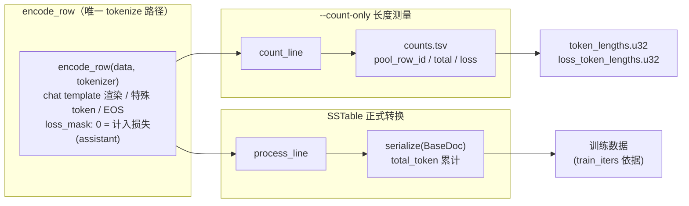
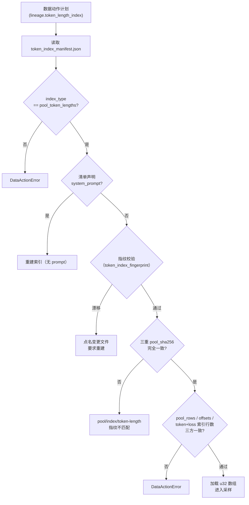

令牌长度索引（token-length index）是 AutoSFT 数据闭环中把"**按行数规划**"升级为"**按令牌预算规划**"的基础设施。整个系统围绕一个核心不变量构建：**索引对每一行测出的令牌数，必须与 SSTable 转换器随后在训练数据准备阶段报出的令牌数逐行相等**。这条不变量由三重机制保障——同源计数路径（一条共享的 `encode_row`）、运行时指纹绑定（把索引与 tokenizer 资产和转换器逐文件哈希绑定）、以及贯穿构建、采样、物化、提交四个阶段的预算一致性校验。本文面向中级开发者，深入解析这套机制的设计动机、实现细节与失败模式。

> **📖 小白导读**
> - 这篇讲什么：令牌长度索引——把训练数据规划从"数行数"升级为"数 token"的计量设施，及其"索引计数＝训练实报"的不变量保障。
> - 读之前先知道：**token（令牌）**＝模型读写的最小文本单位（一个汉字或半个英文单词）；**tokenizer**＝把文本换算成 token 序号的"字典"程序，不同 tokenizer 对同一句话数出的 token 数不同；**SSTable**＝训练引擎消费的按键排序的键值文件格式；**指纹（fingerprint）**＝对文件内容算出的哈希摘要，用来确认"两边用的是同一份东西"。
> - 读完你能明白：为什么"1000 行"不等于"1000 行"（行长差异巨大）；预算校验在构建/采样/物化/提交四个阶段分别卡什么；指纹绑定怎么防止"索引与转换器版本错配"。
> - 提醒：本页的公式不多但逻辑链长，建议配合第 19 页（训练步数推导）一起看。

## 为什么需要令牌长度索引：从行数到 TOKEN 上限

启动器（launcher）为每轮 SFT 训练设定的是一个**令牌预算上限**（token cap），而不是行数。若采样器只能按行数规划，就会因为不同行长度差异巨大（实际池中最长行约 40k token，而短行可能只有几十个）导致每轮真实训练量剧烈波动，跨轮实验比较因此失去意义。令牌长度索引的职责是：让采样器在**不逐行 tokenize、不截断任何行**的前提下，按令牌预算选择整行数据，并保证预算规划所用的"尺度"与转换器最终产出的 `total_token` 完全一致 [tools/local_baseline/build_token_length_index.py](tools/local_baseline/build_token_length_index.py#L1-L27)。

索引按 (pool, tokenizer, chat template) 三元组只构建一次——池本身不可变且带指纹，令牌长度与分类体系（taxonomy）无关，因此后续每一轮都直接复用同一份索引。这个"一次构建、多轮复用"的设计正是指纹校验存在的原因：索引与输入资产之间的绑定关系必须能在任意后续轮次被重新验证 [tools/local_baseline/build_token_length_index.py](tools/local_baseline/build_token_length_index.py#L12-L14)。

## 同源计数路径：一条 encode_row，两条出口

整个机制的核心在 `tools/sstable/trans_sstable_v2.py` 中。`encode_row` 是唯一把一行已解析数据编码成 `(tokens, loss_mask)` 的函数，它处理 input/output 文本对与 messages（ChatML）两种格式，负责 apply_chat_template 渲染、特殊 token 添加、EOS 追加以及 assistant 段落定位。其文档字符串明确声明了设计契约：**SSTable 转换与 `--count-only` 长度统计共用这一条 tokenize 路径，因此索引测出的长度与后续转换报出的 `total_token` 逐行相等** [tools/sstable/trans_sstable_v2.py](tools/sstable/trans_sstable_v2.py#L56-L63)。

两个出口的差异只在**产出物**，不在**计量**：`count_line` 返回 `(pool_row_id, total_tokens, loss_tokens)` 三元组，其中 `loss_tokens` 统计 `mask == 0` 的 token（即 assistant 段），行号取自输入行自带的 `pool_row_id` 字段而非物理顺序，保证索引按稳定行 ID 对齐 [tools/sstable/trans_sstable_v2.py](tools/sstable/trans_sstable_v2.py#L216-L235)；`process_line` 则把同一份 `(tokens, loss_mask)` 序列化为 thrift 文档并累计 `total_token` [tools/sstable/trans_sstable_v2.py](tools/sstable/trans_sstable_v2.py#L191-L213)。

loss_mask 的极性约定值得特别注意：SSTable 侧 **0 表示计入损失**，1 表示不计入；Megatron 批处理打包器后续取 `~mask` 再翻转。计数侧若搞反极性，会静默反转所有 loss 密度诊断——测试套件专门断言 `count_line` 函数体包含 `if m == 0` 来钉死这一语义 [tests/test_token_budget.py](tests/test_token_budget.py#L120-L134)。

`--count-only` 模式由 `run_count_only` 驱动，它**流式**读取输入（池约 1.5GB，`readlines()` 不可行），跳过转换器会跳过的行，把结果写入 `.partial` 临时文件后原子重命名，并在结束时镜像转换器的 `total_token N` 输出行格式，供调用方交叉核对 [tools/sstable/trans_sstable_v2.py](tools/sstable/trans_sstable_v2.py#L299-L324)、[tools/sstable/trans_sstable_v2.py](tools/sstable/trans_sstable_v2.py#L350-L400)。CLI 层强制要求 `--count-only` 与 `--count-output` 成对出现，且此时不需要输出 SSTable 路径 [tools/sstable/trans_sstable_v2.py](tools/sstable/trans_sstable_v2.py#L299-L315)。

## 索引构建流水线：流式测量、对账与原子发布

构建入口 `build_token_length_index.py` 以子进程方式调用转换器，并把构建过程设计为一连串**发布前对账**。它先验证池清单的类型（必须是 `unclassified_messages`）与行数声明和 `offsets.u64` 实际条目数一致，然后在输出目录旁创建带 UUID 的 staging 目录启动测量 [tools/local_baseline/build_token_length_index.py](tools/local_baseline/build_token_length_index.py#L119-L166)。

构建器流式读取转换器 stdout，解析 `count_rows`、`count_loss_token`、`total_token` 三个键值 [tools/local_baseline/build_token_length_index.py](tools/local_baseline/build_token_length_index.py#L175-L186)。由于行按 `pool_row_id` 寻址，转换器跳过的行会在平铺数组中留下空洞——空洞记录为 0 并在清单中报告，而 0 长度的行**永远不会被采样器选中** [tools/local_baseline/build_token_length_index.py](tools/local_baseline/build_token_length_index.py#L188-L211)。

发布前有两条硬性对账，任一失败即拒绝发布：

- **行数对账**：转换器报告的 `count_rows` 必须等于构建器实际解析入数组的行数 [tools/local_baseline/build_token_length_index.py](tools/local_baseline/build_token_length_index.py#L213-L218)。
- **总量对账**：转换器报告的 `total_token` 必须等于索引数组元素之和，否则报出 "refusing to publish a mismatched index" [tools/local_baseline/build_token_length_index.py](tools/local_baseline/build_token_length_index.py#L261-L265)。

对账通过后，三个产物（`token_lengths.u32`、`loss_token_lengths.u32`、`token_index_manifest.json`）在 staging 目录中就绪，再通过 `os.replace` 逐个原子移入目标位置，staging 目录最终清理。任何中途失败都不会留下半成品索引 [tools/local_baseline/build_token_length_index.py](tools/local_baseline/build_token_length_index.py#L266-L290)。重复构建受 `--overwrite` 保护：目标处已存在清单时直接退出 [tools/local_baseline/build_token_length_index.py](tools/local_baseline/build_token_length_index.py#L142-L145)。

## 二进制布局：与 offsets.u64 平行的 u32 数组

索引的物理布局在 `pool_io.py` 中定义：一个**每行一个 `<u32`（小端 4 字节）的平铺数组**，与池的 `offsets.u64`（每行一个 `<Q`，8 字节偏移）严格平行——条目 i 就是池行 i 的令牌化长度。`token_length_count` 通过文件大小整除性校验拒绝截断文件，`append_token_length` 拒绝超出 u32 范围的值（实测最长行约 40k，头部空间充足），`read_token_length` 支持按行号 O(1) 随机寻址 [src/control_plane/pool_io.py](src/control_plane/pool_io.py#L120-L148)。

采样器实际使用 `load_token_lengths` 一次性把整个数组载入内存为 `array("I")`（而非 Python list）：698k 行仅约 2.8MB，一次读取避免了逐行 seek 的开销 [src/control_plane/pool_io.py](src/control_plane/pool_io.py#L151-L160)。测试套件验证了布局契约——3 行索引文件必须恰好 12 字节——以及负行号、越界行号、截断文件、超 u32 值四类拒绝行为 [tests/test_token_budget.py](tests/test_token_budget.py#L40-L88)。

## 运行时指纹：把索引绑定到它的每一个输入

令牌数只有在**确切的 tokenizer 资产与转换器实现**之下才有意义。`src/control_plane/token_index.py` 是构建端与所有运行时消费端共用的确定性指纹实现，它对每一个可能改变 `encode_row` 长度的输入逐文件做 SHA-256：

| 指纹输入 | 覆盖内容 | 为何必须绑定 |
|---|---|---|
| `tokenizer/vocab/versions.json` | 版本注册表 | 决定选用哪套词表 |
| 所选 vocab 目录内所有非 README 文件 | `tokenizer.json`、merge/vocab 表、`tokenizer_config.json`（含内嵌 chat template）、特殊 token 配置 | chat template 或词表变化直接改变每行长度 |
| `tokenizer/tokenizer_py/` 下全部 `*.py` | tokenizer 实现模块 | 实现行为（如 EOS 处理）影响编码 |
| `trans_sstable_v2.py` | 转换器/计数器本体 | `encode_row` 任何改动都改变计量 |

计算细节上，指纹从 `versions.json` 读取所选 tokenizer 的 `vocab_path`（注意其相对 `tokenizer/` 解析而非 `tokenizer/vocab/`，当前注册值形如 `vocab/qwen3`），并做目录包含性检查防止逃逸；结果不是单个不透明摘要，而是**路径到哈希的映射**——这让"索引过期"错误能直接点名变化的文件，而非只说"不匹配" [src/control_plane/token_index.py](src/control_plane/token_index.py#L86-L156)。

校验端 `validate_token_index_fingerprint` 重算指纹并与清单记录逐项比较：tokenizer 版本必须与运行时一致（若运行时显式声明），记录的指纹必须存在且格式合法，任何文件哈希漂移都会抛出带变更文件列表（最多列 8 个）的 `TokenIndexFingerprintError`，要求重建索引 [src/control_plane/token_index.py](src/control_plane/token_index.py#L159-L214)。转换器 checkout 的解析同样确定化：优先显式参数，其次 `AUTO_SFT_SSTABLE_CODE_DIR` 环境变量，兜底本仓库 `tools/sstable`，保证构建端与消费端指向同一实现 [src/control_plane/token_index.py](src/control_plane/token_index.py#L49-L61)。

**system_prompt 是一个特判维度**：索引构建时配方（recipe）的 system prompt 尚未确定，因此索引总是**无 system prompt** 测量。清单中显式记录 `system_prompt: None` / `system_prompt_sha256: None`，而校验函数采取保守策略——清单中只要**存在**（哪怕是空的或畸形的）prompt 字段或哈希，就视为 prompt 依赖，防止手工编辑或旧版清单在不同 chat-template 输入下静默复用长度 [src/control_plane/token_index.py](src/control_plane/token_index.py#L21-L33)、[tools/local_baseline/build_token_length_index.py](tools/local_baseline/build_token_length_index.py#L243-L247)。测试验证了这一保守声明语义，以及"篡改 `encode_row` 后指纹校验必然失败"的漂移检测 [tests/test_token_index_fingerprint.py](tests/test_token_index_fingerprint.py#L38-L67)。

## 消费端校验链：Data Action Runner 的发布门禁

`data_action.py` 的 `validate_plan` 阶段构建了一条多层门禁链，令牌索引处于其中的核心位置：

具体检查依次为：索引类型必须为 `pool_token_lengths`；清单不得声明 system prompt；指纹重算通过（并强制与 `AUTO_SFT_SFT_TOKENIZER` 环境声明的运行时 tokenizer 一致）；**池清单、分类索引清单、令牌索引清单三者的 `pool_sha256` 必须完全相同**；`pool_rows` 声明、`offsets.u64` 实际条目数、令牌长度数组与 loss 长度数组四者行数必须全部一致 [src/control_plane/data_action.py](src/control_plane/data_action.py#L503-L615)。执行阶段（`apply_plan`）会**再次**验证指纹——计划校验与实际执行之间任何资产漂移都会被拦截 [src/control_plane/data_action.py](src/control_plane/data_action.py#L1750-L1764)。

配方物化路径（`recipe_data.py`）在消费 token-fraction 采样清单时执行**第四道**等价校验：清单必须声明 `token_length_index`、索引类型正确、配方的 `system_prompt` 与索引的 prompt 声明互斥（两方向都拒绝）、采样清单与令牌索引的 `pool_sha256` 一致、指纹重算通过，随后把 `token_index_tokenizer` 与完整指纹映射透传进数据集清单供下游追溯 [src/control_plane/recipe_data.py](src/control_plane/recipe_data.py#L298-L367)。

## 采样原语：整行装箱与精确预算切分

`src/control_plane/sampler_core.py` 提供两个共享原语，旧本地采样器与 Data Action Runner 共用同一实现以防止 cap 语义漂移 [src/control_plane/sampler_core.py](src/control_plane/sampler_core.py#L1-L7)。

**`split_token_budget`** 把总预算按类目权重切分为**和恰好等于预算**的名额。它用 `Fraction` 精确有理数运算做最大余数法取整——直接 `budget * weight` 的浮点乘法在超大批次整数下会溢出或丢失低位 token；测试验证了 7 个类目分 100 token 得 `[14×5, 15×2]`、未归一化权重 7:3 得 700:300、乃至 `10^100` 级预算的精确对半分 [src/control_plane/sampler_core.py](src/control_plane/sampler_core.py#L21-L90)、[tests/test_token_budget.py](tests/test_token_budget.py#L177-L222)。

**`fill_token_quota`** 在候选行集合上做**整行装箱**：行要么整行取、要么整行跳过，永不截断、永不超预算。它的停止规则使用**全局最短可用行长度**（先完整扫描一遍求出），而非"当前遇到的最短行"——后者会在洗牌早期抽到长行时提前终止扫描，遗漏后面 42/80 token 的短行；跳过行之后还有一次 best-fit 补偿：在剩余预算内挑能放下的最大跳过行再试一次。0 长度行（构建时的空洞）直接跳过 [src/control_plane/sampler_core.py](src/control_plane/sampler_core.py#L93-L168)、[tests/test_token_budget.py](tests/test_token_budget.py#L225-L279)。

Runner 在调用 `fill_token_quota` 前为每个类目记录 `available_token_capacity`（该类目全部可用行长度之和，含钉住的 replay 行），采样后累计 `returned_tokens` / `returned_loss_tokens`，最终把每行的 `total_tokens` / `loss_tokens` 写入行级血缘清单 [src/control_plane/data_action.py](src/control_plane/data_action.py#L1865-L1908)、[src/control_plane/data_action.py](src/control_plane/data_action.py#L2157-L2177)。

## 动态重写行的长度修正：同源复测

数据动作中的 rewrite 类操作会改写行的 assistant 内容，这使索引中该行的长度失效。Runner 的处理方式与"同源路径"哲学完全一致：`_count_rewritten_rows` 把重写后的行写入临时 JSONL（JSONL＝每行一个 JSON 对象的文本格式），**用同一个转换器、同一条 `--count-only` 路径**重新测量，然后直接就地打补丁到已加载的长度数组上（`total_lengths[row_id] = total`）[src/control_plane/data_action.py](src/control_plane/data_action.py#L1196-L1258)、[src/control_plane/data_action.py](src/control_plane/data_action.py#L1786-L1788)。这意味着无论数据如何被智能体动作改写，采样与物化使用的长度永远出自同一条计量路径。

## 预算一致性闭环：从环境变量到提交前门禁

令牌预算的权威属于**启动器**，不属于配方或智能体。`set_env_vars.sh` 强制要求 `AUTO_SFT_SFT_TOKEN_BUDGET` 由启动方以正整数形式提供，否则直接退出；注释明确"智能体可以读取但绝不能编写或覆盖" [src/commit_utils/set_env_vars.sh](src/commit_utils/set_env_vars.sh#L32-L57)。`resolve_token_budget` 落实这一所有权：配方中若 restatement 了预算则必须与环境值相等，命名一个不同的 cap 会被拒绝而非静默采纳 [src/control_plane/recipe_data.py](src/control_plane/recipe_data.py#L773-L814)。策略守卫（policy_guard）进一步把 `AUTO_SFT_SFT_TOKEN_BUDGET` 列为训练参数保护变量，智能体任何 `VAR=999 python ...` 形式的覆盖尝试都会被审计拦截 [tests/test_token_budget.py](tests/test_token_budget.py#L441-L458)。

预算化的轮次还必须物化为**恰好一个数据集条目**——`total_tokens` 是跨条目的普通求和，而 Megatron 按 `weight` 混合，多条目下"一个 epoch 意味着什么"不再跟随预算 [src/control_plane/recipe_data.py](src/control_plane/recipe_data.py#L215-L227)。SSTable 转换阶段流式解析转换器打印的 `total_token N` 并持久化为 `total_token.txt`（即使 SSTable 后续被复用，train-iters 依然可算）[src/control_plane/recipe_data.py](src/control_plane/recipe_data.py#L677-L741)。

`verify_token_budget` 在**任何 GPU 作业提交之前**运行：它读取 `runtime_tokens_per_iter()`（全局批 × 序列长，默认 16 × 32768 = 524,288 token/步）推算 `planned_iters_per_epoch` 与 `realized_iters_per_epoch`，把核算对象（预算、实收、偏差、未用预算、利用率、每步 token、两个 iters 指标）写回清单；clip-and-drop 语义下实收低于上限是合法的（记录为未用预算），**唯一被拒绝的是超上限** [src/control_plane/recipe_data.py](src/control_plane/recipe_data.py#L744-L770)、[src/control_plane/recipe_data.py](src/control_plane/recipe_data.py#L817-L873)。

最终门禁在 `sft_train.py`：`check_token_budget` 验证核算对象所有字段齐备且相互自洽（`unused == budget - realized`、`deviation == realized - budget` 等），实收为 0 或超上限都直接 `SystemExit` 拒绝提交 [sft_train.py](sft_train.py#L215-L261)。`estimate_iters_per_epoch` 则从**实收** token 数（而非名义预算）推导每 epoch 优化器步数——clip-and-drop 轮次的步数刻意跟随实际数据量 [sft_train.py](sft_train.py#L196-L212)。

## 测试锚定的不变量

测试套件不仅验证行为，还**源码级断言**了几条最容易发生静默漂移的结构性契约：

| 不变量 | 锚定方式 |
|---|---|
| 计数器与转换器共享一条 encode 路径 | 断言 `encode_row(data, tokenizer)` 在源码中出现 ≥2 次，`count_line` 与 `process_line` 均委托之 [tests/test_token_budget.py](tests/test_token_budget.py#L91-L106) |
| 计数路径必须流式（池 1.5GB） | 断言 `run_count_only` 函数体（剔除文档字符串后）不含 `readlines()` [tests/test_token_budget.py](tests/test_token_budget.py#L108-L117) |
| loss 极性：0 = 计入损失 | 断言 `count_line` 体内含 `if m == 0` [tests/test_token_budget.py](tests/test_token_budget.py#L129-L134) |
| 清单必须绑定池/tokenizer/模板/转换器 | 断言构建器源码含 `pool_sha256`、`tokenizer_fingerprint`、`system_prompt_sha256`、`converter_total_token` 及 `tokenizer_config.json`（chat template 载体）[tests/test_token_budget.py](tests/test_token_budget.py#L137-L152) |
| 总量不匹配拒绝发布 | 断言 "refusing to publish a mismatched index" 字符串存在 [tests/test_token_budget.py](tests/test_token_budget.py#L154-L158) |
| 预算为启动器所有 | 断言 `set_env_vars.sh` 无默认值、含 "must be supplied by the launcher"，且 `commit.sh` 原样透传 [tests/test_token_budget.py](tests/test_token_budget.py#L412-L439) |

这套"源码结构断言"是有意为之的防御：同源路径的意义在于两条出口**物理上不可能**分开演化，而测试把这一物理事实固化为回归护栏 [tests/test_token_budget.py](tests/test_token_budget.py#L1-L8)。

## 小结与边界

令牌长度索引的架构可以浓缩为一个原则：**计量即物化**——用于规划的数字与用于训练的数字出自同一条代码路径、同一套指纹绑定的资产、同一道发布前对账，预算核算沿"环境变量 → 计划校验 → 采样装箱 → 转换物化 → 提交门禁"全链路闭环。其相邻主题各有专页：预算切分后的**类目 cap 与 clip-and-drop 欠填策略**见[类目容量与整行采样](14-lei-mu-rong-liang-yu-zheng-xing-cai-yang-cap-pei-e-clip-and-drop-qian-tian-ce-lue-yu-san-lun-epoch-xun-lian-bu-shu-tui-dao)；**数据动作计划的约束执行**见[数据动作计划](11-shu-ju-dong-zuo-ji-hua-bu-ke-bian-yuan-ji-hua-operator-py-yue-shu-zhi-xing-yu-data-action-runner-de-quan-wei-cai-yang)；**SSTable 转换与作业提交流水线**见[SFT 训练轮次](19-sft-xun-lian-lun-ci-cong-qwen3-base-du-li-chu-shi-hua-pei-fang-wu-hua-dao-sstable-zhuan-huan-yu-zuo-ye-ti-jiao)；索引所依附的**不可变原始池构建**见[本地基线模式](3-ben-di-ji-xian-mo-shi-chi-xian-yuan-shi-chi-gou-jian-yu-wu-wang-luo-jian-suo-yun-xing-commit_local_baseline-sh-liu-cheng)。