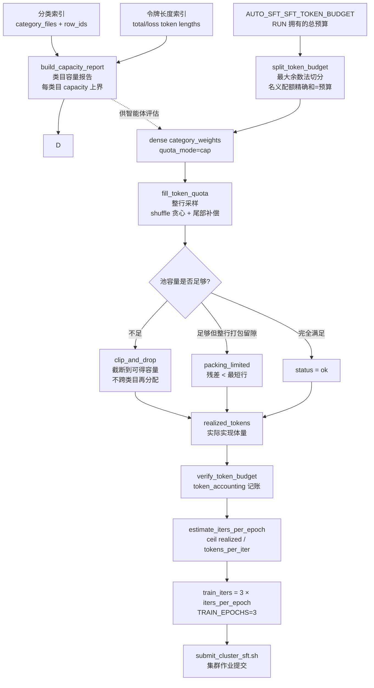

本页解析 AutoSFT 数据供给链路中最核心的一条确定性管线：从**类目容量报告**出发，经 **cap 配额切分**与**整行采样**（whole-row packing），在池容量不足时按 **clip-and-drop 欠填策略**处置，最终将**实际实现的 token 体量**推导为三轮 epoch 的训练步数。这条链路贯穿 `category_capacity.py`、`sampler_core.py`、`data_action.py`、`recipe_data.py` 与 `sft_train.py` 五个模块，其设计主轴是"**配额是名义上界，实现体量才是训练步数的唯一依据**"——所有环节均拒绝浮点捷径与跨类目再平衡，保证同一输入在任何机器上产出完全一致的数据集。

> **📖 小白导读**
> - 这篇讲什么：从"类目容量报告"到"训练步数"的确定性管线——cap 配额怎么切、行怎么采、池不够时怎么欠填、三轮 epoch 的步数怎么算。
> - 读之前先知道：**配额（cap）**＝给每个类目设定的 token 上限份额；**整行采样（whole-row packing）**＝以"整条对话"为单位选取、绝不截断半条；**欠填（clip-and-drop）**＝池里数据不够配额时宁可少拿也不凑数的策略；**epoch**＝把训练数据完整过一遍模型的一个轮次，本项目固定跑满三个。
> - 读完你能明白：为什么"名义配额"和"实际体量"是两回事；步数公式 `3 × ceil(总token ÷ (批大小×序列长))` 的每一项从哪来；这条链路为什么必须确定性（同样输入必出同样结果）。
> - 提醒：本页有全库最密的公式推导，卡住时先跳到"管线总览"图对着走。

## 端到端链路总览

在深入各环节之前，先建立整体认知框架。整条管线可以用一句话概括：**池有多大决定能拿多少，实际拿了多少决定训练多少步**。类目容量报告回答"每类目最多有多少 token 可用"；配额切分回答"这轮名义上每类目想要多少"；整行采样回答"在不切割任何一行的前提下实际能拿到多少"；而训练步数推导则完全建立在采样结果（realized tokens）之上，而非名义预算。



这条链路上有三个所有权分界点值得先行标记：**token 预算属于 RUN 而非配方**（由环境变量 `AUTO_SFT_SFT_TOKEN_BUDGET` 持有，配方只能重述不能修改）；**步数不属于用户**（`--train-iters` 传入任何值都会被拒绝）；**redistribution 被永久禁用**（clip-and-drop 明确声明不可用的预算就是留在那里，不会转给其他类目）。

Sources: [data_action.py](src/control_plane/data_action.py#L50-L51), [sampler_core.py](src/control_plane/sampler_core.py#L1-L7), [recipe_data.py](src/control_plane/recipe_data.py#L773-L780)

## 类目容量报告：曝光上界口径与新鲜度契约

容量报告是智能体决定配额前的"侦察兵"。`build_capacity_report()` 将分类索引的每个类目文件（小端 uint32 行 ID 序列）与令牌长度索引交叉聚合，为每个类目产出三组关键数字：`candidate_rows`/`eligible_rows`（候选行数，因发布索引已做准入过滤而语义等价）、`total_token_capacity`（该类目全部候选行的总 token 数）与 `loss_token_capacity`（其中损失 token 部分的容量）。

这里有一个刻意的设计选择：**多标签成员关系按类目重复计数**。一行样本若同时属于两个类目，会在两个类目的容量里各计一次，因此报告中的每类目容量是"曝光上界"（exposure upper bound）而非去重总量。报告同时给出 `unique_pool_rows`、`unique_total_token_capacity` 与 `overlap_rows`，让智能体能直接看到重叠规模而不改变采样器自身的去重策略——`capacity_semantics` 字段被显式记录为 `per_category_membership_upper_bound`，`multi_label_counts_repeat_membership` 置为 true，杜绝口径歧义。

Sources: [category_capacity.py](src/control_plane/category_capacity.py#L114-L125), [category_capacity.py](src/control_plane/category_capacity.py#L195-L234)

报告的可信度由三重契约保证。其一是**同池校验**：分类索引 manifest 与令牌索引 manifest 必须声明同一个 `pool_sha256`，且两者声明的池行数一致，否则直接抛出 `CategoryCapacityError`，防止对两个不同版本的池做交叉聚合。其二是**新鲜度契约**：`capacity_report_is_current()` 以两个输入 manifest 的 SHA-256 字节摘要作为报告的时效键，任何一次索引重建都会令旧报告立即失效，避免陈旧报告被静默复用。其三是**原子落盘**：报告通过临时文件 + `os.replace` 写出，读者永远不会观察到半写状态。

Sources: [category_capacity.py](src/control_plane/category_capacity.py#L149-L173), [category_capacity.py](src/control_plane/category_capacity.py#L79-L111), [category_capacity.py](src/control_plane/category_capacity.py#L266-L292)

## cap 配额切分：最大余数法与精确有理数运算

配额切分由 `split_token_budget()` 独占实现，legacy 本地采样器与数据动作 Runner 共享同一份代码——`sampler_core.py` 的模块注释明确指出这一单一实现策略的动机：防止动作执行时静默改变 launcher 的 cap 语义、名义配额与实现体量记账。

算法本身是经典的**最大余数法**（largest-remainder rounding）：先按权重比例计算每类目的精确份额 `budget × weight / total`，向下取整后统计与预算的差额，再将差额逐个分配给小数部分最大的类目（平手时按类目名排序），最终保证**所有名义配额之和精确等于 token 预算**。

实现细节中最值得注意的是有理数的使用。份额计算不是用浮点乘法 `budget * weight`，而是将已验证为有限值的浮点权重经**最短十进制表示**转换为 `Fraction` 精确有理数后再运算。注释解释了原因：浮点乘法在超大 Python 整数上会溢出，且超出浮点精确整数范围（2⁵³）时会丢失低位 token。这个防御性设计意味着无论预算是 5 亿还是 5 千亿，配额分配都不受表示精度的影响。

Sources: [sampler_core.py](src/control_plane/sampler_core.py#L1-L7), [sampler_core.py](src/control_plane/sampler_core.py#L21-L90)

配额语义存在两代模式，其差异是理解本页主题的关键分水岭：

| 维度 | dense 模式（现行） | legacy 模式 |
|------|------------------|------------|
| 声明字段 | `category_weights` | `base_mix` |
| `quota_mode` | `cap`（配额是上界） | `hard`（配额是硬性要求） |
| `underfill_policy` | `clip_and_drop` | `error` |
| 权重覆盖要求 | 必须精确覆盖分类索引全部类目，不多不少 | 只需至少一个正权重 |
| 欠填处置 | 截断到可得容量，静默继续 | 欠填超过 `max(shortest_row, 1)` 即报错 |
| 类目遍历序 | 字母序（`sorted`） | 声明序 |
| 跨类目再分配 | 永不（`redistributed_tokens` 恒为空） | 无 |

dense 权重的校验由 `_dense_category_weights()` 执行：每个分类索引类目必须出现且仅出现一次，缺失或多余的类目都会以显式清单报错；权重必须有限非负且至少一个为正。这一"全覆盖"要求使得配额文件天然就是类目全集的显式陈述，零权重类目也被显式声明并进入记账（`status: zero_weight`）。

Sources: [data_action.py](src/control_plane/data_action.py#L50-L51), [data_action.py](src/control_plane/data_action.py#L649-L682), [data_action.py](src/control_plane/data_action.py#L174-L224), [data_action.py](src/control_plane/data_action.py#L2042-L2071)

## 整行采样：不截断、不超调的确定性装填

`fill_token_quota()` 是整条链路的采样原子操作，其契约在 docstring 中表述为"整行选入或不选，绝不截断，绝不超调"。函数接收候选行 ID、令牌长度索引、类目配额与随机数发生器，返回四元组（选中行、实际取用 token 数、超限跳过行数、最短可用行长）。

算法分三阶段。**第一阶段**对候选序列执行 `rng.shuffle()`——这个看似平常的操作承载着关键语义：若按长度排序贪心，短行会先被塞满配额，静默改变配方的长度分布表征。测试 `test_preserves_length_distribution` 用 4 万行、长度 40–2000 的池验证了选出行均值与池均值的偏差小于 5%。**第二阶段**预扫描全部候选，计算**全局最短可用行长** `shortest`（跳过零长度行）。**第三阶段**按 shuffle 序贪心装填：行长 ≤ 剩余额度则整行取入，否则记入溢出跳过列表；当 `remaining < shortest` 时提前终止扫描。

停止规则使用**全局最小值**而非"当前已见最短值"是一个经过测试固化的修复：若采用"最短已见"规则，shuffle 序首行恰好是 900 token 的长行时（剩余 130），扫描会在 42/80 token 的短行被访问前提前终止。测试 `test_stop_rule_uses_global_minimum` 用 12 个种子验证最终能取到 122（= 42 + 80）。

最后还有一步**尾部补偿**：若存在被跳过的行且仍有剩余额度，从跳过列表中选出**能放进剩余空间的最大行**补入。这一步在保持整行语义不变的前提下，把最终残差压缩到严格小于 `shortest` 的水平——即残差以行粒度为下界，无法再被任何单行填满。

Sources: [sampler_core.py](src/control_plane/sampler_core.py#L93-L168), [test_token_budget.py](tests/test_token_budget.py#L225-L319)

整行采样的核心不变量由测试逐条锚定：

| 不变量 | 测试锚点 |
|--------|---------|
| 每个选中行贡献完整长度，`taken = sum(selected lengths)` 且 `taken ≤ quota` | `test_never_truncates_and_never_overshoots` |
| 超过预算的单行被整行跳过，绝不切割 | `test_row_larger_than_budget_is_skipped_not_cut` |
| 零长度行永不入选 | `test_zero_length_rows_are_never_selected` |
| 固定种子下输出逐字节确定 | `test_deterministic_for_a_fixed_seed` |
| 残差 `0 ≤ quota − taken < max(shortest, 1)` | `test_residual_is_bounded_by_row_granularity` |
| 选出行长度分布不偏离池分布（< 5%） | `test_preserves_length_distribution` |

## clip-and-drop 欠填策略：三种状态与不可再平衡原则

数据动作 Runner（`data_action.py`）将上述原子操作组装为完整的类目采样流程。对每个类目，Runner 先钉入回放（replay）行——这些行的 token 直接消耗该类目配额，且若钉入量本身超过配额则报错——随后将剩余配额交给 `fill_token_quota` 独立采样。采样时点会记录"动作后、去重后的有效容量"（`available_token_capacity`），这是欠填判定的基准。

欠填状态被精确区分为三类，写入 `per_category` 记账：

| 状态 | 判定条件 | 语义 |
|------|---------|------|
| `capacity_limited` | `requested_tokens > available_token_capacity` | 池根本供应不了名义配额——被 clip |
| `packing_limited` | 有容量但 `effective_target_tokens > returned_tokens` | 池充足，只是整行打包天然留隙 |
| `ok` | 实际返回等于名义目标 | 完全满足 |

与之对照，legacy hard 模式在采样后立即检查 `gap > max(shortest_row_tokens, 1)` 并抛出 `DataActionError`——欠填超过一行粒度即是硬错误。cap 模式则完全相反：代码注释明确写着 "**Never redistribute a category's unavailable quota**"（绝不再分配一个类目的不可用配额），`redistributed_tokens` 字段保留在 schema 中但恒为空对象，仅为兼容历史消费方。

Sources: [data_action.py](src/control_plane/data_action.py#L1865-L1908), [data_action.py](src/control_plane/data_action.py#L1953-L1974), [data_action.py](src/control_plane/data_action.py#L1988-L2010), [data_action.py](src/control_plane/data_action.py#L2101-L2104)

采样完成后有两道总量防线：**实现总量超过预算**（`realized_tokens > token_budget`）或**任一类目返回超过其名义配额**（`returned_tokens > requested_tokens`）都会抛出 `DataActionError`，后者的报错消息显式点名 `clip_and_drop sampling exceeded category quota`。通过后，完整记账被写入两份 manifest：`quota_manifest.json`（schema 4.0）与 `sample_manifest.json`（schema 3.0），字段包括 `requested_token_quota`、`effective_token_quota`、`returned_tokens`、`returned_loss_tokens`、`capacity_shortfall`、`unused_budget_tokens`、`realized_category_weights`，以及与训练侧对齐的 `tokens_per_iter` 与 `expected_iters_per_epoch`。

去重选项（`dedupe_cross_category`）会让多类目重叠行只被采一次：全局 `seen` 集合在每类目采样后更新，后续类目的候选池会剔除已见行，这会进一步压缩后采样类目的有效容量——这正是容量报告将去重语义留给 Runner 自身的原因。

Sources: [data_action.py](src/control_plane/data_action.py#L2073-L2097), [data_action.py](src/control_plane/data_action.py#L2181-L2211), [data_action.py](src/control_plane/data_action.py#L1844-L1863), [data_action.py](src/control_plane/data_action.py#L2220-L2280)

## token_accounting：预算门禁与记账一致性

训练前的最后一道数据侧关口是 `verify_token_budget()`。它读取 RUN 环境变量 `AUTO_SFT_SFT_TOKEN_BUDGET` 解析出的预算，与数据物化后的实际 `total_tokens` 做三件事：构建记账、写入 manifest、拒绝超调。记账结构 `token_accounting` 包含八个字段，全部可以从两个输入推导，其设计意图是让 ledger 与执行者无需解包嵌套对象即可消费：

```python
accounting = {
    "token_budget": budget,              # RUN 拥有的上界
    "realized_tokens": realized,          # 采样实际实现的体量
    "deviation": realized - budget,       # ≤ 0（clip-and-drop 下必为非正）
    "unused_budget_tokens": budget - realized,
    "budget_utilization": realized / budget,
    "tokens_per_iter": tokens_per_iter,   # global_batch_size × seq_length
    "planned_iters_per_epoch": ceil(budget / tokens_per_iter),   # 名义步数
    "realized_iters_per_epoch": ceil(realized / tokens_per_iter) # 实际步数
}
```

其中 `tokens_per_iter` 由 `runtime_tokens_per_iter()` 统一计算：`AUTO_SFT_SFT_GLOBAL_BATCH_SIZE`（默认 16）乘以 `AUTO_SFT_SFT_SEQ_LENGTH`（默认 32768），即每优化器步消耗 524,288 个打包 token。这个函数同时服务于**数据准备**与**作业提交**两个阶段，其 docstring 强调"准备与提交必须使用相同的运行时旋钮"——任何一侧单独读取环境变量都可能造成记账与实际训练的不一致。

`resolve_token_budget()` 则守护预算的所有权：配方中的 `token_budget` 若与 RUN 环境变量不一致会被直接拒绝（"The token budget is a fixed run cap; drop it from the recipe or match the run value"），且拒绝接受 `10.5` 这类可被 `int()` 截断的非整数。预算可以在配方中重述，但**重述必须等于 RUN 值**。

Sources: [recipe_data.py](src/control_plane/recipe_data.py#L744-L770), [recipe_data.py](src/control_plane/recipe_data.py#L773-L814), [recipe_data.py](src/control_plane/recipe_data.py#L817-L873), [recipe_data.py](src/control_plane/recipe_data.py#L876-L929)

## 三轮 epoch 训练步数推导：从实现体量到优化器步数

`sft_train.py` 将这条链路收口。核心常量 `TRAIN_EPOCHS = 3` 定义在文件顶部，与之配套的运行时契约是：**`--train-iters` 不可由用户设置**——传入任何正值都会触发 `SystemExit`，错误消息完整陈述了自动推导规则。

步数推导分两层。第一层 `estimate_iters_per_epoch()` 从数据 manifest 读取 `total_tokens`（即采样实现的体量），按 `ceil(total_tokens / (global_batch_size × seq_length))` 计算单 epoch 步数，最小值钳位到 1。这里的除法用 `-(-a // b)` 实现向上取整，与 `verify_token_budget` 中的 `max(-(-budget // tokens_per_iter), 1)` 完全同构。第二层 `resolve_train_iters()` 将其乘以 3：

```
train_iters = TRAIN_EPOCHS × ceil(total_tokens / (global_batch_size × seq_length))
```

注意公式中的 `total_tokens` 是**实现体量而非预算**。docstring 明确说明："one step consumes global_batch_size sequences of seq_length packed tokens"——即一个优化器步处理的是 16 条长度 32768 的打包序列。这与 `check_token_budget()` 的 docstring 呼应："Clip-and-drop permits a smaller realized volume. The optimizer-step count is intentionally derived from that actual volume"——欠填是合法的，但步数必须跟随欠填后的真实体量，而不是按名义预算虚增。

Sources: [sft_train.py](sft_train.py#L31-L53), [sft_train.py](sft_train.py#L196-L212), [sft_train.py](sft_train.py#L215-L221), [sft_train.py](sft_train.py#L321-L351)

续跑模式（`--resume-from`）是唯一不走此推导的路径：`resolve_train_iters` 会从被续跑运行的 `run_manifest.json` 中恢复其**原始计划总量** `resume_total_iters`，使得被中断的轮次只是"补完到原定目标"，而非按当前数据重新推导。这个区别对实验可复现性至关重要——中断续跑的最终步数与一次完整运行完全一致。

提交前的门禁 `check_token_budget()` 对记账做全面一致性复核：`unused == budget - realized`、`deviation == realized - budget`、`utilization ≈ realized / budget`（绝对容差 10⁻¹²），并用向上取整除法**重算** `planned_iters` 与 `realized_iters` 与 manifest 中的记录比对。任何不一致都会在 GPU 作业提交前以"re-prepare the data"终止。通过门禁后，`run_manifest.json` 落盘 `train_epochs`、`iters_per_epoch`、`train_iters` 与完整 `token_accounting`，同一组数字经 `record_sft()` 写入实验台账，形成数据决策与训练配置的配对记录。

Sources: [sft_train.py](sft_train.py#L230-L318), [sft_train.py](sft_train.py#L336-L351), [sft_train.py](sft_train.py#L540-L572), [sft_train.py](sft_train.py#L688-L714)

## 数值推导示例

以一个具体数值串联全链路。假设 RUN 预算 `AUTO_SFT_SFT_TOKEN_BUDGET = 400,000,000`，dense 权重声明 `cat-a: 0.6`、`cat-b: 0.25`、`cat-c: 0.15`（三权重之和 1.0，每个分类索引类目恰好声明一次）：

1. **配额切分**：`split_token_budget` 产出 `cat-a: 240,000,000`、`cat-b: 100,000,000`、`cat-c: 60,000,000`，三者之和精确等于 400,000,000（权重和为 1 时无余数分配）。
2. **容量侦察**：若 `cat-c` 的 `available_token_capacity` 只有 45,000,000（容量报告已给出该上界），则采样后 `cat-c` 的状态为 `capacity_limited`，`capacity_shortfall = 15,000,000`。
3. **实现体量**：`cat-a`、`cat-b` 均能装满（各自残差小于其最短行），realized ≈ 240,000,000 + 100,000,000 + 45,000,000 = 385,000,000，`unused_budget_tokens = 15,000,000`，`budget_utilization ≈ 96.25%`。
4. **单 epoch 步数**：`tokens_per_iter = 16 × 32768 = 524,288`，`realized_iters_per_epoch = ceil(385,000,000 / 524,288) = 734`（名义 `planned_iters = ceil(400,000,000 / 524,288) = 763`）。
5. **总步数**：`train_iters = 3 × 734 = 2202`——注意不是 `3 × 763 = 2289`，步数跟随实现体量。

这个示例同时展示了记账体系的价值：若后续评测发现该轮效果欠佳，智能体可以从 `per_category` 的 `capacity_limited` 状态直接读出 `cat-c` 供给不足是欠填来源，进而在下一轮的类目配额或池扩充决策中针对性处理。

## 本地基线采样器的同构实现

`tools/local_baseline/sample_recipe_data.py` 作为手动/legacy 入口，同样复用 `sampler_core` 的两个原子函数（仅做 `SamplerCoreError → SystemExit` 的薄包装），并在文件头部独立声明了 `QUOTA_MODE = "cap"` 与 `UNDERFILL_POLICY = "clip_and_drop"`。其 `resolve_sample_token_budget()` 的语义与 `resolve_token_budget()` 对齐：quota 文件或 CLI 声明的 cap 只在 RUN 环境变量**未设置**时生效；一旦 launcher 设置了预算，声明值只能重述不能替换。这保证了本地基线与线上 Runner 在同一池、同一配方下产出语义一致的数据集，差异仅存在于入口形态。

Sources: [sample_recipe_data.py](tools/local_baseline/sample_recipe_data.py#L55-L118), [sample_recipe_data.py](tools/local_baseline/sample_recipe_data.py#L121-L140), [sample_recipe_data.py](tools/local_baseline/sample_recipe_data.py#L520-L588)

## 测试套件中的行为锚点

上述语义并非仅由实现注释声明，而是被 `tests/test_token_budget.py` 与 `tests/test_data_action.py` 的断言体系固化为契约。`test_data_action.py` 的 `_dense_plan()` fixture 展示了完整的最小合法声明：`category_weights` + `quota_mode: "cap"` + `underfill_policy: "clip_and_drop"` 三者必须同时出现。`test_token_budget.py` 的 `TestBudgetIsARunSetting` 类的 docstring 精炼了整页的主题："Nominal quotas and the cap come from the run. Clip-and-drop may leave the realized volume below that cap, so manifests record the actual steps and volume for later comparison"——名义配额与 cap 来自 RUN，clip-and-drop 允许实现体量低于 cap，因此 manifest 记录的是**实际步数与实际体量**以供后续对比。

Sources: [test_data_action.py](tests/test_data_action.py#L214-L226), [test_token_budget.py](tests/test_token_budget.py#L322-L328)

## 延伸阅读

本页聚焦采样与步数推导本身；相邻主题可按以下路径深入：

- 配额声明的上游——不可变元计划与 operator.py 约束执行，见 [数据动作计划：不可变元计划、operator.py 约束执行与 Data Action Runner 的权威采样](11-shu-ju-dong-zuo-ji-hua-bu-ke-bian-yuan-ji-hua-operator-py-yue-shu-zhi-xing-yu-data-action-runner-de-quan-wei-cai-yang)
- 令牌长度索引如何产出本页依赖的 total/loss 长度序列，见 [令牌长度索引：与 SSTable 转换同源的计数路径、指纹校验与预算一致性](13-ling-pai-chang-du-suo-yin-yu-sstable-zhuan-huan-tong-yuan-de-ji-shu-lu-jing-zhi-wen-xiao-yan-yu-yu-suan-zhi-xing)
- 配方物化、SSTable 转换与作业提交的全流程，见 [SFT 训练轮次：从 Qwen3-Base 独立初始化、配方物化到 SSTable 转换与作业提交](19-sft-xun-lian-lun-ci-cong-qwen3-base-du-li-chu-shi-hua-pei-fang-wu-hua-dao-sstable-zhuan-huan-yu-zuo-ye-ti-jiao)
- 步数与超参如何进入实验台账，见 [实验台账：iterations.jsonl 配对记录、结构化决策备注与最佳分数追踪](23-shi-yan-tai-zhang-iterations-jsonl-pei-dui-ji-lu-jie-gou-hua-jue-ce-bei-zhu-yu-zui-jia-fen-shu-zhui-zong)