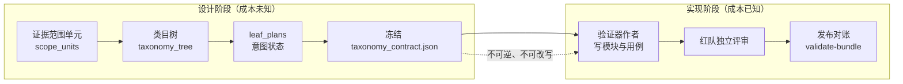
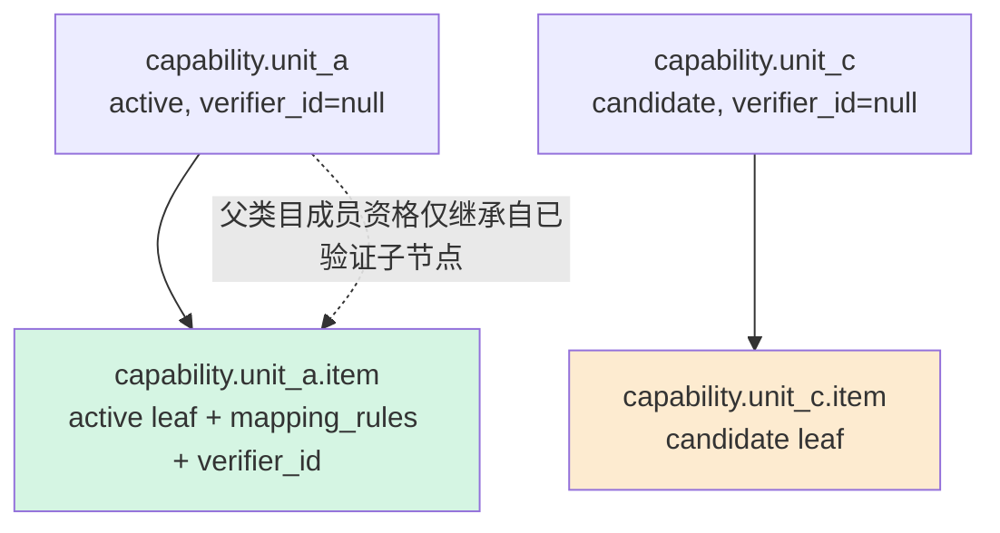
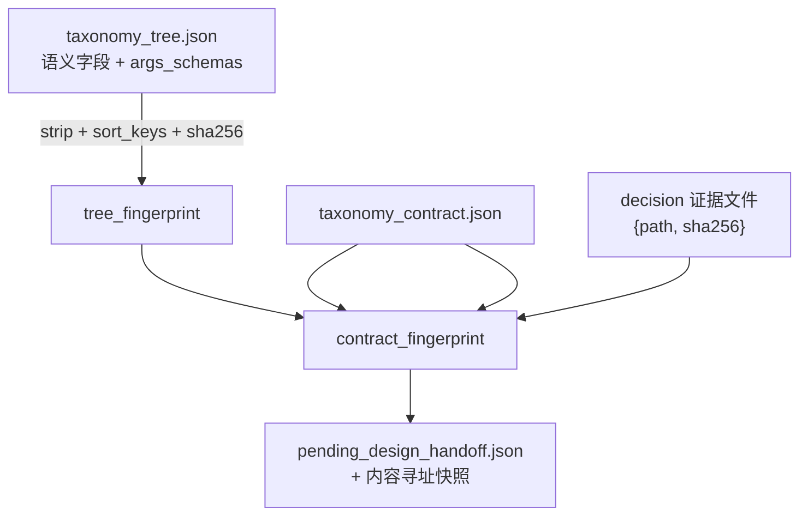
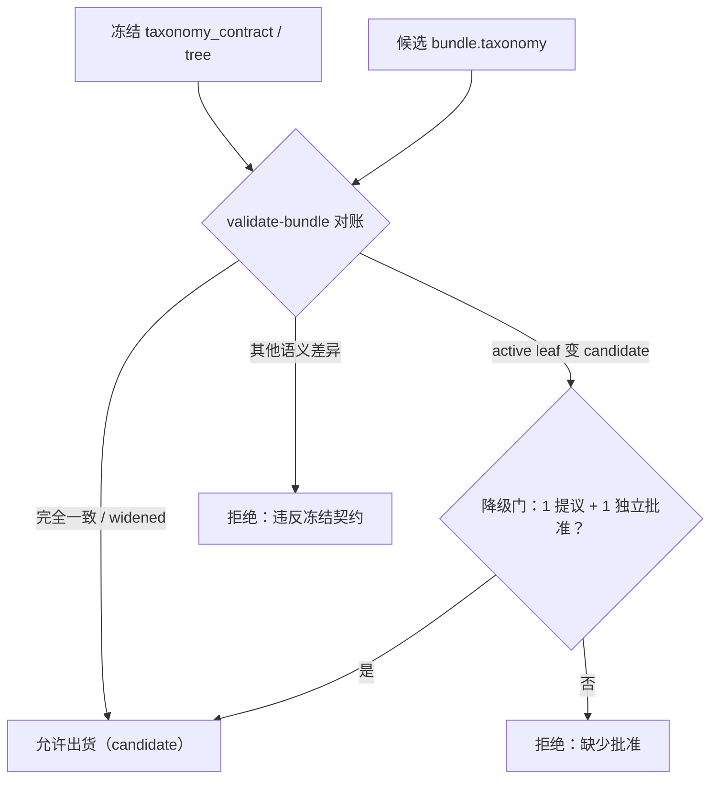

本页聚焦 AutoSFT 分类体系（capability taxonomy）的**设计契约层**：`taxonomy_contract.json` 如何在任何实现工作发生之前被冻结、`taxonomy_tree.json` 承载的类目树语义（id、层级、状态、映射规则、参数模式），以及"先设计、后实现"的分离原则如何通过运行时校验被强制执行。页面只描述设计侧契约与冻结/对账机制；验证器模块如何编写、沙箱如何限制执行属于另一条主线，见 [验证器沙箱运行时：ALLOWED_IMPORTS 白名单、CPU 秒限制与离线确定性执行](16-yan-zheng-qi-sha-xiang-yun-xing-shi-allowed_imports-bai-ming-dan-cpu-miao-xian-zhi-yu-chi-xian-que-ding-xing-zhi-xing)。

> **📖 小白导读**
> - 这篇讲什么：分类体系的"设计合同"——`taxonomy_contract.json` 如何先于一切实现被冻结、类目树里每个字段的语义、以及"先设计后实现"如何被强制。
> - 读之前先知道：**分类体系（taxonomy）**＝一棵"能力类别树"，把训练数据按能力归类；**契约冻结**＝规则一旦定稿就锁死、实现阶段不许再改的机制；**叶子类目**＝树最末端真正挂数据的节点（中间节点只做分组）；**对账**＝定期核对"实现的东西和合同说的是否一致"。
> - 读完你能明白：类目树 JSON 每个字段什么意思；为什么设计稿必须先冻结再动工；运行时如何发现"实现与契约不符"。
> - 提醒：本页与第 16 页（验证器沙箱）、第 17 页（发布流水线）构成三部曲，建议按顺序读。

Sources: [SKILL.md](skills/taxonomy-design/SKILL.md#L20-L32), [contracts.md](skills/taxonomy-design/references/contracts.md#L1-L6)

## 为什么"设计/实现分离"是一条硬约束

分类体系设计角色只回答一个问题：**本次运行的能力分类体系必须覆盖什么**。这个问题必须在任何人知道"覆盖它要花多少成本"之前就回答完毕。设计者产出一个由自己拥有的 `taxonomy_contract.json`、它引用的 `taxonomy_tree.json`，以及一份基准参考溯源记录 `source_evidence.json`，三者一并冻结后立即停止。实现者只能"对着契约建造"，不能改动其中任何一个字节。

这条约束不是风格建议，而是防止一种可预测的漂移：一旦设计者知道在哪里建造便宜，他就会开始按成本挑选类目，设计方向便滑向"最容易用规则检查的东西"，而且没有任何记录显示这是一个被权衡过的选择。因此 `taxonomy-design` 技能**不读**实现材料——"确定性可检查"的精确定义属于契约信息（设计者可以据此判断），而"某个检查要写多久、哪些库装了"属于成本信息（设计者不可知，且知道后无法遗忘）。



Sources: [design.md](skills/taxonomy-design/references/design.md#L1-L40), [SKILL.md](skills/taxonomy-design/SKILL.md#L34-L40)

## 四智能体的所有权边界

分类体系工作被拆给四个智能体。`taxonomy-design` 技能只属于"设计者"，其余三个属于 `taxonomy-verifier-implementation`。所有权是排他的——某角色"拥有"的产物正是它"绝不触碰"清单之外的补集。

| 智能体 | 拥有 | 绝不触碰 |
| --- | --- | --- |
| `autosft_taxonomy_designer` | 冻结的 `taxonomy_contract.json`：范围决策、leaf 计划、类目描述、`mapping_rules`、`args_schema` | 验证器源码、包清单、validator/preflight 输出 |
| `autosft_capability_taxonomy_verifier` | 委派、裁决后窄范围 bundle 编辑、发布、覆盖率、分类请求 | 验证器模块与用例、validate/preflight（归 `autosft_verifier_author`）、类目树、任何 `args_schema`、`taxonomy_contract.json` |
| `autosft_verifier_red_team` | 对抗性通过/失败边界用例 | 只读；永不编辑验证器 |
| `autosft_demotion_adjudicator` | 对某个拟降级 leaf 的单一 `approve`/`reject` 决定 | 不写代码、不设计类目 |

关键推论：**验证器作者可以提议降级，但只有独立裁决者能批准**。设计者不预先批准也不批量处理降级。

Sources: [SKILL.md](skills/taxonomy-design/SKILL.md#L42-L52), [SKILL.md](skills/taxonomy-design/SKILL.md#L82-L86)

## taxonomy_contract.json：唯一的覆盖决策载体

契约在实现开始前写入 `taxonomy_work/` 下，且是**唯一的覆盖决策产物**。它的顶层形状极其克制——只有六个字段，运行时对未知字段零容忍：

```jsonc
{
  "schema_version": "1.0",
  "contract_id": "<lowercase slug>",
  "taxonomy_tree": "<相对契约目录的路径>",
  "tree_fingerprint": "<64-hex 规范化树指纹>",
  "scope_units": "<SCOPE_UNIT_OBJECTS>",
  "leaf_plans": "<LEAF_PLAN_OBJECTS>"
}
```

`taxonomy_tree` 与决策 `evidence_ref` 的路径都相对于契约目录，并指向存放在它旁边的常规文件；发布时契约、树与这些证据文件被归档为一个不可变的版本目录，因此引用**不得**回指可变的运行根目录。运行时对契约的顶层白名单、`schema_version` 与 `contract_id` 均做强制校验。

Sources: [contracts.md](skills/taxonomy-design/references/contracts.md#L8-L49), [contracts.md](skills/taxonomy-verifier-implementation/references/contracts.md#L69-L91), [taxonomy_runtime.py](src/control_plane/taxonomy_runtime.py#L2100-L2160)

### scope_units：include / exclude / merge 的三态决策

每个 `scope_units` 条目有 `unit_key`、`description`、可选 `evidence_refs`，以及**恰好一个**已冻结的 `decision` 对象，其 `kind` 只能是三类之一：

| decision.kind | 必需字段 | 语义 | 运行时不变量 |
| --- | --- | --- | --- |
| `include` | `category_ids` | 列出的 leaf 计划覆盖此范围单元 | 不得携带 `reason`/`evidence_ref`/`target_unit_key` |
| `exclude` | 具体 `reason` + `evidence_ref` | 该单元被明确排除 | 不得列出任何 `category_ids`；`reason` 需过"实质分"阈值 |
| `merge` | `target_unit_key` + `reason` + `evidence_ref` | 该单元并入目标单元 | 不得自指、不得指向被排除单元；merge 链不得成环 |

`exclude` 与 `merge` 的证据文件必须真实存在、位于契约目录之下、且文本中**精确提及**该 `unit_key`（以词元匹配而非子串匹配）；证据文件缺失或未提及单元键会被拒绝。设计者是这些决策的唯一所有者，作者不得增删改写。

Sources: [contracts.md](skills/taxonomy-design/references/contracts.md#L36-L55), [taxonomy_runtime.py](src/control_plane/taxonomy_runtime.py#L2100-L2160)

### leaf_plans：意图状态与"计划即承诺"

每个 `leaf_plans` 条目有 `category_id`、`unit_key`、`intended_status: "active"|"candidate"` 与可选 `note`。这里埋着设计契约最重要的语义之一：

- **一开始就计划为 candidate 的 leaf，从起点即是 candidate，无需任何降级批准**；
- **计划为 active 的 leaf 若最终以 candidate 出货，必须走"一 leaf 一提议 + 一独立裁决"的精确降级路径**。

`note` 在 `intended_status` 为 `candidate` 时是必需的、且必须有实质内容——因为一个计划外转为 candidate 的 leaf，需要一个可读的理由留在记录里。运行时还会强制：每个非弃用的终端 leaf 恰好由一个 `include` 单元的 leaf 计划覆盖；`merge`/`exclude` 单元不得隐藏 leaf 计划。

Sources: [contracts.md](skills/taxonomy-design/references/contracts.md#L57-L62), [design.md](skills/taxonomy-design/references/design.md#L95-L104)

## 类目树 taxonomy_tree.json：语义字段与 args_schemas

被契约引用的 `taxonomy_tree.json` 是设计者拥有的语义类目树，顶层只允许 `schema_version`（必须为 `"1.0"`）、`categories` 数组与 `args_schemas` 对象。它的**长度与拓扑完全来自所选设计**——运行时不规定类目数量、分支因子或树深。

每个类目对象必须携带 `id`、`name`、`description`、`parent_id`、`status`、`aliases`、`catalog_mappings`、`verifier_id` 与 `evidence`。注意树内**不写运行时版本戳**（如 `created_version`/`deprecated_version` 属于发布态，不属于契约输入）。



### id 规则与层级语义

类目 id 不可变：只能重命名显示名或添加别名，**永不重用一个 id**；已出现在 active 分类体系中的 id 在后续版本中不可移除（只能降级为 candidate 或标记 deprecated）。id 必须层级化且稳定，段位反映层级，真正的父子结构由 `parent_id` 表达——分类体系是显式的多层父子树，而不是用点号拼出来的扁平列表。

Sources: [contracts.md](skills/taxonomy-design/references/contracts.md#L64-L88), [design.md](skills/taxonomy-design/references/design.md#L173-L192)

### 状态语义：active / candidate / deprecated

三种状态的可见性与约束差异是整套设计契约的核心杠杆：

| 状态 | verifier_id | mapping_rules | 对解析器/映射器/分类索引 | 引擎计为 leaf 的条件 |
| --- | --- | --- | --- | --- |
| `active` | 必须绑定且唯一 | 必须非空（仅 leaf） | 可见、可映射 | 无 active 子节点 |
| `candidate` | 必须为 `null` | 禁止携带 | 不可见，报告记 `verifier_not_ready` | —— |
| `deprecated` | —— | 禁止 | 保留在版本历史、不可复活 | —— |

"leafness"只在 **active** 类目上计算：一个 active 类目的子节点若全为 candidate，它自身**就是** active leaf——因此要为一个全新范围单元分组做铺垫，必须把该父节点也标记为 candidate。candidate 对解析器、映射器与分类索引完全不可见，这正说明 candidate 不是 active 的低成本替代：一个 candidate leaf 对本次运行能表达的采样混合贡献为零，其成本与一个被排除的范围单元完全相同。

Sources: [contracts.md](skills/taxonomy-design/references/contracts.md#L77-L88), [taxonomy_runtime.py](src/control_plane/taxonomy_runtime.py#L3600-L3625)

### mapping_rules 与闭合集映射器

解析器把每个抽取出的约束映射到**恰好一个** active leaf，或映射到保留的 `OTHER` 结果——这是一个闭合集、单选、且不能提问的决策。只有当存在精确语义匹配时才选中某个 leaf，并在该 leaf 的 `args_schema` 下直接产出最终、schema 合法的参数。因此每个 leaf 的 `description` 与 `mapping_rules` 必须写得能让一个约束**无歧义**地命中唯一 leaf；"两个约束都能匹配的含糊 leaf"是真实缺陷，因为映射器只挑一个，另一个被静默误标。

Sources: [contracts.md](skills/taxonomy-design/references/contracts.md#L90-L98)

### args_schema：类目边界即值集

每个 active leaf 必须声明一个严格的 Draft 2020-12 JSON Schema，用于其解析器产出的参数；运行时强制校验其为 `type: object`、`additionalProperties: false`、且含 `properties`。

契约层面最重要的一句判断是：**schema 的值集就是类目边界**——一个接受五个单位的 leaf 与一个接受三个单位的 leaf 是两个不同的类目。schema 要在这里作为契约设计来写：已存在 schema 内新增取值复用同一验证器，而新语义或新参数键则是版本化变更。

设计规则还特别强调：**约束用来比对的每个值都属于 `args_schema`**。只有标识符的 schema（一个 `const` 命名 leaf、别无他物）是明确要防止的失败模式——它只给约束贴了标签却没捕获它，于是该值只能到别处去恢复，而唯一剩下的地方就是验证器读源文本；这样匹配一种源措辞就会漏掉用不同措辞写的等价行，被验证为 unknown 并退出训练集，leaf 看似被覆盖却几乎不接纳任何行。值的两种合法形态是设计决策而非实现细节：

| 值形态 | 何时使用 | 在 schema 中的写法 |
| --- | --- | --- |
| 逐行变化 | 每条指令自带该值（如上限、区间端点、比较目标） | 带合适 JSON 类型与边界的**类型化字段** |
| 能力层面固定 | 该值对能力真正固定 | 可见可审的 `enum` 或 `const` |

若一个约束的目标确实无法放进 args，那它就是"非确定性可检查"的 leaf——这正是记录为 intended-candidate 的**唯一**正当理由，而不是一份省略目标、指望验证器去把目标找回来的 schema。

Sources: [contracts.md](skills/taxonomy-design/references/contracts.md#L100-L124), [design.md](skills/taxonomy-design/references/design.md#L106-L141)

## "确定性可检查"的精确边界

设计者判断某范围单元的 leaf 是否为 candidate，只允许一个理由：**无论投入多少努力，都不存在能裁决它的验证器**。这个术语有精确边界，且属于契约信息（因此归设计者）：当且仅当一个普通函数能仅凭"助手补全 + `args_schema` 定义的合法参数"（以及在约束把目标写在提示词里时，附加用户查询）做出判断时，约束才是确定性可检查的。该函数离线、可重复：无网络、无模型调用、无时钟、无随机，同样的输入永远给出同样的裁决。

- **规则进来的**（看似难，实则在范围内）：任何可由计数、分段、模式匹配、查表或解析决定的东西，无论多琐碎；跨脚本或需要仔细归一化的确定性操作仍在范围内——"这里恰好装了哪些实现技术"不是设计者的问题。
- **规则排除的**：取决于意义、质量或偏好、任何规则都定不了的要求，或响应与查询根本不包含其目标的要求——这些才是"无验证器可裁决"的范围单元。

设计文档给出一个明确的自我警示：**若你开始推理"写一个检查要多久"或"会有多别扭，就停下"**——那正是这个角色存在所为了避免的判断，而且你并不掌握做出该判断所需的信息。

Sources: [design.md](skills/taxonomy-design/references/design.md#L13-L40)

## 指纹与证据归档

契约与树各自携带一个 64 位十六进制 SHA-256 指纹，二者是"冻结"得以可验证的技术基础。

`tree_fingerprint` 是对**语义树**计算、与 JSON 空白无关的规范指纹：验证时先把人类书写的文本字段（`name`、`description`、每条 `mapping_rules`）在边界处 `strip`，再对 `{schema_version, categories(按 id 排序), args_schemas(按 key 排序)}` 做 `sort_keys` 的紧凑 JSON 序列化后取 SHA-256。这样，一个设计者在验证前按文档计算指纹，不会仅因某个描述被空白填充而产出一个验证器会拒绝的摘要。

`contract_fingerprint` 则聚合更多内容：契约对象本身、每个决策证据文件的 `{path, sha256}` 记录（按路径排序），以及树的 `{path(相对契约目录), sha256}` 记录。它因此同时绑定"契约文本""证据字节"与"被引用的树字节"。当发布把一个指纹已固定的契约从 `taxonomy_work/` 机械复制到 `taxonomy/` 时，指纹仍保持稳定——因为树的引用被记录为相对**契约文件**而非相对运行根。

一个刻意为之的工程细节：发布复制契约与树时走 `_atomic_copy_file`，保留设计者的**原始字节**，而不是把解析后的对象重新序列化；否则 JSON 往返可能改变空白、使已发布的 active 状态无法通过 `record-noop` 的族系校验。



Sources: [taxonomy_runtime.py](src/control_plane/taxonomy_runtime.py#L45-L145), [taxonomy_runtime.py](src/control_plane/taxonomy_runtime.py#L862-L872), [contracts.md](skills/taxonomy-design/references/contracts.md#L29-L34)

## 冻结动作：freeze-contract 与 pending_design_handoff

"冻结"不是一句口头约定，而是一个由编排器（父智能体）拥有的落盘记录，存放在**不属于** `taxonomy_work` 的位置：`taxonomy/pending_design_handoff.json`。这一点至关重要——验证器作者虽然能在组装候选 bundle 时替换 `taxonomy_work` 里的文件，却**不能**悄悄替换父单在派生作者之前就记录下来的那份交接。

`freeze-contract` 的工作流是幂等（重复执行结果不变）且防篡改的：

1. 解析并校验契约、树与证据，产出 `contract_fingerprint` / `tree_fingerprint` / `contract_evidence_records`；
2. 把设计者产物按内容寻址快照到 `taxonomy/pending_design/<contract_fingerprint>/`，这一步用 staging 目录 + `os.replace` 原子安装，并复核快照仍与冻结指纹一致；
3. 写下手持记录（含 `job_type`、`round_id`、`expected_parent_version`、`contract_id`、快照内契约/树路径、两枚指纹、证据记录、`created_at`）。

幂等语义：同一 `(job_type, round_id, expected_parent_version, contract_fingerprint)` 身份重复调用返回既有冻结、且**不重写**原始记录；一个**不同**身份的待处理交接已存在时，必须显式发布或清除后才能开始另一次设计——作者不能编辑 `taxonomy_work` 后要求运行时把被编辑的字节祝福成一次新的设计冻结。bootstrap 冻结不得替换已有 active 分类体系；refine 冻结要求 active 分类体系存在且父版本匹配。

恢复逻辑只信任 `pending_design_handoff.json` 及其指纹快照：一个**裸**的 `taxonomy_work/taxonomy_contract.json` 不被当作冻结证据，而会被报告为"无持久化设计交接"，以便下一次分类体系尝试重跑设计，而不是静默接受一个作者编辑过的契约。

Sources: [taxonomy_runtime.py](src/control_plane/taxonomy_runtime.py#L136-L142), [taxonomy_runtime.py](src/control_plane/taxonomy_runtime.py#L980-L1120)

## 设计意图 vs 实现结果：validate 对账与降级门

冻结之后，`validate-bundle` 会把**实际出货**的分类体系与冻结契约做对账。对账的核心规则是：一个计划为 active 的 leaf 若未以 active 到达，就必须保持为 candidate，并配一份**精确的、经独立批准的逐 leaf 降级提议**；兄弟 leaf 或一个 `exclude` 范围决策**不能**清偿这份被冻结的承诺。

被冻结树与候选 bundle 之间的语义比较只放行一种差异——active leaf 变为 candidate——其余语义编辑（包括没有新树就进行 candidate→active 升格）都被视为契约变更而拒绝。降级可用的字段也被严格限定为 `status`、`verifier_id`、`mapping_rules`，其余不可变字段必须逐一相等。设计者不预先批准降级；作者可提议退却，但只有 `autosft_demotion_adjudicator` 能批准。

对账产出一份面向评审的汇总，直接由冻结计划与归一化后的状态派生：

| 桶 | 判定条件 | 含义 |
| --- | --- | --- |
| `honored` | 计划 active 且当前 active | 承诺兑现 |
| `widened` | 计划 candidate 却当前 active | 加宽（免费，不被追责） |
| `pending_demotions` | 计划 active 却当前 candidate | 必须由降级门单独清偿 |

运行时校验还明确拒绝一类历史遗留：旧协议的 `family_inventory`、`family_disposition`、`design_intent` 字段不得与统一契约混用；旧协议散落的 `inventory.json`/`design_intent.json` **不会**被恢复为一份冻结契约。测试套件把这套"仅新契约"边界固化为可回归的行为。



Sources: [design.md](skills/taxonomy-design/references/design.md#L143-L171), [tests](tests/test_taxonomy_contract_new_only.py#L45-L123), [taxonomy_runtime.py](src/control_plane/taxonomy_runtime.py#L6140-L6160)

## 设计原则清单与常见反模式

把上面各节收敛成一份设计者可直接对照的清单：

**应当**：

- 用层级化、稳定的 id，段位反映所选的层级；把显示名与别名同 id 分离；
- 从本次运行的证据、用自己的判断选择范围单元、层级与粒度；**装了哪些库、约束是否易实现，都不是分类体系证据**；
- 让 leaf 语义互相排斥、每个 `args_schema` 严格、`mapping_rules` 足够具体，使闭合集映射器无需猜测即可选中；
- 把每个被检查的值放进 `args_schema`（逐行变化→类型化字段，能力固定→`enum`/`const`）；
- 刻意使用 `active` 与 `candidate` 状态；需要铺垫新分组时连父节点一起标记 candidate；
- 不把 active 采样分类体系硬编码/映射到外部 catalog 分片；本地动态采样只经版本化分类索引直接使用当前类目 id。

**反模式**：

- leaf 描述陈述"在哪里找到约束"而非"约束本身"（引用证据条目不等于说明响应必须做什么，映射器匹配的是语义要求）；
- 只含标识符、省略目标的 schema——它让值不得不到验证器读源文本处去恢复，匹配一种措辞就漏掉等价行；
- 为"预判很难构建"而把 leaf 计划得更小——若实现后发现某 leaf 建不出来，那应由实现者带证据记录在案，不是设计者的错误，也不该被预判；
- 在契约或树中编码私有基准提示词、期望补全或答案。

Sources: [design.md](skills/taxonomy-design/references/design.md#L106-L192), [SKILL.md](skills/taxonomy-design/SKILL.md#L54-L94)

## 下一步阅读

设计契约冻结后，工作流转入实现与门禁阶段：验证器如何在一个受限沙箱中确定性执行见 [验证器沙箱运行时：ALLOWED_IMPORTS 白名单、CPU 秒限制与离线确定性执行](16-yan-zheng-qi-sha-xiang-yun-xing-shi-allowed_imports-bai-ming-dan-cpu-miao-xian-zhi-yu-chi-xian-que-ding-xing-zhi-xing)；冻结契约如何经过 freeze-contract / validate-bundle / preflight-bundle 到原子发布见 [发布门禁流水线：freeze-contract、validate-bundle、preflight-bundle 与原子发布](17-fa-bu-men-jin-liu-shui-xian-freeze-contract-validate-bundle-preflight-bundle-yu-yuan-zi-fa-bu)；降级提议如何被独立裁决者批准、并校验机器写入的 `spawn_agent` 事件见 [降级裁决与红队评审：双记录门、独立评审员与机器写入 spawn_agent 事件验证](18-jiang-ji-cai-jue-yu-hong-dui-ping-shen-shuang-ji-lu-men-du-li-ping-shen-yuan-yu-ji-qi-xie-ru-spawn_agent-shi-jian-yan-zheng)。