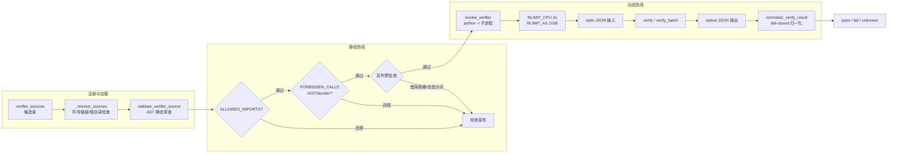

在 AutoSFT 闭环中，每个活跃叶子类目的判据是一段由 LLM 生成、由验证器作者智能体交付的 Python 模块。这段代码的裁决直接决定一条池行能否进入训练集——它既是数据门禁，也是系统中最不受信任的输入之一。`taxonomy_runtime.py` 为此构建了一个**双层沙箱**：第一层在代码执行前做 AST 静态审查（`validate_verifier_source`），第二层在执行时将代码锁进一个无路径、无网络、限时 2 个 CPU 秒的隔离子进程（`invoke_verifier`）。两层之上还有容器级的离线依赖预烘焙，共同保证裁决的确定性。本页剖析这套运行时的完整构造。Sources: [taxonomy_runtime.py](src/control_plane/taxonomy_runtime.py#L4666-L4742)、[taxonomy_runtime.py](src/control_plane/taxonomy_runtime.py#L4810-L4840)

> **📖 小白导读**
> - 这篇讲什么：LLM 写出来的"判据代码"如何被安全执行——一套双层沙箱：先不运行代码做静态体检（AST 审查），再把代码关进"无文件、无网络、限时 2 秒"的隔离小黑屋跑。
> - 读之前先知道：**验证器（verifier）**＝判断"一条数据是否属于某个类目"的 Python 代码片段，由 LLM 生成——正因为是 AI 写的，才必须被当作不可信输入；**沙箱**＝限制权限的隔离执行环境；**AST 静态审查**＝解析代码语法树、检查有没有危险调用（如开文件、发网络请求），不实际运行；**CPU 秒**＝按处理器时间计的配额，超时强杀。
> - 读完你能明白：一条数据"进门"前要过哪几道安检；为什么验证器跑不了 2 秒以上；镜像层还额外预烘焙了什么保险。
> - 提醒：本页涉及安全设计，改验证器相关代码前务必通读。

## 威胁模型：沙箱要防什么

验证器源码来自 LLM 生成的候选束（bundle），在 `validate-bundle` 阶段被解析加载。威胁模型不是"恶意攻击者写炸弹"，而是**能力不足的生成代码在无人审查路径上放大错误**：一段调用 LLM 的验证器会把裁决外包回模型本身；一段自造正则分词的验证器会把带重音的单词数成两个、把中文输入数成零个词——而每一处误数都是对合规响应的误判，且全部落在 fail 一侧，静默地掏空池子。规范文档明确：验证器"必须不重分类该行、不调用 LLM、不使用网络、不派生进程、不访问任意文件"。沙箱的设计目标是让这些禁止在结构上不可违反，而非依赖提示词约定。Sources: [contracts.md](skills/taxonomy-verifier-implementation/references/contracts.md#L508-L511)、[taxonomy_runtime.py](src/control_plane/taxonomy_runtime.py#L4627-L4634)

整体执行链路如下：



加载路径的入口 `_resolve_sources` 在静态审查之前先做文件系统约束：拒绝符号链接、强制源码位于 `taxonomy_work` 根之下、要求为普通文件，并把 AST 提取的导入集合与注册表条目声明的 `dependencies` 对账——未声明的导入在打包阶段即被拒绝。这意味着白名单不是唯一的导入防线，而是第二道：一个模块必须既在白名单内，又已被注册表声明，才能被执行。Sources: [taxonomy_runtime.py](src/control_plane/taxonomy_runtime.py#L4894-L4937)

## 静态防线一：ALLOWED_IMPORTS 白名单

`validate_verifier_source` 以 `ast.parse` 解析源码，对整棵语法树做单遍 `ast.walk`。导入检查在两个节点类型上分别执行：`ast.Import` 取每个别名的顶层模块名，`ast.ImportFrom` 额外拒绝相对导入（`node.level` 非零）。顶层模块名不在 `ALLOWED_IMPORTS` 中即抛出 `TaxonomyRuntimeError`。白名单共 20 个模块，可按用途分三组：

| 组别 | 模块 | 设计意图 |
| --- | --- | --- |
| 标准库 | `collections` `csv` `functools` `io` `itertools` `json` `math` `re` `statistics` `string` `unicodedata` | 计数与字符类工作；`io.StringIO` 服务于 `csv` 读取补全文本；`unicodedata` 直接回答 CJK 字符区间问题 |
| 编译器指令 | `__future__` | 无运行时能力的注解，准许 |
| 第三方 | `nltk` `jieba` `langdetect` `emoji` `syllapy` `yaml` | 覆盖标准库无法判定的语言属性：英文分词、中文分词、语言识别、emoji 检测、音节计数、结构化输出 |
| 受限白名单 | `ast` | 仅 `literal_eval` 可用——`ast.parse` / `ast.compile` / `ast.walk` 被属性级禁令拦截 |

白名单的裁剪逻辑写在 `requirements-direct.txt` 的注释里：`emoji` 与 `syllapy` 是 IFBench 检查器在 third_party 中的仅有的额外导入；`jieba` 专为中国文本补充——中文没有词间空格，词数与关键词位置约束无法靠空格切分获得。Sources: [taxonomy_runtime.py](src/control_plane/taxonomy_runtime.py#L209-L229)、[contracts.md](skills/taxonomy-verifier-implementation/references/contracts.md#L543-L571)、[requirements-direct.txt](containers/requirements-direct.txt#L29-L40)

值得注意的是规范文档对白名单的**刻意隔离**：`contracts.md` 把实现契约放在显式的分隔线之下（"Implementation contracts — do not read while the contract is still open"），因为知道哪些库可用、哪些约束可用正则解决，会悄悄变成类目选择的筛选条件——设计会漂移向容易检查的方向。工具可用性被明确排除在类目设计决策之外。Sources: [contracts.md](skills/taxonomy-verifier-implementation/references/contracts.md#L464-L485)

## 静态防线二：三张禁用清单与顶层语句约束

白名单之外，静态审查维护三张正交的禁用清单，全部在 `ast.walk` 循环内逐节点检查：

**FORBIDDEN_CALLS（13 个内置调用）**：`__import__` `breakpoint` `compile` `delattr` `eval` `exec` `getattr` `globals` `input` `locals` `open` `setattr` `vars`。这封锁了动态导入、动态执行、任意属性操作和文件访问的直通路径。匹配方式是 `ast.Call` 节点中 `func` 为 `ast.Name` 且名称命中集合。

**FORBIDDEN_ATTRIBUTE_CALLS（7 个属性调用）**：拦截"模块被允许但特定方法不安全"的情况——`yaml.load` / `yaml.unsafe_load` / `yaml.full_load` 会从被检文本构造任意对象，只准 `safe_load`；`nltk.download` 触碰沙箱没有的网络（注释指出它挂起而非失败，会拖延 preflight 直到 CPU 限制杀死进程）；`ast.parse` / `ast.compile` / `ast.walk` 被禁因为从补全文本构建语法树是"朝执行被测文本迈出的一步"。每条禁令都附带面向作者的解释字符串，错误消息会原文转述。

**FORBIDDEN_AST_NODES（12 个语法节点）**：所有 async 形态（`AsyncFor` `AsyncFunctionDef` `AsyncWith` `Await`）、`ClassDef`、`Delete`、`Global`、`Nonlocal`、`With`、`Yield`、`YieldFrom`。验证器被塑形为纯函数集合：无类定义、无上下文管理器、无协程。

**dunder 全封禁**：任何以 `__` 开头的 `ast.Name` 或属性访问都被拒绝，包括无害的 `__name__`。注释解释了这个看起来严苛的规则的完整性理由：`type(x).__name__` 本身无害，但封锁 dunder 是关闭 `__class__` / `__subclasses__` 逃逸路线的手段——"不值得为一种标签开一个洞"。

**顶层语句白名单**：模块顶层只允许 `Import`、`ImportFrom`、`FunctionDef`、赋值（`Assign` / `AnnAssign`）和字符串常量表达式（docstring）；任何其他可执行顶层语句直接拒绝。这把模块收窄为"导入 + 函数定义 + 常量表"。

**尺寸限制**：源码字节数上限 `MAX_VERIFIER_SOURCE_BYTES = 100_000`，输出字节数上限 `MAX_VERIFIER_OUTPUT_BYTES = 1_000_000`，防止资源耗尽型滥用。Sources: [taxonomy_runtime.py](src/control_plane/taxonomy_runtime.py#L230-L275)、[taxonomy_runtime.py](src/control_plane/taxonomy_runtime.py#L4670-L4731)、[contracts.md](skills/taxonomy-verifier-implementation/references/contracts.md#L548-L577)

## 静态防线三：两条反作弊规则

静态审查还内置两条针对**语义作弊**（而非安全违规）的检查，这是本沙箱区别于通用代码沙箱的地方。

**借用基准表格检测**（`_reject_borrowed_benchmark_tables`）：仓库内嵌了 IFEval 与 IFBench 的官方评分器作为分类参考，但它们的闭集词表（如 IFBench 打印进自己 prompt 的五十个人名）是该基准自己的约定，只对它生成的 prompt 有效。一个照抄词表的验证器会静默回答"指令本身已经回答了的问题"。检测方法是基于 token 序列而非源文本的匹配——`"Emma Liam Sophia".split()` 和 `["Emma", "Liam", "Sophia"]` 归约为同一序列，所以重排格式无法绕过。判定条件是 6 连词（`BORROWED_TABLE_RUN_LENGTH = 6`）与基准评分器 token 序列索引（`_benchmark_reference_token_runs`）碰撞，且词集不完全是语言学常数集（元音、字母表、罗马数字字母）——后者是文字系统的属性，对每一行都相同，允许携带。

**自造分词检测**（`_reject_improvised_segmentation`）：若模块导入并声明了 `nltk` 或 `jieba` 则直接放行；否则扫描所有 `re.findall` / `re.split` / `re.compile` 调用的常量正则模式，用 `_WORD_SEGMENTATION_RE`（匹配 `\w`、`A-Za-z` 等）与 `_SENTENCE_SEGMENTATION_RE`（匹配持有未转义终结符的字符类）判定该模式是否在执行词/句切分。命中即拒绝，错误消息解释：临时字符类对重音、下划线、非拉丁文字会误数，而"误数就是裁决"。这条规则把分词标准化强制为全池一致行为——综合分支与存量数据验证必须画出相同的词句边界。Sources: [taxonomy_runtime.py](src/control_plane/taxonomy_runtime.py#L283-L317)、[taxonomy_runtime.py](src/control_plane/taxonomy_runtime.py#L4526-L4663)、[contracts.md](skills/taxonomy-verifier-implementation/references/contracts.md#L512-L526)

静态审查的产物是一个摘要字典：`path`、源码 SHA-256、排序后的导入集合。该哈希进入发布管线（manifest 中 pin 验证器源码哈希），保证被验证的代码与被发布的代码是同一份。Sources: [taxonomy_runtime.py](src/control_plane/taxonomy_runtime.py#L4738-L4742)、[contracts.md](skills/taxonomy-verifier-implementation/references/contracts.md#L426)

## 动态防线：隔离子进程与资源预算

静态审查通过不代表信任。每次验证都派生一个全新子进程，由内嵌的 `_SUBPROCESS_RUNNER` 脚本驱动——它用 `importlib.util.spec_from_file_location` 加载模块，从 stdin 读 JSON 请求，按 `operation` 分派到 `module.verify()`（单次）或逐项循环（批处理），把结果 JSON 写到 stdout。模块名固定为 `autosft_generated_verifier`，模块在子进程中只被加载一次，批处理共享这次加载。Sources: [taxonomy_runtime.py](src/control_plane/taxonomy_runtime.py#L4745-L4776)

`invoke_verifier` 的进程构造是防御的核心：

```python
subprocess.run(
    [sys.executable, "-I", "-c", _SUBPROCESS_RUNNER, str(module_path)],
    ...,
    cwd=str(module_path.parent),
    env=_verifier_env(),
    timeout=timeout_seconds,
    preexec_fn=functools.partial(_limit_subprocess, cpu_seconds),
)
```

**`-I` 隔离模式**：Python 的 isolated mode——忽略环境变量 `PYTHONPATH`、不加载用户 site-packages、不隐式预导入任何东西。**`preexec_fn` 注入 rlimit**：子进程在 exec 之前由 `_limit_subprocess` 设置四项资源限制，两项时钟限制互补——`timeout_seconds`（默认 3 秒）是父进程的墙钟看门狗，`cpu_seconds`（默认 2 秒）是内核强制的 CPU 配额；两者组合覆盖了纯计算循环与 I/O 挂起两种情况。

| 资源限制 | 值 | 作用 |
| --- | --- | --- |
| `RLIMIT_CPU` | 2 秒（单次，可调） | 硬终止计算失控 |
| `RLIMIT_AS` | 1 GiB | 地址空间上限；注释说明批准的 NLTK 分词器会拉起 NumPy 并保留超过 256 MiB 虚拟地址空间 |
| `RLIMIT_FSIZE` | 1 MiB | 任何文件写入的大小上限 |
| `RLIMIT_NOFILE` | 16 | 打开文件描述符数上限 |
| 墙钟 timeout | 3 秒（单次默认） | 父进程侧 `subprocess.TimeoutExpired` |

**BLAS 线程钳制**：`_verifier_env` 将 `OPENBLAS_NUM_THREADS`、`OMP_NUM_THREADS`、`MKL_NUM_THREADS` 全部设为 1，原因写在注释里——NLTK 导入 NumPy，BLAS 多线程保留的大型虚拟地址空间会与 `RLIMIT_AS` 沙箱打架。环境同时设置 `PYTHONIOENCODING=utf-8` 保证 JSON 往返编码一致。Sources: [taxonomy_runtime.py](src/control_plane/taxonomy_runtime.py#L4779-L4828)、[contracts.md](skills/taxonomy-verifier-implementation/references/contracts.md#L579-L580)

批处理接口 `invoke_verify_batch` 有独立的预算公式：墙钟超时默认 30 秒，且 **`cpu_seconds = max(2, timeout_seconds)`**——CPU 配额至少 2 秒且随批量超时线性放大，保证大批量下墙钟先于 CPU 配额触发、且单条记录的处理不因批量聚合而被额外惩罚。结果必须是与输入等长的列表，逐项进入归一化。全池扫描的分类索引在调用异常时 fail-closed：所有边统一得到 `status="error"`、`passed=False` 的结果并计入 `verifier_error` 统计，对应行落入 `rejected.jsonl`。Sources: [taxonomy_runtime.py](src/control_plane/taxonomy_runtime.py#L4872-L4891)、[classification_index.py](src/control_plane/classification_index.py#L1412-L1455)

## 归一化层：fail-closed 的状态契约

子进程返回的原始结果不直接使用。`normalize_verify_result` 执行一组双向约束：`passed` 必须是布尔、`reason` 必须是字符串，否则抛错——测试中 `return True` 的验证器触发 "must return an object"；`status` 缺省时从 `passed` 派生（`pass`/`fail`），但显式给出时必须属于 `{pass, fail, unknown}`；**交叉一致性强制**：`status="pass"` 要求 `passed=true`，`status ∈ {fail, unknown}` 要求 `passed=false`。`unknown` 是一等公民状态——当指令中不存在可检查的约束要求时，验证器必须承认无法裁决而非猜测。Sources: [taxonomy_runtime.py](src/control_plane/taxonomy_runtime.py#L4843-L4869)、[test_verifier_runtime.py](tests/test_verifier_runtime.py#L82-L118)

`unknown` 语义在发布门禁中被反向利用为**反作弊探针**：`_validate_query_sensitivity` 对 args schema 为空的叶子（约束目标只能来自指令文本）执行两项检查。其一，golden/red-team 案例中必须存在一个判别对——同一补全与参数、两个不同 query、两个相反期望——否则"一个忽略 query 的验证器也能通过每个案例"。其二，直接以 `query=None` 调用验证器，任何返回 `pass` 或 `fail` 都被拒绝：没有指令就没有可检查的要求，此时声称 `unknown` 之外的任何裁决都意味着验证器在约束之外的东西上做决定。配套的 `_control_plane_marker` 检查进一步拒绝用含 `autosft`、`taxonomy_` 或全大写下划线 token 的 query 构造判别对——那种对只证明代码与案例作者共享一个 token，不证明验证器真的读取指令。Sources: [taxonomy_runtime.py](src/control_plane/taxonomy_runtime.py#L5305-L5317)、[taxonomy_runtime.py](src/control_plane/taxonomy_runtime.py#L5419-L5447)、[contracts.md](skills/taxonomy-verifier-implementation/references/contracts.md#L528-L536)

此外，golden 案例验证还检查 **reason 的分支可区分性**：pass 与 fail 两个分支的 reason（casefold 归一后）若完全相同则拒绝——因为 reason 会被消费为训练反馈，每个分支必须陈述观测值与应用的要求。Sources: [taxonomy_runtime.py](src/control_plane/taxonomy_runtime.py#L5036-L5048)

## 离线确定性执行：环境剪裁与容器预烘焙

确定性执行依赖三个互相咬合的部署层设计。

**进程环境剪裁**：`_verifier_env` 返回的环境字典中 `PATH` 为**空字符串**——子进程没有可执行文件查找路径，任何试图派生进程、发起网络工具调用的代码都无法定位二进制。`NLTK_DATA` 仅在运维者显式配置时透传，否则依赖 NLTK 内置搜索路径。这是"沙箱没有网络"的落地方式：不是防火墙，而是让网络工具根本不可寻址。Sources: [taxonomy_runtime.py](src/control_plane/taxonomy_runtime.py#L4791-4807)

**语料预烘焙**：Cluster 镜像的 Dockerfile 在构建期把 `punkt`、`punkt_tab`、`stopwords`、`averaged_perceptron_tagger`、`averaged_perceptron_tagger_eng` 五套语料烘焙到 `/usr/local/share/nltk_data` 并设为 `NLTK_DATA`。注释明确动机："pre-bake the NLTK corpora the IFBench checkers need so eval does not depend on runtime network access"——若构建主机不可达 NLTK 服务器则降级为运行期惰性下载，但目标状态是完全离线。配额边界同时写进了实现契约："每个验证器获得两个 CPU 秒和 1 GiB。分词器、标注器和 stopwords 在该预算内加载；`cmudict` 与 `wordnet` 不行"——这实质上把可用语料从白名单缩到了预烘焙清单。Sources: [cluster_posttrainbench.Dockerfile](containers/cluster_posttrainbench.Dockerfile#L62-L70)、[contracts.md](skills/taxonomy-verifier-implementation/references/contracts.md#L579-L580)

**依赖镜像化**：`requirements-direct.txt` 把白名单的第三方部分（`nltk`、`jieba`、`emoji`、`syllapy`、`langdetect`、`pyyaml`）作为镜像级依赖安装，并与 third_party 内嵌的 IFBench/IFEval 检查器共享同一套依赖，保证验证器与基准评分器用同一版本的分词库画出相同的边界。`check_runtime_assets.sh` 在运行前逐模块校验可导入性，把缺失依赖拦截为部署错误而非运行期意外。Sources: [requirements-direct.txt](containers/requirements-direct.txt#L25-L40)、[check_runtime_assets.sh](containers/check_runtime_assets.sh#L11-L18)

## 四个调用点：沙箱的两类预算形态

沙箱入口 `invoke_verifier` 在代码库中有四个调用点，呈现两种预算形态——**作者期紧预算**与**生产期批预算**：

| 调用点 | 阶段 | 预算 | 失败语义 |
| --- | --- | --- | --- |
| `_validate_golden_cases` | validate-bundle：golden/red-team 案例执行 | 默认 3s 墙钟 / 2s CPU | 期望不符即 `TaxonomyRuntimeError`，束被拒 |
| `_validate_query_sensitivity` | validate-bundle：空 query 探针 | 默认 3s / 2s | 返回非 unknown 即拒绝 |
| preflight 探针（`run_index` 循环） | preflight-bundle：真实解析器 + 验证器探针 | 默认 3s / 2s | 案例失败计入报告 |
| 分类索引 `_flush_verified_batch` | 全池扫描：`invoke_verify_batch` | 30s 墙钟 / `max(2, 30)`=30s CPU，可配置 1–300s | 整批 fail-closed 为 `error`，行入 `rejected.jsonl` |

作者期的单条预算（2 CPU 秒）是刻意的**成本下界信号**：如果一个验证器在单条 golden 案例上就要用满预算，它必然过不了生产期。全池扫描按验证器聚合边（`edges_by_verifier`），同一验证器的所有待验项合入一次子进程调用，把进程派生开销摊销到整批——`classification_index` 的 `verifier_timeout_seconds` 默认 30 秒、限界 1–300 秒，且该值被记入 manifest 参与指纹一致性比对，防止不同轮次用不同超时产生不可比结果。`data_action.py` 的数据动作验证同样走批处理入口。Sources: [taxonomy_runtime.py](src/control_plane/taxonomy_runtime.py#L5010-L5018)、[taxonomy_runtime.py](src/control_plane/taxonomy_runtime.py#L5419-L5434)、[taxonomy_runtime.py](src/control_plane/taxonomy_runtime.py#L6339-L6362)、[classification_index.py](src/control_plane/classification_index.py#L1628-L1654)、[data_action.py](src/control_plane/data_action.py#L1370-L1376)

## CLI 触点与单文件预检

整套沙箱可通过 `python -m src.control_plane.taxonomy_runtime` 的子命令触达。与沙箱直接相关的是 `validate-verifier`：接受一个或多个 `--module` 路径，逐文件执行 `validate_verifier_source`（含安全、导入、借用表格、分词四类规则），输出每个通过模块的导入集合与 SHA-256，任一拒绝则整体退出码 1。它的存在理由写在 help 文本里——"per-file, so a build batch can run it on its own leaves before the bundle is complete"：作者批处理可以在整束组装之前对单个叶子做预检，把静态审查从发布门禁前移到编写循环内部。束级命令 `validate-bundle` / `preflight-bundle` / `publish` 则复用同一批沙箱函数，静态与动态行为完全一致。Sources: [taxonomy_runtime.py](src/control_plane/taxonomy_runtime.py#L7385-L7393)、[taxonomy_runtime.py](src/control_plane/taxonomy_runtime.py#L7448-L7473)

## 合规验证器的形态

参考束提供两个通过全部检查的范例。`keyword_presence.py` 展示标准结构：顶层只有 docstring、导入与函数定义；`verify(completion, params, query=None)` 三参签名；分支敏感的 reason 同时陈述观测值（"matched {hits} of {len(keywords)} keywords"）与要求（"the requirement of {relation} {threshold}"）。`sentence_count.py` 展示无需第三方依赖的字符类用法——`_TERMINATOR` 匹配句末标点属结构性检查而非分词，因此不被 `_reject_improvised_segmentation` 拦截；实现契约同时警告：分割必须覆盖池内实际字符域，`[A-Za-z0-9]` 类模式对 CJK 输入报告零词、对全角终止文本报告一句，把合规响应变成假失败。Sources: [keyword_presence.py](skills/taxonomy-verifier-implementation/assets/reference_bundle/verifiers/keyword_presence.py#L1-L31)、[sentence_count.py](skills/taxonomy-verifier-implementation/assets/reference_bundle/verifiers/sentence_count.py#L1-L39)、[contracts.md](skills/taxonomy-verifier-implementation/references/contracts.md#L582-L590)

把整套约束折叠成一张速查表：

| 维度 | 规则 | 实施位置 |
| --- | --- | --- |
| 导入 | 20 模块白名单 + 注册表 dependencies 对账 | AST 静态审查 |
| 内置调用 | 13 个禁用（eval/exec/open/getattr…） | AST 静态审查 |
| 属性调用 | yaml.load 族 / nltk.download / ast.parse 族 | AST 静态审查 |
| 语法 | 无 class/with/async/yield/global | AST 静态审查 |
| dunder | 全封禁，含 `__name__` | AST 静态审查 |
| 顶层语句 | 仅导入/函数/赋值/docstring | AST 静态审查 |
| 分词 | 必须声明 nltk 或 jieba，禁自造正则切分 | AST 静态审查 |
| 词表 | 禁抄基准闭集（6 连词碰撞检测） | AST 静态审查 |
| CPU | RLIMIT_CPU 2s（批处理随超时放大） | 子进程 preexec |
| 内存 | RLIMIT_AS 1 GiB + BLAS 单线程 | 子进程 preexec |
| 文件 | RLIMIT_FSIZE 1 MiB / NOFILE 16 / `open` 禁用 | 双层 |
| 网络 | PATH="" / nltk.download 禁用 / 语料预烘焙 | 环境剪裁 + 镜像 |
| 状态 | pass/fail/unknown 三值 + 与 passed 双向一致 | 归一化层 |
| 尺寸 | 源码 100 KB / 输出 1 MB | 动态层 |

## 衔接与后续阅读

本沙箱运行在发布门禁流水线的内侧：`validate-bundle` 的 golden/red-team 案例执行、`preflight-bundle` 的真实探针、`publish` 的指纹锚定，全部经由本文剖析的同一对函数。验证器裁决的下游消费方是分类索引与倒排入池（验证器 fail/error/unknown 的行被拒收）。想继续阅读：门禁如何把这些调用编排为原子发布见[发布门禁流水线：freeze-contract、validate-bundle、preflight-bundle 与原子发布](17-fa-bu-men-jin-liu-shui-xian-freeze-contract-validate-bundle-preflight-bundle-yu-yuan-zi-fa-bu)；裁决产物的落盘结构见[分类索引与原子解析器：LLMGateway 结构化标注、逐轮验证与内容寻址缓存](12-fen-lei-suo-yin-yu-yuan-zi-jie-xi-qi-llmgateway-jie-gou-hua-biao-zhu-zhu-lun-yan-zheng-yu-nei-rong-xun-zhi-huan-cun)；沙箱依赖的容器级离线部署见[Cluster 运行时镜像：Dockerfile 构成、验证器依赖离线部署与共享存储布局](26-cluster-yun-xing-shi-jing-xiang-dockerfile-gou-cheng-yan-zheng-qi-yi-lai-chi-xian-bu-shu-yu-gong-xiang-cun-chu-bu-ju)；沙箱行为的测试覆盖见[测试套件导航：28 个测试文件覆盖的契约、幂等性与门禁行为](28-ce-shi-tao-jian-dao-hang-28-ge-ce-shi-wen-jian-fu-gai-de-qi-yue-mi-deng-xing-yu-men-jin-xing-wei)。Sources: [taxonomy_runtime.py](src/control_plane/taxonomy_runtime.py#L7397-L7426)、[test_verifier_runtime.py](tests/test_verifier_runtime.py#L23-L118)