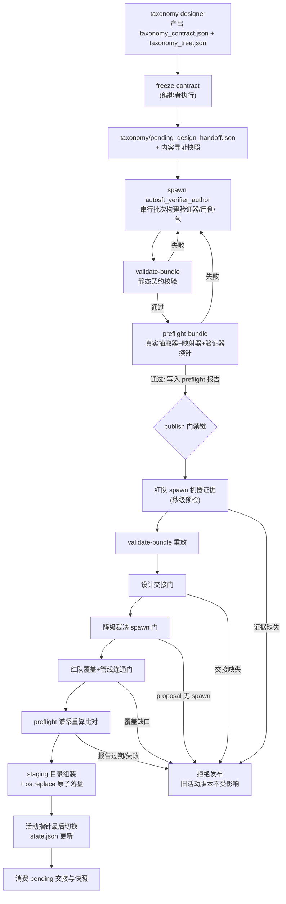

分类体系（taxonomy）的每一次版本演进都不是一次普通写盘，而是一条由四个命令组成的**门禁流水线**：`freeze-contract` 在任何验证器作者被生成之前锚定设计契约，`validate-bundle` 对完整候选包做静态契约校验，`preflight-bundle` 用真实模型与真实验证器做在线演练，最后 `publish` 在多重独立证据门（红队评审、降级裁决、预飞谱系）全部通过后，以目录级原子替换的方式切换活动版本。本文面向高级开发者，剖析 `src/control_plane/taxonomy_runtime.py` 中这条流水线的实现细节、指纹绑定关系与失败安全语义，以及各测试文件如何锁定这些机械保证。

> **📖 小白导读**
> - 这篇讲什么：分类体系版本切换的四道门——冻结契约、静态校验、真机演练（preflight）、多重证据通过后的原子发布。
> - 读之前先知道：**bundle（候选包）**＝一次待发布的分类体系版本的全部文件（契约+树+验证器打包）；**preflight（预飞检查）**＝上线前用真实模型和真实验证器做的在线演练（借自航空领域的起飞前检查）；**原子替换**＝新版本要么完整生效、要么完全不动的目录级切换方式，杜绝"换了一半"的中间态。
> - 读完你能明白：为什么"JSON 里写着已通过评审"不算数（字符串是数据不是证据）；四道门各自的通过条件；发布瞬间发生了什么。
> - 提醒：本页为高级内容，理解主链即可，细节按需回来查。

Sources: [taxonomy_runtime.py](src/control_plane/taxonomy_runtime.py#L7338-L7394)

## 全景：门禁序列与命令链

理解这条流水线的第一原则是：**每一道门回答一个不同的、不可替代的问题**。设计冻结回答"这份契约是谁定的"；静态校验回答"候选包是否与冻结契约自洽"；预飞回答"真实模型与真实验证器在闭环上是否成立"；发布则回答"所有独立证据是否齐备、能否以不破坏旧版本的方式切换"。参考包 README 给出了规范命令序列，四个命令必须以同一 `--contract-fingerprint` 串联：

```text
freeze-contract -> validate-bundle --contract-fingerprint <fingerprint>
-> preflight-bundle --contract-fingerprint <fingerprint>
-> publish --preflight-report <report> --contract-fingerprint <fingerprint>
```

下面这张 Mermaid 流程图展示完整的门禁顺序与失败路径。阅读它需要了解两个约定：菱形节点是判定（通过/失败），失败路径上的所有变更均不会触及 `taxonomy/current_taxonomy.json` 活动指针——这是流水线"失败即无痕"语义的图形化表达：



流水线的角色分工同样重要：`autosft_taxonomy_designer` 只产出契约，`autosft_verifier_author` 在串行批次中构建验证器并驱动 validate/preflight 通过（或交回阻塞提案），`autosft_capability_taxonomy_verifier`（编排者）拥有冻结与发布动作本身。技能文档明确将 validate-bundle/preflight-bundle 归属作者线程，将 publish 归属编排者——这条所有权边界正是后文所有机器写入证据检查的信任基础。

Sources: [README.md](skills/taxonomy-verifier-implementation/assets/reference_bundle/README.md#L33-L50)

Sources: [SKILL.md](skills/taxonomy-verifier-implementation/SKILL.md#L36-L57)

## freeze-contract：设计交接的权威锚定

`freeze-contract` 是流水线的第一道门，解决的核心问题是**信任锚放在哪**（该命令可重复执行且结果不变，即幂等）。设计契约初稿位于 `taxonomy_work/taxonomy_contract.json`，而这个目录是验证器作者可写的——如果信任锚留在那里，作者只需在生成后编辑契约再"自我报告"一个新指纹，就能把私改的设计洗白为合法冻结。因此 `freeze_design_contract` 做了三件事：把交接记录写到父级所有的 `taxonomy/pending_design_handoff.json`（刻意不在 `taxonomy_work` 下）；对契约、树与证据文件做内容寻址快照；并把冻结动作设计为幂等且不可替换——同一契约身份重复冻结返回同一结果，而不同身份的冻结会被直接拒绝，作者无法通过"编辑 work 树再请求 bless"产生第二次冻结。

快照机制是这套设计的关键。`_install_pending_design_snapshot` 将契约文件、树文件及全部证据文件经暂存目录逐字节复制到 `taxonomy/pending_design/<contract_fingerprint>/` 下，再以 `os.replace` 整目录原子落位；已存在时则走 `_verify_pending_design_snapshot` 重验指纹而非重写。快照中保留了契约相对布局（树相对契约目录的路径、证据相对路径），使后续任何验证都能在不可变副本上进行。恢复路径 `unpublished_design_contract` 的语义由此确定：一个裸的 `taxonomy_work/taxonomy_contract.json` **不是**冻结证据——恢复只信任持久化交接与指纹快照，裸契约被报告为"不可信、需重跑设计"，从根上堵死了恢复期间把可变文件变成新冻结的通道。

冻结本身还校验轮次一致性：bootstrap 冻结在存在活动分类体系时被拒绝、不得声明父版本；refine 冻结必须存在活动分类体系且 `expected_parent_version` 精确等于当前活动版本。这保证了契约谱系与版本谱系在源头即对齐。测试套件锁定了这些行为，其中 `test_freeze_handoff_blocks_synchronized_contract_tree_edits` 模拟了最狡猾的绕过——同时编辑 leaf_plans、树语义和自报树指纹使候选包局部自洽——并断言父级交接仍拒绝它；`test_freeze_snapshots_design_outside_the_mutable_work_tree` 则证明作者事后把 work 树改写成空对象也无法污染恢复所信任的设计。

Sources: [taxonomy_runtime.py](src/control_plane/taxonomy_runtime.py#L1219-L1334)

Sources: [taxonomy_runtime.py](src/control_plane/taxonomy_runtime.py#L947-L1013)

Sources: [taxonomy_runtime.py](src/control_plane/taxonomy_runtime.py#L580-L588)

Sources: [taxonomy_runtime.py](src/control_plane/taxonomy_runtime.py#L1337-L1413)

Sources: [test_taxonomy_runtime.py](tests/test_taxonomy_runtime.py#L544-L651)

## validate-bundle：候选包的静态契约校验

`validate_bundle` 是纯本地的确定性校验，它消费一个 schema 2.0 的候选包并回答"这个包是否与冻结契约、当前活动状态完全自洽"。其检查项按依赖顺序排布，任何一项失败都抛出 `TaxonomyRuntimeError`：

| 检查维度 | 具体内容 | 失败示例 |
| --- | --- | --- |
| 包形态 | 必须是 `taxonomy_work` 下的常规文件（拒绝符号链接逃逸）、schema_version=2.0、无未知字段、无 legacy 字段混入 | `family_inventory` 等旧字段出现即拒绝 |
| 轮次一致性 | bootstrap 不得替换活动版本；refine 必须有活动版本且 `expected_parent_version` 精确匹配；`taxonomy_id` 在一个 run 内不可变 | refine 携带旧格式活动记录被拒（需统一契约状态） |
| 契约绑定 | `_validate_taxonomy_contract` 解析契约/树/证据指纹，`_bind_design_handoff` 将候选与持久化交接逐字段比对（契约指纹、contract_id、树指纹、证据记录、job_type、round_id、父版本） | 候选与交接指纹不匹配 → "does not match the persisted designer handoff" |
| 范围对账 | 契约的 scope_units 与 leaf_plans 对实际发布的类目做对账；计划 active 或父版本中曾 active 的叶子以 candidate 状态发布时，必须携带一叶一条的降级提案与独立裁决记录 | 兄弟叶子替代、author-only 提案均不可作为豁免 |
| 验证器与注册表 | 每个活动叶子恰有一个验证器、严格 args_schema、AST 安全与 ALLOWED_IMPORTS、树/注册表 schema 一致性 | 借用基准表、自造分词模式被拒 |
| 用例完备性 | golden/red-team 双正反例、红队独立性、CJK 覆盖、结构化标量探针、scope-unit 样本支撑、查询敏感度证明 | pass/fail reason 不可区分的验证器被拒 |
| 变更实质 | `change_log` 与 `refinement_report.summary` 非空且理由有实质内容；refine 必须确认消费了 `metrics.json`/`scores.json`/`failure_breakdown.json`/`failure_case_study.json` | 堆砌填充词的降级 obstacle 无法通过实质字符数检查 |
| 变更指纹 | 计算整个候选的内容指纹；与当前活动指纹相同则拒绝（"use record-noop"） | 无变更候选包被强制走 record-noop 旁路 |

值得强调的是 `benchmark_feedback_consumed` 的机械校验：refine 包必须为每个目标基准列出三个证据文件的真实路径、置三个 consumed 布尔为 true，且 `benchmark_feedback_evidence_paths` 必须覆盖全部被消费工件——运行时会实际读取这些文件并验证数值聚合与失败分解字段存在。这把"分析反馈是否被真正读过"从叙述变成了可检查的文件级事实。

Sources: [taxonomy_runtime.py](src/control_plane/taxonomy_runtime.py#L5894-L6193)

Sources: [taxonomy_runtime.py](src/control_plane/taxonomy_runtime.py#L366-L491)

Sources: [contracts.md](skills/taxonomy-verifier-implementation/references/contracts.md#L37-L65)

Sources: [test_taxonomy_contract_new_only.py](tests/test_taxonomy_contract_new_only.py#L45-L105)

## preflight-bundle：真实模型与真实验证器的在线演练

静态校验无法发现的问题只有在线演练能暴露：映射器是在**全部活动叶子构成的闭集**中做单选决策，一个叶子在半个分类体系下映射正确，可能在其余叶子落地后被兄弟叶子夺走同一约束——这与它自身代码无关。`preflight_bundle` 因此在发布前用真实 LLMGateway 客户端执行完整解析管线：抽取器产出原子约束，映射器给出叶子或 OTHER 的封闭集决策，随后用**映射器实际产出的 args**（而非用例自带的预期 args）调用真实验证器执行 pass/fail 探针。

执行逻辑在 `_run_preflight_once` 中：每个用例通过内容寻址的 `ParserCache` 缓存抽取与映射结果，比对实际 status、归一化标签（`_normalized_canary_labels` 按类目与 args 排序后比较）、候选状态集合与可选的原子约束计数；`verification_probes` 找到该类目的唯一标签后以 `invoke_verifier` 调用验证器沙箱。`stability_runs`（1–3）允许对选定用例重复模型检查以检验温度为零下的稳定性——多轮循环按轮次筛选活动用例，逐轮累积结果。任何失败或运行时错误都会让报告 `status: "failed"` 并抛错，且**失败报告不可用于发布**。

预飞报告的核心是 `_preflight_identity` 构造的身份元组：`next_version`、候选内容指纹、抽取指纹、映射指纹、用例指纹、全部验证器源 SHA-256、公开模型配置（剔除 auth），以及契约与树指纹。发布时 `_validated_preflight_report` 会用同一客户端工厂**重算**这个身份并与报告逐键比对——任何键不匹配都归入 mismatch 列表并拒绝，错误信息精确到 "preflight report is missing, failed, or stale"。这意味着预飞报告不是一张可以复用的通行证，而是与"这一个候选 + 这一个模型配置 + 这一批验证器字节"绑定的单次性证明。

Sources: [taxonomy_runtime.py](src/control_plane/taxonomy_runtime.py#L6402-L6470)

Sources: [taxonomy_runtime.py](src/control_plane/taxonomy_runtime.py#L6260-L6399)

Sources: [taxonomy_runtime.py](src/control_plane/taxonomy_runtime.py#L6223-L6257)

Sources: [taxonomy_runtime.py](src/control_plane/taxonomy_runtime.py#L6473-L6500)

Sources: [authoring.md](skills/taxonomy-verifier-implementation/references/authoring.md#L154-L173)

## publish：多重门禁与原子落盘

### 门禁链的执行顺序

`publish_bundle` 的门禁排序体现了一个明确的成本考量：**廉价的证据检查放在数分钟的 validate 重放之前**，让被跳过的评审者在数秒内失败并获得带修复指引的错误信息。完整顺序为：红队 spawn 证据预检 → `validate_bundle` 重放（在受保护运行下携带 `--contract-fingerprint`）→ 设计交接门（`AUTO_SFT_POLICY_GUARD` 下缺少持久化交接即拒绝）→ 降级裁决 spawn 门（每个 proposal_id 必须有机器写入的 spawn 证据）→ 红队覆盖与管线连通门（语义半场）→ 预飞报告谱系校验。三条 spawn/证据门各自可被专用环境变量覆盖，但默认跟随 `AUTO_SFT_POLICY_GUARD`——每个受保护的智能体运行都开启，普通测试与维护调用不开启。

三个"机器写入证据"检查共享同一设计哲学：**bundle 里的身份字符串不是出处证明**。`_red_team_spawn_evidence` 扫描 CODEX_HOME 会话日志，只接受 `payload.type == "function_call"` 且 `name == "spawn_agent"`、解析出的参数携带 `agent_type == "autosft_verifier_red_team"` 的记录——提示文本里充满评审者名字（每次尝试都被指示去 spawn 它），子串命中证明不了任何事，这个教训直接来自一次 22 处提及却从未真正 spawn 的真实失败运行。降级裁决门在此基础上更进一步：spawn 消息必须携带**精确的 proposal_id 标记**，且用带词边界的正则防止 `demotion.alpha.extra` 为 `demotion.alpha` 提供出处。红队的语义半场 `_require_red_team_review` 则比对"本候选变更了哪些验证器"（按源哈希与父版本对比）与"评审者实际攻击了哪些"，并要求 bundle 的 `red_team_cases` 逐字携带评审者的边界用例——没人读的 findings 文件等于没有评审。

Sources: [taxonomy_runtime.py](src/control_plane/taxonomy_runtime.py#L6503-L6551)

Sources: [taxonomy_runtime.py](src/control_plane/taxonomy_runtime.py#L2164-L2211)

Sources: [taxonomy_runtime.py](src/control_plane/taxonomy_runtime.py#L2399-L2484)

Sources: [taxonomy_runtime.py](src/control_plane/taxonomy_runtime.py#L2308-L2385)

### 原子发布的落盘机械

门禁全部通过后进入落盘阶段，其结构是"**暂存目录组装 → 逐文件 os.replace 到版本化位置 → 活动指针最后切换**"。发布首先在 `taxonomy/` 下创建带 UUID 的 `.staging-<version>-<hex>` 目录，将验证器源 `shutil.copy2` 到暂存验证器目录、组装带运行时版本戳的 taxonomy/registry/mapping/change_log/refinement_report，并写入版本化提示词与 schema 文件。契约归档是其中最精细的一步：发布的是**冻结设计的原始字节**而非重新序列化的对象——`_atomic_copy_file` 的文档字符串解释了原因：契约指纹绑定设计者树工件的字节哈希，发布时 JSON 往返可能改变空白而保留语义，那将使活动副本无法通过后续谱系验证。证据文件与树文件同样按契约相对布局逐字节复制，整个 `contract_archive` 连同归档版交接记录作为一个不可变版本目录落位。

落盘顺序本身即失败安全语义：先 `os.replace` 全部版本化工件（versions/、registries/、mappings/、golden_cases/、red_team/、parser_cases/、change_logs/、reports/、parsers/、preflight/、contracts/、verifiers/<version>/），**然后**才以 `_atomic_write_json` 更新 `taxonomy/current_taxonomy.json`、注册表、提示词、schema、preflight 报告等活动指针，最后原子写 `taxonomy/state.json`——代码注释明确写着"校验或复制失败会完整保留旧活动版本"。版本号由 `_next_version` 从活动版本机械推导（v0001 → v0002），不存在作者自选版本号的空间。refinement_report 的版本谱系字段（schema_version、taxonomy_version、job_type、round_id、generated_at）由运行时覆盖写入，作者伪造的 `v9999`/`forged-time` 会被测试断言为无效。

发布收尾消费 pending 交接：若候选绑定的契约指纹与持久化交接一致，则删除 `pending_design_handoff.json` 与对应内容寻址快照目录；删除失败被静默吞掉——活动版本与归档交接已经持久，残留的匹配标记是无害的，反而让恢复路径可以重验出处而非丢失谱系。测试 `test_publish_consumes_pending_design_snapshot` 精确锁定了这一对（pending 文件与快照目录消失、归档目录中的交接记录指向版本化工件）。

Sources: [taxonomy_runtime.py](src/control_plane/taxonomy_runtime.py#L6552-L6831)

Sources: [taxonomy_runtime.py](src/control_plane/taxonomy_runtime.py#L509-L523)

Sources: [taxonomy_runtime.py](src/control_plane/taxonomy_runtime.py#L6833-L6933)

Sources: [taxonomy_runtime.py](src/control_plane/taxonomy_runtime.py#L2487-L2493)

Sources: [test_classification_index.py](tests/test_classification_index.py#L847-L940)

## 原子性基础设施与门禁开关

三个原子写原语支撑整条流水线的失败安全：`_atomic_write_json`/`_atomic_write_text` 先在同目录写 `.name.<random>.tmp` 临时文件再 `os.replace`（同文件系统内的原子重命名）；`_atomic_copy_file` 为保留字节精确性而存在；目录级替换（staging → 目标）则保证契约归档与验证器目录要么整体出现、要么完全不出现。这套原语加上"版本化工件先行、活动指针殿后"的顺序，共同实现了一个不变量：**任何时刻读取 `current_taxonomy.json` 的观察者要么看到完整旧版本、要么看到完整新版本，不存在中间态**。

门禁开关的环境变量矩阵如下，三者在受保护运行下默认启用，维护调用可通过专用变量单独关闭（红队门可被显式置零，即使 `AUTO_SFT_POLICY_GUARD=1`）：

| 环境变量 | 控制的门 | 默认行为（未显式设置时） |
| --- | --- | --- |
| `AUTO_SFT_POLICY_GUARD` | 三门总开关 | 置 1 时设计交接门、红队门、降级裁决门全部生效 |
| `AUTO_SFT_REQUIRE_DESIGN_HANDOFF` | 发布必须有持久化设计交接 | 跟随 policy guard |
| `AUTO_SFT_REQUIRE_RED_TEAM` | 红队 spawn + findings 证据 | 跟随 policy guard；显式置 0 可单独关闭 |
| `AUTO_SFT_REQUIRE_DEMOTION_ADJUDICATOR` | 每个 proposal 的 spawn 证据 | 跟随 policy guard（与红队覆盖独立） |
| `CODEX_HOME` | spawn 证据扫描的会话日志根 | 缺省回退到 `<run_dir>/codex_home` |

Sources: [taxonomy_runtime.py](src/control_plane/taxonomy_runtime.py#L336-L349)

Sources: [taxonomy_runtime.py](src/control_plane/taxonomy_runtime.py#L876-L881)

Sources: [taxonomy_runtime.py](src/control_plane/taxonomy_runtime.py#L2279-L2289)

Sources: [taxonomy_runtime.py](src/control_plane/taxonomy_runtime.py#L2388-L2396)

## record-noop：无变更轮次的旁路

当 refine 分析的结论是"不改"，流水线提供 `record-noop` 作为正式出口——发布一个与活动指纹相同的包在 `validate_bundle` 中被明确拒绝，这强制"无变更"走专门的记录路径。`record_noop` 校验活动统一契约状态、要求报告含非空 `summary`、执行与 refine 相同的 `benchmark_feedback_consumed` 确认，然后把报告落盘为 `taxonomy/reports/refine_<round>_no_change.json`，置 `changed: false`、推进 `last_refined_round_id`，并**不创建任何分类体系版本**。这保证了"没有变更"也是一条有据可查、可被后续轮次引用的正式决策，而非静默的空轮。

Sources: [taxonomy_runtime.py](src/control_plane/taxonomy_runtime.py#L6981-L7042)

Sources: [publication.md](skills/taxonomy-verifier-implementation/references/publication.md#L52-L55)

## 测试套件对门禁行为的锁定

| 测试文件 | 锁定的流水线行为 |
| --- | --- |
| [test_taxonomy_runtime.py](tests/test_taxonomy_runtime.py#L534-L651) | 冻结快照位于可变 work 树之外；同步编辑契约+树+自报指纹被交接拒绝；同一内容寻址快照被复用；受保护校验必须携带父级指纹 |
| [test_red_team_gate.py](tests/test_red_team_gate.py#L1-L266) | 叙述性 spawn 指令不是证据；错误 agent 的 spawn 不是证据；覆盖缺口按验证器点名；评审者探针必须逐字进入 red_team_cases；显式置 0 可在 policy guard 下关闭红队门 |
| [test_demotion_adjudicator_gate.py](tests/test_demotion_adjudicator_gate.py#L1-L150) | spawn 必须携带精确 proposal_id；更长 ID 不提供前缀出处；`task_name` 拼写被接受；缺失门逐个报告所有缺失提案 |
| [test_classification_index.py](tests/test_classification_index.py#L819-L845) | `_publish` fixture 完整走 freeze→preflight→publish 三段；发布报告元数据由运行时拥有（伪造字段无效） |
| [test_taxonomy_contract_new_only.py](tests/test_taxonomy_contract_new_only.py#L45-L128) | 缺契约的包被拒；legacy 字段不可混入；裸 work 契约不被恢复为冻结；旧格式活动记录不能支撑 refine |

`test_red_team_gate.py` 的模块级文档字符串记录了这套门禁的来历——某次运行的日志里满是 spawn 评审者的指令文本（22 处提及）却从未真正调用，作者线程自己填满了 `red_team_cases`；测试因此固定了机械保证的每一条边界。红队门测试类还刻意继承分类索引测试基类以重跑其全部用例，作为门在无环境开关时保持惰性的廉价回归。

Sources: [test_red_team_gate.py](tests/test_red_team_gate.py#L1-L83)

## 延伸阅读

- 设计契约的语义规范（scope_units 决策、leaf_plans、树指纹计算）属于设计侧契约，见 [分类体系设计契约：taxonomy_contract 冻结、类目树语义与设计/实现分离原则](15-fen-lei-ti-xi-she-ji-qi-yue-taxonomy_contract-dong-jie-lei-mu-shu-yu-yi-yu-she-ji-shi-xian-fen-chi-yuan-ze)。
- preflight 探针最终调用的是验证器沙箱（ALLOWED_IMPORTS、CPU 秒限制），其运行时细节见 [验证器沙箱运行时：ALLOWED_IMPORTS 白名单、CPU 秒限制与离线确定性执行](16-yan-zheng-qi-sha-xiang-yun-xing-shi-allowed_imports-bai-ming-dan-cpu-miao-xian-zhi-yu-chi-xian-que-ding-xing-zhi-xing)。
- 发布门禁中的降级裁决与红队评审双门，其角色语义与 spawn 事件验证在 [降级裁决与红队评审：双记录门、独立评审员与机器写入 spawn_agent 事件验证](18-jiang-ji-cai-jue-yu-hong-dui-ping-shen-shuang-ji-lu-men-du-li-ping-shen-yuan-yu-ji-qi-xie-ru-spawn_agent-shi-jian-yan-zheng) 中有完整展开。
- 发布完成后在本地动态模式触发的分类作业请求（`classification_job request` 必须是最后一个工具动作）承接于 [分类索引与原子解析器：LLMGateway 结构化标注、逐轮验证与内容寻址缓存](12-fen-lei-suo-yin-yu-yuan-zi-jie-xi-qi-llmgateway-jie-gou-hua-biao-zhu-zhu-lun-yan-zheng-yu-nei-rong-xun-zhi-huan-cun)。
- 上述测试文件的完整导航见 [测试套件导航：28 个测试文件覆盖的契约、幂等性与门禁行为](28-ce-shi-tao-jian-dao-hang-28-ge-ce-shi-wen-jian-fu-gai-de-qi-yue-mi-deng-xing-yu-men-jin-xing-wei)。