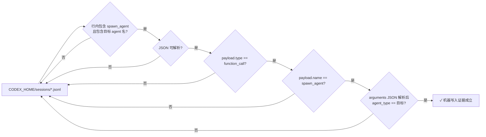
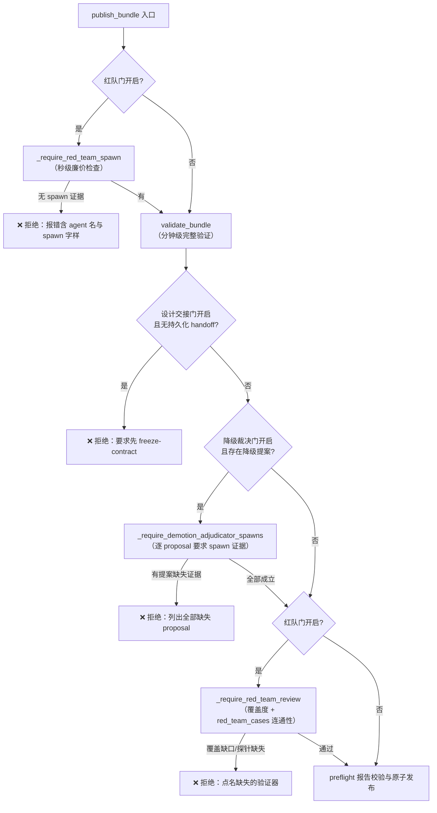

本文解析 AutoSFT 分类体系发布路径上最精细的两道治理门禁：**降级裁决门**（demotion adjudication）与**红队评审门**（red-team review）。两者的共同命题是同一个原创性问题——当一个 bundle 里的 JSON 记录声称"独立评审已经发生"时，运行时凭什么相信它？答案是这套系统给出的核心机制：**bundle 内的字符串是数据，不是来源；真正的来源是 codex 运行时机器写入会话日志的 `spawn_agent` 函数调用记录**。本文覆盖这两个门的开关矩阵、证据判定逻辑、正则边界匹配的防御性细节，以及它们在 `publish_bundle` 中的编排顺序。

> **📖 小白导读**
> - 这篇讲什么：发布路径上最精细的两道治理门——降级裁决门（类目要不要降级）与红队评审门（新类目是否靠谱），核心是"机器写入的运行记录才是唯一可信证据"。
> - 读之前先知道：**红队评审（red-team review）**＝专门挑毛病、试图证伪的独立审查角色（源自网络安全攻防术语"红队"）；**降级裁决**＝决定"一个表现不佳的类目是降级停用还是保留"的仲裁流程；**spawn_agent 记录**＝codex 运行时自动写入会话日志的"确实拉起过子智能体"的机器凭证——人手写的不算。
> - 读完你能明白：两道门的开关矩阵（什么情况必须过、什么情况可跳过）；证据判定的正则匹配细节；这套机制防的是什么作弊手法。
> - 提醒：全库最"治理味"的一页，非必需可后读。

Sources: [taxonomy_runtime.py](src/control_plane/taxonomy_runtime.py#L2154-L2156)

## 设计动机：一次失败运行留下的教训

红队门的测试文件 docstring 完整记录了这条门禁的由来：**提示词文本告诉每一次运行去 spawn `autosft_verifier_red_team`，而催生这道门的那次运行从未真正这样做——它的作者线程自己填满了 `red_team_cases`**。那次运行的日志里出现了 22 次 `autosft_verifier_red_team` 的提及，全部是指令文本，例如"spawn exactly one independent read-only reviewer, autosft_verifier_red_team"。这意味着一个只做子串匹配的守卫会被彻底欺骗：名字出现在日志里，但独立的评审线程从未被创建。

这不是孤例式的边界情况，而是 LLM 智能体系统的结构性风险：模型可以在叙述中表达完整、正确的意图（"我将 spawn 一个红队评审员"），而运行时层面什么都没发生。因此这道门的机械保证被明确钉死：在受守卫的运行下，`publish_bundle` 若找不到 codex 会话日志中机器写入的 spawn 证据，加上评审员持久化的发现文件，就拒绝发布——**叙述的意图两者都算不上**。

Sources: [test_red_team_gate.py](tests/test_red_team_gate.py#L1-L9), [test_red_team_gate.py](tests/test_red_team_gate.py#L49-L75)

降级裁决门面对的是同构但更微妙的问题：bundle 的 schema 要求每个从"计划 active"退化为 `candidate` 的叶子携带一份裁决记录，其 `adjudicator_identity` 字段写着 `autosft_demotion_adjudicator`。但这个字符串是**编排者提供的数据，不是来源证明**——作者线程完全可以自己编造这个字段。所以守卫发布还要把 proposal id 绑定到那个请求独立子智能体做出决定的、机器写入的 `spawn_agent` 调用上。错误信息说得直白："The bundle's identity field alone is not adjudication evidence"。

Sources: [taxonomy_runtime.py](src/control_plane/taxonomy_runtime.py#L2399-L2409), [taxonomy_runtime.py](src/control_plane/taxonomy_runtime.py#L2478-L2484)

## 证据模型：会话日志中的 function_call 记录

两道门共享同一个证据底座。每个 AutoSFT 运行都拥有一个**隔离的 codex home**：`agent_task.py` 在导出 `CODEX_HOME` 之前先捕获机器级 home，然后由 `prepare_run_codex_home` 把认证与配置种子到 `<run_dir>/codex_home`，此后所有会话历史、rollout 与日志都写入这个运行本地目录。这个隔离设计正是证据扫描的前提——spawn 证据检索函数可以枚举 `CODEX_HOME/sessions` 下的所有 `*.jsonl` 文件，确保证据空间是封闭且运行私有的。

Sources: [codex_home.py](src/control_plane/codex_home.py#L19-L43), [agent_task.py](src/control_plane/agent_task.py#L928-L939)

**机器写入证据的判定标准**在两个 spawn 证据函数中保持一致，构成一条严格的过滤漏斗：



注意第一层过滤的深意：先用廉价的子串检查跳过绝大多数行，但子串命中**只触发**后续的严格解析，本身永远不构成证据。`payload.type` 必须是 `function_call`——一条 `type: "message"` 的记录，无论其文本多么详尽地描述了 spawn 的意图，都会在第三层被丢弃。这条记录来自 codex 运行时本身，而非模型的叙述。

Sources: [taxonomy_runtime.py](src/control_plane/taxonomy_runtime.py#L2164-L2211), [taxonomy_runtime.py](src/control_plane/taxonomy_runtime.py#L2410-L2446)

## 门禁开关矩阵：三条独立的环境变量通道

两道门（加上相邻的设计交接门）各有一套**显式覆盖优先、否则跟随策略守卫**的开关语义。这个设计的核心约束写在降级门的注释里：**维护性调用可能有意禁用红队评审，但受守卫的生产运行仍必须证明裁决者的 spawn**——因此两个门不能共享一个覆盖变量。

| 环境变量 | 未设置时的行为 | 设置时的语义 | 对应门 |
| --- | --- | --- | --- |
| `AUTO_SFT_REQUIRE_RED_TEAM` | 跟随 `AUTO_SFT_POLICY_GUARD` | `"1"` 强制开启；**`"0"` 显式关闭（即使策略守卫开着）** | 红队评审门 |
| `AUTO_SFT_REQUIRE_DEMOTION_ADJUDICATOR` | 跟随 `AUTO_SFT_POLICY_GUARD` | `"1"` 强制开启；`"0"` 显式关闭 | 降级裁决门 |
| `AUTO_SFT_POLICY_GUARD` | — | `"1"` 时激活上述两门及设计交接门 | 全局守卫信号 |

测试从两个方向钉死了这个矩阵：`test_explicit_zero_disables_gate_even_under_policy_guard` 证明 `AUTO_SFT_REQUIRE_RED_TEAM=0` 在 `AUTO_SFT_POLICY_GUARD=1` 之下仍然放行发布；而 `test_policy_guard_alone_activates_gate` 证明只设策略守卫、不带任何证据时发布被拒绝。默认关闭同样被测试锁定——不带任何环境开关的普通调用（测试与维护场景）在零证据下也能发布，这保证了门禁对非生产路径保持惰性；`RedTeamGateTests` 继承 `ClassificationIndexTests` 使父类全部测试在本模块下重跑，正是对"无开关时门不动作"的廉价回归。

Sources: [taxonomy_runtime.py](src/control_plane/taxonomy_runtime.py#L2279-L2289), [taxonomy_runtime.py](src/control_plane/taxonomy_runtime.py#L2388-L2396), [test_red_team_gate.py](tests/test_red_team_gate.py#L240-L261)

## publish_bundle 中的编排顺序：快失败优先，语义校验殿后

门禁的执行顺序体现了明确的成本意识。`publish_bundle` 的入口先读取红队门开关，若开启则**立即**调用 `_require_red_team_spawn`——注释解释道这是"廉价预校验：在数秒内失败，而不是在一次四分钟的通过之后"。只有 spawn 证据成立，才进入昂贵的 `validate_bundle`（它要执行验证器沙箱、golden/red-team 用例真实运行、AST 安全检查等）。验证完成后，降级裁决门从已验证的 `demotion_records` 中提取全部 proposal id 并逐一要求 spawn 证据；最后红队门的**语义半边** `_require_red_team_review` 才执行覆盖度与管道连通性检查。



Sources: [taxonomy_runtime.py](src/control_plane/taxonomy_runtime.py#L6503-L6537)

## 红队评审门：从 spawn 证据到语义连通性

### 独立评审员的契约

技能库的角色表用"拥有物 / 永不触碰"二分法划定了独立评审员的位置：`autosft_verifier_red_team` 拥有对抗性 pass/fail 边界用例，**只读，永不编辑验证器**；与之并列的 `autosft_demotion_adjudicator` 拥有针对单个降级提案的 approve/reject 决定，**不写代码、不设计类目**。发布流程文档进一步规定编排者的义务：在构建批次结束后 spawn 恰好一个只读评审线程，它把边界用例与发现写入 `taxonomy_work/red_team/findings.json`，作者把这些探针原样消费进 bundle 的 `red_team_cases`。

Sources: [SKILL.md](skills/taxonomy-verifier-implementation/SKILL.md#L41-L48), [publication.md](skills/taxonomy-verifier-implementation/references/publication.md#L40-L48)

### 发现文件的结构化契约

`_load_red_team_findings` 对评审员持久化输出的校验构成第二道独立证据链。文件必须位于运行时定义的规范路径（`taxonomy_work/red_team/findings.json`），缺失时的错误信息明确排除了作者线程代写的可能："the author thread must not write that file"。结构上要求三个字段：**非空的 `attacked_verifier_ids` 列表**（命名评审员攻击过的每个变更验证器）、**非空的 `boundary_cases` 列表**（每个用例携带字符串 query、completion、category_id，expected ∈ pass|fail|unknown），以及一个 `findings` 列表（空列表合法——"当每一次攻击都被挡住时"）。

Sources: [taxonomy_runtime.py](src/control_plane/taxonomy_runtime.py#L2159-L2161), [taxonomy_runtime.py](src/control_plane/taxonomy_runtime.py#L2214-L2276)

### 语义半边：覆盖度与管道连通性

`_require_red_team_review` 的 docstring 点明了它的存在理由："评审员必须攻击过这个候选变更的每一个验证器，且 bundle 必须真正携带评审员撰写的探针——**一个没人读的发现文件与没有评审员等价**"。它分两步执行：

第一步是**覆盖度检查**：运行时把候选中所有源码 SHA-256 相对父版本发生变化的验证器收集为 `changed` 集合，要求 `attacked_verifier_ids ⊇ changed`。缺口会被点名报出（最多列 10 个，余下以省略号提示）。

第二步是**连通性检查**，也是这套设计里最精巧的一环。运行时为每个用例计算一个规范化身份——把 `(query, completion, args, expected)` 排序后序列化为 JSON——然后检查：对于每个既被攻击又变更了的验证器，bundle 的 `red_team_cases[verifier_id]` 中至少携带一条与评审员 `boundary_cases` 身份完全一致的探针。错误信息阐述了规则的精神："作者必须原样包含评审员提供的探针（query、completion、args、expected）；在此之上添加自己的用例没问题，替换评审员的不行。"

Sources: [taxonomy_runtime.py](src/control_plane/taxonomy_runtime.py#L2308-L2385)

### 独立性的结构化下界

在门禁之外，`validate_bundle` 内部还有一个始终生效的**独立性检查** `_validate_red_team_independence：它对每个活跃验证器比较 golden 与 red-team 两个用例集的**用例身份（completion + args 的规范化序列化）**，若红队集没有提供任何 golden 集缺失的新身份，验证直接失败。其 docstring 解释了为什么这能构成"独立性的结构化下界"：验证器与它的 golden 用例来自对同一个叶子的同一次阅读，**它们在构造上就彼此一致**——从同一集合复制的用例只是重新问了已回答的问题，为一个没人攻击过的验证器报告一道绿色的门。

Sources: [taxonomy_runtime.py](src/control_plane/taxonomy_runtime.py#L5065-L5113)

## 降级裁决门：双记录结构与提案绑定

### 双记录的语义契约

降级治理的核心在 `_validate_demotion_records`：一个"计划 active → candidate"的退化不是普通的候选状态，而是**必须被逐叶裁决的撤回**。整套结构由两条记录组成：

| 维度 | demotion_proposals（作者提案） | demotion_adjudications（独立裁决） |
| --- | --- | --- |
| 签发者 | `author_identity` 必须是 `autosft_verifier_author` | `adjudicator_identity` 必须是 `autosft_demotion_adjudicator`，**且不得等于提案的作者身份** |
| 身份锚点 | 精确 `proposal_id` + `category_id` + `unit_key`（须匹配冻结契约中该类目的归属） | 同一三元组，任何错配即拒绝 |
| 实质内容 | `obstacle`（实质性 ≥ 30 字符）+ `unblocked_by`（≥ 20 字符） | approve 时**逐字保留**提案的 obstacle/unblocked_by；reject 时必须留空 |
| 证据 | `preflight_failure_ids` + `evidence_paths` + 运行时复核的 `evidence_fingerprint` | `evidence_fingerprint` 必须与所审提案完全一致 |
| 决定权 | 只能提议，不能批准或应用 | `decision: approve/reject`；**reject 的提案不得以 candidate 状态发布** |

实质性阈值由 `_reason_substance` 执行：先剥除 25 个样板短语（"not ready"、"future work"、"to be determined"等）与 45 个填充词，再对残余内容计量——长度会被填充击败，样板黑名单又会漏掉生硬的非回答，所以两者结合。分词基于 Unicode 词字符而非 ASCII，**CJK 字符权重为 2**（一个 CJK 字符承载约一个语素，而一个拉丁字符只承载一个字母），校准注释给出了实例：真实障碍条款留下 36 个字符，而填充的非答案只留下 18 个。

Sources: [taxonomy_runtime.py](src/control_plane/taxonomy_runtime.py#L3706-L3722), [taxonomy_runtime.py](src/control_plane/taxonomy_runtime.py#L3870-L3902), [taxonomy_runtime.py](src/control_plane/taxonomy_runtime.py#L4021-L4077), [taxonomy_runtime.py](src/control_plane/taxonomy_runtime.py#L2533-L2557), [taxonomy_runtime.py](src/control_plane/taxonomy_runtime.py#L146-L159)

这套验证还系统性地封堵了所有"批量降级"的捷径：静态被封锁列表本身就被注释指认为"这道门要移除的机制"——只要 bundle 中出现任何 candidate，运行时就检查其来源是否引用了硬编码的 blocked-category 列表；曾经活跃且携带验证器的叶子**不能直接标为 `deprecated`**（必须保持 candidate 走完整裁决）；一个类目最多一份提案、一份提案最多一份裁决；每个计划 active 或先前 active 的退化叶子都必须恰好被一份提案和一份 approve 覆盖。bundle 的顶层字段集合 `demotion_proposals` 与 `demotion_adjudications` 也是 schema 的显式成员。

Sources: [taxonomy_runtime.py](src/control_plane/taxonomy_runtime.py#L3743-L3794), [taxonomy_runtime.py](src/control_plane/taxonomy_runtime.py#L2714-L2736)

### spawn 证据绑定与正则边界匹配

双记录结构通过了 `_validate_demotion_records` 之后，守卫发布还要穿越最后一层：`_require_demotion_adjudicator_spawns` 从验证结果中提取全部 proposal id，对每一个调用 `_demotion_adjudicator_spawn_evidence` 在会话日志中寻找**绑定该精确提案**的机器写入 `spawn_agent` 调用。

这个函数的判定比红队版本多两个防御性细节。第一，它同时接受历史拼写 `agent_type` 与当前工具的 `task_name` 字段——测试 `test_current_task_name_spelling_is_accepted` 锁定了这种向前兼容。第二，也是最关键的，**proposal id 的匹配必须是一个完整的标识符 token，而非子串**。问题在于提案 id 共享点号/下划线的 slug 字母表：如果用子串检查，一个为 `demotion.alpha.extra` 发起的 spawn 就能"证明" `demotion.alpha` 的来源。运行时的解法是把解析后的参数对象重新序列化，再用正则做**边界锚定的完整 token 匹配**：

```python
rf"(?<![\w.-]){re.escape(proposal_id)}(?![\w-]|\.(?=[\w.-]))"
```

这个模式的两个环视各自负责一个边界：前向环视 `(?<![\w.-])` 禁止 id 前面紧邻任何标识符字符（排除 `xdemotion.alpha`）；后向环视 `(?![\w-]|\.(?=[\w.-]))` 禁止 id 后面紧邻词字符、连字符，**或后面还跟着标识符字符的点号**。注释专门解释了这个点号的微妙之处：自然语言的 spawn 消息常以句号结尾（`demotion.alpha.`），此时点号是标点而非标识符的一部分，应予放行；但 `demotion.alpha.extra` 中的点号后面跟着 `e`，仍必须失败。测试 `test_longer_proposal_id_does_not_prove_prefix` 正是对这条边界的精确钉死。

Sources: [taxonomy_runtime.py](src/control_plane/taxonomy_runtime.py#L2399-L2466), [taxonomy_runtime.py](src/control_plane/taxonomy_runtime.py#L2469-L2484), [test_demotion_adjudicator_gate.py](tests/test_demotion_adjudicator_gate.py#L64-L93)

## 测试矩阵：拒绝面与放行面

两个测试文件共同构成这两个门的完整行为规约。红队门测试覆盖了从"从未 spawn"到"spawn 了错误智能体"再到"spawn 了但没有发现文件"的整条拒绝链，以及唯一的放行组合：

| 测试场景 | 期望结果 | 验证的契约点 |
| --- | --- | --- |
| 门关闭、零证据发布 | ✅ 放行（v0001） | 门禁对无开关调用惰性 |
| 有发现文件、从未 spawn | ❌ 拒绝，报错含 agent 名与 "spawn" | 双证据缺一不可 |
| 只有叙述性指令文本 | ❌ 拒绝 | 子串命中不是证据 |
| spawn 了 `autosft_verifier_author` | ❌ 拒绝 | agent 身份必须精确匹配 |
| spawn 成立、发现文件缺失 | ❌ 拒绝，报错含 "red_team" 与 "findings" | spawn 不豁免持久化输出 |
| 发现文件缺 `attacked_verifier_ids` | ❌ 拒绝，报错点名缺失字段 | 结构化 schema 强制 |
| 攻击列表不含变更验证器 | ❌ 拒绝，报错点名该验证器 | 覆盖度语义 |
| bundle 丢弃全部评审员探针 | ❌ 拒绝，报错含 "red_team_cases" 与验证器名 | 管道连通性 |
| 叙述行 + 真实 spawn + 发现文件 + 连通 bundle | ✅ 放行（v0001） | 完整证据链成立 |

降级裁决门测试则聚焦于 token 边界与提案粒度：spawn 必须命名精确提案（对 `demotion.alpha` 的查询在 `demotion.beta` 的 spawn 下返回 False）；叙述与错误 agent 一律不算来源；聚合级 `_require_demotion_adjudicator_spawns` 的报错必须列出**每一个**缺失的提案（`['demotion.beta']` 出现在异常正则中）。

Sources: [test_red_team_gate.py](tests/test_red_team_gate.py#L128-L238), [test_demotion_adjudicator_gate.py](tests/test_demotion_adjudicator_gate.py#L47-L145)

## 与相邻门禁的协同

这两道门不是孤立存在的，它们嵌在一条更大的发布门禁链上。`publish_bundle` 在它们之前先检查**设计交接门**（守卫运行要求 `freeze-contract` 持久化的 handoff，防止作者替换"编排者冻结了哪份契约"这一事实），在它们之后校验 preflight 报告的身份指纹与版本谱系，最后才进入原子发布。技能文档中 contracts.md 对降级门的描述也把双记录与 spawn 事件写进了对智能体的契约文本："In guarded runs, publish additionally requires a machine-written `spawn_agent` event for `autosft_demotion_adjudicator` whose message carries the exact `proposal_id`; the identity string in the JSON record is not provenance by itself."——即技能文档、运行时实现与测试三层对同一不变量的重复钉死。

发布之后的延续方面，`_approved_demotion_obstacles_by_category` 从版本化报告中恢复每个 candidate 的障碍与解除条件，供后续 refine 的覆盖报告使用——裁决的结果不是终点，而是**晋级积压**（promotion backlog）的输入。

Sources: [taxonomy_runtime.py](src/control_plane/taxonomy_runtime.py#L6523-L6527), [contracts.md](skills/taxonomy-verifier-implementation/references/contracts.md#L103-L120), [taxonomy_runtime.py](src/control_plane/taxonomy_runtime.py#L4108-L4160)

## 延伸阅读

- 理解这两道门所处的外层流水线，见 [发布门禁流水线：freeze-contract、validate-bundle、preflight-bundle 与原子发布](17-fa-bu-men-jin-liu-shui-xian-freeze-contract-validate-bundle-preflight-bundle-yu-yuan-zi-fa-bu)
- 设计交接门背后的冻结机制与指纹谱系，见 [分类体系设计契约：taxonomy_contract 冻结、类目树语义与设计/实现分离原则](15-fen-lei-ti-xi-she-ji-qi-yue-taxonomy_contract-dong-jie-lei-mu-shu-yu-yi-yu-she-ji-shi-xian-fen-chi-yuan-ze)
- 全局守卫信号 `AUTO_SFT_POLICY_GUARD` 的完整语义与违规审计，见 [策略守卫机制：policy_guard 的源码保护、禁用训练流检测与违规审计（policy_guard_check.sh）](9-ce-lue-shou-wei-ji-zhi-policy_guard-de-yuan-ma-bao-hu-jin-yong-xun-lian-liu-jian-ce-yu-wei-gui-shen-ji-policy_guard_check-sh)
- 验证这些门行为的测试文件全貌，见 [测试套件导航：28 个测试文件覆盖的契约、幂等性与门禁行为](28-ce-shi-tao-jian-dao-hang-28-ge-ce-shi-wen-jian-fu-gai-de-qi-yue-mi-deng-xing-yu-men-jin-xing-wei)