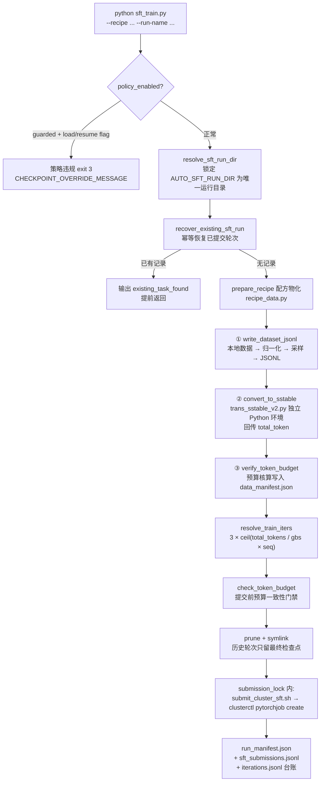

本文解析 AutoSFT 闭环中一次"正常 SFT 轮次"的完整生命周期：`sft_train.py` 作为唯一入口，如何在策略守卫的约束下拒绝一切检查点续训路径、强制每轮独立从 `Qwen/Qwen3-1.7B-Base` 初始化，如何将智能体撰写的数据配方（`data-recipe.yaml`）物化为训练引擎可直接消费的 SSTable，如何从实际 token 体量自动推导训练步数并通过预算门禁，最终以幂等方式把 Megatron 训练作业提交到 Cluster 集群并写入双重台账。本文聚焦"提交前"的全部确定性逻辑——检查点格式转换、评测执行与作业轮询属于后续阶段，将只作为交接点提及。

> **📖 小白导读**
> - 这篇讲什么：一次正常 SFT 训练轮的"提交前"全流程——配方物化、token 核算、步数推导、预算门禁、幂等提交到集群。
> - 读之前先知道：**SFT（监督微调）**＝用"问题＋标准答案"数据继续训练已有模型；**配方（data-recipe.yaml）**＝写明"用哪些类目、各多少 token"的数据配比单；**幂等（idempotent）**＝同一操作重复执行结果不变、不会重复提交作业的性质；**Megatron**＝NVIDIA 的分布式大模型训练框架，本项目训练作业用它跑。
> - 读完你能明白：为什么每轮都从同一个 Base 模型从头训（禁止续训的科学原因）；SSTable 是怎么从配方物化出来的；训练步数公式的每项含义。
> - 提醒：本页是训练主线核心，建议与第 13、14 页（计量与采样）连读。

## 全景：一轮 SFT 的八个阶段

理解这一页的关键在于一个设计决策：**训练轮次是"无状态"的**。每一轮都从同一个基座检查点独立开始，唯一的实验变量是数据配方。这使轮次之间完全可比，也让整个系统可以放心地把研究自由度全部押在数据侧。下图给出从命令行调用到台账落盘的全链路：



整个流程的刻意约束是：智能体传入的只有配方与运行名，超参、步数、检查点来源、输出目录全部由系统单方面决定。

Sources: [sft_train.py](sft_train.py#L435-L753)

## 入口契约：固定基座与"三不可"策略守卫

`sft_train.py` 顶部的一组模块级常量定义了整轮的不可变骨架：`BASE_MODEL` 被钉死为 `Qwen/Qwen3-1.7B-Base`（`--base-model` 的 `choices` 只有这一个值），`TRAIN_EPOCHS` 固定为 3，`MODEL_DEFAULTS` 则登记了该基座对应的分词器目录与 Megatron 检查点路径 `/user/sunpengqi/qwen3_1p7b_if_sft_20260520/ckpts/qwen3_1.7b_base.tp1`。`SFT_HYPERPARAM_ENV` 声明了仅存的五个可读超参环境变量（lr、min_lr、global_batch_size、micro_batch_size、save_interval），但它们属于运行环境注入的固定默认值，而非智能体按轮调优的旋钮——智能体的研究变量只有数据。[sft_train.py](sft_train.py#L31-L53)

守卫逻辑在 `main()` 的最前端执行：若策略守卫启用（`policy_enabled()`）且命令行携带 `--load-ckpt` 或 `--resume-from`，进程直接以退出码 3 终止，并输出 `CHECKPOINT_OVERRIDE_MESSAGE`——"Guarded AutoSFT rounds always start from the Qwen3 base model"。同样地，显式传 `--train-iters` 在**任何**模式下都会被拒绝：正常轮次的步数由数据体量自动推导，续训轮次则恢复原计划总量。这两个拒绝合在一起确立了"正常轮次 = 新鲜微调"的语义。值得注意的是一个细节防御：若用户在非守卫模式下手动传了 `--load-ckpt`，入口会立即调用 `Path(...).resolve()` 把该路径冻结为具体目录——因为后续 `link_current_round_checkpoints` 会把 `run_dir/sft/checkpoints` 符号链接重指到新一轮，若不提前解析，形如 `--load-ckpt <run>/sft/checkpoints` 的回溯路径会静默指向空的新轮目录。[sft_train.py](sft_train.py#L33-L44) [sft_train.py](sft_train.py#L435-L453)

运行目录本身也是被守卫的：`resolve_sft_run_dir` 在 guarded 模式下要求实际运行目录与 `AUTO_SFT_RUN_DIR` 逐字节解析后一致，任何不一致都会以 `sft_run_dir_mismatch` 规则记录到 `policy_feedback.json` 并退出。测试 `test_guarded_explicit_noncanonical_run_dir_is_rejected` 验证了这一失败闭合行为。[sft_train.py](sft_train.py#L56-L84) [tests/test_sft_defaults.py](tests/test_sft_defaults.py#L60-L79)

## 检查点初始化：三种模式，一种守卫语义

`resolve_checkpoint_initialization` 是"独立初始化"的规范实现点。它按优先级返回 `(checkpoint 路径, initialization 元数据)` 二元组，三种模式的语义边界如下表：

| 模式 | 触发条件 | 检查点来源 | `initialization.type` | Guarded 模式 |
|------|---------|-----------|----------------------|-------------|
| **正常轮次** | 无 `--load-ckpt` 无 `--resume-from` | `AUTO_SFT_SFT_LOAD_CKPT` 环境变量，回退 `MODEL_DEFAULTS` 的 Qwen3-Base `.tp1` 目录 | `base` | **唯一允许** |
| **续训** | `--resume-from <run_dir>` | 不设置（由提交脚本的 `--load <output>/checkpoints` 接管） | `resume` + `source_run_dir` | 拒绝，exit 3 |
| **显式加载** | `--load-ckpt <path>` | 用户显式路径 | `checkpoint_load` | 拒绝，exit 3 |

正常轮次解析出的 Qwen3-Base 检查点随后经 `AUTO_SFT_SFT_LOAD_CKPT` 环境变量传递给提交脚本，配合 `--finetune --no-load-data-state` 两个 Megatron 标志完成"从基座独立微调"——不携带任何优化器状态与数据迭代器状态。测试 `test_normal_initialization_uses_configured_qwen3_base_checkpoint` 与 `test_manual_checkpoint_load_remains_available` 分别锁定两端行为：守卫下永远取默认基座，非守卫下手动加载仍可用（供遗留/人工操作）。[sft_train.py](sft_train.py#L354-L383) [sft_train.py](sft_train.py#L597-L598) [tests/test_sft_defaults.py](tests/test_sft_defaults.py#L150-L223)

## 配方物化：prepare_recipe 的三阶段流水线

`prepare_recipe`（`src/control_plane/recipe_data.py`）把 YAML 配方变成训练引擎可读的数据，同时产出事实清单 `data_manifest.json`。它首先把配方复制为 `run_dir/data-recipe.yaml` 快照（保证后续审计读到的是当轮真实输入），然后依次执行三个阶段。

**阶段一：JSONL 物化**（`write_dataset_jsonl`）。对配方中的每个数据集条目：解析路径（优先显式 `path`，否则在 `datasets_dir/<id>`、`run_dir.parent/datasets/<recipe_id>/<id>`、`run_dir/datasets/<id>` 三级候选中探测），读取本地文件（`.jsonl` 逐行、`.json` 列表或 `data/rows/examples/train` 键、`.parquet` 与 `load_from_disk` 目录），再经 `normalize_row` 把三类上游格式统一为 `messages` chatml 结构——`messages` 原生格式直接清洗、`conversations` 格式做 `human/gpt/bot → user/assistant` 角色映射、`instruction/output` 单轮格式拼成 user+assistant 两条消息；`system_prompt` 若存在则前置注入。之后以固定种子 `seed=42` 洗牌（除非 `preserve_materialized_order: true`），截取 `sample_count` 行，可用行不足时按 `allow_repeated_samples` 决定有放回补齐或报错。同一函数还承担分类体系血缘的完整校验：`sample_manifest_path` 指向的采样清单必须与 `sample_count` 相等、token-fraction 清单必须声明 token 长度索引且其 `pool_sha256` 指纹一致、dense 混合必须使用 `cap + clip_and_drop` 配额模式、动态分类采样必须匹配当前激活的分类体系指纹——这些校验把第 11、12、13、14 页描述的数据动作与索引体系的产物"焊接"到训练输入上。[recipe_data.py](recipe_data.py#L41-L90) [recipe_data.py](recipe_data.py#L601-L665) [recipe_data.py](recipe_data.py#L239-L281)

**阶段二：SSTable 转换**（`convert_to_sstable`）。每个数据集写入独立目录 `run_dir/data/sstable/<dataset_id>/part-00000.sstable`，最终把 `"权重 目录"` 对拼接成 Megatron 的 `dataset_path` 字符串。这里有一个关键的环境隔离设计：转换通过 `subprocess.Popen` 调用**独立的 sstable conda 环境**（默认 `/user/zhangyixuan/.../envs/sstable/bin/python`）执行 `tools/sstable/trans_sstable_v2.py`，因为该工具依赖 thriftpy2 与 vendor_sdk，与控制面的依赖树互不兼容。控制面以 `stdout=PIPE, text=True, bufsize=1` 流式读取转换器输出，用正则 `total_token\s+(\d+)` 捕获 token 总数，并将其持久化为同目录的 `total_token.txt`——这样即使后续轮次直接复用该 SSTable（基于 `output.stat().st_mtime >= jsonl_path.stat().st_mtime` 的新鲜度判断），自动步数推导仍然可用；若 JSONL 更新，陈旧 SSTable 会被整体删除重建，杜绝"新一轮训练消费上一轮 token 数据"的静默错误。[recipe_data.py](recipe_data.py#L677-L741) [sft_train.py](sft_train.py#L37-L38)

**阶段三：预算核算**（`verify_token_budget`）。Token 预算的归属权在**运行（launcher）而不在配方**：环境变量 `AUTO_SFT_SFT_TOKEN_BUDGET` 是唯一权威上限，配方若重述预算必须与之相等，否则拒绝；智能体撰写的配方必须省略该字段。核算要求 `total_tokens`（各数据集转换回报之和；epoch＝把全部训练数据完整过一遍模型的轮次，本项目固定三轮）为已知正数且不超过预算，随后把完整的 `token_accounting` 对象（budget、realized、deviation、unused、utilization、planned/realized iters_per_epoch）写入清单。clip-and-drop 语义允许实现量低于预算——短类目被裁剪、未用预算直接丢弃，`train_iters` 跟随**实现量**而非名义上限。[recipe_data.py](recipe_data.py#L773-L814) [recipe_data.py](recipe_data.py#L817-L873)

一个结构性约束值得强调：**预算轮次必须只定义一个数据集条目**。原因是 `total_tokens` 是各条目简单求和，而 Megatron 按 `weight` 混合数据，多条目下"一轮 epoch"的含义会脱离预算语义——所以类目选择必须在采样阶段合并为单一完整混合物。[recipe_data.py](recipe_data.py#L215-L227)

## SSTable 转换器内部：encode_row 与 loss_mask 的单一真源

`trans_sstable_v2.py` 的 `encode_row` 是 token 计数的**唯一权威路径**——SSTable 转换与 `--count-only` 长度统计（即第 13 页的令牌长度索引）共用这一函数，保证了"索引里的每行 token 数"与"真实转换报出的 total_token"逐行相等，这是预算一致性的物理基础。对 chatml 格式的处理流程是：`apply_chat_template` 一次性渲染完整对话文本 → 带 `return_offsets_mapping=True` 整体 tokenize（不支持时降级为逐 token decode 建立字符映射）→ 默认 loss_mask 全 1 → 定位每个 `<|im_start|>assistant` 到 `<|im_end|>` 的字符区间，把与之相交的 token 置 0。这里的语义约定是 **0 = 计入损失（assistant 段），1 = 不计入**，与直觉相反，是 SSTable 的历史约定；行尾若缺 EOS 则补上且计入损失。每行经 `traindoc.thrift` 的 `BaseDoc(token_ids, mask)` 序列化后由 `MbTableBuilder` 以 kLzo 压缩写入。[trans_sstable_v2.py](trans_sstable_v2.py#L56-L64) [trans_sstable_v2.py](trans_sstable_v2.py#L92-L184)

Token 总量的回传链路同样值得注意：多进程模式下 `doc_handler.total_token` 在主进程累加各 worker 返回的 `len(tokens)`，`save()` 时打印 `self.total_token N`；`--count-only` 模式则显式打印 `total_token N`（还有 `count_rows`、`count_loss_token`）。控制面的正则正是匹配这一行。`convert_jsonl_to_sstable.sh` 提供了人工调用同一工具的薄封装，同样默认使用 sstable 独立 Python 环境。[trans_sstable_v2.py](trans_sstable_v2.py#L262-L285) [trans_sstable_v2.py](trans_sstable_v2.py#L396-L400) [convert_jsonl_to_sstable.sh](tools/sstable/convert_jsonl_to_sstable.sh#L12-L22)

## 训练步数推导与提交前预算门禁

步数推导由两个纯函数完成，公式为：

```text
iters_per_epoch = ceil(total_tokens / (global_batch_size × seq_length))
train_iters     = 3 × iters_per_epoch          # 正常轮次
train_iters     = resume_total_iters           # 续训：恢复原 run_manifest.json 的计划总量
```

`estimate_iters_per_epoch` 用 Python 的负 Floor 除法 `-(-a // b)` 实现向上取整，`tokens_per_iter = global_batch_size × seq_length`（默认 16 × 32768 = 524,288）。测试给出了两个锚点：70,748,900 tokens → 135 iters/epoch → 405 总步数；恰好 524,289 tokens（每步 +1）→ 2 iters/epoch → 6 总步数（体现三倍放大下的舍入放大效应）。`runtime_tokens_per_iter` 同样强制读取这两个环境变量并拒绝非正整数，确保准备与提交两侧使用同一套运行时旋钮。[sft_train.py](sft_train.py#L196-L212) [sft_train.py](sft_train.py#L321-L351) [recipe_data.py](recipe_data.py#L750-L770) [tests/test_sft_defaults.py](tests/test_sft_defaults.py#L100-L137)

提交前的 `check_token_budget` 门禁做了近乎偏执的一致性校验：不仅要求 `realized ≤ budget` 且 `realized > 0`，还逐字段验证 `unused == budget - realized`、`deviation == realized - budget`、`utilization` 与 `realized/budget` 在 `abs_tol=1e-12` 内相等、`planned/realized_iters` 与从 `tokens_per_iter` 重算的期望值一致、清单 `total_tokens` 与核算 `realized_tokens` 相等、以及**准备阶段记录的 iters/epoch 必须等于本次提交计算的 iters/epoch**。任何不一致都以 `SystemExit` 拒绝提交并提示重新准备数据——这是防止"预算账本与实际提交的训练量分叉"的最后一道闸门。[sft_train.py](sft_train.py#L215-L318)

## 检查点保留策略：每轮一个最终检查点

磁盘管理由两个函数协作完成。`prune_prior_round_checkpoints` 遍历 `run_dir/sft/` 下的所有历史轮次目录，读取各自的 `latest_checkpointed_iteration.txt` 得到最终步数，删除所有 `step < final_step` 的 `iter_*` 目录——因此**每一轮在磁盘上只留下它的最终检查点**，且不同轮次的最终检查点互不删除（`test_pruning_keeps_every_prior_round_final_checkpoint` 验证了 round_1 的 `iter_0000006` 在 round_2 启动后依然存在）。`link_current_round_checkpoints` 则维护一个稳定锚点：把 `run_dir/sft/checkpoints` 符号链接指向当前活跃轮次的 checkpoints 目录，使转换与续训控制流程始终能通过这一规范路径访问"当前模型"。[sft_train.py](sft_train.py#L129-L193) [tests/test_sft_defaults.py](tests/test_sft_defaults.py#L225-L243)

## 作业提交：submit_cluster_sft.sh 与远程训练入口

提交脚本 `skills/cluster-sft-job-submission/scripts/submit_cluster_sft.sh` 是 `sft_train.py` 的唯一集群接口（技能文档明确禁止智能体直接调用它）。它强制要求 `train_iters` 作为第二个参数传入（`TRAIN_ITERS="${2:?...}"`，缺失即报错），序列长度默认 32768。核心训练配置的固定值如下表：

| 配置维度 | 默认值 | 来源 |
|---------|-------|------|
| 学习率 / 最低学习率 | 1e-4 / 1e-7 | `AUTO_SFT_SFT_LR` / `_MIN_LR` |
| LR 衰减 | cosine，`--lr-decay-iters = train_iters` | 固定 |
| LR 预热 | `train_iters × 5 / 100`（约 5%，无下限） | `AUTO_SFT_SFT_LR_WARMUP_ITERS` |
| 保存间隔 | `= train_iters`（即只写最终检查点） | `AUTO_SFT_SFT_SAVE_INTERVAL` |
| 并行策略 | TP=1, PP=1, CP=4，全量重算 uniform 1 层 | `AUTO_SFT_SFT_TP/_PP/_CP` |
| 序列长度 | 32768（同时设 max-position-embeddings） | `AUTO_SFT_SFT_SEQ_LENGTH` |
| 集群资源 | beijing / model-autosft 池 / h800 / 1 节点 8 卡 / 16 CPU / 128GiB | `AUTO_SFT_CLUSTER_*` |
| 远程代码 | Megatron-LM 固定 commit `0db633b...` | `AUTO_SFT_SFT_GIT_COMMIT` |

`RESUME_FLAGS` 的分叉点正对应初始化模式：续训时为 `--load "${OUTPUT_DIR}/checkpoints"`（并校验 `latest_checkpointed_iteration.txt` 存在、把对应 `iter_XXXXXXX` 链接为 `release` 以适配 Vendor 数据态加载器）；正常轮次为 `--load "${LOAD_CKPT}" --finetune --no-load-data-state`——这就是"从 Qwen3-Base 独立初始化"落到 Megatron 命令行上的最终形态。[submit_cluster_sft.sh](skills/cluster-sft-job-submission/scripts/submit_cluster_sft.sh#L12-L61) [submit_cluster_sft.sh](skills/cluster-sft-job-submission/scripts/submit_cluster_sft.sh#L88-L118)

远程容器内的 entry 脚本做四件事：`git checkout` 固定 commit、`pip install transformers==4.57.1`（走国内镜像 + 白名单代理）、把 `vendor_sdk_patches` 下的 `megatron_batch_packer.py` 与 `base_doc.py` 覆盖安装进 SDK（修补 SSTable 读取路径）、最后执行 `examples/qwen3/train_qwen3_1.7b.128k.sh` 并透传全部超参，附带 `--use-span-based-attn` 与 `--log-throughput`。`clusterctl pytorchjob create` 经 `cluster_retry` 包装做有界指数退避重试（应对 503/计费账户类瞬时故障），成功响应由内嵌 Python 以 JSON 追加到 `sft_submissions.jsonl`，记录字段包括 task、task_id、cluster、project、status、run_name、output_dir、dataset_path、train_iters、seq_length、resume_mode。[submit_cluster_sft.sh](skills/cluster-sft-job-submission/scripts/submit_cluster_sft.sh#L120-L191) [submit_cluster_sft.sh](skills/cluster-sft-job-submission/scripts/submit_cluster_sft.sh#L193-L229)

## 幂等提交：锁、恢复与冲突判定

提交环节的原子性由 `src/control_plane/submission_registry.py` 的 `submission_lock`（fcntl 排他文件锁 `.cluster-submission.lock`）保证——`sft_train.py` 在锁内执行"查重 → 冲突检测 → 提交"的完整序列，杜绝并发下的重复建任务。查重用 `find_sft_submission` 按 `run_name` 找到首条含 task 的记录；若存在，`sft_submission_conflicts` 逐一比对四元组（规范化的 output_dir、dataset_path、train_iters、seq_length）：完全一致则**复用**既有任务并输出 `existing_task_found`；任何一项不一致则**失败闭合**——拒绝创建第二个任务。这一幂等语义有两层入口：进程启动早期 `recover_existing_sft_run` 基于 `run_manifest.json` 的 run_name 匹配做快速短路（在数据准备之前，避免重复物化），提交时刻再做权威判定的兜底。此外若 `submit_cluster_sft.sh` 非零退出，`sft_train.py` 会转发其 stdout/stderr 并明确声明"未创建 Cluster 任务、未写入清单记录"，把模糊状态留给人工核查而非盲目重试。[sft_train.py](sft_train.py#L87-L116) [sft_train.py](sft_train.py#L613-L662) [submission_registry.py](src/control_plane/submission_registry.py#L44-L73) [submission_registry.py](src/control_plane/submission_registry.py#L76-L101)

## 轮次产物：run_manifest 与实验台账

提交成功后落盘三份记录，构成后续所有分析与评测的事实基础。`run_manifest.json` 是单轮的完整快照：run_name、created_at、base_model、recipe 路径、dataset_path、train_epochs / iters_per_epoch / train_iters 三元组、token_accounting、seq_length、sft_output_dir、sft_task（Cluster 任务 ID）、`initialization`（正常轮次为 `{"type": "base", "model": ..., "checkpoint": ...}`）、`branched_from`（正常轮次为 `null`）、policy 摘要以及完整的 data_manifest。`sft_submissions.jsonl` 是追加式的提交注册表。最后 `record_sft` 在 `iterations.jsonl` 实验台账中开启一条迭代记录：归档配方到 `recipe_history/iter_<NNN>.yaml`（因为运行目录里的活文件每轮都会被覆盖，快照是唯一不可变历史）、写入 hyperparams（由 `collect_hyperparams` 从环境变量捕获的五个旋钮 + 步数三元组）、以 `kind = "fresh"` 标注正常轮次（resume/restart/continue/mcts 等其他谱系仅在非守卫模式出现）、附加预暂存的 rationale，并触发 `iterations.md` 摘要重生成与 `refresh_executor_handoff` 交接刷新。台账写入被刻意设计为**尽力而为**——异常只打 WARN 不阻塞已成功的集群提交。[sft_train.py](sft_train.py#L688-L751) [ledger.py](src/control_plane/ledger.py#L237-L329) [ledger.py](src/control_plane/ledger.py#L1-L35)

## 延伸阅读

SFT 提交只是流水线的中段。训练完成后，轮次产物的下游路径依次是：[检查点转换：Megatron 分布式到 HF/vLLM 格式的幂等转换与 Python 环境隔离](20-jian-cha-dian-zhuan-huan-megatron-fen-bu-shi-dao-hf-vllm-ge-shi-de-mi-deng-zhuan-huan-yu-python-huan-jing-ge-chi)（消费 `run_dir/sft/checkpoints` 符号链接指向的最终检查点）、[Cluster 作业生命周期：提交、轮询、停止、收集与 clusterctl 有界重试基础设施](22-cluster-zuo-ye-sheng-ming-zhou-qi-ti-jiao-lun-xun-ting-zhi-shou-ji-yu-clusterctl-you-jie-zhong-shi-ji-chu-she-shi)（追踪本文创建的 PyTorchJob）。数据侧的上游依赖在[令牌长度索引：与 SSTable 转换同源的计数路径、指纹校验与预算一致性](13-ling-pai-chang-du-suo-yin-yu-sstable-zhuan-huan-tong-yuan-de-ji-shu-lu-jing-zhi-wen-xiao-yan-yu-yu-suan-zhi-xing)（`--count-only` 同源路径）、[类目容量与整行采样：cap 配额、clip-and-drop 欠填策略与三轮 epoch 训练步数推导](14-lei-mu-rong-liang-yu-zheng-xing-cai-yang-cap-pei-e-clip-and-drop-qian-tian-ce-lue-yu-san-lun-epoch-xun-lian-bu-shu-tui-dao)与[数据动作计划：不可变元计划、operator.py 约束执行与 Data Action Runner 的权威采样](11-shu-ju-dong-zuo-ji-hua-bu-ke-bian-yuan-ji-hua-operator-py-yue-shu-zhi-xing-yu-data-action-runner-de-quan-wei-cai-yang)中详述；台账本身的消费方式见[实验台账：iterations.jsonl 配对记录、结构化决策备注与最佳分数追踪](23-shi-yan-tai-zhang-iterations-jsonl-pei-dui-ji-lu-jie-gou-hua-jue-ce-bei-zhu-yu-zui-jia-fen-shu-zhui-zong)。