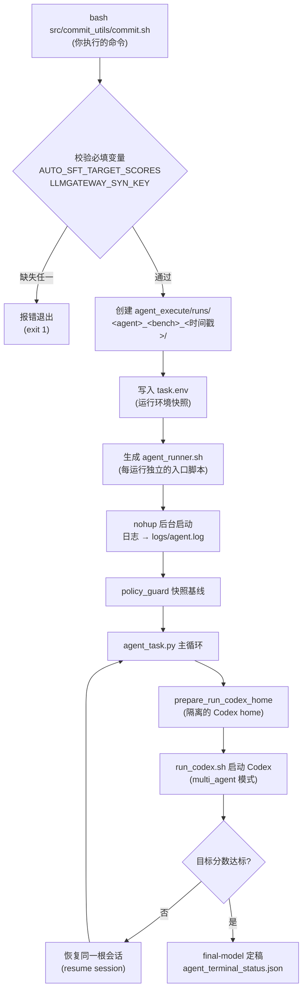

本页是 AutoSFT 的实操入口：从零开始把一次智能体驱动的 SFT 研究闭环跑起来。你将完成三件事——准备本地控制平面环境、安装并验证 Codex CLI、用一条 `commit.sh` 命令启动首次多智能体运行。本页只覆盖启动路径本身；运行产物解读、配置全景与本地基线模式分别有专门页面。开始前请先阅读[项目总览](1-xiang-mu-zong-lan-zhi-neng-ti-qu-dong-de-sft-yan-jiu-bi-huan-autosft-shi-shi-yao-wei-shi-yao-cun-zai)以理解 AutoSFT 的"控制平面在本地、GPU 在 Cluster"的分工——这决定了本地机器**不需要 GPU**，但需要能访问 Cluster 的凭证。

> **📖 小白导读**
> - 这篇讲什么：一份"从零到跑起来"的实操清单——准备环境、装好大脑（Codex CLI）、用一条 `commit.sh` 启动第一次智能体运行。
> - 读之前先知道：**Codex CLI**＝OpenAI 出的命令行编程智能体，AutoSFT 的所有决策都跑在它的会话里；**devspace**＝预配置好的开发容器（一个自带全部依赖的工作区）；**环境变量**＝操作系统里按名字存放的设置（如 `AUTO_SFT_RUN_DIR`），程序启动时读取。
> - 读完你能明白：一条启动命令背后依次发生了什么；智能体卡住或报错时先去哪里看日志；怎么确认它真的在干活。
> - 提醒：本页只管"启动"；启动之后产物怎么读见[运行产物目录全解](6-yun-xing-chan-wu-mu-lu-quan-jie-agent_execute-runs-xia-de-tai-zhang-bao-gao-jian-cha-dian-yu-fen-lei-shu-ju-bu-ju)，配置细节见[运行配置与环境变量详解](4-yun-xing-pei-zhi-yu-huan-jing-bian-liang-xiang-jie-mu-biao-fen-shu-ping-ce-hou-duan-ling-pai-yu-suan-yu-zhong-shi-ce-lue)。

Sources: [README.md](README.md#L64-L96)

## 启动全景：一条命令背后发生了什么

在动手之前，先建立整体心智模型。执行 `bash src/commit_utils/commit.sh` 时，系统经过五个阶段：**校验必填变量 → 创建运行目录与 task.env → 生成 agent_runner.sh 脚本 → 快照策略基线 → 后台启动控制平面智能体**。智能体随后进入一个"目标分数驱动的重试循环"：只要评测分数未达标，外层 runner 就会带上下文重启 Codex 会话，直到每个基准达到目标分数或触发不可重试错误。



这个设计的核心特征是**运行即记录**：每次启动都生成一个带时间戳的独立目录，`task.env` 把当时的全部环境决策固化下来，因此后续重启不会因环境漂移而行为改变。同时，launcher 从不请求 GPU——所有训练与评测作业都提交到 Cluster 集群。

Sources: [commit.sh](src/commit_utils/commit.sh#L1-L10), [commit.sh](src/commit_utils/commit.sh#L91-L123)

## 第一步：本地环境准备

本地控制平面是一台普通的开发机，唯一的硬性要求是 Linux/macOS 的 bash 环境（脚本使用 `set -euo pipefail`、heredoc 与 `nohup`，不兼容 Windows 原生 cmd）与 Python 3。依赖安装只有一条命令：

```bash
pip install -r containers/requirements-local.txt
```

这份清单刻意与 Cluster 评测镜像的 `requirements-direct.txt`（含 PyTorch、vLLM、CUDA）分离——本地工作零 GPU、零重型依赖。它包含三组内容：

| 依赖组 | 包 | 用途 |
|--------|-----|------|
| 控制平面 | `jsonschema`、`httpx`、`pexpect` | 模式校验、LLMGateway 传输、Codex 进程控制 |
| 验证器沙箱 | `nltk`、`jieba`、`langdetect`、`emoji`、`syllapy`、`pyyaml` | 生成的确定性叶子验证器允许导入的白名单模块 |
| 测试套件 | `pytest` | 运行 `tests/` 下 28 个测试文件 |

第二个容易被忽略的硬性要求是 **ripgrep（`rg`）必须在 PATH 上**。启动脚本会显式检查它，因为智能体频繁使用 `rg` 做代码检索；缺少它时智能体会临时拼凑 grep 替代品，其参数不匹配产生的错误会被误读为真实失败。macOS 用 `brew install ripgrep`，Ubuntu 用 `apt install ripgrep` 安装。

Sources: [requirements-local.txt](containers/requirements-local.txt#L15-L31), [run_codex.sh](tools/codex_exec/run_codex.sh#L32-L37)

### .env：每台机器的本地覆盖

Cluster 集群参数（项目名、集群名、资源池等）在 `set_env_vars.sh` 中有默认值，但每台机器可能有差异（例如不同的 `CODEX_HOME` 路径）。仓库提供 git-ignored 的 `.env` 机制：在仓库根目录放置 `.env` 文件，launcher 启动时会以 `set -a` 方式自动加载它，覆盖默认值而不修改任何被跟踪的文件。新克隆的仓库没有 `.env`，此步是安全的空操作。可用 `set_default` 语义覆盖的典型变量包括 `AUTO_SFT_CLUSTER_PROJECT`（默认 `autosft-7`）、`AUTO_SFT_CLUSTER_CLUSTER`（默认 `beijing`）、`AUTO_SFT_CLUSTER_RESOURCE_POOL`（默认 `model-autosft`）等。

Sources: [set_env_vars.sh](src/commit_utils/set_env_vars.sh#L13-L30), [set_env_vars.sh](src/commit_utils/set_env_vars.sh#L39-L50)

## 第二步：安装并验证 Codex CLI

AutoSFT 的多智能体架构依赖 Codex CLI 的 `multi_agent` 特性。安装 Codex 后，在启动前逐项验证：

```bash
codex --version
codex features list | grep '^multi_agent '
```

两条命令分别确认版本可用与 multi_agent 特性已启用。启动脚本 `run_codex.sh` 会再次自动检查这两项——`codex features list` 的输出中必须包含 `multi_agent` 行，否则以 "this codex CLI does not expose the multi_agent feature; upgrade Codex" 报错退出。如果 `codex --version` 就失败，先完成 Codex CLI 的安装与登录认证。

### 认证与 CODEX_HOME 的关键区分

这里有一个**初学者最容易踩的坑**：仓库内有一个 `.codex/` 目录（含 `config.toml` 与 `agents/*.toml`），但它是**项目级共享配置**，不是你的个人 Codex home。每台机器的认证（`auth.json`）与提供商配置存放在正常的机器级 Codex home（通常是 `~/.codex`）中。**绝对不要**把 `CODEX_HOME` 环境变量指向仓库的 `.codex` 目录——README 明确警告了这一点。

正确的心智模型是三层分离：

| 层 | 位置 | 内容 | 由谁维护 |
|----|------|------|----------|
| 机器级 Codex home | `~/.codex`（默认） | `auth.json` 认证、提供商/模型配置 | 你，每台机器一次 |
| 项目级共享配置 | 仓库 `.codex/` | `config.toml`（多智能体限制）、`agents/*.toml`（10 个角色定义） | 仓库，随 git 分发 |
| 运行级隔离 home | `<run_dir>/codex_home/` | 从机器级种子复制 + 生成的 `autosft.config.toml` 信任声明 | launcher 自动生成 |

Sources: [README.md](README.md#L86-L96), [codex_home.py](src/control_plane/codex_home.py#L14-L16)

### 项目级 config.toml 里的多智能体限制

`.codex/config.toml` 声明了三条全局约束，它们解释了系统能同时跑多少智能体、能嵌套多深：

- **`multi_agent = true`**：启用 Codex 的多智能体特性，这是整个架构的前提。
- **`max_threads = 6`**：限制并发线程数。
- **`max_depth = 3`**：允许三层嵌套委托，专门为分类体系作业设计——最外层是 `autosft_capability_taxonomy_verifier`，它可再委托四个固定子角色（taxonomy 设计者、验证器作者、红队评审员、降级裁决员）。压缩设计/实现角色会导致分类体系悄悄收窄到"容易检查的范围内"；压缩评审员或裁决员则失去独立门禁。

```toml
[features]
multi_agent = true

[agents]
max_threads = 6
max_depth = 3
interrupt_message = true
```

启动脚本还会逐一验证 10 个智能体定义文件（`autosft_executor`、`autosft_failure_case_study`、`autosft_data_examine`、`autosft_evaluation_feedback_analysis`、`autosft_history`、`autosft_capability_taxonomy_verifier`、`autosft_taxonomy_designer`、`autosft_verifier_author`、`autosft_verifier_red_team`、`autosft_demotion_adjudicator`）都存在于 `.codex/agents/` 下，缺任何一个都会拒绝启动。

Sources: [config.toml](.codex/config.toml#L1-L16), [run_codex.sh](tools/codex_exec/run_codex.sh#L45-L67)

### 运行级隔离：codex_home 的种子复制机制

每次运行创建独立的 `<run_dir>/codex_home/`，由 `prepare_run_codex_home` 实现两个动作：从机器级 home 复制 `auth.json` 与 `config.toml`（认证与提供商配置），然后生成一个 `autosft.config.toml` profile 文件，内容是 `[projects."<checkout路径>"] trust_level = "trusted"`——这份信任声明让 Codex 能直接加载仓库中被跟踪的 `.codex/` 配置与角色定义，**无需**每个用户手工把项目配置复制进个人 home。会话历史、rollout、日志等运行时状态全部写入这个运行局部 home，与机器级配置彻底隔离。该函数是幂等的（幂等＝同一操作重复执行，结果和只执行一次相同），主循环在**每次**重启尝试前都会重新执行，以修复运行中途变陈旧的 home（只准备一次的旧设计会让后续所有尝试以相同方式失败且无法自愈）。

Sources: [codex_home.py](src/control_plane/codex_home.py#L19-L70), [agent_task.py](src/control_plane/agent_task.py#L1022-L1039)

## 第三步：理解必填变量，然后启动

`commit.sh` 强制要求两个变量**必须**在启动命令行上显式传入，没有任何内置默认值——这是刻意设计，因为目标分数是整个运行的停止条件，绝不能静默取默认。

| 变量 | 必填性 | 格式与语义 |
|------|--------|-----------|
| `AUTO_SFT_TARGET_SCORES` | **必填** | `benchmark=score,benchmark=score`，如 `ifeval=0.8,ifbench=0.5`。运行持续迭代直到每个基准的最佳 `primary_score` 达到目标 |
| `LLMGATEWAY_SYN_KEY` | **必填** | Bearer 密钥，被固定的分类解析器运行时继承。**刻意永不写入** task.env 或任何运行产物 |
| `AUTO_SFT_AGENTS` | 可选（默认 `codex`） | 智能体后端选择 |
| `AUTO_SFT_BENCHMARKS` | 可选（默认 `ifeval,ifbench`） | 空格分隔的多个条目各自成为独立运行；条目内逗号分隔的基准在同一运行的评测阶段全部评测 |
| `AUTO_SFT_SFT_TOKEN_BUDGET` | 可选（默认 `20000000`） | 每轮训练的令牌上限，launcher 所有，智能体只读不可改 |
| `AUTO_SFT_BASE_MODEL` | 可选（默认 `Qwen/Qwen3-1.7B-Base`） | 每轮 SFT 独立初始化的基础模型 |

缺失任一必填变量时的报错信息会直接给出正确的启动示例。完整的首次启动命令是：

```bash
AUTO_SFT_AGENTS=codex \
AUTO_SFT_BENCHMARKS=ifeval,ifbench \
AUTO_SFT_TARGET_SCORES=ifeval=0.8,ifbench=0.5 \
LLMGATEWAY_SYN_KEY=你的密钥 \
bash src/commit_utils/commit.sh
```

执行后 launcher 立即返回（智能体在后台 `nohup` 运行），终端输出形如 `Starting local agent: agent=codex benchmark=ifeval,ifbench run_id=codex_ifeval+ifbench_20260101120000` 与 `Submitted local agent runs. Logs are under .../logs/agent.log`。

Sources: [commit.sh](src/commit_utils/commit.sh#L20-L35), [README.md](README.md#L145-L158)

### run_id 与目录布局

launcher 对 `BENCHMARKS × AGENTS` 做双重循环，每个组合生成一个独立运行。run_id 规则是 `<agent>_<基准标签>_<时间戳>`，其中基准标签内的逗号替换为 `+`（如 `codex_ifeval+ifbench_20260101120000`）。首次启动成功后，你在 `agent_execute/runs/` 下会看到：

```text
agent_execute/runs/codex_ifeval+ifbench_<时间戳>/
  task.env              # 环境快照（基准、目标分数、预算、Cluster 凭证等）
  agent.pid             # 后台进程 PID
  agent_prompt.txt      # 根元智能体的完整初始提示词
  agent_runner.sh       # 本运行专属入口脚本
  agent_attempts.jsonl  # 每次重启尝试的结构化记录
  codex_home/           # 隔离的 Codex home（认证种子 + autosft profile）
  datasets/             # 物化数据集的落点
  logs/agent.log        # 唯一日志入口
```

`task.env` 由 launcher 写入所有关键配置（含条件性追加 `HUGGINGFACE_HUB_TOKEN`、`HF_TOKEN`、数据模式等），生成的 `agent_runner.sh` 会 `cd` 回仓库根、`set -a` 加载 task.env、执行 policy_guard 快照、然后调用 `python -m src.control_plane.agent_task codex`。整个运行目录被 git-ignore，不会污染仓库。

Sources: [commit.sh](src/commit_utils/commit.sh#L41-L62), [README.md](README.md#L242-L255)

## 第四步：验证运行健康

启动后第一步看日志。`tail -f agent_execute/runs/<run_id>/logs/agent.log`，健康运行的早期标志依次是：`Per-run CODEX_HOME: ...`（隔离 home 就绪）、`Stop condition — target scores: ...`（目标解析成功）、`Starting agent attempt 1/unbounded; scores: ...`（首次尝试开始）。若想确认 `task.env` 的内容是否符合预期，直接查看该文件即可——它是纯文本的环境快照。

### Codex 进程是如何被组装的

理解日志中的行为需要知道 `run_codex.sh` 组装了什么命令。在完成全部前置检查（`AUTO_SFT_AGENT_PROMPT` 存在、`CODEX_HOME` 指向运行局部 home 且含 autosft profile、`codex` 与 `rg` 在 PATH、multi_agent 特性可用、`.codex/config.toml` 与 10 个角色文件齐全）后，它执行：

| 参数 | 作用 |
|------|------|
| `codex -C <仓库根> --profile autosft` | 以生成的信任 profile 运行于仓库上下文 |
| `--dangerously-bypass-approvals-and-sandbox` | 无人值守执行（外层由 policy_hook 把关） |
| `--enable multi_agent --disable unified_exec` | 强制多智能体模式 |
| `-c hooks.PreToolUse=[...]` | 注入 `policy_hook.py` 拦截 shell/写操作，30 秒超时 |
| `--search`（默认）或 `-c web_search="disabled"` | 由 `AUTO_SFT_CODEX_SEARCH` 决定根元智能体是否有实时网络检索 |
| `resume <ROOT_SESSION_ID>`（若存在） | 跨重启延续同一条根会话线程 |

特别注意 `resume` 的实现细节：恢复时**显式按 ID 命名 ROOT 会话**而非用 `resume --last`，因为后者可能选中某个子智能体更新的 rollout 而接错线程。每轮提示词会先经 `os.path.expandvars` 展开 `${AUTO_SFT_*}` 占位符再写入 `agent_prompt.txt`，且首次运行的选择由 `AUTO_SFT_DATA_MODE` 决定：默认用 `tools/codex_exec/agent_prompt_online.md`（在线模式），`local` 则用 `agent_prompt_local.md`。

Sources: [run_codex.sh](tools/codex_exec/run_codex.sh#L72-L105), [agent_task.py](src/control_plane/agent_task.py#L79-L85), [agent_task.py](src/control_plane/agent_task.py#L1102-L1125)

### 停止条件与重试语义

外层循环的权威判定来自实验台账：每轮评测后 `best_scores(run_dir)` 读取各基准历史最佳分数，与 `AUTO_SFT_TARGET_SCORES` 解析出的阈值逐项比对。只要存在缺失或未达标的基准，循环继续；`AUTO_SFT_AGENT_RETRY_MAX=0`（默认）意味着**无上限**重试。三类延迟参数控制节奏：失败后等待 `AUTO_SFT_AGENT_RETRY_DELAY_SECONDS`（默认 300 秒）、干净退出但目标未达时等 `AUTO_SFT_AGENT_SUCCESS_RETRY_DELAY_SECONDS`（默认 60 秒）、`AUTO_SFT_CODEX_RESUME=1`（默认）保证每次重启恢复根会话上下文。达到全部目标且 `final_model_summary.json` 已写时，运行写入 `agent_terminal_status.json` 并正常终止；若再次调用 launcher 且目标已达成，会直接幂等地报告 "nothing to do"。

Sources: [agent_task.py](src/control_plane/agent_task.py#L962-L997), [agent_task.py](src/control_plane/agent_task.py#L1022-L1061)

## 故障排查速查表

| 症状（日志中的报错） | 原因 | 解决 |
|----------------------|------|------|
| `AUTO_SFT_TARGET_SCORES is required` | 未传必填变量 | 在启动命令行加上，如 `AUTO_SFT_TARGET_SCORES=ifeval=0.8,ifbench=0.5` |
| `LLMGATEWAY_SYN_KEY is required by the taxonomy parser` | 未传 LLMGateway 密钥 | 在启动环境导出；注意它永不持久化到 task.env |
| `AUTO_SFT_SFT_TOKEN_BUDGET must be supplied ... positive integer` | 预算值非正整数 | launcher 默认已填 20000000；若自定义须为正整数 |
| `codex CLI is not installed or is not on PATH` | Codex 未安装 | 安装 Codex CLI 并确认 `codex --version` 可用 |
| `ripgrep (rg) is not installed or is not on PATH` | 缺 ripgrep | `brew install ripgrep` / `apt install ripgrep` |
| `this codex CLI does not expose the multi_agent feature` | Codex 版本过旧 | 升级 Codex CLI |
| `missing project agent definition: .codex/agents/<name>.toml` | 角色文件缺失 | 检查 git 状态，确认 10 个 toml 齐全 |
| `CODEX_HOME must point to the AutoSFT run-local Codex home` | CODEX_HOME 指向错误 | 不要手动设 CODEX_HOME；由 agent_task.py 自动管理 |
| `AutoSFT Codex profile was not prepared under CODEX_HOME=...` | 运行局部 home 未就绪或已损坏 | 主循环每次尝试都会重播种；若持续失败检查机器级 `~/.codex` 中 `auth.json` 是否有效 |
| `WARN: no AUTO_SFT_TARGET_SCORES provided` | 目标未配置（仅警告） | 循环退化为首次干净退出即停止；建议始终显式传入 |
| `Target scores already reached and run finalized ... nothing to do` | 非错误 | 目标已达成，运行幂等地拒绝重复启动 |

Sources: [commit.sh](src/commit_utils/commit.sh#L24-L34), [run_codex.sh](tools/codex_exec/run_codex.sh#L12-L48), [agent_task.py](src/control_plane/agent_task.py#L970-L1012)

## 安全机制预告与下一步阅读

首次运行中你会注意到两道防线在静默工作：每次尝试前后 `policy_guard` 会快照并审计仓库状态（保护源码不被智能体篡改、阻断禁用的训练参数覆盖），而 `tools/codex_goal/policy_hook.py` 作为 PreToolUse 钩子拦截每一次 shell/写操作。这些机制的完整设计在[策略守卫机制](9-ce-lue-shou-wei-ji-zhi-policy_guard-de-yuan-ma-bao-hu-jin-yong-xun-lian-liu-jian-ce-yu-wei-gui-shen-ji-policy_guard_check-sh)页详解。

启动成功后，推荐的阅读路径是：

1. **[运行产物目录全解](6-yun-xing-chan-wu-mu-lu-quan-jie-agent_execute-runs-xia-de-tai-zhang-bao-gao-jian-cha-dian-yu-fen-lei-shu-ju-bu-ju)** —— 看懂 `agent_execute/runs/` 下台账、报告、检查点的完整布局，这是你观察运行进度的主要窗口。
2. **[运行配置与环境变量详解](4-yun-xing-pei-zhi-yu-huan-jing-bian-liang-xiang-jie-mu-biao-fen-shu-ping-ce-hou-duan-ling-pai-yu-suan-yu-zhong-shi-ce-lue)** —— 目标分数、评测后端、令牌预算与重试策略的全部可调项。
3. **[本地基线模式](3-ben-di-ji-xian-mo-shi-chi-xian-yuan-shi-chi-gou-jian-yu-wu-wang-luo-jian-suo-yun-xing-commit_local_baseline-sh-liu-cheng)** —— 如果在线检索不可用，用 `commit_local_baseline.sh` 走离线原始池路径。
4. **[手动执行单阶段流程](5-shou-dong-zhi-xing-dan-jie-duan-liu-cheng-tuo-chi-zhi-neng-ti-xun-huan-zhi-jie-diao-yong-sft_train-convert_checkpoint-evaluate)** —— 脱离智能体循环直接驱动 `sft_train.py` / `convert_checkpoint.py` / `evaluate.py`，适合调试单阶段。

当你想理解智能体内部如何分工时，进入深入解析部分：[多智能体控制平面](7-duo-zhi-neng-ti-kong-zhi-ping-mian-yuan-zhi-neng-ti-zhi-xing-zhe-si-lu-bing-xing-fen-xi-yu-fen-lei-ti-xi-zi-zhi-neng-ti-de-fen-gong-she-ji)与[智能体契约与硬性规则](8-zhi-neng-ti-qi-yue-yu-ying-xing-gui-ze-agents-md-de-shi-bu-liu-shui-xian-jiao-se-suo-you-quan-yu-ting-zhi-tiao-jian)。