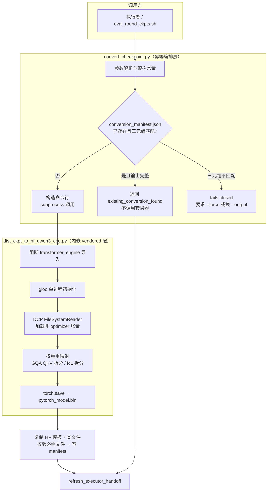
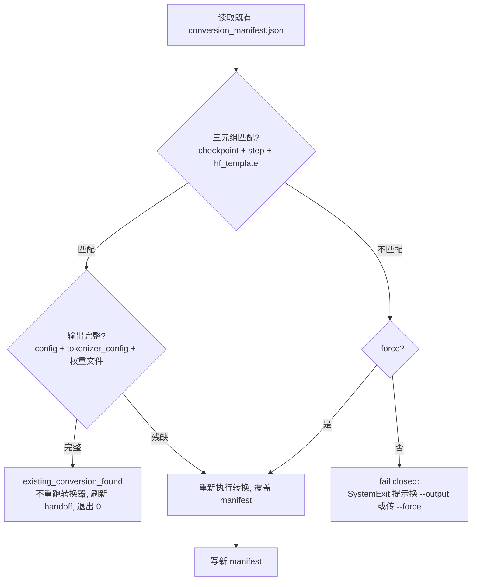

在 AutoSFT 研究闭环中，SFT 训练产出的是 Megatron 格式的 **torch_dist 分布式检查点**（`iter_0000003/` 目录树），而下游 IFEval / IFBench 评测运行时（Inspect AI 或 OpenCompass 的 vLLM 后端）消费的是 **HuggingFace 格式的模型目录**。`convert_checkpoint.py` 正是这道格式鸿沟上唯一的受控通道：它把一次显式选定的完整 Megatron 检查点（模型权重存档）转换为 HF/vLLM 可加载的模型目录，同时以 **manifest 三元组匹配**保证幂等（重复调用不重跑转换器）、以**独立的 NumPy 1.x 解释器**隔离宿主 Python 环境。该阶段在 AGENTS.md 十一步流水线中是第 7 步，由执行者（executor）角色独占，本页将解析其双层架构、权重重映射语义、幂等归属保护与下游集成。

> **📖 小白导读**
> - 这篇讲什么：检查点格式转换——把 Megatron 训练产出的分布式检查点，转换成评测工具能加载的 HuggingFace 格式，且重复执行不会翻车（幂等）。
> - 读之前先知道：**检查点（checkpoint）**＝训练存档的模型权重；**分布式检查点**＝多张 GPU 各存一片、必须拼起来才完整的存档格式（Megatron 的 `torch_dist`）；**HF 格式**＝HuggingFace 生态通用的模型目录（config.json + 权重文件），vLLM 等推理引擎都认它；**vLLM**＝高性能大模型推理引擎，评测时用它驱动被测模型；**manifest 三元组**＝记录"哪个检查点+哪段代码+哪套参数"的指纹组合，用来识别"这个转换我做过没有"。
> - 读完你能明白：为什么转换必须显式选定完整检查点；重复转换如何被识别并直接复用旧产物；Python 环境隔离是怎么隔的。
> - 提醒：本页流程性强，照着"转换路径"图读最省力。

Sources: [AGENTS.md](AGENTS.md#L19-L23), [convert_checkpoint.py](convert_checkpoint.py#L19-L33)

## 双层架构：幂等包装器与内嵌 CPU 转换器

转换系统由两个职责严格分离的层构成。**外层**是仓库根目录的 `convert_checkpoint.py`——一个约 190 行的编排器，负责参数解析、幂等判定、manifest 记录、HF 模板文件复制与执行者交接刷新，但它本身不触碰任何张量。**内层**是 `tools/megatron_qwen3/tools/checkpoint/dist_ckpt_to_hf_qwen3_cpu.py`——一个被有意内嵌（vendored）到仓库的 CPU-only 转换器，负责真正的分布式检查点加载与权重重映射。外层通过 `subprocess.run` 以独立进程调用内层，并将 `cwd` 设为 `tools/megatron_qwen3`、把该目录前置到 `PYTHONPATH`，使内层能找到配套的 Megatron shim 包。

这种分层并非偶然：幂等、归属与审计等**策略性**关注点全部收敛在外层（与 AutoSFT 控制平面的其他组件共享同一套 `src.control_plane.common` 工具函数），而**技术性**的张量搬运被封装在内层，其行为由固定的 Qwen3-1.7B 架构参数（`--num-layers 28 --hidden-size 2048 --ffn-hidden-size 6144 --num-attention-heads 16 --num-query-groups 8 --kv-channels 128`）锁定——这些值在 `convert_checkpoint.py` 中硬编码进命令行，执行者无需也不能修改。

Sources: [convert_checkpoint.py](convert_checkpoint.py#L73-L110), [convert_checkpoint.py](convert_checkpoint.py#L153-L179), [tools/megatron_qwen3/convert_dist_ckpt_to_hf.sh](tools/megatron_qwen3/convert_dist_ckpt_to_hf.sh#L15-L25)

### Megatron shim：最小化的导入兼容包

内嵌目录下还有一个刻意稀疏的 `megatron/` Python 包树：`megatron/core/dist_checkpointing/strategies/torch.py` 仅含一个空的 `MCoreSavePlan` 占位类，各级 `__init__.py` 全部为空。DCP 元数据的反序列化会触发 `megatron.core` 的导入链，而这个 shim 让仓库在**不携带完整 Megatron-LM 代码**的前提下满足导入路径，同时把部署面压缩到最小。这是典型的"最小 vendoring"模式：只复制让脚本可运行的导入骨架，其余依赖交由真正的 `torch.distributed.checkpoint` 标准库承担。

Sources: [torch.py](tools/megatron_qwen3/megatron/core/dist_checkpointing/strategies/torch.py#L1-L3), [dist_ckpt_to_hf_qwen3_cpu.py](tools/megatron_qwen3/tools/checkpoint/dist_ckpt_to_hf_qwen3_cpu.py#L13-L16)

## 安全检查点选择：latest_checkpointed_iteration.txt 单一信任源

技能契约明确规定：**完整性判定的唯一信任标记是 `<checkpoint_root>/latest_checkpointed_iteration.txt`**。执行者读取该文件并确保请求的 step 不超过其值；严禁通过枚举 `iter_*` 目录来推断完整性——一个 `iter_0000005/` 目录完全可能在训练进程仍在写入时就已经存在，此时读取它会得到残缺张量。这条纪律在流水线两端被双重执行：`eval_round_ckpts.sh` 收集待评测步时显式过滤 `step <= FINAL_STEP` 并注释说明"latest 之后可能是部分写入"（`Never go beyond latest, which could be a partial in-flight write`），而内层转换器在未显式给 `--iteration` 时同样回落到读取该标记文件。

| 风险行为 | 后果 | 系统防线 |
|---|---|---|
| 枚举 `iter_*` 目录选最大值 | 读到训练中的部分写入目录 | SKILL.md 明令禁止；`eval_round_ckpts.sh` 以 latest 文件为上界过滤 |
| step 超过 latest | 转换器报错或产出坏模型 | 执行者契约要求 step ≤ latest；handoff 阶段机推导 latest_step |
| 猜测 step 编号（如 `5` vs `0000005`） | 命中错误或不存在目录 | `_normalized_step` 去前导零归一化比较；内层 `iter_{n:07d}` 补零寻址 |

Sources: [SKILL.md](skills/megatron-hf-checkpoint-conversion/SKILL.md#L25-L35), [eval_round_ckpts.sh](skills/cluster-eval-job-submission/scripts/eval_round_ckpts.sh#L61-L89), [dist_ckpt_to_hf_qwen3_cpu.py](tools/megatron_qwen3/tools/checkpoint/dist_ckpt_to_hf_qwen3_cpu.py#L61-L66)

## 权重重映射：从 Megatron DCP 命名空间到 HF 命名空间

内层转换器的核心是 `convert()` 函数中的键名映射与张量重组。它通过 `torch.distributed.checkpoint` 的 `FileSystemReader` 读取元数据，为每个带 `size` 属性的非 `optimizer.*` 条目预分配空张量后用 `dcp.load` 一次性填充——这使得**同一个脚本无需 GPU 也能加载原本面向多卡训练保存的分布式检查点**（gloo 后端、rank 0、world_size 1）。加载后的张量按 Megatron 的层堆叠布局（每个 key 的第 0 维是层维度，逐层索引 `[i]`）取出，再映射为 HF 的 `model.layers.{i}.*` 扁平命名。

| Megatron DCP 键 | HF 键 | 变换 |
|---|---|---|
| `embedding.word_embeddings.weight` | `model.embed_tokens.weight` | 直接复制（默认绑定输出权重，无 lm_head） |
| `decoder.final_layernorm.weight` | `model.norm.weight` | 直接复制 |
| `decoder.layers.self_attention.linear_qkv.weight[i]` | `self_attn.q_proj/k_proj/v_proj.weight` | **GQA 交织拆分**：每 KV 组含 `num_q_per_group+2` 个 `kv_channels` 段 |
| `decoder.layers.self_attention.q/k_layernorm.weight[i]` | `self_attn.q_norm/k_norm.weight` | QK layernorm，Qwen3 特有 |
| `decoder.layers.mlp.linear_fc1.weight[i]` | `mlp.gate_proj / up_proj.weight` | 按第 0 维对半拆分 |
| `decoder.layers.mlp.linear_fc2.weight[i]` | `mlp.down_proj.weight` | 直接复制 |
| `output_layer.weight`（可选） | `lm_head.weight` | 仅当 `--untie-embeddings-and-output-weights` |

最精妙的是 GQA（分组查询注意力）的 QKV 拆分：Megatron 把 Q、K、V 按 KV 组交织存放（每组布局为 `[q×num_q_per_group, k, v]`），转换器按 `(num_q_per_group + 2) * g` 的基址偏移逐组抽取 Q 段、K 段、V 段，再分别 `torch.cat` 成 HF 期望的连续 `q_proj/k_proj/v_proj` 矩阵。所有输出张量最终 `.clone().contiguous()` 消除视图依赖，再以 `torch.save` 落盘为单个 `pytorch_model.bin`。文件顶部的 docstring 点明了与 MiniCPM 转换器的两个关键差异——QK layernorm 权重与默认绑定的 embedding——这正是这份脚本被单独 vendored 而非复用通用工具的原因。

Sources: [dist_ckpt_to_hf_qwen3_cpu.py](tools/megatron_qwen3/tools/checkpoint/dist_ckpt_to_hf_qwen3_cpu.py#L69-L129), [dist_ckpt_to_hf_qwen3_cpu.py](tools/megatron_qwen3/tools/checkpoint/dist_ckpt_to_hf_qwen3_cpu.py#L1-L8), [dist_ckpt_to_hf_qwen3_cpu.py](tools/megatron_qwen3/tools/checkpoint/dist_ckpt_to_hf_qwen3_cpu.py#L132-L154)

## 幂等性与归属保护：manifest 三元组的守门逻辑

外层包装器的核心价值是把一次转换变成**可重入、可审计、防串扰**的操作。每次成功转换（含 dry-run）都会在输出目录写入 `conversion_manifest.json`，记录 checkpoint、ckpt_step、output、hf_template、megatron_dir、python 解释器、完整命令行和时间戳。再次调用同一 `--output` 时，包装器读取既有 manifest 并与当前请求做三元组比对——**checkpoint 路径、ckpt_step、hf_template** 三者全等才视为同一转换。

归一化处理消除了伪差异：`_canonical()` 把路径 `expanduser().resolve()` 成绝对规范形式（比较前先展开软链接），`_normalized_step()` 去掉前导零，因此 `2` 与 `0000002` 是同一步。比对结果驱动三条分支：

"输出完整"的判定标准（`conversion_complete`）与评测消费方的最低要求对齐：`config.json` 与 `tokenizer_config.json` 必须存在，且 `*.safetensors` 或 `*.bin` 至少出现一类。注意**匹配但残缺**的输出会重新执行转换——幂等跳过只在完整产物存在时生效，避免了"manifest 在而权重丢失"的半状态污染下游。而**不匹配则默认拒绝执行**（fail closed），这条保护防止执行者把 round 2 的检查点悄悄覆盖到 round 1 的模型目录上，`--force` 被技能契约明确定位为"刻意手动替换"的保留通道，而非执行者的常规恢复手段。

Sources: [convert_checkpoint.py](convert_checkpoint.py#L36-L70), [convert_checkpoint.py](convert_checkpoint.py#L112-L151), [SKILL.md](skills/megatron-hf-checkpoint-conversion/SKILL.md#L53-L57)

### 幂等性的测试锚点

`tests/test_conversion_idempotency.py` 用三个用例钉死了上述语义，且通过 `patch.object(convert_checkpoint.subprocess, "run")` 断言**快路径根本不会启动子进程**：用例一验证 manifest 的 mtime 纳秒级不变（即连 manifest 重写都没有）且 `run.assert_not_called()`，同时验证 `0000003` 与 `3` 的 step 归一等价；用例二验证不同 checkpoint 输入直接以 `SystemExit("conversion output belongs to different inputs")` 失败；用例三删掉 `model.safetensors` 后 `conversion_complete` 必须返回 False——半成品不得被当作已完成转换。

Sources: [test_conversion_idempotency.py](tests/test_conversion_idempotency.py#L40-L123)

## Python 环境隔离：NumPy 1.x 解释器与 transformer_engine 阻断

转换器对运行环境有两个强约束，系统在两个层面分别处置。第一个约束是**宿主控制平面与转换器需要不同版本的 NumPy**：转换器所依赖的 Megatron 时代栈要求 NumPy 1.x，而 NumPy 2.x 解释器会抛出 `RuntimeError: Numpy is not available`。解法是解释器级隔离——`convert_checkpoint.py` 默认用 `/user/.../envs/lxl/bin/python`（一个 NumPy 1.x conda 环境）执行内层脚本，可用 `--python` 或环境变量 `AUTO_SFT_CONVERT_PYTHON` 覆盖；外层自身则运行在控制平面的 Python 3 中，两者互不污染。

第二个约束是 **transformer_engine 在 CPU 节点上的破坏性**：该库可能已安装但只编译了 CUDA 符号，在 CPU 环境导入会触发未定义 C++ 符号错误，而 DCP 元数据的反序列化恰恰会经 `megatron.core` 触发对它的导入。内层脚本在**任何其他 import 之前**向 `sys.meta_path` 头部插入一个 `MetaPathFinder`，对 `transformer_engine` 及其子模块一律抛出 `ModuleNotFoundError`，并预先清除 `sys.modules` 中可能已缓存的条目。被"伪装成未安装"后，Megatron 自身的 `try/except ModuleNotFoundError` 兜底逻辑会走 `HAVE_TE=False` 分支，整条导入链得以在纯 CPU 上完成。这是一种值得注意的防御模式：不去修补有缺陷的依赖，而是让它按"不存在"的契约被上层代码优雅降级。

| 隔离维度 | 机制 | 可覆盖点 |
|---|---|---|
| NumPy 版本 | 独立 conda 解释器执行子进程 | `--python` / `AUTO_SFT_CONVERT_PYTHON` |
| 导入路径 | `PYTHONPATH` 前置 `megatron_dir`，`cwd` 同步设置 | `--megatron-dir` / `AUTO_SFT_MEGATRON_DIR` |
| 危险 C++ 依赖 | meta-path 导入阻断器注入 `ModuleNotFoundError` | 无（内层硬编码，属设计决策） |
| 进程边界 | `subprocess.run(check=True)` + 显式 `env` 拷贝 | `--dry-run` 仅打印命令 |

Sources: [dist_ckpt_to_hf_qwen3_cpu.py](tools/megatron_qwen3/tools/checkpoint/dist_ckpt_to_hf_qwen3_cpu.py#L9-L32), [convert_checkpoint.py](convert_checkpoint.py#L15-L16), [convert_checkpoint.py](convert_checkpoint.py#L153-L160), [conversion-troubleshooting.md](skills/megatron-hf-checkpoint-conversion/references/conversion-troubleshooting.md#L17-L29)

## 与执行者交接和评测流水线的集成

转换不是孤立命令，而是执行者有限状态机中的一个阶段。`src/control_plane/executor_handoff.py` 在每次交接刷新时推导转换状态：从 SFT 提交记录反查 `output_dir/checkpoints`，读取 `latest_checkpointed_iteration.txt` 得到 latest_step，然后在候选位置（`run_dir/hf_model/`、`run_dir/final-model/`、`ckpt_eval/**/hf_model/`、`*/hf_model/`）搜索 `conversion_manifest.json`，将 manifest 中的 checkpoint 与 step 同当前轮的检查点目录与 latest_step 匹配，再独立校验产物完整性（复用与 `conversion_complete` 相同的 config + 权重判据）。当 SFT 已 Succeeded、检查点完整但 `conversion.complete` 为 False 时，handoff 给出阶段 `checkpoint_conversion`，指令只有一个动作——"Convert checkpoint ... at step ... once"——并指向唯一归属技能 `megatron-hf-checkpoint-conversion`。

这种 manifest 驱动的状态恢复意味着**无需目录猜测**：即使执行者线程中断重启，新会话只需读取 handoff 即可知道转换是否已完成，而 `convert_checkpoint.py` 在成功后（以及命中幂等快路径后）主动调用 `refresh_executor_handoff` 刷新这份紧凑状态，形成闭环。转换产物的 `model_identity`（目录内容指纹）随后成为评测提交幂等性的比对键——`evaluate.py` 用 `checkpoint + step` 的来源溯源加上 `benchmark + eval_backend + limit` 判重，防止不同执行者会话对同一模型重复提交评测。

Sources: [executor_handoff.py](src/control_plane/executor_handoff.py#L204-L250), [executor_handoff.py](src/control_plane/executor_handoff.py#L553-L558), [convert_checkpoint.py](convert_checkpoint.py#L179-L186)

### eval_round_ckpts.sh：两遍式批量转换与提交

评测侧的标准入口 `skills/cluster-eval-job-submission/scripts/eval_round_ckpts.sh` 把转换嵌入两遍式流水线。**Pass 1** 对每个合法保存步（默认仅最终步，因为现行策略"每轮只存最终检查点"）串行调用 `convert_checkpoint.py`，输出到 `${AUTO_SFT_RUN_DIR}/ckpt_eval/${ROUND_KEY}/step_${step}/hf_model`——由于转换是本地 CPU 工作且幂等，串行执行无并发风险，重复运行自动命中 `existing_conversion_found` 快路径。**Pass 2** 紧接着为每个 HF 目录调用 `evaluate.py` 提交每个 benchmark 一个 Cluster 评测作业（默认每作业 1 GPU，通常 1 步 × 2 benchmark = 2 个并行作业）。`AUTO_SFT_CLUSTER_DRY_RUN=1` 可让两遍都只打印动作。与之呼应，`sft_train.py` 侧维护 `run_dir/sft/checkpoints` 软链接指向当前轮，并清理历史轮中早于 final 的 `iter_*` 目录，保证"每轮一个最终检查点"的供给约定。

Sources: [eval_round_ckpts.sh](skills/cluster-eval-job-submission/scripts/eval_round_ckpts.sh#L105-L141), [sft_train.py](sft_train.py#L130-L169), [sft_train.py](sft_train.py#L172-L193)

## 失败诊断速查

技能的渐进式披露资源 `references/conversion-troubleshooting.md` 覆盖四类高频故障，均可从代码语义直接推导根因：

| 症状 | 根因 | 处置 |
|---|---|---|
| `RuntimeError: Numpy is not available` | 用了 NumPy 2.x 解释器覆盖 `--python` | 恢复默认解释器；若必须覆盖，指向 `numpy<2` 环境 |
| `conversion script not found: ...` | `--megatron-dir` 指错，vendored 转换器缺失 | 用默认 `tools/megatron_qwen3` 或修正 `AUTO_SFT_MEGATRON_DIR` |
| `converted model is missing required files: config.json, tokenizer_config.json` | `--hf-template` 不是完整 HF 基座目录 | 指向含 7 类 tokenizer/config 文件的完整 Qwen3-1.7B-Base 目录 |
| step 为空或报错 | step 超过 latest 或命中半写入目录 | 读 `latest_checkpointed_iteration.txt`，step ≤ latest |

HF 模板复制环节值得注意：转换器只产出权重（`pytorch_model.bin`），`config.json`、`tokenizer_config.json`、`tokenizer.json`、`vocab.json`、`merges.txt`、`generation_config.json`、`special_tokens_map.json` 这七类文件由包装器从 `--hf-template` 用 `shutil.copy2`（保留元数据）逐个复制，存在的才复制、必需的两个事后强制校验——这就是"HF 模板必须完整"约束的直接来源。

Sources: [conversion-troubleshooting.md](skills/megatron-hf-checkpoint-conversion/references/conversion-troubleshooting.md#L17-L43), [convert_checkpoint.py](convert_checkpoint.py#L161-L177)

## 延伸阅读

理解本页后，可沿两条线索继续：**下游消费**方面，[评测后端双轨：Inspect AI 默认路径与 OpenCompass vLLM 自托管 API 桥接](21-ping-ce-hou-duan-shuang-gui-inspect-ai-mo-ren-lu-jing-yu-opencompass-vllm-zi-tuo-guan-api-qiao-jie) 解释转换产物如何被两种评测运行时加载；**上游供给**方面，[SFT 训练轮次：从 Qwen3-Base 独立初始化、配方物化到 SSTable 转换与作业提交](19-sft-xun-lian-lun-ci-cong-qwen3-base-du-li-chu-shi-hua-pei-fang-wu-hua-dao-sstable-zhuan-huan-yu-zuo-ye-ti-jiao) 说明检查点目录如何由训练作业产生。若想看转换阶段在执行者有限状态机中的完整上下游，[执行者交接与容错恢复：executor_handoff 紧凑状态、断点续跑与防重复提交注册表](25-zhi-xing-zhe-jiao-jie-yu-rong-cuo-hui-fu-executor_handoff-jin-cou-zhuang-tai-duan-dian-xu-pao-yu-fang-zhong-fu-ti-jiao-zhu-ce-biao) 是权威参考；而[测试套件导航：28 个测试文件覆盖的契约、幂等性与门禁行为](28-ce-shi-tao-jian-dao-hang-28-ge-ce-shi-wen-jian-fu-gai-de-qi-yue-mi-deng-xing-yu-men-jin-xing-wei) 汇总了 `test_conversion_idempotency.py` 在整体测试版图中的位置。