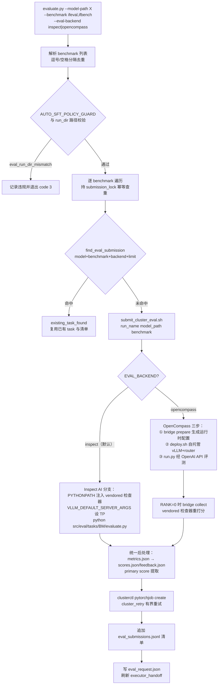
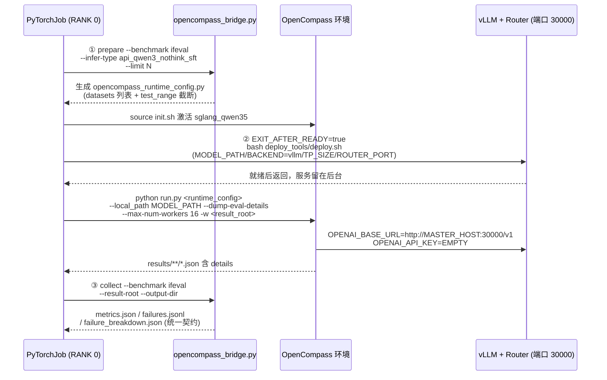

本文解析 PostTrainBench 评测子系统的**双轨后端架构**：系统为 IFEval / IFBench 两个基准提供两种可切换的评测执行器——默认的 **Inspect AI 路径**（在每个评测作业内以 Inspect AI 框架内嵌 vLLM 直接驱动模型）与备选的 **OpenCompass 桥接路径**（在 PyTorchJob 内先自托管部署 vLLM 服务，再让 OpenCompass 通过其 OpenAI 兼容 API 完成推理，最后由桥接器将结果归一回 AutoSFT 契约）。本文面向中级开发者，覆盖从 CLI 入口分发、两条路径的执行细节、统一输出契约，到禁止中途切换后端的治理约束，帮助你理解为什么一个评测系统需要两条执行路径、它们各自解决什么问题，以及下游分析为何对两者无感知。

> **📖 小白导读**
> - 这篇讲什么：评测后端的"双轨制"——默认的 Inspect AI 直评路径与备选的 OpenCompass 桥接路径，一条环境变量即可切换。
> - 读之前先知道：**Inspect AI**＝一个评测框架（组织"给模型出题、收答案、打分"的流水线框架）；**OpenCompass**＝另一个国产开源评测框架；**vLLM 自托管 API**＝把被测模型临时部署成一个本机网页服务（提供 OpenAI 兼容接口），评测器通过发 HTTP 请求对话；**桥接（bridge）**＝把 OpenCompass 的输出格式翻译回 AutoSFT 统一契约的适配层。
> - 读完你能明白：两条路径各自的执行细节与适用场景；分数如何归一到同一口径；切换后端要改哪、不动哪。
> - 提醒：只想跑通评测的话，读"路径选择与切换"一节就够。

## 双轨设计的第一性原理：一个契约，两种执行器

评测子系统面临一个典型的工程张力：一方面，AutoSFT 优化闭环（多轮 SFT → 评测 → 失败分析 → 数据动作）要求每轮评测产出**结构完全一致**的 `metrics.json`、`failures.jsonl`、`failure_breakdown.json` 产物，下游的四维分析报告与实验台账依赖这些稳定字段；另一方面，评测执行器本身存在多种合理选择——Inspect AI 提供进程内 vLLM 与精细的 sample 级元数据，而 OpenCompass 提供成熟的数据集管线与标准化的指标命名。

系统的解法是把"评测执行"从"评测契约"中剥离出来：`evaluate.py` 顶部的 `EVAL_BACKENDS = ("inspect", "opencompass")` 元组定义了仅有的两种合法取值，`--eval-backend` 参数与 `AUTO_SFT_EVAL_BACKEND` 环境变量控制选择且默认为 `inspect`，其余一切（提交流程、幂等检查（幂等＝同一操作重复执行不会重复提交）、产物写入、handoff 刷新）对两条路径完全一致。值得注意的是，`eval_backend` 本身参与了幂等身份的构造——`find_eval_submission` 以"模型身份 + benchmark + eval_backend + limit"四元组判定是否已有等价提交，这意味着同一模型切到另一后端会被视为**新的**评测请求而非重复。

Sources: [evaluate.py](evaluate.py#L27-L65), [evaluate.py](evaluate.py#L123-L147)

## 架构总览：从 CLI 到 Cluster 作业的分发流程

下图展示了一次 `evaluate.py` 调用的完整决策流。首先理解几个前置概念：**PyTorchJob** 是 Cluster 集群的训练/推理作业单元（每基准一个任务、默认 8 卡）；**提交清单（manifest）** 是 `eval_submissions.jsonl`，其中带 task id 的记录才算提交成功；**vLLM** 是推理引擎，两条路径都用它，区别在于 Inspect 路径让它作为 Inspect 的进程内 provider 存在，而 OpenCompass 路径让它先变成一个监听端口的 HTTP 服务。

这条流程中有两个容易被忽略的细节。其一，`evaluate.py` 并不在本地运行评测——它把评测**打包成集群作业**异步提交，通过环境变量（`AUTO_SFT_EVAL_MANIFEST`、`AUTO_SFT_EVAL_OUTPUT_DIR`、`AUTO_SFT_EVAL_LIMIT`、`AUTO_SFT_EVAL_BACKEND`、`AUTO_SFT_EVAL_MODEL_IDENTITY` 等）将全部上下文传给提交脚本；单个 benchmark 提交失败不影响其他 benchmark 的清单记录，失败集合会在最后以首个错误码退出。其二，当存在 `AUTO_SFT_RUN_DIR` 时，`refresh_executor_handoff` 会被调用把评测请求状态写回紧凑交接文件，这是断点续跑机制的一部分。

Sources: [evaluate.py](evaluate.py#L118-L176), [evaluate.py](evaluate.py#L244-L282)

## Inspect AI 默认路径：进程内 vLLM 与四维确定性别打分器

Inspect 路径的核心是 `src/eval/tasks/{ifeval,ifbench}/evaluate.py` 这对结构镜像的入口脚本。它们用 Inspect AI 的 `@task` 装饰器定义任务：从 vendored 的 `tools/eval_data/ifeval/input_data.jsonl`（或 ifbench 对应文件）读入样本，构造 `MemoryDataset`，solver 是最简单的 `generate()`，scorer 则注册了四个正交维度的确定性检查器——**strict/loose（是否容忍标点转义等宽松匹配）× prompt/instruction（整条提示全对才算 vs 逐条指令部分得分）**。每个 scorer 复用 `third_party/instruction_following_eval`（IFEval）或 `third_party/ifbench`（IFBench）中 vendored 的 `test_instruction_following_strict/loose` 函数，`@scorer(metrics=[mean(), stderr()])` 让 Inspect 框架自动聚合均值与标准误。

推理侧的关键在 `main()` 中的 `inspect_eval(ifeval(), model=f"vllm/{args.model_path}", model_args=model_args, ...)`——`vllm/` 前缀让 Inspect AI 直接在其 provider 层启动一个**进程内 vLLM 实例**加载本地模型目录，无需任何网络服务。`model_args` 中除了 `gpu_memory_utilization` 外还注入了 `chat_template`，其选择逻辑体现了对三类模型架构的适配：先按模型路径名匹配 `qwen/gemma/smollm` 关键字，失败则读取 `config.json` 的 `architectures[0]` 再匹配，最终从 `src/eval/templates/` 挑出 `qwen3.jinja`、`gemma3.jemma` 或 `smollm.jinja`——这保证了评测时模型以与其训练时一致的对话模板渲染提示。此外还依赖 `third_party/inspect_ai_vllm_stdout`（内嵌的 Inspect AI 源码树，名字暗示对 vLLM stdout 的补丁）通过 `PYTHONPATH` 注入。

评测结束后脚本做两层本地后处理。`_metrics_from_eval` 从 Inspect 的聚合结果中提取四个 accuracy 键，再合成 `overall_accuracy`（四者均值）与 `score`；`_analyze_samples` 遍历 EvalLog 的 samples，读取每个 sample 的 scorer metadata（`instruction_id_list`、`follow_instruction_list`），对未全过的样本构建含 `failed_instructions_strict/loose` 与 `inspect_log_ref` 的失败记录，同时按指令 ID 的冒号前缀切分出**粗类目（如 `length_constraints`）与细子类（如 `number_words`）** 的两级失败率分解——这正是下游失败分析技能的输入。

Sources: [evaluate.py](src/eval/tasks/ifeval/evaluate.py#L15-L50), [evaluate.py](src/eval/tasks/ifeval/evaluate.py#L100-L167), [evaluate.py](src/eval/tasks/ifeval/evaluate.py#L197-L362), [evaluate.py](src/eval/tasks/ifeval/evaluate.py#L365-L415)

### 默认参数的两级设定

值得注意参数默认值存在两套：任务脚本内是保守的本地默认（`--max-connections 2`、`--gpu-memory-utilization 0.3`、`--max-tokens 1200`），而集群提交脚本会显式覆盖为吞吐导向的值（`MAX_CONNECTIONS=64`、`GPU_MEMORY_UTILIZATION=0.85`），并附注释说明这是"针对单卡 H100 上的 1.7B 小模型"的调优。这解释了为什么手动直接运行任务脚本与经集群提交的性能表现差异巨大。

Sources: [evaluate.py](src/eval/tasks/ifeval/evaluate.py#L27-L36), [submit_cluster_eval.sh](skills/cluster-eval-job-submission/scripts/submit_cluster_eval.sh#L53-L60)

## OpenCompass 桥接路径：自托管 vLLM API 与三段式流水线

OpenCompass 路径放弃了 Inspect 框架，改为复用一个外部配置好的 OpenCompass checkout（默认 `/user/linbiyuan/opencompass`）与其 conda 环境（`sglang_qwen35`），把推理、部署、评分全部交给 OpenCompass 的管线，AutoSFT 只负责**前置准备**与**后置归一**两端。提交脚本中该分支的作业入口按顺序执行三段：

**第一段（prepare）**：桥接器的 `write_runtime_config` 生成一个小型 OpenCompass 配置文件。`BENCHMARK_CONFIGS` 字典将 `ifeval` 映射为 `("IFEvalDataset", "IFEvaluator", "IFEval", "opencompass/IFEval")`，`ifbench` 映射为 `("IFBenchDataset", "IFBenchEvaluator", "IFBench", "allenai/IFBench_test")`；生成的配置通过 `__import__('opencompass.configs.mb_internal.models.<infer_type>')` 动态加载模型定义，用 `GenInferencer` + `ZeroRetriever` + `PromptTemplate` 组装零样本生成式推理，`--limit N` 被转写为 `test_range='[:N]'` 实现数据集截断。安全上有一道正则防线：`infer_type` 必须匹配 `^[A-Za-z_][A-Za-z0-9_]*$`，防止通过模块名注入任意代码。

**第二段（deploy + run）**：作业先 `source init.sh` 切入 OpenCompass 的 Python 环境，然后设置一组 API 环境变量并执行 `deploy.sh`。关键的 `EXIT_AFTER_READY=true` 使部署脚本**仅等待 vLLM worker 与 router 就绪即返回**（服务在后台持续运行），随后 `run.py` 携带 `--local_path` 指向模型目录执行评测——OpenCompass 内部通过 `OPENAI_BASE_URL`（默认 `http://<MASTER_HOST>:30000/v1`，`MASTER_HOST` 取 `MASTER_ADDR` 或 fallback `localhost`）与 `OPENAI_API_KEY=EMPTY` 访问这个作业内自托管的服务。`no_proxy/NO_PROXY` 显式排除本地与 master 主机，避免集群代理拦截内网 API 调用；`--dump-eval-details` 强制写出逐样本详情；当 `WORLD_SIZE > 1` 时附加 `--pytorchjob` 开启分布式模式。

**第三段（collect）**：`find_result_file` 在 `result_root` 下递归扫描含 `results` 路径段的 JSON，要求同时含有四个 OpenCompass 指标键（`Prompt-level-strict-accuracy` 等）与 `details` 结构，并按"文件名匹配 benchmark 优先、mtime 最新优先"排序取最优候选——这容忍了 OpenCompass 输出目录结构的变化。随后 `build_artifacts` 做本文最关键的一步：**不信任 OpenCompass 报出的分数，而是遍历 details 中每个样本，用 AutoSFT 自己 vendored 的检查器重新打分**。`_score_detail` 从 detail 的 `refer`/`reference` 字段取出 prompt、`instruction_id_list`、`kwargs`，从 `pred`/`prediction` 取出补全，重建 `InputExample` 后调用与 Inspect 路径完全相同的 `test_instruction_following_strict/loose`。`_unwrap_singleton` 处理 OpenCompass 偶尔把单元素嵌套成列表的字段形态，`_details_in_order` 保证 dict 形态的 details 按数字键排序还原样本顺序。

Sources: [opencompass_bridge.py](src/eval/opencompass_bridge.py#L17-L31), [opencompass_bridge.py](src/eval/opencompass_bridge.py#L35-L91), [opencompass_bridge.py](src/eval/opencompass_bridge.py#L94-L155), [opencompass_bridge.py](src/eval/opencompass_bridge.py#L158-L205), [opencompass_bridge.py](src/eval/opencompass_bridge.py#L390-L414), [submit_cluster_eval.sh](skills/cluster-eval-job-submission/scripts/submit_cluster_eval.sh#L151-L209)

### 为什么选择"重打分"而非"转译分数"

`build_artifacts` 接收整份 OpenCompass 报告，但只把它当作**样本级证据的容器**：`opencompass_reported_metrics` 字段把 OpenCompass 原始数值指标原样保留在 metrics.json 中以便审计，而契约字段（四个 accuracy、`overall_accuracy`、`score`、失败分解）全部由 vendored 检查器基于逐样本 completion 重算得出。这种设计消除了两条路径在评分实现上的分叉风险——即使 OpenCompass 的 IFEvaluator 版本与 vendored 版本存在行为差异，AutoSFT 比较历史分数时依据的永远是同一份检查器代码。代价是 `collect` 阶段要求 details 完整可用，任何缺失 prompt 或 instruction 元数据的样本都会让 `ValueError` 中止收集，这是有意的 fail-loud。

Sources: [opencompass_bridge.py](src/eval/opencompass_bridge.py#L216-L228), [opencompass_bridge.py](src/eval/opencompass_bridge.py#L365-L387)

## 统一输出契约：两轨汇合的产物结构

无论哪条路径，作业内 RANK=0 的后处理 Python 块都执行相同的归一逻辑：读取 `metrics.json`，从 `accuracy/acc/score/pass_at_1` 顺序探测首个数值型字段作为 `primary_score`（都不存在则取第一个数值字段），解析相对路径产物（`failures_path`、`failure_breakdown_path`、`inspect_log_dir`）为绝对路径，附加 stdout/stderr 位置，写出 `scores.json` 与内容一致的 `feedback.json`。OpenCompass 路径额外附加一个 `opencompass` 元数据块记录 checkout、环境、infer_type、dataset、deploy_backend，让产物自证其来源；策略守卫开启时还会并入 `policy_status` 与违规摘要。两张对照表分别给出契约字段与指标键的双轨映射：

| 产物字段 | inspect 路径来源 | opencompass 路径来源 |
| --- | --- | --- |
| `strict_prompt_accuracy` 等 4 项 | `_metrics_from_eval` 从 Inspect scorer 聚合 | vendored 检查器重打分后聚合 |
| `overall_accuracy` / `score` | 四 accuracy 均值 | 四 accuracy 均值（同一公式） |
| `failures_path` / `failure_breakdown_path` | `_analyze_samples` 输出 | `build_artifacts` 输出 |
| `inspect_log_dir` | `inspect_logs/`（Inspect 原生日志） | `"opencompass"`（指向 result root） |
| `eval_backend` | `"inspect"` | `"opencompass"` |
| 溯源字段 | `inspect_log_ref`（log 文件+sample id） | `opencompass_result_ref` + `opencompass_reported_metrics` |

| AutoSFT 契约键 | OpenCompass 原生键（METRIC_KEYS 映射） |
| --- | --- |
| `strict_prompt_accuracy` | `Prompt-level-strict-accuracy` |
| `loose_prompt_accuracy` | `Prompt-level-loose-accuracy` |
| `strict_instruction_accuracy` | `Inst-level-strict-accuracy` |
| `loose_instruction_accuracy` | `Inst-level-loose-accuracy` |

两条路径产出的失败记录结构也刻意对齐：都包含 `sample_id`、`prompt`、`completion`、`instruction_id_list`、`kwargs`、`follow_instruction_list_strict/loose`、`failed_instructions_strict/loose`、`scores`，差异仅在溯源引用字段（Inspect 用 `inspect_log_ref` 字典，OpenCompass 用 `opencompass_result_ref` 字符串）。这使下游的失败案例分析与数据动作技能无需感知后端差异。

Sources: [submit_cluster_eval.sh](skills/cluster-eval-job-submission/scripts/submit_cluster_eval.sh#L212-L280), [opencompass_bridge.py](src/eval/opencompass_bridge.py#L26-L31), [opencompass_bridge.py](src/eval/opencompass_bridge.py#L276-L301), [evaluate.py](src/eval/tasks/ifeval/evaluate.py#L261-L278)

## 双轨参数与执行模型对比

下表从执行模型、推理驱动、并发控制等维度完整对比两条路径。注意 OpenCompass 路径多出的 `TEMPERATURE=0.7` 默认值——这是一个采样参数，而 Inspect 路径未显式设置温度（依赖 vLLM 默认），这也是技能文档强调"不要在一次运行中途切换后端"的原因之一：提示、生成与评分方法的变化会让优化历史不可比较。

| 维度 | inspect（默认） | opencompass |
| --- | --- | --- |
| 执行框架 | Inspect AI（`third_party/inspect_ai_vllm_stdout` 内嵌） | 外部 OpenCompass checkout + conda 环境 |
| 推理驱动 | Inspect 进程内 `vllm/<model_path>` provider | 作业内自托管 vLLM + router，OpenAI 兼容 API（端口 30000） |
| 数据来源 | vendored `tools/eval_data/<bm>/input_data.jsonl` | OpenCompass 数据集（`opencompass/IFEval` / `allenai/IFBench_test`），dataset config 名 `IFEval_gen_353ae7` / `IFBench_gen_353ae7` |
| 评分实现 | vendored 检查器（scorer 内调用） | OpenCompass 推理 + 桥接器用**同一份** vendored 检查器重打分 |
| 并发/吞吐 | `MAX_CONNECTIONS=64`、`GPU_MEM_UTIL=0.85`、`VLLM_TP=GPUS_PER_NODE` | `API_CONCURRENCY=64`、`MAX_WORKERS=16`、`TP_SIZE=1` |
| 序列限制 | `MAX_TOKENS_ARG` 可选覆盖（任务默认 1200） | `MAX_SEQ_LEN=81920`、`MAX_OUT_LEN=1200` |
| 采样参数 | 未显式设温度 | `TEMPERATURE=0.7`、`API_TIMEOUT=1800` |
| 前置校验 | `src/eval/tasks/<bm>/evaluate.py` 必须存在 | `${OPENCOMPASS_DIR}/run.py` 与 `deploy_tools/deploy.sh` 必须存在 |
| NLTK 数据 | `third_party/ifbench/.nltk_data` | 同左 + `OPENCOMPASS_NLTK_DATA` |

提交前的存在性校验也按后端分叉：inspect 要求 `src/eval/tasks/${BENCHMARK}/evaluate.py` 文件就位，opencompass 要求 OpenCompass checkout 内的 `run.py` 与 `deploy_tools/deploy.sh` 可达（dry-run 时豁免）。两者都要求模型目录存在且 `BILLING_ACCOUNT_ID` 非空（clusterctl 强制要求计费账户）。

Sources: [submit_cluster_eval.sh](skills/cluster-eval-job-submission/scripts/submit_cluster_eval.sh#L74-L109), [submit_cluster_eval.sh](skills/cluster-eval-job-submission/scripts/submit_cluster_eval.sh#L110-L150), [benchmarks.md](skills/cluster-eval-job-submission/references/benchmarks.md#L28-L40)

## 治理约束：后端是运行级常量而非轮次旋钮

双轨设计存在一个强治理前提：`AUTO_SFT_EVAL_BACKEND` 被 policy_guard 判定为 **guarded run constant**——当智能体试图通过 `AUTO_SFT_EVAL_BACKEND=opencompass python evaluate.py ...` 形式的命令覆盖它时，`job_infra_overrides_for_command` 会产生提示信息，确保后端切换显式可见而非被静默注入。技能文档将此表述为硬性规则："Do not switch backends between rounds in one run: prompt, generation, and scoring-method changes would make the optimization history non-comparable"——因为两条路径在对话模板应用方式（Inspect 用显式 chat_template 文件 vs OpenCompass 经其模型配置）、温度、并发策略上均存在差异，中途切换会让 iterations.jsonl 中的跨轮分数失去可比性。

选择传播有三条通道，且彼此一致：CLI 参数 `--eval-backend`（`eval_backend` 函数负责小写归一与白名单校验）、环境变量 `AUTO_SFT_EVAL_BACKEND`（`set_env_vars.sh` 中默认 `inspect`，供完整的智能体运行在启动前一次性设定）、以及 round 检查点评测包装器 `eval_round_ckpts.sh` 的显式继承——后者读取环境后以 `--eval-backend "${EVAL_BACKEND}"` 透传给 `evaluate.py`，确保轮末批量评测与逐次评测使用同一后端。技能文档建议对一次性手动请求用 CLI 参数、对完整运行用环境变量（因包装器自动继承）。

Sources: [test_eval_backends.py](tests/test_eval_backends.py#L122-L129), [SKILL.md](skills/cluster-eval-job-submission/SKILL.md#L48-L57), [set_env_vars.sh](src/commit_utils/set_env_vars.sh#L30), [eval_round_ckpts.sh](skills/cluster-eval-job-submission/scripts/eval_round_ckpts.sh#L26-L41), [benchmarks.md](skills/cluster-eval-job-submission/references/benchmarks.md#L23-L26)

## 测试保障：双轨契约的机器验证

`tests/test_eval_backends.py` 用约 15 个测试从四个层面锁定上述行为。**入口层**验证默认值为 inspect、CLI 与环境变量两种切换方式均生效、后端值传播到子进程环境与 `eval_request.json` 的顶层及 submissions 条目。**脚本层**用字符串断言确保提交脚本同时保留两条 runner 分支的关键命令行（`src/eval/tasks/${BENCHMARK}/evaluate.py`、`deploy_tools/deploy.sh`、`run.py "${OPENCOMPASS_RUNTIME_CONFIG}"`、manifest 记录中的 `eval_backend` 字段），并对两个 shell 脚本执行 `bash -n` 语法检查。**桥接层**验证运行时配置生成（ifbench 时含 `IFBenchDataset`、`allenai/IFBench_test`、`test_range='[:7]'`）、结果文件按 benchmark 名优先与 mtime 排序的定位逻辑、单例列表解包。**契约层**的 `test_build_artifacts_preserves_autosft_metric_contract` 用手工构造的两样本报告（注入 fake scorer）断言四个 accuracy 的精确值（含 `overall_accuracy = 19/24`）、失败记录数与细粒度分解计数，把"两轨输出同一契约"从约定升级为回归测试。另有测试锁定集群默认值（beijing/h800、`api_qwen3_nothink_sft`、`OPENCOMPASS_TEMPERATURE:-0.7`），防止环境漂移。

Sources: [test_eval_backends.py](tests/test_eval_backends.py#L88-L121), [test_eval_backends.py](tests/test_eval_backends.py#L173-L179), [test_eval_backends.py](tests/test_eval_backends.py#L181-L210), [test_eval_backends.py](tests/test_eval_backends.py#L218-L311)

## 小结与延伸阅读

评测后端双轨的本质是一次**关注点分离**：把"模型如何被推理与打分"封装为可整体替换的执行单元，把"产物的形状与语义"固化为跨后端不变的契约，再以幂等身份、策略守卫与测试断言三重机制保证切换是显式、可审计且可回归验证的。Inspect 路径胜在内聚（单进程、vendored 全依赖、sample 级元数据丰富），OpenCompass 路径胜在与既有评测基建的互操作（标准数据集管线、可配置的部署拓扑），而 vendored 检查器重打分的设计让后者的分数与前者严格可比。

若要继续深入，建议按以下顺序阅读：先看评测作业在集群上的生命周期（[Cluster 作业生命周期：提交、轮询、停止、收集与 clusterctl 有界重试基础设施](22-cluster-zuo-ye-sheng-ming-zhou-qi-ti-jiao-lun-xun-ting-zhi-shou-ji-yu-clusterctl-you-jie-zhong-shi-ji-chu-she-shi)），理解 `cluster_retry` 与 clusterctl 交互的细节；再回到上游（[检查点转换：Megatron 分布式到 HF/vLLM 格式的幂等转换与 Python 环境隔离](20-jian-cha-dian-zhuan-huan-megatron-fen-bu-shi-dao-hf-vllm-ge-shi-de-mi-deng-zhuan-huan-yu-python-huan-jing-ge-chi)），了解被评测的模型目录从何而来；随后转向下游（[四维分析报告体系：失败案例、数据供给、学习动力学与分支保留历史的共享动作语义](24-si-wei-fen-xi-bao-gao-ti-xi-shi-bai-an-li-shu-ju-gong-gei-xue-xi-dong-li-xue-yu-fen-zhi-bao-liu-li-shi-de-gong-xiang-dong-zuo-yu-yi)），看 failures.jsonl 如何驱动下一轮数据决策；最后通过（[第三方评测依赖：IFEval / IFBench 规则库与 Inspect AI 运行时的内嵌用途](27-di-san-fang-ping-ce-yi-lai-ifeval-ifbench-gui-ze-ku-yu-inspect-ai-yun-xing-shi-de-nei-qian-yong-tu)）与（[测试套件导航：28 个测试文件覆盖的契约、幂等性与门禁行为](28-ce-shi-tao-jian-dao-hang-28-ge-ce-shi-wen-jian-fu-gai-de-qi-yue-mi-deng-xing-yu-men-jin-xing-wei)）补全依赖与验证视角。