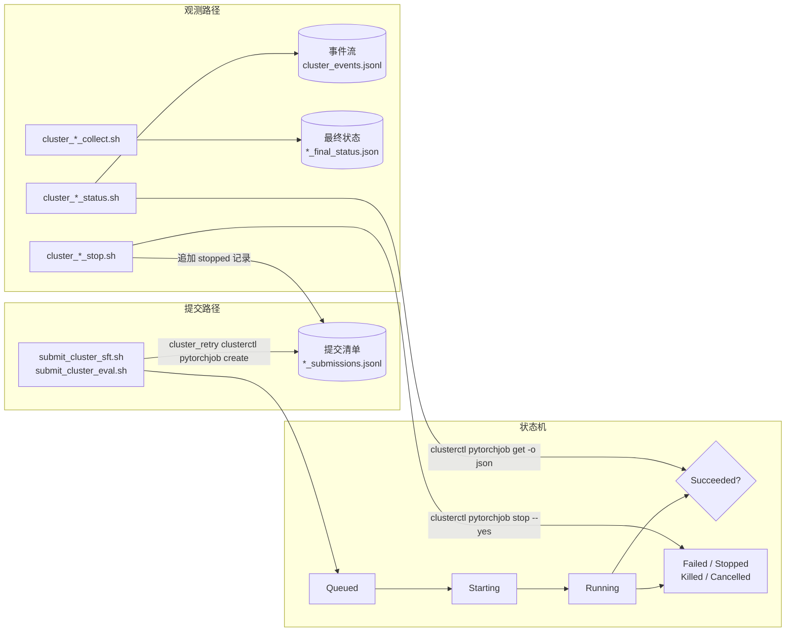
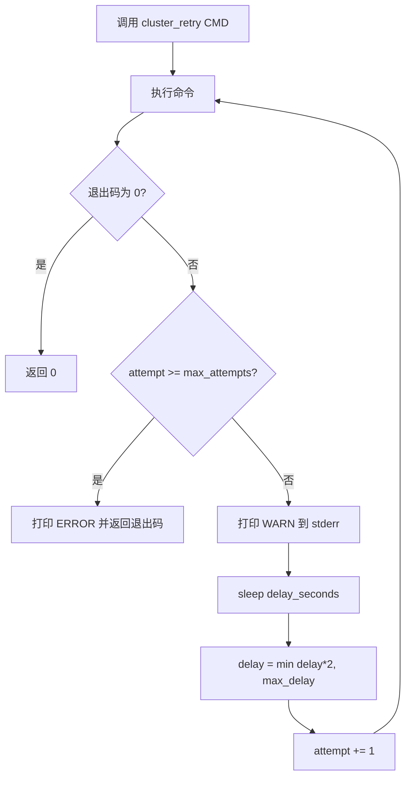

本页聚焦 AutoSFT 执行者（executor）技能 `cluster-job-lifecycle` 所覆盖的**作业生命周期闭环**：如何确认一个已提交的 Cluster SFT 或评测作业真的成功、产物落在何处、如何在终态前安全停止、以及如何用 `clusterctl` 有界重试应对瞬时故障。它**不**判断模型质量、不读取分数值、不决定下一个作业跑什么，也不在瞬态命令重试之外选择重试策略。理解本页后，你将掌握提交（submit）→ 排队（Queued）→ 运行（Running）→ 终态（Succeeded / Failed / Stopped / Killed / Cancelled）这一完整路径上的结构化文件契约与脚本入口。

> **📖 小白导读**
> - 这篇讲什么：集群作业的完整一生——提交（submit）、排队（Queued）、运行（Running）、终态（Succeeded/Failed/Stopped/Killed），以及每一步的安全操作与容错。
> - 读之前先知道：**作业（job）**＝提交给 GPU 集群的一次任务（一次训练或一次评测）；**clusterctl**＝Cluster 集群的命令行管理工具（类比 kubectl 之于 Kubernetes）；**有界重试**＝最多重试 N 次、不会无限循环的重试策略，专治集群的瞬时抖动；**终态**＝作业的最终状态，一旦到达就不再变化。
> - 读完你能明白：怎么确认作业真的提交成功、产物落在集群哪个路径；终态前如何安全叫停；哪些报错值得重试、哪些不值得。
> - 提醒：本页是执行者的"操作手册"，遇到作业问题时按小节当 checklist 用。

Sources: [SKILL.md](skills/cluster-job-lifecycle/SKILL.md#L18-L25), [SKILL.md](skills/cluster-job-lifecycle/SKILL.md#L1-L16)

## 生命周期全景与结构化文件契约

AutoSFT 用**按运行目录（run dir）组织的结构化文件**暴露每个 Cluster 作业的完整生命周期，使调用方永远不必去抓取人类可读的 `clusterctl` 输出。作业每一次状态查询、停止与最终状态汇总都落到磁盘上的确定位置：提交清单 `sft_submissions.jsonl`（或 `eval_submissions.jsonl`）、事件流 `cluster_events.jsonl`、以及最终状态文件 `sft_final_status.json` / `<eval_run>/eval_final_status.json`。

Sources: [lifecycle-files.md](skills/cluster-job-lifecycle/references/lifecycle-files.md#L1-L12)

整个生命周期可以抽象为「提交脚本创建作业」与「生命周期脚本观测/停止/收集作业」两条并行路径。提交路径由 `submit_cluster_sft.sh` / `submit_cluster_eval.sh` 通过 `cluster_retry clusterctl pytorchjob create` 创建作业并写入提交清单；观测路径则通过 `cluster_*_status.sh` 轮询、`cluster_*_stop.sh` 停止、`cluster_*_collect.sh` 收集，全部围绕同一套结构化文件展开。



Sources: [SKILL.md](skills/cluster-job-lifecycle/SKILL.md#L29-L64), [lifecycle-files.md](skills/cluster-job-lifecycle/references/lifecycle-files.md#L14-L58)

三类文件的语义边界被刻意分离：**提交清单**是任务身份的不可变来源，**事件流**是紧凑可重放的增量状态，**最终状态**是聚合后的终态判定。下表对比三者的职责与关键字段。

| 文件 | 写入者 | 关键字段 | 用途 |
|------|--------|----------|------|
| `*_submissions.jsonl` | `submit_*` / `*_stop` | `task`、`task_id`、`output_dir`、`model_path`、`benchmark`、`eval_backend`，以及 `{"event":"stopped",...}` | 任务身份与提交时刻快照（含算子停止记录） |
| `cluster_events.jsonl` | `*_status.sh`（经 `cluster_status.py`） | `status`、`previous_status`、`changed`、`create_time`、`update_time`、`error`、`artifact_paths` | 增量轮询事件，省略不可变作业规格 |
| `sft_final_status.json` / `eval_final_status.json` | `*_collect.sh` | `cluster_status`、`checkpoint_complete` / `artifacts_complete`、`clusterctl_summary`、`clusterctl_error` | 单文件聚合，供后续阶段判定 |

Sources: [lifecycle-files.md](skills/cluster-job-lifecycle/references/lifecycle-files.md#L14-L73), [submit_cluster_sft.sh](skills/cluster-sft-job-submission/scripts/submit_cluster_sft.sh#L202-L226), [submit_cluster_eval.sh](skills/cluster-eval-job-submission/scripts/submit_cluster_eval.sh#L338-L363)

提交清单的记录可被过滤为「真实提交」：凡带 `event` 字段的行（如 `event == "stopped"`）不是提交，只有**无** `event` 字段的行才是真正的任务提交，这使算子停止与任务消失可以被区分开来。

Sources: [lifecycle-files.md](skills/cluster-job-lifecycle/references/lifecycle-files.md#L22-L25), [submit_cluster_sft.sh](skills/cluster-sft-job-submission/scripts/submit_cluster_sft.sh#L210-L225)

## 轮询：增量状态事件与非终态选择器

轮询脚本 `cluster_sft_status.sh` / `cluster_eval_status.sh` 的核心设计原则是**每个活跃任务只抓取一次 JSON，且只持久化会变化的生命周期字段**——固定的作业规格不会在每一次轮询时重新进入智能体上下文。每个任务通过 `cluster_retry clusterctl pytorchjob get "${task}" -o json` 抓取一次真实状态，随后把该 JSON 管道式传给 `cluster_status.py record` 写入事件流。

Sources: [cluster_sft_status.sh](skills/cluster-job-lifecycle/scripts/cluster_sft_status.sh#L4-L65), [cluster_eval_status.sh](skills/cluster-job-lifecycle/scripts/cluster_eval_status.sh#L4-L68)

无显式任务参数时，脚本通过 `python -m src.control_plane.cluster_status pending` 选择「仍需轮询」的任务。选择逻辑位于 `pending_tasks`：它读取清单中的唯一任务列表，再对照事件流中每个任务的**最新**非空状态，剔除已经是终态的任务；传入 `--include-terminal`（或环境变量 `AUTO_SFT_POLL_TERMINAL_TASKS=1`）时则返回全部任务。显式传入任务 id 会绕过该选择器，可对终态任务做有意复查。

Sources: [cluster_status.py](src/control_plane/cluster_status.py#L76-L92), [cluster_sft_status.sh](skills/cluster-job-lifecycle/scripts/cluster_sft_status.sh#L25-L37)

终态集合 `TERMINAL_STATUSES` 由模块统一冻结为 `Succeeded`、`Failed`、`Stopped`、`Killed`、`Cancelled`、`Canceled`；`Queued`、`Starting`、`Running` 则为非终态。每次记录事件时，`append_status_event` 会读取该任务上一次状态作为 `previous_status`，并据此计算 `changed` 标志，同时把可能超长的错误/产物字段用 `_bounded` 截断到 2000 字符，避免污染上下文。

Sources: [cluster_status.py](src/control_plane/cluster_status.py#L18-L27), [cluster_status.py](src/control_plane/cluster_status.py#L132-L195), [cluster_status.py](src/control_plane/cluster_status.py#L95-L129)

下面是 `cluster_events.jsonl` 中一条典型的紧凑轮询事件，可以看到它显式省略了 `entry`、`environment` 等不可变字段，只保留能驱动下一步生命周期动作的数据：

```json
{"event":"status_poll","task":"tasks/379078","polled_at":"...",
 "status":"Running","previous_status":"Queued","changed":true,
 "create_time":"...","update_time":"...","error":null,"artifact_paths":null}
```

Sources: [lifecycle-files.md](skills/cluster-job-lifecycle/references/lifecycle-files.md#L27-L41), [test_cluster_status.py](tests/test_cluster_status.py#L72-L116)

轮询完成后，若处于运行目录上下文中，脚本会调用 `python -m src.control_plane.executor_handoff refresh --run-dir "${AUTO_SFT_RUN_DIR}"` 刷新紧凑交接状态（失败仅告警、非致命），保证执行者交接视图与最新事件流同步。

Sources: [cluster_sft_status.sh](skills/cluster-job-lifecycle/scripts/cluster_sft_status.sh#L66-L72), [cluster_eval_status.sh](skills/cluster-job-lifecycle/scripts/cluster_eval_status.sh#L70-L75)

## 停止：非交互确认与停止事件记录

停止脚本 `cluster_sft_stop.sh` / `cluster_eval_stop.sh` 通过 `cluster_retry clusterctl pytorchjob stop "${task}" --yes` 执行停止，`--yes` 提供非交互确认。停止一个任务会**释放 Cluster 的 GPU，但不会删除磁盘上的检查点、TensorBoard 事件或输出目录下任何文件**。

Sources: [cluster_sft_stop.sh](skills/cluster-job-lifecycle/scripts/cluster_sft_stop.sh#L11-L17), [cluster_sft_stop.sh](skills/cluster-job-lifecycle/scripts/cluster_sft_stop.sh#L71-L78), [cluster_eval_stop.sh](skills/cluster-job-lifecycle/scripts/cluster_eval_stop.sh#L65-L72)

无显式任务参数时，SFT 停止脚本从清单中取出**最近一次**真实提交任务；评测停止脚本则从评测清单中取出**所有**已提交任务（去重）。停止之后，脚本会向对应清单追加一条结构化 `{"event":"stopped", "task":..., "stopped_at":..., "clusterctl_exit_code":...}` 记录（评测记录额外带 `job_kind":"evaluation"`），使下游收集/状态/最终状态工具能区分「任务凭空消失」与「算子显式停止该任务」。

Sources: [cluster_sft_stop.sh](skills/cluster-job-lifecycle/scripts/cluster_sft_stop.sh#L33-L99), [cluster_eval_stop.sh](skills/cluster-job-lifecycle/scripts/cluster_eval_stop.sh#L28-L94), [SKILL.md](skills/cluster-job-lifecycle/SKILL.md#L104-L116)

停止应当在**元智能体的作业契约要求时**才执行。停止入口本身不做任何调度推断，仅负责执行停止动作并把结果落为可审计的记录。

Sources: [SKILL.md](skills/cluster-job-lifecycle/SKILL.md#L93-L102)

## 收集：终态判定优先于文件存在性

收集脚本是成功判定的关键环节。`cluster_sft_collect.sh` 对清单中每条提交记录执行三件事：检查 `<output_dir>/checkpoints/latest_checkpointed_iteration.txt` 这一**文件存在性**完整性信号、把 TensorBoard 事件解析为 `loss_summary.json` / `loss_curve.csv`、并额外调用 `clusterctl pytorchjob get <task> -o json` 捕获**真实的 Cluster 终态**。之所以必须抓取真实终态，是因为一个**在写完检查点之后被 OOM 杀掉**的任务，纯看磁盘产物会显得「完整」——只有 `clusterctl` 状态能消歧。

Sources: [cluster_sft_collect.sh](skills/cluster-job-lifecycle/scripts/cluster_sft_collect.sh#L4-L18), [lifecycle-files.md](skills/cluster-job-lifecycle/references/lifecycle-files.md#L43-L58)

评测收集脚本 `cluster_eval_collect.sh` 对每条记录计算 `artifacts_complete`——仅当聚合、分数、反馈三类核心文件（`metrics.json`、`scores.json`、`feedback.json`）**全部存在**时才为真。它构建的 `artifact_paths` / `artifact_exists` **只包含路径与存在性标志，绝不包含任何分数值**。顶层的 `status` 只有在清单中每个任务真实状态为 `Succeeded` 且核心产物完整时才为 `succeeded`；任一任务是 `Failed`/`Stopped`/`Killed`/`Cancelled`/`Canceled` 时为 `failed`；否则为 `incomplete`。

Sources: [cluster_eval_collect.sh](skills/cluster-job-lifecycle/scripts/cluster_eval_collect.sh#L155-L230), [lifecycle-files.md](skills/cluster-job-lifecycle/references/lifecycle-files.md#L60-L73)

评测收集脚本还会重写 `eval_successful_submissions.jsonl`，只保留同时满足「真实状态 `Succeeded`」与「核心产物完整」两个条件的任务；随后 `python -m src.control_plane.ledger record-eval` 只消费这个**过滤后**的清单来记录账目（失败仅告警、非致命）。因此，一个失败任务遗留的分数文件无法满足外层目标门禁。收集结束时同样刷新执行者交接状态。

Sources: [cluster_eval_collect.sh](skills/cluster-job-lifecycle/scripts/cluster_eval_collect.sh#L215-L269), [lifecycle-files.md](skills/cluster-job-lifecycle/references/lifecycle-files.md#L74-L78)

收集脚本内部对**终态任务做缓存复用**：若上一次 `*_final_status.json` 已记录某任务为终态（且对 Succeeded 任务其完整性标志已为真），则直接复用旧记录、输出 `reused_terminal_result`，避免重复抓取。这一缓存与轮询选择器共同保证「记录为终态的任务不会被反复轮询」。

Sources: [cluster_sft_collect.sh](skills/cluster-job-lifecycle/scripts/cluster_sft_collect.sh#L151-L166), [cluster_eval_collect.sh](skills/cluster-job-lifecycle/scripts/cluster_eval_collect.sh#L139-L154)

下表汇总 SFT 与评测两条收集路径的差异：

| 维度 | SFT 收集 | 评测收集 |
|------|----------|----------|
| 完整性标志 | `checkpoint_complete`（`latest_checkpointed_iteration.txt` 存在） | `artifacts_complete`（`metrics`/`scores`/`feedback` 全存在） |
| 附加产物 | `loss_summary.json` / `loss_curve.csv`（解析 TensorBoard） | `artifact_paths` / `artifact_exists`（仅路径与存在性） |
| 停止记录交叉引用 | `operator_stop_recorded` / `stopped_at` | —（记录写入清单，账目走过滤清单） |
| 输出文件 | `sft_final_status.json` | `eval_final_status.json` + `eval_successful_submissions.jsonl` |
| 账目写入 | —（无 `record-eval` 调用） | `ledger record-eval` 消费过滤清单 |

Sources: [cluster_sft_collect.sh](skills/cluster-job-lifecycle/scripts/cluster_sft_collect.sh#L167-L238), [cluster_eval_collect.sh](skills/cluster-job-lifecycle/scripts/cluster_eval_collect.sh#L196-L249)

## 成功判据：信任真实状态而非文件存在性

技能文档给出一条不可妥协的规则：**信任真实的 `cluster_status`，而非仅凭文件存在性**。SFT 成功要求 `cluster_status == "Succeeded"` **且** `checkpoint_complete == true`；评测成功要求 `cluster_status == "Succeeded"` **且** 每个请求的 benchmark 任务都满足 `artifacts_complete == true`。

Sources: [SKILL.md](skills/cluster-job-lifecycle/SKILL.md#L66-L76)

一个失败或被停止的任务可能留下部分输出。因此**绝不能仅凭检查点或分数文件就上报成功**。一个在写完检查点后被杀的任务会呈现 `checkpoint_complete == true` 但 `cluster_status` 处于 `Failed`/`Stopped` 的矛盾状态，此时必须以 `cluster_status` 为准，不得因为检查点存在就把任务推进到下一阶段。

Sources: [lifecycle-files.md](skills/cluster-job-lifecycle/references/lifecycle-files.md#L55-L58), [SKILL.md](skills/cluster-job-lifecycle/SKILL.md#L75-L76)

执行者交接模块 `executor_handoff.py` 把这一判据编码为 `next_action` 的分支：`sft_status in FAILED_STATUSES` 时进入 `blocked` 并明确「不要重提交该任务」；`sft_status != "Succeeded"` 时进入 `sft_poll` 只轮询活跃任务；Succeeded 但 `checkpoint_complete` 为假时进入 `sft_collect` 收集一次。它还输出 `constraints.do_not_resubmit_tasks`（所有已知任务）与 `constraints.poll_terminal_tasks: false`，从机制上防止对已记录终态的任务重复轮询或重复提交。

Sources: [executor_handoff.py](src/control_plane/executor_handoff.py#L538-L552), [executor_handoff.py](src/control_plane/executor_handoff.py#L596-L651)

## clusterctl 有界重试基础设施

提交、状态、停止三类命令都使用来自 `src/commit_utils/cluster_retry.sh` 的**有界重试**设置。该文件导出 `cluster_retry()` 函数：它以固定起点延迟开始，每失败一次即指数退避（延迟翻倍），并在达到 `AUTO_SFT_CLUSTER_RETRY_MAX_DELAY_SECONDS` 上限时封顶，直到耗尽最大尝试次数才返回最后一次的退出码。重试诊断信息全部走 stderr，因此只有 `clusterctl` 的最终响应会进入调用方的标准输出。

Sources: [cluster_retry.sh](src/commit_utils/cluster_retry.sh#L1-L27), [submit_cluster_sft.sh](skills/cluster-sft-job-submission/scripts/submit_cluster_sft.sh#L185-L191)



Sources: [cluster_retry.sh](src/commit_utils/cluster_retry.sh#L5-L27)

三个可调参数及其默认值如下表。它们既被 shell 的 `cluster_retry()` 读取，也被收集脚本内嵌的 Python `fetch_clusterctl_status()` 以相同默认值读取，保证两条实现路径的重试语义一致。

| 环境变量 | 默认值 | 含义 |
|----------|--------|------|
| `AUTO_SFT_CLUSTER_RETRY_MAX` | `5` | 最大尝试次数 |
| `AUTO_SFT_CLUSTER_RETRY_DELAY_SECONDS` | `30` | 初始退避延迟（秒），每次翻倍 |
| `AUTO_SFT_CLUSTER_RETRY_MAX_DELAY_SECONDS` | `300` | 退避延迟上限（秒） |

Sources: [cluster_retry.sh](src/commit_utils/cluster_retry.sh#L6-L8), [lifecycle-files.md](skills/cluster-job-lifecycle/references/lifecycle-files.md#L86-L94), [cluster_sft_collect.sh](skills/cluster-job-lifecycle/scripts/cluster_sft_collect.sh#L72-L105)

重试的意图是吸收**瞬时**故障，例如可恢复的 HTTP 503「billing account」验证中断，让集群短暂抖动不再直接判负整轮。提交脚本在 `source` 重试助手后，用 `RESPONSE="$(cluster_retry clusterctl "${CLUSTERCTL_ARGS[@]}")"` 包裹创建调用；重试耗尽后函数返回非零，配合 `set -e` 让脚本大声失败（与未加重试前行为一致）。

Sources: [submit_cluster_sft.sh](skills/cluster-sft-job-submission/scripts/submit_cluster_sft.sh#L6-L10), [submit_cluster_eval.sh](skills/cluster-eval-job-submission/scripts/submit_cluster_eval.sh#L6-L10), [submit_cluster_sft.sh](skills/cluster-sft-job-submission/scripts/submit_cluster_sft.sh#L185-L191)

## 提交歧义与重复防护

**Queued/Starting 持续数分钟是正常的**，原因通常是镜像拉取或节点启动。然而，如果一次创建请求在服务端已接受之后才超时，盲目重提会造成**重复工作**。因此在恢复一次歧义提交失败前，必须检查相关 `*_submissions.jsonl`、`cluster_events.jsonl` 以及预期输出目录，以判断任务是否真的已创建。

Sources: [SKILL.md](skills/cluster-job-lifecycle/SKILL.md#L78-L91), [clusterctl-defaults.md](skills/cluster-job-lifecycle/references/clusterctl-defaults.md#L49-L57)

关键判据是：**预提交校验错误不会写入任何清单记录**。缺失数据集/分词器/加载检查点等错误会以 `ERROR: ... exited with code N` 出现在 stderr，并伴随非零退出与「无清单记录」，可以直接当作「未创建任何任务」，修好输入后重新提交即可。

Sources: [lifecycle-files.md](skills/cluster-job-lifecycle/references/lifecycle-files.md#L80-L94)

为在并发场景下防止重复创建，提交注册表 `submission_registry.py` 提供 `submission_lock(run_dir)`——它用 `.cluster-submission.lock` 文件加 `fcntl.flock` 排他锁，把「检查是否已存在 + 创建」这一本地 check-and-create 操作串行化；`find_sft_submission` 则按 `run_name` 返回某一运行名下最早的一次耐久任务。

Sources: [submission_registry.py](src/control_plane/submission_registry.py#L44-L73)

此外，策略守卫禁止智能体**直接**调用 `clusterctl pytorchjob create`：`FORBIDDEN_COMMAND_PATTERNS` 中的 `direct_cluster_submission` 正则匹配 `clusterctl pytorchjob create`，`policy_hook.py` 会在实时工具调用中拒绝该命令。所有提交必须经由 `sft_train.py` / `evaluate.py` 走技能脚本完成。这保证了任务创建只发生在受控的提交脚本中，配合清单与事件流使重复提交可被检测。

Sources: [policy_guard.py](src/control_plane/policy_guard.py#L75), [policy_hook.py](tools/codex_goal/policy_hook.py#L141-L156), [clusterctl-defaults.md](skills/cluster-job-lifecycle/references/clusterctl-defaults.md#L51-L52)

## 输出契约与守卫式清单解析

技能对执行者的输出契约作出明确规定：返回任务 id 与原始终态；填充匹配的 `result_artifacts.sft` 或 `result_artifacts.evaluation` 路径；仅在确实发生重试时向 `retry_history` 追加结构化条目；并且**仅在失败或被阻塞的终态**下才设置 `failure_details`。它明确禁止打开 `metrics.json`、`scores.json`、`feedback.json`、`failures.jsonl` 或 `failure_breakdown.json`——这些属于分析角色，生命周期技能不做指标解读。

Sources: [SKILL.md](skills/cluster-job-lifecycle/SKILL.md#L118-L125), [AGENTS.md](AGENTS.md#L48-L54)

在受守卫的智能体运行中（`AUTO_SFT_POLICY_GUARD=1` 且设置了 `AUTO_SFT_RUN_DIR`），生命周期脚本对清单路径实施**严格校验**：SFT 命令只接受规范的运行级清单 `${AUTO_SFT_RUN_DIR}/sft_submissions.jsonl`；评测每个 eval run 各有自己的清单，因此要求精确的 `${AUTO_SFT_RUN_DIR}/eval_runs/<name>/eval_submissions.jsonl`。任何不符都会以退出码 2 失败，而**不会静默回退**到全局清单，从而避免跨运行污染。

Sources: [cluster_sft_status.sh](skills/cluster-job-lifecycle/scripts/cluster_sft_status.sh#L16-L23), [cluster_eval_status.sh](skills/cluster-job-lifecycle/scripts/cluster_eval_status.sh#L16-L26), [clusterctl-defaults.md](skills/cluster-job-lifecycle/references/clusterctl-defaults.md#L34-L39)

清单默认值本身遵循「有运行目录则用运行级、否则回退结果目录」的解析顺序：`AUTO_SFT_SFT_MANIFEST` 在运行激活时为 `${AUTO_SFT_RUN_DIR}/sft_submissions.jsonl`，否则为 `${AUTO_SFT_RESULTS_DIR}/cluster_sft_submissions.jsonl`；`AUTO_SFT_EVAL_MANIFEST` 默认指向 `${AUTO_SFT_RESULTS_DIR}/cluster_eval_submissions.jsonl`。这些默认值定义在 `set_env_vars.sh` 中，由提交脚本消费。

Sources: [set_env_vars.sh](src/commit_utils/set_env_vars.sh#L62-L67), [clusterctl-defaults.md](skills/cluster-job-lifecycle/references/clusterctl-defaults.md#L28-L33)

## 契约行为与测试守卫

生命周期脚本的若干关键不变量由测试套件固化，防止后续改动破坏契约。`test_cluster_lifecycle_scripts.py` 断言状态脚本对每个任务**只抓取一次**（`clusterctl pytorchjob get "${task}"` 恰好出现一次且使用 `-o json`）、事件流中**不出现** `clusterctl_response`；断言停止脚本使用 `--yes` 非交互确认；断言受守卫的 SFT/评测脚本分别校验规范的运行级/每运行清单路径；并对六个脚本执行 `bash -n` 语法检查。

Sources: [test_cluster_lifecycle_scripts.py](tests/test_cluster_lifecycle_scripts.py#L12-L72)

`test_cluster_status.py` 则固化轮询选择器与增量事件的语义：清单轮询会跳过每一种终态（`Succeeded`、`Killed` 等），只在 `include_terminal=True` 时返回全部任务；状态事件只存储增量字段，重复轮询同一状态时 `changed` 为假，且持久化内容中**不包含** `clusterctl_response`、`resourcesPerNode`、固定启动脚本或环境令牌。

Sources: [test_cluster_status.py](tests/test_cluster_status.py#L14-L116)

## 小结与阅读衔接

`cluster-job-lifecycle` 技能把「作业是否真的成功、产物在哪、如何安全停止」这一问题收敛为三个结构化文件与六个薄脚本入口，其背后由 `cluster_status.py`（增量事件与非终态选择）、`cluster_retry.sh`（有界指数退避）、`submission_registry.py`（并发防重）与 `executor_handoff.py`（`next_action` 与 `do_not_resubmit_tasks`）共同支撑。

若要继续理解本页上下游，建议按流水线顺序阅读：

- 上游：作业如何被创建——[SFT 训练轮次：从 Qwen3-Base 独立初始化、配方物化到 SSTable 转换与作业提交](19-sft-xun-lian-lun-ci-cong-qwen3-base-du-li-chu-shi-hua-pei-fang-wu-hua-dao-sstable-zhuan-huan-yu-zuo-ye-ti-jiao) 与 [评测后端双轨：Inspect AI 默认路径与 OpenCompass vLLM 自托管 API 桥接](21-ping-ce-hou-duan-shuang-gui-inspect-ai-mo-ren-lu-jing-yu-opencompass-vllm-zi-tuo-guan-api-qiao-jie)。
- 中间：检查点如何被转换——[检查点转换：Megatron 分布式到 HF/vLLM 格式的幂等转换与 Python 环境隔离](20-jian-cha-dian-zhuan-huan-megatron-fen-bu-shi-dao-hf-vllm-ge-shi-de-mi-deng-zhuan-huan-yu-python-huan-jing-ge-chi)。
- 下游：轮询结果如何进入容错恢复与账目——[执行者交接与容错恢复：executor_handoff 紧凑状态、断点续跑与防重复提交注册表](25-zhi-xing-zhe-jiao-jie-yu-rong-cuo-hui-fu-executor_handoff-jin-cou-zhuang-tai-duan-dian-xu-pao-yu-fang-zhong-fu-ti-jiao-zhu-ce-biao) 与 [实验台账：iterations.jsonl 配对记录、结构化决策备注与最佳分数追踪](23-shi-yan-tai-zhang-iterations-jsonl-pei-dui-ji-lu-jie-gou-hua-jue-ce-bei-zhu-yu-zui-jia-fen-shu-zhui-zong)。
- 背景：禁止直接提交的守卫规则——[策略守卫机制：policy_guard 的源码保护、禁用训练流检测与违规审计（policy_guard_check.sh）](9-ce-lue-shou-wei-ji-zhi-policy_guard-de-yuan-ma-bao-hu-jin-yong-xun-lian-liu-jian-ce-yu-wei-gui-shen-ji-policy_guard_check-sh)。