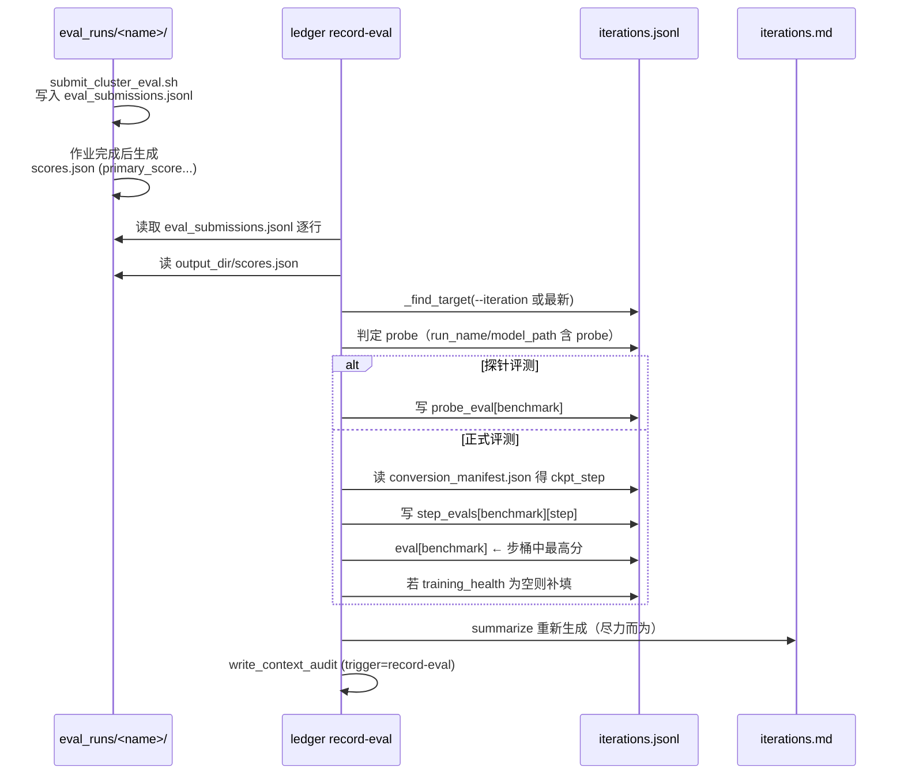
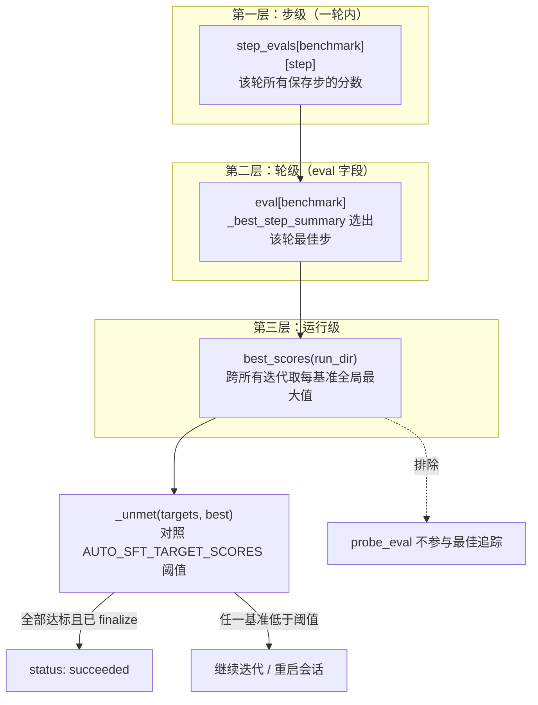

AutoSFT 的受保护运行目录采用单文件工件复用模式：每轮训练都会覆盖 `data-recipe.yaml`、`run_manifest.json`、`sft/checkpoints/` 等文件。这种设计换来了路径稳定性，却让智能体失去了"我已经试过什么、效果如何"的记忆。实验台账（experiment ledger）正是为修复这一缺陷而生——它是一个**配对式追加/合并记录系统**，把每轮迭代的"配方"与"结果"绑定在同一条 JSON 记录中，并通过结构化决策备注与最佳分数追踪，为元智能体的下一轮决策和运行器的停止条件提供唯一权威依据。本文面向中级开发者，解析其数据模型、生命周期、验证规则与消费生态。

> **📖 小白导读**
> - 这篇讲什么：实验台账 `iterations.jsonl`——每轮实验的"配方＋结果"如何绑定成一条记录、决策备注怎么写、最佳分数怎么追踪。
> - 读之前先知道：**JSONL**＝每行一个 JSON 对象的追加式文本文件（JSON＝花括号组织的通用数据格式）；**追加写**＝只在文件末尾添新行、永不改旧行的写入方式（保证历史不可篡改）；**主分数（primary_score）**＝每个基准的正式得分，停止条件只认它。
> - 读完你能明白：为什么运行目录里文件被覆盖了历史却不丢；元智能体"下一轮参考上一轮"读的就是这份台账；停止条件到哪一步读什么字段。
> - 提醒：本页结构简单但字段多，先记"配方+结果成对入账"这个骨架。

Sources: [ledger.py](src/control_plane/ledger.py#L1-L35)

## 一、设计动因：三件套工件与"渐进填充"模式

台账的核心洞察是**时间解耦**：SFT 提交时结果尚不存在，评测收集时配方已被覆盖，因此一条记录必须能分阶段写入。台账由此落地为三个互补工件，全部位于 `${AUTO_SFT_RUN_DIR}` 下：

- **`recipe_history/iter_<NNN>.yaml` + `.data_manifest.json`**——每轮配方的不可变快照。活跃的 `data-recipe.yaml` 会被每轮覆盖（`prepare_recipe` 在准备数据时将其复制到 run 目录），但这些归档副本永不改写。
- **`iterations.jsonl`**——每轮一行 JSON 对象，按 `iteration` 索引渐进填充：SFT 提交时写入配方摘要、超参数与检查点谱系；评测收集时附加训练健康度与各基准分数；`rationale` 与 `decision` 由智能体通过 `note` 命令随时补写。
- **`iterations.md`**——从 `iterations.jsonl` 重新生成的紧凑表格，供智能体与人类一眼纵览完整轨迹。

`record_sft` 打开新迭代时，会预置占位字段（`training_health: None`、`eval: {}`、`step_evals: {}`、`probe_eval: {}`、`rationale` 暂取暂存的备注），后续各写入路径分别填充自己的字段。这种**先建骨架、后填血肉**的模式是整个台账的统一风格，也是它能在"提交—训练—评测—分析"长链路中保持一致性的关键。

```mermaid
flowchart LR
    subgraph 写入端["写入端（分阶段）"]
        A["sft_train.py<br/>提交 SFT 作业"] -->|"record_sft<br/>打开迭代+配方快照"| L
        B["智能体（元）<br/>note 命令"] -->|"rationale + decision"| L
        C["智能体/收集流程<br/>record-eval 命令"] -->|"eval + step_evals<br/>+ training_health"| L
        D["智能体<br/>record-taxonomy 命令"| E["taxonomy_refinement"]
        E -->|"版本+报告路径"| L
    end
    L["iterations.jsonl<br/>（每轮一行，渐进填充）"]
    L --> R["recipe_history/<br/>iter_NNN.yaml 不可变快照"]
    L --> M["iterations.md<br/>重新生成的总览表"]
    subgraph 消费端["消费端"]
        M --> F["元智能体<br/>下一轮决策前 summarize"]
        L --> G["codex_goal_runner<br/>best_scores 验证停止条件"]
        L --> H["history-round-analysis<br/>实验树与分支保留"]
    end
```

所有写入路径在成功后都尽力调用 `summarize` 刷新 `iterations.md`（用裸 `except Exception` 包裹，摘要失败绝不阻断主流程），这使得 Markdown 总览与 JSONL 源始终近似同步。

Sources: [ledger.py](src/control_plane/ledger.py#L49-L52), [ledger.py](src/control_plane/ledger.py#L213-L231), [ledger.py](src/control_plane/ledger.py#L291-L329), [recipe_data.py](src/control_plane/recipe_data.py#L888-L892)

## 二、记录结构：配方侧、结果侧与主观侧的字段全景

一条迭代记录由三组语义独立的字段构成，下表按写入阶段展开：

| 字段组 | 关键字段 | 写入时机 | 内容要点 |
|---|---|---|---|
| **配方侧（客观）** | `recipe`、`recipe_archive`、`hyperparams`、`sft_output_dir`、`kind`、`base_model`、`initialization`、`branched_from`、`taxonomy_used` | SFT 提交时（`record_sft`） | 配方摘要含每个数据集的 `source`、`sample_count`、`weight`、令牌统计（`total_tokens`/`loss_tokens`/`loss_token_ratio`/`mean_tokens_per_row`）及配额语义字段；超参数含 `train_epochs`/`iters_per_epoch`/`train_iters`/`seq_length` 及采集的环境变量覆盖 |
| **结果侧（客观）** | `training_health`、`eval`、`step_evals`、`probe_eval` | 评测收集时（`record_eval`） | `eval[benchmark]` 指向该轮最佳步；`step_evals[benchmark][step]` 保留全部步；探针评测单独进 `probe_eval` |
| **主观侧（智能体撰写）** | `rationale`、`decision` | 任意时刻（`add_note`） | `rationale` 为自由文本；`decision` 为六字段强验证结构 |
| **谱系附加** | `taxonomy_refinement` | 分类体系精炼后（`record_taxonomy`） | 分类体系版本、精炼报告、覆盖报告与四份分析报告路径 |

`recipe` 摘要中的令牌统计字段具有明确的科学意图——注释指出 `total_tokens` 决定启动器上限下的实际算力，而 `loss_token_ratio` 在比较数据量时标记监督密度不均的情况。`kind` 字段则从谱系信息推导，其判定优先级为：`resume_mode` → `branched_from.type == continue` → `mcts` → `load_ckpt`（restart）→ 默认 `fresh`。在正常 AutoSFT 流程中，每轮都从 Qwen3-Base 独立初始化，因此 `fresh` 是常态。

Sources: [ledger.py](src/control_plane/ledger.py#L150-L210), [ledger.py](src/control_plane/ledger.py#L279-L320)

## 三、配对机制：run_name 幂等（幂等＝同一运行名重复登记，效果和登记一次相同）与迭代索引连接

"配对"（pairing）在代码中有两处精确体现，且各自使用不同的连接键。

**写入侧的幂等配对**：`record_sft` 首先扫描现有记录，若 `run_name` 已存在则直接返回已有索引而不新建——这保证重复调用 `sft_train.py`（例如恢复场景下的防重复提交路径）不会产生重复迭代行。只有全新 `run_name` 才推进 `_next_index`（现有最大索引 + 1）并归档配方快照。

**读取侧的索引连接**：`record_eval` 读取评测运行目录下的 `eval_submissions.jsonl` 清单（由 `submit_cluster_eval.sh` 在提交时追加），对每条非事件记录解析 `output_dir`/`benchmark`，找到对应的 `scores.json`（或 `feedback.json`）后，用两种方式定位目标迭代：显式 `--iteration N` 参数，或默认连接到**最近一次提交的 SFT 迭代**（`_find_target` 取 `iteration` 最大者）。文档字符串明确解释了这个设计：初始化元数据与谱系记录在 SFT 侧，而评测收集把分数挂到产出该检查点的那一轮。

`record_eval` 还提供了一个贴心恢复：`derive_run_dir_from_manifest` 从评测清单路径向上遍历父目录，找到首个含 `iterations.jsonl` 或 `run_manifest.json` 的目录即认定为台账属主，因此 CLI 的 `record-eval` 子命令在省略 `--run-dir` 时也能自动定位。



Sources: [ledger.py](src/control_plane/ledger.py#L443-L543), [ledger.py](src/control_plane/ledger.py#L256-L264), [ledger.py](src/control_plane/ledger.py#L1018-L1027)

## 四、步级桶与探针路由：为什么 eval[benchmark] 不是简单覆盖

训练后评测扫描（`eval_round_ckpts.sh`）会把一轮保存的每个步（通常仅最终步，但若磁盘上有额外 `iter_*` 目录则全部 ≤ final 的步都评）转换为 HF 格式并逐 (步 × 基准) 提交作业。这带来一个记录难题：同一轮同一基准可能有多个分数，直接覆盖会丢失信息。

`record_eval` 的解法是**双层结构**：`step_evals[benchmark]` 是以步号为键的字典，所有步的摘要并存（步号取自 HF 模型目录下 `conversion_manifest.json` 的 `ckpt_step`；无步号时退化为 `run_name`）；而 `eval[benchmark]` 始终指向该桶中 `primary_score` 最高者（`_best_step_summary`），并标注 `ckpt_step` 与 `recorded_at`。摘要表渲染时，若某基准步桶多于一个，单元格会附加 `(best of N)` 提示，且 `iterations.md` 底部专门生成 "Per-step evals" 小节列出全部步分——文档字符串称之为"可审计的最佳步选择"。

探针评测走完全独立的通道：只要 `run_name` 或 `model_path` 中包含 "probe"（不区分大小写），结果进入 `probe_eval` 桶而非 `step_evals`，因此**不参与**任何最佳分数追踪。摘要表对仅有探针分数的轮次会显示 `(probe@步号)` 后缀，与正式分数明确区分。

训练健康度（`training_health`）也在此阶段补填：从 `sft_output_dir/loss_summary.json` 读取，按标签排序规则（精确 `loss` > `lm loss` > 含 `loss` > 其他）选出主损失标签，记录 `last`/`min`/`last_pct_slope`/`last_step` 与 `has_nan`/`has_inf` 标志。`record_eval` 只在该字段仍为空时写入，避免覆盖。

Sources: [ledger.py](src/control_plane/ledger.py#L408-L431), [ledger.py](src/control_plane/ledger.py#L504-L526), [ledger.py](src/control_plane/ledger.py#L768-L828), [eval_round_ckpts.sh](skills/cluster-eval-job-submission/scripts/eval_round_ckpts.sh#L4-L12)

## 五、结构化决策备注：六字段强验证与暂存机制

`note` 命令承载的是整个多智能体体系中最关键的因果证据链。AGENTS.md 契约规定：元智能体在写下一份动作计划前，必须读完所有分析建议，选定恰好一个 `action_type`，然后在台账中记录选中的建议 ID、主假设、计划动作、预期效果、证伪条件与任何偏差，同时保留一份简洁的人类可读 rationale。

`_validate_decision` 对六字段执行严格验证，任何不合规直接 `SystemExit`：

| 字段 | 验证规则 | 语义 |
|---|---|---|
| `selected_recommendation_ids` | 非空字符串列表；每项去重 | 选中的分析建议稳定 ID；未选任何建议时用哨兵值 `meta-originated` |
| `primary_hypothesis` | 非空字符串 | 本轮要检验的主假设 |
| `planned_action` | 非空字符串 | 计划执行的数据动作 |
| `expected_effect` | 非空字符串 | 预期效果（可被后续轮次对照） |
| `falsification` | 非空字符串 | 证伪条件——这是实验可证伪性的锚点 |
| `deviations` | 字符串列表（可为空） | 对所选建议的实质性偏离 |

**暂存机制**解决了时序错位：智能体可能在首次 SFT 提交前就写备注，此时台账还没有任何迭代行。`add_note` 检测到目标不存在且未显式指定迭代号时，把 rationale 与 decision 写入 `pending_rationale.json`；随后 `record_sft` 打开新迭代时自动读取该暂存文件、将两个字段注入新记录，并删除暂存文件。若显式指定了不存在的迭代号，则报错要求先提交 SFT 轮。

契约还蕴含一条科学纪律："优先改变一个因果可解释的数据变量；若多个变量必须同时改变，须记录为何无法拆分。"这正是 `history-round-analysis` 消费端区分 `supported`/`falsified` 与 `confounded` 的依据——没有决策记录的轮次无法归因。

Sources: [ledger.py](src/control_plane/ledger.py#L604-L676), [AGENTS.md](AGENTS.md#L127-L145)

## 六、最佳分数追踪：三层结构与目标验证停止条件

"最佳分数"在系统中呈三层金字塔，每层职责不同：



`_best_iteration`（用于摘要表底部 "Best so far" 行）与 `best_scores`（用于 CLI `best-scores` 子命令与程序化调用）都只读 `eval` 字段而非 `step_evals`，因此探针分数与各步明细永远不会污染全局最优。

`best_scores` 的程序化消费者是 `codex_goal_runner`：它在每个会话尝试结束后调用该函数，把结果与 `AUTO_SFT_TARGET_SCORES`（格式 `benchmark=score,...`）对照。`_unmet` 对每个目标基准检查——分数缺失（尚无评测）或低于阈值都算未达标。停止条件是**目标全达标 AND finalize 标记存在**的双重条件；仅目标达标但未 finalize 不会声明成功，`/goal` 声称完成但分数未达标时还会被 nudged 继续运行。最终终止状态 JSON（`terminal_status`）中固化了 `best_scores` 快照，目标未达标时进程以退出码 1 结束。目标条件文本本身（`DEFAULT_GOAL_CONDITION`）就直接引用了 `best-scores` 命令，形成契约与实现的闭环。

Sources: [ledger.py](src/control_plane/ledger.py#L916-L953), [codex_goal_runner.py](src/control_plane/codex_goal_runner.py#L51-L58), [codex_goal_runner.py](src/control_plane/codex_goal_runner.py#L96-L116), [codex_goal_runner.py](src/control_plane/codex_goal_runner.py#L627-L645), [AGENTS.md](AGENTS.md#L349-L362)

## 七、调用链全景与尽力而为哲学

台账的所有程序化写入入口已收敛为一条主线：`sft_train.py` 在写入 `run_manifest.json` 并完成提交后，调用 `record_sft` 归档快照并登记迭代（位于 try/except 中，注释明确"ledger is best-effort; never block a real submission"——台账失败只打印 WARN，绝不阻断真实集群提交）。评测侧的 `record-eval` 则由智能体按契约手动调用，因为评测收集与分析报告产出之间存在智能体决策空间。

`record_eval` 额外联动了**上下文审计**：每次评测收集后调用 `write_context_audit`（trigger 为 `record-eval`），从运行 JSONL 日志估算智能体上下文的组成分布（推理、助手消息、命令串、命令输出、todo 状态等桶，用 tiktoken 或字符数/4 启发式计 token），同样包裹在尽力而为的异常处理中——审计失败绝不阻断评测收集。这一设计的动机是让运行监督者能追踪智能体上下文被何种内容占据，为长循环的上下文健康管理提供数据。

| 调用方 | 触发点 | 调用的台账 API | 失败语义 |
|---|---|---|---|
| `sft_train.py` | SFT 提交成功后（非 dry-run） | `record_sft` | WARN，不阻断提交 |
| 智能体（契约驱动） | 评测收集后 | CLI `record-eval` | 逐条尽力写入，无效行跳过 |
| 智能体（元） | 每轮决策前/后 | CLI `note` + `summarize` | decision 验证失败硬退出 |
| 智能体（元） | 分类体系精炼后 | CLI `record-taxonomy` | 无迭代时硬退出 |
| `codex_goal_runner` | 每次会话尝试结束、恢复检查 | `best_scores`（程序化） | 只读，无失败路径 |
| `history-round-analysis` | 轮次完成后分析 | 读 `iterations.jsonl`/`.md` + `recipe_history/` | 缺失 rationale 视为谱系缺失证据 |

Sources: [sft_train.py](sft_train.py#L717-L751), [ledger.py](src/control_plane/ledger.py#L528-L543), [context_audit.py](src/control_plane/context_audit.py#L1-L11), [history-round-analysis](skills/history-round-analysis/SKILL.md#L29-L63)

## 八、消费生态：从决策记忆到实验树重建

台账的价值最终由三类消费者兑现，它们各自读取不同的投影：

**元智能体**在每轮决策前读 `summarize` 输出（AGENTS.md 第 373-384 行："read the ledger before each decision"），从表格中获取每轮的配方、最终检查点、分数、分析谱系与建议树；恢复场景下（被重启后）也以 `summarize` 作为重建状态的起点，"既不重复已试配方，也不丢失好的早期结果"。

**history-round-analysis** 是台账最深度结构化消费端：它以 `decision.selected_recommendation_ids` 为首选证据判定建议是否被显式选中（rationale 文本推断只能标为 `inferred`、置信度更低），把每个建议节点分类为 `untried`/`supported`/`falsified`/`mixed`/`inconclusive`/`confounded`，并保留未选中的兄弟分支——"后续建议可以回到更早的父节点，而非只在最新执行节点上延伸"。SKILL 明确规定"缺失 rationale 或建议选择是谱系缺失的证据，不是发明谱系的许可"。

**运行器**（`codex_goal_runner`）则只关心标量投影：`best_scores` 的每基准最大值对照阈值，构成整个运行的目标契约验证。

三者的共同前提是台账记录的**完备性与诚实性**：契约要求每个正常轮次都必须有结构化决策，这正是"实验可证伪"从口号落为可执行纪律的地方。

Sources: [AGENTS.md](AGENTS.md#L373-L391), [history-round-analysis](skills/history-round-analysis/SKILL.md#L42-L63)

## 延伸阅读

- 台账的配方摘要字段来源于数据动作执行层，详见[数据动作计划：不可变元计划、operator.py 约束执行与 Data Action Runner 的权威采样](11-shu-ju-dong-zuo-ji-hua-bu-ke-bian-yuan-ji-hua-operator-py-yue-shu-zhi-xing-yu-data-action-runner-de-quan-wei-cai-yang)
- `record-eval` 消费的评测产物与提交脚本，见[评测后端双轨：Inspect AI 默认路径与 OpenCompass vLLM 自托管 API 桥接](21-ping-ce-hou-duan-shuang-gui-inspect-ai-mo-ren-lu-jing-yu-opencompass-vllm-zi-tuo-guan-api-qiao-jie)与[Cluster 作业生命周期：提交、轮询、停止、收集与 clusterctl 有界重试基础设施](22-cluster-zuo-ye-sheng-ming-zhou-qi-ti-jiao-lun-xun-ting-zhi-shou-ji-yu-clusterctl-you-jie-zhong-shi-ji-chu-she-shi)
- 台账记录的 `taxonomy_refinement` 与四份分析报告的生成过程，见[四维分析报告体系：失败案例、数据供给、学习动力学与分支保留历史的共享动作语义](24-si-wei-fen-xi-bao-gao-ti-xi-shi-bai-an-li-shu-ju-gong-gei-xue-xi-dong-li-xue-yu-fen-zhi-bao-liu-li-shi-de-gong-xiang-dong-zuo-yu-yi)与[分类体系设计契约：taxonomy_contract 冻结、类目树语义与设计/实现分离原则](15-fen-lei-ti-xi-she-ji-qi-yue-taxonomy_contract-dong-jie-lei-mu-shu-yu-yi-yu-she-ji-shi-xian-fen-chi-yuan-ze)
- 台账所在的运行产物目录整体布局，见[运行产物目录全解：agent_execute/runs 下的台账、报告、检查点与分类数据布局](6-yun-xing-chan-wu-mu-lu-quan-jie-agent_execute-runs-xia-de-tai-zhang-bao-gao-jian-cha-dian-yu-fen-lei-shu-ju-bu-ju)