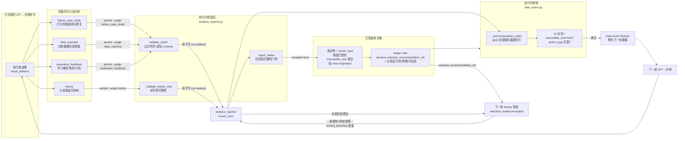

在 AutoSFT 的十一阶段流水线中，第 10 步"四路并行分析"是整个系统从"执行循环"切换到"科学决策循环"的枢纽：一个已完成的 SFT→评测轮次结束后，元智能体（meta-agent）会并行派出四个只读分析子智能体，各自从互不重叠的视角审视同一轮证据，并将结论以**结构化、可证伪、带统一动作语义**的 JSON 报告持久化到 `analysis_reports/round_<id>/` 目录。这四份报告不仅是下一步数据决策的直接输入，其 `recommendations` 数组更构成贯穿整个实验历史树的稳定证据节点。本页解析这一四维分析体系的契约设计：各角度的所有权边界、报告 schema 的校验机制、六种统一 `action_type` 的规范化语义，以及历史角度如何通过分支保留树（branch-preserving experiment tree）克服线性轮次序列丢失未选分支的根本缺陷。

> **📖 小白导读**
> - 这篇讲什么：四路并行分析报告——每轮训练+评测结束后，四个只读子智能体从"失败案例、数据供给、学习动力学、历史轮次"四个互不重叠的角度各自出一份 JSON 报告。
> - 读之前先知道：**只读分析**＝只能查看证据文件、不能改动任何东西的观察角色；**可证伪**＝建议必须写清"什么证据出现就说明我错了"，能被推翻才叫科学建议；**动作语义**＝所有报告的建议共用一套统一格式（动作类型+参数），让元智能体能机械比较；**学习动力学**＝研究训练过程中模型学没学进去、学没学歪的角度。
> - 读完你能明白：四个角度为什么这样切分（不重不漏）；"零建议"为什么合法；这些报告如何汇入实验历史树。
> - 提醒：读这页前最好先读第 7 页（控制平面）理解角色分工。

## 四个分析角度：互不重叠的问题所有权

四路分析的核心设计原则是**问题所有权的排他划分**——每个子智能体只回答一个问题，且明确声明不做什么。这避免了多个智能体对同一证据做出重复或矛盾诊断的噪声，也使元智能体能将每份报告视为一个独立证据通道。四个角度与其各自"拥有的问题"如下：

| 智能体 ID | 技能文件 | 持久化角度 | 拥有的问题 |
|---|---|---|---|
| `autosft_failure_case_study` | `failure-case-study-analysis` | `failure_case_study` | 模型可观测行为为何失败，哪个数据操作最能直接检验修复假设 |
| `autosft_data_examine` | `training-data-examination` | `data_examine` | 本轮实际供给的训练信号是什么，其有效质量/多样性是否与名义规模匹配 |
| `autosft_evaluation_feedback_analysis` | `learning-dynamics-interference-analysis` | `evaluation_feedback` | 模型从给定混合数据中能学到什么，哪些切片过易/难但可学/持续不可学/饱和，以及切片间干扰 |
| `autosft_history` | `history-round-analysis` | `history` | 哪些已提出的数据动作实际有效、失败、未试或因果不可解释，同时保留线性序列未选择的分支 |

Sources: [AGENTS.md](AGENTS.md#L36-L41) [SKILL.md](skills/failure-case-study-analysis/SKILL.md#L21-L33)

每个技能文件都以"The question this agent owns"开头明确定义所有权，并紧接着列出**明确排除项**。例如失败案例角度声明"Do not audit raw training-data supply, infer category learnability from loss curves, or reconstruct the full experiment-history tree. Those are separate angles."（不要审计原始训练数据供给、不要从损失曲线推断类目可学性、不要重建完整实验历史树——那些是其他角度的职责）。数据供给角度同样声明"Do not diagnose prediction behavior, interpret optimization dynamics, or judge long-run causal history. A low benchmark score alone is not evidence that the training rows are bad."（不要诊断预测行为、解释优化动力学或评判长期因果历史；低基准分本身不是训练行质量差的证据）。这种主动放弃是设计出来的：低分不等于数据差——模型架构、训练超参、数据本身三者中任何一个都可能是原因，四个角度的划分正是沿这三条因果链加历史维度展开的。

Sources: [SKILL.md](skills/failure-case-study-analysis/SKILL.md#L30-L33) [SKILL.md](skills/training-data-examination/SKILL.md#L26-L29)

值得注意的是第三个角度的**命名遗留**：智能体 ID `autosft_evaluation_feedback_analysis` 与持久化键 `analysis_angle="evaluation_feedback"` 都沿用了旧名，但其技能已被替换为 `learning-dynamics-interference-analysis`（学习动力学与干扰分析），技能文件明确说明"This role retains the persisted `analysis_angle="evaluation_feedback"` only for compatibility with existing AutoSFT runs. It no longer owns generic L1/L2 failure diagnosis; that is combined with case study in the failure-behavior angle."（保留持久化键仅为兼容既有运行；不再负责通用 L1/L2 失败诊断，该职责已合并入失败行为角度）。测试用例 `test_learning_dynamics_skill_replaces_the_old_skill_name` 锁定了这一迁移：新技能文件存在、旧技能文件不存在、智能体 TOML 指令中引用新技能名。

Sources: [SKILL.md](skills/learning-dynamics-interference-analysis/SKILL.md#L26-L33) [test_analysis_reports.py](tests/test_analysis_reports.py#L376-L392)

## 报告契约：summary-first 结构与持久化门禁

四份报告共享一个**稳定公共外壳**（stable common shell），由 `src/control_plane/analysis_reports.py` 的 `validate_report` 函数强制校验。这个校验不是建议性的——每个分析子智能体必须先通过该命令持久化报告，命令验证失败则无法落盘：

```json
{
  "round_id": "string",
  "analysis_angle": "failure_case_study",
  "summary": "2-6 sentence narrative for the meta-agent",
  "key_findings": [
    {"finding": "string", "evidence": "string", "confidence": "high|medium|low"}
  ],
  "decision_relevant_signals": ["fact"],
  "uncertainties": ["string"],
  "evidence_paths": ["path"],
  "details": {"...": "角度特定的深层结构"},
  "recommendations": ["0-3 条带完整可证伪 schema 的建议"]
}
```

`summary` 字段被置于 JSON 最前（summary-first），因为元智能体的消费顺序是先读 `summary` 再看细节——这是为上下文效率设计的渐进披露。校验层要求 `summary` 非空、`key_findings` 中每条 `finding` 为字符串且 `confidence` 必须是 `high|medium|low` 三档之一、`decision_relevant_signals`/`uncertainties`/`evidence_paths` 均为字符串列表、`details` 为对象。`round_id` 与 `analysis_angle` 必须与命令行传入值严格一致，防止报告在轮次间错位。

Sources: [analysis_reports.py](src/control_plane/analysis_reports.py#L312-L361) [agent_prompt_online.md](tools/codex_exec/agent_prompt_online.md#L59-L66)

**原子写入**是持久化的关键工程细节：`_atomic_write` 函数先在同目录写临时文件（前缀 `.{目标名}.`、后缀 `.tmp`），再通过 `os.replace` 原子重命名到位。其文档字符串直指原因——"The four analysis subagents persist in parallel, so a half-written report must never be observable to the meta-agent's completeness check."（四个分析子智能体并行持久化，半写状态的报告绝不能被元智能体的完整性检查观察到）。`os.replace` 在 Windows 和 Linux 上都是原子操作，保证了无论哪个进程在何时崩溃，磁盘上要么是完整旧报告、要么是完整新报告。

Sources: [analysis_reports.py](src/control_plane/analysis_reports.py#L419-L438)

持久化命令由各子智能体自己执行，而非由元智能体代劳。每个 `.codex/agents/*.toml` 的 `developer_instructions` 末尾都包含精确的命令模板：

```bash
python -m src.control_plane.analysis_reports persist \
  --run-dir "${AUTO_SFT_RUN_DIR}" \
  --round-id "<round_id>" \
  --angle "history" \
  --input "<path to your report JSON>"
```

测试 `test_analysis_agents_may_write_but_stay_narrowly_scoped` 逐一验证四个 TOML：`sandbox_mode` 必须是 `workspace-write`（仅运行目录可写）、指令必须包含 "Do not edit any file except"（除自己报告外不得编辑任何文件）、"no repository source"（不得触碰仓库源码）、"analysis_reports persist" 与精确的 `--angle` 值、"Do not spawn another agent"（不得再派生子智能体）、以及 "zero to three" 的建议数量约束。这套测试将"分析子智能体只有一个写入理由——持久化自己的报告"这一治理规则固化成了回归防线。

Sources: [autosft_history.toml](.codex/agents/autosft_history.toml#L78-L88) [test_analysis_reports.py](tests/test_analysis_reports.py#L353-L374)

## 完整性门禁与恢复语义

四个角度各自落盘后，元智能体通过 `analysis_reports status` 命令校验完整性，而不是代为持久化。该命令由 `report_status` 函数实现：对给定的 `run_dir` 与 `round_id`，检查四个预期角度（`failure_case_study`、`data_examine`、`evaluation_feedback`、`history`）对应的 JSON 文件是否全部存在，返回 `complete` 布尔值与 `missing_angles` 缺失列表。测试 `test_persist_and_complete_status` 验证了从部分到完整的转换路径：第一个角度持久化后 `complete` 为 `false`，四角度齐备后转为 `true` 且 `missing_angles` 为空。

Sources: [analysis_reports.py](src/control_plane/analysis_reports.py#L452-L465) [test_analysis_reports.py](tests/test_analysis_reports.py#L91-L113)

更精细的恢复语义由 `incomplete_rounds` 承担。该函数**扫描 `analysis_reports/` 目录本身**而非依赖轮次 ID，因为它服务的场景是外部运行器重启一个可能中途中断的智能体："Discovered by scanning `analysis_reports/` rather than from a round id, so the runner does not have to know which round the agent was working on."（通过扫描目录而非轮次 ID 发现，因此运行器无需知道智能体当时正在哪个轮次工作）。其区分三种状态的核心逻辑是：只报告**有部分报告但非全部四个**的轮次——`present and present != EXPECTED_ANGLES` 才进入结果；一个完全没有目录的轮次不算（智能体可能尚未到达该阶段，这与丢失已产出报告是两回事）；名称不以 `round_` 开头的目录和无关文件（如 `notes.txt`）直接忽略。测试 `test_incomplete_rounds_ignores_complete_and_absent_rounds` 与 `test_incomplete_rounds_ignores_unrelated_files` 锁定了这些边界。

Sources: [analysis_reports.py](src/control_plane/analysis_reports.py#L468-L497) [test_analysis_reports.py](tests/test_analysis_reports.py#L252-L292)

执行者报告（executor report）被**有意排除**在这一目录之外。`executor_report_path` 的文档字符串解释了原因："That directory means 'the four analysis angles' to two other consumers: the completeness gate in `report_status`, and the ledger, which globs it to record taxonomy lineage. An executor report is neither an angle nor a lineage input, so it gets its own directory rather than widening either."（该目录对另外两个消费方——`report_status` 的完整性门禁与台账的分类血缘 glob——意味着"四个分析角度"。执行者报告既非角度也非血缘输入，因此它有自己的目录，而不是放宽这两者的语义）。执行者报告落在 `executor_reports/round_<id>.json`，且使用独立校验器 `validate_executor_report`——它**故意不复用** `validate_report`："an executor reports what it ran and what it produced, and is forbidden from interpreting metrics, so it has no `summary` or graded `key_findings` to give. Requiring those would force it to invent judgements its own contract rules out."（执行者报告它运行了什么、产出了什么，且被禁止解释指标，因此它没有 `summary` 或分级 `key_findings` 可给；要求这些会强迫它编造其自身契约排除的判断）。执行者报告的 schema 只要求 `round_id`、`job_type`（`round|recover|finalize`）、`status`（`succeeded|failed|blocked`）、`tasks` 列表与 `result_artifacts` 对象。

Sources: [analysis_reports.py](src/control_plane/analysis_reports.py#L301-L309) [analysis_reports.py](src/control_plane/analysis_reports.py#L364-L406) [test_analysis_reports.py](tests/test_analysis_reports.py#L294-L351)

## 共享动作语义：六种规范化 action_type

四份报告的 `recommendations` 数组是整个体系的决策输出，而其中最关键的设计是**跨四个角度共享同一套动作语义**。AGENTS.md 的"Analysis recommendation action semantics"一节给出了六种 `action_type` 的规范化定义，其精妙之处在于：`action_type` **描述提议的操作本身，与当前流水线能否执行该操作无关**（"describes the proposed operation independently of whether the current pipeline can execute it"），而可执行性由独立的 `executable_now` 布尔字段表达。这允许分析智能体提出语义上正确但当前无法执行的建议（如合成数据），保留其科学价值而不污染运行时：

| action_type | 规范化定义 | 运行时可执行性 |
|---|---|---|
| `filter` | 对既有数据施加可复现的行级包含/排除谓词，并明确说明回填行为 | ✅ 可执行 |
| `remove` | 将已识别的行集、来源、类目或切片的训练曝光设为零，并明确说明 token 预算重分配 | ✅ 可执行 |
| `reweight` | 改变既有数据的相对采样或 token 曝光，不改变行内容 | ✅ 可执行 |
| `rewrite` | 为既有行创建溯源链接的替换——改变其最终 assistant 内容同时保留任务身份、先前分类上下文与父血缘 | ✅ 可执行 |
| `synthesize` | 创建非既有行溯源保持变换的新训练内容 | ⚠️ 仅建议性（advisory-only），必须 `executable_now=false` |
| `replay` | 以稳定行身份寻址，按指定曝光故意包含先前轮次的精确既有行 | ✅ 可执行 |

Sources: [AGENTS.md](AGENTS.md#L69-L94)

**`synthesize` 的运行时禁令**在两个层面被强制执行。报告校验层：`_validate_recommendations` 中的显式规则 `if action_type == "synthesize" and executable_now: raise AnalysisReportError(...)` 拒绝任何声称当前可执行的合成建议，错误消息直指"under the current no-synthetic-data policy"（在当前无合成数据策略下）。测试 `test_synthetic_proposal_cannot_claim_current_executability` 验证该拒绝路径。运行时层：`data_action.py` 中 `ADVISORY_ONLY_ACTION_TYPES = {"synthesize"}`，计划校验遇到该类型直接抛出 "is advisory-only and cannot enter a runtime plan"（仅建议性，不能进入运行时计划）。

Sources: [analysis_reports.py](src/control_plane/analysis_reports.py#L155-L162) [test_analysis_reports.py](tests/test_analysis_reports.py#L192-L208) [data_action.py](src/control_plane/data_action.py#L52-L54)

`curriculum` 是一个**已移除**的动作类型——它曾出现在旧的 `action_type` 词汇中，但已被从 `ACTION_TYPES` 集合剔除。运行时给出精确的迁移指引："is not in the runtime action space; use reweight for a static mix change"（不在运行时动作空间中；静态混合变更请用 reweight）。测试 `test_curriculum_is_no_longer_a_recommendation_action` 确保报告校验层同样拒绝该类型。值得注意的是，`HISTORY_ACTION_TYPES = ACTION_TYPES | {"curriculum"}` 保留了 curriculum 在**历史树节点**中的合法性——这是为了兼容早期运行中已持久化的历史节点，但新的建议中不允许再使用它。

Sources: [analysis_reports.py](src/control_plane/analysis_reports.py#L25-L33) [data_action.py](src/control_plane/data_action.py#L439-L447) [test_analysis_reports.py](tests/test_analysis_reports.py#L210-L223)

## 建议对象的可证伪 schema

每条建议（最多 3 条，最少 0 条——零条在证据不足时是**正确**的）是一个包含 14 个必填字段的完整对象，校验器 `_validate_recommendations` 逐一强制。其设计哲学是**强制科学严谨性**——每个字段对应假设检验的一个环节：

| 字段 | 语义 | 校验规则 |
|---|---|---|
| `recommendation_id` | 稳定 ID，跨后续历史报告保持不变 | 必须以 `{round_id}:{angle}:` 前缀开头，同一报告内不得重复 |
| `parent_recommendation_ids` | 父建议列表，用于扩展先前未试或部分支持的分支 | 必须为非空字符串列表，不得包含自身 ID |
| `hypothesis` | 当前问题为何发生 | 非空字符串 |
| `target_slice` | 目标失败切片或数据切片 | 非空字符串 |
| `action_type` | 六种规范化动作之一 | 枚举校验 |
| `proposed_action` | 待检验的数据操作 | 非空字符串 |
| `evidence` | 工件路径加具体数值或案例 ID | **必须非空**且每项为非空字符串 |
| `alternative_explanation` | 另一个可能原因 | 非空字符串——强制承认竞争性假设 |
| `expected_effect` | 预期变化的指标或切片 | 非空字符串 |
| `regression_risk` | 什么可能变差 | 非空字符串——强制声明风险 |
| `falsification` | 何种结果将反驳该假设 | 非空字符串——**可证伪性是硬性要求** |
| `cost` | 实施成本 | `low\|medium\|high` 三档 |
| `executable_now` | 当前机制与策略是否支持执行 | 布尔值；synthesize 时必须为 false |
| `outcome` | 检验结果 | `untested\|supported\|falsified\|mixed\|inconclusive\|confounded` |
| `actual_effect` | 实际观察到的效果 | `untested` 时必须为 null；非 `untested` 时必须非空 |

Sources: [analysis_reports.py](src/control_plane/analysis_reports.py#L84-L183) [AGENTS.md](AGENTS.md#L56-L58)

`outcome` 与 `actual_effect` 的**互斥约束**值得特别说明：新提议必须用 `outcome="untested"` 与 `actual_effect=null`——因为建议在提出时尚未被检验；而一旦某条建议在后续轮次中被实际执行并观察到效果，历史角度会在**树节点**上（而非改写原始报告）记录 `outcome` 与 `actual_effect`。`untested` 时 `actual_effect` 若非 null、或非 `untested` 时 `actual_effect` 为 null，均触发校验错误。测试 `test_tested_recommendation_requires_actual_effect` 锁定了这一规则。这维持了证据的时间不可变性——报告一经持久化即是快照，效果归属在历史树的更新副本中追加。

Sources: [analysis_reports.py](src/control_plane/analysis_reports.py#L164-L183) [test_analysis_reports.py](tests/test_analysis_reports.py#L225-L237)

## 历史树：分支保留与因果归因

四个角度中，`history` 是唯一拥有**专用深层结构**的角度——其 `details` 必须包含 `experiment_tree` 对象，由 `_validate_history_tree` 独立校验。这个设计直接回应了线性实验序列的根本缺陷：如果每轮只执行一个动作，未选择的备选假设将永久丢失，系统就无法"回到早前的兄弟分支"。

```json
{
  "nodes": [
    {
      "recommendation_id": "稳定 ID（来自原始报告）",
      "parent_recommendation_ids": [],
      "proposed_round_id": "提出时的轮次 ID",
      "analysis_angle": "来源角度",
      "hypothesis": "string",
      "action_type": "string",
      "selected_by_meta": "true|false|null",
      "selection_evidence": "explicit|inferred|missing",
      "tested_round_ids": ["round id"],
      "variables_changed": ["数据变量"],
      "outcome": "untried|supported|falsified|mixed|inconclusive|confounded",
      "actual_effect": "untried 时为 null；否则为观察到的分数/切片变化",
      "evidence": ["路径加数值"]
    }
  ],
  "active_branch": ["按执行顺序的建议 ID"],
  "untried_branches": ["建议 ID"]
}
```

Sources: [SKILL.md](skills/history-round-analysis/SKILL.md#L65-L91) [analysis_reports.py](src/control_plane/analysis_reports.py#L186-L298)

树结构的核心字段语义：`selected_by_meta` 区分三种状态——`true`（被元智能体显式选择）、`false`（明确未被选择）、`null`（无法确定，即选择证据缺失）；`selection_evidence` 进一步区分证据质量——`explicit`（来自台账的结构化 `decision.selected_recommendation_ids` 条目）、`inferred`（仅从 rationale 文本推断匹配，置信度较低）、`missing`（完全无法归因）。校验器对树施加**引用完整性**约束：`nodes` 内 `recommendation_id` 不得重复；每个节点的 `parent_recommendation_ids` 必须引用**已存在的节点 ID**——引用未知 ID 将抛出 "references unknown ids" 错误；`active_branch` 与 `untried_branches` 中的 ID 同样必须存在于 `nodes` 中。`evidence` 必须非空——历史树不允许无证据节点。

Sources: [analysis_reports.py](src/control_plane/analysis_reports.py#L218-L298) [SKILL.md](skills/history-round-analysis/SKILL.md#L41-L64)

**不要改写早期报告来追加效果**——技能文件明确指令："Do not overwrite earlier reports to add effects; later history reports carry the updated tree."（不要改写早期报告以添加效果；后续历史报告携带更新后的树）。每轮的历史分析都重建完整树，将新观察到的效果附加到对应节点上，而原始报告保持不可变。这确保了证据链的完整审计能力：任何时刻都可以从最早的历史报告回溯每个假设从提出、选择、检验到结论的完整轨迹。

Sources: [SKILL.md](skills/history-round-analysis/SKILL.md#L92-L94)

`outcome` 枚举中的 `confounded`（混淆）值得专门解释。技能文件要求历史角度标记"rounds changing multiple material variables without an isolating control"（改变多个实质性变量而无隔离控制的轮次）——当一个轮次同时改变了数据组合与配额、或同时引入新来源与移除旧来源时，单一变量的因果效应无法从结果中分离。这类节点被标为 `confounded`，其 `actual_effect` 记录的是"混淆后的综合变化"，而该节点的子建议往往就是"隔离单一变量重试"（如技能中的例子"isolating one variable from a confounded round"）。AGENTS.md 对元智能体的对应要求是"Prefer changing one causally interpretable data variable; if several must change together, record why the bundle cannot be separated."（优先改变单个因果可解释的数据变量；若必须同时改变多个，记录为何该捆绑不可分离）。

Sources: [SKILL.md](skills/history-round-analysis/SKILL.md#L52-L63) [AGENTS.md](AGENTS.md#L141-L142)

## 从建议到决策：选择闭环与血缘传导

四份报告的建议最终汇聚到元智能体的单一决策。AGENTS.md 规定其流程是"chooses exactly one data `action_type`, then selects one or more `executable_now=true` recommendations whose `action_type` matches it (or selects none and records `meta-originated`)"——先选定唯一一个动作类型，再从全部报告中筛选 `action_type` 匹配且当前可执行的一条或多条建议；若不选任何建议，则记录 `meta-originated`。选中的 ID 连同主假设、计划动作、预期效果、可证伪条件与偏差，通过 `ledger note` 的结构化选项写入台账的 `decision` 记录。`ledger.py` 的 `_validate_decision` 校验器要求 `selected_recommendation_ids` 必须为非空字符串列表（空列表不允许——不选建议也必须显式写 `meta-originated`），四个必填文本字段均非空。

Sources: [AGENTS.md](AGENTS.md#L127-L140) [ledger.py](src/control_plane/ledger.py#L604-L637) [agent_prompt_online.md](tools/codex_exec/agent_prompt_online.md#L133-L142)

这套设计形成了一个**完整的建议追踪闭环**：分析角度产生带稳定 ID 的建议 → 元智能体选择并记录到台账 `decision` → 历史角度读台账识别 `explicit` 选择证据 → 历史角度在树节点上附加实际效果与 outcome 分类 → 下轮决策可参考树中 `untried_branches` 回到未试分支。台账中的 `decision.selected_recommendation_ids` 正是历史角度区分 `explicit` 与 `inferred` 选择证据的**权威来源**——AGENTS.md 明确要求"Ledger rationales identify which analysis recommendation ids were selected so the history report can distinguish tested, untried, supported, falsified, mixed, inconclusive, and confounded branches."（台账 rationale 标识选中了哪些分析建议 ID，以便历史报告区分已检验、未试、支持、证伪、混合、不可判定与混淆分支）。

Sources: [AGENTS.md](AGENTS.md#L146-L148) [ledger.py](src/control_plane/ledger.py#L604-L614)

**运行时的二次校验**构成最后一道防线。当元智能体写出不可变的 `data_action_plan.json` 并交给执行者物化时，`data_action.py` 的计划校验器会**重新 glob 全部 `analysis_reports/round_*/*.json`** 构建 `recommendation_id → 建议对象` 的索引（`_recommendation_index` 函数），然后对计划中的 `selected_recommendation_ids` 逐一验证三件事：ID 必须存在于某份已持久化报告中；对应建议的 `executable_now` 必须严格为 `true`；对应建议的 `action_type` 必须与计划的 `action_type` **完全一致**——任何不匹配都触发 "selected recommendations must use plan action_type" 错误。唯一的豁免是字面值 `meta-originated`，且它**不能与其他 ID 混用**（"meta-originated cannot be combined with recommendation ids"）。这意味着分析报告不仅是建议的载体，更是运行时执行权限的**事实来源**——没有落盘的报告建议，就没有可执行的数据动作。

Sources: [data_action.py](src/control_plane/data_action.py#L239-L254) [data_action.py](src/control_plane/data_action.py#L452-L489)

最后，`ledger.py` 的 `record_taxonomy` 将四份报告路径作为分类血缘写入当前迭代：`analysis_report_dir` 参数指向 `analysis_reports/round_<id>/`，其下所有 `*.json` 文件的 stem 被收集为 `reports` 字典，写入台账的 `taxonomy_refinement.analysis_reports`。这使后续任何轮次都能从台账追溯"该轮分类决策参考了哪四份分析报告"。测试 `test_taxonomy_ledger.py` 验证了该记录包含全部四个角度。至此，四维分析报告从产出、校验、持久化、消费、选择、执行到血缘归档的完整生命周期闭合。

Sources: [ledger.py](src/control_plane/ledger.py#L549-L598) [test_taxonomy_ledger.py](tests/test_taxonomy_ledger.py#L218-L256)

## 架构全景：证据流与控制流



图中的两条回流路径是体系的核心闭环：左下角"运行时校验→Data Action Runner→下一轮"是**执行闭环**——建议被选中、校验、物化为实际数据动作；右下角"台账决策→下一轮 history 角度→重建树"是**认知闭环**——选择证据与实际效果回流到历史树，未选分支被保留，系统具备回到任意兄弟假设的能力。两条闭环共享同一份持久化报告作为事实来源。

## 设计评述：为什么是这四个角度

四维划分并非随意切分，而是对"数据如何影响 SFT 效果"这一因果链的系统性分解。**失败案例角度**面向"模型输出与基准要求的差距"（症状层）；**数据供给角度**面向"喂给模型的训练信号质量"（输入层）；**学习动力学角度**面向"模型在给定输入上的优化行为"（过程层）；**历史角度**面向"跨轮次的因果归因与备选假设管理"（元层）。症状、输入、过程、元层四者覆盖了数据研究的完整因果链，且相互排斥——低分可能源于输出行为缺陷、数据质量问题、优化困难或历史混淆中的任何一个，四个角度保证每个可能原因都有专属的诊断通道。

**零建议合法性**（"Zero recommendations is valid; do not pressure an analysis agent to invent one"）是对抗 LLM 幻觉倾向的关键防线。强制每个分析都产出建议会诱导模型在证据不足时编造理由；允许零条建议使"证据不支持任何行动"成为一等公民结论，与"证据支持行动"具有同等地位。这与 `executable_now` 的分离设计共同构成**诚实性架构**：分析智能体永远不必为了"有用"而说谎。

**稳定 ID + 父链接**的标识体系是历史树能跨轮次生长的基础。`{round_id}:{angle}:{序号}` 的格式保证了全局唯一性，`parent_recommendation_ids` 允许后轮建议显式扩展或反驳前轮建议，而校验器拒绝自引用与未知引用保证了树的结构有效性。当元智能体在某轮回到三个轮次前的未试分支时，新建议只需引用那个分支的 ID 作为父节点，历史角度就能在重建树时正确呈现"我们试了 A，失败；现在回头试 A 的兄弟 B"的完整决策叙事——这正是线性轮次序列永远无法表达的。

## 延伸阅读

- 想了解建议被选中后如何被物化为不可变数据动作计划并约束执行，参见 [数据动作计划：不可变元计划、operator.py 约束执行与 Data Action Runner 的权威采样](11-shu-ju-dong-zuo-ji-hua-bu-ke-bian-yuan-ji-hua-operator-py-yue-shu-zhi-xing-yu-data-action-runner-de-quan-wei-cai-yang)
- 想了解台账如何配对记录决策、配方与结果并追踪最佳分数，参见 [实验台账：iterations.jsonl 配对记录、结构化决策备注与最佳分数追踪](23-shi-yan-tai-zhang-iterations-jsonl-pei-dui-ji-lu-jie-gou-hua-jue-ce-bei-zhu-yu-zui-jia-fen-shu-zhui-zong)
- 想了解多智能体整体分工与元智能体/执行者/分析团队的角色边界，参见 [多智能体控制平面：元智能体、执行者、四路并行分析与分类体系子智能体的分工设计](7-duo-zhi-neng-ti-kong-zhi-ping-mian-yuan-zhi-neng-ti-zhi-xing-zhe-si-lu-bing-xing-fen-xi-yu-fen-lei-ti-xi-zi-zhi-neng-ti-de-fen-gong-she-ji)
- 想了解锁定本页所有契约行为的 28 个测试文件，参见 [测试套件导航：28 个测试文件覆盖的契约、幂等性与门禁行为](28-ce-shi-tao-jian-dao-hang-28-ge-ce-shi-wen-jian-fu-gai-de-qi-yue-mi-deng-xing-yu-men-jin-xing-wei)