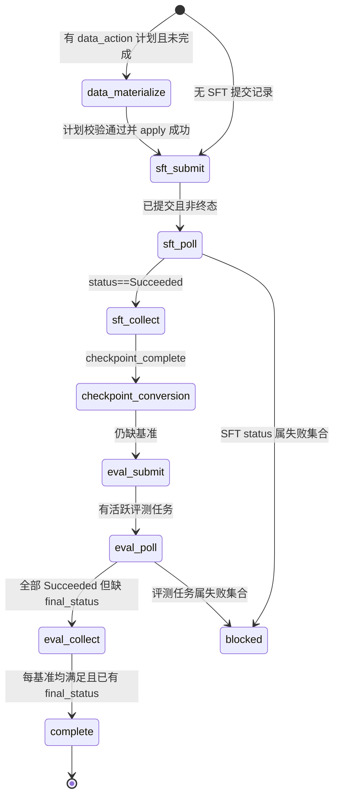
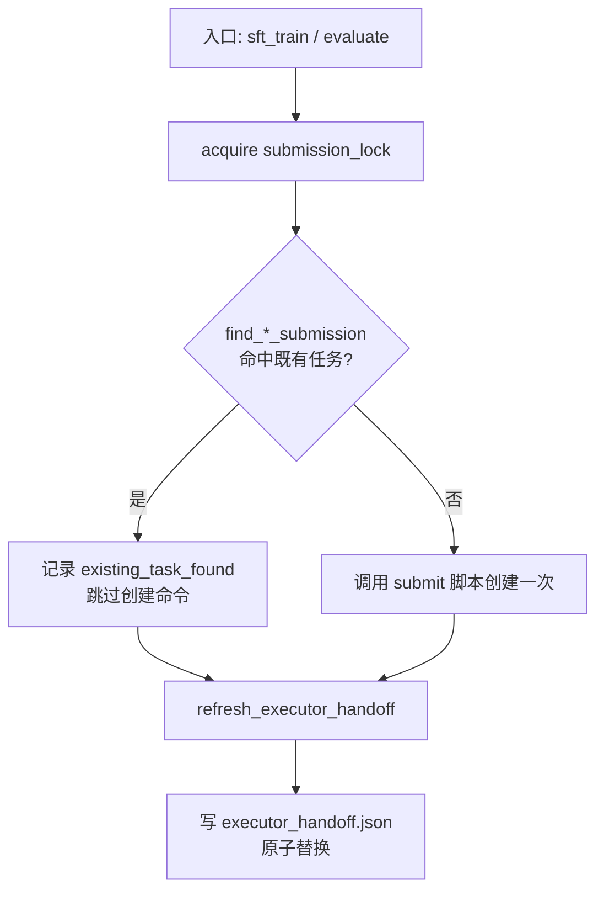

`autosft_executor` 并不是一个常驻守护进程，而是一个被元智能体按需 spawn 的短生命周期子智能体。它随时可能因超时、容器重启或上下文超限而被中断并重新拉起。本页要回答的核心架构问题是：**一份无状态的执行者如何在被反复重启后，依然知道自己走到流水线的哪一步、下一步该做什么、以及哪些任务绝不能再提交一次**。答案由两个模块协作给出——`executor_handoff.py` 从既有的持久化产物中**推导**一份有限状态快照，`submission_registry.py` 提供**去重身份**与**加锁的检查-创建**原语，使得"重复提交"在物理层面不可能发生。二者共同构成 AutoSFT 容错恢复的基石，而非可选的便利设施。

> **📖 小白导读**
> - 这篇讲什么：执行者（executor）的"断点续跑"设计——一个随时会被杀掉的短命子智能体，重启后如何准确知道"走到哪步、下一步干嘛、什么绝不能再交"。
> - 读之前先知道：**执行者**＝被元智能体按需拉起的干活的子智能体，可能因超时/容器重启随时中断；**handoff（交接快照）**＝从已有产物反推出来的"进度存档"；**去重身份**＝给每个待提交任务算出的唯一 ID，提交前先查注册表"是不是交过了"，物理上杜绝重复提交。
> - 读完你能明白：为什么执行者不自己存状态（答案：从产物推导，而不是另存一份会失同步的状态）；重复提交怎么被锁死；交接文件里每项怎么读。
> - 提醒：本页是容错设计的教科书案例，值得精读。

## 为什么需要一份"推导式"交接快照

AutoSFT 的防护运行目录（guarded run dir）复用一组单文件产物：`data-recipe.yaml`、`run_manifest.json`、`sft/<run_name>/checkpoints/`、`hf_model/` 等，每一轮都会**覆盖写入**。这意味着文件系统本身不保留"我现在处于哪一阶段"的显式标记——一个被中断的执行者重新读取目录时，无法仅凭文件名判断任务已提交但尚未轮询，还是已轮询但尚未收集。若把阶段状态改由一个可写的"当前状态"文件维护，则会引入第二个真相源，一旦它与真实产物失步，恢复逻辑本身就成了故障源。

`executor_handoff` 的设计选择是**完全无状态推导**：不新增任何独立状态文件，而是从已存在的权威产物（提交清单、事件流、最终状态文件、动作清单、转换清单）中确定性地重算出一份紧凑快照，再原子地覆盖写入 `executor_handoff.json`。模块的头注释把它明确表述为"Build one compact, durable state snapshot for AutoSFT executors"，其构建函数 `build_executor_handoff` 的文档字符串进一步声明它"从规范的运行产物推导有限状态执行者交接"（Derive the finite-state executor handoff from canonical run artifacts）。这保证了快照永远不与底层产物矛盾——它只是产物的一次视图投影。

Sources: [executor_handoff.py](src/control_plane/executor_handoff.py#L2), [executor_handoff.py](src/control_plane/executor_handoff.py#L293-L301)

元智能体契约把这份快照定位为执行者与元智能体之间的**唯一状态契约**：每次初始或替换执行者被 spawn 之前，元智能体都要刷新并把 `${AUTO_SFT_RUN_DIR}/executor_handoff.json` 传给它（本地动态数据动作轮还会附带 `--action-plan`）。AGENTS.md 明确要求执行者"消费其 `next_action`，只读取 `skills_required`，绝不轮询已记录的终态任务，也绝不替换列在 `do_not_resubmit_tasks` 中的任务"。换言之，快照把散落在多个文件中的隐性状态，收敛成一个执行者必须遵守的显式契约。契约还规定了**会话连续性**：元智能体在一整个轮次内保持同一个执行者线程，正常的轮询间隔绝不新建会话，只有真正结束或丢失的线程才允许被替换，且替换者从同一份交接启动。

Sources: [AGENTS.md](AGENTS.md#L107-L115)

## executor_handoff.json 的整体结构

快照是一个扁平且字段稳定的 JSON 对象，顶层携带 `schema_version: 2`。十个顶层键分别承担不同的语义维度：身份元数据（`generated_at`、`run_dir`、`current_round`、`run_name`）、决策指令（`stage`、`next_action`、`skills_required`）、四个状态分区（`data_prep`、`sft`、`conversion`、`evaluation`）、一次失败回放（`last_executor_failure`）以及一组硬约束（`constraints`）。`stage` 与 `next_action` 是执行者真正据以行动的两个字段，其余字段用于校验与陈述事实。

| 顶层键 | 语义 | 关键子字段 |
|---|---|---|
| `schema_version` | 快照格式版本，当前为 `2` | — |
| `generated_at` | 生成时刻（UTC） | — |
| `run_dir` / `run_name` / `current_round` | 规范运行目录、选中的运行名、推导出的轮次 | — |
| `stage` | 有限状态机当前状态（见下节） | — |
| `next_action` | 面向人类/智能体的一句话指令 | — |
| `skills_required` | 本阶段只应读取的技能白名单 | — |
| `data_prep` | 数据物化子状态 | `mode`、`plan`、`plan_sha256`、`complete`、`outputs` |
| `sft` | SFT 提交与检查点状态 | `task`、`duplicate_tasks`、`status`、`checkpoint_complete`、`latest_step` |
| `conversion` | 检查点转换状态 | `complete`、`model_dir`、`model_identity`、`manifest` |
| `evaluation` | 评测任务集合 | `tasks`、`active_tasks`、`missing_benchmarks`、`satisfied_benchmarks`、`duplicate_submission_groups` |
| `last_executor_failure` | 最近一次执行者失败回放 | `report`、`round_id`、`status`、`failure_details` |
| `constraints` | 硬约束 | `canonical_run_dir`、`do_not_resubmit_tasks`、`poll_terminal_tasks` |

`constraints.do_not_resubmit_tasks` 聚合了所有已知任务 id（SFT 记录与评测任务的并集，去重后保序），`poll_terminal_tasks` 恒为 `false`——这是把"终态任务不可再轮询"写进机器可读约束，而非仅停留在提示词中。

Sources: [executor_handoff.py](src/control_plane/executor_handoff.py#L596-L652)

## 阶段状态机：十个有限状态与唯一逃生出口

`build_executor_handoff` 的主体是一棵**条件阶梯（conditional ladder）**，从上到下依次判定，命中即停。每个分支同时设定 `stage`、`next_action` 与 `skills_required` 三件套，因此三者之间永远自洽。理解这棵阶梯的顺序，等于理解整条 SFT-through-eval 流水线的权威推进顺序：数据物化 → SFT 提交 → SFT 轮询 → SFT 收集 → 检查点转换 → 评测提交 → 评测轮询 → 评测收集 → 完成；任何一环出现终态失败则进入 `blocked`。

阶梯中的关键判定顺序值得逐一说明。若尚未有 SFT 记录且 `data_prep.mode == "data_action"` 且未完成，则停在 `data_materialize`，要求"只应用一次给定的数据动作计划，然后在 SFT 提交前刷新此交接"；否则若无 SFT 记录则进入 `sft_submit`，`next_action` 显式给出 `sft_train.py --run-dir {run_dir}` 与配方路径，并附加强调"不要使用默认或相对运行目录"。SFT 状态属失败集合（`Failed`/`Stopped`/`Killed`/`Cancelled`/`Canceled`）时进入 `blocked`，指令是"报告终态 SFT 状态并**不要重新提交**任务 `sft_task`"。

Sources: [executor_handoff.py](src/control_plane/executor_handoff.py#L521-L552)

校准 SFT 成功后，判定继续沿"检查点是否完整 → 转换是否完整 → 缺失基准 → 满意度"推进。`sft_collect` 要求"一次性收集终态的 SFT 任务"；`checkpoint_conversion` 给出"一次性转换检查点 `checkpoint_dir` 的第 `latest_step` 步"；`eval_submit` 只列出**缺失**的基准（`Submit only missing benchmarks: ...`）。当且仅当所有请求的基准都出现在 `satisfied_benchmarks` 中、且每个基准至少有一条记录携带 `final_status` 时，进入终极状态 `complete`，指令是"返回已持久化的执行结果；不提交任何东西"。

Sources: [executor_handoff.py](src/control_plane/executor_handoff.py#L545-L577)

阶梯的尾部两者处理评测阶段的活跃与失败事实：`eval_poll` 只列出活跃任务（`Poll only live eval tasks: ...`），`blocked`（评测失败分支）则明确"报告终态评测失败；**不要自动替换任务**"；兜底分支落入 `eval_collect`。`skills_required` 的取值与阶段严格对应——数据物化用 `data-action-execution`，评测提交用 `cluster-eval-job-submission`，转换用 `megatron-hf-checkpoint-conversion`，其余需要驱动作业生命周期的阶段统一用 `cluster-job-lifecycle`，`complete` 则为空列表。

Sources: [executor_handoff.py](src/control_plane/executor_handoff.py#L578-L594)

## 状态推导的权威来源与优先级

快照的每个状态字段都遵循一条统一的**三级回退（fallback）**规则：以"新近且权威的事实文件"优先，事件流次之，提交时记录的状态兜底。对某个任务而言，`sft_final_status.json`/`eval_final_status.json` 中的 `cluster_status` 是最高真相，因为它是收集器直接从 `clusterctl pytorchjob get -o json` 抄录的真实终态；其次是 `cluster_events.jsonl` 中该任务最近一次非空状态；最后才是提交清单里提交时刻的初始状态。

| 优先级 | 来源 | 读取函数 | 语义 |
|---|---|---|---|
| 1（最高） | `sft_final_status.json` / `eval_final_status.json` 的 `cluster_status` | `_task_status_from_final` | 收集器抄录的真实 clusterctl 终态 |
| 2 | `cluster_events.jsonl` 最近非空状态 | `latest_task_statuses` | 每次轮询追加的紧凑事件流 |
| 3（兜底） | 提交清单记录的 `status` | `_read_jsonl` | 提交时刻的初始状态 |

这里有一个被文档反复强调的**容错要点**：一个任务若在写完检查点之后才被 OOM 杀掉，`checkpoint_complete` 会为真，但其 `cluster_status` 却是 `Failed`/`Stopped`。生命周期的参考文档给出硬性指令——"信任 `cluster_status`，绝不因为检查点文件存在就把 Failed/Stopped 任务晋升到下一阶段"。快照中的 `checkpoint_complete` 因此被独立计算（优先取 final 任务里的显式字段，否则回退到 `latest_checkpointed_iteration.txt` 是否存在），从不参与"任务是否成功"的判定。

Sources: [executor_handoff.py](src/control_plane/executor_handoff.py#L189-L201), [executor_handoff.py](src/control_plane/executor_handoff.py#L355-L388), [lifecycle-files.md](skills/cluster-job-lifecycle/references/lifecycle-files.md#L43-L58)

`TERMINAL_STATUSES` 与 `FAILED_STATUSES` 共同构成了"什么算结束、什么算失败"的判定基础。前者是 `frozenset`，含 `Succeeded`/`Failed`/`Stopped`/`Killed`/`Cancelled`/`Canceled`；后者是快照构建器排除 `Succeeded` 后的失败子集。`active_tasks` 正是"状态不属于 `TERMINAL_STATUSES`"的任务集合，`failed_tasks` 则是"状态属于 `FAILED_STATUSES`"的集合。此外 `latest_task_statuses` 只保留含字符串 `task` 与非空字符串 `status` 的记录，天然忽略格式错误的行。

Sources: [cluster_status.py](src/control_plane/cluster_status.py#L18-L27), [cluster_status.py](src/control_plane/cluster_status.py#L51-L59), [executor_handoff.py](src/control_plane/executor_handoff.py#L504-L511)

## data_prep 子状态：以 plan_sha256 绑定的物化完整性

当本轮是本地动态数据动作轮时，`data_prep` 记录数据物化的完成度。它首先解析动作计划路径（默认 `run_dir/data_action_plan.json`，或由 `--action-plan` 指定）；若计划文件不存在，则返回 `mode: "recipe_only"`、`complete: false`，表示本轮不涉及数据动作。若计划存在但 JSON 非法，则返回 `mode: "data_action"` 并携带 `error: "invalid_plan_json"`，同样不完整——这两种拒绝路径保证坏计划不会被误判为"已完成"。

Sources: [executor_handoff.py](src/control_plane/executor_handoff.py#L81-L113)

对合法计划，完成判定执行一次**绑定式校验**：读入 `action_manifest.json`，要求其 `status == "succeeded"`、其 `plan_sha256` 与当前计划文件的 SHA-256 **完全相等**、并且四个必需产物（`dataset`、`sample_manifest`、`row_manifest`、`recipe`）全部存在。`plan_sha256` 相等这一条是关键：它把动作清单与它声称执行的计划内容锁定在一起，任何计划篡改都会使 `complete` 翻转为假。输出路径统一由 `_resolve_plan_path` 规范化——环境变量展开、相对路径相对 `run_dir` 解析、`strict=False` 解析以容忍尚不存在的产物。

Sources: [executor_handoff.py](src/control_plane/executor_handoff.py#L114-L163)

`data-action-execution` 技能正是以这套字段驱动其流程：先读 `data_prep.plan`，再以 `--expected-plan-sha256 <data_prep.plan_sha256>` 校验并 `apply` 一次，最后用同一计划调用 `executor_handoff refresh --action-plan <plan>` 刷新快照，然后"只按快照的新 `next_action` 继续"。这与快照的 `data_materialize` 阶段形成了闭环。

Sources: [data-action-execution/SKILL.md](skills/data-action-execution/SKILL.md#L84-L124)

## 转换状态与模型身份：把评测绑定到检查点溯源

`conversion` 分区回答"检查点是否已被转换成 HF/vLLM 格式、转换产物在哪"。它按一组候选路径收集 `conversion_manifest.json`（含 `run_dir/hf_model/`、`run_dir/final-model/`、`run_dir/ckpt_eval/**/hf_model/` 以及 `run_dir/*/hf_model/`），并用两个键过滤：清单里的 `checkpoint` 必须与当前 `checkpoint_dir` 规范化后一致（若已知），清单里的 `ckpt_step` 去掉前导零后必须与 `latest_step` 一致（若已知）。命中后取排序最后一个清单，并验证 `config.json`、`tokenizer_config.json` 与至少一个权重文件（`*.safetensors` 或 `*.bin`）存在，才判定 `complete: true`，同时计算该模型的 `model_identity`。

Sources: [executor_handoff.py](src/control_plane/executor_handoff.py#L204-L250)

真正的容错设计体现在 `model_identity`。评测的去重**不能**依赖模型输出目录名，因为同一检查点可能被转换成不同名字的目录，不同检查点也可能巧合地共享目录名。`model_identity` 因此读取模型目录下的 `conversion_manifest.json`，把规范化的 `checkpoint` 路径与去零后的 `ckpt_step` 用 `\0` 拼接后取 SHA-256，返回 `checkpoint:<digest>`；若无清单或字段缺失，则回退为 `path:<canonical_model>`。这把"模型身份"从可复用的路径名重新锚定到**不可变的检查点溯源**上，是防重复提交注册表得以跨运行一致的前提。

Sources: [submission_registry.py](src/control_plane/submission_registry.py#L125-L144)

## 防重复提交注册表：锁、身份与冲突检测

`submission_registry` 提供四种能力：**加锁**、**SFT 查找与冲突检测**、**评测身份与跨清单查找**、以及**任务 id 规范化**。它们共同把"检查—创建"这一本身非原子的操作，变成在一个持久化运行目录内可安全串行化的操作。

`submission_lock` 是一个上下文管理器，在 `run_dir/.cluster-submission.lock` 上以 `fcntl.flock(LOCK_EX)` 取得排他咨询锁，退出时释放。它把"本地检查并创建"的操作串行化，从而在单机（或共享同一文件系统）前提下消除并发提交竞态。值得注意的是，它依赖 POSIX 的 `fcntl`，这与其运行环境（Linux 容器/共享存储）一致。

Sources: [submission_registry.py](src/control_plane/submission_registry.py#L44-L54)

`find_sft_submission` 在 `sft_submissions.jsonl` 中按 `run_name` 匹配，返回 `submitted_at` 最早的那条记录——即"该运行名的第一个持久化任务"。它刻意跳过带 `event` 字段的行（那些是 stop 之类的事件记录，不是真实提交）。`sft_submission_conflicts` 则回答一个更微妙的问题："同一个运行名下，是否隐藏着会改变任务身份的参数差异？"它比较 `output_dir`、`dataset_path`、`train_iters`、`seq_length` 四个字段（路径先规范化），仅当既有记录字段非空且与请求值不同时才报告冲突。这样，重放同一个运行名被视为幂等（幂等＝同一操作重复执行，结果和执行一次相同），而悄悄改变数据或步数则被 fail-closed 拒绝。

Sources: [submission_registry.py](src/control_plane/submission_registry.py#L13-L25), [submission_registry.py](src/control_plane/submission_registry.py#L57-L101)

评测侧的身份是四元组 `(model_identity, benchmark, eval_backend, limit)`，由 `eval_identity` 计算，`model_identity` 缺省时回退到 `model_identity(model_path)` 的结果。`find_eval_submission` 用 `eval_manifest_paths` 枚举规范清单、`cluster_eval_submissions.jsonl` 与每个 `eval_runs/*/eval_submissions.jsonl`（**不做递归树扫描**），逐条比对身份，命中多个时取 `(submitted_at, manifest)` 最小者。这意味着即便执行者换了一个全新的评测运行名，也能在历史运行目录里"找回"同一模型+基准+后端+limit 的既有任务，从而避免重复评测。

Sources: [submission_registry.py](src/control_plane/submission_registry.py#L104-L122), [submission_registry.py](src/control_plane/submission_registry.py#L147-L201)

`task_id` 负责把不同来源的任务标识统一成 `tasks/<n>` 形式：当记录只有 `task_id`（而 `task` 字段为空）且值不以 `tasks/` 开头时，自动补前缀。所有快照与注册表函数都通过它取值，因此任务 id 在 `do_not_resubmit_tasks`、事件匹配与清单去重中始终是同一套字符串。

Sources: [submission_registry.py](src/control_plane/submission_registry.py#L34-L41), [submission_registry.py](src/control_plane/submission_registry.py#L204-L206)

## 断点续跑的落地点：三处入口的"检查-创建"

注册表的原语被三个入口在同一模式下消费，形成断点续跑的实际闭环。

`evaluate.py` 对每个基准在 `submission_lock` 保护下先 `find_eval_submission`；命中则记为 `existing_task_found`（带着既有 `task`、清单与模型身份），**跳过任何创建命令**；未命中才真正调用提交脚本。测试 `test_evaluate_recovers_existing_task_without_calling_create` 断言了这一行为：恢复路径下**不调用**创建命令，且 `eval_request.json` 中记录 `status == "existing_task_found"` 与既有 `task: tasks/101`。

Sources: [evaluate.py](evaluate.py#L138-L150), [evaluate.py](evaluate.py#L188-L242), [test_submission_idempotency.py](tests/test_submission_idempotency.py#L110-L173)

`sft_train.py` 有两层恢复。第一层是 `recover_existing_sft_run`：在参数解析早期（提交之前）就按 `run_name` 查 `find_sft_submission`，若已存在任务且本地 `run_manifest.json` 的 `run_name` 匹配，则直接返回 `existing_task_found` 交接并刷新快照就返回，完全跳过配方准备与提交。第二层是在真正提交前，同样在 `submission_lock` 下再次 `find_sft_submission` 并做 `sft_submission_conflicts`：若有冲突则 fail-closed 抛错拒绝创建第二个任务，否则才提交。提交成功后它用 `find_sft_submission` 回读 `durable_submission`，并把它作为 `submission_reused`/`sft_task` 写进 `run_manifest.json`。

Sources: [sft_train.py](sft_train.py#L87-L116), [sft_train.py](sft_train.py#L613-L686), [sft_train.py](sft_train.py#L688-L714)

第三个"入口"是元智能体本身所在的 `agent_task.py`：它在每次续跑提示词构造前先 `refresh_executor_handoff(run_dir)`，仅当快照含数据动作状态、SFT 任务、评测任务或最近失败回放时，才把这份快照嵌入提示词并交给执行者。它向执行者强调"传入这条确切路径，只消费这份快照与所列 `skills_required`，而不要重新扫描运行树"，并把 `constraints.do_not_resubmit_tasks` 一并列出。

Sources: [agent_task.py](src/control_plane/agent_task.py#L371-L390), [agent_task.py](src/control_plane/agent_task.py#L1062-L1097)

## 原子写入与刷新时机

快照的持久化必须对"写入过程中被中断"免疫，否则一个半截 JSON 会让恢复逻辑读到损坏状态。`_atomic_write` 采用标准的同目录临时文件 + `os.replace` 方案：先在目标目录下用 `tempfile.NamedTemporaryFile(delete=False)` 写完整内容，再 `os.replace` 原子重命名覆盖目标。由于临时文件与目标同处一个目录（同一文件系统），重命名是原子的——读者要么看到旧快照，要么看到新快照，绝不会看到中间态。

Sources: [executor_handoff.py](src/control_plane/executor_handoff.py#L277-L290)

`refresh_executor_handoff` 是唯一的公开写入口：它解析出 `run_dir/executor_handoff.json`，调用 `build_executor_handoff` 得到负载，再原子写入，返回 `(path, payload)` 二元组。CLI 侧只暴露 `refresh` 子命令，参数覆盖 `--run-dir`、`--round-id`、`--run-name`、`--benchmarks`、`--action-plan`，并在结果中仅打印 `handoff_path`、`current_round`、`stage`、`next_action`、`skills_required` 五个字段——保持面向调用者的输出同样紧凑。

Sources: [executor_handoff.py](src/control_plane/executor_handoff.py#L655-L672), [executor_handoff.py](src/control_plane/executor_handoff.py#L675-L713)

写入被安插在若干关键点位。`sft_train.py` 在真实提交并被记入台账后（在 `try/except OSError` 保护下，失败只告警不阻断）刷新；`evaluate.py` 在写完 `eval_request.json` 后，仅当存在 `AUTO_SFT_RUN_DIR` 环境（即处于受保护运行）时才刷新，异常同样降级为警告。这种"刷新失败不阻断主流程"的策略，与断点续跑的整体哲学一致——真正的真相永远在底层产物里，快照只是可随时重建的派生物。

Sources: [sft_train.py](sft_train.py#L717-L751), [evaluate.py](evaluate.py#L264-L273)

## 失败回放：last_executor_failure 的作用

容错恢复不仅要知道"现在在哪一步"，还要知道"上一次为什么失败"。`_latest_executor_failure` 扫描 `executor_reports/round_*.json`，按文件名倒序查找**含 `failure_details`** 的最近一份报告（若已知 `round_id` 则限定同一轮次），返回其 `report`、`round_id`、`status` 与 `failure_details`。执行者报告由独立的报告目录与校验器管理，其 job 类型为 `{round, recover, finalize}`、状态为 `{succeeded, failed, blocked}`——它是"事实而非判断"的载体，正好适合作为失败回放输入。

Sources: [executor_handoff.py](src/control_plane/executor_handoff.py#L253-L274), [analysis_reports.py](src/control_plane/analysis_reports.py#L63-L65)

元智能体在决定是否把快照传给执行者时，`last_executor_failure` 的存在本身就是一个触发条件（见前文的 `has_data_action_state or has_sft_state or has_eval_state or last_executor_failure` 判定）。这确保了"上一轮失败但尚未产生任何新提交"的情况下，执行者仍能收到带失败上下文的交接，而不是面对一份看似"空白"的目录。

Sources: [agent_task.py](src/control_plane/agent_task.py#L1077-L1080)

## 测试所固化的契约

两个测试文件把上述契约钉死为可执行的断言。`test_executor_handoff.py` 覆盖：数据动作计划优先于 SFT 提交（`data_materialize`）、完成的数据动作推进到 `sft_submit`、启动器传入的单数基准被保留、活跃 SFT 任务只产出单一阶段专属 `next_action`、完整流水线可无目录猜测地恢复为 `complete`、以及被 Killed 的评测任务既属终态、也不被选入轮询而落入 `blocked`。

Sources: [test_executor_handoff.py](tests/test_executor_handoff.py#L31-L93), [test_executor_handoff.py](tests/test_executor_handoff.py#L112-L153), [test_executor_handoff.py](tests/test_executor_handoff.py#L155-L337)

`test_submission_idempotency.py` 则覆盖注册表的不变量：同一 `run_name` 不重复记入台账、模型身份取检查点溯源而非输出名（两个不同名目录指向同一检查点时身份相等）、评测查找跨运行按四元组命中、`evaluate.py` 恢复既有任务时不调用创建、以及 SFT 运行名是 fail-closed 身份（数据集不同即报冲突）。

Sources: [test_submission_idempotency.py](tests/test_submission_idempotency.py#L42-L64), [test_submission_idempotency.py](tests/test_submission_idempotency.py#L66-L108), [test_submission_idempotency.py](tests/test_submission_idempotency.py#L175-L212)

## 小结与延伸阅读

`executor_handoff` 与 `submission_registry` 共同实现了一条清晰的容错原则：**不要维护第二份状态，而是从权威产物推导状态；不要假设操作是原子的，而是用身份 + 锁把重复提交变成物理上不可能**。快照的十个 `stage` 提供确定性的下一步，`do_not_resubmit_tasks` 与 `find_*_submission` 从两个层面（提示词约束与代码强制）阻断重复提交，而原子写入与降级刷新保证这套机制自身不会成为新的故障点。

若要继续深入，建议阅读 [运行产物目录全解：agent_execute/runs 下的台账、报告、检查点与分类数据布局](6-yun-xing-chan-wu-mu-lu-quan-jie-agent_execute-runs-xia-de-tai-zhang-bao-gao-jian-cha-dian-yu-fen-lei-shu-ju-bu-ju) 了解快照所依赖的文件布局；[Cluster 作业生命周期：提交、轮询、停止、收集与 clusterctl 有界重试基础设施](22-cluster-zuo-ye-sheng-ming-zhou-qi-ti-jiao-lun-xun-ting-zhi-shou-ji-yu-clusterctl-you-jie-zhong-shi-ji-chu-she-shi) 理解事件流与最终状态文件的产生；[实验台账：iterations.jsonl 配对记录、结构化决策备注与最佳分数追踪](23-shi-yan-tai-zhang-iterations-jsonl-pei-dui-ji-lu-jie-gou-hua-jue-ce-bei-zhu-yu-zui-jia-fen-shu-zhui-zong) 观察与 SFT 提交同点位的台账写入；以及 [智能体契约与硬性规则：AGENTS.md 的十一步流水线、角色所有权与停止条件](8-zhi-neng-ti-qi-yue-yu-ying-xing-gui-ze-agents-md-de-shi-bu-liu-shui-xian-jiao-se-suo-you-quan-yu-ting-zhi-tiao-jian) 了解执行者契约的完整规则语境。