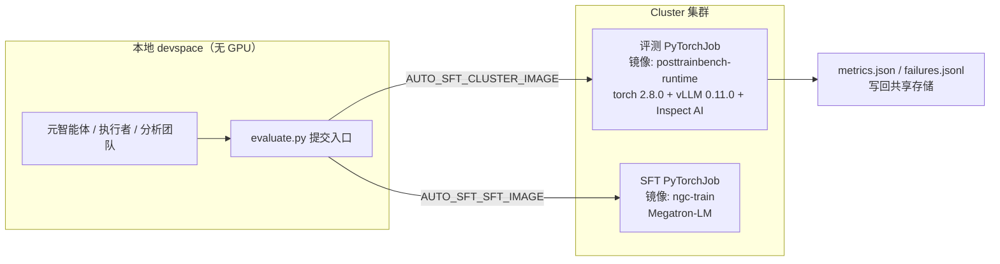
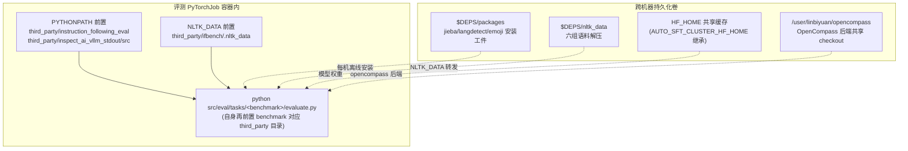

本页解析 AutoSFT 系统中 GPU 评测作业的运行环境——`containers/cluster_posttrainbench.Dockerfile` 所构建的 Cluster 运行时镜像。该镜像是"本地 devspace 只做控制面、GPU 训练与评测全部落在 Cluster"这一架构分工的落点：本地开发机无需 GPU，而 IFEval/IFBench 的评分、vLLM 推理服务与验证器依赖全部打包进这一镜像。文档覆盖四个核心议题：Dockerfile 的分层构成、`requirements-direct.txt` 与 `requirements-local.txt` 的双清单依赖体系、验证器沙箱依赖的离线部署协议，以及贯穿评测作业与开发机的共享存储布局。

> **📖 小白导读**
> - 这篇讲什么：GPU 评测作业的运行环境——`cluster_posttrainbench.Dockerfile` 这个镜像文件里装了什么、怎么分层、为什么评测集群没网也能跑。
> - 读之前先知道：**Dockerfile**＝描述"如何一步步构建一个镜像"的配方文件（镜像＝打包好的软件环境快照，类比带系统的压缩包）；**依赖预烘焙**＝把 pip 包提前装进镜像层，运行时不再需要联网下载；**requirements 文件**＝pip 的依赖清单（`requirements-*.txt` 每行一个包名+版本）。
> - 读完你能明白：镜像的四层结构各自解决什么；离线依赖是怎么烘焙的；共享存储挂载把哪些路径接通。
> - 提醒：只有改镜像/加依赖时才需要细读本页，日常运行可略。

## 镜像在系统架构中的位置

AutoSFT 的研究循环跑在无 GPU 的本地 devspace 上，智能体（元智能体、执行者、分析团队）只在控制面活动；当执行者需要训练或评测时，通过 `clusterctl pytorchjob create` 把任务提交到 Cluster 集群，任务在该集群上以镜像方式启动。评测作业（Inspect AI 后端）使用的镜像由本 Dockerfile 构建，SFT 作业则使用独立的 Megatron 训练镜像——两者通过不同的环境变量区分，避免评测运行时与训练运行时互相拖入对方的依赖。



评测镜像的默认值固定为 `cluster/posttrainbench-runtime:2026052008`，SFT 镜像默认为 `cluster/model-align/ngc-train:nvidia.47165eea-sink`。值得注意的细节是：Dockerfile 的 `FROM` 行直接以这个 SFT 基础镜像（`ngc-train:nvidia.47165eea-sink`）为起点——评测镜像本质上是"训练基础镜像之上再叠加评测运行时"的产物，因此天然继承其 CUDA/NCCL 栈。
Sources: [clusterctl-defaults.md](skills/cluster-job-lifecycle/references/clusterctl-defaults.md#L21-L26)、[cluster_posttrainbench.Dockerfile](containers/cluster_posttrainbench.Dockerfile#L1)

## Dockerfile 分层构成：从 NGC 基础镜像到收敛校验

Dockerfile 全文仅 81 行，但每个 `RUN` 层都承载明确职责。理解分层的意义在于：任何一层的修改都会使其后所有层失效，这解释了为什么文档强调"IFBench 依赖需要重建镜像"，而 `langdetect` 却能不重建镜像就生效（后文详述）。

| 层序 | 阶段 | 关键动作 | 设计意图 |
|------|------|----------|----------|
| 1 | 基础镜像 | `FROM ngc-train:nvidia.47165eea-sink` | 继承 CUDA/PyTorch 训练栈 |
| 2 | 构建参数 | `ARG PIP_INDEX_URL`（国内镜像） | 国内构建环境网络优化 |
| 3 | 系统包 | build-essential、git、python3-dev、wget、tree、uuid-runtime | 编译依赖与作业内工具 |
| 4 | 工具链升级 | `pip==25.1.1 uv==0.11.15 packaging==24.2` | 固定安装器版本保证可重复构建 |
| 5 | GPU 栈重置 | 卸载 torch/torchvision/torchaudio/xformers/flash-attn 后重装 `torch==2.8.0`、`vllm==0.11.0 --no-deps` | 摆脱基础镜像的版本漂移 |
| 6 | vLLM 依赖重建 | 从 `requires("vllm")` 动态提取需求过滤 torch 系后安装 | `--no-deps` 需要手动补齐其余依赖 |
| 7 | 直装清单 | `-r requirements-direct.txt` | 评测与验证器依赖 |
| 8 | NLTK 预烘焙 | 下载 5 组语料到 `/usr/local/share/nltk_data` | 消除运行时网络依赖 |
| 9 | Inspect AI 定制 | `SETUPTOOLS_SCM_PRETEND_VERSION_FOR_INSPECT_AI=0.3.150` 安装供应商化包 | 没有 git 元数据时锁定版本号 |
| 10 | 收敛校验 | 最后一层重新装 `numpy<2` 并校验 | 对抗上游包拉高 numpy 版本 |

几个值得展开的设计决策。**GPU 栈的"卸载-重装"**：基础镜像自带训练栈，版本不受本仓库控制，所以第 5 层先显式卸载全部五件套，再以精确版本重装。vLLM 采用 `--no-deps` 安装是为了避免它拉自己的 torch 版本，代价是必须用 `importlib.metadata.requires("vllm")` 在构建时动态展开它的依赖清单，过滤掉 torch 系之后逐项安装。**PIP_CONSTRAINT=/dev/null 与 `unset PIP_CONSTRAINTS`**：基础镜像可能带有约束文件，这里逐层清理，确保任何安装步骤都不受隐藏约束干扰。**numpy<2 的三次出现**：numpy 2.x 与多个依赖不兼容，Dockerfile 在第 5、7 步之后以及最末层反复强制回压，最末层还做了一次已安装分布的校验——这是对抗 pip 依赖解析器在后续安装中悄悄升级 numpy 的防御性收尾。

NLTK 预烘焙层的注释说明了它的容错设计：如果构建主机无法访问 NLTK 服务器，构建不会失败（`|| echo "WARN..."`），IFBench 会在运行时回退到惰性下载——这在集群无外网时是一个逃生通道。
Sources: [cluster_posttrainbench.Dockerfile](containers/cluster_posttrainbench.Dockerfile#L19-L70)、[cluster_posttrainbench.Dockerfile](containers/cluster_posttrainbench.Dockerfile#L72-L81)

## 双清单依赖体系：评测镜像与本地开发机互不拖累

仓库维护两份 requirements 文件，服务于两种截然不同的运行环境。`requirements-direct.txt` 描述评测镜像内容——它最终会带上 PyTorch、vLLM 与 CUDA；`requirements-local.txt` 描述本地开发——运行测试套件、驱动分类体系引导，完全不需要 GPU。

| 维度 | requirements-direct.txt | requirements-local.txt |
|------|------------------------|------------------------|
| 目标环境 | Cluster 评测镜像（容器内） | 本地 devspace（裸机） |
| GPU 需求 | torch/vLLM/CUDA 全量 | 明确声明"Nothing here needs a GPU" |
| 核心内容 | transformers 4.57.3、datasets 4.5.0、inspect-ai 0.3.150、lm-eval 0.4.10、peft、trl | jsonschema、httpx、pexpect + 验证器白名单包 + pytest |
| 共同部分 | nltk、jieba、langdetect、emoji、syllapy、pyyaml | 同左（与 ALLOWED_IMPORTS 保持同步） |

两份清单的重叠部分正是验证器依赖：`requirements-local.txt` 的注释明确要求"Keep the two in sync"——因为 `ALLOWED_IMPORTS` 白名单的执行不区分环境，本地跑分类引导与集群跑评测必须看到同一组可导入模块。`jieba` 的注释揭示了一个有趣的边界：它只被**生成的分类体系验证器**使用（中文没有词间空格，词数与关键词位置约束必须先分词），而**评测本身完全不用它**——评测是 IFEval/IFBench，与生成的验证器是两个独立体系。
Sources: [requirements-local.txt](containers/requirements-local.txt#L1-L32)、[requirements-direct.txt](containers/requirements-direct.txt#L29-L41)

## 验证器依赖的离线部署：$DEPS 共享存储协议

第三方包与 NLTK 语料不进仓库、也不能依赖 pip 在线安装——原因有二：容器重建会丢失 overlay 上的 pip 安装；而验证器沙箱无网络。README 给出了完整的共享存储协议：选择一个跨开发机持久化的挂载卷（明确排除 `/root` 与 `/tmp`），按下述布局准备一次，之后每台新机器只需执行离线安装步骤。

```text
$DEPS/
  packages/        # jieba + langdetect sdists, emoji wheel
  nltk_packages/   # the six corpus zips, kept for re-extraction
  nltk_data/       # corpora unpacked once; NLTK_DATA points here
```

部署流程分三步，每步针对不同的网络条件：

**第一步（联网机器，一次性）**：`pip download` 拉取安装工件。`jieba` 与 `langdetect` 是纯 Python，`--no-binary=:all:` 强制走 sdist，目标架构无关；`emoji` 含原生代码，必须用 `--platform manylinux2014_x86_64 --python-version 312 --implementation cp` 锁定平台 wheel。NLTK 语料从 GitHub gh-pages 分支逐个 `curl` 下载六个 zip（punkt_tab、punkt、stopwords、cmudict、wordnet、averaged_perceptron_tagger_eng），保留 zip 以备重复解压。

**第二步（共享存储，一次性）**：把六个 zip 解压到 `$DEPS/nltk_data/` 对应的 `tokenizers/`（NLTK 的分词器资源目录）、`corpora/`、`taggers/` 子目录。

**第三步（每台机器，离线）**：`pip install --no-index --find-links "$DEPS/packages" --break-system-packages --no-build-isolation jieba langdetect emoji`，随后 `export NLTK_DATA="$DEPS/nltk_data"`。

第三步的两个 pip 标志是**必需项而非便利项**，README 逐条解释了原因。`--break-system-packages` 覆盖 Debian 的 PEP 668 保护——验证器沙箱通过 `sys.executable` 直接运行*系统*解释器，任何 virtualenv 对它不可见，所以包必须装进系统 site-packages。`--no-build-isolation` 让 jieba/langdetect 的 sdist 复用系统 setuptools——pip 的隔离构建环境会试图在线拉取构建依赖，离线场景下必然失败。包最终落在 `/usr/local/lib/python3.12/dist-packages`，该路径不被 dpkg 管理，因此不会与 apt 安装的 Python 模块冲突。
Sources: [README.md](README.md#L280-L340)

## 验证器沙箱的资源约束：为什么"能 import"不等于"能运行"

部署完成后，README 特别警告：**用真实沙箱调用验证，而非裸 import**——因为只有子进程才携带资源限制。`invoke_verifier` 的实现在 `taxonomy_runtime.py` 中，它以 `preexec_fn` 在子进程 exec 前套上四层 rlimit：

| 资源 | 限制值 | 针对的问题 |
|------|--------|-----------|
| RLIMIT_CPU | 2 CPU 秒（软硬同值） | 验证器跑飞 / 词典构建超时 |
| RLIMIT_AS | 1 GiB 虚拟地址空间 | NLTK 引入 NumPy 时预留超过 256 MiB 虚存 |
| RLIMIT_FSIZE | 1 MiB 文件写入上限 | 阻止验证器落盘 |
| RLIMIT_NOFILE | 16 个文件描述符 | 限制资源打开 |

`_verifier_env()` 构造的最小化环境同样经过精心设计：`PATH=""` 切断外部命令执行路径；`OPENBLAS_NUM_THREADS=1`、`OMP_NUM_THREADS=1`、`MKL_NUM_THREADS=1` 三个变量绑定 BLAS 线程数——注释解释这是防止"NumPy 的 BLAS 线程预留大量虚拟地址空间，与 RLIMIT_AS 沙箱打架"；`NLTK_DATA` 仅当操作者显式设置时才转发，否则留给 NLTK 内建搜索路径。整个调用以 `python -I`（隔离模式）启动，配合 3 秒墙钟超时兜底。

这些约束直接决定了哪些语料可用：**punkt、punkt_tab、stopwords、averaged_perceptron_tagger 在 2 CPU 秒内加载无虞，但 cmudict 和 wordnet 加载就会超限被 SIGKILL**——在本地与共享存储上皆然。同理，"构建 jieba 词典 + 分词"放在同一调用里也会超时。README 的结论是：需要这些语料的叶子验证器应该申请提高 `cpu_seconds`，而不是换语料位置。验证探针脚本演示了正确做法：为每个模块写一个最小 `verify` 函数，经 `invoke_verifier` 走完整沙箱路径，逐个模块探测（因为多个语料同时加载会合力超限）。
Sources: [README.md](README.md#L342-L376)、[taxonomy_runtime.py](src/control_plane/taxonomy_runtime.py#L4779-L4807)、[taxonomy_runtime.py](src/control_plane/taxonomy_runtime.py#L4810-L4840)

## 白名单与禁止调用：依赖的静态边界

`ALLOWED_IMPORTS` 白名单共 19 项：标准库占多数（`ast`、`collections`、`csv`、`functools`、`io`、`itertools`、`json`、`math`、`re`、`statistics`、`string`、`unicodedata`、`__future__`），第三方仅 6 个——`emoji`、`jieba`、`langdetect`、`syllapy`、`yaml`、`nltk`，与双清单的重叠区完全一致。更有意思的是**属性级禁止**：即使模块已放行，某些调用仍被拦截。`yaml.load/unsafe_load/full_load` 被禁是因为它们从受检文本构造任意对象（只许 `safe_load`）；`nltk.download` 被禁的原因写得很直白——沙箱无网络，这个调用会**挂起而非失败**，从而卡死 preflight；`ast.parse/compile/walk` 被禁是因为验证器应当"度量文本而非构建语法树"，后者是通向执行受检文本的第一步。`nltk.download` 的拦截与离线部署协议形成闭环：语料必须在镜像构建期或共享存储上预先就位，沙箱内没有下载这条路。
Sources: [taxonomy_runtime.py](src/control_plane/taxonomy_runtime.py#L209-L260)

## 共享存储布局：作业内路径与仓库分发资产的汇合

评测作业启动时，`submit_cluster_eval.sh` 生成的 ENTRY 脚本在容器内铺设一条路径链，把仓库内 vendored 的第三方资产接入运行环境。Inspect 后端的入口路径：

```bash
export PYTHONPATH="${REPO_DIR}/third_party/instruction_following_eval:${REPO_DIR}/third_party/inspect_ai_vllm_stdout/src:${PYTHONPATH:-}"
export NLTK_DATA="${REPO_DIR}/third_party/ifbench/.nltk_data:${NLTK_DATA:-}"
```

这条链有三层含义。第一，**语料的仓库内兜底**：`third_party/ifbench/.nltk_data/` 随 git 分发（内含 tokenizers/punkt、tokenizers/punkt_tab、corpora/stopwords、taggers/averaged_perceptron_tagger_eng 四组），作为 NLTK_DATA 的首选条目——即使镜像没有预烘焙语料，作业也能从仓库副本读取。第二，**两个 benchmark 的 sys.path 前置**：`ifeval/evaluate.py` 把 `third_party/instruction_following_eval` 插到 `sys.path[0]`，`ifbench/evaluate.py` 对应插入 `third_party/ifbench`——这使仓库里的评测规则库优先于镜像内安装的任何同名包。第三，OpenCompass 后端额外依赖集群上的共享 checkout（默认 `/user/linbiyuan/opencompass` 与其 nltk_data），并在 collect 阶段再次前置 `third_party/instruction_following_eval:third_party/ifbench`。



控制面侧的环境变量同样编码了共享存储语义：`set_env_vars.sh` 把 `HF_HOME` 默认指向 `$HOME/.cache/huggingface` 并将 `AUTO_SFT_CLUSTER_HF_HOME` 默认继承该值，使评测作业复用开发机已拉取的模型权重缓存；`NLTK_DATA` 在 README 的变量表中被标注为"存在时自动探测 synthesis-branch 共享路径"。镜像冒烟脚本 `cluster_image_smoke_remote.sh` 的默认仓库路径 `/user/sunpengqi/AutoSFT` 进一步印证了"仓库检出于共享卷、容器挂载执行"的部署形态。
Sources: [submit_cluster_eval.sh](skills/cluster-eval-job-submission/scripts/submit_cluster_eval.sh#L134-L159)、[ifeval/evaluate.py](src/eval/tasks/ifeval/evaluate.py#L12-L21)、[ifbench/evaluate.py](src/eval/tasks/ifbench/evaluate.py#L12-L21)、[set_env_vars.sh](src/commit_utils/set_env_vars.sh#L13-L30)、[cluster_image_smoke_remote.sh](src/commit_utils/cluster_image_smoke_remote.sh#L4-L11)

## 镜像漂移容忍：vendored 兜底如何免去重建

`CLUSTER_IMAGE.md` 记录了一次由镜像漂移引发的事故及其防御设计。钉住的镜像 tag `2026052008` 早于 `langdetect` 进入依赖清单——缺这个包时，IFEval 的 `language:response_language` 检查把**所有非英文响应静默判为失败**（100% 失败率，直接污染 IFEval 分数）。修复采用双保险：一方面把 `langdetect==1.0.9` vendor 进 `third_party/instruction_following_eval/langdetect/`（与 `third_party/ifbench/` 下 vendor 的 emoji/syllapy 同一模式），经由 `evaluate.py` 的 sys.path 前置生效，**无需重建镜像**；另一方面 `instructions.py` 改为在无可用 langdetect 时大声报错而非猜测 `en`，保证缺检测器永远不会再次静默误判。与之对照，IFBench 的 `emoji`/`syllapy` 依赖只存在于 requirements-direct.txt 中，没有 vendored 版本，所以文档明确要求"重建并重新注册镜像后才能跑 IFBench 评测"——这正是分层依赖策略的现实代价映射：能走仓库分发的路径就无需重建，只进镜像的依赖则受镜像 tag 漂移约束。
Sources: [CLUSTER_IMAGE.md](containers/CLUSTER_IMAGE.md#L42-L72)

## 构建注册与验证：从镜像到可提交状态

镜像构建完成后需注册为 Cluster 训练镜像并通过 `clusterctl image create` 暴露给作业系统，随后用 `AUTO_SFT_CLUSTER_IMAGE` 指向新 tag。仓库提供两级验证工具：

**冒烟测试**（`cluster_image_smoke_remote.sh`）在 GPU 机器上以目标镜像环境运行，顺序导入 torch、vllm、transformers、datasets、peft、trl、inspect_ai、langdetect、yaml 并打印 torch 版本，末尾输出 `image-smoke-ok` 标记——这组导入清单与 `check_runtime_assets.sh` 的模块清单几乎一致，构成"镜像必须能 import 的最小集合"的事实标准。

**资产检查**（`check_runtime_assets.sh`）面向控制面，逐个探测同一组 Python 模块加 HF 缓存目录 `HF_HOME`（默认 `$HOME/.cache/huggingface`）的存在性，任一缺失即非零退出——它是提交评测作业前的本地前置校验，确保共享缓存已就位。

两份脚本共同定义了运行时的"健康底线"：九个 Python 模块 + 一个模型缓存目录。注意到 `langdetect` 出现在两份清单中，正是上述漂移事故后的修复痕迹。
Sources: [CLUSTER_IMAGE.md](containers/CLUSTER_IMAGE.md#L22-L40)、[cluster_image_smoke_remote.sh](src/commit_utils/cluster_image_smoke_remote.sh#L12-L26)、[check_runtime_assets.sh](containers/check_runtime_assets.sh#L11-L27)

## 小结

Cluster 运行时镜像的架构核心可归纳为三条互补的依赖供给线：**镜像层**（Dockerfile 十层构建，GPU 栈精确钉版 + 直装清单 + NLTK 预烘焙）覆盖重型与网络受限依赖；**仓库层**（`third_party/` 下的 IFEval/IFBench 规则库、langdetect、`.nltk_data` 语料副本）通过 sys.path 前置与 PYTHONPATH 链提供免重建的快速通道；**共享存储层**（`$DEPS` 三目录布局 + HF_HOME 缓存 + OpenCompass checkout）解决跨机器持久化与离线安装。验证器沙箱则在这之上叠加静态白名单与动态资源限制，把"可用依赖"收敛为"2 CPU 秒内可加载且可完成的依赖"——这是任何验证器作者在选语料时必须先读的硬约束。

## 延伸阅读

- 验证器白名单与沙箱机制的完整契约：[验证器沙箱运行时：ALLOWED_IMPORTS 白名单、CPU 秒限制与离线确定性执行](16-yan-zheng-qi-sha-xiang-yun-xing-shi-allowed_imports-bai-ming-dan-cpu-miao-xian-zhi-yu-chi-xian-que-ding-xing-zhi-xing)
- 评测作业的提交与生命周期：[Cluster 作业生命周期：提交、轮询、停止、收集与 clusterctl 有界重试基础设施](22-cluster-zuo-ye-sheng-ming-zhou-qi-ti-jiao-lun-xun-ting-zhi-shou-ji-yu-clusterctl-you-jie-zhong-shi-ji-chu-she-shi)
- 镜像内嵌的第三方评测规则库：[第三方评测依赖：IFEval / IFBench 规则库与 Inspect AI 运行时的内嵌用途](27-di-san-fang-ping-ce-yi-lai-ifeval-ifbench-gui-ze-ku-yu-inspect-ai-yun-xing-shi-de-nei-qian-yong-tu)
- 评测后端如何消费该镜像：[评测后端双轨：Inspect AI 默认路径与 OpenCompass vLLM 自托管 API 桥接](21-ping-ce-hou-duan-shuang-gui-inspect-ai-mo-ren-lu-jing-yu-opencompass-vllm-zi-tuo-guan-api-qiao-jie)