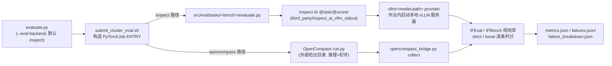

PostTrainBench 的每一次 SFT 训练轮次都要用 **IFEval** 和 **IFBench** 两个公开基准回答同一个问题——"这次微调让模型更听话了吗？"。但评测集群是无网络的封闭环境，且评测分数直接驱动智能体的数据决策，所以项目没有简单地在 `pip install` 里引用这三个开源项目，而是把它们的源码**整体拷贝进仓库的 `third_party/` 目录**（这种做法叫 vendoring，即"内嵌"）。本页面向初学者解释：这三个内嵌依赖各自是什么、被谁在什么时机调用、项目对它们做了哪些针对性修改，以及为什么镜像层要为它们预烘焙数据。理解这一层之后，[评测后端双轨：Inspect AI 默认路径与 OpenCompass vLLM 自托管 API 桥接](21-ping-ce-hou-duan-shuang-gui-inspect-ai-mo-ren-lu-jing-yu-opencompass-vllm-zi-tuo-guan-api-qiao-jie)中描述的双后端设计才真正完整。

> **📖 小白导读**
> - 这篇讲什么：三个被"整体拷贝进仓库"的第三方依赖——IFEval、IFBench（两个指令遵循基准）与 Inspect AI（评测框架）：各自是什么、谁在何时调用、项目对它们改了什么。
> - 读之前先知道：**基准（benchmark）**＝一套标准化考题+评分方法；**指令遵循**＝"模型能不能严格按用户要求办"的能力（如'用三段写''必须加标题'）；**vendoring（内嵌）**＝把第三方源码整个复制进自己仓库的做法，好处是版本锁死、离线可用、可审计；**规则库**＝IFEval 里按字面规则（如"是否包含标题"）机械判分的检查器集合。
> - 读完你能明白：为什么评测集群断网也难不倒它；三处源码改动各自解决什么问题；镜像里为什么要预下载基准数据。
> - 提醒：本页门槛最低，读完第 1 页即可直接读。

Sources: [README.md](README.md#L510-L513)

## 全景：三个内嵌目录与两条消费路径

仓库顶层 README 的目录树把三个内嵌依赖概括为一句话："Vendored Google IFEval rules / Vendored allenai/IFBench rules / Vendored Inspect AI runtime"。它们分别承担**规则裁判**（两套指令遵循检查器）和**评测运行时**（驱动模型推理、组织样本循环、记录日志的框架）两个角色。注意还有第四件容易被忽略的内嵌资产：`tools/eval_data/` 下的两份 `input_data.jsonl` 评测题目文件，IFBench 的题目来自 `allenai/IFBench_test`，同样不依赖网络拉取数据集。

Sources: [README.md](README.md#L502-L513)

下面的关系图展示了一条评测请求从 `evaluate.py` 入口出发，如何在两条后端路径上消费这三个依赖。默认的 `inspect` 路径里，**Inspect AI 运行时负责推理编排，IFEval/IFBench 规则库负责逐条判分**；备选的 `opencompass` 路径里，推理与初评交给外部的 OpenCompass 检出目录，但**最终分数仍由内嵌规则库对预测结果重算**，保证两条路径打分口径一致。

在 `inspect` 路径上，提交脚本生成的作业入口命令会显式设置三个环境变量：`PYTHONPATH` 前置 `third_party/instruction_following_eval` 与 `third_party/inspect_ai_vllm_stdout/src`，`NLTK_DATA` 指向 `third_party/ifbench/.nltk_data`，`VLLM_DEFAULT_SERVER_ARGS` 声明张量并行度，然后执行 `python src/eval/tasks/${BENCHMARK}/evaluate.py`。也就是说，**内嵌依赖是通过 sys.path/PYTHONPATH 优先级直接顶替 site-packages 中的同名包**来生效的，这是整个 vendoring 机制的核心。

Sources: [submit_cluster_eval.sh](skills/cluster-eval-job-submission/scripts/submit_cluster_eval.sh#L134-L150)

## IFEval 规则库：裁判的注册表与判分语义

`third_party/instruction_following_eval/` 是 Google 官方 IFEval 评测代码的完整拷贝，包结构为 `instruction_following_eval/` 下的四个模块。其中 **`instructions_registry.py` 是规则路由表**：`INSTRUCTION_DICT` 把形如 `keywords:existence`、`length_constraints:number_words`、`detectable_format:json_format` 的指令 ID 映射到对应的检查器类，`INSTRUCTION_CONFLICTS` 则声明哪些指令不能在同一道题里共存。每个 benchmark 条目里带的 `instruction_id_list` 和 `kwargs`，最终就是查这张表逐条实例化检查器。

Sources: [instructions_registry.py](third_party/instruction_following_eval/instruction_following_eval/instructions_registry.py#L39-L77)

判分入口是 `evaluation_lib.py` 的两个函数，它们定义了 IFEval 的两种宽松度。**严格模式**（`test_instruction_following_strict`）对每条指令实例化检查器、用题目 kwargs 调 `build_description` 初始化，然后对模型的原始回答调 `check_following`——原文一字不动；**宽松模式**（`test_instruction_following_loose`）先构造 8 个回答变体（去首行、去尾行、去首尾行、去掉所有 `*` 星号，以及这四种操作的组合），任一变体通过即算该指令通过。这个设计承认了模型常在回答外加"好的，以下是……"之类的包装行，宽松分数是遵循度的上界估计。两套分数最终汇总为 prompt 级（整题全对才算对）与 instruction 级（逐条指令的正确率）两组指标。

Sources: [evaluation_lib.py](third_party/instruction_following_eval/instruction_following_eval/evaluation_lib.py#L75-L130)

项目对这份 Google 源码做了一处关键修改，位于 `instructions.py` 的顶部。IFEval 的 `language:response_language` 指令需要 `langdetect` 库判断回答语言，原版代码在库缺失时会回退猜测 `en`——历史上一次旧评测镜像恰好缺装这个库，导致所有非英文回答被**静默判为失败**，IFEval 分数整体被污染。现在修改后的逻辑是：`import langdetect` 失败时构造一个 `_MissingLangDetect` 替身，任何真正调用检测的时刻直接抛出 `RuntimeError`，错误信息明确指示安装方式。这就是文档中反复强调的 **fail loudly 而非静默误判**原则在第三方代码上的落地。

Sources: [instructions.py](third_party/instruction_following_eval/instruction_following_eval/instructions.py#L25-L53)

为了让修复不依赖重建镜像，`langdetect==1.0.9` 本身也被内嵌进 `third_party/instruction_following_eval/langdetect/`（与下面的 IFBench 做法同构）。由于 `src/eval/tasks/ifeval/evaluate.py` 启动时把 `third_party/instruction_following_eval` 整个目录插入 `sys.path` 首位，内嵌的 `langdetect` 会优先于 site-packages 中可能缺失的同名包被找到——**旧镜像不重建也能拿到正确的语言检测能力**。

Sources: [CLUSTER_IMAGE.md](containers/CLUSTER_IMAGE.md#L60-L72)

## IFBench 规则库：更难的裁判与离线数据依赖

`third_party/ifbench/` 是 Allen AI 的 IFBench 评测代码拷贝，与 IFEval 的包结构不同——它是**平铺的模块**（`evaluation_lib.py`、`instructions.py` 等直接放在目录根部，没有外层包名），所以消费方用 `import evaluation_lib` 这种顶层导入。它的注册表收录约 60 条更刁钻的约束指令，按前缀分组：`count:`（词数区间、唯一词数、人名计数）、`ratio:`（停用词占比、句式比例、n-gram 重叠）、`words:`（回文、元音字母段落、首字母不连续）、`format:`（嵌套括号、缩进阶梯、表情符号句）、`custom:`（数字倒序、欧洲首都排序）等。这些检查器对文本分析工具的要求远高于 IFEval。

Sources: [instructions_registry.py](third_party/ifbench/instructions_registry.py#L20-L79)

正因如此，这个目录里除了规则代码还内嵌了**三样离线依赖**。第一是 `emoji` 和 `syllapy` 两个 Python 包的完整源码——IFBench 检查器是除 IFEval 外唯一需要它们的组件（表情符号句检查与音节奇偶检查），镜像文档特别说明没有引入 spaCy，因为人名检查用的是固定名单而非 NER 模型。第二是 `.nltk_data/` 目录，预置了 `punkt`、`punkt_tab`、`stopwords`、`averaged_perceptron_tagger_eng` 四套 NLTK 语料。第三是 `instructions.py` 顶部的一段自初始化代码：模块被导入时立即把 `.nltk_data` 注册进 `NLTK_DATA` 环境变量和 NLTK 的搜索路径，确保分词器不触发网络下载。判分语义上 IFBench 的 `evaluation_lib.py` 与 IFEval 同构（strict 原文判 / loose 八变体判），两套库可以互换使用同一套调用协议。

Sources: [instructions.py](third_party/ifbench/instructions.py#L25-L40)

## Inspect AI 运行时：fork 的名字就是它的补丁

`third_party/inspect_ai_vllm_stdout/` 是英国 AI 安全研究所 Inspect AI 框架（v0.3.150）的完整 fork。它是评测的**骨架**：提供 `@task` 装饰器定义评测任务、`@scorer` 装饰器定义打分器、`MemoryDataset` 装载样本、`inspect_eval()` 驱动"逐样本生成→逐样本打分→汇总均值"的循环，并把全过程写入结构化的 EvalLog。仓库里两个任务脚本 `src/eval/tasks/ifeval/evaluate.py` 与 `ifbench/evaluate.py` 就是这套骨架上的薄薄一层业务逻辑：从 `tools/eval_data/<bench>/input_data.jsonl` 读题构造 `MemoryDataset`，`solver` 用最朴素的 `generate()`，`scorer` 注册四个打分器（strict/loose × prompt/instruction），打分器内部回调内嵌规则库。

Sources: [evaluate.py](src/eval/tasks/ifeval/evaluate.py#L39-L50)

目录名 `inspect_ai_vllm_stdout` 直接点明了 fork 的定制内容。任务脚本以 `model=f"vllm/{args.model_path}"` 指定模型，Inspect AI 的 `VLLMAPI` provider 会尝试连接已有服务器，连不上就在作业内执行 `vllm serve <model_path>` 启动一个本地 vLLM 服务器，再通过 OpenAI 兼容 API 推理。fork 改动在于：`vllm.py` 的 `_start_server` 调用 `start_local_server` 时显式传了 `stream_output=True`，而 `local_server.py` 中该参数为 `True` 时子进程的 stdout/stderr **直接继承父进程、透传到作业日志**，只有为 `False` 时才用 `subprocess.PIPE` 捕获。这个看似微小的改动解决了实际问题：vLLM 服务器加载模型可能耗时极长，若输出被 PIPE 缓冲，运维在 Cluster 作业日志里什么都看不到，无法区分"正在加载"与"卡死"。

Sources: [vllm.py](third_party/inspect_ai_vllm_stdout/src/inspect_ai/model/_providers/vllm.py#L147-L198), [local_server.py](third_party/inspect_ai_vllm_stdout/src/inspect_ai/_util/local_server.py#L136-L176)

与 PyPI 版本的关系值得初学者注意：`containers/requirements-direct.txt` 中确实列着 `inspect-ai==0.3.150`，但这不是重复安装。Dockerfile 的构建顺序是先用 requirements 装齐依赖树，最后一步再以 `SETUPTOOLS_SCM_PRETEND_VERSION_FOR_INSPECT_AI=0.3.150 pip install /opt/inspect_ai_vllm_stdout` **用本地 fork 覆盖安装**同名同版本包。requirements 里保留条目是为了让依赖解析器知道这个包该存在；fork 的 `pyproject.toml` 把版本号钉在同一个 0.3.150，保证覆盖安装是无缝的版本等价替换而非升级。

Sources: [requirements-direct.txt](containers/requirements-direct.txt#L14), [cluster_posttrainbench.Dockerfile](containers/cluster_posttrainbench.Dockerfile#L72-L75)

## 两条后端路径的调用细节

**inspect 路径**（`evaluate.py` 的 `--eval-backend` 默认值，也是 `AUTO_SFT_EVAL_BACKEND` 未设置时的取值）的完整链路是：`evaluate.py` 逐 benchmark 调用提交脚本 → 提交脚本设置 `PYTHONPATH`/`NLTK_DATA` 后执行任务脚本 → 任务脚本自身再 `sys.path.insert(0, REPO_ROOT / "third_party" / <对应规则库目录>)`（ifeval 指向包结构目录并 `from instruction_following_eval import evaluation_lib`；ifbench 指向平铺目录并 `import evaluation_lib`）→ `inspect_eval(ifeval(), model="vllm/...", ...)` 驱动推理与打分。任务脚本还根据模型路径名选择聊天模板（qwen/gemma/smollm 各有 `.jinja` 文件），并把超时参数设到极大值以容忍大模型加载。产物统一落在输出目录：`metrics.json`（含四项准确率与 `overall_accuracy`）、`failures.jsonl`（每条失败样本的题目、回答、失败指令清单）、`failure_breakdown.json`（按指令 ID 的粗/细分失败率统计）以及 `inspect_logs/` 原始评测日志。

Sources: [evaluate.py](src/eval/tasks/ifeval/evaluate.py#L12-L21), [evaluate.py](src/eval/tasks/ifeval/evaluate.py#L384-L415)

**opencompass 路径**的精妙之处在于规则库的**二次复用**。OpenCompass 在 PyTorchJob 内自管 vLLM 部署并完成推理与初评后，提交脚本的 ENTRY 会在 RANK=0 上以 `PYTHONPATH=third_party/instruction_following_eval:third_party/ifbench` 执行 `opencompass_bridge.py collect`。桥接器的 `_load_evaluation_lib` 按基准选择对应内嵌库，`_score_detail` 把 OpenCompass 结果里的每条预测还原成 `InputExample`，调用与 inspect 路径**完全相同**的 `test_instruction_following_strict/loose` 重算分数。OpenCompass 自己报的指标只被原样存进 `opencompass_reported_metrics` 字段供对照，**权威分数永远来自内嵌检查器**——这就是 SKILL.md 里"bridge normalizes scores and failure artifacts back into the same AutoSFT output contract"的实现方式，也是为什么文档规定一个 run 内不得中途切换后端（打分方法变化会让优化历史失去可比性）。

Sources: [submit_cluster_eval.sh](skills/cluster-eval-job-submission/scripts/submit_cluster_eval.sh#L202-L209), [opencompass_bridge.py](src/eval/opencompass_bridge.py#L144-L205)

## 依赖闭环：镜像构建、资产自检与测试保护

三个内嵌组件加上它们的数据依赖，在镜像层形成多重保险。Dockerfile 先 `COPY third_party/inspect_ai_vllm_stdout` 进镜像（规则库不 COPY，因为它们随仓库代码在作业内经 `PYTHONPATH` 生效），安装 `torch==2.8.0`/`vllm==0.11.0` 栈与 requirements，随后**在构建期预下载** NLTK 四套语料到 `/usr/local/share/nltk_data`（下载失败只告警，运行期 `instructions_util.py` 会懒加载重试兜底），最后覆盖安装 Inspect AI fork。`check_runtime_assets.sh` 作为冒烟自检脚本逐个验证 `inspect_ai`、`langdetect`、`vllm` 等关键模块可导入，任何缺失即非零退出。镜像文档还明确提醒：固定的镜像标签早于 IFBench 引入，跑 IFBench 前必须重建并重新注册镜像。

Sources: [cluster_posttrainbench.Dockerfile](containers/cluster_posttrainbench.Dockerfile#L16-L17), [cluster_posttrainbench.Dockerfile](containers/cluster_posttrainbench.Dockerfile#L62-L75), [check_runtime_assets.sh](containers/check_runtime_assets.sh#L11-L18), [CLUSTER_IMAGE.md](containers/CLUSTER_IMAGE.md#L38-L47)

测试套件从两个角度锁定这套集成不被无意破坏。`test_submission_script_keeps_both_runners` 直接读取提交脚本文本，断言 inspect 分支的 `python "src/eval/tasks/${BENCHMARK}/evaluate.py"` 调用与 opencompass 分支的 `deploy.sh`/`run.py` 调用同时存在；`OpenCompassBridgeTests` 一组用例则验证桥接器生成的运行时配置正确引用 `IFBenchDataset`/`allenai/IFBench_test`，且 `build_artifacts` 产出的 `strict_prompt_accuracy` 等指标精确符合 AutoSFT 契约。这些测试不需要 GPU 或真实模型，靠注入假分数函数即可运行。

Sources: [test_eval_backends.py](tests/test_eval_backends.py#L173-L179), [test_eval_backends.py](tests/test_eval_backends.py#L218-L232), [test_eval_backends.py](tests/test_eval_backends.py#L260-L299)

## 速查对比

| 内嵌组件 | 上游来源 | 仓库内布局 | 生效机制 | 相对上游的改动 |
|---|---|---|---|---|
| IFEval 规则库 | Google Research IFEval | `third_party/instruction_following_eval/`（含包 `instruction_following_eval/` 与内嵌 `langdetect/`） | 任务脚本 `sys.path.insert` + 作业 `PYTHONPATH` | langdetect 缺失时抛错而非猜 `en`（fail loudly） |
| IFBench 规则库 | Allen AI IFBench | `third_party/ifbench/`（平铺模块 + 内嵌 `emoji/`、`syllapy/`、`.nltk_data/`） | 任务脚本 `sys.path.insert` + 作业 `PYTHONPATH`/`NLTK_DATA` | 导入期把本地 `.nltk_data` 注册进 NLTK 搜索路径 |
| Inspect AI 运行时 | UK AISI Inspect AI v0.3.150 | `third_party/inspect_ai_vllm_stdout/`（标准 src 布局） | 作业 `PYTHONPATH` + Dockerfile 内 fork 覆盖安装 | vLLM 服务器 stdout 透传到作业日志（`stream_output=True`） |

| 判分语义 | 严格模式（strict） | 宽松模式（loose） |
|---|---|---|
| 检查对象 | 模型原始回答 | 原文 + 7 个去包装变体（去首/尾/首尾行、去 `*` 及组合） |
| 判定规则 | 每条指令逐一 `check_following(原文)` | 任一变体通过即该指令通过 |
| 指标含义 | 遵循度下界 | 遵循度上界 |
| 聚合层次 | prompt 级（全对才算对）+ instruction 级（逐条正确率） | 同左 |

Sources: [evaluation_lib.py](third_party/ifbench/evaluation_lib.py#L75-L166)

## 延伸阅读

理解了内嵌依赖的角色后，可以沿两条线索继续深入：想看这两个规则库在完整的"训练→转换→评测→决策"闭环中如何被调度，请阅读[评测后端双轨：Inspect AI 默认路径与 OpenCompass vLLM 自托管 API 桥接](21-ping-ce-hou-duan-shuang-gui-inspect-ai-mo-ren-lu-jing-yu-opencompass-vllm-zi-tuo-guan-api-qiao-jie)与[Cluster 作业生命周期：提交、轮询、停止、收集与 clusterctl 有界重试基础设施](22-cluster-zuo-ye-sheng-ming-zhou-qi-ti-jiao-lun-xun-ting-zhi-shou-ji-yu-clusterctl-you-jie-zhong-shi-ji-chu-she-shi)；想了解承载这一切的镜像如何构建、验证器依赖为何同样选择离线部署，请阅读[Cluster 运行时镜像：Dockerfile 构成、验证器依赖离线部署与共享存储布局](26-cluster-yun-xing-shi-jing-xiang-dockerfile-gou-cheng-yan-zheng-qi-yi-lai-chi-xian-bu-shu-yu-gong-xiang-cun-chu-bu-ju)。评测产出的 `failures.jsonl` 与失败类目统计则是[四维分析报告体系：失败案例、数据供给、学习动力学与分支保留历史的共享动作语义](24-si-wei-fen-xi-bao-gao-ti-xi-shi-bai-an-li-shu-ju-gong-gei-xue-xi-dong-li-xue-yu-fen-zhi-bao-liu-li-shi-de-gong-xiang-dong-zuo-yu-yi)的直接输入。