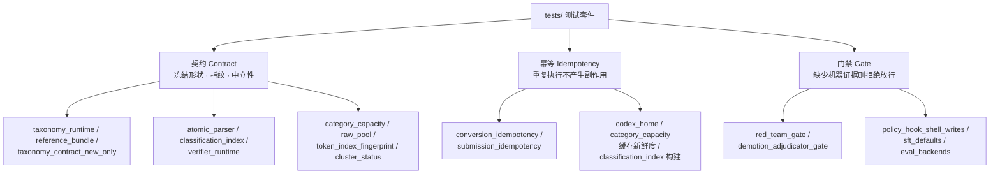
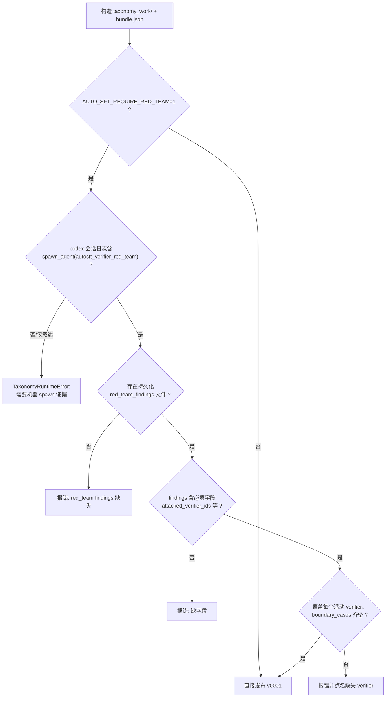

`tests/` 目录是本仓库的唯一测试根，存放着一组围绕**契约（contract）**、**幂等（idempotency）**与**门禁（gate）**三条主线组织的自动化测试。本页不是逐个测试的流水账，而是一张"地图"：它说明测试如何被组织与运行、每类测试守护什么系统不变量、以及当你修改某个模块时应优先关注哪几个测试文件。目录中当前存在 29 个 `test_*.py` 模块，它们全部直接对 `src/control_plane`、根目录脚本（`sft_train.py` / `evaluate.py` / `convert_checkpoint.py`）以及 `skills/**/scripts` 下的 shell 脚本进行静态断言或端到端驱动。

> **📖 小白导读**
> - 这篇讲什么：`tests/` 目录的"导航图"——29 个测试文件按契约/幂等/门禁三条主线怎么分类、改某段代码前该先看哪几个测试。
> - 读之前先知道：**pytest**＝Python 最常用的测试框架（自动发现 `test_*.py` 并运行其中以 `test_` 开头的函数）；**契约测试**＝验证"数据形状/字段/指纹"符合约定的测试；**幂等测试**＝验证"同一操作重复执行结果不变"的测试；**门禁测试**＝验证"缺证据就拒绝放行"的测试。
> - 读完你能明白：跑全量测试的命令；改 `data_action.py`/`taxonomy_runtime.py` 等核心模块时的"最低测试套餐"；一条门禁测试从发起到拦截的完整路径。
> - 提醒：本页是维护者的地图，按"文件对照表"一节当索引用最划算。

导航价值在于：这些测试是**硬性契约的机器化表达**。一条 AGENTS.md 规则、一个"必须由独立评审员机器触发"的治理承诺、一次"绝不重复提交作业"的幂等保证，都被落成可执行的断言。因此测试通过与否，本身就是系统最权威的行为规格。

Sources: [test_red_team_gate.py](tests/test_red_team_gate.py#L1-L9), [test_conversion_idempotency.py](tests/test_conversion_idempotency.py#L14-L38)

## 测试的组织形态与运行约定

套件混合使用两套测试风格。绝大多数文件继承 `unittest.TestCase`（如 `AtomicParserTests`、`DataActionTests`、`ClassificationIndexTests`），少数文件采用 pytest 原生风格——`test_token_budget.py` 与 `test_token_index_fingerprint.py` 以 `class Test*` 组织并直接使用 `pytest.raises` / `pytest.importorskip`。这意味着运行入口是 **pytest**：pytest 能同时发现 `unittest.TestCase` 与原生测试函数，而 `unittest` 无法执行后者的 `fixture`（如 `TestBudgetGate` 的 `@pytest.fixture(autouse=True)`）。仓库根目录没有 `conftest.py`、`pyproject.toml` 或 `pytest.ini`，因此不存在集中式配置——每个模块自行处理路径与依赖。

路径可达性由各文件自行解决：需要以 `src.control_plane.*` 绝对包名导入的模块，会先把仓库根插入 `sys.path`（如 `test_token_index_fingerprint.py`、`test_token_budget.py`、`test_policy_hook_shell_writes.py`）；不需要的则直接 `import sft_train` / `import evaluate` / `import convert_checkpoint` 以依赖工作目录即仓库根。跨文件复用时采用显式导入而非共享基类包，例如 `test_red_team_gate.py` 通过 `from tests.test_classification_index import LEAF, VERIFIER_V1, ClassificationIndexTests` 复用分类索引夹具，并借此在该模块内**重跑父类测试**作为"门禁关闭时应保持惰性"的回归。

Sources: [test_token_index_fingerprint.py](tests/test_token_index_fingerprint.py#L7-L18), [test_token_budget.py](tests/test_token_budget.py#L20-L31), [test_policy_hook_shell_writes.py](tests/test_policy_hook_shell_writes.py#L24-L28), [test_red_team_gate.py](tests/test_red_team_gate.py#L22-L27), [test_red_team_gate.py](tests/test_red_team_gate.py#L78-L84)

## 三大验证主题的关系

三条主线并非互斥：一个文件常同时体现两类行为。例如 `test_taxonomy_contract_new_only.py` 既是契约测试（拒绝缺少 `taxonomy_contract` 的 bundle），也是门禁测试（拒绝遗留字段与旧活动记录）。下面的分类按**主导意图**划分。

Sources: [test_taxonomy_contract_new_only.py](tests/test_taxonomy_contract_new_only.py#L45-L70), [test_category_capacity.py](tests/test_category_capacity.py#L68-L97)

## 契约类测试：冻结形状、指纹与中立性

契约测试守护"系统对外承诺的数据形状"以及"它由谁来写、能否被悄悄改写"。**分类体系契约**是最核心的一环：`test_taxonomy_contract_new_only.py` 断言缺少 `bundle.taxonomy_contract` 被拒（`bundle.taxonomy_contract is required`）、遗留 `family_inventory` 字段不可与契约混用、`demotion_proposals` 中出现 `family_key` 会被判为非法形状，且旧的孤立文件（`inventory.json` / `design_intent.json`）不会被"误认"为已冻结契约；`refine` 也不能基于旧的活动记录运行。

**参考夹具必须长期有效**由 `test_reference_bundle.py` 保证：它加载 `skills/taxonomy-verifier-implementation/assets/reference_bundle/build.py`，验证已提交资产仍能被 `validate_bundle` 接受，并逐字段比对提交副本与生成器输出（`taxonomy_contract.json` / `taxonomy_tree.json` / `bundle.json` / 两个 verifier 源码），一旦生成器前进而资产未重生成即失败。它还要求资产可移植——不含生成时绝对路径、`taxonomy_contract` 保持相对路径——并在把整个目录拷入"别人的 run"后仍能通过校验。

Sources: [test_taxonomy_contract_new_only.py](tests/test_taxonomy_contract_new_only.py#L45-L123), [test_reference_bundle.py](tests/test_reference_bundle.py#L35-L147), [test_reference_bundle.py](tests/test_reference_bundle.py#L149-L200)

**解析器与索引契约**由 `test_atomic_parser.py` 与 `test_classification_index.py` 覆盖。前者验证原子解析器的结构化输出契约：布尔型参数获得默认 grounding（`case_sensitive` 默认 `True`）、`split_assistant_turns` 在每个 assistant 轮次切分且不含目标答案，以及分类索引的 `_publish` 夹具构造的 `bundle` 形状。后者（全仓库最大的测试文件之一）验证索引构建的多个不变量：分类统计使用有界重 hitter（`_BoundedHeavyHitters` 容量 8，堆不超过 32）、候选行状态详情保留全部原始状态、以及基于 LLM 的反馈分桶把瞬时服务故障单独归类。

Sources: [test_atomic_parser.py](tests/test_atomic_parser.py#L239-L330), [test_classification_index.py](tests/test_classification_index.py#L363-L393), [test_classification_index.py](tests/test_classification_index.py#L402-L470)

**验证器运行时契约**在 `test_verifier_runtime.py` 中定义：`invoke_verify_batch` 必须把返回 `status` 归一化为 `pass` / `unknown` 分支契约；`nltk` 的 `TreebankWordTokenizer` 需正确处理缩写与小数；返回非对象（`return True`）或死循环（超时）必须 **fail closed**——分别抛出 `must return an object` 与 `subprocess.TimeoutExpired`；`validate_verifier_source` 拒绝同时实现 `classify` 的"生成式分类器"。

Sources: [test_verifier_runtime.py](tests/test_verifier_runtime.py#L23-L80), [test_verifier_runtime.py](tests/test_verifier_runtime.py#L82-L135)

**中立性契约**是本套件独具特色的一类，集中在 `test_taxonomy_prompt_neutrality.py`。它以 `FORBIDDEN_CATEGORY_ANCHORS` 列表为基准，断言可复用的分类资源（Agent TOML、SKILL.md、契约模板、抽取/解析提示）**不得**出现具体的类别词汇（如 `keyword_presence`、`sentence_count`、`format.json.v1`），从而避免给设计者预设一整套能力词汇表。`TaxonomyPhaseBarrierTests` 进一步把"实现成本不得提前泄露"编码为顺序约束：`contracts.md` 中的阶段分隔线之后才允许出现 `langdetect` / `syllapy` / `jieba` / `emoji` / `nltk`，`taxonomy_contract.json` 冻结位置之前的文本不得提实现包，因为"知道哪些库可用"会反向影响类的宽度选择。`test_taxonomy_orchestration.py` 则把契约的**所有权划分**写成文本断言：`validate-bundle` / `preflight-bundle` 归作者（`authoring.md`），`publish` 归编排者（`publication.md`），且两文件不得互换内容。

Sources: [test_taxonomy_prompt_neutrality.py](tests/test_taxonomy_prompt_neutrality.py#L119-L175), [test_taxonomy_prompt_neutrality.py](tests/test_taxonomy_prompt_neutrality.py#L289-L340), [test_taxonomy_orchestration.py](tests/test_taxonomy_orchestration.py#L100-L147)

**容量与令牌索引契约**由 `test_category_capacity.py`、`test_raw_pool.py`、`test_token_index_fingerprint.py` 与 `test_cluster_status.py` 承载。`test_category_capacity.py` 断言相对路径与多标签重叠的容量计算正确（`cat-a` 令牌容量 30、`cat-b` 为 50、重叠行 1），并要求指纹陈旧、池指纹不匹配、行越界、重复行、类目文件逃逸索引目录统统被拒。`test_raw_pool.py` 验证原始池构建是"无分类体系"的——清洗掉 `extras` / `ability` / `detailed_category` 等旧标注，只保留 `messages`，并把无效 JSON、无效消息行分别计数。`test_cluster_status.py` 规定状态轮询只增量落盘（不重复响应体与启动脚本），且终态任务默认被跳过。

Sources: [test_category_capacity.py](tests/test_category_capacity.py#L68-L137), [test_raw_pool.py](tests/test_raw_pool.py#L28-L106), [test_token_index_fingerprint.py](tests/test_token_index_fingerprint.py#L38-L66), [test_cluster_status.py](tests/test_cluster_status.py#L15-L116)

## 幂等类测试：重复执行不产生副作用

幂等类测试守护"同一操作执行两次，结果与一次相同"。**检查点转换**的幂等在 `test_conversion_idempotency.py` 中被精确锚定：当输出目录已含匹配的 `conversion_manifest.json` 与完整产物时，`convert_checkpoint.main()` 必须**跳过子进程调用且不改写清单**（断言 manifest 的 `st_mtime_ns` 不变、`subprocess.run` 未被调用）；当输入属于**不同**检查点且未加 `--force` 时，必须 fail closed 抛出 `conversion output belongs to different inputs`；产物不完整（缺 `model.safetensors`）时 `conversion_complete` 返回假。

Sources: [test_conversion_idempotency.py](tests/test_conversion_idempotency.py#L40-L123)

**作业提交**的幂等在 `test_submission_idempotency.py` 中覆盖三层身份：台账层 `record_sft` 对同一 `run_name` 两次调用只产生一条记录；模型身份 `model_identity` 基于**检查点溯源**而非输出目录名（改名后的模型与原名同身份，换一轮则不同）；评测查找 `find_eval_submission` 跨 run 以 `model_path + benchmark + eval_backend + limit` 四元组命中既有任务，且 `evaluate` 在发现既有任务时**不调用创建命令**（`create.assert_not_called()`），而是写入 `status: existing_task_found`。最后 `sft_submission_conflicts` 把 `run_name` 定义为 fail-closed 的身份：同名但输出、数据集或步数不一致即冲突。

Sources: [test_submission_idempotency.py](tests/test_submission_idempotency.py#L22-L64), [test_submission_idempotency.py](tests/test_submission_idempotency.py#L66-L108), [test_submission_idempotency.py](tests/test_submission_idempotency.py#L110-L217)

**运行环境的"可重放修复"**由 `test_codex_home.py` 表达：`prepare_run_codex_home` 首次播种用户 `auth.json` / `config.toml` 并生成项目信任 profile，而当 run-home 中途变陈旧时**再次准备必须修复**——这对应 runner 的"每次尝试前重新准备"策略。类似的"重复调用需幂等"也出现在 `test_executor_handoff.py`（完整流水线在中断后无需猜测目录即可恢复）与 `test_analysis_reports.py`（四角度报告逐份落盘，全部到齐后 `report_status` 才为 `complete`）。

Sources: [test_codex_home.py](tests/test_codex_home.py#L21-L80), [test_executor_handoff.py](tests/test_executor_handoff.py#L155-L200), [test_analysis_reports.py](tests/test_analysis_reports.py#L90-L113)

**训练默认与"轮次可复现"**在 `test_sft_defaults.py` 中固定：`seq_length` 全局默认 32768（跨 CLI、提交脚本、参考文档三处一致）；选定数据固定训练三轮（`estimate_iters_per_epoch` = 135、`train_iters` = 405）；resume 保留原始计划总量；三轮回合向上取整逻辑可复现；正常初始化始终从配置的 Qwen3-Base 拉起点并拒绝被覆盖。

Sources: [test_sft_defaults.py](tests/test_sft_defaults.py#L81-L167), [test_taxonomy_ledger.py](tests/test_taxonomy_ledger.py#L46-L83)

## 门禁类测试：缺少机器证据则拒绝放行

门禁测试守护"某些动作必须由机器可验证的证据支撑"。最具代表性的是 **发布时红队门禁**（`test_red_team_gate.py`；红队＝专门挑毛病、试图证伪的独立审查角色）。它的文档字符串直陈动机：过往提示虽要求每个 run 触发 `autosft_verifier_red_team`，但真正需要该门禁的那次 run 从未触发，其作者线程自行填了 `red_team_cases`。因此这些测试把保证机器化：在受守卫的 run 中，`publish_bundle` 必须要求 codex 会话日志里存在**机器写入的 `spawn_agent` 调用证据**加上评审员持久化的 `red_team_findings` 文件，二者缺一不可，而"叙述性意图"（提示文本提到 `autosft_verifier_red_team`）不算证据。

Sources: [test_red_team_gate.py](tests/test_red_team_gate.py#L1-L9), [test_red_team_gate.py](tests/test_red_team_gate.py#L30-L75)

该门禁的拒绝分支被逐一枚举：门禁默认关闭时无需任何证据即可发布；从未 spawn 评审员则报错并点名 `autosft_verifier_red_team` 与 `spawn`；只有叙述指令不算证据；spawn 了**别的** agent（`autosft_verifier_author`）不算；有 spawn 但缺少持久化 findings 会同时报 `red_team` 与 `findings`；findings 缺必填字段（如 `attacked_verifier_ids`）被拒；覆盖缺口（攻打了错误的 verifier）必须点名缺失的验证器。

Sources: [test_red_team_gate.py](tests/test_red_team_gate.py#L128-L200)

**降级裁决门禁**（`test_demotion_adjudicator_gate.py`）把 `spawn_agent` 证据检验推进到"精确提案"粒度：spawn 消息必须**逐字点名**目标 `proposal_id`（`demotion.alpha` 不能被更长的 `demotion.alpha.extra` 前缀误判为已证明），兼容当前 `task_name` 字段拼写，且叙述文本或错误 agent（`autosft_verifier_author`）均不算溯源。`_require_demotion_adjudicator_spawns` 会在缺失时报告**每一个**未证明的提案（如仅 `['demotion.beta']`）。

Sources: [test_demotion_adjudicator_gate.py](tests/test_demotion_adjudicator_gate.py#L47-L145)

**Shell 写入实时守卫**（`test_policy_hook_shell_writes.py`）源于一次真实事故：分类设计者把冻结契约写进了仓库根而非 run 目录，而当时的 PreToolUse 钩子只匹配 `Bash|apply_patch|Edit|Write`，codex 实际把 shell 调用命名为 `shell_command`，路径检查又只作用于 `apply_patch` 载荷，于是通过 `Path.write_text` 的 heredoc 绕过了守卫。测试固定两半：钩子匹配符必须覆盖 `shell_command` 与 `apply_patch`（同时校验 `codex_goal_runner._HOOK_MATCHER` 与 `tools/codex_exec/run_codex.sh`），以及 `policy_guard.shell_write_targets` 能识别 heredoc 写入、`>` / `>>` / `cp` / `tee`，同时**不**误报只读脚本、解释器内的比较运算 `>`、以及 subprocess 的 `cwd`。

Sources: [test_policy_hook_shell_writes.py](tests/test_policy_hook_shell_writes.py#L1-L13), [test_policy_hook_shell_writes.py](tests/test_policy_hook_shell_writes.py#L46-L101)

端到端层面，`HookDecisionTest` 真正以子进程方式运行 `tools/codex_goal/policy_hook.py`，验证它拒绝写到 run 目录之外的命令（输出含 `deny`），放行 run 目录内的写入与只读命令（空输出）。

Sources: [test_policy_hook_shell_writes.py](tests/test_policy_hook_shell_writes.py#L104-L154)

**受守卫的 run 目录与后端常量**由 `test_sft_defaults.py` 与 `test_eval_backends.py` 覆盖：在 `AUTO_SFT_POLICY_GUARD` 打开时，显式传入非规范 run 目录会被拒（退出码 3 并写 `policy_feedback.json`，规则 `sft_run_dir_mismatch` / `eval_run_dir_mismatch`），`--load-ckpt` / `--resume-from` 等检查点覆盖被拒，且后端（`inspect` / `opencompass`）被视为**run 常量**——`AUTO_SFT_EVAL_BACKEND` 覆盖会被 `job_infra_overrides_for_command` 标记，评测后端需同时传播到提交脚本与 `eval_request.json`。

Sources: [test_eval_backends.py](tests/test_eval_backends.py#L52-L171), [test_sft_defaults.py](tests/test_sft_defaults.py#L60-L79), [test_sft_defaults.py](tests/test_sft_defaults.py#L169-L200)

**动作与预算门禁**在 `test_data_action.py` 与 `test_token_budget.py` 中体现。前者断言 `action_type` 必须是单一字符串、多选推荐必须与计划的 `action_type` 全部匹配、`reweight` 物化出精确固定预算与 lineage、执行者编写的 filter operator 被沙箱化。后者把"令牌预算属于 run 而非 recipe"编码为守卫：`AUTO_SFT_SFT_TOKEN_BUDGET` 只能由 launcher 提供，recipe 或 CLI 无法覆盖（`fixed run cap`），且 `policy_guard.training_param_overrides_for_command` 会拦截 agent 的预算改用尝试，但同时允许"读取该设置"。

Sources: [test_data_action.py](tests/test_data_action.py#L254-L405), [test_token_budget.py](tests/test_token_budget.py#L322-L471)

## 测试文件对照表

| 测试文件 | 主要守护对象 | 主导主题 | 风格 |
| --- | --- | --- | --- |
| `test_agent_task.py` | 续跑提示、孤儿契约恢复、根会话续接 | 门禁/恢复 | unittest |
| `test_analysis_reports.py` | 四角度报告完整性、置信度与推荐上限 | 契约/幂等 | unittest |
| `test_atomic_parser.py` | 原子解析器 JSON 契约、默认 grounding | 契约 | unittest |
| `test_category_capacity.py` | 多标签容量、指纹新鲜度、索引逃逸 | 契约/幂等 | unittest |
| `test_classification_index.py` | 索引构建、有界重 hitter、反馈分桶、发布 | 契约 | unittest |
| `test_codex_home.py` | 运行 home 播种与陈旧修复、profile 加载 | 幂等 | unittest |
| `test_conversion_idempotency.py` | 转换跳过子进程、fail-closed、完整性 | 幂等 | unittest |
| `test_cluster_lifecycle_scripts.py` | 生命周期 shell 的单次拉取/确认/守卫默认 | 契约 | unittest |
| `test_cluster_status.py` | 状态轮询跳过终态、增量落盘 | 契约 | unittest |
| `test_data_action.py` | 动作计划校验、operator 沙箱、精确预算 | 门禁 | unittest |
| `test_demotion_adjudicator_gate.py` | 降级裁决 spawn 溯源、精确提案名 | 门禁 | unittest |
| `test_eval_backends.py` | 后端默认/双轨、受守卫 run 目录 | 门禁 | unittest |
| `test_executor_handoff.py` | 阶段推导、断点续跑、单一下一步 | 幂等 | unittest |
| `test_llmgateway_client.py` | 客户端默认、内容归一化、密钥脱敏、AIMD | 契约 | unittest |
| `test_policy_hook_shell_writes.py` | shell 写入检测与端到端 deny | 门禁 | unittest |
| `test_raw_pool.py` | 无分类体系池构建、覆盖保护 | 契约 | unittest |
| `test_red_team_gate.py` | 发布时红队门禁、机器证据 | 门禁 | unittest |
| `test_reference_bundle.py` | 参考资产有效性与可移植性 | 契约 | unittest |
| `test_sft_defaults.py` | 32k/三轮默认、受守卫 run 目录、base 初始化 | 门禁/幂等 | unittest |
| `test_submission_idempotency.py` | 台账去重、模型身份、既有任务复用 | 幂等 | unittest |
| `test_taxonomy_contract_new_only.py` | 统一契约必填、拒绝遗留字段/记录 | 契约/门禁 | unittest |
| `test_taxonomy_data_bridge.py` | 类目替换保持配额混比、lineage | 契约 | unittest |
| `test_taxonomy_ledger.py` | 台账记录、结构化决策、旧 MCTS 兼容 | 契约 | unittest |
| `test_taxonomy_orchestration.py` | 提示顺序、角色所有权划分 | 契约 | unittest |
| `test_taxonomy_prompt_neutrality.py` | 提示中立性、实现阶段屏障 | 契约/门禁 | unittest |
| `test_taxonomy_runtime.py` | 统一契约协议（从参考 bundle 起步） | 契约 | unittest |
| `test_token_budget.py` | 索引 IO、编码共享、拆分/填充分配、预算门禁 | 契约/门禁 | pytest |
| `test_token_index_fingerprint.py` | 指纹往返、转换器漂移、提示声明保守性 | 契约 | pytest |
| `test_verifier_runtime.py` | 验证器批处理契约、超时 fail-closed | 契约/门禁 | unittest |

Sources: [test_classification_index.py](tests/test_classification_index.py#L362-L470), [test_taxonomy_runtime.py](tests/test_taxonomy_runtime.py#L38-L68), [test_token_budget.py](tests/test_token_budget.py#L177-L539), [test_llmgateway_client.py](tests/test_llmgateway_client.py#L16-L67)

## 一条门禁测试的执行路径

以红队门禁为例，一次 `_publish` 从环境开关到放行的判定顺序如下——它几乎复刻了运行时 `publish_bundle` 的检查链：

Sources: [test_red_team_gate.py](tests/test_red_team_gate.py#L85-L141), [test_red_team_gate.py](tests/test_red_team_gate.py#L165-L200)

## 如何据本页选择阅读与修改路径

把测试当作"改代码前先读的规格"最有效：当你要改动**分类体系运行时契约**，从 `test_taxonomy_contract_new_only.py` 与 `test_taxonomy_runtime.py` 入手，它们直接决定了允许与禁止的 bundle 形状；当你要调整**门禁语义**（例如红队、降级裁决、run 目录守卫），对应的三个 gate 测试与 `test_policy_hook_shell_writes.py` 是最先会变红的文件；当你触碰**采样/预算/训练步数**逻辑，`test_token_budget.py`、`test_category_capacity.py` 和 `test_sft_defaults.py` 共同锁定了"run 拥有预算、三轮固定、索引与转换器同源"这些不变量。

要理解这些测试背后的系统语义，建议接着阅读与之呼应的解释页：契约的定义见[分类体系设计契约：taxonomy_contract 冻结、类目树语义与设计/实现分离原则](15-fen-lei-ti-xi-she-ji-qi-yue-taxonomy_contract-dong-jie-lei-mu-shu-yu-yi-yu-she-ji-shi-xian-fen-chi-yuan-ze)，门禁流水线见[发布门禁流水线：freeze-contract、validate-bundle、preflight-bundle 与原子发布](17-fa-bu-men-jin-liu-shui-xian-freeze-contract-validate-bundle-preflight-bundle-yu-yuan-zi-fa-bu)，红队与降级裁决见[降级裁决与红队评审：双记录门、独立评审员与机器写入 spawn_agent 事件验证](18-jiang-ji-cai-jue-yu-hong-dui-ping-shen-shuang-ji-lu-men-du-li-ping-shen-yuan-yu-ji-qi-xie-ru-spawn_agent-shi-jian-yan-zheng)，令牌索引与预算一致性见[令牌长度索引：与 SSTable 转换同源的计数路径、指纹校验与预算一致性](13-ling-pai-chang-du-suo-yin-yu-sstable-zhuan-huan-tong-yuan-de-ji-shu-lu-jing-zhi-wen-xiao-yan-yu-yu-suan-zhi-xing)，策略守卫的整体机制见[策略守卫机制：policy_guard 的源码保护、禁用训练流检测与违规审计（policy_guard_check.sh）](9-ce-lue-shou-wei-ji-zhi-policy_guard-de-yuan-ma-bao-hu-jin-yong-xun-lian-liu-jian-ce-yu-wei-gui-shen-ji-policy_guard_check-sh)。