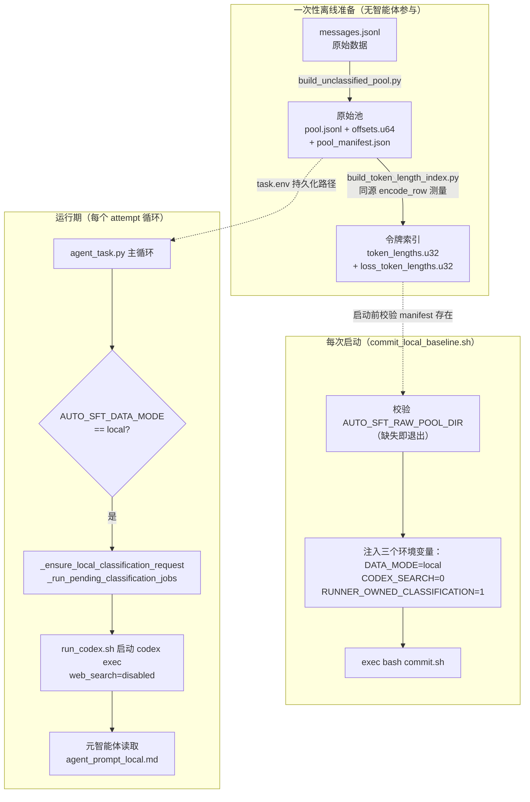
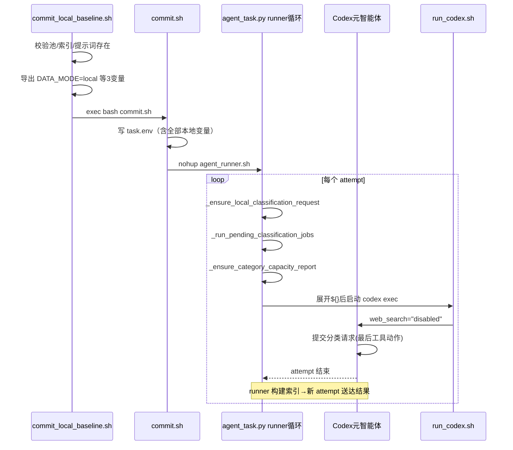

**本地基线模式**（local-data baseline）是 AutoSFT 智能体研究闭环的离线变体：它关闭 Codex 的网络检索能力，将唯一的训练数据来源替换为一个**预构建、只读、无分类标注的原始消息池**（unclassified messages pool）。本文档面向中级开发者，覆盖该模式的完整生命周期——从池与令牌索引的一次性离线构建，到启动器的三处环境变量注入、无网络保障的三层实现，直至 runner-owned 分类反转对智能体的所有权约束。读完本文，你将能独立完成一次本地基线运行的准备、启动与故障诊断。

> **📖 小白导读**
> - 这篇讲什么：AutoSFT 的"断网模式"——关掉联网检索、用一份预建好的只读数据池跑完整闭环，适合无网环境与对照实验。
> - 读之前先知道：**原始消息池**＝预先收集好的训练数据集合（一个 JSONL 文件，每行一条对话），本模式下它是唯一数据来源；**网络检索**＝Codex 智能体联网查资料的能力，本模式把它彻底关死；**分类反转**＝由外层运行器（而不是智能体）决定"哪些行进训练集"的所有权安排。
> - 读完你能明白：什么时候该用本地基线模式；三个关键环境变量各控制什么；出现"检索被拒/池只读"类报错时如何排查。
> - 提醒：本页是中级难度，跳过也不影响你理解在线模式的主线。



启动器委托链是理解此模式的第一原则：`commit_local_baseline.sh` 并不重新实现运行管理，它只做**环境变量准备与前置校验**，然后通过 `exec bash` 将控制权移交给在线模式的通用启动器 `commit.sh`，由后者创建 run 记录、写入 `task.env` 并以后台 `nohup` 方式拉起 `agent_runner.sh`。真正的运行循环在 `agent_task.py` 中，它根据 `AUTO_SFT_DATA_MODE` 分支出本地模式专属的分类恢复与容量报告逻辑。这种设计意味着本地基线与在线模式共享同一套多智能体架构、策略守卫和重试基础设施，差异被压缩到最小集合——数据来源、检索能力与分类所有权三处。
Sources: [commit_local_baseline.sh](src/commit_utils/commit_local_baseline.sh#L58-L68)

## 离线构建阶段：原始池与令牌索引

本地模式要求两项**一次性**离线构件，均在启动智能体之前用终端手工构建，且构建过程完全不消耗 LLM API 与网络资源。

### 原始池：build_unclassified_pool.py

第一个工具将任意的 messages 格式 JSONL 转换为**分类标注剥离的规范化消息池**。它的核心清洗函数 `lean_messages` 只保留 `role` 与 `content` 两个键，并施加三条准入规则：至少两条消息、至少一条 `user` 轮、至少一条 `assistant` 轮——不满足任何一条的行连同非法 JSON 一起被计入统计后丢弃，而非中断构建。

输出的三件套构成本地模式的物理数据底座：`pool.jsonl` 存放规范化行（每行携带 `pool_row_id`、来源三元组 `uid`/`source_dataset`/`source_index`、`messages` 与 `source_fingerprint`）；`offsets.u64` 是与行严格平行的**小端 u64 字节偏移数组**，使任意行可通过一次 seek 读取；`pool_manifest.json` 记录指纹、行数、剔除统计与 `excluded_fields` 清单。清单中显式列出的七个排除字段（`ability`、`sub_ability`、`extras`、`constraint_verification`、`detailed_category`、`verifier_path`、`expected_answer`）是设计意图的直接证据——**任何可能预泄露答案或预标注分类的信号都被删除**，迫使智能体通过自己的分类体系从零建立类别结构。

构建采用**staging 目录 + 原子替换**模式：所有产物先写入 `.building-<uuid>` 临时目录，全部就绪后用 `os.replace` 一次性移入目标位置，任何中途失败都不会留下半成品池。`pool_sha256` 对整个 `pool.jsonl` 内容流式哈希，成为后续令牌索引与分类索引指纹校验的锚点。若目标已存在清单，除非传 `--overwrite` 否则拒绝重建，保护已建索引的引用完整性。

Sources: [build_unclassified_pool.py](tools/local_baseline/build_unclassified_pool.py#L23-L41) [build_unclassified_pool.py](tools/local_baseline/build_unclassified_pool.py#L100-L121) [build_unclassified_pool.py](tools/local_baseline/build_unclassified_pool.py#L130-L167)

### 令牌长度索引：build_token_length_index.py

第二个工具解决的问题是：本地模式以**令牌预算**（而非行数）规划每轮训练，但逐轮重新分词百万级行不可接受。它的解决方案是用与 SSTable 转换器（SSTable＝训练引擎消费的按键排序数据文件格式）**完全相同的 `encode_row` 路径**（通过 `trans_sstable_v2.py --count-only` 驱动）预先测量每行的总令牌数与 assistant（loss）令牌数，产出两个平行于 `offsets.u64` 的 u32 数组。同源测量是硬约束而非优化：采样器据此规划的预算与转换器日后报告的 `total_token` 处于同一尺度，`build_index` 甚至在发布前校验转换器自报的 `total_token` 总和与数组求和一致，不一致则**拒绝发布**。

| 产物文件 | 语义 | 寻址方式 |
|---|---|---|
| `token_lengths.u32` | 每行总令牌数 | 按下标 i = `pool_row_id`，小端 u32 |
| `loss_token_lengths.u32` | 每行 assistant/loss 令牌数 | 同上 |
| `token_index_manifest.json` | pool_sha256、tokenizer 指纹、容量统计 | 单一 JSON 清单 |

索引清单中的 `tokenizer_fingerprint` 由 `token_index_fingerprint` 计算，绑定 tokenizer 实现、词表、版本映射、转换器脚本以及内嵌于 `tokenizer_config.json` 的聊天模板——任何一项变动都会使指纹失效，采样器据此**拒绝使用过期索引**而非静默给出错误预算。一个关键的隐含约束：索引是在**无 system_prompt** 条件下构建的（清单中 `system_prompt: None`），因为配方级 system prompt 会前缀到每行从而改变所有长度；若配方设置 system prompt，该索引不可直接使用。整个流程只测量、**从不截断或改写任何行**，池与索引一次构建、跨轮复用，因为池不可变且令牌长度与分类体系无关。

Sources: [build_token_length_index.py](tools/local_baseline/build_token_length_index.py#L2-L27) [build_token_length_index.py](tools/local_baseline/build_token_length_index.py#L152-L186) [build_token_length_index.py](tools/local_baseline/build_token_length_index.py#L229-L265)

### 底层随机访问原语：pool_io.py

两个构建工具与运行期采样器共享同一组二进制原语。`offset_count` 通过文件大小整除校验返回行数；`read_pool_row` 按 `row_id * 8` 字节 seek 读偏移，再定位 `pool.jsonl` 读取整行，并**校验行内 `pool_row_id` 与请求的 row_id 一致**，防止任何偏移错位静默产生错行。`load_token_lengths` 将整个 u32 索引一次性载入 `array("I")`（注释给出量化事实：约 70 万行仅约 2.8 MB），采样器因此一遍读完所有长度而无需逐行 seek。这些原语是"内容寻址 + 结构校验"设计哲学在文件层的最小实现。

Sources: [pool_io.py](src/control_plane/pool_io.py#L21-L61) [pool_io.py](src/control_plane/pool_io.py#L128-L163)

## 启动阶段：commit_local_baseline.sh 的三处注入

启动器是一个仅 69 行的薄壳，其全部职责可归纳为：**校验前置构件存在性 → 注入本地模式环境变量 → 委托 commit.sh**。

| 步骤 | 校验对象 | 失败行为 |
|---|---|---|
| 1 | `AUTO_SFT_RAW_POOL_DIR` 非空 | **硬失败退出**——本地模式必需 |
| 2 | `pool_manifest.json` 存在 | 仅**警告**后继续，让动态分类在运行期显式失败 |
| 3 | `token_index_manifest.json` 存在 | **硬失败退出**——采样无令牌索引不可规划 |
| 4 | 提示词文件存在（默认 `tools/codex_exec/agent_prompt_local.md`） | **硬失败退出** |

校验行为的不对称（清单缺失仅警告、索引缺失即退出）反映两者的容错定位：池清单的缺失会在分类请求阶段被更完整的运行期逻辑捕获并给出明确指引，而令牌索引缺失会让采样路径在无预算依据的情况下产生不可诊断的失败，因此宁可在启动前拦截。三个环境变量随后被导出：

```bash
export AUTO_SFT_DATA_MODE=local              # 控制平面的模式分支开关
export AUTO_SFT_CODEX_SEARCH=0               # 移除 Codex web_search 工具
export AUTO_SFT_RUNNER_OWNED_CLASSIFICATION=1 # 分类构建所有权归 runner
```

`commit.sh` 接管后，这三个变量连同池路径、清单路径、令牌索引路径被逐一条件写入 `task.env`。这一持久化动作具有容错意义：`task.env` 是 `agent_runner.sh` 每次重启时的唯一环境事实来源，README 明确指出这防止"后续 `agent_runner.sh` 重启时静默回退到在线提示词"。注意 `LLMGATEWAY_SYN_KEY` **刻意不写入** `task.env`——它仅通过进程环境继承，永不落盘于任何运行产物。

Sources: [commit_local_baseline.sh](src/commit_utils/commit_local_baseline.sh#L25-L68) [commit.sh](src/commit_utils/commit.sh#L69-L89) [README.md](README.md#L114-L116)

### 提示词的占位符协议

启动器将 `agent_prompt_local.md` 全文读入 `AUTO_SFT_AGENT_PROMPT` 环境变量，但**不做任何变量展开**——文件中的 `${AUTO_SFT_RUN_DIR}`、`${AUTO_SFT_BENCHMARK}` 等占位符保持字面量。展开发生在 `agent_task.py` 的运行期：`default_prompt()` 依据 `AUTO_SFT_DATA_MODE` 选择本地或在线提示词，主循环用 `os.path.expandvars` 结合每次 attempt 的续跑上下文（分类任务结果、执行者交接状态、未完成报告）动态展开。`default_prompt` 的存在意味着即使启动器未设置 `AUTO_SFT_AGENT_PROMPT`，`AUTO_SFT_DATA_MODE=local` 本身就足以让 runner 选中本地提示词——环境变量与提示词路径形成双保险。

Sources: [agent_task.py](src/control_plane/agent_task.py#L79-L85) [agent_task.py](src/control_plane/agent_task.py#L1084-L1100)

## 无网络检索的三层保障

"禁用网络检索"在本地模式中不是单一开关，而是**提示词契约、工具移除、策略守卫**三层叠加，任何一层失效都有下一层兜底。

### 第一层：提示词中的数据访问契约

`agent_prompt_local.md` 的 "Data access" 一节是面向 LLM 的行为契约：明确声明 "Web search is disabled. Do not access HuggingFace or download datasets"，并规定唯一数据来源是 `${AUTO_SFT_RAW_POOL_MANIFEST}` 指向的只读池，且该池不含 legacy `detailed_category`、类别卡片、验证器路径或约束验证标签。同一节还界定了元智能体的**读取白名单**——只允许读 `skills/sft-data-recipe-authoring/SKILL.md` 与其 `dynamic-local-pool.md` 参考，**明确禁止**读取 `huggingface-dataset-discovery` 技能与任何执行者/分析技能，从知识层面切断在线数据发现的路径。

Sources: [agent_prompt_local.md](tools/codex_exec/agent_prompt_local.md#L124-L131) [agent_prompt_local.md](tools/codex_exec/agent_prompt_local.md#L13-L22)

### 第二层：run_codex.sh 的工具级移除

真正的技术门控发生在 `tools/codex_exec/run_codex.sh`（在线与本地模式共享的 Codex 启动脚本）。它根据 `AUTO_SFT_CODEX_SEARCH` 二值分支：值为 `1` 时追加 `--search` 旗标暴露 web_search 工具；值为 `0` 时改传 `-c 'web_search="disabled"'` 配置。**关键架构事实**是本地模式的离线性并不依赖网络沙箱——源码注释与 `/goal` 基线启动器均说明 Codex 的 bubblewrap 沙箱在此环境无法初始化，因此系统采取"不提供工具"而非"阻断网络"的思路：`--search` 不被传入，web_search 工具对智能体不可见，智能体根本没有可调用的检索接口。

Sources: [run_codex.sh](tools/codex_exec/run_codex.sh#L83-L87) [commit_codex_goal_baseline.sh](src/commit_utils/commit_codex_goal_baseline.sh#L9-L16)

### 第三层：策略守卫的命令级审计

即使前两层被绕过（例如智能体用 shell 命令自行发起网络请求），`policy_guard` 仍从命令文本层面审计。其规则集将 **DPO/RLHF/偏好优化流、合成数据流、直接的 `clusterctl pytorchjob create` 提交**列为禁止模式，且这些正则刻意匹配**真实调用**（脚本路径、CLI 旗标、训练器类名）而非裸关键词，配合"仅扫描实际执行的命令"策略，避免智能体仅阅读规则或搜索仓库就被误伤。此外 `_SAMPLER_ENTRYPOINT_RE` 与 `_TOKEN_BUDGET_FLAG_RE` 的组合专门拦截向采样器传 `--token-budget` 的行为——令牌预算是启动器所有物，被 `policy_guard` 归类为 `training_param_override` 违规。

Sources: [policy_guard.py](src/control_plane/policy_guard.py#L44-L76) [policy_guard.py](src/control_plane/policy_guard.py#L808-L815)

## runner-owned 分类：所有权反转与策略联动

本地模式最深的架构差异在于**长时分类构建的所有权从智能体转移到外部 runner**。`AUTO_SFT_RUNNER_OWNED_CLASSIFICATION=1` 触发两处联动：

**主循环侧**，每个 attempt 开始时，若目标未达成，`agent_task.py` 依次调用 `_ensure_local_classification_request` 与 `_run_pending_classification_jobs`。前者在特定条件下（`AUTO_SFT_DATA_MODE == "local"` 且 runner-owned 标志为 1 且池清单存在）**幂等地恢复缺失的分类请求**（幂等＝同一操作重复执行，效果和只执行一次相同，已完成的不会重复做）——它读取 `taxonomy/state.json` 的当前版本，校验 `data_pool/classifications/<version>/manifest.json` 是否已就位，若发布中断于请求提交之前，则由 runner 自己补交 `classification_job request`，无需再消耗一次 LLM 调用。后者在没有 Codex 工具超时约束的环境下执行实际的长构建，完成后将终态结果注入下一个 attempt 的续跑提示词。

**守卫侧**，`policy_guard` 在该标志开启时对 agent 日志追加一类实时违规检测：`_DIRECT_CLASSIFICATION_BUILD_RE` 匹配任何直接调用 `python -m src.control_plane.classification_index ... build` 的命令，触发 `direct_classification_index_build` 违规。注释阐明这是**仅实时检查**的历史原因——追溯扫描会使 runner-owned 机制引入前的运行被追溯判废。此规则在实时 PreToolUse 钩子（`tools/codex_goal/policy_hook.py` 复用同一正则源）与事后日志扫描两处生效，形成"提交请求可以、直接构建不行"的清晰边界：智能体的职责终结于把版本固定的分类请求作为其**最后一个工具动作**提交，之后应立即结束本次 Codex attempt，由 runner 完成构建并在新 attempt 中送达结果。

Sources: [agent_task.py](src/control_plane/agent_task.py#L284-L330) [agent_task.py](src/control_plane/agent_task.py#L1039-L1057) [policy_guard.py](src/control_plane/policy_guard.py#L78-L85) [policy_guard.py](src/control_plane/policy_guard.py#L871-L884) [policy_guard.py](src/control_plane/policy_guard.py#L1066-L1076)



## 运行期数据流：从池到物化数据集

本地模式的一轮数据流由四个不可变构件串联，每一环都有指纹校验：**原始池**（`pool_sha256`）→ **令牌索引**（绑定池指纹 + tokenizer/模板指纹）→ **分类索引**（`data_pool/classifications/vNNNN/`，绑定池 + 分类体系 + 解析器 + 验证器指纹）→ **物化数据集**（由 Data Action Runner 产出，参考 `local/if_unclassified_pool_mix` 标识）。

提示词为元智能体规定了密集的 `category_weights` 协议：必须覆盖当前分类索引 `category_files` 的**每一个**键（包括显式零），配 `quota_mode: cap` 与 `underfill_policy: clip_and_drop`；正权重类目的名义配额 `q_i = B * w_i / sum(w)` 是**上限而非必须填满的目标**——容量不足的类目只取其现有整行，缺口记为 `unused_budget_tokens`，**严禁**跨类目再分配、再归一化或类目盲回填。智能体不得在计划或配方中写 `token_budget`，该值只来自启动器的 `AUTO_SFT_SFT_TOKEN_BUDGET`（`commit.sh` 默认 2000 万令牌）。`_ensure_category_capacity_report` 在每个 attempt 前生成 `category_capacity.json`，为规划提供每类目的合格行数与总/loss 令牌容量视图——行数与令牌数不可互换，池中单行跨度从几十到上万令牌。

Sources: [agent_prompt_local.md](tools/codex_exec/agent_prompt_local.md#L132-L171) [agent_task.py](src/control_plane/agent_task.py#L196-L210) [commit.sh](src/commit_utils/commit.sh#L8-L9) [dynamic-local-pool.md](skills/sft-data-recipe-authoring/references/dynamic-local-pool.md#L163-L190)

## 故障排查速查

| 症状 | 根因 | 处置 |
|---|---|---|
| `ERROR: AUTO_SFT_RAW_POOL_DIR is required` | 未设置池目录环境变量 | 先运行 `build_unclassified_pool.py`，再 `export AUTO_SFT_RAW_POOL_DIR=...` |
| `ERROR: token-length index not found` | 池已建但令牌索引缺失 | 运行 `build_token_length_index.py --pool-manifest ... --out-dir ...` |
| 池构建拒绝执行 `pool already exists` | 目标目录已有 manifest | 确认无需重建，或加 `--overwrite`（会使已建索引指纹失效） |
| 采样器拒绝令牌索引 | 池或 tokenizer/模板变动使指纹不匹配 | 加 `--overwrite` 重建索引 |
| 配方设置了 system_prompt 却沿用索引 | 索引按无 system_prompt 构建 | 该索引不可用；此约束记录于索引清单 `system_prompt: null` |
| 智能体日志出现 `direct_classification_index_build` | 智能体直接调用了 `classification_index build` | 属策略违规；正确路径是提交 `classification_job request` 后立即结束 attempt |
| `agent_runner.sh` 重启后行为像在线模式 | task.env 未含本地变量（旧 run 目录） | 确认由 `commit_local_baseline.sh`（而非裸 `commit.sh`）创建 run |

Sources: [commit_local_baseline.sh](src/commit_utils/commit_local_baseline.sh#L27-L56) [build_unclassified_pool.py](tools/local_baseline/build_unclassified_pool.py#L64-L68) [build_token_length_index.py](tools/local_baseline/build_token_length_index.py#L141-L145) [README.md](README.md#L197-L204)

## 边界澄清：与相邻模式的区分

本地基线家族中有三个易混淆入口，需明确划界：`commit_local_baseline.sh` 是本文主题——**非-/goal 多智能体 + 动态分类索引**路径；`commit_codex_goal_baseline.sh` 与 `tools/local_baseline/agent_prompt.md` 构成**遗留静态目录**路径（`build_catalog.py` 产出的 category_cards/shards），为 `/goal` TUI 兼容性保留，单根智能体顺序执行全流程；裸 `commit.sh` 是**在线模式**，保留 `huggingface-dataset-discovery` 技能与 web search。`tools/local_baseline/sample_recipe_data.py` 是遗留手动采样入口，多智能体流程中由 Data Action Runner 经共享 sampler core 承担同等职责，该入口仅作手动/静态基线后端保留。

Sources: [commit_codex_goal_baseline.sh](src/commit_utils/commit_codex_goal_baseline.sh#L4-L16) [agent_prompt.md](tools/local_baseline/agent_prompt.md#L1-L12) [build_catalog.py](tools/local_baseline/build_catalog.py#L2-L5) [sample_recipe_data.py](tools/local_baseline/sample_recipe_data.py#L2-L9)

## 延伸阅读

- 环境变量的完整语义与令牌预算策略见 [运行配置与环境变量详解：目标分数、评测后端、令牌预算与重试策略](4-yun-xing-pei-zhi-yu-huan-jing-bian-liang-xiang-jie-mu-biao-fen-shu-ping-ce-hou-duan-ling-pai-yu-suan-yu-zhong-shi-ce-lue)
- 令牌索引的指纹机制深入分析见 [令牌长度索引：与 SSTable 转换同源的计数路径、指纹校验与预算一致性](13-ling-pai-chang-du-suo-yin-yu-sstable-zhuan-huan-tong-yuan-de-ji-shu-lu-jing-zhi-wen-xiao-yan-yu-yu-suan-zhi-xing)
- cap/clip-and-drop 采样语义见 [类目容量与整行采样：cap 配额、clip-and-drop 欠填策略与三轮 epoch 训练步数推导](14-lei-mu-rong-liang-yu-zheng-xing-cai-yang-cap-pei-e-clip-and-drop-qian-tian-ce-lue-yu-san-lun-epoch-xun-lian-bu-shu-tui-dao)
- 分类索引的构建细节见 [分类索引与原子解析器：LLMGateway 结构化标注、逐轮验证与内容寻址缓存](12-fen-lei-suo-yin-yu-yuan-zi-jie-xi-qi-llmgateway-jie-gou-hua-biao-zhu-zhu-lun-yan-zheng-yu-nei-rong-xun-zhi-huan-cun)
- 策略守卫全貌见 [策略守卫机制：policy_guard 的源码保护、禁用训练流检测与违规审计（policy_guard_check.sh）](9-ce-lue-shou-wei-ji-zhi-policy_guard-de-yuan-ma-bao-hu-jin-yong-xun-lian-liu-jian-ce-yu-wei-gui-shen-ji-policy_guard_check-sh)
- 采样器实现细节见 [数据动作计划：不可变元计划、operator.py 约束执行与 Data Action Runner 的权威采样](11-shu-ju-dong-zuo-ji-hua-bu-ke-bian-yuan-ji-hua-operator-py-yue-shu-zhi-xing-yu-data-action-runner-de-quan-wei-cai-yang)