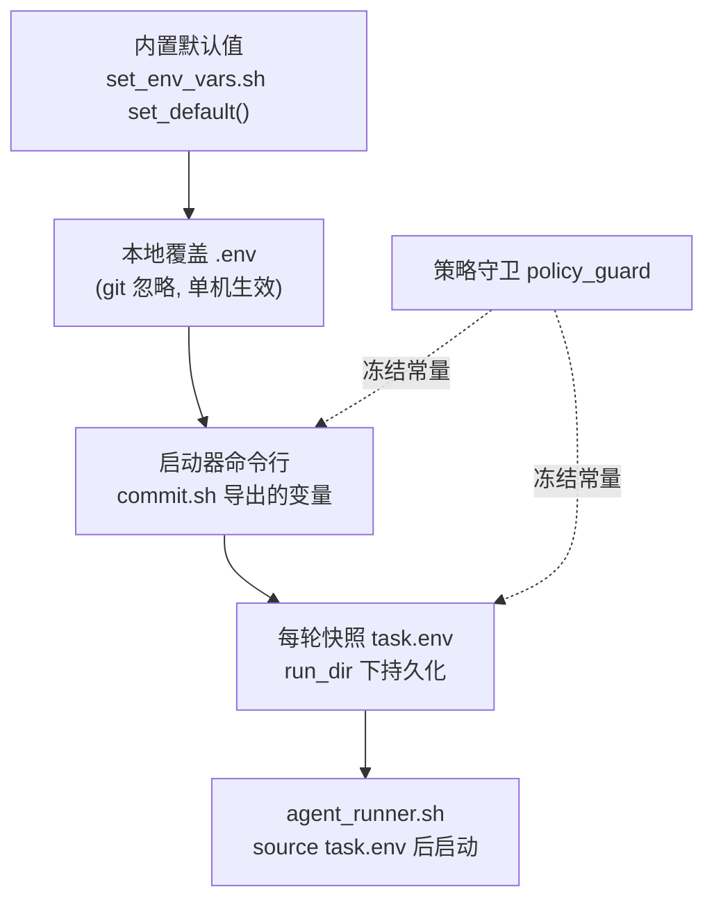
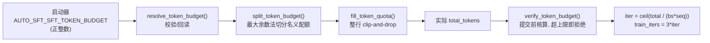
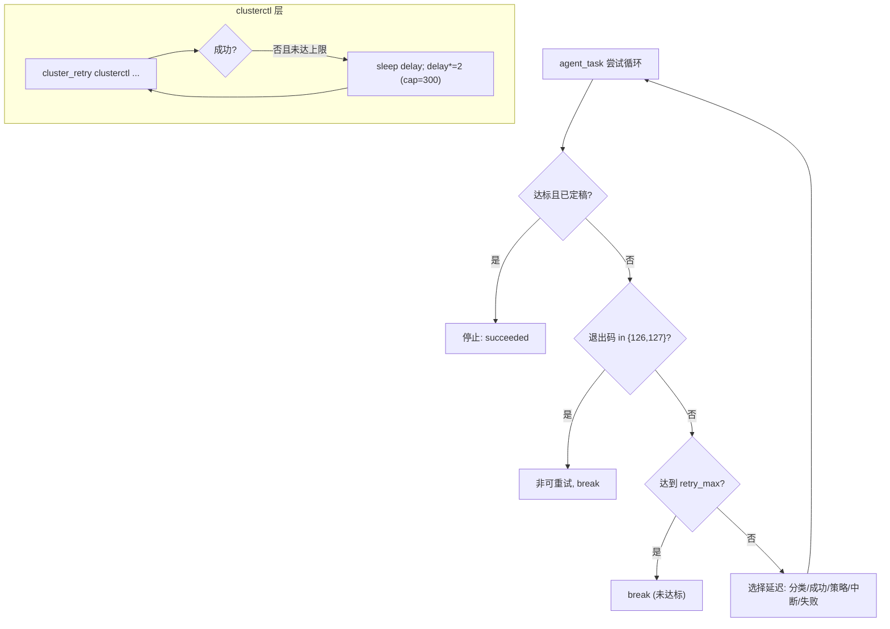

AutoSFT 的运行行为主要由一组 `AUTO_SFT_*` 环境变量驱动，而它们并非散落各处、随读随取，而是遵循一套**分层覆盖 + 常量冻结**的治理模型。本页聚焦四类决定"运行骨架"的配置：**目标分数**（何时停止迭代）、**评测后端**（用哪条推理/评测路径）、**令牌预算**（每轮训练多少 token）、以及**重试策略**（agent 尝试与集群提交的容错）。理解它们的优先级与边界，是让一整轮无人值守实验可控、可比、可复现的前提。

> **📖 小白导读**
> - 这篇讲什么：所有 `AUTO_SFT_*` 环境变量的"总账本"——目标分数、评测后端、令牌预算、重试策略四类旋钮各自的取值、默认值与优先级。
> - 读之前先知道：**环境变量**＝操作系统里按名字存放的设置，程序启动时读取；**分层覆盖**＝"内置默认值 → 启动脚本 → 命令行手动指定"三层，越靠后优先级越高；**冻结常量**＝被安全机制锁定、智能体运行中不许改的配置项。
> - 读完你能明白：想让实验"何时停"改哪个变量、"花多少 token"改哪个变量；为什么有些值你设了也不生效（被守卫锁死）；改错配置会发生什么。
> - 提醒：这张表适合当字典用——第一次粗读知道四类变量存在即可，用到哪类再回来查对应小节。

## 配置分层与优先级模型

配置的解析链路自底向上分为四层，**越靠后、越靠近运行时的层优先级越高**，但其中若干常量被策略守卫锁定，不允许智能体在运行中改动。

第一层是**内置默认值**。`set_env_vars.sh` 定义了 `set_default()` 辅助函数：仅当变量未设置或字面值为 `UNDEFINED` 时才写入默认值，从而让"调用者已提供的值"优先于脚本默认，例如集群默认固定为北京 `h800`、项目为 `autosft-7`、镜像为固定的运行时镜像标签。

Sources: [set_env_vars.sh](src/commit_utils/set_env_vars.sh#L2-L30)

第二层是**每台机器的本地覆盖**。仓库根目录下的 `.env`（被 git 忽略、不提交）会在默认值之后被 `set -a` 载入，使单机可以注入如 `CODEX_HOME` 之类的环境而不影响其他克隆者；由于它相对仓库根解析，任意 cwd 下都能生效。

Sources: [set_env_vars.sh](src/commit_utils/set_env_vars.sh#L39-L50)

第三层是**启动器命令行**。`commit.sh` 在 `source set_env_vars.sh` 之前就把命令行传入的 `AUTO_SFT_SFT_TOKEN_BUDGET`、`AUTO_SFT_TARGET_SCORES` 等导出，使其压制脚本默认值。

Sources: [commit.sh](src/commit_utils/commit.sh#L8-L10)

第四层是**每轮运行快照 `task.env`**。`commit.sh` 为每个 `(benchmark, agent)` 组合创建独立的 `run_dir`，把最终生效的基础模型、benchmark、目标分数、令牌预算、重试上限、策略守卫路径、`HF_ENDPOINT` 以及可选的凭据/数据模式写进 `task.env`；随后生成的 `agent_runner.sh` 用 `set -a; source task.env` 载入该快照再启动控制平面，使一次运行的配置与"启动它的那个环境"解耦、可被后续重启精确复原。

Sources: [commit.sh](src/commit_utils/commit.sh#L48-L62)



需要额外说明的是，策略守卫（`policy_guard`）在运行期对 `job_infra_overrides_for_command` 做扫描，一旦命令试图改动被钉死的作业/基础设施变量（集群、项目、资源池、优先级、节点/GPU/CPU/内存、镜像、训练代码 git 源），就会被记为违规；`AUTO_SFT_EVAL_BACKEND` 也在其中，属于"运行所有者一次性选定、跨轮不得更改"的固定方法论常量。

Sources: [policy_guard.py](src/control_plane/policy_guard.py#L819-L858)

## 目标分数：AUTO_SFT_TARGET_SCORES

`AUTO_SFT_TARGET_SCORES` 是整个运行循环的**停止条件**，它**必填且没有内置默认值**——`commit.sh` 若发现它为空会直接报错退出，并打印一个 `ifeval=0.8,ifbench=0.5` 的格式示例。

Sources: [commit.sh](src/commit_utils/commit.sh#L20-L28)

其格式为逗号分隔的 `benchmark=score` 列表。`_parse_target_scores()` 对每一项用 `=` 切分、将名称转小写并对分数做浮点解析；缺少 `=`、名称为空或分数非法的条目只会打印 `WARN` 并被忽略，而不会中断运行。

Sources: [agent_task.py](src/control_plane/agent_task.py#L105-L129)

运行时，循环用 `_unmet_targets()` 判定"未达标"：只要某个 benchmark 的**最佳** `primary_score` 缺失或仍低于阈值，它就留在未达标集合中；只有**当没有任何 benchmark 低于阈值**时，`_targets_reached()` 才返回真，运行才算完成。`_score_status_line()` 会把每个 benchmark 渲染成 `name=score/target (MET|below|no eval yet)` 便于日志核验。

Sources: [agent_task.py](src/control_plane/agent_task.py#L132-L153)

目标分数还决定了**"已达标但未定稿"**这一特殊阶段：当目标已达成但 `${AUTO_SFT_RUN_DIR}/final_model_summary.json` 尚不存在时，下一轮尝试被标记为 `finalize_only`，其唯一任务是把最佳模型定稿，而不是继续训练。

Sources: [agent_task.py](src/control_plane/agent_task.py#L1059-L1061)

在智能体契约层面，AGENTS.md 把整轮研究描述为**一个持久目标**：期望终态是"每个目标 benchmark 的最佳 `primary_score` 达到阈值且最佳模型被定稿"，且明确要求智能体使用"本次运行所提供的 benchmark 与阈值，不要假设任何具体数字"。

Sources: [AGENTS.md](AGENTS.md#L354-L366)

同一份目标分数还被复用于**检查点策略**：`checkpoint_policy` 用 `_target_benchmarks_from_env()` 解析出目标 benchmark 名单，只统计这些 benchmark 的 `primary_score` 均值作为候选模型的比较依据，从而让"选最佳历史模型"与停止条件保持一致口径。

Sources: [checkpoint_policy.py](src/control_plane/checkpoint_policy.py#L65-L93)

| 属性 | 值 | 说明 |
|------|-----|------|
| 变量名 | `AUTO_SFT_TARGET_SCORES` | 停止条件 |
| 默认值 | 无（必填） | 空值直接报错退出 |
| 格式 | `benchmark=score,benchmark=score` | 例 `ifeval=0.8,ifbench=0.5` |
| 解析容错 | 非法项仅告警并跳过 | 不中断运行 |
| 复用处 | `checkpoint_policy` 最佳模型选择 | 同口径统计 |

## 评测后端：AUTO_SFT_EVAL_BACKEND

`AUTO_SFT_EVAL_BACKEND` 决定用哪条推理/评测路径，取值仅两个：**`inspect`**（默认）与 **`opencompass`**。它在三层里被反复声明与校验：`set_env_vars.sh` 的默认值、`evaluate.py` 的 CLI/环境参数校验、以及策略守卫的固定常量名单。

Sources: [set_env_vars.sh](src/commit_utils/set_env_vars.sh#L30)

`evaluate.py` 用 `eval_backend()` 作为 argparse 的 `type`，把输入统一小写并通过白名单 `EVAL_BACKENDS` 校验，非法值直接抛出 `ArgumentTypeError`；CLI 参数默认取 `AUTO_SFT_EVAL_BACKEND`，缺省回落到 `inspect`。

Sources: [evaluate.py](evaluate.py#L27-L37)

Sources: [evaluate.py](evaluate.py#L55-L65)

两条后端的差异在于**推理栈**：`inspect` 保持既有的本地 Inspect AI / vLLM 路径；`opencompass` 则在 PyTorchJob 内自托管 vLLM 并暴露 OpenAI 兼容 API，评测后把结果转换回 AutoSFT 统一的 metrics/failure/ledger 契约。后端选择会被透传给每个 benchmark 的提交脚本与 `eval_request.json`，保证记录与实测一致。

Sources: [evaluate.py](evaluate.py#L126-L134)

在交付脚本 `submit_cluster_eval.sh` 中，后端取值再次被 `case` 白名单校验（非 `inspect`/`opencompass` 即退出），并驱动两套完全不同的入口：`inspect` 直接调用 `src/eval/tasks/${BENCHMARK}/evaluate.py`，`opencompass` 则先由桥接生成运行时配置、`source init.sh`、用 `deploy.sh` 拉起 vLLM/router，再 `python run.py` 评测并用 `opencompass_bridge.py collect` 收集结果。

Sources: [submit_cluster_eval.sh](skills/cluster-eval-job-submission/scripts/submit_cluster_eval.sh)

后端的实现边界由 `opencompass_bridge.py` 固化：它维护 `BENCHMARK_CONFIGS`（`ifeval`/`ifbench` 的数据集、评估器、缩略名与数据集路径）、`METRIC_KEYS`（把 OpenCompass 的四种准确率映射回 AutoSFT 的 `strict/loose × prompt/instruction` 键），并通过 `write_runtime_config()` 生成带可选 `test_range` 限制的运行时配置。

Sources: [opencompass_bridge.py](src/eval/opencompass_bridge.py#L17-L91)

策略守卫对后端变量有专门文案：改动 `AUTO_SFT_EVAL_BACKEND` 会被记录为"设置了固定的评测方法变量，评测后端由运行所有者一次性选定，必须跨轮保持不变以保持分数可比"。

Sources: [policy_guard.py](src/control_plane/policy_guard.py#L844-L849)

只有 `opencompass` 后端才会消费的一组专属环境变量如下，均带内建默认：

| 变量 | 默认 | 用途 |
|------|------|------|
| `AUTO_SFT_OPENCOMPASS_DIR` | `/user/linbiyuan/opencompass` | 共享 checkout |
| `AUTO_SFT_OPENCOMPASS_ENV_NAME` | `sglang_qwen35` | `init.sh` 中的环境名 |
| `AUTO_SFT_OPENCOMPASS_INFER_TYPE` | `api_qwen3_nothink_sft` | 推理模型模块名 |
| `AUTO_SFT_OPENCOMPASS_DEPLOY_BACKEND` | `vllm` | 部署后端 |
| `AUTO_SFT_OPENCOMPASS_ROUTER_PORT` / `_TP_SIZE` | `30000` / `1` | router 端口与张量并行 |
| `AUTO_SFT_OPENCOMPASS_MAX_SEQ_LEN` / `_MAX_OUT_LEN` | `81920` / `1200` | 序列与输出长度上限 |
| `AUTO_SFT_OPENCOMPASS_API_CONCURRENCY` / `_MAX_WORKERS` | `64` / `16` | API 并发与 worker 数 |
| `AUTO_SFT_OPENCOMPASS_TEMPERATURE` / `_API_TIMEOUT` | `0.7` / `1800` | 采样温度与超时 |

Sources: [submit_cluster_eval.sh](skills/cluster-eval-job-submission/scripts/submit_cluster_eval.sh)

两条后端共享的评测吞吐旋钮独立于后端：`AUTO_SFT_EVAL_LIMIT`（`-1` 表示全量）、`AUTO_SFT_EVAL_MAX_CONNECTIONS`（默认 `64`）、`AUTO_SFT_EVAL_GPU_MEMORY_UTILIZATION`（默认 `0.85`），这些变量由 `evaluate.py` 读取并在提交时注入。

Sources: [evaluate.py](evaluate.py#L54)

Sources: [submit_cluster_eval.sh](skills/cluster-eval-job-submission/scripts/submit_cluster_eval.sh#L51)

## 令牌预算：AUTO_SFT_SFT_TOKEN_BUDGET

`AUTO_SFT_SFT_TOKEN_BUDGET` 是**每轮的 token 上限**，且被严格设计为"**启动器拥有、智能体只读**"。`set_env_vars.sh` 用正则 `^[1-9][0-9]*$` 强制它必须是正整数，否则报错返回码 2；`commit.sh` 则在缺省时补上 `20000000` 作为兼容默认。

Sources: [set_env_vars.sh](src/commit_utils/set_env_vars.sh#L52-L57)

Sources: [commit.sh](src/commit_utils/commit.sh#L8-L9)

预算的语义是**上界而非承诺**。`resolve_token_budget()` 优先读取环境变量：值为 `None`/`""`/`"0"` 时视为未设；否则要求可解析为正整数。若配方也声明了 `token_budget`，则它必须与环境值**完全相等**——不同即报错，因为预算是"固定的运行上限，不能由配方悄悄替换"；配方值还必须严格是 `int`（拒绝 `10.5` 这类可被 `int()` 截断的值）。

Sources: [recipe_data.py](src/control_plane/recipe_data.py#L773-L814)

`verify_token_budget()` 在**任何 GPU 作业提交之前**运行：它用采样器的计划量与转换器实际产出的 `total_tokens` 对比，只有在"未知、为空或超上限"时才拒绝（超上限直接报错；欠填则合法）。它为 manifest 写入一份核算对象，含 `token_budget`、`realized_tokens`、`deviation`、`unused_budget_tokens`、`budget_utilization` 以及按 `tokens_per_iter` 推导的 `planned_iters_per_epoch` / `realized_iters_per_epoch`（epoch＝把全部训练数据完整过一遍模型的轮次，iter＝一次优化器更新）。

Sources: [recipe_data.py](src/control_plane/recipe_data.py#L817-L873)

**单步吞吐**由 `runtime_tokens_per_iter()` 从两个运行旋钮推导：`AUTO_SFT_SFT_GLOBAL_BATCH_SIZE`（默认 `16`）与 `AUTO_SFT_SFT_SEQ_LENGTH`（默认 `32768`）的乘积，即默认 `524288` token/步；两者必须为正整数，否则在写 manifest 之前就报错，避免计划与提交使用不一致的步数口径。

Sources: [recipe_data.py](src/control_plane/recipe_data.py#L744-L770)

据此，每轮训练步数完全由**实际 token 量**自动决定，而非智能体指定的步数：

```text
iters_per_epoch = ceil(total_tokens / (global_batch_size * seq_length))
train_iters     = 3 * iters_per_epoch
```

`estimate_iters_per_epoch` 与 `resolve_train_iters` 在 `sft_train.py` 中实现这一公式（数据量未知时，dry-run 返回 1，否则报错）。

Sources: [sft_train.py](sft_train.py#L204-L212)

分配层面，`split_token_budget()` 用**最大余数法**把总预算按类目相对权重切分为"名义配额"，并保证各配额**精确求和等于预算**（用 `Fraction` 做精确有理数运算，避免大整数下的浮点溢出与低位 token 丢失）；若某类目候选行不足，`fill_token_quota()` 只挑选**完整行**、绝不截断、绝不把欠额重分配给其他类目——这正是 clip-and-drop 语义。

Sources: [sampler_core.py](src/control_plane/sampler_core.py#L21-L107)

该不变式被测试固定：`split_token_budget` 的求和必须精确等于预算，最大余数"不遗留任何未分配 token"。

Sources: [test_token_budget.py](tests/test_token_budget.py#L177-L196)

需要强调的治理约束：`policy_guard` 把改动令牌预算（无论经环境变量还是 `sample_recipe_data.py --token-budget`）视为 `training_param_override`；AGENTS.md 明确要求智能体**不要设置、导出、内联覆盖或重写** `AUTO_SFT_SFT_TOKEN_BUDGET`，并**从智能体撰写的计划与配方中省略 `token_budget`**。

Sources: [AGENTS.md](AGENTS.md#L268-L280)

`sample_recipe_data.py` 的 `resolve_sample_token_budget()` 也遵守同一规则：作为手工/遗留入口它可以接受配额声明的上限，但**一旦 `AUTO_SFT_SFT_TOKEN_BUDGET` 已设置，配额文件或 CLI 值只能复述该上限，不能替换它**。

Sources: [sample_recipe_data.py](tools/local_baseline/sample_recipe_data.py#L121-L144)



## 重试策略：智能体尝试与 clusterctl 有界重试

系统含**两层互相独立的重试**：外层是控制平面驱动智能体进程的**尝试循环**，内层是向 Cluster 提交作业时的 **clusterctl 有界重试**。

### 智能体尝试循环

`AUTO_SFT_AGENT_RETRY_MAX` 限制最大尝试次数，语义特殊：**`0` 表示无界**（一直跑到达标为止，`max_attempts` 被设为 `10^9`），正数则为硬上限。延迟相关变量分为四类场景：失败后 `AUTO_SFT_AGENT_RETRY_DELAY_SECONDS`（默认 `300`）、目标已达标或干净退出后 `AUTO_SFT_AGENT_SUCCESS_RETRY_DELAY_SECONDS`（默认 `60`）、策略守卫退出码 3 后 `AUTO_SFT_AGENT_POLICY_RETRY_DELAY_SECONDS`（默认回落到成功延迟）、以及长时间运行后被中断 `AUTO_SFT_AGENT_INTERRUPT_RETRY_DELAY_SECONDS`（默认 `45`）。

Sources: [agent_task.py](src/control_plane/agent_task.py#L962-L969)

`AUTO_SFT_AGENT_NONRETRYABLE_EXIT_CODES` 默认 `126,127`（命令不可执行/未找到）——命中即**不再重试**并跳出循环。

Sources: [agent_task.py](src/control_plane/agent_task.py#L582-L593)

循环末端按"退出状态 + 上下文"选择延迟与重试理由：分类作业结果存在则延迟 `0`；目标已达标或退出码 0 走成功延迟；退出码 3 走策略延迟；若本次尝试运行时间已超过快速失败阈值且被判定为中断，则走中断延迟；其余走失败延迟。

Sources: [agent_task.py](src/control_plane/agent_task.py#L1371-L1410)

此外有一个**快速失败告警**机制：`AUTO_SFT_AGENT_FAST_FAIL_STREAK`（默认 `10`）与 `AUTO_SFT_AGENT_FAST_FAIL_SECONDS`（默认 `5.0`）用来识别"连续若干次在几秒内非零退出"的卡死配置——它**只告警、不终止**，以保证无人值守的过夜运行不会被自终止（streak 设为 0 可禁用）。

Sources: [agent_task.py](src/control_plane/agent_task.py#L669-L699)

`AUTO_SFT_CODEX_RESUME`（默认 `1`）控制每次重启是否**恢复运行本地的 Codex 会话**，`0` 则强制全新会话；它让干净退出重试、失败、交接与 runner 重启都能保留会话上下文。

Sources: [agent_task.py](src/control_plane/agent_task.py#L1015)

每次尝试的起止、退出码、时长、退出原因、是否恢复会话、最佳分数与是否达标，都会被追加进 `agent_attempts.jsonl`，便于事后诊断重试模式。

Sources: [agent_task.py](src/control_plane/agent_task.py#L1208-L1226)

### clusterctl 有界重试（指数退避）

`cluster_retry()` 是针对**瞬时**集群/提交故障的共享辅助函数（如可恢复的 `503`/计费账户校验抖动），它有界且会指数退避：由 `AUTO_SFT_CLUSTER_RETRY_MAX`（默认 `5`）限制总尝试次数，`AUTO_SFT_CLUSTER_RETRY_DELAY_SECONDS`（默认 `30`）为初始延迟，每次失败后**延迟翻倍**，并用 `AUTO_SFT_CLUSTER_RETRY_MAX_DELAY_SECONDS`（默认 `300`）封顶；重试诊断信息走 stderr，仅最终 clusterctl 响应落入 `RESPONSE`，用尽重试后返回非零并由 `set -e` 中止。

Sources: [cluster_retry.sh](src/commit_utils/cluster_retry.sh#L5-L27)



### 重试变量速查

| 变量 | 默认 | 层级 | 语义 |
|------|------|------|------|
| `AUTO_SFT_AGENT_RETRY_MAX` | 0 | 智能体 | 尝试上限，0=无界 |
| `AUTO_SFT_AGENT_RETRY_DELAY_SECONDS` | 300 | 智能体 | 失败后重启延迟 |
| `AUTO_SFT_AGENT_SUCCESS_RETRY_DELAY_SECONDS` | 60 | 智能体 | 干净退出/达标后延迟 |
| `AUTO_SFT_AGENT_POLICY_RETRY_DELAY_SECONDS` | =成功延迟 | 智能体 | 策略退出码 3 后延迟 |
| `AUTO_SFT_AGENT_INTERRUPT_RETRY_DELAY_SECONDS` | 45 | 智能体 | 长跑中断后延迟 |
| `AUTO_SFT_AGENT_NONRETRYABLE_EXIT_CODES` | 126,127 | 智能体 | 命中即不重试 |
| `AUTO_SFT_AGENT_ATTEMPT_TIMEOUT_SECONDS` | 0=关 | 智能体 | 单次尝试超时 |
| `AUTO_SFT_AGENT_FAST_FAIL_STREAK` / `_SECONDS` | 10 / 5.0 | 智能体 | 快速失败仅告警 |
| `AUTO_SFT_CLUSTER_RETRY_MAX` | 5 | clusterctl | 提交重试上限 |
| `AUTO_SFT_CLUSTER_RETRY_DELAY_SECONDS` | 30 | clusterctl | 初始退避延迟 |
| `AUTO_SFT_CLUSTER_RETRY_MAX_DELAY_SECONDS` | 300 | clusterctl | 退避延迟封顶 |

Sources: [agent_task.py](src/control_plane/agent_task.py#L962-L968)

Sources: [cluster_retry.sh](src/commit_utils/cluster_retry.sh#L6-L8)

## 关键运行变量总览

下表汇总本页四类骨架配置及其在 `commit.sh` 生成的 `task.env` 中的落地情况，作为快速参考。

| 变量 | 默认 | 必填 | 冻结 | 落地位置 |
|------|------|------|------|----------|
| `AUTO_SFT_TARGET_SCORES` | 无 | ✅ | 启动时 | `task.env` |
| `AUTO_SFT_EVAL_BACKEND` | `inspect` | ❌ | ✅ 策略守卫 | `task.env`(间接) |
| `AUTO_SFT_SFT_TOKEN_BUDGET` | `20000000` | ✅(启动器) | ✅ 策略守卫 | `task.env` |
| `AUTO_SFT_AGENT_RETRY_MAX` | 0 | ❌ | — | `task.env` |
| `AUTO_SFT_AGENT_SUCCESS_RETRY_DELAY_SECONDS` | 60 | ❌ | — | `task.env` |

Sources: [commit.sh](src/commit_utils/commit.sh#L48-L62)

Sources: [README.md](README.md#L145-L158)

四类配置共同构成一个"**运行前一次性冻结、运行期只读**"的契约：目标分数提供可验证的终态，评测后端保证跨轮分数可比，令牌预算把算力绑定到实际数据量而非人为步数，重试策略则在保证无人值守鲁棒性的同时避免无意义自终止。理解这一分层与冻结边界，是排查"为何某轮行为与预期不符"的第一性切入点——多数偏差都能在 `task.env` 快照与策略守卫的反馈中找到答案。

如需继续深入相邻主题，建议阅读 [评测后端双轨：Inspect AI 默认路径与 OpenCompass vLLM 自托管 API 桥接](21-ping-ce-hou-duan-shuang-gui-inspect-ai-mo-ren-lu-jing-yu-opencompass-vllm-zi-tuo-guan-api-qiao-jie) 了解两条后端在任务级如何落地，[令牌长度索引：与 SSTable 转换同源的计数路径、指纹校验与预算一致性](13-ling-pai-chang-du-suo-yin-yu-sstable-zhuan-huan-tong-yuan-de-ji-shu-lu-jing-zhi-wen-xiao-yan-yu-yu-suan-zhi-xing) 了解预算所依赖的计数来源，以及 [Cluster 作业生命周期：提交、轮询、停止、收集与 clusterctl 有界重试基础设施](22-cluster-zuo-ye-sheng-ming-zhou-qi-ti-jiao-lun-xun-ting-zhi-shou-ji-yu-clusterctl-you-jie-zhong-shi-ji-chu-she-shi) 了解 clusterctl 重试所在的完整作业生命周期。