PostTrainBench（AutoSFT 智能体）的一切研究决策都以文件形式落地。每一次 `commit.sh` 启动的智能体运行，都会在 `agent_execute/runs/` 下生成一个独立运行目录，其中既有实验台账（`iterations.jsonl`）、四维分析报告、Megatron 检查点、HF 转换模型，也有以分类体系版本为键组织的 `data_pool/classifications/` 数据索引。本页面向中级开发者，系统拆解该目录的**布局规则、每个产物的写入者与读取者、以及它们如何构成智能体断点续跑的持久化状态**。阅读本页后，你应能仅凭目录内容回答"这次跑到第几轮、用了什么数据、为什么这么选、训出的模型在哪、分数是多少"这一整套审计问题。

> **📖 小白导读**
> - 这篇讲什么：`agent_execute/runs/` 运行目录的"拆迁图"——每个子目录和文件是谁写的、给谁读、在断点续跑时扮演什么角色。
> - 读之前先知道：**JSONL**＝每行放一个 JSON 对象的文本文件（JSON＝用花括号和引号组织数据的通用格式），适合一行一条地追加记录；**台账**＝按顺序记录每轮实验"做了什么、结果如何"的账本文件；**检查点目录**＝存放模型权重存档的地方。
> - 读完你能明白：只看目录内容就能复原"这轮实验做了什么"；智能体重启后从哪些文件恢复记忆；想找某轮的分数/报告/模型分别去哪个路径。
> - 提醒：把本页当地图收藏——刚开始只需记住"runs/ 下每次运行一个目录"，细节用到再查。

Sources: [README.md](agent_execute/README.md#L1-L10)

## 目录的诞生：commit.sh 如何创建运行目录

运行目录的生命周期从 `src/commit_utils/commit.sh` 开始。该脚本是"主 devspace 启动器"——它从不请求 GPU，而是为每个 agent/benchmark 组合在 `agent_execute/runs/` 下创建一条本地运行记录，并从当前代码检出直接启动控制平面智能体；GPU 计算交给 Cluster 集群执行。目录命名规则为 `{agent}_{benchmarks}_{timestamp}`（时间戳格式 `YYYYMMDDHHMMSS`），例如 `codex_ifeval+ifbench_20250603120000`；benchmark 列表中的逗号会被替换为 `+`，使单个目录可以承载一次运行中联合评测的多个基准。

Sources: [commit.sh](src/commit_utils/commit.sh#L3-L18)

启动器会先执行三项强制检查：`AUTO_SFT_TARGET_SCORES`（分数停止条件，格式 `benchmark=score`，无内置默认值）、`LLMGATEWAY_SYN_KEY`（分类解析器调用 LLMGateway 所需密钥，**刻意不写入 task.env 或任何运行产物**）必须显式传入，否则直接退出。随后脚本创建 `${run_dir}/datasets` 与 `${run_dir}/logs` 两个初始子目录，把环境配置写入 `task.env`（含基座模型、运行 ID、数据集目录、令牌预算、目标分数、策略守卫开关等），并渲染生成 `agent_runner.sh`——这个每运行启动器用 `nohup` 后台启动，其 PID 记录在 `agent.pid` 中，stdout/stderr 重定向到 `logs/agent.log`。

Sources: [commit.sh](src/commit_utils/commit.sh#L20-L46)

`agent_runner.sh` 内嵌了终态写入逻辑：如果智能体以非零返回码退出且尚未写 `agent_terminal_status.json`，则通过内联 Python 记录 `runner_failed` 状态与时间戳。在启动智能体前，它还调用 `python -m src.control_plane.policy_guard snapshot` 对仓库当前状态做策略基线快照（产出 `policy_baseline.json`），随后执行 `python -m src.control_plane.agent_task` 进入智能体主循环。这一设计意味着：即使智能体进程崩溃，运行目录中也留有确定性的终态标记，供外部审计工具（如 `policy_guard_check.sh`）判断运行结局。

Sources: [commit.sh](src/commit_utils/commit.sh#L91-L133)

## 运行目录全景：一张分层地图

`agent_execute/README.md` 给出了完整的目录布局契约。下面这张分层结构图概括了产物的组织逻辑——按"运行控制层 → 台账与配方层 → 分类数据层 → 训练检查点层 → 评测产物层"自上而下排列：

```mermaid
flowchart TD
    subgraph RUN["agent_execute/runs/&lt;agent&gt;_&lt;benchmarks&gt;_&lt;timestamp&gt;/"]
        direction TB
        subgraph CTRL["运行控制层"]
            task_env["task.env<br/>每运行环境变量"]
            runner["agent_runner.sh<br/>每运行启动器"]
            pid["agent.pid"]
            prompt["agent_prompt.txt<br/>渲染后的初始提示<br/>(+agent_prompt_retry_N.txt)"]
            attempts["agent_attempts.jsonl<br/>每次尝试一条记录"]
            terminal["agent_terminal_status.json<br/>终态: succeeded/failed/policy_failed"]
            handoff["executor_handoff.json<br/>紧凑的当前阶段/任务/下一步动作"]
            dap["data_action_plan.json<br/>元智能体制定的不可变本地数据决策"]
            logs["logs/agent.log"]
            codex_home["codex_home/<br/>每运行根/子智能体会话与日志"]
        end
        subgraph LEDGER["台账与配方层"]
            iter["iterations.jsonl<br/>实验台账(每轮配方+结果配对)"]
            itermd["iterations.md<br/>渲染的配方→结果表格"]
            rh["recipe_history/<br/>不可变的每轮配方+数据清单快照"]
            ar["analysis_reports/<br/>每轮四份持久化总结报告"]
            ctx["context_audits/<br/>Codex 日志桶/占比审计"]
            taxonomy["taxonomy/<br/>分类体系/验证器/解析器版本"]
            tax_work["taxonomy_work/<br/>验证前的候选束与生成代码"]
            datasets["datasets/"]
            recipe["data-recipe.yaml<br/>(Runner 生成或在线/遗留元角色生成)"]
        end
        subgraph POOL["分类数据层"]
            dp["data_pool/classifications/&lt;taxonomy_version&gt;/"]
            pc["data_pool/parser_cache/<br/>内容寻址的 LLMGateway 原始/解析结果"]
            quota["quota_roundN.json"]
            manifest["sample_manifest_roundN.json"]
            actions["data_actions/round_&lt;id&gt;/<br/>operator.py + 清单"]
        end
        subgraph SFT["训练检查点层"]
            sft_runs["sft/&lt;run_name&gt;/<br/>checkpoints/ tensorboard/<br/>loss_summary.json loss_curve.csv"]
            sft_link["sft/checkpoints<br/>指向当前轮检查点根的兼容符号链接"]
            hf["hf_model/<br/>转换后的 HF/vLLM 模型"]
        end
        subgraph EVAL["评测产物层"]
            eval_runs["eval_runs/&lt;eval_run&gt;/eval/&lt;benchmark&gt;/"]
            efj["sft_final_status.json<br/>cluster_events.jsonl"]
            subs["sft_submissions.jsonl<br/>eval_submissions.jsonl"]
            final["final-model/ + final_model_summary.json"]
        end
    end
    CTRL -->|"崩溃后由 durable 文件重建"| handoff
    LEDGER -->|"读取历史指导下一轮决策"| iter
    POOL -->|"采样输入"| dp
    SFT -->|"训练产出"| sft_runs
    EVAL -->|"评测产出"| eval_runs
```

这张图背后的核心设计意图有三点。**第一，单文件复用 + 台账追加**：`data-recipe.yaml`、`data_manifest.json`、`sft/checkpoints/`、`hf_model/` 等单文件产物每轮被覆盖，而 `iterations.jsonl` 与 `recipe_history/` 以追加/不可变方式保留全历史，从而在紧凑的"工作区"与持久的"记忆"之间取得平衡。**第二，读写权分离**：元智能体拥有数据/动作计划决策权（写 `data_action_plan.json` 与决策理由），执行者子智能体只实现计划的 `operator.py`，确定性 Runner 负责最终采样、整行打包、清单与配方生成；四个分析子智能体各自在返回前持久化自己的报告；分类/验证器子智能体只写运行局部的 taxonomy/parser 工件、验证器代码、通过-only 分类索引与覆盖率缺口，从不写配方或训练数据。**第三，断点续跑**：如果根智能体尝试重启，上述持久化文件会替代任何丢失的内存态子智能体交接。

Sources: [README.md](agent_execute/README.md#L25-L131)

## 台账层：iterations.jsonl 的配对记录与不可变配方历史

实验台账由 `src/control_plane/ledger.py` 管理，它解决的核心问题是："受守卫的运行目录复用单文件产物（`data-recipe.yaml`、`data_manifest.json`、`run_manifest.json`、`sft/checkpoints/`、`hf_model/`），每轮覆盖，导致智能体对*它已经试过什么、效果如何*没有记忆"。台账模块用一个追加/合并的账本将每一轮迭代的**配方**与**结果**配对记录，包含三个协同组件：`recipe_history/iter_<NNN>.yaml` 与 `.data_manifest.json`（每轮所用确切配方的不可变快照，活动的 `data-recipe.yaml` 持续被覆盖但这些快照不会）、`iterations.jsonl`（每迭代一个 JSON 对象，在 SFT 提交时填充配方摘要+超参+检查点世系，在评测收集时填充训练健康度+评测分数，以及智能体写入的自由文本 `rationale`）、`iterations.md`（从 `iterations.jsonl` 重新渲染的紧凑人类/智能体可读表格，让智能体在选择下一配方前纵览整个轨迹）。

Sources: [ledger.py](src/control_plane/ledger.py#L1-L25)

台账的字段填充职责严格分工：**客观字段**（分数、训练指标）由 `sft_train.py` 与评测收集脚本自动填充；**主观 `rationale`** 由智能体通过 `note` CLI 命令添加（可携带 `--selected-recommendation-id`、`--primary-hypothesis`、`--planned-action`、`--expected-effect`、`--falsification` 等结构化决策字段）。一个在首次 SFT 提交前写入的备注会被暂存在 `pending_rationale.json` 中，并在该迭代开启时自动附加——这保证了决策理由与它所属的迭代轮次正确绑定。台账的读取入口是 `summarize`、`best-scores` 等 CLI 子命令，实现上 `read_iterations` 会按 `iteration` 字段排序后返回全部记录。

Sources: [ledger.py](src/control_plane/ledger.py#L27-L35)

每条 `iterations.jsonl` 记录中的 `_recipe_summary` 展示了台账捕获的采样语义维度。对于配方中的每个数据集规格，摘要保留 `source`、`sample_count`、`weight`、`taxonomy_id/taxonomy_version`、`sampler_mode`、`classification_index`、`pool_manifest_path/pool_sha256`、配额与样本清单路径、动作计划哈希、`category_mix`、去重与替换策略标志、`reused_rows`、`quota_mode/underfill_policy`，以及令牌核算四元组——`total_tokens`（本轮实际训练的量，同时决定启动器上限下的计算量）、`loss_tokens`、`loss_token_ratio`（在体量对比时标记不平等的监督密度）、`mean_tokens_per_row`。这意味着仅从台账即可重建每一轮"选了哪些类目、各配多少行、令牌预算是否花满、欠填策略是否触发"的完整决策画像。

Sources: [ledger.py](src/control_plane/ledger.py#L150-L198)

`recipe_history/` 的快照机制与 `checkpoint_policy.py` 的遗产检查逻辑共同构成了检查点世系管理。`checkpoint_policy` 模块是早期线性 AutoSFT 循环（第 N+1 轮从最近完成轮热启动）的遗留工具，它把已完成的检查点视作一棵小搜索树，用 UCB 风格 MCTS 分数（评估质量 + 欠访问分支的探索加成）选取父节点。值得注意的是该模块的**历史定位**：它"为历史检查与手动实验保留；受守卫的 AutoSFT 轮次不再调用它，且总是从 Qwen3 Base 初始化"。其 `checkpoint_complete` 判定逻辑（读取 `checkpoints/latest_checkpointed_iteration.txt`，若为 `release` 则检查 `release/` 目录，否则检查 `iter_{step:07d}` 目录存在性）与 `sft_final_status.json` 中的 `checkpoint_complete` 字段语义一致，是理解检查点完整性的关键。

Sources: [checkpoint_policy.py](src/control_plane/checkpoint_policy.py#L1-L62)

## 报告层：analysis_reports 的四角度结构与共享动作语义

`src/control_plane/analysis_reports.py` 定义了四个分析子智能体的持久化契约。每个角度的期望集合被硬编码为 `EXPECTED_ANGLES = {"failure_case_study", "data_examine", "evaluation_feedback", "history"}`，报告按轮次组织在 `analysis_reports/round_<round_id>/` 目录下（round_id 经正则清洗，非法字符替换为 `_`），每个角度对应一个 `<angle>.json` 文件。报告中的推荐（recommendations）受严格校验：每份报告**最多 3 条**（`MAX_RECOMMENDATIONS = 3`），`recommendation_id` 必须以 `{round_id}:{angle}:` 为前缀且不可重复，`parent_recommendation_ids` 构成跨轮推荐链（不可包含自身），`action_type` 必须属于六种共享动作类型 `{filter, remove, reweight, rewrite, synthesize, replay}`（history 角度额外允许 `curriculum`），成本枚举为 `{low, medium, high}`，结果枚举为 `{untested, supported, falsified, mixed, inconclusive, confounded}`。

Sources: [analysis_reports.py](src/control_plane/analysis_reports.py#L18-L65)

除了四角度报告，`analysis_reports.py` 还管理 `executor_reports/` 目录（`EXECUTOR_REPORT_DIR`），执行者报告带有独立的作业类型 `{round, recover, finalize}` 与状态 `{succeeded, failed, blocked}` 枚举。这套报告体系的设计哲学是"**事实而非决策**"：README 明确说明四个分析团队子智能体并行读取失败预测、物化数据、指标/失败文件与跨迭代历史，"它们返回事实与不确定性，而不是下一个配方；每个子智能体在 taxonomy 精炼前持久化自己的报告"。报告中的 `recommendation_id` 前缀约束确保了每条推荐可追溯到具体的轮次与角度，`parent_recommendation_ids` 则让后续轮次的推荐可以声明"我在验证/推翻哪个先前的假设"，形成假设树。

Sources: [analysis_reports.py](src/control_plane/analysis_reports.py#L63-L65), [README.md](agent_execute/README.md#L112-L120)

## 分类数据层：data_pool 的版本化索引与内容寻址缓存

`data_pool/classifications/<taxonomy_version>/` 是动态采样器的核心输入。其固定布局为：`manifest.json`（池/解析器/taxonomy/验证器的指纹锁定）、`parser_labels.jsonl`（逐轮结构化标签与上下文哈希）、`verification.jsonl`（逐轮判定加上全轮行准入）、`inverted.jsonl`（仅通过判定的类目分配）、`by_category/*.u32`（用于快速类目采样的通过行 ID）。分类索引的构建由 `src/control_plane/classification_index.py` 驱动，输出根路径确定为 `run_dir / "data_pool" / "classifications"`（代码中两处出现该路径拼接），staging 目录按该约定创建 `by_category` 子目录并写入 `verification.jsonl`。类目文件名经过 `_category_filename` 规范化：可读前缀（截断到 96 字符）+ 短 SHA-256 摘要前 10 位 + `.u32` 扩展名，保证跨平台的文件名安全性与唯一性。

Sources: [README.md](agent_execute/README.md#L74-L80), [classification_index.py](src/control_plane/classification_index.py#L631-L698), [classification_index.py](src/control_plane/classification_index.py#L1716-L1832)

`.u32` 文件采用小端无符号 32 位整数（`ROW_ID_STRUCT = struct.Struct("<I")`）存储通过验证的行 ID 序列，这正是"快速类目采样"的实现基础。上游数据池由 `src/control_plane/pool_io.py` 提供流式与随机访问：原始池是 JSONL 文件，配套 offsets 文件（`<Q` 小端无符号 64 位偏移）允许按行 ID 在 O(1) 时间内定位（`read_offset` 直接 `seek(row_id * 8)` 读取），`read_pool_row` 读取时校验 `pool_row_id` 与请求 ID 一致，`iter_pool_rows_from` 支持从任意稳定行 ID 开始流式扫描而不重读前缀。这套行寻址原语被分类索引（逐行验证、类目倒排）与采样器（按类目取行）共享。

Sources: [classification_index.py](src/control_plane/classification_index.py#L46-L46), [pool_io.py](src/control_plane/pool_io.py#L13-L61)

`data_pool/parser_cache/` 是**内容寻址**的 LLMGateway 原始/解析结果缓存（在 `atomic_parser.py` 的 `ParserCache` 中实现，通过 `extraction_fingerprint`/`mapping_fingerprint` 派生键）。分类索引管道全程维护一个 `PIPELINE_STAT_KEYS` 统计管道（含 `parser_error_turns`、`candidate_turns`、`verifier_pass/fail/unknown/error`、`accepted_rows`、`excluded_rows`、`unclassified_rows`、`multi_label_rows` 等二十余个计数器），这些统计最终进入 `taxonomy_feedback.json`（顶部 20 组 + 每组 3 个示例的部分覆盖），反馈给 taxonomy 精炼环节。`manifest.json` 中的四指纹锁定（pool/parser/taxonomy/verifier）保证了"这个分类索引只对这个池与这套 taxonomy/验证器版本有效"，任何指纹漂移都要求重建索引而非静默复用。

Sources: [README.md](agent_execute/README.md#L74-L80)

## taxonomy 目录：状态、版本与发布门禁的分层

`taxonomy/` 子树是分类体系子系统的运行时状态库，其结构反映了"设计冻结 → 门禁 → 发布 → 活跃"的生命周期：`state.json` 记录活跃版本与最近精炼轮次；`current_taxonomy.json`、`verifier_registry.json`、`parser_prompt.md`、`parser_schema.json` 是活跃工件；`versions/`、`verifiers/`、`parsers/` 存放不可变的历史版本；`pending_design/<sha256>/` 是发布前冻结的契约/树/证据，由 `pending_design_handoff.json` 指向；`golden_cases/` 与 `red_team/` 存放发布门禁的评审结果；`verification/` 与 `coverage/` 存放每轮分类与覆盖缺口；`reports/` 与 `change_logs/` 记录引导/精炼报告与分类体系演化。台账的 `_taxonomy_state_summary` 直接读取 `state.json` 的 `current_version`、`current_taxonomy`、`verifier_registry`、`taxonomy_to_catalog_map` 字段生成摘要——这意味着每条迭代记录都能回溯到它当时使用的分类体系版本。

Sources: [README.md](agent_execute/README.md#L60-L73), [ledger.py](src/control_plane/ledger.py#L86-L97)

与之对照的 `taxonomy_work/` 是**验证前的候选区**：候选束与生成的验证器代码先在此生成，通过验证器沙箱（ALLOWED_IMPORTS 白名单、CPU 秒限制、离线确定性执行）与发布门禁（freeze-contract → validate-bundle → preflight-bundle → 原子发布）后才晋升为 `taxonomy/` 下的不可变版本。这条"工作区→门禁→发布"的目录分层正是分类体系可信演化的物理保障。

Sources: [README.md](agent_execute/README.md#L73-L73)

## 检查点与模型层：sft/、hf_model/ 与 final-model/

SFT 训练产物按 `sft/<run_name>/` 组织，每个训练轮次包含：`checkpoints/`（Megatron 分布式检查点 + `latest_checkpointed_iteration.txt`）、`tensorboard/`（原始标量事件）、`loss_summary.json`（每个标量标签的 first/last/min/max/mean、尾部斜率、NaN/Inf 标志）、`loss_curve.csv`（每步一行、每标量标签一列）。`sft/checkpoints` 是一个**兼容符号链接**，指向当前轮的检查点根——这个细节解释了为什么 `checkpoint_policy.py` 的 `_latest_completed_fallback` 遍历 `run_dir / "sft"` 时要显式跳过符号链接（`round_dir.is_symlink()` 检查），避免把兼容链接误当作真实轮次目录。

Sources: [README.md](agent_execute/README.md#L87-L93), [checkpoint_policy.py](src/control_plane/checkpoint_policy.py#L107-L121)

`hf_model/` 存放转换为 HF/vLLM 格式的模型；用于训练后评测的模型位于 `ckpt_eval/<round>/step_<N>/hf_model/`。评测产物按三层深度组织在 `eval_runs/<eval_run>/eval/<benchmark>/` 下，采用**三层信息分级**：Tier 1 是摘要（`metrics.json`、`scores.json`、`feedback.json`），Tier 2 是每次失败的详情（`failures.jsonl`、`failure_breakdown.json`），Tier 3 是原始 Inspect AI EvalLog（`inspect_logs/`）。同级还有 `eval_final_status.json`（原始评测任务状态 + 工件路径，**不含任何指标值**）与 `eval_successful_submissions.jsonl`（台账安全的成功任务子集）。运行收尾时最优评估检查点被晋升到 `final-model/`，`final_model_summary.json` 记录最终运行回顾。

Sources: [README.md](agent_execute/README.md#L93-L102)

## 台账安全的提交记录：JSONL 事件流与终态文件

除 `iterations.jsonl` 外，运行目录还维护一组紧凑的 JSONL 事件流，每个文件记录一个维度的生命周期：`sft_submissions.jsonl`（每次 SFT 提交一行 + 一条 `{"event":"stopped",...}` 收尾记录）、`eval_submissions.jsonl`（每次评测提交一行）、`cluster_events.jsonl`（紧凑的增量状态轮询生命周期日志）。这些事件流与 `sft_final_status.json`（每任务的 `checkpoint_complete` + 真实 `cluster_status`）共同构成"**台账安全**"的提交证据链——README 强调执行者使用提交清单、`cluster_events.jsonl`、两个终态文件来判断作业结局，其原生返回报告终态加类型化的 `result_artifacts`、`retry_history`、`failure_details`，但**从不包含指标值**（指标只能从 eval 目录的 Tier 1 文件读取）。

Sources: [README.md](agent_execute/README.md#L82-L111)

`context_audits/` 是评测收集后的附加审计：`context_audit_latest.md` 估算 Codex 运行日志在推理、消息、命令、命令输出、todo 状态、runner 行、元数据、错误之间的分布占比。这类审计回答的是"智能体的上下文预算花在哪里了"，为后续轮次的提示工程与日志治理提供依据。`executor_handoff.json` 则是断点续跑的枢纽——README 说明它是"紧凑的当前执行阶段/任务/下一步动作"，根智能体重启时配合上述持久化文件重建全部执行状态。

Sources: [README.md](agent_execute/README.md#L37-L131)

## 数据动作层：data_action_plan、quota 与 sample_manifest

本地守卫模式下的数据决策以 `data_action_plan.json` 为锚点——它是元智能体制定的**不可变**本地数据决策，`data_actions/round_<id>/` 下的 `operator.py` 是执行者对该固定计划的实现，`action_manifest.json` 记录计划/算子哈希、输出与令牌核算，`row_manifest.jsonl` 提供物化数据的稳定行级溯源。Runner 侧的权威采样产物包括 `quota_round<N>.json`（本地模式每类目目标暴露量）与 `sample_manifest_round<N>.json`（每类目 base/reused/returned 的精确计数），最终由确定性 Runner 生成该运行的 `data-recipe.yaml`。

Sources: [README.md](agent_execute/README.md#L7-L48)

整个数据动作链的读取顺序在 README 的"How to read these"部分被明确描述：执行者首先在需要时实现给定的本地动作计划；确定性 Runner 拥有最终采样、启动器上限下的整行打包与 clip-and-drop 欠填、清单生成与配方生成。`commit.sh` 写入的 `AUTO_SFT_RUNNER_OWNED_CLASSIFICATION` 等环境变量进一步控制 Runner 对分类环节的所有权边界。

Sources: [README.md](agent_execute/README.md#L104-L131), [commit.sh](src/commit_utils/commit.sh#L87-L89)

## 目录布局速查表

| 目录/文件 | 写入者 | 读取者 | 生命周期 | 关键语义 |
|---|---|---|---|---|
| `task.env` | commit.sh | agent_runner.sh | 创建一次 | 每运行环境（不含 LLMGATEWAY_SYN_KEY） |
| `agent_prompt.txt` | Runner | 根智能体 | 创建一次(+retry_N) | 渲染后的初始提示 |
| `agent_attempts.jsonl` | Runner | 审计 | 追加 | 每次尝试一条 |
| `agent_terminal_status.json` | agent_runner.sh 陷阱 | 外部审计 | 终态 | succeeded/failed/policy_failed/runner_failed |
| `executor_handoff.json` | 执行者 | 重启后的根智能体 | 每轮更新 | 紧凑阶段/任务/下一步动作 |
| `data_action_plan.json` | 元智能体 | 执行者+Runner | 不可变 | 本地数据决策 |
| `iterations.jsonl` | ledger.py(SFT/评测/智能体) | 智能体+summarize | 追加(按 iteration 排序) | 配方+结果配对记录 |
| `recipe_history/iter_<NNN>.*` | ledger.py | 智能体 | 不可变快照 | 每轮确切配方 |
| `analysis_reports/round_<id>/*.json` | 四分析子智能体 | taxonomy 精炼 | 每轮持久化 | ≤3 条带 ID 链的推荐 |
| `taxonomy/` | 分类子系统 | 全流水线 | 版本化不可变 | state/active/pending/versions |
| `data_pool/classifications/<ver>/` | classification_index.py | 动态采样器 | 版本化 | 四指纹锁定+by_category/.u32 |
| `data_pool/parser_cache/` | atomic_parser | LLMGateway 客户端 | 内容寻址 | 原始/解析结果缓存 |
| `sft/<run_name>/` | sft_train.py(Cluster) | 检查点转换/台账 | 每轮 | Megatron ckpt+loss 摘要 |
| `sft/checkpoints` | Runner | 兼容路径 | 符号链接 | 指向当前轮检查点根 |
| `hf_model/` | convert_checkpoint.py | 评测 | 每轮覆盖 | HF/vLLM 格式模型 |
| `eval_runs/<run>/eval/<bench>/` | 评测后端 | 分析子智能体 | 每评测保留 | Tier1 摘要/Tier2 失败/Tier3 原始日志 |
| `sft_submissions.jsonl` | 提交注册表 | 执行者/审计 | 追加 | 每次 SFT 提交+stopped 事件 |
| `final-model/` | 终结阶段 | 部署 | 运行终态 | 最优评估检查点晋升 |

Sources: [README.md](agent_execute/README.md#L25-L102)

## 与相邻页面的关系

本页聚焦目录布局本身；每个产物族的生成机制与深层设计有对应专页。台账记录的字段语义与 `best-scores` 追踪在 [实验台账：iterations.jsonl 配对记录、结构化决策备注与最佳分数追踪](23-shi-yan-tai-zhang-iterations-jsonl-pei-dui-ji-lu-jie-gou-hua-jue-ce-bei-zhu-yu-zui-jia-fen-shu-zhui-zong) 深入展开；四角度报告的共享动作语义详见 [四维分析报告体系：失败案例、数据供给、学习动力学与分支保留历史的共享动作语义](24-si-wei-fen-xi-bao-gao-ti-xi-shi-bai-an-li-shu-ju-gong-gei-xue-xi-dong-li-xue-yu-fen-zhi-bao-liu-li-shi-de-gong-xiang-dong-zuo-yu-yi)；`executor_handoff.json` 的紧凑状态设计与断点续跑协议在 [执行者交接与容错恢复：executor_handoff 紧凑状态、断点续跑与防重复提交注册表](25-zhi-xing-zhe-jiao-jie-yu-rong-cuo-hui-fu-executor_handoff-jin-cou-zhuang-tai-duan-dian-xu-pao-yu-fang-zhong-fu-ti-jiao-zhu-ce-biao) 解析；分类索引与解析器缓存在 [分类索引与原子解析器：LLMGateway 结构化标注、逐轮验证与内容寻址缓存](12-fen-lei-suo-yin-yu-yuan-zi-jie-xi-qi-llmgateway-jie-gou-hua-biao-zhu-zhu-lun-yan-zheng-yu-nei-rong-xun-zhi-huan-cun)；taxonomy 目录对应的门禁流程见 [发布门禁流水线：freeze-contract、validate-bundle、preflight-bundle 与原子发布](17-fa-bu-men-jin-liu-shui-xian-freeze-contract-validate-bundle-preflight-bundle-yu-yuan-zi-fa-bu)；检查点目录的形成与轮次独立初始化策略在 [SFT 训练轮次：从 Qwen3-Base 独立初始化、配方物化到 SSTable 转换与作业提交](19-sft-xun-lian-lun-ci-cong-qwen3-base-du-li-chu-shi-hua-pei-fang-wu-hua-dao-sstable-zhuan-huan-yu-zuo-ye-ti-jiao)；评测目录三层分级的产生机制见 [评测后端双轨：Inspect AI 默认路径与 OpenCompass vLLM 自托管 API 桥接](21-ping-ce-hou-duan-shuang-gui-inspect-ai-mo-ren-lu-jing-yu-opencompass-vllm-zi-tuo-guan-api-qiao-jie)。