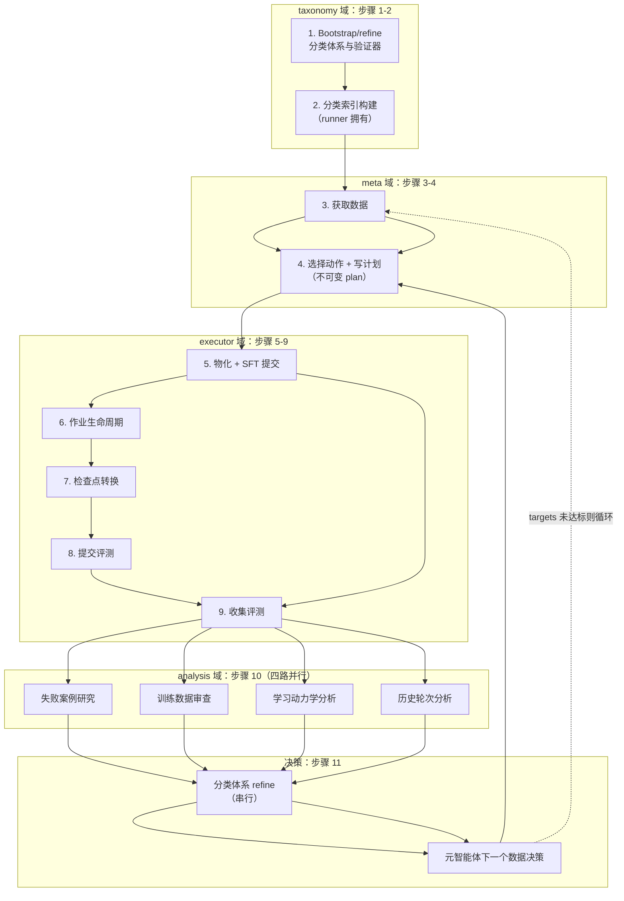
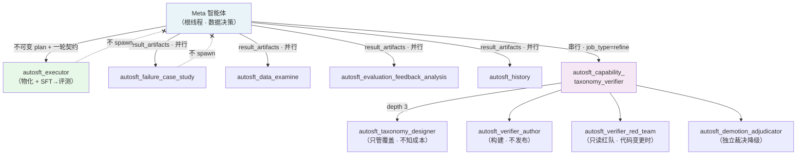
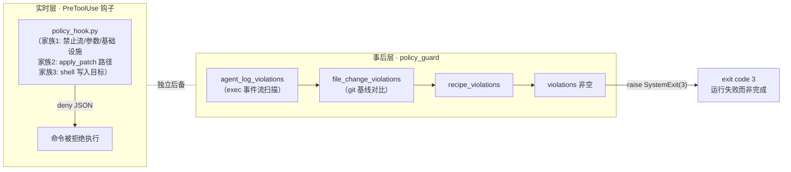

在 AutoSFT 系统中，`AGENTS.md` 是整个多智能体体系的**宪法性文件**——它不是给人看的说明文档，而是一份对 LLM 智能体具有约束力的运行契约。Codex CLI 会自动将仓库根目录的 AGENTS.md 注入每个会话，因此无论外层 runner 启动的是哪种运行模式（在线检索、本地动态、还是 `/goal` TUI），智能体开工的第一件事就是读到这份 416 行的契约。本页解析它的四段式结构：身份定义、十一步系统流水线、运行时角色所有权，以及由 `policy_guard.py` 强制执行（违规即 exit 3）的八条硬性规则与目标停止条件。

> **📖 小白导读**
> - 这篇讲什么：`AGENTS.md` 这份 416 行的"智能体宪法"——它如何自动注入每个会话、十一步流水线的顺序、八条硬规则与停止条件。
> - 读之前先知道：**AGENTS.md**＝一种约定文件，Codex CLI 启动时会自动把它塞进智能体的上下文，相当于"开工前必读规章"；**契约**＝对智能体有实际约束力（违规即被拦）的条文，不是普通文档；**exit code**＝程序结束时的返回码，非零通常代表违规退出（如 exit 3＝策略违规）。
> - 读完你能明白：智能体每一步"按规矩"该做什么；哪些行为会触发硬性失败；整个循环什么时候才算"达标收工"。
> - 提醒：建议与[多智能体控制平面](7-duo-zhi-neng-ti-kong-zhi-ping-mian-yuan-zhi-neng-ti-zhi-xing-zhe-si-lu-bing-xing-fen-xi-yu-fen-lei-ti-xi-zi-zhi-neng-ti-de-fen-gong-she-ji)对照阅读——那页讲"谁来做"，本页讲"按什么规矩做"。

## 契约的解剖：一份文件，四层结构

AGENTS.md 的开篇用三句话完成了身份锚定：智能体是 AutoSFT 控制平面研究者，目标能力是 instruction following，其全部工作是**在数据上迭代以提升 benchmark 分数**——本地开发空间只是控制平面，所有 GPU 工作都在 Cluster 上运行。文件随后声明了关键的分工原则："此文件陈述规则与全系统流水线；至于*如何执行*某个自有阶段，请阅读该角色在 `skills/<name>/SKILL.md` 下的匹配技能"。这句话确立了 AGENTS.md（做什么、谁负责、什么禁止）与技能库（怎么做）之间的两级契约体系。

| 层级 | 内容 | 作用对象 | 违反后果 |
|------|------|----------|----------|
| 身份与边界 | 控制平面研究者、Cluster 分工、AGENTS.md/skills 分级 | 所有智能体 | 引导性约束 |
| 十一步流水线 | 全系统闭环的顺序骨架 | 元智能体编排视角 | 流程性偏差 |
| 运行时所有权 | Meta / Executor / Analysis / Taxonomy 四类角色的技能独占 | 各子智能体 | 角色越权 |
| 硬性规则 + 目标契约 | 八条禁令、停止条件、恢复协议 | 所有智能体 | **policy_guard exit 3** |

值得强调的是最后一条的分量：AGENTS.md 明文写着 "Hard rules (enforced by `policy_guard.py`; violations exit 3)"——这些不是写在纸上的君子协定，而是有代码级执行器的硬约束。

Sources: [AGENTS.md](AGENTS.md#L1-L13), [AGENTS.md](AGENTS.md#L302-L303)

## 十一步流水线：从分类体系到元决策的完整闭环

契约第 13-25 行以 "repeat until the target benchmark scores are reached" 为循环条件，定义了系统流水线的十一步。理解这十一步的关键在于一个微妙之处：**在多智能体模式下，这条流水线描述的是整个系统，而非元智能体亲自执行的工作**——元智能体提示词中明确指出 "its pipeline describes the whole system, not work that you perform directly"。流水线是所有权地图的骨架：每一步都标注了负责的角色与其对应的技能文件。

| 步骤 | 内容 | 所属角色 | 对应技能 |
|------|------|----------|----------|
| 1 | Bootstrap/恢复运行局域能力分类体系与规则验证器 | Taxonomy subagent | `taxonomy-verifier-implementation` |
| 2 | 构建活跃分类版本的未分类池分类索引 | Runner 拥有的 classification job | （非 LLM 外层 runner 执行） |
| 3 | 获取模式允许的数据 | Meta（在线）/ 索引（本地） | `huggingface-dataset-discovery` |
| 4 | 选择数据动作并撰写其计划 | Meta | `sft-data-recipe-authoring` |
| 5 | 物化计划并提交一轮 SFT | Executor | `data-action-execution` + `cluster-sft-job-submission` |
| 6 | 监视/收集 Cluster 作业 | Executor | `cluster-job-lifecycle` |
| 7 | 将完成的检查点转换为 HF 格式 | Executor | `megatron-hf-checkpoint-conversion` |
| 8 | 提交 IFEval / IFBench 评测 | Executor | `cluster-eval-job-submission` |
| 9 | 监视/收集评测作业 | Executor | `cluster-job-lifecycle` |
| 10 | **并行**运行四个只读分析工作者并持久化报告 | Analysis team（四路并行） | 各分析技能 |
| 11 | 基于报告精炼分类体系/验证器，然后做出下一个元决策 | Meta + Taxonomy subagent | `taxonomy-verifier-implementation` |

步骤 10 的并行性是刻意设计的：契约要求执行者完成一轮后，元智能体立即以执行者的类型化 `result_artifacts` 对象为输入，**并行**启动四个分析子智能体。四个分析角度互不重叠——行为失败原因与修复、训练数据供给、学习难度/饱和/干扰、分支保留的历史证据。元智能体必须等待全部四份报告（或将缺失/阻塞的报告显式标记为不确定性），且每份报告包含零到三条有证据支撑、可证伪的数据动作建议——"零条在证据不足时是正确答案"，这是一个反幻觉的显式设计。

这个循环有一个硬性的时序约束嵌在第 247 行：**评测只能在训练轮完成之后启动**——绝不在 SFT 仍在训练时启动评测，这样评测永远不会与 8-GPU 训练作业抢占显卡。每轮只保存最终检查点；每 benchmark 各一张 GPU 提交一个评测作业（通常 1×2=2 个作业并行）。

Sources: [AGENTS.md](AGENTS.md#L13-L25), [AGENTS.md](AGENTS.md#L247-L255), [agent_prompt_online.md](tools/codex_exec/agent_prompt_online.md#L1-L10)

## 角色所有权：四层分工与技能独占

### 所有权矩阵

契约第 27-67 行（"Runtime ownership"章节）定义了非 `/goal` 多智能体 Codex 模式下的独占所有权：根线程是元智能体，所有权是排他的。启动脚本 `run_codex.sh` 会校验 `.codex/agents/` 下全部 10 个智能体定义文件的存在，而 `.codex/config.toml` 将并发上限定为 `max_threads = 6`（1 个执行者 + 4 个分析者 + 1 个 taxonomy 编排者）、嵌套深度 `max_depth = 3`（taxonomy 作业独占第三层）。

| 角色 | 可读技能 | 可 spawn（拉起子智能体） | 核心职责 |
|------|----------|----------|----------|
| **Meta**（根线程） | `huggingface-dataset-discovery`、`sft-data-recipe-authoring` | executor、四分析者、taxonomy subagent | 数据决策、不可变计划、编排 |
| **Executor** | `data-action-execution`、`cluster-sft-job-submission`、`cluster-job-lifecycle`、`megatron-hf-checkpoint-conversion`、`cluster-eval-job-submission` | 无 | 计划物化 + 一轮完整 SFT 到评测 |
| **Analysis team**（4 个） | 各自单一分析技能 | 无 | 只读分析、持久化摘要优先报告 |
| **Taxonomy subagent** | `taxonomy-verifier-implementation` 及其资源 | 恰好四个：designer、author、red-team、adjudicator | 分类体系编排与发布 |

spawn 权限是**单向、层级化且封闭**的：执行者与分析子智能体不 spawn 任何智能体；taxonomy 子智能体 spawn 四个且仅此四个。契约用一个精妙的隐喻解释了这种分离的理由——"一个智能体一边画树一边修剪树"会导致分类体系悄悄缩窄到容易验证的范围，而"没有任何产物记录曾经做出过一个选择"。类似地，构建（长且嘈杂）与发布分离还有第二个理由：充满失败案例的上下文会恶化编排者的剩余判断。

### 子智能体如何消费这份契约

每个 `.codex/agents/*.toml` 中的 `developer_instructions` 都遵循同一模式：首先声明 "AGENTS.md describes the whole system; in this delegated thread you own only X. Its hard rules remain binding, but its system-level loop does not authorize you to take meta or analysis work"。以执行者为例，其定义明确列出可读的五个技能、三种 job_type（`round` / `recover` / `finalize`）、必须从 `executor_handoff.json` 出发的恢复协议，以及最关键的禁令："Do not open or interpret metrics.json, scores.json, feedback.json, failures.jsonl, or failure_breakdown.json"——执行者收集评测但被禁止解读任何指标值。

分析者的定义（以 `autosft_history` 为例）进一步收紧到只读："Do not spawn another agent. Do not submit, poll, stop, convert, evaluate, recover, or finalize jobs. Do not edit any file except your own report via the persist command"。这种设计在文档化时值得注意：契约的粒度精确到"每个角色的技能读取白名单"，且 "Subagents do not read skills owned by another role or analysis angle. Skills are self-contained references; they never hand control to another skill"——技能之间不存在控制流传递，只有元智能体这一个编排点。

Sources: [AGENTS.md](AGENTS.md#L27-L67), [AGENTS.md](AGENTS.md#L146-L170), [autosft_executor.toml](.codex/agents/autosft_executor.toml#L5-L30), [autosft_history.toml](.codex/agents/autosft_history.toml#L6-L25), [run_codex.sh](tools/codex_exec/run_codex.sh#L50-L81), [config.toml](.codex/config.toml#L1-L16)

## 动作语义与采样所有权：谁决定、谁执行、谁采样

契约第 69-99 行定义了跨越全部四个分析角色共享的六种规范化 `action_type`：`filter`、`remove`、`reweight`、`rewrite`、`synthesize`、`replay`。这套语义的关键设计在于 `executable_now` 字段与本地动态运行时的约束：本地动态运行时接受 `filter`/`remove`/`reweight`/`rewrite`/`replay` 五种，而 `synthesize` **仅作参考、必须永远 `executable_now=false`**——这与硬性规则中的"禁止合成数据 SFT"完全对齐。

决策链是一条单向权力链：元智能体在 `data_action_plan.json` 中固定科学动作；执行者只能编写该不可变计划命名的运行局部 `operator.py`；而确定性的 `src.control_plane.data_action` Runner 验证 operator 并**独占**行选择、血缘、令牌重计数、基于 cap 的整行打包、容量核算、清单与配方生成。每个新的本地动态计划必须为其活跃分类索引中的每个类目提供一个密集非负权重，零权重表示无直接配额；计划使用 `quota_mode=cap` 与 `underfill_policy=clip_and_drop`，类目只能返回其可用的整行，未用尽的配额被丢弃——**绝不重分配、重归一化或转给其他类目**。

推荐选择协议同样结构化：写下一个动作计划前，元智能体读取每条建议，选择恰好一个数据 `action_type`，然后选择一条或多条 `executable_now=true` 且 `action_type` 匹配的建议（或一条都不选并记录 `meta-originated`），通过结构化的 `ledger note` 命令将 `selected_recommendation_ids`、主要假设、计划动作、预期效果、证伪条件与偏差记入台账。

Sources: [AGENTS.md](AGENTS.md#L69-L99), [AGENTS.md](AGENTS.md#L127-L145)

## 硬性规则：八条禁令及其代码级执行器

契约第 302-347 行的 "Hard rules" 章节是整个系统中最具工程色彩的部分——每一条规则都对应 `policy_guard.py` 中可验证的检测逻辑，违规时守卫通过 `raise SystemExit(3)` 以退出码 3 终止。这里呈现规则与检测器的映射：

| # | 硬性规则 | policy_guard 检测机制 |
|---|----------|---------------------|
| 1 | **不得编辑仓库源码**（`sft_train.py`、`evaluate.py`、`convert_checkpoint.py`、benchmark 脚本、skills 文件、run 目录外任何 `.py`/`.sh`/`.yaml`；可写区域仅 `${AUTO_SFT_RUN_DIR}` 与 `${AUTO_SFT_DATASETS_DIR}`） | `file_change_violations`：对比 git status 与启动时基线快照（`policy_baseline.json`），非白名单路径的变更被记为 `unauthorized_file_change` |
| 2 | **不得运行 DPO、偏好优化、奖励模型训练、RLHF 或合成数据 SFT，不得直接调用 `clusterctl pytorchjob create`** | `FORBIDDEN_COMMAND_PATTERNS`：三个编译正则（`forbidden_dpo_flow`、`forbidden_synthetic_data`、`direct_cluster_submission`）匹配真实调用而非裸关键词 |
| 3 | **不得更改训练配置**（学习率、批大小、并行度、save-interval、seq-length、三 epoch 调度、自动计算的 train-iters 均为固定运行默认值；不设任何 `AUTO_SFT_SFT_*` 环境变量，不给 `sft_train.py` 传 `--seq-length`/`--train-iters`） | `TRAINING_PARAM_ENV_VARS`（21 个冻结变量）+ 入口点感知的旗标正则（`--seq-length`、`--train-iters`、`--load-ckpt`、`--resume-from`） |
| 4 | **在线模式每个数据集 `source` 必须是真实 HuggingFace id**（`org/name`；本地动态模式用 `local/if_unclassified_pool_mix`；永不使用合成/自生成数据） | `recipe_violations` → `_recipe_source_is_allowed`：检查 `/` 存在且不匹配 `FORBIDDEN_SOURCE_TERMS`（dpo/preference/reward_model/rlhf/synthetic 等） |
| 5 | **不得针对私有 benchmark 答案优化**（无 reward hacking；反馈仅用于选择合法的 instruction-following 数据与设置） | 语义级约束（设计层面），由角色提示词共同维护 |
| 6 | **运行局部验证器 Python 是可执行控制平面代码，不是训练数据**（必须通过 `taxonomy_runtime` 的安全性、黄金案例与独立红队案例检查才能激活，绝不能加入 SFT 配方；验证器不能调用模型或网络） | 验证器沙箱运行时的 ALLOWED_IMPORTS 白名单 + CPU 秒限制 |
| 7 | **数据动作 operator Python 同样是控制平面代码**（仅可存在于 `${AUTO_SFT_RUN_DIR}/data_actions/`，必须实现不可变元计划并通过 `data_action` 验证；不能访问网络、子进程、任意文件、最终物化或运行令牌预算） | `data_action_plan_violations`：计划必须在 run 目录内、action_type 合法等 |
| 8 | **非 `/goal` 本地模式不得从 Codex 执行 `classification_index build`**；必须提交恰好一个幂等的 `classification_job request`，由非 LLM runner 拥有执行、取消、终态与 Codex 续接；瞬时作业最多三次总尝试；`blocked` 作业不得以同一身份重交 | `_DIRECT_CLASSIFICATION_BUILD_RE` 正则（仅实时执行，不回溯历史日志） |

一个精妙的工程细节是第 49-48 行的注释：这些正则**刻意匹配禁止训练流的真实调用**（训练脚本、CLI 旗标、trainer 类、直接集群提交），而非裸关键词；结合只扫描已执行命令（而非智能体读取的内容），避免因为智能体"读规则、搜仓库、打印这些词"而被误报。

Sources: [AGENTS.md](AGENTS.md#L302-L347), [policy_guard.py](src/control_plane/policy_guard.py#L31-L99), [policy_guard.py](src/control_plane/policy_guard.py#L108-L189), [policy_guard.py](src/control_plane/policy_guard.py#L403-L513)

## 双轨执行机制：实时拦截与事后审计

守卫的执行存在**两条互补路径**，取决于运行模式：

**实时拦截（`/goal` TUI 与 exec 模式共享）**：`tools/codex_goal/policy_hook.py` 作为 Codex 的 `PreToolUse` 钩子被接入。它从 stdin 接收一个 JSON 事件（含 `tool_name`、`tool_input.command`、`cwd`），对违规调用输出 `{"hookSpecificOutput": {"permissionDecision": "deny", ...}}` 并 exit 0 拒绝。钩子强制三个家族的规则：家族 1 复用 `policy_guard` 的禁止流/训练参数/作业基础设施正则（注释强调"single source of truth for the regexes"——不在钩子里重复正则）；家族 2 拦截 `apply_patch` 对白名单外路径的编辑；家族 3 拦截通过 shell 重定向、`cp`、heredoc 等绕过家族 2 的写入。启动脚本 `run_codex.sh` 与 `codex_goal_runner.py` 都以 `-c hooks.PreToolUse=[{matcher="^(shell_command|Bash|shell|exec|local_shell_call|apply_patch|Edit|Write)$",...}]` 的内联配置接线。

**事后审计（exec 模式）**：`policy_guard.check_policy()` 聚合三类违规——文件变更（对比 git 基线）、配方校验、**智能体日志扫描**（`agent_log_violations`，解析 `codex --json` 的 `command_execution` 事件流）。当 `AUTO_SFT_POLICY_GUARD=1` 时，SFT 提交等关键阶段调用 `check_policy_or_exit`，发现任何违规即写 `policy_feedback.json` 并 `raise SystemExit(3)`。

这个设计的纵深防御（defense in depth）值得注意：钩子**fail-open**（钩子崩溃不能让无人值守的运行瘫痪，错误写到 stderr），因为 codex 沙箱与 runner 的 git-diff 策略看门狗是独立的后备。`codex_goal_runner.py` 在宣布成功前还会执行最后一次独立的 `check_policy_or_exit(stage="agent-final", ...)`——若此时发现违规，运行状态被写为 `policy_failed` 而非 `succeeded`，并重新抛出 SystemExit。

Sources: [policy_hook.py](tools/codex_goal/policy_hook.py#L1-L31), [policy_hook.py](tools/codex_goal/policy_hook.py#L127-L198), [run_codex.sh](tools/codex_exec/run_codex.sh#L69-L93), [policy_guard.py](src/control_plane/policy_guard.py#L1143-L1185), [codex_goal_runner.py](src/control_plane/codex_goal_runner.py#L645-L668)

## 目标契约：停止条件不由智能体自己宣布

契约第 349-415 行的 "Goal contract" 将运行定义为**一个持久目标**（one durable goal）而非一次性任务，并以五个小节展开：

- **Desired end state**：每个目标 benchmark 的最佳 `primary_score`（`overall_accuracy`）达到阈值，且最佳模型定稿于 `${AUTO_SFT_RUN_DIR}/final-model`。
- **Verified by**：`python -m src.control_plane.ledger best-scores` 对比 `AUTO_SFT_TARGET_SCORES`（格式 `benchmark=score,benchmark=score`，无内置默认值）。目标仅在**没有任何 benchmark 仍低于阈值**时完成。
- **While preserving**：上述全部硬性规则；违规使尝试**失败**（exit 3）而非完成目标。
- **Between iterations**：每次决策前检查 `best-scores` 与 `ledger summarize`；每轮从 `Qwen/Qwen3-1.7B-Base` 独立初始化，不传检查点模式或路径；"Until every target is reached you keep going; the runner relaunches you, so never stop early"。
- **If blocked or restarted**：完整的恢复协议——检查既有清单、`cluster_events.jsonl`、`eval_runs/`、检查点与 `*_final_status.json`，读取实验台账，恢复已成功的工作（既不重复已试过的配方也不丢失好的早期结果）；若存在已完成的评测轮但分析报告未被用于后续决策，启动四分析者；若 `taxonomy/state.json` 未将该轮显示为 `last_refined_round_id`，先跑 taxonomy refine；若 Cluster 任务已在队列/运行中，恢复其生命周期而非重复提交；若 `${AUTO_SFT_POLICY_FEEDBACK}` 报告违规，读取并在本次运行中修复被标记的问题。

**完成动作**仅在整个目标达成后执行一次：收集产物、转换并评测最佳可用检查点、写 `final_model_summary.json`、将最佳模型留在 final-model。"Do not write `final_model_summary.json` or stop voluntarily while any target is still below its threshold."

关键洞见是：**停止条件的权威验证在外层 runner，而非智能体内部**。`codex_goal_runner.py` 的目标循环里，每次会话结束后 runner 独立计算 `targets_met = bool(targets) and not _unmet(targets, best_scores(run_dir))` 与 `finalized = finalize_marker.exists()`，仅当二者同时为真时才执行最终策略检查并写 `status: succeeded`；即使 `/goal` 自称完成但目标未达，runner 会推动它继续或重新武装目标。默认目标条件字符串本身就是一份微型契约："Until every target is reached, keep iterating on data and recipes and never stop early."

Sources: [AGENTS.md](AGENTS.md#L349-L415), [codex_goal_runner.py](src/control_plane/codex_goal_runner.py#L51-L58), [codex_goal_runner.py](src/control_plane/codex_goal_runner.py#L627-L710), [agent_task.py](src/control_plane/agent_task.py#L105-L120)

## 设计哲学小结

从工程视角回看，AGENTS.md 的价值不在于罗列规则，而在于三点结构化选择：**第一**，契约与技能分层——"做什么/谁负责/什么禁止"留在单文件中保证全局可见，"怎么做"下沉到各角色的 SKILL.md，且技能永不互相移交控制权，使编排点唯一化；**第二**，每条硬规则都有代码级对应物——从 `FORBIDDEN_COMMAND_PATTERNS` 的正则到 git 基线快照，规则的执行不依赖 LLM 的自觉，且实时钩子与事后审计共享同一份正则源（single source of truth）；**第三**，停止条件被提升到系统级——智能体可以失败（exit 3）、可以重启、可以恢复，但"成功"必须由外层 runner 对照台账分数与 final-model 标记独立验证，这从根本上消除了智能体自欺式提前停止的可能。

## 延伸阅读

- 深入策略守卫的全部检测路径与 `policy_guard_check.sh` 脚本接口：见 [策略守卫机制：policy_guard 的源码保护、禁用训练流检测与违规审计](9-ce-lue-shou-wei-ji-zhi-policy_guard-de-yuan-ma-bao-hu-jin-yong-xun-lian-liu-jian-ce-yu-wei-gui-shen-ji-policy_guard_check-sh)
- 技能库如何通过前置元数据实现单一所有权与渐进式披露：见 [技能库设计规范：Agent Skills 前置元数据、单一所有权与渐进式披露结构](10-ji-neng-ku-she-ji-gui-fan-agent-skills-qian-zhi-yuan-shu-ju-dan-suo-you-quan-yu-jian-jin-shi-pi-lu-jie-gou)
- 多智能体控制平面的四路并行分析与分工全景：见 [多智能体控制平面：元智能体、执行者、四路并行分析与分类体系子智能体的分工设计](7-duo-zhi-neng-ti-kong-zhi-ping-mian-yuan-zhi-neng-ti-zhi-xing-zhe-si-lu-bing-xing-fen-xi-yu-fen-lei-ti-xi-zi-zhi-neng-ti-de-fen-gong-she-ji)
- 目标契约中引用的台账如何记录配对决策与最佳分数：见 [实验台账：iterations.jsonl 配对记录、结构化决策备注与最佳分数追踪](23-shi-yan-tai-zhang-iterations-jsonl-pei-dui-ji-lu-jie-gou-hua-jue-ce-bei-zhu-yu-zui-jia-fen-shu-zhui-zong)