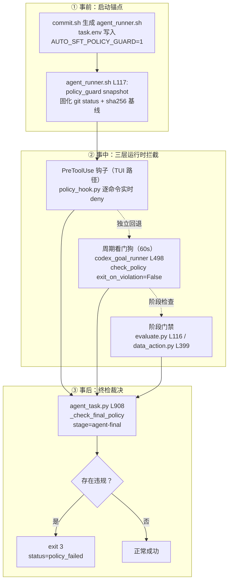

在 AutoSFT 这个"智能体自主迭代 SFT 研究闭环"中，智能体被授予了极高的操作权限——它可以读写运行目录、提交训练作业、驱动整个实验循环。但权限与失控只有一线之隔：一个走偏的智能体可能修改仓库源码来"讨好"评测指标，或绕过配方直接调用 DPO/RLHF 等偏好优化流程。**策略守卫机制（policy guard）正是为此而生的约束层**：它在时间维度上构成"实时拦截 → 周期看门狗 → 事后终检"的三层纵深，在规则维度上覆盖源码保护、禁用训练流、固定训练配置与作业基础设施四大域，并将所有违规以结构化 JSONL 形式落盘审计。本文面向高级开发者，逐一拆解这套机制的入口拓扑、规则语法、命令分析引擎、审计流水线与容错设计，最后剖析其"宁可漏报、绝不误报"的工程哲学。

> **📖 小白导读**
> - 这篇讲什么：策略守卫（policy guard）——一套防止智能体"走捷径作弊"的三层拦截机制：实时拦截、周期看门狗、事后终检。
> - 读之前先知道：**看门狗（watchdog）**＝每隔一段时间自动巡检一遍的后台检查程序；**审计**＝把每次违规记成结构化记录留档备查；**硬性规则**＝违反即终止运行的禁令（如"不许改源码""不许跑 DPO"）；DPO/RLHF＝两种偏好优化训练法，本项目禁用以保证"只改数据"的研究纯度。
> - 读完你能明白：智能体如果试图改训练脚本会发生什么；四类规则域（源码保护/禁用训练流/固定配置/作业基础设施）各自守什么；违规记录去哪查。
> - 提醒：本页偏高级，第一次读可只看"三层纵深"总图，细节等真遇到 exit 3 再回来对照。

本文涉及三个核心文件：`src/commit_utils/policy_guard_check.sh`（CI 审计入口）、`src/control_plane/policy_guard.py`（规则库与审计引擎本体，1276 行）与 `tools/codex_goal/policy_hook.py`（Codex TUI 实时钩子）。理解它们如何协作，就理解了 AutoSFT 如何在"给智能体自由"与"守住科学有效性"之间划出机器可执行的边界。

Sources: [policy_guard_check.sh](src/commit_utils/policy_guard_check.sh#L1-L19)

## 一、入口拓扑：一个薄壳与三个执行时序

从调用结构看，policy_guard 呈现出清晰的"核心 + 多入口"架构。`policy_guard_check.sh` 仅有 19 行：它接收 `run_dir` 与可选 `stage`（默认 `remote-audit`），设置 `set -euo pipefail` 保证严格失败语义，然后直接委托给 `python -m src.control_plane.policy_guard check`。其头部注释明确说明了自己的定位——"CodeUp CI / pre-push 作业的**次级审计入口**（Secondary audit entrypoint）"，真正的运行时强制执行位于 `policy_guard.py` 与 `commit.sh` 中。这层薄壳存在的意义在于：CI 环境无法复用运行时的进程内调用路径，需要一个可从外部独立调用的命令行入口。

Sources: [policy_guard_check.sh](src/commit_utils/policy_guard_check.sh#L1-L19)

真正的执行时序由 `commit.sh` 拉起的三条链路构成，它们分别对应"事前、事中、事后"：

事前锚点由 `commit.sh` 完成：它为每次运行写入 `task.env`，其中 `AUTO_SFT_POLICY_GUARD=1` 是整个守卫体系的总开关，`AUTO_SFT_POLICY_BASELINE` 与 `AUTO_SFT_POLICY_FEEDBACK` 指定基线与反馈文件路径。随后生成的 `agent_runner.sh` 在启动智能体前**首先执行 `policy_guard snapshot`**——用 `git status --porcelain=v1 -z --untracked-files=all` 加逐文件 SHA-256 固化仓库当前状态，作为后续一切变更检测的"零点参照"。

Sources: [commit.sh](src/commit_utils/commit.sh#L48-L62), [commit.sh](src/commit_utils/commit.sh#L117-L121), [policy_guard.py](src/control_plane/policy_guard.py#L1218-L1230)

事中拦截有三条路径。对 Codex `/goal` TUI 路径，`codex_goal_runner.py` 通过 `-c hooks.PreToolUse=[{matcher="^(shell_command|Bash|shell|exec|local_shell_call|apply_patch|Edit|Write)$",hooks=[{type="command",command="python3 policy_hook.py",timeout=30}]}]` 内联配置把钩子注入每个工具调用之前；同时其监督循环以 `AUTO_SFT_CODEX_WATCHDOG_SECONDS`（默认 60 秒）为周期调用 `check_policy(exit_on_violation=False)` 做 git-diff 看门狗——发现违规时**不终止会话**，而是向 TUI 发送消息要求智能体"原地撤销/修复被标记的变更并继续"。此外，`evaluate.py` 在提交评测作业前、`data_action.py` 在物化数据动作前均调用守卫做阶段门禁。

Sources: [codex_goal_runner.py](src/control_plane/codex_goal_runner.py#L194-L203), [codex_goal_runner.py](src/control_plane/codex_goal_runner.py#L494-L512), [evaluate.py](evaluate.py#L116)

事后终检由 `agent_task.py` 的 `_check_final_policy` 执行：在智能体尝试结束、宣布成功之前，以 `stage="agent-final"` 跑一次完整审计（文件变更 + 配方 + 智能体日志），存在违规则 `SystemExit(3)`，外层将其记为 `status: "policy_failed"`——违规**不构成目标完成**，这一点被写入了 AGENTS.md 的 Goal 契约。

Sources: [agent_task.py](src/control_plane/agent_task.py#L908-L917), [AGENTS.md](AGENTS.md#L302-L302)

## 二、规则库解剖：四大保护域与单一事实源

`policy_guard.py` 顶部的常量层是全部规则的声明式定义，可归为四个保护域。**第一域是禁用训练流**：`FORBIDDEN_COMMAND_PATTERNS` 定义了三条针对"真实调用形态"的正则——`forbidden_dpo_flow` 匹配 DPO/PPO/GRPO/ORPO/KTO/RLOO/RLHF 训练脚本路径、CLI 标志（如 `--dpo`、`--reward_model`）、Trainer 类名（`DPOTTrainer` 等）、`trl` 子命令及 `trl/trlx/openrlhf` 模块引用；`forbidden_synthetic_data` 匹配合成数据生成脚本与 `self_generated`/`agent_generated` 术语；`direct_cluster_submission` 匹配 `\bclusterctl\s+pytorchjob\s+create\b`，强制所有作业必须经由提交脚本而非直连集群 API。注意其注释中的关键设计声明：这些模式"有意只匹配禁用训练流的**真实调用**（训练脚本、CLI 标志、Trainer 类、直连集群提交），而非裸关键词"，其目的是避免智能体仅仅阅读规则、搜索仓库或打印这些词就被误伤。

Sources: [policy_guard.py](src/control_plane/policy_guard.py#L44-L76)

**第二域是固定训练配置**：`TRAINING_PARAM_ENV_VARS` 列出 15 个 `AUTO_SFT_SFT_*` 环境变量（train-iters、lr、seq-length、batch size、TP/PP/CP 并行度、token budget 等），配合 `_SFT_ENTRYPOINT_RE`（`sft_train.py`）与四个标志正则（`--seq-length`、`--train-iters`、`--load-ckpt`、`--resume-from`）以及 `sample_recipe_data.py` 的 `--token-budget`。其哲学在注释中直言："训练超参是受守护运行的**固定默认值**：智能体的研究变量是数据，永远不是训练配置。" 唯一例外被显式豁免并说明理由——token budget 是 launcher 持有的上限封顶，但改变它仍然改变运行契约，因此依旧禁止。

Sources: [policy_guard.py](src/control_plane/policy_guard.py#L108-L143)

**第三域是作业基础设施**：`JOB_INFRA_ENV_VARS` 涵盖 24 个变量，分四组——Cluster 放置与资源（cluster、project、resource pool、priority、nodes、GPU/CPU/memory）、SFT 容器镜像与训练代码 git 源（image、git_path、git_ref、git_commit）、评测作业镜像与资源、以及评测方法论（`AUTO_SFT_EVAL_BACKEND`）。注释解释了豁免逻辑：dry-run、repo 目录、HF 缓存等"纯操作开关"不改变作业身份/放置/资源，因此**有意不列入**，以保证 dry-run 验证探针与路径设置仍可工作。

Sources: [policy_guard.py](src/control_plane/policy_guard.py#L150-L189)

**第四域是源码保护与只读命令白名单**：`SOURCE_LIKE_SUFFIXES`（12 种后缀）与 `SOURCE_LIKE_NAMES`（Dockerfile/Makefile）定义"源码样文件"；`FORBIDDEN_SOURCE_TERMS`（13 个术语：dpo、preference、rlhf、synthetic、self_generated、agent_generated 等）用于配方与数据源审查；`READ_ONLY_COMMANDS` 是约 60 个只读命令的 frozenset（rg/grep/cat/ls/find/jq/yq 等），它们**不能启动训练流**，因此其领导的命令段在匹配前被跳过。

Sources: [policy_guard.py](src/control_plane/policy_guard.py#L16-L43), [policy_guard.py](src/control_plane/policy_guard.py#L87-L99)

这四个域的规则在两处被消费：`policy_guard.py` 事后扫描 `agent.log`，以及 `policy_hook.py` 实时拦截。**单一事实源原则**由四个公开包装函数保证——`forbidden_rules_for_command`、`training_param_overrides_for_command`、`job_infra_overrides_for_command`、`shell_write_targets`——钩子通过 `from src.control_plane import policy_guard` 直接导入这些函数，注释强调"勿在钩子中重复正则"。

Sources: [policy_guard.py](src/control_plane/policy_guard.py#L861-L894)

## 三、命令分析引擎：从原始命令文本到可判定段

守卫最精巧的部分是命令分析引擎，它解决的问题是：如何在不执行命令的前提下，判断一个 shell 命令是否触碰了禁用域。处理流水线分四步。

第一步是 **shell -c 解包**：`_unwrap_shell_c` 识别 `bash -lc "<inner>"` 形态的调用，剥掉解释器前缀与首尾引号，取出真正的脚本体。第二步是**引号感知分段**：`_split_shell_segments` 以字符级状态机遍历命令文本，正确处理反斜杠转义、单双引号上下文，并在 `&&`、`||`、`;`、`|`、`&`、换行处切分出独立命令段。其文档字符串承认一个已知局限：heredoc 主体可能被过度切分，但由于模式"只匹配真实调用 token、从不匹配裸词"，**这不会制造误报**——这是一个自洽的容错声明。

Sources: [policy_guard.py](src/control_plane/policy_guard.py#L664-L724)

第三步是**只读段过滤**。`_segment_is_read_only` 逐 token 检查段首：跳过前导 `VAR=value` 环境赋值与 `_COMMAND_WRAPPERS`（sudo/nohup/env/time/timeout/xargs 等透明包装器），最终判定真实可执行名是否在 `READ_ONLY_COMMANDS` 中。训练参数检查使用了增强版 `_training_param_scannable_segments`：它额外保留以 `export`/`set`/`declare`/`typeset`/`local`/`readonly` 开头的段，即使这些段看起来只读——确保 `export AUTO_SFT_SFT_LR=...` 仍会被捕获，而 `grep AUTO_SFT_SFT_LR= ...` 不会。

Sources: [policy_guard.py](src/control_plane/policy_guard.py#L727-L735), [policy_guard.py](src/control_plane/policy_guard.py#L746-L763)

第四步是**规则匹配与消息生成**。过滤后的段拼成 haystack，逐条应用正则。以训练参数为例：`_SFT_ENV_ASSIGN_RE` 捕获被赋值的受保护变量名（去重后每变量一条消息）；`_SFT_ENTRYPOINT_RE` 命中 `sft_train.py` 时，再分别检查四个标志正则，每命中一条生成一条独立消息，消息文本包含人类可读的补救指引（如"省略该标志；正常轮次从选定数据量计算一个 epoch 并训练三个 epoch"）。用下表对比三类命令检查的语义差异：

| 检查函数 | 扫描的段 | 捕获目标 | 误报规避手段 |
|---|---|---|---|
| `_forbidden_rules_for_command` | 非只读段 | 训练流正则命中 | 只匹配调用形态（脚本/标志/类名/子命令），非裸词 |
| `_training_param_overrides_for_command` | 非只读段 + env 赋值领导段 | 受保护 env 赋值 + sft_train.py 固定标志 | 保留 `export` 段；grep/cat/echo 段被丢弃 |
| `_job_infra_overrides_for_command` | 同上 | 24 个基础设施 env 赋值 | 同上；dry-run 等操作开关不在名单 |

Sources: [policy_guard.py](src/control_plane/policy_guard.py#L766-L816), [policy_guard.py](src/control_plane/policy_guard.py#L819-L858)

## 四、shell 写入目标识别：绝对路径策略与"永不猜测"

实时钩子的 Family 3 需要识别 shell 命令会写哪些文件，这在语法上是欠定问题。`shell_write_targets` 的方案是**只报告可从命令文本确定性恢复的写入目标，绝不做语义猜测**。它覆盖三类语法：`_SHELL_REDIRECT_RE` 捕获 `>>` / `>` 重定向；`_SHELL_WRITE_ARG_RE` 捕获 `cp/mv/install/tee/touch/mkdir/rsync` 的参数（cp/mv/install/rsync 只取最后一个参数作为目标，其余工具取全部）；以及嵌入解释器体中带引号的绝对路径 `_EMBEDDED_ABS_PATH_RE`——但仅当 `_WRITE_MODE_HINT_RE`（`write_text`/`open(...,"w")`/`json.dump`/`shutil.copy` 等写入模式信号）命中时才激活，且排除 `_CWD_KWARG_RE` 捕获的 `cwd=` 参数（它命名子进程运行位置而非写入文件）。

三条铁律贯穿实现：**其一，只接受绝对路径**——裸相对 token 无法在没有写入者 cwd 的前提下解析（heredoc 体内的 `>` 是 Python 比较运算符，`2:` 是字典键），注释引用了重放历史命令日志的实证："接受相对 token 会在约 3% 的真实命令上误报"。**其二，良性目标豁免**——`/dev/null`、`/dev/stdout`、`/dev/stderr`、`/tmp/`、`/var/tmp/` 直接放行，"拒绝这些只会让一个正在做常规事务的运行搁浅"。**其三，仓库源聚焦**——嵌入路径检查只报告落在仓库根之下、且不在 `agent_execute/` 运行区内的路径，"运行目录之外的任何东西都不归我们管"。

Sources: [policy_guard.py](src/control_plane/policy_guard.py#L897-L989)

这套保守策略不是理论推演，而是事故复盘的直接产物。`test_policy_hook_shell_writes.py` 的模块文档记载了真实事件：一个分类体系设计子智能体曾把冻结契约写入仓库根目录而非运行目录——spawn 消息引用了裸 `taxonomy_work/`，而 codex 以仓库为 cwd，产物落入受跟踪源码。当时的钩子只匹配 `^(Bash|apply_patch|Edit|Write)$` 而 codex 将每个 shell 调用命名为 `shell_command`（`Bash` 从未在 codex 会话中出现），且路径检查仅覆盖 apply_patch 载荷——一个通过 `Path.write_text` 写文件的 heredoc **完全绕过了守卫**。测试文件的三个测试类分别钉住了：写入检测器必须捕获肇事命令形态、只读命令不得被误报、钩子进程端到端必须 deny 该写入。

Sources: [test_policy_hook_shell_writes.py](tests/test_policy_hook_shell_writes.py#L1-L44), [policy_hook.py](tools/codex_goal/policy_hook.py#L46-L49)

## 五、实时钩子：policy_hook.py 的三家族拦截与 fail-open

`policy_hook.py` 是挂在 Codex PreToolUse 事件上的进程外守卫，每次工具调用前由 codex 以 stdin JSON 调起，30 秒超时。其 `main` 函数实现三个拦截家族。**Family 1 训练流与配置**：对 `shell_command` 等工具，依次调用 `forbidden_rules_for_command` + `runner_owned_job_violations_for_command`、`training_param_overrides_for_command`、`job_infra_overrides_for_command`，任一命中即通过 stdout 输出 `{"hookSpecificOutput":{"hookEventName":"PreToolUse","permissionDecision":"deny","permissionDecisionReason":...}}` 并 `exit 0` 拒绝该工具调用。**Family 2 apply_patch 路径**：解析 patch 文本中的 `*** Add/Update/Delete/Move` 目标路径，逐一比对 `_writable_allowlist`（`AUTO_SFT_RUN_DIR` + `AUTO_SFT_DATASETS_DIR` + 两个批准的 recipe 文件）之外即拒绝。**Family 3 shell 写入**：调用 `shell_write_targets` 提取绝对写入目标，同样比对 allowlist。

Sources: [policy_hook.py](tools/codex_goal/policy_hook.py#L127-L198)

钩子的可用性设计值得注意两点。**工具名宽匹配**：`_SHELL_TOOLS` 元组包含 `shell_command`、`Bash`、`shell`、`exec`、`local_shell_call` 五个名字，注释解释 codex 实际发出的每个 shell 调用都叫 `shell_command`，而 `Bash` 是 Claude Code 的名字——"省略它的匹配器或分支会静默地什么也检查不到"，这正是前述事故的第二个根因。**fail-open 语义**：`__main__` 块捕获所有非 SystemExit 异常，打印非致命错误到 stderr 后 `exit 0` 放行。模块文档的论证是："防御纵深之下，codex 沙箱（网络 + 可写根）与运行器的 git-diff 策略看门狗是独立回退，所以这个钩子在意外内部错误上 fail-open——一个钩子崩溃绝不能让无人值守的运行瘫痪。" 反过来看，事后审计路径（`check_policy`）则是 **fail-closed**：违规即 `exit 3`。两种语义的并存不是矛盾，而是按"该层是否拥有独立回退"做出的分层决策。

Sources: [policy_hook.py](tools/codex_goal/policy_hook.py#L27-L31), [policy_hook.py](tools/codex_goal/policy_hook.py#L203-L211), [codex_goal_runner.py](src/control_plane/codex_goal_runner.py#L210-L227)

## 六、文件变更审计与配方审查：事后终检的两大支柱

`check_policy` 是事后审计的编排入口，其五步流程依次是：加载基线（缺失则记 `missing_policy_baseline` 违规——受守护运行必须经 commit.sh 快照启动）、`file_change_violations`（文件变更）、`recipe_violations`（配方审查，仅 stage 为 `sft` 且非 resume 模式时）、`agent_log_violations`（命令日志回溯）、最后 `write_policy_feedback` 落盘并在存在违规时 `exit 3`。

Sources: [policy_guard.py](src/control_plane/policy_guard.py#L1143-L1185)

**文件变更审计**基于"当前 git status vs 基线快照"的差异检测。对每个当前记录，先过三重允许判定：路径在 `run_dir` 下、在 `datasets_dir` 下、或属于批准的 recipe 路径集合（运行目录内的 `data-recipe.yaml` + 仓库级 `agent_execute/data-recipe.yaml`）；然后比对基线——路径在基线中不存在（新文件）、或 status/sha256 任一变化，才算"新变更"；最后，status 为 `??`（未跟踪）**或**文件是源码样文件（被跟踪但被改）时，生成 `unauthorized_file_change` 违规，附上 80 行以内的 diff 摘录供审计回溯。**配方审查**则验证：不得 `--skip-data-prepare`（SFT 必须走配方准备）、必须提供 YAML 配方且路径合法、每个 dataset 的 `source` 必须是命名空间化的 HuggingFace 风格 id（含 `/`、不以 `.` 或 `/` 开头）且不含禁用术语、本地路径必须落在受守护的数据集目录下。

Sources: [policy_guard.py](src/control_plane/policy_guard.py#L346-L399), [policy_guard.py](src/control_plane/policy_guard.py#L410-L513)

**命令日志回溯**是事后路径独有的能力：`_iter_logged_commands` 逐行解析 `logs/agent.log`（JSONL 流），只提取 `item.type == "command_execution"` 的条目（推理文本、智能体消息、运行器状态行一律不扫），按 item id 去重后，对每条命令重放与实时钩子完全相同的规则检查。这保证了无论智能体走 TUI 钩子路径还是 exec 日志路径，规则的判定结果一致。

Sources: [policy_guard.py](src/control_plane/policy_guard.py#L992-L1020), [policy_guard.py](src/control_plane/policy_guard.py#L1023-L1077)

此外还有两个专项扩展。`data_action_plan_violations` 审查数据动作元计划：计划必须位于运行目录下、`action_type` 为单字符串且不得为 `synthesize`/`curriculum`、`dataset_source` 复用配方术语审查、**计划不得自带 `token_budget`**（运行持有的 `AUTO_SFT_SFT_TOKEN_BUDGET` 是唯一预算源）、生成的 operator Python 必须位于 `run_dir/data_actions/` 之下并通过 `data_action_operator` 的安全校验、所有输出路径必须落在运行目录或数据集目录内。`runner_owned_job_violations_for_command` 是一个**仅实时生效**的规则（注释明确说明：作用于完整历史日志会追溯性地废止 runner 持有分类作业机制出现之前的运行）：当 `AUTO_SFT_RUNNER_OWNED_CLASSIFICATION=1` 时，直接调用 `classification_index build` 被视为违规，必须改为提交 `classification_job request` 交给非 LLM 运行器持有执行。

Sources: [policy_guard.py](src/control_plane/policy_guard.py#L516-L661), [policy_guard.py](src/control_plane/policy_guard.py#L78-L85), [policy_guard.py](src/control_plane/policy_guard.py#L871-L884)

## 七、审计产物与裁决出口：policy_feedback.json 与 exit 3

守卫的输出是双文件结构。`policy_feedback.json`（由 `AUTO_SFT_POLICY_FEEDBACK` 指定，默认 `run_dir/policy_feedback.json`）承载整体状态：`policy_status`（`"violation"` 或 `"ok"`）、`stage`、`generated_at`、`run_dir`、完整的 `violations` 数组，以及两个产物路径的自引用。`policy_violations.jsonl` 则是逐行 JSONL 追加式流水，每条违规记录包含 `rule_id`、`severity`、`message`、可选的 `path`/`git_status`/`diff_excerpt`/`detail`（如命令日志违规携带行号与截断至 500 字符的命令原文）。`policy_summary` 提供读取侧接口：返回状态与前 10 条违规的精简视图，被 `evaluate.py` 用于运行报告。

Sources: [policy_guard.py](src/control_plane/policy_guard.py#L1080-L1101), [policy_guard.py](src/control_plane/policy_guard.py#L1123-L1140), [evaluate.py](evaluate.py#L262-L262)

裁决出口有三条。`check_policy` 默认 `exit_on_violation=True`，违规即 `raise SystemExit(3)`；`record_policy_violation_and_exit` 供早期守卫失败（如 `evaluate.py` 检测到评测输出目录不在运行目录下的 `eval_run_dir_mismatch`）通过标准接口持久化单条违规后同样退出 3；`check_policy_or_exit` 是运行时的门控包装：若 `policy_enabled()` 为假（未设 `AUTO_SFT_POLICY_GUARD=1`）直接返回 None 放行，否则要求 `AUTO_SFT_RUN_DIR` 必须存在。exit 3 的语义被 AGENTS.md 显式钉住——"违规使尝试失败（policy_guard exit 3），它**不构成目标完成**"，外层 `agent_task.py` 据此记录 `agent_policy_check_failed` 事件并以 `policy_failed` 终态收场，决定是否重试。

Sources: [policy_guard.py](src/control_plane/policy_guard.py#L1104-L1120), [policy_guard.py](src/control_plane/policy_guard.py#L1188-L1215), [evaluate.py](evaluate.py#L99-L116), [AGENTS.md](AGENTS.md#L363-L366)

## 八、设计哲学：误报最小化的边界权衡

综合全部实现，这套守卫的工程哲学可以用一句话概括：**每一次放宽都对应一个被论证过的漏报风险接受，每一次收紧都对应一次真实事故**。下表整理了关键权衡点：

| 设计决策 | 收紧/放宽 | 理由 |
|---|---|---|
| 命令模式只匹配调用形态（脚本路径/标志/类名/子命令），不匹配裸词 | 放宽 | 智能体阅读规则、grep 仓库是合法行为 |
| shell 写入目标只接受绝对路径，相对路径永不报告 | 放宽 | 历史日志重放显示相对 token 在约 3% 真实命令上误报 |
| `/tmp/`、`/dev/null` 等良性目标豁免 | 放宽 | 拒绝常规事务只会搁浅无人值守运行 |
| 嵌入路径检查只聚焦仓库源（排除 `agent_execute/` 运行区） | 收窄 | 仓库外的东西不归本守卫管；运行区是合法读写区 |
| dry-run、HF 缓存等操作开关不入基础设施名单 | 放宽 | 不改变作业身份/放置/资源的探针必须可用 |
| runner-owned 分类规则仅实时生效、不回溯历史日志 | 放宽 | 回溯会废止旧机制出现前的合法运行 |
| 钩子 fail-open，事后审计 fail-closed | 分层 | 钩子层有独立回退（沙箱+看门狗）；终检层是最后防线 |
| heredoc 过度切分容忍 | 放宽 | 只匹配调用 token 的模式保证不可能产生新误报 |

支撑这些权衡的是一个隐含的代价不对称判断，写在 `shell_write_targets` 的注释里："它绝不能猜测——一次误报会拒绝一条合法命令，让无人值守的运行搁浅（strand an unattended run）。" 在 AutoSFT 的语境中，误报的代价（整次实验尝试作废）高于漏报（事后 git 扫描兜底）。这解释了为什么系统坚持三层冗余而非单点完美：实时钩子负责速度，看门狗负责中途纠偏，事后终检负责完整性——任何一层的保守缺口都由其他层的存在来对冲。

Sources: [policy_guard.py](src/control_plane/policy_guard.py#L897-L903), [policy_hook.py](tools/codex_goal/policy_hook.py#L27-L31)

## 结语与延伸阅读

策略守卫机制本质上回答了一个自治研究系统的治理问题：当智能体拥有完整的实验操作权限时，如何用机器可执行的方式固化"研究变量是数据、不是训练配置"这一科学有效性前提。它的答案不是一道防火墙，而是一个由声明式规则常量、确定性命令分析、分层拦截时序与结构化审计产物组成的治理体系，且每条规则都能在 AGENTS.md 的 Hard rules 章节找到人类可读的契约对应。

若要继续深入，建议按以下顺序阅读：先看[智能体契约与硬性规则：AGENTS.md 的十一步流水线、角色所有权与停止条件](8-zhi-neng-ti-qi-yue-yu-ying-xing-gui-ze-agents-md-de-shi-bu-liu-shui-xian-jiao-se-suo-you-quan-yu-ting-zhi-tiao-jian)理解守卫所执行的契约源头；再看[数据动作计划：不可变元计划、operator.py 约束执行与 Data Action Runner 的权威采样](11-shu-ju-dong-zuo-ji-hua-bu-ke-bian-yuan-ji-hua-operator-py-yue-shu-zhi-xing-yu-data-action-runner-de-quan-wei-cai-yang)了解 `data_action_plan_violations` 守卫的对象——数据动作元计划与 operator 安全校验；然后看[执行者交接与容错恢复：executor_handoff 紧凑状态、断点续跑与防重复提交注册表](25-zhi-xing-zhe-jiao-jie-yu-rong-cuo-hui-fu-executor_handoff-jin-cou-zhuang-tai-duan-dian-xu-pao-yu-fang-zhong-fu-ti-jiao-zhu-ce-biao)理解 `policy_failed` 之后运行如何容错恢复；最后用[测试套件导航：28 个测试文件覆盖的契约、幂等性与门禁行为](28-ce-shi-tao-jian-dao-hang-28-ge-ce-shi-wen-jian-fu-gai-de-qi-yue-mi-deng-xing-yu-men-jin-xing-wei)找到钉住这些守卫行为的全部测试。