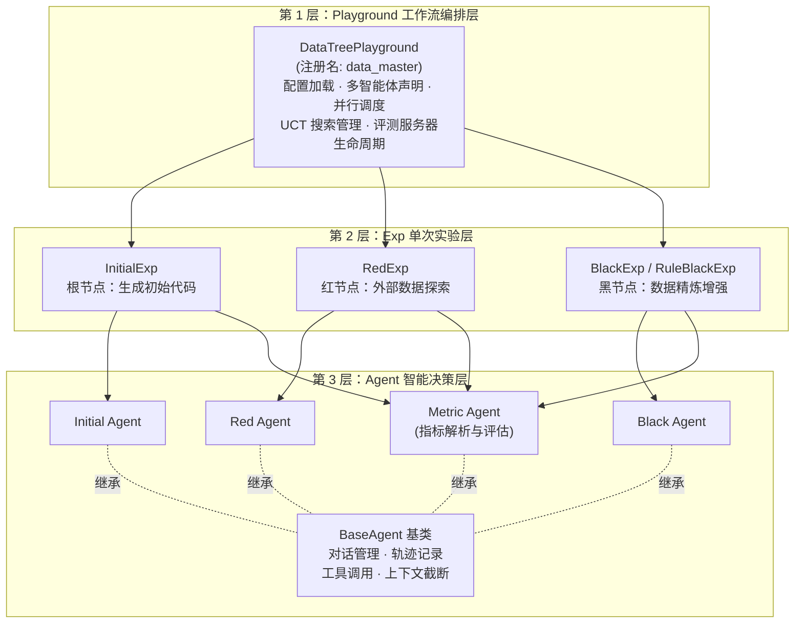

本页是 DataMaster 项目的整体导览，面向初次接触本仓库的开发者。我们将回答三个问题：**DataMaster 是什么**、**它如何组织数据工程决策**、**仓库各部分承担什么职责**。读完本页，你将建立起对框架的全局认知，并能根据文末的阅读路线选择下一个深入方向。

> **📖 小白导读**
> - 这篇讲什么：用一页纸介绍 DataMaster 是什么、核心思路（DataTree 搜索）和仓库里各个目录是干什么的。
> - 读之前先知道：**LLM**（大语言模型，如 GPT 一类的聊天模型）、**agent/智能体**（让 LLM 自己决定下一步做什么、调用工具、写并运行代码的程序）、**Kaggle**（机器学习竞赛平台）、**YAML**（一种用缩进写配置的文本格式）。
> - 读完你能明白：DataMaster 想解决什么问题；红节点、黑节点、记忆树各是什么；想看某个功能时该去哪个目录找。
> - 提醒：本仓库只能在 Linux 上安装运行（`pyproject.toml` 的 `environments` 限定 `sys_platform == 'linux'`）。

## 一、DataMaster 是什么

DataMaster 是一个**面向机器学习数据侧的自主研究框架**（Data-Centric Autonomous AI Research）。它的核心假设是：在建模算法或初始解决方案固定的前提下，机器学习任务的性能瓶颈往往出在数据侧——数据流水线、外部数据源、特征变换、验证信号与可复用数据工件的质量。DataMaster 将这些"数据工程决策"交给 LLM 驱动的智能体（agent：能自己写代码、运行代码、根据结果再决定下一步的程序）去**自动搜索**，而非依赖人工经验。

框架通过 **DataTree（数据树）** 来组织这一搜索过程：**红节点（Red Node）** 负责探索外部数据或数据变换，**黑节点（Black Node）** 负责利用和精炼已有候选方案，**Data Pool（候选数据池）** 沉淀跨搜索分支可复用的数据集，**Global Memory（全局记忆）** 则跨搜索轮次保留节点结果、工件与可复用发现。整个搜索以验证指标（validation score）作为反馈信号，形成"探索 → 执行 → 评估 → 更新"的闭环。

Sources: [README.md](README.md#L23-L27), [README_CN.md](README_CN.md#L25-L29)

用一个类比帮助理解：如果把解决一个 Kaggle 竞赛任务比作"做菜"，传统 ML Agent 热衷于换菜谱（换模型、调超参），DataMaster 则专注于**备菜**——寻找更好的食材（外部数据源）、更精细的切配（数据清洗与特征变换）、更可靠的试吃反馈（验证信号），而菜谱本身保持不变。这一设计取向使其与主流"模型侧优化"智能体形成了鲜明互补。

## 二、目标基准与发布范围

DataMaster 面向两类工作流设计：**MLE-Bench**（竞赛式机器学习工程任务基准）与 **PostTrainBench**（后训练工作流）。当前开源版本只包含 MLE-Bench（Kaggle 竞赛）工作流，**没有 PostTrainBench 的任何代码**；仓库 README 的 Roadmap 中该项标注为 "Coming soon"（README.md 第 177-182 行附近）。各组件在仓库中的位置如下：

| 组件 | 路径 | 职责 |
|---|---|---|
| DataTree 核心工作流 | `playground/data_master` | DataMaster 主工作流：红/黑节点搜索、UCT 决策、记忆管理 |
| MLE-Bench 基线工作流 | `playground/ml_master` | 基线（baseline，即用来做对比的参照方法）Agent（ML-Master），用于对照实验 |
| 数据集搜索与提交工具 | `playground/search_dataset_tools` | HuggingFace/GitHub/Web/学术检索及提交校验工具集 |
| Benchmark 集成 | `mle-bench/` | MLE-Bench 评测逻辑与评测服务器（vendored） |
| 任务特定配置（75 个任务） | `configs/data_master` | 每个竞赛任务的 YAML 配置与 MCP（Model Context Protocol，让 agent 调用外部工具服务的一种协议）JSON 配置 |

值得注意的是，仓库中内置的 `mle-bench/` 目录源自 OpenAI 的 MLE-Bench 项目（论文《MLE-Bench: Evaluating Machine Learning Agents on Machine Learning Engineering》），提供了 Kaggle 竞赛任务的数据准备、提交评分（grading server）等评测基础设施。但仓库**不含任何基准数据集、Kaggle 数据、模型检查点**——你需要自行准备 MLE-Bench / MLE-Bench Lite 数据并通过 `DATA_ROOT` 环境变量指向本地目录。

Sources: [README.md](README.md#L33-L43), [README.md](README.md#L171-L173), [README_CN.md](README_CN.md#L33-L45), [mle-bench/README.md](mle-bench/README.md#L1-L3)

## 三、全景架构：EvoMaster 三层体系

DataMaster 构建在 **EvoMaster** 框架之上，复用了其核心 Agent 与运行时抽象。EvoMaster 采用清晰的三层架构，理解这三层是阅读全部代码的钥匙：



**Playground 层**是工作流编排器，负责配置加载与组件初始化、Session 生命周期管理、多智能体协调与并行执行、MCP 服务器连接以及结果聚合。**Exp 层**代表单次实验执行：接收任务描述、创建任务实例、运行 Agent 并收集轨迹、保存结果。**Agent 层**是智能核心，由 `BaseAgent` 基类提供对话管理（Dialog）、工具调用执行、上下文截断与执行轨迹记录等基础能力。

DataMaster 的注册机制值得注意：`@register_playground("data_master")` 装饰器写在 `playground/data_master/core/playground.py` 的 `DataTreePlayground` 类上（第 44 行）；`run.py` 里的 `auto_import_playgrounds()` 会遍历 `playground/` 下每个子目录并 `import` 其 `core.playground` 模块，从而触发装饰器、把类登记进全局注册表，运行时再根据 `--agent` 参数用 `get_playground_class` 查找对应的 Playground 类。（装饰器：Python 里写在类或函数上方、以 `@` 开头的"包装"语法；这里的作用是"登记名字"。）若未注册自定义实现，则回退到通用 `BasePlayground`。这种"注册即扩展"的设计是后续二次开发的基础。

Sources: [architecture.md](docs/architecture.md#L26-L70), [registry.py](evomaster/core/registry.py#L27-L53), [README.md](README.md#L212-L214)

在实现层面，`DataTreePlayground` 在初始化时声明了**五个智能体角色**（`nouse_agent`、`initial_agent`、`black_agent`、`red_agent`、`metric_agent`），并读取并行配置（`max_parallel`）、维护独立的 grading server 子进程。它还内置了**组件消融开关**（ablation：关掉某个组件，看效果下降多少，以判断该组件是否有用）——`use_red_node`（是否启用红节点）、`use_memory`（是否启用记忆）、`black_mode`（黑节点采用 agent 模式还是规则模式）——这使得研究者可以系统性地评估各组件的贡献。这些开关从配置的 `ablation` 段读取，缺省时 `use_red_node=True`、`use_memory=True`、`black_mode="agent"`；注意仓库里 75 份任务 YAML 是旧模板生成的，不含 `ablation` 段，所以不手动添加就是默认全开。

Sources: [playground.py](playground/data_master/core/playground.py#L44-L90)

## 四、DataTree：核心搜索机制一览

DataTree 是 DataMaster 区别于其他 ML Agent 的核心设计。每个树节点代表一个**可执行的数据状态**——包含 Agent 生成的计划（plan）、代码（code）、执行输出（stdout）、验证指标（metric），以及 UCT 统计量（访问次数 `visits`、累计奖励 `total_reward`、子节点集合 `children` 等）。

节点扩展遵循明确的规则：**根节点**（root）唯一初始化，由 InitialExp 从初始代码或任务描述生成第一版可提交代码；若一个节点被判定为 **buggy**（执行出错或产出无效），它不会立即被丢弃，而是被施加 UCT 惩罚（从 UCT 值中减去 `buggy_penalty=1000.0`，使其在后续节点选择中几乎不会再被选中），并允许最多生成 3 个"修复子节点"尝试自救（`is_fully_expanded` 中 `max_buggy_children = 3`，源码注释误写为 2）；正常节点则可派生出**最多 1 个红节点（`num_red=1`）与最多 5 个黑节点（`num_black=5`），子节点总数上限 6**（`UCTSearchConfig`，uct.py 第 112-117 行）。每个节点仍会提交完整代码参与评测，以 validation score 作为评判分数，UCT 算法负责节点选择与奖励更新。（**UCT** 是 MCTS——蒙特卡洛树搜索——里的一个打分公式：既偏爱到目前为止成绩好的节点，也给"很少被试过"的节点加分，以便在"深挖"和"尝新"之间折中。）

> **术语提示（给小白）**：**buggy** 指 Agent 产出的代码运行报错、或提交的评测结果无效（如指标解析失败）。这类节点不是"程序 bug"，而是搜索过程中的**失败尝试**——框架的设计哲学是给失败分支留有限的修复机会，同时通过重罚让搜索预算集中在有希望的分支上。

| 节点类型 | 颜色语义 | 核心职责 | 对应 Exp 类 |
|---|---|---|---|
| Root / Initial | 起点 | 从 initial code 出发生成最初版本代码 | `InitialExp` |
| Black（黑节点） | 利用 | 对现有训练数据进行数据增强、数据整合、清洗适配、DataLoader 构建 | `BlackExp` / `RuleBlackExp` |
| Red（红节点） | 探索 | 调用外部搜索接口搜索数据、下载新数据集到本地、引入新数据源 | `RedExp` |

"红与黑"的命名直观地对应了搜索算法中经典的 **exploration/exploitation 权衡**：红节点承担"探索"职责（打开新的数据来源），黑节点承担"利用"职责（深挖当前候选的潜力）。"红与黑"只是命名，和颜色没有技术关系。整个 UCT 搜索逻辑被封装在 `UCTSearchManager` 中，配合 `MetricReview`（标准化度量结果）与 `UCTDecayConfig`（衰减策略）工作。

Sources: [data_master/README.md](playground/data_master/README.md#L7-L56), [uct.py](playground/data_master/core/utils/uct.py#L1-L40)

与 UCT 搜索树**一一对应**的是文件系统形式的 **Memory Tree**：每个节点拥有独立的文件夹（以节点 id 命名），内含 `manifest.md`（由 Agent 通过工具写入的节点知识总结）、`storage/`（保存轨迹、代码、输出与提交文件备份），树根则维护 `global_memory.md`（全局记忆）与 `data_link.json`（数据集链接记录）。这一设计使搜索过程天然可追溯、可持久化、可离线分析。

Sources: [memory_tree.py](playground/search_dataset_tools/memory_tree.py#L1-L16)

## 五、仓库结构导览

```
DataMaster/
├── run.py                      # 主 CLI 入口（--agent/--config/--task/--parallel）
├── configs/
│   ├── data_master/            # DataTree 配置 + 75 个任务级 YAML 配置
│   │   ├── config_base.yaml    # 基础配置模板（LLM/Agents/Session/MCP）
│   │   ├── yaml_configs/       # 任务级配置（由脚本自动生成）
│   │   └── json_configs/       # MCP 工具配置
│   └── ml_master/              # 基线 Agent 配置
├── evomaster/                  # EvoMaster 核心库
│   ├── agent/                  # Agent 基类、上下文、会话、工具系统
│   ├── core/                   # BaseExp / BasePlayground / Playground 注册表
│   ├── env/                    # 环境管理（local / docker / k8s / bohrium）
│   ├── skills/                 # 技能系统（数据操作、检索、RAG 等；DataMaster 的 agent 配置里没有 `skills:` 键，实际未使用，未完全验证）
│   └── utils/                  # LLM 抽象层与类型定义
├── playground/
│   ├── data_master/            # ★ DataTree 主工作流
│   │   ├── core/               # playground.py + exp/ + utils/(uct/grading/metric)
│   │   ├── initial_code/       # 每个任务的 starter code
│   │   ├── prompts/            # 分节点提示词模板（initial/black/red/metric）
│   │   └── vis/                # DataTree 交互式可视化
│   ├── ml_master/              # ML-Master 基线工作流
│   └── search_dataset_tools/   # 数据集搜索工具 + Memory Tree 实现
├── initial_code/               # 顶层 starter-code 模板（data_loader_format）
├── mle-bench/                  # Benchmark 集成与评测工具（vendored）
├── scripts/                    # 配置生成、初始代码构建、可视化等脚本
└── docs/                       # 中英文文档
```

如果你只能记住三个目录，请记住：`run.py` 是唯一入口、`playground/data_master` 是主战场、`evomaster` 是地基。配置文件采用分层设计——`config_base.yaml` 定义了五个 Agent 各自的 LLM 指向、对话轮数上限、工具集（内置工具 + MCP）、上下文管理策略与提示词文件路径，任务级 YAML 则由 `scripts/auto_config_exp.py` 在此模板上自动生成。

Sources: [README.md](README.md#L70-L96), [config_base.yaml](configs/data_master/config_base.yaml#L30-L118)

## 六、从命令行到结果：运行全貌

一切从一条命令开始。`run.py` 提供了三种互斥的任务输入方式：`--task`（单任务描述或 .txt/.md 文件路径）、`--task-file`（包含多任务的 JSON 文件，可配合 `--parallel` 并行执行）、`--interactive`（交互式任务输入模式）。可选参数包括 `--initial-code`（为初始节点提供 starter code，即"起步代码"）、`--test-feedback`（启用测试反馈模式以选择最优节点）及指标方向控制参数。**注意**：`--test-feedback` 在当前代码中构造 metric_test agent 时 `system_prompt_file` 是未展开的字面量 `"${PROJECT_ROOT}/..."` 且没传 `config_dir`，会抛 ValueError（未实测）；该模式还会把测试集分数带进搜索，不建议使用。

```bash
python run.py \
  --agent data_master \
  --config configs/data_master/yaml_configs/detecting-insults-in-social-commentary/config_detecting-insults-in-social-commentary.yaml \
  --task "$DATA_ROOT/detecting-insults-in-social-commentary/prepared/public/description.md"
```

运行前需设置的环境变量包括：`DATA_ROOT`（本地基准数据目录）、`LLM_MODEL` / `LLM_API_KEY` / `LLM_BASE_URL`（LLM 接入三要素），以及可选的 `SERPER_API_KEY`（Web 搜索）与 `HF_TOKEN`（HuggingFace 数据集搜索）。框架遵循"**仓库不含任何凭证**"的安全原则，所有密钥均通过环境变量（操作系统里的"全局小纸条"，用 `export 名字=值` 设置）注入。注意：`${VAR}` 形式的展开只在主 YAML 里生效，且变量未设置时会静默变成空串，不会报错。

Sources: [run.py](run.py#L1-L111), [README.md](README.md#L120-L154)

配套的运维脚本覆盖了从准备到复盘的完整链路：`auto_config_exp.py`（生成任务级配置）、`build_full_initial_codes.py`（组装 starter-code 清单）、`prefetch_models.py`（本地模型预取）、`check_port_conflicts.py`（诊断 grading server 端口冲突）、`vis_node_by_tree_with_grade.py`（交互式 DataTree 可视化分析）。

Sources: [README.md](README.md#L158-L168)

## 七、关键特性与技术定位

六大核心特性共同构成了 DataMaster 的能力矩阵：

| 特性 | 机制 | 关键实现 |
|---|---|---|
| 🌲 DataTree 搜索 | 树结构的可执行数据状态迭代搜索 | `UCTSearchManager` + 节点状态机 |
| 🔴 红节点 | 外部数据发现与候选数据源获取 | `RedExp` + 数据集搜索工具集 |
| ⚫ 黑节点 | 数据精炼、清洗、适配与 DataLoader 构建 | `BlackExp`（Agent 模式）/ `RuleBlackExp`（规则模式） |
| 🗄️ Data Pool | 跨搜索分支共享的候选数据集层 | `data_link.json` 数据索引 |
| 🧠 Global Memory | 跨轮次存储节点结果、工件与可复用发现 | Memory Tree 文件系统 |
| 🎯 验证反馈 | 任务执行与可配置指标评估 | Metric Agent + grading server |

从学术定位看，DataMaster（arXiv:2605.10906，《DataMaster: Towards Autonomous Data Engineering for Machine Learning》）代表了自主智能体研究中"数据工程自动化"这一分支。它继承自 EvoMaster 框架，并以 ML-Master 为直接前身（"MLE-Bench 排行榜上的知名基线"这一说法未验证）——`playground/data_master/README.md` 中记载了这一演化关系（该文件是给开发者的内部说明，原文为中文）："这是 ML-Master 的源代码……转变为一个能够进行自动化数据探索和发现的 Data Agent"。仓库同时保留了 `ml_master` 作为对照基线，便于研究者进行消融与对比实验。

Sources: [README.md](README.md#L49-L67), [README.md](README.md#L194-L208), [data_master/README.md](playground/data_master/README.md#L1-L5)

## 八、建议阅读路线

基于目录结构，为初学者规划如下递进式路线：

**第一阶段 · 跑通流程**（动手优先）：
1. [环境准备：安装、依赖与凭证管理](3-huan-jing-zhun-bei-an-zhuang-yi-lai-yu-ping-zheng-guan-li) —— 完成 `pip install -e .` 与环境变量配置
2. [MLE-Bench 数据集与任务输入准备](4-mle-bench-shu-ju-ji-yu-ren-wu-shu-ru-zhun-bei) —— 准备 `DATA_ROOT` 指向的基准数据
3. [快速开始：运行第一个 DataTree 搜索任务](2-kuai-su-kai-shi-yun-xing-di-ge-datatree-sou-suo-ren-wu) —— 执行第一条 `run.py` 命令并观察输出

**第二阶段 · 理解骨架**（建立地图）：
4. [仓库目录结构与模块职责速览](5-cang-ku-mu-lu-jie-gou-yu-mo-kuai-zhi-ze-su-lan) —— 逐目录精确定位
5. [EvoMaster 三层架构：Playground / Exp / Agent](6-evomaster-san-ceng-jia-gou-playground-exp-agent) —— 本页第三节的三倍深度展开

**第三阶段 · 深入核心**（按兴趣选择）：
- 工作流主线：[DataTree 搜索流程全解析](7-datatree-sou-suo-liu-cheng-quan-jie-xi-cong-chu-shi-hua-dao-bing-xing-sou-suo) → [三类节点实验](8-san-lei-jie-dian-shi-yan-initial-black-yu-red-de-zhi-ze-hua-fen) → [UCT 搜索算法](9-uct-sou-suo-suan-fa-jie-dian-xuan-ze-jiang-li-geng-xin-yu-shuai-jian-ce-lue) → [并行执行机制](10-bing-xing-zhi-xing-ji-zhi-worker-xun-huan-yu-shi-jian-qu-dong-jie-dian-kuo-zhan)
- 数据资产线：[Memory Tree](12-memory-tree-yu-uct-shu-dui-ying-de-wen-jian-xi-tong-she-ji) → [manifest.md 知识库总结](13-manifest-md-yu-jie-dian-zhi-shi-ku-zong-jie-ji-zhi) → [Data Pool 与外部数据源](14-data-pool-yu-wai-bu-shu-ju-yuan-yin-ru-hong-jie-dian-shu-ju-xia-zai)
- 工具链线：[operate_submission 流水线](15-operate_submission-dai-ma-guan-li-zhi-xing-yu-ti-jiao-xiao-yan-liu-shui-xian) → [数据集搜索工具集](16-shu-ju-ji-sou-suo-gong-ju-ji-huggingface-github-web-xue-zhu-jian-suo) → [Agent 内置工具与 MCP](17-agent-nei-zhi-gong-ju-bash-editor-think-finish-yu-mcp-xie-yi-ji-cheng)

**第四阶段 · 研究与扩展**：
- [组件消融实验](29-zu-jian-xiao-rong-shi-yan-use_red_node-use_memory-black_mode-kai-guan) 与 [二次开发指南](30-er-ci-kai-fa-zhi-nan-zhu-ce-zi-ding-yi-playground-exp-yu-agent) 面向希望开展研究或定制工作流的读者

对于时间有限的读者，最小必读集合是：本页 → [快速开始](2-kuai-su-kai-shi-yun-xing-di-ge-datatree-sou-suo-ren-wu) → [EvoMaster 三层架构](6-evomaster-san-ceng-jia-gou-playground-exp-agent) → [DataTree 搜索流程全解析](7-datatree-sou-suo-liu-cheng-quan-jie-xi-cong-chu-shi-hua-dao-bing-xing-sou-suo)。这四页将带你从"知道它是什么"走到"看懂它在做什么"。
