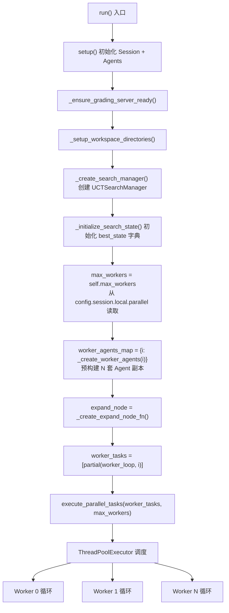
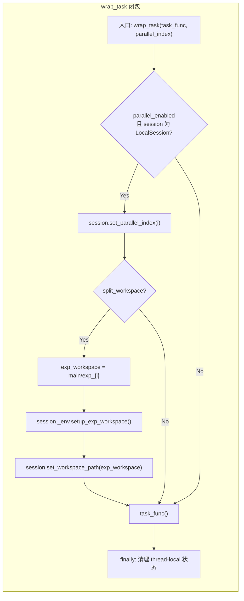
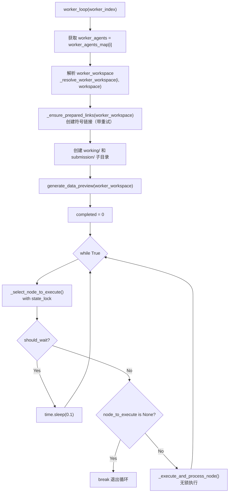
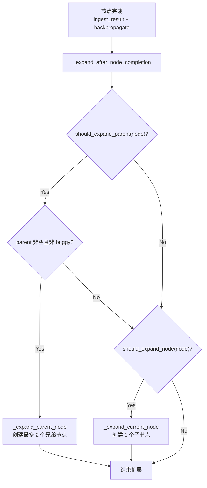
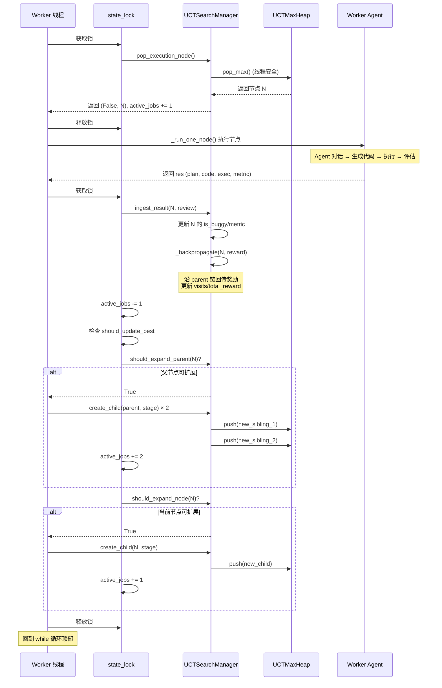

DataTree 搜索框架的并行执行机制是其核心架构优势之一——它将 UCT 树搜索的节点选择、执行与扩展过程封装为一个**多 Worker 线程池 + 共享状态锁 + 事件驱动扩展**的三层协调系统。（Worker：同时干活的"工人"线程；线程池 `ThreadPoolExecutor`：Python 标准库里一次开好固定数量线程的工具；线程锁：同一时刻只允许一个线程进入被保护的代码，防止多个线程同时改同一份数据；事件驱动扩展：不是由一个独立的调度器定时安排任务，而是"某个节点跑完"这件事一发生，就立刻在原地决定要不要建新节点。）本文深入剖析从 `ThreadPoolExecutor` 调度入口到单个 Worker 的 `while True` 轮询循环、再到节点完成后的即时树扩展（event-driven expansion）的全链路机制，揭示多线程环境下 UCT 搜索如何保持一致性，并分析 `active_jobs` 计数器的设计意图与实际行为（它本意是流量控制阀门，但按代码推演，实际并不能起到"计数归零就退出"的作用）。

> 📖 **小白导读**
> - **这篇讲什么**：DataMaster 如何同时让 4 个 Worker 一起跑节点实验，它们怎么轮流从"待办堆"里取节点、怎么避免互相踩踏，以及一个节点跑完后如何立刻长出新节点；还会讲 `active_jobs` 计数器和 `max_steps` 的真实行为。
> - **读之前先知道**：①线程（程序里可以同时进行的几条"执行线"）与线程锁；②上一篇讲的 UCT 树和节点（initial / black / red）；③workspace（工作目录，节点的代码和中间文件都放在这里）。
> - **读完能明白**：一个 Worker 循环每一圈做什么；`active_jobs` 在一个小例子里怎么一步步变化、为什么它回不到 0；为什么 `max_steps=150` 实际会多跑几个节点。


## 架构全景：从 run() 到 Worker 循环的执行路径

整个并行执行流程始于 `DataTreePlayground.run()` 方法，它依次完成搜索管理器初始化、搜索状态字典创建、Worker Agent 集群预构建、以及最终的线程池派发。这条路径的关键设计决策是：**所有 Worker 的 Agent 副本在进入线程池之前就已经预构建完毕**，避免了线程内竞争性 Agent 创建。



`run()` 方法通过 `partial(worker_loop, i)` 将 Worker 索引绑定到闭包中，然后调用基类的 `execute_parallel_tasks` 进行线程池调度。每个 Worker 拿到的 `worker_index` 决定了它使用的 Agent 副本集合和工作空间路径。

Sources: [playground.py](playground/data_master/core/playground.py#L1138-L1212)

## 线程池调度层：execute_parallel_tasks 的封装

`BasePlayground.execute_parallel_tasks` 是一个通用并行任务执行器，它封装了 `ThreadPoolExecutor`，并用一个 **wrap_task 闭包** 在每个线程里设置"线程局部"（每个线程各有一份、互不可见的变量，Python 的 `threading.local()`）的并行索引与工作空间。注意：基类的 `register_thread`（日志按线程过滤用）只在 `BasePlayground.run()` 里被调用，而 `DataTreePlayground` 重写了 `run()`，不调用它，所以 DataMaster 的 Worker 线程并没有被注册（见文末"日志的线程过滤"）。

### wrap_task 的双重职责

`wrap_task` 闭包在真正调用用户传入的 `task_func` 之前，执行两个条件性操作：

1. **设置 parallel_index**：当 `parallel_enabled=True` 且 Session 为 `LocalSession` 时，调用 `session.set_parallel_index(parallel_index)` 将当前线程注册为特定的并行索引。这使得 `LocalSession` 的 `exec_bash` 方法能通过 `threading.local()` 获取线程局部状态，为不同 Worker 分配独立的 GPU/CPU 资源。

2. **设置独立工作空间**：当 `split_workspace_for_exp=True` 时，在主工作空间下创建 `exp_{parallel_index}` 子目录，调用 `session._env.setup_exp_workspace()` 设置符号链接（symlink，一种指向别处文件或目录的"快捷方式"），并通过 `session.set_workspace_path()` 写入线程局部工作空间路径。这使得 `exec_bash` 执行命令时使用线程专属的工作目录而非共享主目录。



在 `finally` 块中，`wrap_task` 始终清理线程局部状态（`set_parallel_index(None)` 和 `set_workspace_path(None)`），确保线程池重用线程时不会残留前一个 Worker 的上下文。

### 结果收集策略

`execute_parallel_tasks` 使用 `as_completed` 迭代已完成的 Future，但通过 `future_to_index` 字典保持结果与输入顺序的对应关系。异常不会中断其他任务——异常对象被直接存入结果列表的对应位置。

Sources: [playground.py](evomaster/core/playground.py#L1386-L1463), [local.py](evomaster/agent/session/local.py#L65-L95)

## Worker 主循环：状态锁保护的节点选取-执行-扩展

每个 Worker 线程进入 `worker_loop` 后，执行的并非简单的任务消费，而是一个 **持续轮询、条件等待、锁保护选取、锁外执行** 的复合循环。

### 循环结构与退出条件



Worker 循环的退出发生在 `_select_node_to_execute` 返回 `(False, None)` 时。代码里有三种可能：搜索步数已达上限（`current_step >= max_steps`）；phase 1 中 `select_next()` 返回 None；以及 phase 2 中执行堆为空且 `active_jobs == 0`。其中第三种在实际运行中**不会成立**（见下一节的推演），所以 phase 2 的 Worker 实际只能靠第一种退出。当返回 `(True, None)` 时表示 `should_wait=True`，Worker 进入 0.1 秒的轻量休眠后重试——这发生在：非 0 号 Worker 等待 Initial 阶段完成、0 号 Worker 刚批量建完子节点后、以及执行堆暂时为空而 `active_jobs` 不为 0 时（等别人跑完产生新节点）。

### 两阶段节点选取

`_select_node_to_execute` 在 `state_lock` 保护下进行决策，根据 `best_state["initial_completed"]` 标志分为两个阶段：

| 阶段 | 条件 | 调用方法 | Worker 限制 | 选取逻辑 |
|------|------|----------|-------------|----------|
| **Phase 1** | `initial_completed == False` | `_handle_phase1` | 仅 Worker 0 | UCT `select_next()` 选取 → 创建 initial 子节点 → 执行 |
| **Phase 2** | `initial_completed == True` | `_handle_phase2` | 所有 Worker | `pop_execution_node()` 从堆中弹出一个节点（设计意图是 UCT 最高者，实际顺序见下文 UCTMaxHeap 一节：按随机 id） |

**Phase 1 的串行约束**通过 `worker_index != 0` 检查实现：非零 Worker 直接返回 `(True, None)` 进入等待状态。这确保 Initial 节点（生成基线代码的关键步骤）不会被多线程并发执行。当 Initial 节点完成后，`_batch_expand_after_initial` 将 `initial_completed` 标志翻转为 `True`，并一次性批量创建所有初始子节点（1 个 red + N 个 black）压入执行堆，正式进入 Phase 2 的并行阶段。

Sources: [playground.py](playground/data_master/core/playground.py#L1166-L1212), [playground.py](playground/data_master/core/playground.py#L734-L816)

## active_jobs 计数器：设计意图与实际行为

`best_state["active_jobs"]` 是一个整数计数器（`best_state` 是各 Worker 共享的状态字典，初始值 `active_jobs = 0`）。**设计意图**是充当流量阀门：当执行堆暂时为空时，如果还有别的 Worker 在跑节点（跑完会产生新节点），空闲的 Worker 就先等一等，而不是直接退出。**实际行为**是：它的加减不对称，会重复计数，永远回不到 0，因此并不能可靠地承担"防死锁、判断搜索结束"的职责。

**计数器增减规则**（每个节点从创建到完成，会在不同位置被加减多次）：

| 事件 | 操作 | 位置 |
|------|------|------|
| Phase 1 创建 initial 节点 | `active_jobs += 1` | `_handle_phase1`（`playground.py` 第 791 行） |
| 从执行堆弹出节点 | `active_jobs += 1` | `_handle_phase2`（第 815 行） |
| Initial 后批量创建子节点 | `active_jobs += len(stages_batch)` | `_batch_expand_after_initial`（第 843 行） |
| 事件驱动扩展创建新节点 | `active_jobs += 1`（每创建一个加一次） | `_expand_parent_node`（第 1074、1092 行）/ `_expand_current_node`（第 1119 行） |
| 节点执行完成 | `active_jobs = max(active_jobs - 1, 0)` | `_execute_and_process_node`（第 911 行） |

关键事实：**phase 2 里的每个节点，在"创建"时加一次，在"被弹出执行"时又加一次，在"完成"时只减一次**，净增 +1。也就是说，同一个节点被数了两次，只被扣了一次。

### 一个具体的小例子：initial 之后建 6 个节点

假设默认配置：4 个 Worker，`num_black=5`、`num_red=1`、开启 red 节点。下表逐步演示 `active_jobs` 怎么变，最后一列是"真正正在执行的节点数"，用来对比：

| 步骤 | 发生了什么 | active_jobs | 真正在跑的节点数 |
|---|---|---|---|
| 0 | 搜索开始 | 0 | 0 |
| 1 | Worker 0 创建 initial 节点并开始执行（+1） | 1 | 1 |
| 2 | initial 跑完（-1）。此时 `initial_completed` 还是 False，不触发扩展 | 0 | 0 |
| 3 | Worker 0 再次选到 initial，批量建 1 个 red + 5 个 black，共 6 个节点压入堆（+6） | **6** | 0 |
| 4 | 4 个 Worker 各弹出 1 个节点开始执行（+1 ×4） | **10** | 4 |
| 5 | 其中一个节点 N1 跑完（-1），它不是 buggy，于是为它建 1 个子节点（+1）；它的父节点 initial 已有 6 个子节点，不再建兄弟 | 10 | 3 |
| 6 | 空闲的 Worker 从堆里弹出一个节点（+1） | **11** | 4 |
| 7 | 又一个节点跑完（-1），建 1 个子节点（+1） | 11 | 3 |

可以看到：第 3 步时一个节点都没在跑，计数已经是 6；之后每完成一个节点，"完成 -1"和"新建子节点 +1"相互抵消，而每次"弹出 +1"没有被抵消，数字只会越来越大。（上面这张表是我按代码规则手算的演示，并非实际运行的日志。）

**为什么回不到 0**：第 3 步之后，计数器 = 已创建节点数 + 已弹出节点数 - 已完成节点数。已完成的节点一定先被弹出过，所以"已弹出 ≥ 已完成"，计数器始终 ≥ 已创建节点数 ≥ 6，永远不会等于 0（推断，来自代码阅读，未实测）。

**对退出逻辑的影响**：`_handle_phase2` 里"堆为空且 `active_jobs == 0` 就退出"这一条在 phase 2 里永远不会成立。如果某一刻执行堆空了，而又没有节点在跑，所有 Worker 会一直 `sleep 0.1` 重试，而不是退出（推断；实际中每个节点完成后通常都会建新的子节点，所以堆一般不会真的空）。搜索真正的终止条件只有一个：`current_step >= max_steps`。

Sources: [playground.py](playground/data_master/core/playground.py#L803-L816), [playground.py](playground/data_master/core/playground.py#L910-L911)

### max_steps 为什么会多跑几个节点

`max_steps`（默认 150，来自 `scripts/auto_config_exp.py` 的默认输入）的含义是**完成的节点数**，包括 initial 节点和 buggy 节点，不是模型训练轮数。检查和计数发生在两个不同的时刻：

- **检查**：`_select_node_to_execute` 在**选节点之前**先看 `search_mgr.current_step >= max_steps`（`playground.py` 第 751 行）。
- **计数**：`current_step` 在 `ingest_result` 的**最后**才加 1（`uct.py` 第 851 行），也就是节点已经跑完之后。

节点一跑就是几十分钟，期间 `current_step` 不变。例：`max_steps = 150`，此刻已完成 149 个节点，另外 3 个 Worker 正在跑各自的节点。第 4 个 Worker 空闲，检查 `149 >= 150` 为假，于是又弹出一个节点开始跑。这 4 个节点最终都会完成，`current_step` 变成 153。所以并行时最多会多跑 `max_parallel - 1`（默认 3）个节点（推断，来自代码阅读，未实测）。

Sources: [playground.py](playground/data_master/core/playground.py#L734-L762), [uct.py](playground/data_master/core/utils/uct.py#L851-L852)

## 事件驱动节点扩展：完成即扩展

节点扩展并非由独立的调度器驱动，而是**嵌入在节点完成处理流程中**——当一个节点执行完毕并完成奖励回传后，立即在同一个 `state_lock` 临界区内决定并创建新的待执行节点。这种事件驱动设计确保了：节点完成 → 奖励回传 → UCT 值更新 → 新节点入堆的无缝衔接。

### 扩展决策的两条路径

`_expand_after_node_completion` 在节点完成处理流程的最后阶段被调用，它依次检查两个独立的扩展条件：



**路径 1：扩展父节点（`_expand_parent_node`）**——当 `should_expand_parent` 返回 `True`（父节点的子节点数未达上限）时触发。此方法执行**两轮**创建循环，每轮重新检查当前 red/black 子节点数量与配置上限的差距，从可用阶段中随机选择一个创建兄弟节点。两轮独立计数意味着：即使第一轮创建了 red 节点使 red 达到上限，第二轮仍能创建 black 节点。

**路径 2：扩展当前节点（`_expand_current_node`）**——当 `should_expand_node` 返回 `True`（当前节点未完全扩展）时触发。此方法采用**优先级策略**：优先创建 red 子节点（若 `use_red_node=True` 且 red 子节点数未达上限），否则创建 black 子节点。与父节点扩展的随机选择不同，子节点扩展是确定性的优先级选取。

### expand_node 闭包的完整职责

`_create_expand_node_fn` 返回的 `expand_node` 闭包不仅创建 UCT 树节点，还执行三个关键副作用：

1. **`search_mgr.create_child(parent, stage=stage)`**——在 UCT 树中注册新节点，自动建立 parent → child 的链接关系（`UCTNode.__post_init__` 中 `parent.children.add(self)`），并调用 `parent.expect_child()` 递增预期子节点计数。

2. **`create_node_memory(workspace, child_node.id, parent_id=node.id)`**——在文件系统中为新节点创建 Memory Tree 目录结构（受 `use_memory` 消融开关控制）。

3. **`search_mgr.push_execution_node(child_node)`**——将新节点压入 `UCTMaxHeap` 执行堆，等待某个 Worker 在 `_handle_phase2` 中弹出执行（入堆时 UCT 值为 `inf`，不产生真正的优先级差别）。

此外它还会调用 `save_node_snapshot(..., snapshot_event="created")` 写一份"节点已创建"的快照到日志目录。

Sources: [playground.py](playground/data_master/core/playground.py#L693-L732), [playground.py](playground/data_master/core/playground.py#L1027-L1120), [uct.py](playground/data_master/core/utils/uct.py#L536-L571)

## UCTMaxHeap：线程安全的优先级执行堆

`UCTMaxHeap` 是并行执行机制中保证节点选取一致性的底层数据结构（堆：一种每次能快速取出"最小"元素的容器）。它封装了 Python `heapq`（最小堆），通过存储负 UCT 值实现最大堆语义，并用 `threading.Lock` 保护所有堆操作。

| 方法 | 功能 | 线程安全性 |
|------|------|------------|
| `push(node)` | 计算节点 UCT 值并入堆；重复节点（相同 id）自动跳过 | 加锁 |
| `pop_max()` | 弹出键最小（即 -UCT 最小）的节点；新节点键相同时按 id 字典序 | 加锁 |
| `peek_max()` | 查看但不弹出最大节点 | 加锁 |
| `is_empty()` / `size()` | 查询堆状态 | 加锁 |

UCT 值的计算委托给 `UCTSearchManager._get_node_uct_value`，它调用 `node.uct_value(exploration_constant, parent_visits, search_cfg)`。堆的键是 `(-uct值, node.id)`，UCT 值在 `push` 时算一次。但入堆的都是刚创建、`visits == 0` 的新节点，UCT 值都是 `float("inf")`（buggy 惩罚 `inf - 1000` 仍是 `inf`），键都变成 `(-inf, node.id)`；`-inf` 彼此相等，就按 `node.id`（随机 uuid）排序出堆。所以**出堆顺序既不是按 UCT 优先级，也不是"先扩展先执行"（先进先出），而是等价于随机顺序**。这个堆在开源版里实际只是一个线程安全的待办池。

Sources: [uct.py](playground/data_master/core/utils/uct.py#L261-L314), [uct.py](playground/data_master/core/utils/uct.py#L528-L542)

## Worker Agent 副本机制：copy_agent 的隔离设计

并行执行要求每个 Worker 拥有独立的 Agent 上下文，以避免多线程共享同一个 Agent 实例时对话历史和 LLM 状态的竞态冲突。`_create_worker_agents` 通过 `copy_agent` 为每个 Worker 创建四类 Agent 副本（initial / black / red / metric）。

`copy_agent` 的隔离策略采用**选择性深拷贝**：

| 组件 | 是否独立 | 说明 |
|------|----------|------|
| LLM 实例 | **独立创建** | 从原 Agent 的 config 重建新 LLM，确保每个 Worker 有独立的 API 连接和速率限制 |
| AgentConfig | **深拷贝** | `model_copy(deep=True)`，确保 context_config 独立 |
| Session / Tools / SkillRegistry | **共享** | 同一个实例引用，通过线程局部状态隔离执行环境 |
| 对话上下文 / 轨迹 / 步数 | **重置** | `current_dialog=None`, `trajectory=None`, `_step_count=0` |
| 提示词 | **共享** | `_system_prompt` / `_user_prompt` 直接复制引用（只读） |

这种设计的关键平衡是：**LLM 连接独立**避免 API 速率限制竞争，**Session 和 Tools 共享**减少资源开销，**对话上下文重置**确保每个节点实验从干净状态开始。Session 的线程安全性由 `LocalSession._thread_local` 保证——每个线程的 `parallel_index` 和 `workspace_path` 存储在线程局部存储中，`exec_bash` 执行时自动读取。

Sources: [playground.py](evomaster/core/playground.py#L935-L1009), [playground.py](playground/data_master/core/playground.py#L419-L434)

## 并发竞态防护：符号链接与日志过滤

### 符号链接的重试机制

多 Worker 并行启动时，`_ensure_prepared_links` 中的符号链接创建面临典型的竞态条件：多个 Worker 同时尝试为同一个 `baseline.json` / `grade.py` / `public` 目录创建符号链接。`_safe_symlink` 内部函数通过 **3 次重试 + 退避休眠** 处理 `FileExistsError`——在重试中发现链接已存在且指向正确目标时，视为成功（由另一个 Worker 创建），而非失败。

### 日志的线程过滤

`evomaster/core/playground.py` 里定义了 `_SessionThreadFilter`：它利用全局字典 `_thread_playground_map`（线程 id → Playground 实例）判断一条日志是否属于当前 Playground，目的是让多个并行 Playground 的日志不互相污染。但这张字典只有 `register_thread()` 才会写入，而它只在基类 `BasePlayground.run()` 里被调用（`evomaster/core/playground.py` 第 1294 行）。`DataTreePlayground` 重写了 `run()` 且没有调用它，所以 DataMaster 的 Worker 线程查不到映射；过滤器对"没有映射"的线程会直接放行（`owner is None` 时返回 True），实际上等于没有过滤。原文称"每个 Worker 线程在 `register_thread()` 时登记自己"，对 DataMaster 并不成立。

Sources: [playground.py](playground/data_master/core/playground.py#L314-L408), [playground.py](evomaster/core/playground.py#L34-L64), [playground.py](evomaster/core/playground.py#L348-L350)

## 并行配置与资源分配

并行执行的配置通过 `config_base.yaml` 的 `session.local.parallel` 节点控制：

```yaml
session:
  local:
    parallel:
      enabled: true          # 启用并行
      max_parallel: 4        # 最大 Worker 数
      split_workspace_for_exp: false  # 是否为每个 Worker 创建独立工作空间
    gpu_devices: ["0", "1", "2", "3"]  # GPU 分配：Worker i 取列表里第 i % 4 个（yaml 原注释写"每个任务 2 卡"，与列表内容不符）
```

`max_parallel` 在 `DataTreePlayground.__init__` 中被读取为 `self.max_workers`，同时用于 Worker Agent 副本的预构建数量和 `execute_parallel_tasks` 的 `max_workers` 参数。`split_workspace_for_exp` 控制是否在主工作空间下创建 `exp_0/`, `exp_1/` 等子目录——设为 `false`（默认）时所有 Worker 共享同一工作空间目录。代码里确实定义了 `_reset_working_dir`（清空并重建 `working/`），但在 DataMaster 里**从未被调用**（全仓库只有 ML-Master 的 playground 调用了它），所以并没有这层清理。多个 Worker 共用 `working/` 与固定名字的 `submission/submission.csv`，提交文件可能互相覆盖（推断，未实测）。

Sources: [config_base.yaml](configs/data_master/config_base.yaml#L158-L162), [playground.py](playground/data_master/core/playground.py#L58-L63)

## 完整执行时序：一个节点的生命周期

将上述机制串联起来，一个节点从创建到完成再到触发新扩展的完整时序如下：



整个流程的核心约束是：**节点执行在锁外进行**（长时间运行的 LLM 对话和代码执行不阻塞其他 Worker），而**状态读写（选取、回传、扩展）在锁内进行**。这保证了 UCT 树结构的一致性，同时最大化并行吞吐。

Sources: [playground.py](playground/data_master/core/playground.py#L849-L960), [uct.py](playground/data_master/core/utils/uct.py#L646-L851)

## 相关页面

- [UCT 搜索算法：节点选择、奖励更新与衰减策略](9-uct-sou-suo-suan-fa-jie-dian-xuan-ze-jiang-li-geng-xin-yu-shuai-jian-ce-lue) — 深入了解 UCT 值计算公式与衰减策略
- [DataTree 搜索流程全解析：从初始化到并行搜索](7-datatree-sou-suo-liu-cheng-quan-jie-xi-cong-chu-shi-hua-dao-bing-xing-sou-suo) — 全局视角的搜索流程概述
- [三类节点实验：Initial、Black 与 Red 的职责划分](8-san-lei-jie-dian-shi-yan-initial-black-yu-red-de-zhi-ze-hua-fen) — 节点实验的具体执行逻辑
- [组件消融实验：use_red_node / use_memory / black_mode 开关](29-zu-jian-xiao-rong-shi-yan-use_red_node-use_memory-black_mode-kai-guan) — 消融开关如何影响扩展逻辑
- [会话与环境管理：LocalSession 与 Docker 隔离环境](21-hui-hua-yu-huan-jing-guan-li-localsession-yu-docker-ge-chi-huan-jing) — LocalSession 的线程局部存储机制
