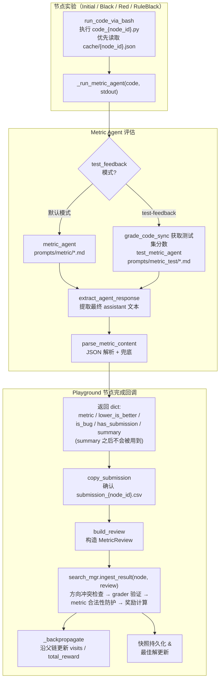

在 DataTree 的搜索循环中，每一个 Initial / Black / Red 节点的实验结果都不是"执行完就结束"，而是要经过一条完整的**评估反馈闭环**：代码执行产出的 stdout 被交给一个专职的 **Metric Agent**（专门用来"读输出、打分、判断有没有 bug"的 LLM agent；LLM 即大语言模型）解析，提炼出结构化的验证指标与 bug 判定，再封装成 `MetricReview` 写回 UCT 节点，驱动奖励计算、回传与最佳解更新。本页聚焦这条闭环的核心环节——Metric Agent 的定义与调用、验证指标与方向（maximize / minimize）的解析规则、test-feedback 测试集反馈模式，以及 `ingest_result` 中的奖励回传逻辑。对于 UCT 节点选择与衰减策略，请参阅 [UCT 搜索算法：节点选择、奖励更新与衰减策略](9-uct-sou-suo-suan-fa-jie-dian-xuan-ze-jiang-li-geng-xin-yu-shuai-jian-ce-lue)。

Sources: [playground.py](playground/data_master/core/playground.py#L502-L605)

> 📖 **小白导读**
> - **这篇讲什么**：节点的代码跑完后，系统怎么从一大段输出文字里"读出"得分，怎么判断这次跑得对不对，又怎么把结果变成奖励传回搜索树。
> - **读之前先知道**：①stdout（程序运行时打印出来的文字）；②metric（评价指标，就是一个分数，比如准确率或误差）；③agent（由大语言模型驱动、能自己决定下一步做什么的程序）；④"越大越好 / 越小越好"两种分数方向；⑤上一篇讲的 UCT 奖励回传。
> - **读完能明白**：Metric Agent 输出哪五个字段、`summary` 实际来自哪里、分数方向冲突和异常分数怎么处理，以及一个容易被忽略的漏洞：分数为 0 时的有效性检查几乎形同虚设。
> - **注意**：本文已按代码核对修正了若干与原文不同之处（`summary` 来源、test-feedback 的可用性、grading server 的实际行为等），每处都在对应小节说明。

## 闭环全景：从代码执行到奖励回传

在进入实现细节之前，先建立对整条链路的宏观认知。DataTree 中每个节点实验（Exp）的 `run()` 方法都以相同的收尾三步曲结束：**执行代码 → 调用 Metric Agent 解析 → 返回 metric / metric_detail 字段**。随后 Playground 主循环在节点完成回调中把实验结果转换为 `MetricReview`，交给 `UCTSearchManager.ingest_result()` 计算奖励并沿父链回传。



这条链路中有两个关键的设计分界：其一，Metric Agent 是一个**独立的 LLM Agent**而非规则解析器，这意味着它能容忍格式各异的 stdout 并做出 bug 判断；其二，`ingest_result` 中"解析判定"与"奖励计算"被刻意分离——解析层只负责陈述事实，奖励层负责把事实翻译成 UCT 可消费的数值信号。

Sources: [__init__.py](playground/data_master/core/exp/__init__.py#L37-L95), [playground.py](playground/data_master/core/playground.py#L910-L925), [runtime.py](playground/data_master/core/utils/runtime.py#L89-L127)

## Metric Agent 的定义与实例化

Metric Agent 在 `configs/data_master/config_base.yaml` 中以独立 agent 槽位定义，与其他三类节点 Agent（initial / black / red）显著不同的是它的**轻量化配置**：`max_turns` 仅为 4（black/red 为 50），工具列表只保留内置的 `finish`，不挂载任何 MCP 数据操作工具——它的职责是纯粹的"读输出、判结果"，不需要操作文件系统或执行命令。上下文窗口也压缩到 64000 tokens，截断策略保留最近 2 轮对话。

| 配置项 | Metric Agent | Initial Agent | Black / Red Agent |
|---|---|---|---|
| max_turns | 4 | 20 | 50 |
| tools.builtin | `["finish"]` | bash / think / finish | bash / think / finish |
| MCP 工具 | 无 | mcp_initial | mcp_data_node |
| context.max_tokens | 64000 | 128000 | 128000 |
| prompt 目录 | `prompts/metric/` | `prompts/initial/` | `prompts/black/`、`prompts/red/` |

Sources: [config_base.yaml](configs/data_master/config_base.yaml#L123-L141)

Agent 的生命周期管理遵循"主实例 + Worker 副本"模式。`DataTreePlayground.setup()` 会校验 `metric_agent` 槽位必须存在，否则直接抛出配置错误；进入并行搜索阶段后，`_create_worker_agents()` 为每个 worker 通过 `copy_agent` 复制一份专属的 metric agent（命名形如 `metric_worker_{index}`），保证并行节点实验之间的对话上下文互不污染。

Sources: [playground.py](playground/data_master/core/playground.py#L279-L287), [playground.py](playground/data_master/core/playground.py#L419-L434)

## 默认模式：验证指标解析流程

`NodeExp._run_metric_agent()` 是整个闭环的枢纽方法，定义在 Exp 基类中，被三类节点实验共享。默认模式下它执行一次极简的"填参 → 运行 → 提取 → 解析"流程：将本次实验的 `code` 与 `stdout` 注入 metric agent 的 `_prompt_format_kwargs`（对应 prompt 模板中的 `{code}` 与 `{stdout}` 占位符），构造一个 `task_type="metric"` 的 `TaskInstance` 运行一轮，随后用 `extract_agent_response` 抽取轨迹中最后一条 assistant 消息，交给 `parse_metric_content` 做结构化解析。值得注意的是 `finally` 块中恢复了原始的 prompt 格式参数——这是一个典型的"借用共享 agent 再还原"模式，避免污染后续调用。

Sources: [__init__.py](playground/data_master/core/exp/__init__.py#L85-L95), [runtime.py](playground/data_master/core/utils/runtime.py#L44-L53)

Metric Agent 的用户提示词（`prompts/metric/user_prompt.md`）将其设定为"评估自己代码执行输出的 Kaggle Grandmaster"，要求从代码与执行输出中提取五个字段并**只输出纯 JSON**：

| 字段 | 类型 | 语义 |
|---|---|---|
| `metric` | number / null | 从输出中提取的验证指标数值 |
| `lower_is_better` | bool / null | 该竞赛是否越小越好（方向判定） |
| `is_bug` | bool | 代码是否有 bug（错误、执行不完整、明显行为异常） |
| `has_submission` | bool | 是否确认生成了 submission.csv |
| `summary` | string | 2-3 句执行结果摘要（**注意：这个字段解析出来后实际被丢弃**，见下文 MetricReview 一节） |

提示词中还内置了一条重要的**容错规则**：若训练已完成、验证指标已输出且 submission 已保存，则 stdout 中的 `MaxRetryError`（例如 huggingface.co 连接超时）应视为非致命，`is_bug` 判定为 false。这条规则避免了"主任务成功但尾部网络告警污染判定"的误杀场景。

Sources: [user_prompt.md](playground/data_master/prompts/metric/user_prompt.md#L1-L33)

`code` 与 `stdout` 的来源由 `run_code_via_bash` 保证：它优先读取 `workspace/cache/{node_id}.json` 中缓存的执行结果（由 `operate_submission_run_code` 工具写入），未命中缓存时才实际调用 `run_code_sync` 执行 `code_{node_id}.py`。这种缓存优先设计使得"执行"与"解析"两个阶段天然解耦——Metric Agent 可以对同一次执行结果反复解析而不必重复跑代码。

Sources: [runtime.py](playground/data_master/core/utils/runtime.py#L89-L127)

## JSON 解析与安全兜底

Metric Agent 的输出最终要落回结构化数据，这一步由 `parse_metric_content` 完成，其设计哲学是**"解析失败即视为 bug"**。函数先做空文本检查，再调用 `extract_json_code` 从 Markdown 代码块中剥出 JSON 文本（正则匹配 ` ```json ... ``` `，无代码块则取原文），最后 `json.loads` 并校验结果必须是 dict。任何一步失败都返回 `{"metric": None, "is_bug": True, "error": ...}`——由于下游 `build_review` 中 `is_bug or metric is None` 的逻辑，这类解析失败节点会被归入 buggy 分支接受 UCT 惩罚，而不是让异常向上传播中断搜索。

Sources: [metric.py](playground/data_master/core/utils/metric.py#L9-L23), [runtime.py](playground/data_master/core/utils/runtime.py#L36-L41)

## Test-Feedback 模式：测试集分数解析

当运行入口传入 `--test-feedback` 参数时，闭环切换到第二套解析通路。CLI 层强制要求该模式必须同时指定 `--force-minimize` 或 `--force-maximize` 之一——因为测试集分数的方向（越小越好还是越大越好）无法从输出中可靠推断，必须由用户显式声明。

Sources: [run.py](run.py#L78-L101), [run.py](run.py#L193-L210)

模式切换发生在 `_run_metric_agent` 的入口分支。test-feedback 模式下不再解析验证集 stdout，而是先调用 `grade_code_sync(node_id, workspace, timeout=300)` 获取**测试集评分输出**，然后把 `grade_output`、`direction`（minimize / maximize）与 `lower_is_better` 三个变量注入 `test_metric_agent` 进行解析。这个专用 agent 在 Playground 的 `setup()` 阶段延迟创建（因为依赖 session 初始化），使用 `prompts/metric_test/` 下的独立提示词，配置为单轮（`max_turns=1`）且禁用工具，并注入到每个 Exp 实例的 `test_metric_agent` 属性中。

**但这条通路在开源版里无法运行**：创建时传的 `system_prompt_file` 是字面量字符串 `"${PROJECT_ROOT}/playground/data_master/prompts/metric_test/system_prompt.md"`，不是绝对路径，而且创建 `Agent(...)` 时没有传 `config_dir`。`Agent.__init__` 加载提示词时（`evomaster/agent/agent.py` 第 1186 行起，`load_prompt_from_file` 第 673 行）会因"相对路径但 config_dir 未设置"抛出 `ValueError`，于是 `setup()` 就失败，整个运行启动不了。另外，这个模式还会把**测试集分数**作为节点 metric 带进搜索（用来选最佳节点），等于让搜索过程看到了测试集信息，使用前要想清楚是否符合实验设定。

Sources: [__init__.py](playground/data_master/core/exp/__init__.py#L41-L83), [playground.py](playground/data_master/core/playground.py#L116-L141)

metric_test 提示词的语义与默认模式有两处本质差异：其一，`lower_is_better` 不再由 LLM 推断，而是**固定采用用户指定的方向**（模板中直接内插 `{lower_is_better}`）；其二，`is_bug` 的定义收窄为"评分过程是否失败"（错误、无 metric、超时），`has_submission` 则等价于"是否找到了分数"。

Sources: [user_prompt.md](playground/data_master/prompts/metric_test/user_prompt.md#L1-L31)

`grade_code_sync`（对异步函数 `_grade_code_async` 的同步封装）的底层实现是**"先试 HTTP，失败回退 subprocess"**：先检查硬编码在 `127.0.0.1:7777` 的 HTTP grade server 是否健康（`GET /health`），健康则 `POST /grade`；否则回退为用 subprocess（子进程，由当前程序另外启动的一个独立程序）执行 `data_root/{exp_id}/prepared/grade.py -g {ground_truth} -s {submission}`，stdout 与 stderr 拼接后交给 metric_test agent 解析。需要注意：仓库里搜不到任何实现 `/grade` 接口的服务端代码，7777 端口的服务并不存在，所以实际**总是**回落到 subprocess（推断，依据全仓库检索）。

Sources: [_submission_utils.py](playground/search_dataset_tools/operate_submission/_submission_utils.py#L1147-L1180), [_submission_utils.py](playground/search_dataset_tools/operate_submission/_submission_utils.py#L1259-L1310), [_submission_utils.py](playground/search_dataset_tools/operate_submission/_submission_utils.py#L1384-L1427)

## MetricReview 与 MetricValue：方向感知的数据结构

解析结果进入 UCT 世界前，先要经过两个数据结构的标准化。`MetricReview` 是"外部解析器返回的标准化度量结果"：`__post_init__` 中执行关键的**方向归一**——只要 `lower_is_better` 非 None，就令 `maximize = not lower_is_better`，同时把 metric 强转为 float。`build_review` 负责从 Exp 返回的原始 dict 构造它，其中有一条容易被忽视的强规则：`is_bug = detail.get("is_bug", False) or metric is None`，即**指标缺失本身就被视为 bug 信号**。

**`summary` 的来源**：`build_review` 里写的是 `summary=(res.get("exec", {}).get("stdout", "") or "")[-500:]`，也就是**程序 stdout 的最后 500 个字符**，而不是 Metric Agent 返回的那个"2-3 句摘要"（后者留在 `metric_detail["summary"]` 里，之后没人读，实际被丢弃）。这个 `review.summary` 随后被 `ingest_result` 存成 `node.analysis`，再被 `fetch_child_memory` 当作"Results"拼进后续节点的提示词。因此后续 agent 看到的其实是上一次运行输出的末尾片段（可能只是一堆训练日志或报错堆栈），不是干净的摘要。（`fetch_child_memory` 还会拼一行 `Design: {child.plan}`，但各 exp 返回的 `plan` 都是空串，所以这一行恒为空。）

Sources: [uct.py](playground/data_master/core/utils/uct.py#L44-L74), [playground_helpers.py](playground/data_master/core/utils/playground_helpers.py#L56-L67)

`MetricValue` 则是 UCT 打分可消费的"可比较指标包装"。其 `__gt__` 实现了**方向感知比较**：当 `maximize=False` 时，数值更小反而返回 True。`WorstMetricValue` 是其特化子类，以 `value=None` 表示最差值（bug / 无效），确保任何有效指标在与它比较时都胜出。这套比较语义贯穿了 `_get_node_reward` 中的 best 更新判断与 `_check_improvement` 中的改进量计算。

Sources: [uct.py](playground/data_master/core/utils/uct.py#L77-L103)

## ingest_result：解析结果写回与奖励回传

`UCTSearchManager.ingest_result(node, review)` 是闭环的终点站，也是防御性设计最密集的方法。它首先把解析器输出原样保存到节点的 `last_review_*` 系列字段以保证可观测性，然后执行核心判定流程。代码中两处标注了"核心修复"的注释揭示了演进过程中踩过的坑：

**修复一（is_buggy 的唯一来源）**：只有 metric parser 判定的 `is_bug` 才直接写入 `node.is_buggy`；`ingest_result` 内部在 metric 缺失时只赋 `WorstMetricValue` 并在 analysis 中追加 `[metric] metric missing` 弱错误标记，不再自己把节点"硬判死"。**但这层宽容被上游抵消了**：前面 `build_review` 已经写了 `is_bug = ... or metric is None`，所以 metric 缺失的节点传进来时 `review.is_bug` 本来就是 True，最终仍是 buggy。这条"修复"在当前调用链下实际没有效果（推断，依据 `build_review` 与 `ingest_result` 的调用关系）。

**修复二（grader 不可用 ≠ 无效提交）**：grader 调用失败只标记 `grading_status="server_unavailable"` 与 `is_valid=None`，不改变 is_buggy；只有 grader **明确返回** `is_valid=False` 时才将节点判死（`invalid_submission` 状态、metric 置 Worst、is_buggy 置 True）。这区分了"验证未完成"与"验证失败"两种语义完全不同的场景。

Sources: [uct.py](playground/data_master/core/utils/uct.py#L646-L700), [uct.py](playground/data_master/core/utils/uct.py#L723-L790)

在两处修复之间还嵌入了三条防护逻辑：**方向冲突拒绝**——非 buggy 且带有效 metric 的节点，若其 `maximize` 与当前 best_node 不一致，直接判为 buggy 并记入 analysis（防止同一棵树中 RMSE 与 AUC 混比）。方向冲突有两个细节：一是当 best_node 还不存在（树里还没有任何成功节点）时不做检查，**第一个成功节点的方向就成了全树的标准**，如果它的方向是 LLM 判错的，之后所有方向正确的节点反而会被判为冲突；二是 Metric Agent 把 `lower_is_better` 返回 `null` 时，`MetricReview.maximize` 保持默认的 `True`（越大越好），即默认当作"越大越好"，对 RMSE 这类越小越好的指标会悄悄比反（推断，依据 `MetricReview.__post_init__`）；**父节点翻正**——若父节点 buggy 而当前节点成功，父节点的 `is_buggy` 被回置为 False；**metric 合法性防护**——`_check_metric_valid` 以 `invalid_metric_upper_bound=100` 为界，比较新旧 metric 绝对值之比，防止异常放大的假指标（如错把损失当成精度）污染 best。

**当指标为 0 时，这个防护几乎失效**。代码（`uct.py` 第 906-916 行）是：

```python
if v1 is None or v2 is None:
    return True                    # 还没有 best，或本节点没指标：直接算有效
if v1 == 0 or v2 == 0:
    return abs(v1 - v2) <= bound   # 只要差值不超过 100 就算有效
ratio = max(abs(v1), abs(v2)) / min(abs(v1), abs(v2))
return ratio <= bound              # 正常情况：两者比值不超过 100 才算有效
```

问题在于：比值检查无法处理 0（会除以 0），所以代码改为比较"差值是否 ≤ 100"。而绝大多数指标（准确率、AUC、RMSE 等）的取值范围远小于 100，差值永远不会超过 100。**结果：只要新节点的指标是 0（比如训练崩溃后程序打印了 0 分，或者没产出有效预测），就一定被当作"有效指标"，不会被判 buggy**；而一个本来合理的、但与 best 相差 100 倍的非零指标（如 best 为 0.9、新值为 0.001）反而会被判为无效。

举例：best 的 AUC 是 0.85，某节点的训练脚本中途崩溃，但 Metric Agent 仍从输出里读到 `0`（或者 stdout 里默认打印了 `val_auc: 0.0`）且判定 `is_bug=false`。这时 `abs(0.85 - 0) = 0.85 ≤ 100`，通过检查，节点被当成"一个得了低分的正常节点"，拿到基础奖励 +1，而不是 -1（推断，依据代码阅读，未实测；是否被判 bug 还取决于 Metric Agent 的 `is_bug` 判断）。对"越小越好"的指标（如 RMSE），情况更糟：指标 0 在比较里表现为"完美"，`_get_node_reward` 会给它改进奖励，并通过 `MetricValue.__gt__` 的判断让它成为新的 best（推断，依据 `_get_node_reward` 与 `__gt__`），后续会把崩溃节点当最优解保存。

Sources: [uct.py](playground/data_master/core/utils/uct.py#L695-L721), [uct.py](playground/data_master/core/utils/uct.py#L792-L800), [uct.py](playground/data_master/core/utils/uct.py#L906-L916)

奖励计算集中在 `_get_node_reward`，规则可归纳为下表：

| 条件 | 奖励贡献 |
|---|---|
| is_buggy 或 metric 为 None | 直接返回 **-1.0** |
| 非 buggy 基础分 | **+1.0** |
| 父节点是 buggy 而本节点成功（修复了父代缺陷） | **+1.0** |
| 方向与 best 一致且相对 best_metric 有改进 | **+1.0** |

best 的更新同样被多重守卫包裹：仅当方向与现有 best 匹配（或 best 尚为空）、且 `_check_metric_valid` 通过时，才允许写入 `best_metric` / `best_node`。算出的 reward 随后由 `_backpropagate` 沿父链逐层累加 `visits` 与 `total_reward`，成为后续 UCT 选择（exploitation 项 `total_reward / visits`）的输入。

Sources: [uct.py](playground/data_master/core/utils/uct.py#L871-L904), [uct.py](playground/data_master/core/utils/uct.py#L862-L869)

## Grading Server 验证链路

闭环中 grader 的接入点在 `_create_search_manager`：Playground 构造 `UCTSearchManager` 时注入一个调用 `validate_submission` 的 lambda，绑定配置中**唯一固定**的 grading server URL（配置校验强制 `grading_servers` 恰好一项）。`validate_submission` 向 `{server}/validate` 发送 multipart 文件上传（携带 `exp-id` 请求头），服务端由 `mlebench.grade.validate_submission` 完成提交格式校验；调用前会执行健康检查。`_ensure_grading_server_ready` 在 `run()` 开头和每个节点开头都会被调用（`playground.py` 第 1141、871 行）：服务健康就直接用；不健康则走 `_start_grading_server_process` 在同端口重启，但这个函数拼出的 `grading_server_runner.py` 路径少了 `playground/` 一层（`playground.py` 第 195-201 行），文件不存在，会抛 `RuntimeError`（按代码阅读，推断，未实测）。所以评分服务需要在运行前自己保证已启动且健康。另外还有一个嵌入式版本 `core/utils/grading_server.py`，由 `grading.py` 中的 `validate_submission` 在节点结算时尝试拉起。服务端处理 `/validate` 时会把上传文件写到写死的 `/tmp/submission_to_validate.csv`，并行时多个请求会共用这个文件名（推断）。

Sources: [playground.py](playground/data_master/core/playground.py#L626-L680), [playground.py](playground/data_master/core/playground.py#L143-L277), [grading.py](playground/data_master/core/utils/grading.py#L61-L102)

grader 的结果通过 `grading_status` 字段沉淀为四种状态，其与节点语义的映射关系如下：

| grading_status | 触发条件 | 对节点的影响 |
|---|---|---|
| `passed` | grader 返回 `is_valid=True` | is_valid=True，节点正常参与奖励计算 |
| `invalid_submission` | grader 明确返回 `is_valid=False` | is_buggy=True，metric 置 Worst，接受 UCT 惩罚 |
| `server_unavailable` | 健康检查/请求失败 | is_valid=None，**不影响** is_buggy 与 metric |
| `bad_response` | grader 返回非 dict 响应 | is_valid=None，仅记录警告 |

关于 grading server 的部署方式、Flask 应用构造与 `/health`、`/validate` 接口的完整细节，参见 [Grading Server：评测服务器部署、健康检查与 API 接口](24-grading-server-ping-ce-fu-wu-qi-bu-shu-jian-kang-jian-cha-yu-api-jie-kou)。

Sources: [uct.py](playground/data_master/core/utils/uct.py#L738-L787)

## 结果落盘：快照、轨迹与最佳解

`ingest_result` 的尾部通过 `snapshot_fn` 回调为当前节点及其全部祖先各写一份快照到 `run_dir/logs/uct_nodes/{node_id}.json`，内容涵盖 metric、maximize、is_buggy、reward、visits、total_reward、uct_value 与初始统计（`initial_reward` 等），这是事后复盘评估链路的原始证据。Playground 侧的 `_run_single_node` 回调则在 `ingest_result` 返回 reward 后调用 `_append_trajectory`（记录 stage、metric、has_submission）并在 `_should_update_best` 满足时通过 `_update_best_solution` 将最佳代码与 submission 持久化到 `best_solution/` 与 `best_submission/` 目录。这些快照同时是可视化工具的输入，详见 [搜索过程可视化：DataTree 交互式树分析与分数对照](25-sou-suo-guo-cheng-ke-shi-hua-datatree-jiao-hu-shi-shu-fen-xi-yu-fen-shu-dui-zhao)。

Sources: [uct.py](playground/data_master/core/utils/uct.py#L834-L851), [playground.py](playground/data_master/core/playground.py#L921-L960), [playground.py](playground/data_master/core/playground.py#L1004-L1025)

## 配置与参数速查

闭环相关的可调参数分散在多处，汇总如下便于查阅：

| 参数 | 位置 | 默认值 | 作用 |
|---|---|---|---|
| `agents.metric.max_turns` | config_base.yaml | 4 | Metric Agent 最大对话轮数 |
| `agents.metric.context.max_tokens` | config_base.yaml | 64000 | 解析上下文窗口 |
| `invalid_metric_upper_bound` | UCTSearchConfig | 100 | metric 合法性比值上界 |
| `metric_improvement_threshold` | UCTSearchConfig | 0.0001 | 改进量判定阈值 |
| `buggy_penalty` | UCTSearchConfig | 1000.0 | buggy 节点 UCT 惩罚值 |
| `timeout`（grade_code_sync） | exp/__init__.py | 300 秒 | 测试集评分超时 |
| `--test-feedback` | run.py | 关闭 | 启用测试集反馈选优 |
| `--force-minimize` / `--force-maximize` | run.py | 必选其一 | 强制指标方向 |

Sources: [config_base.yaml](configs/data_master/config_base.yaml#L123-L141), [uct.py](playground/data_master/core/utils/uct.py#L111-L124), [__init__.py](playground/data_master/core/exp/__init__.py#L44-L51), [run.py](run.py#L87-L101)

## 小结

评估反馈闭环的本质是一个**三层递进的信任体系**：最外层是 Metric Agent 的自由判断（从混乱 stdout 中提炼五个字段），中间层是 `parse_metric_content` / `build_review` 的结构化约束（解析失败与指标缺失都归入 bug 通道），最内层是 `ingest_result` 的多重防护（方向冲突、异常放大、grader 可用性区分）。这种分层设计使得单点失败——无论是 LLM 输出格式漂移、网络超时还是评分服务宕机——大多被限制为弱信号而不至于扭曲整棵搜索树的奖励分布。不过也有漏网之处：指标为 0 时的有效性检查几乎不起作用（见上文），`summary` 实际用的是 stdout 末尾而非 Metric Agent 的摘要。理解这条闭环后，建议继续阅读 [Memory Tree：与 UCT 树对应的文件系统设计](12-memory-tree-yu-uct-shu-dui-ying-de-wen-jian-xi-tong-she-ji) 了解节点执行结果如何沉淀为跨任务知识，或阅读 [三类节点实验：Initial、Black 与 Red 的职责划分](8-san-lei-jie-dian-shi-yan-initial-black-yu-red-de-zhi-ze-hua-fen) 回看闭环上游的实验组织方式。
