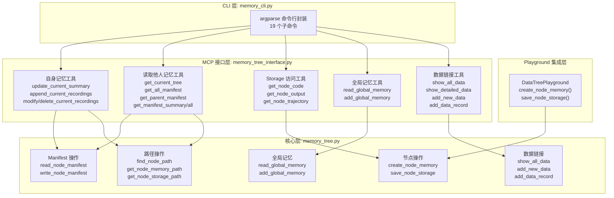
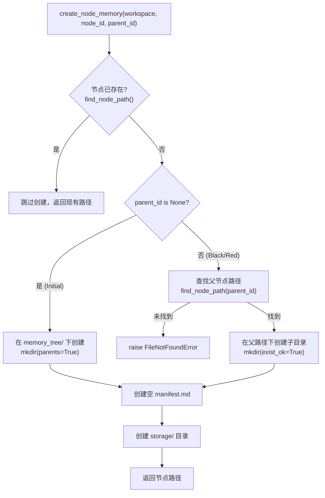
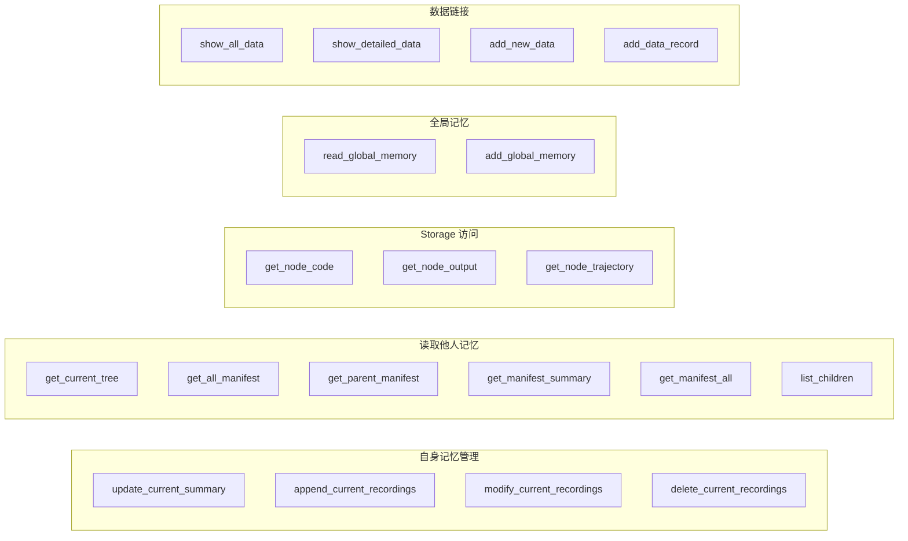

DataMaster 框架在 UCT 搜索过程中构建一棵内存中的搜索树，每个 `UCTNode` 实例承载计划、代码、指标和奖励等运行时状态。**Memory Tree** 是这棵搜索树在文件系统上的持久化投影——通过文件夹嵌套表达父子关系，通过 `manifest.md` 与 `storage/` 目录分离"Agent 主动写入的知识总结"与"系统自动保存的执行数据"两类记忆。这种设计使得搜索过程中的知识可以在节点间共享、在实验结束后审计、在消融实验中按需关闭，同时也为 Agent 提供了 MCP 工具接口来动态读写自身和他人的记忆。

> **📖 小白导读**
> - 这篇讲什么：DataMaster 把每个"实验节点"（一次完整的写代码、跑代码、打分）的运行记录，以及 AI 自己写的笔记，存成磁盘上的文件夹，文件夹嵌套关系就是节点的父子关系。这套文件夹叫 Memory Tree（记忆树）。
> - 读之前先知道：**UCT 搜索树**（一种"先试几个方案、看分数、再决定往哪个方向继续试"的树状搜索，UCT 是它挑选下一个节点时用的打分公式）；**agent**（能自己决定调用哪些工具的 AI）；**MCP**（Model Context Protocol，让 AI 调用外部工具的统一协议，可以理解成"工具插座"）；**workspace**（一次实验的工作目录）。
> - 读完你能明白：记忆文件夹长什么样、系统自动存什么、AI 能用哪些工具读写。要特别注意一个容易误解的点：**这些记忆文件不会自动塞进 AI 的提示词（prompt，即发给大模型的那段文字）**，AI 必须主动调用工具才能读到；真正自动进入提示词的只有另一个机制 `fetch_child_memory`，而且它的"设计"一栏恒为空（见下文）。

## 文件系统布局

Memory Tree 的根目录位于工作空间的 `memory_tree/` 文件夹下，整体结构与 UCT 搜索树一一对应：

```
workspace/memory_tree/
├── global_memory.md          # 跨节点全局记忆
├── data_link.json            # 外部数据集链接记录
├── {initial_node_id}/        # Initial 节点（顶层）
│   ├── manifest.md           # Agent 主动写入的知识总结（初始为空）
│   └── storage/              # 系统自动保存的执行数据
│       ├── trajectory.json   # 多轮对话记录
│       ├── code.py           # 节点代码备份
│       ├── stdout.txt        # 运行结果和控制台输出
│       └── submission.csv    # 提交文件备份
│   ├── {black_child_id}/    # Black 子节点（嵌套于父节点下）
│   │   ├── manifest.md
│   │   └── storage/
│   │   └── {grandchild_id}/  # 孙节点（递归结构）
│   │       ├── manifest.md
│   │       └── storage/
│   └── {red_child_id}/       # Red 子节点
│       ├── manifest.md
│       └── storage/
```

关键设计约束在于：**文件夹嵌套即父子关系**。Initial 节点直接位于 `memory_tree/` 根下（`parent_id=None`），其 Black/Red 子节点作为子文件夹嵌套其中，孙节点继续递归嵌套。`storage/` 是唯一被排除在树结构遍历之外的子目录——它纯粹是数据容器，不参与节点层级语义。

补充两点（已核对代码）：第一，UCT 树的 root 节点（只负责派生 initial 节点的占位根）没有对应文件夹，只有 initial 节点及其后代才会调用 `create_node_memory`。第二，`global_memory.md` 和 `data_link.json` 并不是一开始就存在：它们由 `init_global_memory` / `init_data_link` 在第一次被读写时才创建（`memory_tree.py` 的 `init_global_memory`、`init_data_link`），所以刚启动的实验里看不到这两个文件是正常的。

Sources: [memory_tree.py](playground/search_dataset_tools/memory_tree.py#L1-L16), [manifest_design.md](playground/search_dataset_tools/manifest_design.md#L5-L30), [SKILL.md](evomaster/skills/memory-tools/SKILL.md#L15-L28)

## 核心模块架构

Memory Tree 的实现分为三层：**核心层**提供路径操作与文件读写原语，**MCP 接口层**将核心层暴露为 Agent 可调用的工具，**CLI 层**提供命令行封装用于调试和 Skills 集成。



三层之间的依赖方向是单向的：Playground 直接调用核心层的 `create_node_memory` 和 `save_node_storage`；MCP 接口层通过 Python import 调用核心层函数并以 `@mcp.tool()` 装饰器（Python 里给函数"贴标签"的写法，这里的标签意思是"把这个函数登记为 AI 可调用的工具"）暴露给 Agent；CLI（command-line interface，命令行接口）层封装 MCP 接口层的所有 19 个函数。这套架构确保了核心逻辑的唯一性——无论 Agent 通过 MCP 工具、CLI 还是 Playground 自动调用，最终都汇聚到同一组文件操作原语上。

需要注意的是：CLI 层位于 `evomaster/skills/memory-tools/scripts/` 下，它 import 的是同目录下的那份拷贝（去掉了 `FastMCP` 和 `@mcp.tool()` 的普通函数版本，`memory_tree.py` 与 `playground/search_dataset_tools/` 下的一致，`memory_tree_interface.py` 则不同），而不是 `playground/` 下的 MCP 版本。另外，DataMaster 的 agent 配置里没有 `skills:` 键，这套 skills 拷贝在 DataMaster 运行中并没有被使用（依据 `config_base.yaml` 的 agents 段；`evomaster/skills/memory-tools/scripts/memory_cli.py` 头部 import）。

Sources: [memory_tree.py](playground/search_dataset_tools/memory_tree.py#L131-L200), [memory_tree_interface.py](playground/search_dataset_tools/memory_tree_interface.py#L1-L28), [memory_cli.py](evomaster/skills/memory-tools/scripts/memory_cli.py#L38-L58), [playground.py](playground/data_master/core/playground.py#L36-L39)

## 路径解析与节点查找

Memory Tree 面临的核心挑战是：**给定一个 `node_id`，如何在可能深层嵌套的目录树中定位其文件夹？** UCT 搜索树使用 UUID（一串随机生成、几乎不会重复的编号，例如 `3f2a9c...`）作为节点 ID，但 UUID 本身不编码层级信息，因此路径解析需要从 `memory_tree/` 根开始搜索。举例：要找节点 `c3` 的文件夹，而它实际位于 `memory_tree/a1/b2/c3/`，函数必须一层层往下翻目录才能找到。

`find_node_path` 函数采用 **BFS 遍历 + 深度优先策略**（BFS 即广度优先搜索：先看完这一层所有文件夹，再看下一层）：广度优先遍历整棵树，收集所有名称匹配 `node_id` 的目录，最终返回深度最大的匹配路径。排除 `storage` 目录以避免误匹配。这种设计处理了理论上可能出现的同名节点（虽然 UUID 保证唯一性，但兼容性考虑使代码更健壮）：

```python
# BFS 遍历 memory_tree/，收集所有匹配 node_id 的目录
queue = deque([memory_root])
while queue:
    current_dir = queue.popleft()
    if current_dir.name == node_id and current_dir != memory_root:
        matches.append(current_dir)
    for item in current_dir.iterdir():
        if item.is_dir() and item.name != "storage":
            queue.append(item)
# 返回深度最大的匹配
return max(matches, key=get_depth)
```

基于 `find_node_path`，其他路径获取函数构建了完整的导航体系：

| 函数 | 输入 | 输出 | 用途 |
|------|------|------|------|
| `get_memory_tree_root` | workspace | `workspace/memory_tree/` | 获取根目录 |
| `get_node_memory_path` | workspace, node_id | 节点文件夹完整路径；找不到时记录一条 error 日志，并返回兜底的平铺路径 `memory_tree/{node_id}/`（不抛异常） | 定位节点 |
| `get_node_storage_path` | workspace, node_id | `节点路径/storage/` | 定位存储目录 |
| `get_node_manifest_path` | workspace, node_id | `节点路径/manifest.md` | 定位知识文件 |
| `get_parent_id` | workspace, node_id | 父目录名或 None | 获取父节点 ID |
| `list_child_nodes` | workspace, node_id | 子目录名列表 | 遍历子节点 |

`get_parent_id` 的实现巧妙地利用了文件系统的层级语义：通过 `find_node_path` 获取节点的完整路径后，取其 `.parent` 的 `.name` 即为父节点 ID。若父目录就是 `memory_root`，则返回 `None` 表示顶层节点。

Sources: [memory_tree.py](playground/search_dataset_tools/memory_tree.py#L30-L68), [memory_tree.py](playground/search_dataset_tools/memory_tree.py#L71-L128), [memory_tree.py](playground/search_dataset_tools/memory_tree.py#L336-L388), [memory_tree_implementation.md](playground/search_dataset_tools/memory_tree_implementation.md#L82-L85)

## 节点创建与存储保存

Memory Tree 的节点创建发生在 UCT 搜索树扩展时。`create_node_memory` 函数负责在文件系统中建立与新的 `UCTNode` 对应的目录结构：



该函数在三个场景下被调用，均位于 `DataTreePlayground` 的搜索主循环中：

**场景一：Initial 节点创建**——Phase 1 串行阶段中，`_handle_phase1` 方法在 root 节点扩展 initial 子节点时调用 `create_node_memory(workspace, node.id, parent_id=None)`，直接在 `memory_tree/` 根下创建。

**场景二：批量扩展**——Initial 节点完成后，`_batch_expand_after_initial` 方法根据搜索配置创建一批 Black/Red 子节点，每个都调用 `create_node_memory(workspace, child_node.id, parent_id=target.id)`，嵌套于 Initial 节点目录下。

**场景三：事件驱动扩展**——Phase 2 并行阶段中，`_create_expand_node_fn` 返回的闭包在节点完成并需要扩展子节点时被调用，同样通过 `create_node_memory(workspace, child_node.id, parent_id=node.id)` 创建。

所有三个场景都受 `self.use_memory` 开关控制（消融即"关掉某个功能，看结果变差多少，以此衡量这个功能的价值"）。当消融配置中 `use_memory=False` 时，跳过 Memory Tree 创建，仅记录日志。节点创建后会保存一份"节点已创建"的快照（`save_node_snapshot` 或 `_save_node_created_snapshot`，这是另一套日志，与 Memory Tree 无关）。

节点执行完成后，`_execute_and_process_node` 方法调用 `save_node_storage` 将执行数据持久化到 `storage/` 目录：

| 存储文件 | 内容来源 | 写入方式 |
|---------|---------|---------|
| `trajectory.json` | `agent.trajectory.model_dump(mode="json")` | `json.dump` |
| `code.py` | `res.get("code", "")` | `write_text` |
| `stdout.txt` | `res.get("exec", {}).get("stdout", "")` | `write_text` |
| `submission.csv` | `copied`（提交文件路径） | `shutil.copy` |

每个文件的保存都包裹在独立的 try/except 中（Python 的"出错也不中断"写法），确保单个文件保存失败不会影响其他文件。`save_node_storage` 同样受 `use_memory` 开关控制——关闭时跳过所有存储操作。`submission.csv` 只在提交文件存在时才复制。

两个实际细节：其一，`trajectory.json` 取自该节点所用 agent 的对话轨迹（`agent.trajectory.model_dump(mode="json")`），agent 取不到轨迹时写入空字典 `{}`（`playground.py` 的 `_execute_and_process_node`）。其二，`stdout.txt` 里存的是 `res["exec"]["stdout"]`，也就是整段运行输出，没有截断。

Sources: [memory_tree.py](playground/search_dataset_tools/memory_tree.py#L131-L200), [memory_tree.py](playground/search_dataset_tools/memory_tree.py#L203-L265), [playground.py](playground/data_master/core/playground.py#L693-L732), [playground.py](playground/data_master/core/playground.py#L778-L847), [playground.py](playground/data_master/core/playground.py#L927-L950), [playground.py](playground/data_master/core/playground.py#L79-L90)

## Manifest 格式与读写机制

`manifest.md` 是 Memory Tree 中唯一由 Agent 自主写入的知识文件，采用结构化 Markdown 格式，包含两个固定段落：

```markdown
# Manifest

## TL;DR

{overall_summary}

## Recordings

1. Recording 1: {content_summary}
{recording_1_content}

2. Recording 2: {content_summary}
{recording_2_content}
```

**TL;DR** 段落是节点的总体摘要，由 `update_current_summary` 工具覆盖式更新。**Recordings** 段落是带编号的记录列表，每条 Recording 包含一行摘要标题（`Recording N: summary`）和后续的详细内容行。Recordings 支持追加、修改和删除操作。**编号规则要小心**：每次写回时 `format_manifest` 都用 `enumerate(recordings, start=1)` 把所有条目重新编成 1、2、3……所以删除中间一条后，后面的条目编号会整体前移（例如删掉 2 号，原来的 3 号变成 2 号），AI 脑子里记的旧编号可能就对不上了；`get_next_recording_id` 虽然写了"最大编号加一"的逻辑，但没有任何工具调用它（死代码，即写了但从未被执行的代码）。新建节点时 `manifest.md` 是一个空文件，第一次通过工具写入后才有上面的结构。

MCP 接口层实现了 manifest 的**解析-修改-重写**流水线（manifest 即"清单"，这里指节点的笔记文件）。`parse_manifest` 函数通过正则表达式 `^(\d+)\.\s+Recording\s+(\d+):\s*(.+)$` 识别 Recording 条目边界，将 Markdown 文本解析为 `{"tldr": str, "recordings": [{"id", "summary", "content"}]}` 结构化字典。`format_manifest` 函数执行逆操作，将结构化数据重新格式化为 Markdown。所有修改操作（update/append/modify/delete）都遵循"读取→解析→修改→重新格式化→覆盖写入"的模式：

| MCP 工具 | 操作语义 | 实现方式 |
|---------|---------|---------|
| `update_current_summary` | 覆盖 TL;DR | 解析→保留 recordings→重新格式化→overwrite |
| `append_current_recordings` | 追加 Recording | 解析→追加新条目→重新格式化→overwrite |
| `modify_current_recordings` | 修改指定 Recording | 解析→查找并更新字段→重新格式化→overwrite |
| `delete_current_recordings` | 删除指定 Recording | 解析→过滤→重新格式化→overwrite |

核心层的 `write_node_manifest` 提供三种写入模式：`overwrite`（覆盖全文）、`append`（追加到末尾）、`prepend`（插入到开头）。MCP 接口层始终使用 `overwrite` 模式，因为解析-重写流程已经生成了完整的文件内容。

这个"解析再重写"的做法有三个副作用，都可以在 `parse_manifest` / `format_manifest` 里验证：
1. TL;DR 段落里以 `#` 开头的行在解析时会被丢弃（`not line.startswith("#")`），所以 AI 如果在 TL;DR 里写了 Markdown 小标题，下次任何一次更新都会让这些行消失。
2. 如果某条 recording 的正文里恰好有一行形如 `1. Recording 3: xxx`，会被误认为新条目。
3. 工具的返回值只是 `Successfully updated manifest: {路径}` 之类的字符串，`append_current_recordings` 的文档字符串虽然写着"返回新的 recording ID"，实际并不返回编号。

此外这些工具**没有任何权限检查**：`node_id` 是调用者自己传的参数，AI 理论上可以改写任何节点的 manifest，"只写自己的"只是提示词里的约定。

Sources: [memory_tree_interface.py](playground/search_dataset_tools/memory_tree_interface.py#L61-L159), [memory_tree_interface.py](playground/search_dataset_tools/memory_tree_interface.py#L186-L311), [memory_tree.py](playground/search_dataset_tools/memory_tree.py#L267-L333), [manifest_template.md](playground/search_dataset_tools/manifest_template.md#L1-L18), [manifest_design.md](playground/search_dataset_tools/manifest_design.md#L32-L73)

## MCP 工具接口体系

Agent 通过 MCP（Model Context Protocol）与 Memory Tree 交互。`memory_tree_interface.py` 使用 FastMCP 框架（一个帮你快速写 MCP 服务的 Python 库）注册了 **19 个工具**，分为五大功能域。每个工具的第一个参数都是 `workspace`（工作目录的绝对路径），需要定位节点的工具再带一个 `node_id`：



**自身记忆管理**域允许 Agent 在探索过程中实时更新自己的 manifest。`update_current_summary` 覆盖 TL;DR 摘要，`append_current_recordings` 追加新的 Recording 条目（追加在末尾，编号在写回时统一重排），`modify_current_recordings` 和 `delete_current_recordings` 分别修改和删除指定 ID 的 Recording。

**读取他人记忆**域是 Memory Tree 跨节点知识共享的核心。`get_current_tree` 调用系统 `tree` 命令（Linux 上用 `apt install tree` 安装；没装时只返回一句提示，不会报错）生成排除 `storage` 和 `manifest.md` 的目录树可视化。`get_all_manifest` 递归遍历整个 Memory Tree，收集所有节点的 TL;DR 摘要并格式化输出。`get_parent_manifest` 通过 `get_parent_id` 定位父节点后读取其完整 manifest。`get_manifest_summary` 和 `get_manifest_all` 分别返回节点的摘要版本（仅 TL;DR + Recording 标题）和完整版本。`list_children` 返回子节点 ID 列表。

**Storage 访问**域允许 Agent 读取任意节点的执行数据文件。`get_node_code`、`get_node_output`、`get_node_trajectory` 分别读取 `code.py`、`stdout.txt`、`trajectory.json`。`read_storage_file` 核心函数对 `.json` 文件执行 `json.load` + 格式化输出，对其他文件直接返回文本内容。

MCP 服务器通过 JSON 配置注册到 Agent 环境。在 `base_all.json`、`base_initial.json` 和 `base_datanode.json` 三种节点配置中，`memory_tree` 始终作为一个独立的 MCP Server 存在：

```json
{
  "memory_tree": {
    "command": "python",
    "args": ["playground/search_dataset_tools/memory_tree_interface.py"],
    "env": { ... }
  }
}
```

Initial 专用配置 `base_initial.json` 仅包含 `operate_submission_for_initial` 和 `memory_tree` 两个 MCP Server，所以 Memory Tree 是三种配置里唯一都出现的外部工具。但**实际运行时并没有按节点类型区分工具**：`config_base.yaml` 里排在最前的 `nouse` agent 使用 `$mcp_node_all`（对应 `base_all.json`），而 `evomaster/core/playground.py` 的 `_setup_agent` 只在第一次遇到带 MCP 配置的 agent 时初始化 MCP 连接（`if self.mcp_manager is None`），之后的 agent 复用同一套工具。结果是 initial、black、red 三类节点看到的是同一套完整工具，"各自该用什么"主要靠提示词来约束。（这是对 `evomaster/core/playground.py` 第 580-586 行逻辑的解读。）另外，配置里 `args` 写的是相对路径 `playground/search_dataset_tools/memory_tree_interface.py`，因此要从仓库根目录启动才能找到它（推断）。

Sources: [memory_tree_interface.py](playground/search_dataset_tools/memory_tree_interface.py#L186-L311), [memory_tree_interface.py](playground/search_dataset_tools/memory_tree_interface.py#L319-L562), [memory_tree_interface.py](playground/search_dataset_tools/memory_tree_interface.py#L495-L541), [base_all.json](configs/data_master/base_all.json#L25-L35), [base_initial.json](configs/data_master/base_initial.json#L14-L24), [base_datanode.json](configs/data_master/base_datanode.json#L14-L24)

## 全局记忆与数据链接

Memory Tree 根目录下维护两个跨节点共享的特殊文件，它们不附属于任何特定节点，而是服务于整个搜索过程。

**`global_memory.md`** 是跨节点知识共享的全局通道。`init_global_memory` 在首次访问时创建该文件并写入初始模板。`read_global_memory` 读取全文，`add_global_memory` 追加带自增编号的条目（格式为 `N. {summary}\n{content}`）。Agent 在发现重要的跨节点知识（如数据特征洞察、通用预处理策略）时通过 `add_global_memory` 工具写入全局记忆，其他节点的 Agent 可以通过 `read_global_memory` 读取这些经验。

**注意：全局记忆不会自动进入提示词。** 在整个 `playground/data_master` 里，除了提示词模板 `memory.md` 里"强烈建议开始前先调用 `memory_tree_read_global_memory`"这类文字要求，没有任何代码会把 `global_memory.md` 或 `manifest.md` 的内容读出来拼进提示词；AI 不主动调用工具，就读不到（依据对 `playground.py`、`exp/*.py` 的检索）。`memory.md` 本身只是"使用说明书"，它会被整份塞进提示词，告诉 AI 有哪些工具、什么时候该用。

另一个小坑：这些文件的读-改-写没有任何锁（lock，防止两个人同时改同一个文件的机制），并行 worker 同时写同一个文件会互相覆盖（推断，`memory_tree.py` 中没有任何锁相关代码）。

**`data_link.json`** 是外部数据集的注册表与评论系统，以 JSON 格式存储。其数据结构为：

```json
{
  "{dataset_name}": {
    "dataset_id": 1,
    "path": "/absolute/path/to/dataset",
    "init_description": "初始描述文本",
    "comment": [
      {"node_id": "abc123", "comment": "该数据集对提升指标有显著贡献"}
    ]
  }
}
```

Red 节点在引入外部数据后通过 `add_new_data` 注册新条目（`dataset_id` 自动取最大值+1，用路径最后一段作为键，重名直接报错），Black 节点在评估数据效果后通过 `add_data_record` 追加评论。`show_all_data` 展示所有数据集的摘要（每个数据集最多显示 3 条评论；代码是 `comments[:3]`，取的是**最早写入的 3 条**，而不是"最近"的 3 条，超出的只显示"还有 N 条"），`show_detailed_data` 展示指定数据集的全部评论记录。这一机制建立了一个**数据集发现-评估反馈闭环**：Red 节点负责引入数据并创建记录，Black 节点负责评估数据并添加评论，后续节点通过查询评论来决定是否继续使用该数据集。这里的分工是提示词里的约定，代码并不强制：Black 节点的提示词同样要求把自己生成的数据集存到 `data_links/` 并用 `memory_tree_add_new_data` 登记（`prompts/black/user_prompt.md` 第 134 行附近）。

`data_link.json` 只是一份"登记簿"：`add_new_data` 不会检查路径是否存在，也不会检查是否真的位于 `data_links/` 下，只是原样记下传进来的字符串。更完整的"数据池"说明见第 14 篇。

Sources: [memory_tree.py](playground/search_dataset_tools/memory_tree.py#L466-L558), [memory_tree.py](playground/search_dataset_tools/memory_tree.py#L560-L804), [memory_tree_interface.py](playground/search_dataset_tools/memory_tree_interface.py#L569-L677), [SKILL.md](evomaster/skills/memory-tools/SKILL.md#L9-L13)

## UCT 树与 Memory Tree 的双向映射

UCT 搜索树和 Memory Tree 在"节点 ID 与父子关系"上一一对应，但二者的数据流方向不同，而且**内容并不互通**。UCT 树是**运行时内存对象**，由 `UCTNode`（dataclass，Python 里专门用来装一堆字段的"数据类"）构成，通过 `parent`/`children` 引用维护拓扑结构；Memory Tree 是**持久化文件系统对象**，通过目录嵌套维护拓扑。二者的映射关系如下：

| 维度 | UCT 树（内存） | Memory Tree（文件系统） |
|------|---------------|----------------------|
| 节点标识 | `UCTNode.id`（UUID hex） | 文件夹名（同名 UUID hex） |
| 父子关系 | `parent` 引用 / `children` set | 目录嵌套（父目录包含子目录） |
| 节点计划 | `UCTNode.plan`（initial/black/red 的 `run()` 都返回 `plan: ""`，所以恒为空串） | 没有直接对应；Agent 想记什么自己写进 `manifest.md` |
| 节点代码 | `UCTNode.code` | `storage/code.py` |
| 执行输出 | `UCTNode.stdout` | `storage/stdout.txt` |
| 验证指标 | `UCTNode.metric.value` | Memory Tree 里**没有**单独存指标（`storage/` 只有 submission.csv 本身）；指标在运行日志的节点快照里（`logs/uct_nodes`） |
| 对话轨迹 | `Agent.trajectory` | `storage/trajectory.json` |
| 子节点摘要 | `fetch_child_memory()` 返回的字符串（只在内存里由 `UCTNode` 字段拼成，不读磁盘） | 没有对应：它和 `manifest.md` 之间没有任何代码联系 |

**从 UCT 树到 Memory Tree 的数据流**由 Playground 自动驱动。节点创建时，`create_node_memory` 在文件系统中建立对应目录；节点执行完成后，`save_node_storage` 将 Agent 的 trajectory、代码、输出和提交文件写入 `storage/`。这条流向是单向的——系统写入的数据 Agent 只能通过 MCP 工具读取，不能直接修改。

**从 Memory Tree 到 Agent 的知识流**必须区分两条完全独立的路径，原文常把它们混为一谈：

- **路径 A（自动进提示词，与 Memory Tree 文件无关）**：`UCTNode.fetch_child_memory` 方法遍历"父节点的所有子节点"（也就是当前节点的兄弟们，当前节点自己尚未完成，会被跳过），把每个已完成兄弟的 `plan`、`analysis`、`metric` 拼成字符串，作为提示词里"Historical Attempts"（历史尝试）一栏注入给 black/red 节点（`prompts/black/user_prompt.md`、`prompts/red/user_prompt.md` 的 `{memory}`；initial 的提示词里没有 `{memory}`）。这段字符串完全由内存里的 `UCTNode` 字段拼出，**不读 `manifest.md`**。而且内容很单薄：`Design:` 后面是 `child.plan`，各个 exp 的返回值里 `plan` 恒为 `""`，所以 Design 恒为空；默认 `include_code=False`，不含代码；`Results:` 取自 `node.analysis`，其值来自 `build_review` 里 stdout 的**最后 500 个字符**（外加若干 `[metric]`、`[grading]` 标记行）；有 bug 的兄弟只会得到固定的两句"有 bug / 换个方法"（`uct.py` 的 `fetch_child_memory`、`playground_helpers.py` 的 `build_review`）。这里的"有 bug"判定是 `is_bug = detail.is_bug or metric is None`，不看有没有提交文件。
- **路径 B（AI 主动调用工具）**：AI 通过 MCP 工具读 `manifest.md`、`global_memory.md`、`storage/*`。**没有任何代码把这些内容自动注入提示词**，只有提示词模板 `memory.md`（工具说明书）里要求 AI 去读。

因此"系统自动注入的是结构化摘要，Agent 自主读的是笔记"这句话只对了一半：自动注入的那份并不来自 Memory Tree，质量也远不如名字听上去那样丰富。

`_execute_and_process_node` 方法中的代码清晰展示了这两条数据流的位置：

```python
# 路径 A：UCT 树（内存）→ 提示词（与 Memory Tree 文件无关）
parent_node = node.parent
if self.use_memory and parent_node:
    memory = parent_node.fetch_child_memory()  # 从 UCT 树提取
else:
    memory = ""

# ... Agent 执行 ...

# 数据流：UCT 树 → Memory Tree（系统自动保存）
if self.use_memory:
    save_node_storage(
        workspace=workspace,
        node_id=node.id,
        trajectory=trajectory_dict,
        code=res.get("code", ""),
        stdout=res.get("exec", {}).get("stdout", ""),
        submission_path=copied,
    )
```

`memory` 变量从 UCT 树中提取的摘要被作为 prompt 的一部分传递给 Agent，而 `save_node_storage` 则将执行结果写入文件系统。Agent 在执行过程中还可以通过 MCP 工具独立读取 Memory Tree 中其他节点的 manifest 和 storage 文件（即上文的路径 B），这条路径完全由 Agent 的自主决策驱动，不受 Playground 控制。

Sources: [uct.py](playground/data_master/core/utils/uct.py#L320-L362), [uct.py](playground/data_master/core/utils/uct.py#L451-L486), [playground.py](playground/data_master/core/playground.py#L882-L950), [memory_tree_implementation.md](playground/search_dataset_tools/memory_tree_implementation.md#L68-L81)

## 消融开关与并发注意事项

Memory Tree 的创建和存储操作受 `use_memory` 消融开关控制。该开关在 `DataTreePlayground.__init__` 中从配置的 `ablation` 段读取，默认为 `True`：

```python
ablation_cfg = getattr(self.config, "ablation", {}) or {}
self.use_memory = bool(ablation_cfg.get("use_memory", True))
```

当 `use_memory=False` 时，所有集成点（Initial 节点创建、批量扩展、事件驱动扩展、节点完成存储）都跳过 Memory Tree 操作并记录日志，同时 `fetch_child_memory` 的注入也被置为空字符串。关闭后 Agent 不会获得自动注入的 child memory 摘要，系统也不再建目录、存 storage。**但 MCP 工具并没有被移除，提示词里仍然要求 AI 使用它们**：原文说"无法通过 MCP 工具读写 manifest（因为目录不存在）"并不准确——`write_node_manifest` 会 `mkdir(parents=True)`，`get_node_memory_path` 找不到节点时又会退回平铺路径 `memory_tree/{node_id}/`，所以 AI 的写入仍会成功，只是落在一个平铺目录里；读取其他节点的 `storage` 文件才会返回"File not found"（依据 `memory_tree.py` 的 `get_node_memory_path`、`write_node_manifest`、`read_storage_file`）。搜索流程本身不受影响。

关于**并发访问**，当前实现未处理并发写入冲突（整个 `memory_tree.py` 和 `memory_tree_interface.py` 里没有任何锁）。默认配置是 4 个并行 worker（worker：同时干活的线程）共享同一个 workspace（`config_base.yaml` 第 162 行 `split_workspace_for_exp: false`）。多个 Worker 可能同时调用 `create_node_memory` 或 `save_node_storage` 操作不同的节点目录。由于每个节点有唯一的 UUID，文件层面的写入冲突概率极低，但 `find_node_path` 的 BFS 遍历在并发创建时可能遇到目录树不一致的竞态条件（推断）。实现文档建议在并行场景下为每个 Worker 分配独立的 workspace（`exp_0/`、`exp_1/`），这通过 `_resolve_worker_workspace` 方法在配置 `split_workspace_for_exp=True` 时实现。但要注意：`create_node_memory` / `save_node_storage` 用的 workspace 始终是主 workspace（`self.session.config.workspace_path`），而 Agent 的提示词里 `{workspace}` 是各 worker 自己的目录，所以真开启切分时，AI 工具指向的 `memory_tree` 与系统实际创建的可能不是同一个（推断，未实测）。

关于**性能**，`find_node_path` 的 BFS 搜索复杂度为 O(N)（N 为 Memory Tree 中的节点总数），在节点数量通常可控（<100）的实际场景中性能可接受。`save_node_storage` 中的每个文件操作都独立包裹异常处理，确保单个文件保存失败不会中断整个存储流程。

关于**存储空间**，`trajectory.json` 和 `submission.csv` 可能很大。当前实现没有自动清理策略——Memory Tree 的内容在整个实验运行期间持续累积，实验结束后作为审计资产保留。如需控制存储空间，需要在实验完成后手动清理或在 Playground 层面添加轮转策略。

Sources: [playground.py](playground/data_master/core/playground.py#L79-L90), [playground.py](playground/data_master/core/playground.py#L409-L417), [playground.py](playground/data_master/core/playground.py#L705-L711), [playground.py](playground/data_master/core/playground.py#L927-L950), [memory_tree_implementation.md](playground/search_dataset_tools/memory_tree_implementation.md#L173-L182)

## Skills 集成与 CLI 封装

Memory Tree 的代码在 `evomaster/skills/memory-tools/` 下有一份镜像副本，作为独立技能分发给 Agent。该技能包含三个脚本文件：

`scripts/memory_tree.py` 是核心模块的副本（与 playground 下的文件内容一致），`scripts/memory_tree_interface.py` 是接口层的改写版（去掉了 FastMCP 和 `@mcp.tool()`，变成普通 Python 函数，并把 import 改成同目录导入），`scripts/memory_cli.py` 是 CLI 封装层——它用 argparse（Python 标准库里解析命令行参数的模块）将 19 个函数映射为子命令，使 Agent 可以通过 `python memory_cli.py -w WORKSPACE <command>` 的方式调用：

```bash
# 更新当前节点摘要
python memory_cli.py -w /workspace update-summary -n NODE_ID --summary "..."

# 追加 Recording
python memory_cli.py -w /workspace append-recording -n NODE_ID --summary "title" --content "detail"

# 可视化内存树
python memory_cli.py -w /workspace tree

# 读取父节点 manifest
python memory_cli.py -w /workspace parent-manifest -n NODE_ID

# 获取节点代码
python memory_cli.py -w /workspace node-code -n NODE_ID

# 添加全局记忆
python memory_cli.py -w /workspace add-global --summary "title" --content "detail"

# 添加数据集记录
python memory_cli.py -w /workspace add-data --path /abs/path --desc "description"
```

CLI 封装的核心价值在于：它使得 Memory Tree 工具不依赖 MCP 协议运行时即可使用。Agent 可以通过 Bash 工具直接调用 CLI 命令，绕过 MCP Server 的进程启动开销。不过在 DataMaster 里，agent 配置没有 `skills:` 键，这条路径实际并未启用（未验证 skills 是否在其他入口被加载）。`SKILL.md` 中定义了推荐的使用流程：探索前读取全局记忆和父节点 manifest → 探索中追加 Recordings → 发现重要知识时更新全局记忆 → 节点完成时更新 TL;DR 摘要 → Red 节点创建数据链接、Black 节点添加数据评论。

Sources: [SKILL.md](evomaster/skills/memory-tools/SKILL.md#L1-L110), [memory_cli.py](evomaster/skills/memory-tools/scripts/memory_cli.py#L1-L200), [memory_tree_implementation.md](playground/search_dataset_tools/memory_tree_implementation.md#L160-L171)

Memory Tree 的设计体现了 DataMaster 框架的核心哲学：将搜索过程中的知识显式持久化为可审计的文件系统结构，同时通过 MCP 工具赋予 Agent 自主读写记忆的能力。这种"系统自动保存 + Agent 主动总结"的双层记忆机制，使得搜索过程中的知识不会随节点执行结束而丢失，而是累积为可被后续节点利用的结构化资产。

理解了 Memory Tree 的文件系统设计与工具接口后，建议继续阅读 [manifest.md 与节点知识库总结机制](13-manifest-md-yu-jie-dian-zhi-shi-ku-zong-jie-ji-zhi) 以深入了解 Agent 如何利用 manifest 格式组织探索知识，以及 [Data Pool 与外部数据源引入](14-data-pool-yu-wai-bu-shu-ju-yuan-yin-ru-hong-jie-dian-shu-ju-xia-zai) 以了解 `data_link.json` 如何与红节点的数据下载流程联动。

## 本文修订记录

- 原文把"系统自动注入的 child memory 摘要"和"manifest 笔记"说成互补的同一体系；核对后明确拆成路径 A（`fetch_child_memory`，由内存里的 `UCTNode` 字段拼成，不读磁盘文件）和路径 B（AI 主动调工具）。全局记忆、manifest 不会自动进提示词；`fetch_child_memory` 的 Design 恒为空（各 exp 返回 `plan: ""`），默认不含代码，Results 只是 stdout 末尾 500 字符。依据 `uct.py` 的 `fetch_child_memory`、`playground_helpers.py` 的 `build_review`、`exp/*.py`。
- 原文称 recording ID"从 1 递增"、`append` 返回新 ID；实际 `format_manifest` 每次重排编号，删除中间条目会让后面编号前移，`get_next_recording_id` 为死代码，返回值只是"Successfully updated manifest"。依据 `memory_tree_interface.py` 第 133-178 行及各工具函数。
- 原文称关闭 `use_memory` 后 AI"无法通过 MCP 工具读写 manifest"，不准确：写入会通过 `mkdir(parents=True)` 和兜底路径落到平铺目录。依据 `memory_tree.py` 的 `get_node_memory_path`、`write_node_manifest`。
- 修正 CLI 子命令数 18 改为 19；`memory-tools` 下的 interface 是去掉 MCP 装饰器的改写版而非"副本"，且 DataMaster 的 agent 配置没有 `skills:`，该目录未被使用。
- 修正映射表：`plan` 恒为空、Memory Tree 不存指标、`fetch_child_memory` 与 `manifest.md` 无代码联系；修正代码片段注释（`fetch_child_memory` 是"UCT 树到提示词"，不是"到 Memory Tree"）。
- 补充：`show_all_data` 的"最多 3 条评论"实为最早的 3 条（`comments[:3]`）；root 节点无文件夹；global_memory/data_link 惰性创建；MCP 实际只按第一个带 MCP 配置的 agent 初始化一次，三类节点看到同一套工具（`evomaster/core/playground.py` 第 580-586 行）；切分 workspace 时 memory_tree 仍建在主 workspace（推断）。
- 未能验证：`tree` 命令多个 `-I` 参数的具体行为；并发下 BFS 的竞态（已标推断）。
