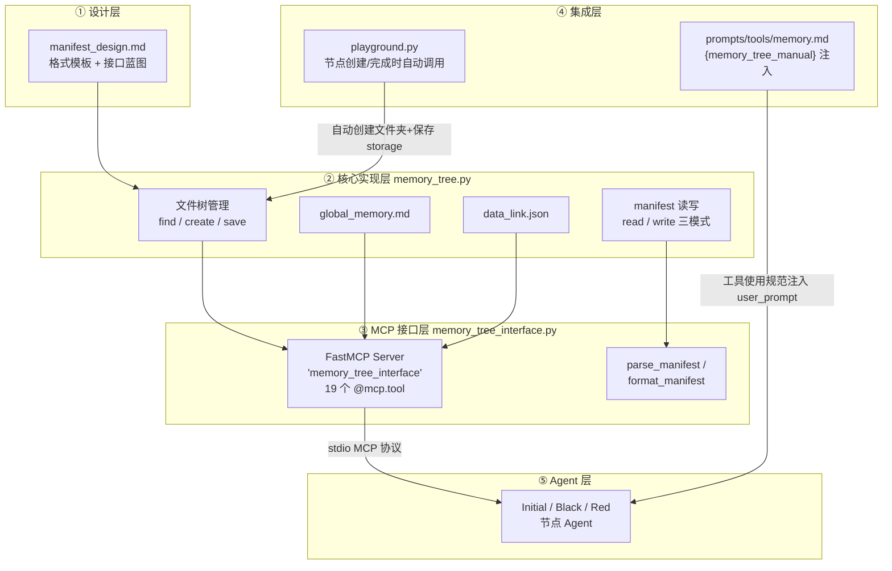
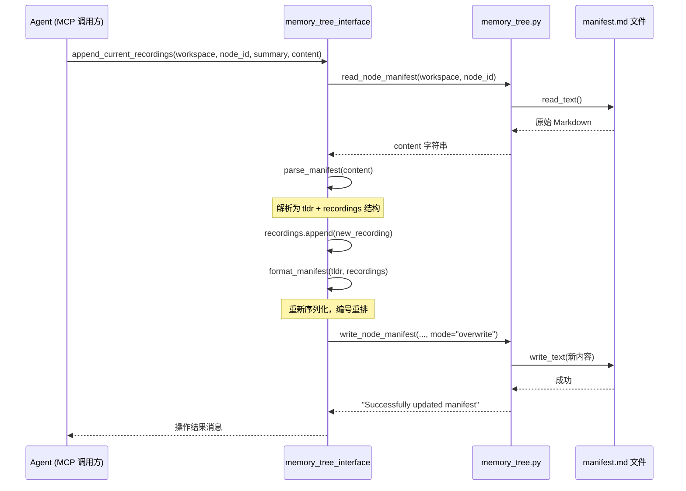

在 DataMaster 的 DataTree 搜索中，每个节点的 Agent 执行会消耗大量上下文（多轮工具调用、代码迭代、评估反馈），但这些探索经验若随会话结束而消散，后续节点就必须重复踩坑。**manifest.md 机制**正是为解决这一问题而生：它将每个节点的探索经验固化为树形文件系统中的一个 Markdown 知识库，由 Agent 在探索过程中自主写入，并允许任意节点跨树读取——这是 DataMaster 区别于 ML-Master 基线的核心记忆增强之一。本文从设计意图、文件格式、核心实现、MCP 工具接口、Playground 集成五个层面完整剖析该机制，适合需要二次开发记忆系统或调试消融实验的开发者阅读（新手也可以按下面的导读读懂大意）。

Sources: [manifest_design.md](playground/search_dataset_tools/manifest_design.md#L1-L30)

> **📖 小白导读**
> - 这篇讲什么：每个搜索节点（一次"写代码、跑代码、拿分数"的实验）都有一个叫 `manifest.md` 的笔记文件，由 AI 自己用工具往里写"这次试了什么、结果如何、学到了什么"，其他节点的 AI 也可以去读。
> - 读之前先知道：**agent**（能自己调用工具的 AI）；**MCP**（让 AI 调用外部工具的统一协议）；**prompt/提示词**（发给大模型的文字）；**UCT 搜索树**（把每次实验当作树的一个节点，根据得分决定下一步往哪个节点扩展）；上一篇（第 12 篇）讲的 Memory Tree 文件夹结构。
> - 读完你能明白：manifest 的格式、AI 有哪些工具读写它、系统在什么时候自动建目录和存数据。
> - 一个必须先记住的结论：**manifest 和全局记忆的内容不会被系统自动塞进提示词**，只有"用法说明书"会被塞进去；AI 要不要读、读哪些，完全看它自己是否调用工具。另一份自动进入提示词的 `fetch_child_memory` 摘要和 manifest 无关，而且它的"Design"一栏恒为空（见第八节）。

## 一、设计定位：三层记忆体系中的节点级知识库

DataMaster 的记忆体系并非只有 manifest.md 一个组件。从提示词规范可以明确看到，系统向 Agent 定义了三类记忆，三者职责清晰、存储位置不同：**Global Memory**（`global_memory.md`）存放跨节点通用知识（如数据预处理最佳实践），**Data Link Record**（`data_link.json`）记录外部数据集的使用详情与评论，而 **Memory Tree（manifest.md）** 则记录当前节点自身的详细探索过程——尝试了什么方法、每个方法的结果、学到了什么。manifest 是其中唯一与 UCT 搜索树结构一一对应的组件：每个 `node_id` 拥有独立的 `manifest.md` 文件，父子关系通过文件夹嵌套体现。

Sources: [memory.md](playground/data_master/prompts/tools/memory.md#L1-L26)

这一设计源自 `manifest_design.md` 中的明确蓝图：每个节点在 memory tree 中拥有以 `node_id` 命名的文件夹，内含 `manifest.md`（Agent 通过工具写入，初始为空）与 `storage/`（系统自动保存的执行数据）。**职责分离是第一设计原则**——manifest 是 Agent 主动总结的"知识精华"，storage 是系统被动记录的"原始证据"，二者互不干扰。manifest 由 Agent 自己在探索过程中"探索、尝试、更新"，且不同节点的 Agent 可以查看别人的 manifest 文件，这是知识跨节点流动的基石。

Sources: [manifest_design.md](playground/search_dataset_tools/manifest_design.md#L30-L34), [memory_tree.py](playground/search_dataset_tools/memory_tree.py#L1-L16)

## 二、架构总览：从设计蓝图到 Agent 工具调用的五层链路

manifest 机制的实现横跨五层，理解各层职责是调试与扩展的前提。下图展示了完整的数据流与控制流：



关键点在于**双通道信息流**：左侧通道（②→③→⑤）是 Agent 运行时的动态读写——Agent 通过 MCP 协议（stdio 方式：把工具当成一个子进程，通过标准输入输出和它对话）调用 19 个工具操作 manifest（原文写 17 个，实际 `@mcp.tool()` 共 19 个，下文第五节的表格也列的是这 19 个）；右侧通道（④→⑤）是静态注入——Playground 在构建节点提示词时，将 `memory.md` 中定义的使用规范（"说明书"文字，不含任何 manifest 内容）填充到 `{memory_tree_manual}` 占位符（占位符：模板里先留的一个"坑"，运行时再用真实内容替换），教导 Agent 何时、如何使用这些工具。两条通道缺一不可：没有前者 Agent 无法操作记忆，没有后者 Agent 不知道记忆的存在。**注意右侧通道注入的只是使用说明，不是记忆内容本身**；记忆内容只能通过左侧通道由 AI 主动拉取。

Sources: [memory_tree_interface.py](playground/search_dataset_tools/memory_tree_interface.py#L1-L32), [black_exp.py](playground/data_master/core/exp/black_exp.py#L128-L148)

## 三、manifest.md 文件格式规范

manifest.md 采用固定的二段式 Markdown 结构，由 `# Manifest` 头部、`## TL;DR` 与 `## Recordings` 两个核心段落构成。设计文档与提示词规范给出了完整的模板：

```markdown
# Manifest for `{node_id}`

## TL;DR

{overall_summary}

## Recordings

1. Recording 1: {content_summary}
{recording_1_content}

2. Recording 2: {content_summary}
{recording_2_content}
```

两个段落的信息密度定位截然不同。**TL;DR 是整体摘要**——描述整个节点探索过程的高层概览，设计上允许 Agent 在探索过程中实时更新，提示词明确指出"High-quality TLDR can help subsequent exploration be more efficient"，并建议不超过 200 词。**Recordings 是时序化的尝试日志**——按时间顺序记录每次重要尝试，每条由 `recording_summary`（5-10 词的简短标题）与 `recording_content`（尝试内容与结果的详细描述）组成，建议记录约 5 条且细节可略丰富。这种"粗摘要 + 细条目"的两级结构，使得读取方可以先通过 `get_manifest_summary` 只看 TL;DR 与各条目标题做快速筛选，再用 `get_manifest_all` 深入感兴趣的条目——**渐进式信息披露**是该格式服务于上下文经济性的核心考量。

Sources: [manifest_template.md](playground/search_dataset_tools/manifest_template.md#L1-L18), [memory.md](playground/data_master/prompts/tools/memory.md#L95-L118)

值得注意的是，Recordings 中的编号存在设计模板与实现之间的细节差异：设计文档中模板本身有笔误（第 2 条出现两次），而实际实现的 `format_manifest` 使用 `enumerate(recordings, start=1)` 严格生成连续编号 `1. Recording N: {summary}`，解析端 `parse_manifest` 通过正则 `^(\d+)\.\s+Recording\s+(\d+):\s*(.+)$` 匹配该格式。这提示开发者：**若手工编辑 manifest.md，必须严格遵循实现端的编号格式，否则解析将失败**（"失败"的具体表现是：不匹配的行被当成上一条 recording 的正文或直接丢掉，下一次工具写回时整个文件被重新生成，原格式不会保留）。

另有一处模板与实现的差异：提示词 `memory.md` 里给 AI 看的标题是 ``# Manifest for `{node_id}` ``，但 `format_manifest` 实际写出的标题只是 `# Manifest`（不带节点 ID）。此外 TL;DR 段落中以 `#` 开头的行在解析时会被丢弃（`parse_manifest` 中 `not line.startswith("#")`），所以 AI 在 TL;DR 里写的 Markdown 小标题会在下一次更新后消失。

Sources: [manifest_design.md](playground/search_dataset_tools/manifest_design.md#L36-L54), [memory_tree_interface.py](playground/search_dataset_tools/memory_tree_interface.py#L99-L115)

## 四、核心实现：memory_tree.py 的文件系统操作

### 4.1 路径解析与 BFS 节点查找

`memory_tree.py` 的基础是一组路径函数：`get_memory_tree_root` 返回 `workspace/memory_tree`，`get_node_memory_path` 在其下拼接 `node_id`，`get_node_manifest_path` 进一步拼接 `manifest.md`。复杂度来自**嵌套节点**——子节点文件夹位于父节点文件夹内部（如 `memory_tree/{initial_id}/{black_child}/{grandchild}`），因此不能简单拼接路径，必须先搜索定位。

`find_node_path` 采用 **BFS 队列遍历**整个 memory_tree 目录，排除 `storage` 目录后逐层收集所有名称匹配 `node_id` 的文件夹，最终返回**深度最大**（最具体）的匹配路径。这一"深度优先"的消歧策略意味着：当树中存在同名节点时（正常情况下 UUID 唯一性使这不会发生，但属于防御性设计），系统选择嵌套最深的那个。查找失败时，`get_node_memory_path` 会记录错误日志并回退到 `workspace/memory_tree/{node_id}` 的默认扁平路径以兼容旧代码，而非直接抛异常——这是运行时容错的关键设计。

Sources: [memory_tree.py](playground/search_dataset_tools/memory_tree.py#L30-L68), [memory_tree.py](playground/search_dataset_tools/memory_tree.py#L83-L102)

### 4.2 幂等的节点结构创建

`create_node_memory` 在 UCT 树扩展新节点时被调用，负责创建 `memory_tree/{parent_id}/{node_id}/` 文件夹、空 `manifest.md` 与 `storage/` 目录。三个实现细节值得注意：其一，**幂等性保障**——函数首先调用 `find_node_path` 检查节点是否已存在，存在则直接返回，避免并行场景下的重复创建；其二，**父节点强制前置**——`parent_id` 非 None 时若找不到父节点文件夹，抛出 `FileNotFoundError` 并提示"Make sure parent node is created first"，保证文件夹嵌套与 UCT 树的父子关系严格一致；其三，initial 节点（`parent_id=None`）使用 `mkdir(parents=True)` 连带创建 `memory_tree` 根目录，而子节点只创建单层目录以避免静默掩盖父节点缺失。

Sources: [memory_tree.py](playground/search_dataset_tools/memory_tree.py#L131-L200)

### 4.3 三模式写入与系统自动保存

底层 `write_node_manifest` 提供三种写入模式：`overwrite`（整体覆盖，MCP 工具的标准路径）、`append`（追加至文件末尾）与 `prepend`（插入文件开头），后两者通过"读取现有内容 → 字符串拼接 → 重写"实现。`save_node_storage` 则是系统侧的自动归档函数，在节点执行完成后将四类产物写入 storage：`trajectory.json`（多轮对话记录，含 `model_dump(mode="json")` 序列化）、`code.py`（节点最终代码）、`stdout.txt`（运行输出）与 `submission.csv`（提交文件备份，仅当存在时复制）。每个文件独立 try-except 包裹，单文件失败不阻断其余保存。

Sources: [memory_tree.py](playground/search_dataset_tools/memory_tree.py#L284-L333), [memory_tree.py](playground/search_dataset_tools/memory_tree.py#L203-L264)

## 五、MCP 工具接口：19 个工具的分组矩阵

`memory_tree_interface.py` 基于 FastMCP 框架构建名为 `memory_tree_interface` 的 MCP server，通过 stdio 协议暴露 19 个工具。所有工具遵循统一契约：首个参数 `workspace` 为工作空间绝对路径（经 `_validate_workspace` 校验存在性，不存在抛出 `ValueError`），后续参数携带 `node_id` 定位节点。**workspace 显式传参而非依赖服务器端状态**，意味着每个节点 Agent 持有完整的工作空间路径后，可以读写树中任何节点的 manifest——知识共享是全开放设计，权限边界交由提示词规范软约束（代码里没有任何"只能改自己的"检查）。

工具返回值都是纯文本字符串，没有结构化 JSON：写入类工具返回形如 `Successfully updated manifest: {路径}` 或以 `Error:` 开头的字符串；`get_manifest_summary` / `get_all_manifest` 返回 `Node: ... / TL;DR: ...` 样式的多行文本；`list_children` 返回逗号分隔的节点 ID；节点不存在或文件为空时，`get_manifest_*` 返回 `Manifest for node '...' is empty or does not exist`，`get_node_*` 返回 `Error: File not found: ...`。

| 分组 | 工具名 | 功能 | 数据流向 |
|------|--------|------|----------|
| **更新自身记忆** | `update_current_summary` | 覆盖 TL;DR，Recordings 不变 | 写 |
| | `append_current_recordings` | 追加一条 recording（自动分配递增 ID） | 写 |
| | `modify_current_recordings` | 按 recording_id 修改 summary/content（None 保持不变） | 写 |
| | `delete_current_recordings` | 按 recording_id 删除指定条目 | 写 |
| **读取他人记忆** | `get_current_tree` | ASCII 树形可视化（依赖系统 `tree` 命令，排除 storage/manifest.md） | 读 |
| | `get_all_manifest` | 汇总所有节点的 TL;DR 摘要 | 读 |
| | `get_parent_manifest` | 获取父节点完整 manifest | 读 |
| | `get_manifest_summary` | 指定节点的 TL;DR + 各 recording 标题（不含详情） | 读 |
| | `get_manifest_all` | 指定节点的完整 manifest | 读 |
| **存储访问** | `get_node_code` | 读取 storage/code.py | 读 |
| | `get_node_output` | 读取 storage/stdout.txt | 读 |
| | `get_node_trajectory` | 读取 storage/trajectory.json | 读 |
| | `list_children` | 列出子节点 ID | 读 |
| **全局记忆** | `read_global_memory` | 读取 global_memory.md | 读 |
| | `add_global_memory` | 追加全局记忆条目 | 写 |
| **数据链接** | `show_all_data` / `show_detailed_data` / `add_new_data` / `add_data_record` | data_link.json 的查询与登记 | 读写 |

Sources: [memory_tree_interface.py](playground/search_dataset_tools/memory_tree_interface.py#L186-L311), [memory_tree_interface.py](playground/search_dataset_tools/memory_tree_interface.py#L319-L561)

其中数据链接组的四个工具与红节点的外部数据引入流程强相关，其详细机制属于 [Data Pool 与外部数据源引入](14-data-pool-yu-wai-bu-shu-ju-yuan-yin-ru-hong-jie-dian-shu-ju-xia-zai) 页的范围，此处仅作为接口矩阵的完整性呈现。

### 5.1 读-改-写循环：所有更新工具的统一模式

四个更新工具（update/append/delete/modify）共享完全一致的处理范式——**Read-Modify-Write 循环**：先调用 `read_node_manifest` 读取原始 Markdown，经 `parse_manifest` 解析为 `{"tldr": str, "recordings": [{"id", "summary", "content"}]}` 结构化字典，在内存中修改结构化数据，最后经 `format_manifest` 重新序列化并以 `overwrite` 模式整体写回。以 `update_current_summary` 为例，其实现仅为四行：读取 → 解析 → `format_manifest(summary, parsed["recordings"])` → 覆盖写入。



这一模式带来两个直接后果，开发者必须知悉。**优势**：格式由 `format_manifest` 单点控制，无论 Agent 如何编辑，写回的文件始终符合解析器的正则预期，编号始终连续（删除中间条目后会重排），从根本上杜绝格式漂移。**代价**：一是并发写风险——若两个进程同时读-改-写同一 manifest，后写者会覆盖前者的修改（实现文档明确指出"当前实现未处理并发写入冲突"，依赖每个并行 worker 拥有独立 workspace 或节点级别的天然隔离）；二是 recording_id 语义漂移——每次写回都会把编号重新排成 1 到 N，删除中间条目后 Agent 记忆中的旧 ID 可能失效，`modify`/`delete` 操作需在当前文件状态下重新确认 ID（`get_next_recording_id` 虽然实现了"最大 ID 加一"，但没有任何工具调用它，是死代码）。

Sources: [memory_tree_interface.py](playground/search_dataset_tools/memory_tree_interface.py#L61-L159), [memory_tree_implementation.md](playground/search_dataset_tools/memory_tree_implementation.md#L173-L181)

## 六、Playground 集成：生命周期三阶段的自动挂钩

`DataTreePlayground` 在节点生命周期的三个关键阶段自动挂钩 memory_tree 操作，全部受 `use_memory` 消融开关（`ablation.use_memory`，默认 True）门控。**阶段一：节点创建**。三个创建点分别对应：事件驱动的单节点扩展（`expand_node` 内部，`create_node_memory(workspace, child_node.id, parent_id=node.id)`）、initial 节点创建（`parent_id=None` 直接挂于 `memory_tree` 根下）、以及 Initial 完成后的批量子节点扩展（`parent_id=target.id`）。**阶段二：提示词注入**。节点执行前，若 `use_memory` 为真且存在父节点，调用 `parent_node.fetch_child_memory()` 生成"兄弟节点历史摘要"填入 `{memory}` 占位符（只有 black/red 的提示词模板有这个占位符；这份摘要不读 manifest，且 Design 一栏恒为空，详见第八节）。**阶段三：节点完成**。执行结果回填后，系统将 `agent.trajectory.model_dump(mode="json")`、代码、stdout 与提交文件经 `save_node_storage` 写入 storage，整个过程 try-except 包裹，存储失败仅告警不中断主流程。

Sources: [playground.py](playground/data_master/core/playground.py#L705-L711), [playground.py](playground/data_master/core/playground.py#L883-L886), [playground.py](playground/data_master/core/playground.py#L927-L950)

MCP server 的注册发生在任务级配置 JSON 中：以 dog-breed-identification 为例，`node_all_*.json` 与 `data_node_*.json` 均声明 `"memory_tree"` server，命令为 `python playground/search_dataset_tools/memory_tree_interface.py`，经 stdio 协议为节点 Agent 提供工具。（注意：MCP 连接只按第一个带 MCP 配置的 agent 初始化一次，所以 Initial/Black/Red 三类节点实际看到的是同一套完整工具，区分只靠提示词；依据 `evomaster/core/playground.py` 第 580-586 行的 `if self.mcp_manager is None` 逻辑。）工具在 Agent 侧呈现为 `memory_tree_` 前缀（如 `memory_tree_update_current_summary`），该前缀来自 MCP server 名称，与提示词文档中的工具名一一对应。

Sources: [node_all_dog-breed-identification.json](configs/data_master/json_configs/dog-breed-identification/node_all_dog-breed-identification.json#L25-L35), [memory.md](playground/data_master/prompts/tools/memory.md#L120-L152)

## 七、提示词规范：强制性记忆行为约束

工具存在不等于工具被正确使用。`memory.md`（约 153 行）作为 `{memory_tree_manual}` 的内容源，定义了 Agent 使用记忆的行为规范，其中包含三条 **MUST 级强制要求**：至少读取一次全局记忆；做出发现（无论成功或失败经验）时至少更新一次全局记忆；至少更新一次自己节点的 manifest 并维护多条详细 recordings。此外还有按节点角色的差异化要求：**BLACK 节点**须根据代码运行的分数反馈（测试集与验证集得分）更新具体的 datalink 记录，**RED 节点**则须为自己发现的新数据集创建新的 datalink 条目。

推荐的使用节奏被归纳为三步：探索前读取相关记忆以了解既有经验（`memory_tree_read_global_memory` 被标注为"Strongly recommended to use before starting a task"）、做出重要发现时立即更新全局记忆与数据链接、节点完成时更新本节点 manifest 总结。这条规范通过 `black_exp.py` / `initial_exp.py` / `red_exp.py` 中相同的注入逻辑（读取 `memory.md` 填入 fmt 字典的 `memory_tree_manual` 键）进入三类节点的 user_prompt。

Sources: [memory.md](playground/data_master/prompts/tools/memory.md#L18-L26), [memory.md](playground/data_master/prompts/tools/memory.md#L43-L44), [black_exp.py](playground/data_master/core/exp/black_exp.py#L128-L148)

## 八、双轨记忆对比：manifest 与 UCT 内存摘要的互补

一个容易混淆的架构事实是：DataMaster 的节点记忆存在**两条并行轨道**。轨道一是本文主题的 manifest 文件记忆（Agent 自主、自由格式、跨节点可读）；轨道二是 UCT 节点内存中的结构化摘要——`fetch_child_memory`（位于 `UCTNode` 类）遍历父节点的所有子节点（即当前节点的兄弟，尚未完成的跳过），将每个已完成节点的 `plan` / `analysis` / `metric` 拼成 `Design / Results / Validation Metric`（有 bug 的节点则是固定的 `Results ... has bugs` 与 `Insight` 两句）格式的摘要，在节点启动时经 `{memory}` 占位符注入提示词。原文说它包含 `code`：默认 `include_code=False`，调用处 `playground.py` 第 884 行也没有传 True，所以**不含代码**。更关键的是：各 exp 的 `run()` 返回 `plan: ""`，`Design:` 后面恒为空；`Results` 来自 `node.analysis`，实际内容是运行输出（stdout）的**最后 500 个字符**（`build_review`）外加几行 `[metric]`/`[grading]` 标记；"有没有 bug"的判定是 `is_bug = detail.is_bug or metric is None`，与有没有提交文件无关。二者的对比如下：

| 维度 | manifest.md 文件记忆 | UCT fetch_child_memory 摘要 |
|------|---------------------|---------------------------|
| **生成者** | Agent 自主撰写（LLM 总结） | 系统从 UCT 节点字段自动拼接 |
| **数据来源** | Agent 探索过程中的主观提炼 | plan（恒为空）/ analysis（stdout 末 500 字符）/ metric 字段 |
| **格式** | TL;DR + Recordings 自由 Markdown | Design/Results/Insight 固定骨架（Design 为空） |
| **注入方式** | **不自动注入**；Agent 按需通过 MCP 工具拉取 | 节点启动时自动注入 `{memory}`（仅 black/red 模板有此占位符） |
| **可读范围** | 全树任意节点（含旁支） | 仅父节点的直接子节点（即兄弟节点） |
| **持久性** | 落盘持久（文件在 workspace 里；是否能"跨运行"复用未验证） | 内存态，随进程结束消失（节点快照另存日志） |
| **粒度控制** | 渐进式（summary → all 两级） | 一次性全量注入 |
| **消融开关** | `use_memory`（同时门控两者） | 同左 |

Sources: [uct.py](playground/data_master/core/utils/uct.py#L451-L472), [playground.py](playground/data_master/core/playground.py#L882-L886)

两轨的设计意图是分工：**内存摘要提供一个不依赖 AI 自觉的下限**——即使 Agent 从不主动读记忆，black/red 的启动提示词中也有兄弟节点的成败记录（源自 ML-Master 的设计，代码注释标注"ported from ML-Master MCTSNode"），但实际内容很薄（没有方案描述、没有代码，只有输出末尾 500 字符和指标值）；**manifest 拓展信息上限**——Agent 可以按需拉取任意深度、任意旁支节点的经验细节，前提是 AI 真的去调用工具（提示词只是"强烈建议"和 MUST 式要求，代码不检查是否执行）。当 `use_memory=False` 时两条轨道的系统侧动作同时关闭，节点创建跳过 memory_tree 写入（`No-Memory ablation enabled: skip memory tree creation`），memory 注入置空字符串，storage 保存亦被跳过；MCP 工具本身仍可调用（见第 12 篇）——这正是 [组件消融实验](29-zu-jian-xiao-rong-shi-yan-use_red_node-use_memory-black_mode-kai-guan) 页所分析的记忆消融配置的技术内幕。

Sources: [uct.py](playground/data_master/core/utils/uct.py#L451-L452), [playground.py](playground/data_master/core/playground.py#L80-L90)

## 九、边界情况与工程注意事项

基于实现文档的官方声明与代码验证，以下工程边界需在二次开发前知悉。**并发安全**：memory_tree 未实现任何锁（默认 4 个 worker 共用同一个 workspace），依赖"节点只写自己的 manifest + 各节点天然隔离"的隐式约定；并行 worker 共享同一 workspace 时，跨节点读取安全，但任何对同一 manifest 的并发更新存在丢失更新风险。**查找性能**：`find_node_path` 为全树 BFS，节点数量增大时每次路径解析的成本线性增长（文档评估实际节点数通常 <100，可接受）。**`get_current_tree` 的环境依赖**：该工具 shell out 调用系统 `tree` 命令并在 FileNotFoundError 时提示 `apt install tree`——在没装 `tree` 的环境（例如精简容器；整个仓库本身也只能在 Linux 上安装运行）中该工具将降级为错误提示，可视化树功能不可用，但不影响其余 18 个纯 Python 工具。**存储体积**：`trajectory.json` 与 `submission.csv` 可能很大，文档建议制定定期清理策略。

Sources: [memory_tree_implementation.md](playground/search_dataset_tools/memory_tree_implementation.md#L173-L181), [memory_tree_interface.py](playground/search_dataset_tools/memory_tree_interface.py#L340-L355)

## 十、小结与延伸阅读

manifest 机制的本质，是将"探索经验"从易失的会话上下文转化为持久的、结构可寻址的、跨主体共享的文件资产。其实现呈现出教科书式的分层纪律：设计文档定义契约 → 核心模块管理文件系统 → MCP 接口暴露能力 → Playground 挂钩生命周期 → 提示词规范驱动使用行为。对二次开发者而言，最常见的扩展方向包括：为 manifest 增加语义检索（当前仅有 TL;DR 全量遍历式的 `get_all_manifest`）、引入文件锁解决并发写、或将 `parse_manifest` 的正则解析升级为更健壮的 Markdown AST 解析。

理解了节点级知识库之后，自然的延伸路径有三：Memory Tree 的整体文件系统设计（storage 细节与目录布局）见 [Memory Tree：与 UCT 树对应的文件系统设计](12-memory-tree-yu-uct-shu-dui-ying-de-wen-jian-xi-tong-she-ji)；与 manifest 并列的 data_link 记录如何服务于红节点数据引入见 [Data Pool 与外部数据源引入](14-data-pool-yu-wai-bu-shu-ju-yuan-yin-ru-hong-jie-dian-shu-ju-xia-zai)；而 `use_memory` 开关如何量化验证记忆机制的贡献，见 [组件消融实验：use_red_node / use_memory / black_mode 开关](29-zu-jian-xiao-rong-shi-yan-use_red_node-use_memory-black_mode-kai-guan)。

## 本文修订记录

- 原文称 MCP 工具共 17 个（架构图和第二节），实际 `memory_tree_interface.py` 中 `@mcp.tool()` 共 19 个，改正；依据该文件的装饰器计数。
- 原文暗示记忆会随提示词"静态注入"；核对后明确：注入的只有 `memory.md` 这份使用说明，manifest/全局记忆的内容不会被自动注入，只能靠 AI 调工具读（`exp/black_exp.py`、`red_exp.py`、`initial_exp.py` 只读入 `memory.md` 文本）。
- 原文称 `fetch_child_memory` 拼接 `Design/Code/Results/Insight` 并含代码；实际默认不含代码，`Design` 取 `child.plan` 而各 exp 返回 `plan: ""`，恒为空，`Results` 是 stdout 末 500 字符；已改第八节正文与对比表。依据 `uct.py` 的 `fetch_child_memory`、`playground_helpers.py` 的 `build_review`、`exp/*.py` 的返回值。
- 原文称 `get_next_recording_id` 决定新编号，实际它是死代码，编号由 `format_manifest` 每次重排；补充了 TL;DR 中 `#` 开头行会被丢弃、标题与提示词模板不一致（`# Manifest` vs ``# Manifest for `{node_id}` ``）。
- 补充：所有工具返回纯文本字符串；MCP 只初始化一次，三类节点看到同一套工具（`evomaster/core/playground.py` 第 580-586 行）。
- 未能验证：manifest 内容是否能"跨运行"复用（未验证）。
