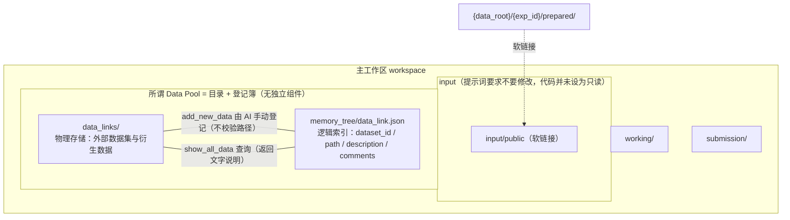
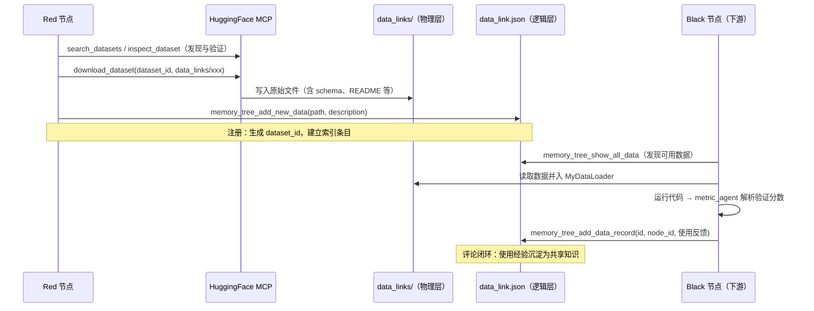

DataMaster 的核心竞争力在于让搜索过程突破"本地数据闭集"的限制——当黑节点（Black）在既有数据上做清洗、增强与特征工程时，**红节点（Red）** 承担着从外部世界引入增量数据的职责。本页聚焦支撑这一机制的 **Data Pool（数据池）**。需要先说清楚：仓库 README 里把它描述成一个"跨搜索分支共享的候选数据集层"，但**在代码里并不存在一个叫 Data Pool 的类、模块或服务**，它实际上只是两样东西的组合：物理存储 `{workspace}/data_links/` 目录，加上逻辑索引 `memory_tree/data_link.json` 这份登记簿（以及读写这份登记簿的 4 个 MCP 工具）。本页据此解析红节点从搜索、下载、注册到下游消费的数据流转闭环。红节点本身的设计哲学值得注意：它的首要成功标准不是产出一份高分的 DataLoader 提交，而是"找到强外部数据 → 存储到正确位置 → 为后续节点留下清晰文档"。

> **📖 小白导读**
> - 这篇讲什么：DataMaster 里有两种节点——黑节点（Black）在现有数据上做清洗、增强；红节点（Red）负责去网上找外部数据集、下载到本地。这篇讲红节点怎么找、怎么下载、怎么登记，以及别的节点怎么用上。
> - 读之前先知道：**agent**（会自己调用工具的 AI）；**MCP**（让 AI 调用外部工具的协议）；**DataLoader**（一个专门负责"读数据、处理数据"的 Python 类，训练代码从它那里拿数据）；**workspace**（一次实验的工作目录）；**symlink（符号链接）**（一种"快捷方式"文件，指向别处的真实文件）。
> - 读完你能明白："数据池"在代码里其实就是 `data_links/` 目录加 `data_link.json` 登记簿；红节点有哪些搜索和下载工具；哪些"规则"是代码强制的，哪些只是写在提示词里让 AI 自觉遵守。

Sources: [README.md](playground/data_master/README.md#L8-L12), [red_exp.py](playground/data_master/core/exp/red_exp.py#L21-L29), [README.md](README.md#L62)

## Data Pool 的双层架构：物理存储与逻辑索引

"Data Pool" 在代码库中并非一个独立的类或模块，而是一个由**文件系统目录 + JSON 索引**构成的双层结构。理解这一点是理解数据流转的前提。

物理层由 `_setup_workspace_directories` 在主工作区初始化时创建：`data_links/` 与 `working/`、`best_solution/`、`best_submission/`、`submission/` 并列。它被提示词规定为存放新增数据的目录（红/黑节点的提示词都要求"新数据只能放进 `data_links`"），但**这只是对 AI 的口头要求，代码里没有任何检查**去阻止 AI 把文件写到别处。逻辑层则位于 memory_tree 根目录下的 `data_link.json`，其数据结构以"数据集名称（路径末段）"为键，每条记录包含递增的 `dataset_id`、绝对路径 `path`、初始描述 `init_description`，以及一个按节点追加的评论列表 `comment`——每个评论绑定 `node_id` 与使用反馈文本。这种设计将"数据在哪"（物理文件）与"数据怎么样"（使用经验）解耦：前者是静态资产，后者是随搜索过程不断累积的动态知识。

要提醒的是，"登记簿"和"目录"之间没有任何程序联动：`add_new_data` 不会检查传入的路径是否存在、是否在 `data_links/` 下；`data_links/` 里多了文件，也不会自动出现在 `data_link.json`。除了 4 个 MCP 工具，整个 `playground/data_master` 里没有任何代码读取 `data_link.json`，唯一直接引用 `data_links` 的代码就是那一行 `mkdir`（`playground.py` 第 621 行）。

在并行模式下，所有 Worker 默认共享同一个主工作区（`split_workspace_for_exp: false` 时不切分子目录，默认并行 4 个 worker，worker 即同时干活的线程），这意味着 `data_links/` 天然是一个**跨 Worker 共享的目录**——任意 Worker 上的红节点下载的数据，可被其他 Worker 的黑节点立即复用。反过来，如果打开 `split_workspace_for_exp`，各 worker 的子目录里并不会创建 `data_links/`（只有主 workspace 在 `_setup_workspace_directories` 中创建），这条路径是否可用未验证。此外，`_ensure_prepared_links` 会通过带重试的符号链接机制将 `{data_root}/{exp_id}/prepared/` 下的 `baseline.json`、`grade.py` 与 `input/public` 挂载到工作区（重试是因为多个 worker 可能同时创建同一个链接）。提示词规定 **input 目录不许改、data_links 目录可写**，同样只是约定，代码没有把 `input` 设成只读。

Sources: [playground_helpers.py](playground/data_master/core/utils/playground_helpers.py#L56-L67), [playground.py](playground/data_master/core/playground.py#L616-L624), [memory.md](playground/data_master/prompts/tools/memory.md#L46-L77), [playground.py](playground/data_master/core/playground.py#L409-L417), [playground.py](playground/data_master/core/playground.py#L314-L407)

## 红节点 RedExp：搜索导向的实验执行体

`RedExp` 继承自 `NodeExp` 基类，其 `run()` 方法接收任务描述、父节点代码、子节点记忆（`memory` 参数，即兄弟节点的历史尝试摘要，不是 data_link.json 的内容）、父节点执行输出与全局最优解，返回包含 plan、code、exec、metric 的标准结果字典（其中 `plan` 恒为空串）。执行流程分为四个阶段：首先从父节点复制 `code_{parent_id}_template.py` 为本节点模板——**只复制 template，不复制父节点的 dataloader**，算法计算段对红节点同样不可修改（template：训练脚本模板；dataloader：数据读取与处理类）；随后加载工具手册（dataloader 用法 `dataloader_en.md`、operate 工具 `operate/for_datanode_en.md`、memory tree 工具 `memory.md`、search 工具 `search.md`）并连同父节点 DataLoader 代码（只作为提示词里的参考文本）、数据预览一起填充提示词模板，交由 red agent 以 `task_type="red"` 运行多轮对话；接着检查 agent 是否已通过 `write_code()` 工具生成 `code_{node_id}_dataloader.py`，若缺失则尝试从回复里的代码块提取内容当作 dataloader 兜底——这正好覆盖"红节点只搜数据、不写 dataloader"的情形，但此时被当作 dataloader 的可能只是一段与数据无关的文字或代码，是否合理没有检查；最后调用 `_assemble_code` 组装（base_dataloader + dataloader + template），再由 `run_code_via_bash` 取得运行结果（名字里有 bash，实际是：先读 `cache/{node_id}.json` 缓存，没有缓存才调用 `run_code_sync` 跑一遍，并不经过 bash），交由 metric agent 解析验证分数。

提示词层面对红节点的职责边界做了约束（只是文字要求，代码不检查）。system prompt 将其定位为"专精外部数据获取与集成的 Kaggle 宗师"，user prompt 则进一步明确了**搜索导向而非操作导向**的工作方式：节点"可以仅通过发现强外部数据集、下载到正确位置、记录可用元数据/schema/文件路径、为后续节点编写清晰集成指引"即视为成功，明确禁止将精力耗费在重复的 operate 循环或表现得像专注于本地清洗的 Black 节点。这个"职责松绑"的设计使红节点免于陷入与黑节点同质化的代码打磨，而将 LLM 的探索预算集中于数据发现本身。

Sources: [red_exp.py](playground/data_master/core/exp/red_exp.py#L36-L183), [system_prompt.md](playground/data_master/prompts/red/system_prompt.md#L3-L13), [user_prompt.md](playground/data_master/prompts/red/user_prompt.md#L8-L62)

## 搜索工具矩阵：四域检索与 HuggingFace 下载管线

红节点通过 `search.md` 手册获得跨四个信息域的检索能力，其推荐工作流体现了"先广泛搜索、后收敛验证、再下载"的漏斗式策略。

| 信息域 | 核心工具 | 典型用途 |
|---|---|---|
| HuggingFace | `search_huggingface_search_datasets` → `inspect_dataset` → `get_dataset_configs/splits/sample/readme` → `download_dataset` | 七步流水线：从发现到落地 |
| GitHub | `comprehensive_github_search`、`get_repository_readme`、`search_code/issues/pull_requests/repositories/users` | 定位开源数据集仓库与 README |
| Web | `search_web_google_search` → `search_web_web_parse` | 通用检索 + 网页/PDF 正文抽取 |
| 学术 | `arxiv_search_by_author/content`、`google_scholar_search` | 通过论文发现最新发布的数据集 |
| 可视化（**手册里写了，代码里不存在**） | `visual_inspect_images_details`、`visual_inspect_images_info` | 手册声称用于多模态数据预览与分布检查 |

关于最后一行：`search.md` 手册里确实介绍了这两个工具，但在整个仓库的 `.py`、`.json`、`.yaml` 里检索不到它们的实现，`base_datanode.json` 配置的六个 MCP 服务器里也没有对应的服务，所以红节点实际调用不到（依据全仓检索 `visual_inspect` / `inspect_images`）。想看图片只能用 `execute_bash` 之类的通用手段。

HuggingFace 工具链的下载实现值得深入分析。`download_dataset(dataset_id, output_dir)` 的执行路径是：先尝试通过本地沙箱代理（`HF_SANDBOX_URL`，默认 `http://localhost:8899`）转发请求（超时 600 秒），失败则回退到本地实现——由 `try_download_raw_file` 使用 `HfFileSystem` 递归列出数据集仓库全部文件，再逐个调用 `hf_hub_download` 以 `local_dir=output_dir` 方式下载（禁用符号链接以获得真实文件），并输出每个文件的本地路径与体积。

几个实际行为要注意（均已对照 `search_huggingface.py`）：
- **没有任何大小上限或确认步骤**：`download_dataset` 会下载仓库里的**全部**文件，代码里没有检查总体积；提示词里"避免超大数据集"完全靠 AI 自觉（工具文档字符串里也承认 "may take significant time and disk space"）。
- **单个文件失败不会让整体失败**：失败的文件只会在结果文本里多一行 `Failed to download ...`，函数仍返回"成功"样式的汇总；只有列文件本身失败或一个都没下载成才返回字符串 `Download Error`。
- **"只看一眼"的工具其实会下载整套数据**：`get_dataset_splits` 直接 `load_dataset(dataset_id, name=config)`，`get_dataset_sample` 调用 `load_dataset(dataset_id, name=config, split=split)` 后再取前几条（没有开启流式读取 streaming），这两个都会把对应数据完整下载并缓存到 HF 的缓存目录。手册把它们描述成"查看划分/预览样本"，容易让人以为只读少量数据。`inspect_dataset` 用的是 `load_dataset_builder`，主要读元数据。
- **沙箱代理（8899 端口）在仓库中找不到实现**：全仓只有 `search_huggingface.py`（及它在 skills 目录的拷贝）引用 `HF_SANDBOX_URL`，没有对应的服务代码，所以通常会直接走回退分支（推断）。原文所说"沙箱用于隔离网络调用"的动机，代码里没有说明（推断）。
- 配置层通过 `HF_TOKEN`（访问 gated 数据集，gated：需要申请权限才能下载的数据集）、`HF_ENDPOINT` 与 `HF_HOME` 三个环境变量控制认证与缓存行为；其中 `https://hf-mirror.com` 是写在 MCP JSON 配置里的值，不是代码里的默认值。另外，JSON 里 `HF_TOKEN` 写的是字面量 `"${HF_TOKEN}"`，而 MCP 的 JSON 配置是直接 `json.load` 读入的，没有任何环境变量展开（`${VAR}` 只在主 yaml 里展开），子进程拿到的多半是这串字面文本而不是真实令牌（推断，未实测）。

对 CV 任务（CV：计算机视觉，即图像类任务），search.md 手册给出了关键风险提示：**必须仔细核验外部数据与原始训练集的分布一致性**（图像风格、亮度、尺寸等），盲目引入外部数据可能显著劣化数据集质量。原文进一步介绍了 `visual_inspect_images_*` 两个工具如何服务这一核验环节，但如上所述它们并不存在，这一环节目前只能靠 AI 自己写脚本检查。

Sources: [search.md](playground/data_master/prompts/tools/search.md#L1-L56), [search.md](playground/data_master/prompts/tools/search.md#L64-L126), [search_huggingface.py](playground/search_dataset_tools/search_huggingface.py#L109-L146), [search_huggingface.py](playground/search_dataset_tools/search_huggingface.py#L700-L770), [base_datanode.json](configs/data_master/base_datanode.json#L43-L62)

## MCP 配置矩阵：红节点的完整工具面

红节点与黑节点在 yaml 里共享同一份 MCP 配置（`$mcp_data_node` → `base_datanode.json`），共挂载六个 MCP 服务器（MCP 服务器：一个独立的小进程，把若干函数以"工具"形式提供给 AI）。与 initial 节点的配置（仅 `operate_submission_for_initial` 与 `memory_tree`）相比，数据节点额外获得四个搜索类服务器，这正是红节点数据引入能力的配置基础。**但实际运行时 MCP 只按第一个带 MCP 配置的 agent（yaml 里的 `nouse`，使用 `$mcp_node_all`）初始化一次**（`evomaster/core/playground.py` 第 580-586 行），initial/black/red 看到的是同一套完整工具，"红节点才有搜索工具"主要靠提示词（只有红节点的提示词里有 `{search_tools_manual}`）来区分。

| MCP 服务器 | 启动脚本 | 关键环境变量 | 职责 |
|---|---|---|---|
| `operate_submission` | `for_datanode.py` | `ML_MASTER_DATA_ROOT/EXPID`、`ML_MASTER_GRADING_SERVERS` | 代码写入/修改/执行/校验 |
| `memory_tree` | `memory_tree_interface.py` | 同上 | manifest 与数据链接记录 |
| `search_web` | `search_web.py` | `SERPER_API_KEY` | Google 检索 + 网页解析 |
| `search_github` | `search_github.py` | `GITHUB_TOKEN`（JSON 中写死为空字符串 `""`，不填则所有 GitHub 工具都会报错，见第 16 篇） | GitHub 全实体检索 |
| `search_huggingface` | `search_huggingface.py` | `HF_TOKEN`、`HF_ENDPOINT`、`HF_HOME` | 数据集发现与下载 |
| `search_scholar` | `search_scholar.py` | `SERPER_API_KEY` | arXiv / Google Scholar |

YAML（一种用缩进表示层级的配置文件格式）配置中 red agent 被声明为独立的多智能体成员：`max_turns: 50`（最多对话轮数，与 black 相同，远高于 initial 的 20），工具为内置 `execute_bash / think / finish` 加 MCP 数据节点全集，提示词指向 `prompts/red/` 目录。

Sources: [base_datanode.json](configs/data_master/base_datanode.json#L1-L64), [base_initial.json](configs/data_master/base_initial.json#L1-L26), [config_base.yaml](configs/data_master/config_base.yaml#L85-L100)

## 数据注册与反馈闭环：从 add_new_data 到评论沉淀

数据下载完成后必须完成注册才能进入共享知识网络，这一闭环由四个 MCP 工具构成。

`add_new_data(dataset_path, init_descriptions)` 是红节点被要求做的动作（"强制"只是提示词措辞）——user prompt 在工具手册末尾以醒目的 ATTENTION 提醒"既然已成功将新数据下载到 data_links 目录，请记得使用 `memory_tree_add_new_data` 添加数据链接"。其实现逻辑：读取现有索引 → 计算 `max(dataset_id) + 1` 生成新 ID → 以路径末段为键检查重名（重名直接报错，返回字符串 `Error: Dataset '...' already exists`）→ 写入包含空评论列表的记录。全程不检查路径是否存在，也没有加锁。`add_data_record(dataset_id, node_id, comment)` 则由**下游节点**调用：当黑节点实际消费了某个数据集并跑出分数后，提示词要求它根据验证集/测试集表现追加评论，将"这个数据集实际有没有用"的一手经验沉淀回索引。查询侧由 `show_all_data`（全量摘要 + 每个数据集最多 3 条评论，注意代码取的是 `comments[:3]`，即**最早**的 3 条而不是"近期"评论，多出来的只显示"还有 N 条"）与 `show_detailed_data(dataset_id)`（指定数据集全量评论）承担。这些工具的返回值都是纯文本。memory.md 手册对两类节点的差异化要求形成对称约束：**RED 节点创建新数据条目，BLACK 节点基于分数反馈更新条目**。

这个闭环的深层价值在于将**数据资产的使用效果反馈进后续搜索决策**：任意后续节点在决定"要不要引入这个数据集"时，`show_detailed_data` 返回的历史评论提供了真实的成败证据，而非仅凭初始描述的乐观判断。需要强调：这个反馈环是"软"的——评论由 AI 自己写、AI 自己决定读不读，没有任何程序逻辑把 `data_link.json` 的内容注入提示词或用于挑选节点。另外，图中"黑节点读取数据并入 MyDataLoader"等步骤只是一个理想流程，哪些数据被用上完全取决于 AI 的行为。

Sources: [memory_tree.py](playground/search_dataset_tools/memory_tree.py#L733-L771), [memory_tree.py](playground/search_dataset_tools/memory_tree.py#L774-L803), [memory_tree_interface.py](playground/search_dataset_tools/memory_tree_interface.py#L608-L677), [user_prompt.md](playground/data_master/prompts/red/user_prompt.md#L129-L135), [memory.md](playground/data_master/prompts/tools/memory.md#L23-L26)

## 调度与消融控制：红节点在树中的位置与开关

红节点在 UCT 搜索树中的扩展受 `UCTSearchConfig` 严格控制：`num_red: int = 1`（红节点上限）对比 `num_black: int = 5`（黑节点上限），即每个父节点最多派生 1 个红子节点与 5 个黑子节点，总体上限 `num_black + num_red = 6`。调度逻辑存在三条路径且高度一致：`_select_stages_batch`（Initial 完成后的批量创建）会一次性创建全部待补子节点——red（若未达上限）加上补齐数量的 black；`_expand_current_node`（当前节点完成后的子节点扩展）在可选 stage 中**红节点优先于黑节点**；`_expand_parent_node`（父节点扩展，创建兄弟节点）则分两轮、每轮从可用 stage 中随机选择一次。

举个具体例子：initial 节点完成后，`_select_stages_batch` 会一次性给它创建 1 个红子节点和 5 个黑子节点（共 6 个）；之后某个黑节点跑完，`_expand_current_node` 会先看它的红子节点是否已达上限 1，没达到就先建红的，否则建黑的。

`use_red_node` 同时是组件消融实验的开关（消融：关掉某个功能看结果变化），从配置的 `ablation` 段读取，代码里的默认值是 `true`。（`config_base.yaml` 里用占位符 `$use_red_node` 填值；仓库里现成的任务 yaml 不含 `ablation` 段，所以不手动加的话红节点默认开启，以上依据 `playground.py` 第 80-82 行和配置核对。）当该开关关闭时，`_run_one_node` 在收到 red stage 请求时直接抛出 `RuntimeError`，而所有扩展路径均会跳过红节点创建并记录"No-Red ablation enabled"日志——这构成评估"外部数据引入对最终成绩贡献"的实验基础。值得注意的是，`_setup_workspace_directories` 无条件创建 `data_links/` 目录，即使红节点被消融，黑节点保存本地衍生数据集的能力依然保留。

| 调度路径 | 触发时机 | red 选择策略 |
|---|---|---|
| `_select_stages_batch` | Initial 节点完成后批量扩展 | 一次性创建 red（若未达上限）+ 补齐数量的 black |
| `_expand_current_node` | 当前节点完成后创建子节点 | **red 优先于 black** |
| `_expand_parent_node` | 节点完成后创建兄弟节点 | 分两轮，每轮从可用 stage 随机选取 |

Sources: [uct.py](playground/data_master/core/utils/uct.py#L111-L125), [playground.py](playground/data_master/core/playground.py#L446-L500), [playground.py](playground/data_master/core/playground.py#L578-L582), [playground.py](playground/data_master/core/playground.py#L1095-L1120), [playground.py](playground/data_master/core/playground.py#L80-L90), [config_base.yaml](configs/data_master/config_base.yaml#L281-L286)

## 安全边界与工程约束

红节点的行为被一组显式禁令框定，这些约束直接写在 user prompt 中，构成数据引入的质量与合规底线。**请注意：以下全部是写给 AI 的文字要求，代码里没有对应的强制检查**（没有泄露检测、没有体积检查、没有路径检查）。

**数据泄露防护**是最高优先级禁令：严禁使用任何包含测试集答案或标签的外部数据集。**数据规模控制**要求避免引入导致训练时间不可接受的超大数据集，在数据量与计算效率间维持平衡。**下载位置强制**规定所有外部数据必须落在 `{workspace}/data_links` 之下（可建子文件夹，传给工具时使用绝对路径），禁止下载到其他位置；同时 `input` 文件夹严格只读——新增强或生成的数据只能移入 `data_links`。**来源合法性**要求不使用非公开或存疑的数据源，不引入明确的泄露风险，不为无充分理由下载大体积低置信度数据集。此外还有**与历史解的差异要求**：新策略必须与 Memory 模块中已记录的方案存在实质差异，避免重复探索。

从工程视角看，红节点同时受到执行流程的隐性保护：父节点模板缺失时直接返回错误而非尝试无根创作；dataloader 文件缺失时有从 agent 回复提取代码的兜底路径。原文还说"节点执行完毕后 `working/` 目录会被重置"，核对后发现：`_reset_working_dir` 方法虽然在 `playground.py` 第 436 行定义了，但在 `playground/data_master` 里没有任何地方调用它（只有 `playground/ml_master` 在调用），所以 DataMaster 里 `working/` 并不会被自动清空；`data_links/` 中是否只有"有意保存的数据"也没有代码保证。

Sources: [user_prompt.md](playground/data_master/prompts/red/user_prompt.md#L47-L62), [user_prompt.md](playground/data_master/prompts/red/user_prompt.md#L111-L115), [red_exp.py](playground/data_master/core/exp/red_exp.py#L65-L78), [red_exp.py](playground/data_master/core/exp/red_exp.py#L142-L156), [playground.py](playground/data_master/core/playground.py#L436-L444)

## 小结与延伸阅读

Data Pool 的设计精髓在于用一个**极简的目录约定 + 一个 JSON 索引**替代了复杂的数据库方案，却完整支撑了"发现—下载—注册—消费—反馈"的数据资产生命周期：物理层保证任何节点可按路径直接读取，逻辑层保证使用经验随搜索进程累积，共享工作区保证跨 Worker 的即时可见性，而红/黑节点的职责不对称（红创建、黑反馈）则让索引内容自然保持了信息完整性。

若需继续深入，建议按以下路径阅读：理解 UCT 树如何决定红节点何时被选中与奖励如何计算，参见 [UCT 搜索算法：节点选择、奖励更新与衰减策略](9-uct-sou-suo-suan-fa-jie-dian-xuan-ze-jiang-li-geng-xin-yu-shuai-jian-ce-lue)；了解承载 `data_link.json` 的完整文件系统设计，参见 [Memory Tree：与 UCT 树对应的文件系统设计](12-memory-tree-yu-uct-shu-dui-ying-de-wen-jian-xi-tong-she-ji)；掌握作为 Data Pool 主要消费者的黑节点机制，参见 [三类节点实验：Initial、Black 与 Red 的职责划分](8-san-lei-jie-dian-shi-yan-initial-black-yu-red-de-zhi-ze-hua-fen)；检索工具的完整实现细节，参见 [数据集搜索工具集：HuggingFace / GitHub / Web / 学术检索](16-shu-ju-ji-sou-suo-gong-ju-ji-huggingface-github-web-xue-zhu-jian-suo)；验证红节点贡献的实验方法，参见 [组件消融实验：use_red_node / use_memory / black_mode 开关](29-zu-jian-xiao-rong-shi-yan-use_red_node-use_memory-black_mode-kai-guan)。
