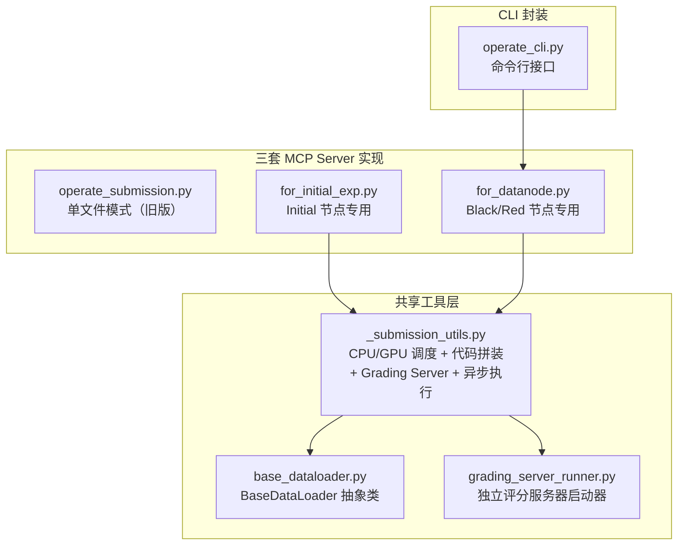
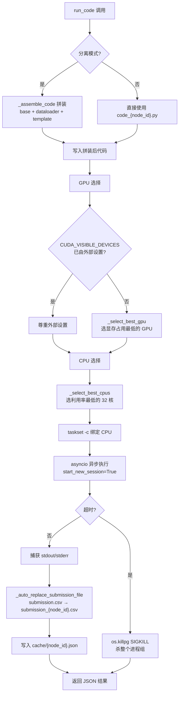
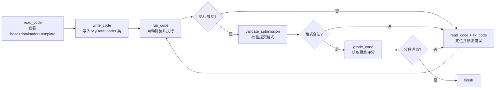

`operate_submission` 是 DataMaster 框架中连接 Agent 智能与评测基础设施的核心工具链。它以 MCP (Model Context Protocol) Server 的形式暴露六个工具函数，覆盖了从代码编写、读取、修改、执行，到提交验证和最终评分的完整闭环。该工具链的设计哲学是：**Agent 只需关注算法逻辑，资源调度、代码拼装、提交格式校验和评分通信全部由工具链自动处理**。

> **📖 小白导读**
> - 这篇讲什么：AI（agent）不能直接"提交答案"，而是通过一组工具——写代码、读代码、改代码、跑代码、校验提交文件、打分——来完成整个"写代码到出分数"的流程。这组工具就叫 `operate_submission`。
> - 读之前先知道：**MCP**（让 AI 调用外部工具的协议，每个工具像一个可被远程调用的函数）；**DataLoader / template**（DataMaster 把一份完整训练代码拆成两个文件：dataloader 负责读取并处理数据，template 是固定的训练脚本，运行时再拼起来）；**subprocess（子进程）**（程序里再启动另一个程序）；**stdout（标准输出）**（程序 `print` 出来的文字）；**Grading Server（评分服务器）**（一个独立的小网站，接收提交文件并检查格式）。
> - 读完你能明白：三套工具实现的区别、`run_code` 到底做了什么（选 GPU、选 CPU、拼代码、限时、改名提交文件）、校验和打分各走哪条路，以及哪些环节依赖 Linux 专有命令。

## 整体架构与三套实现

`operate_submission` 工具链并非单一文件，而是根据节点类型的不同，以三套独立的 MCP Server 实现呈现。其中 `for_initial_exp.py` 与 `for_datanode.py` 共享 `_submission_utils.py` 中的底层函数；但旧版的 `operate_submission.py` **并不导入** `_submission_utils.py`，它有自己独立的一套实现（单文件、同步执行），仓库中的 MCP 配置也没有引用它（全仓检索只有 zread 文档提到它）。三套实现在可操作的文件范围上有严格区分。



三套实现的关键区别在于 **Agent 可编辑的文件范围**。下表对比了各实现的能力边界：

| 维度 | `operate_submission.py`（单文件模式） | `for_initial_exp.py`（Initial） | `for_datanode.py`（Black/Red） |
|------|--------------------------------------|--------------------------------|-------------------------------|
| 代码文件结构 | 单一 `code_{node_id}.py` | `code_{node_id}_dataloader.py` + `code_{node_id}_template.py` | `code_{node_id}_dataloader.py`（template 只读继承） |
| `write_code` 可操作文件 | `code_{node_id}.py` | dataloader 和 template 均可 | **仅 dataloader** |
| `fix_code` 可操作文件 | `code_{node_id}.py` | dataloader 和 template 均可 | **仅 dataloader** |
| `read_code` 输出 | 单文件内容 | base + dataloader + template 三段拼合 | base + dataloader + template 三段拼合（标注只读） |
| `run_code` 代码拼装 | 直接执行 | 自动拼装三组件 | 自动拼装三组件 |
| 执行方式 | 同步 `subprocess.run` | 异步 `asyncio.create_subprocess_exec` | 异步 `asyncio.create_subprocess_exec` |
| 默认超时 | 300 秒 | 3600 秒 | 3600 秒 |
| MCP 调用总超时 | 含 `run_code` 的工具 5400 秒，其余 1800 秒（对三套实现一视同仁，由客户端 `evomaster/agent/tools/mcp/mcp.py` 第 176-181 行控制） | 同左 | 同左 |

提示一处文档与代码的差异：提示词手册 `prompts/tools/operate/for_datanode_en.md` 写的是 `run_code(node_id, workspace, timeout=300)`，但 `for_datanode.py` / `for_initial_exp.py` 的 `run_code` 默认值是 3600；`run_code_sync`（系统自己兜底跑代码时用）默认 300 秒。AI 若照手册显式传 300，则会被限制为 5 分钟。

Sources: [operate_submission.py](playground/search_dataset_tools/operate_submission.py#L83-L131), [for_initial_exp.py](playground/search_dataset_tools/operate_submission/for_initial_exp.py#L28-L153), [for_datanode.py](playground/search_dataset_tools/operate_submission/for_datanode.py#L28-L134), [README.md](playground/search_dataset_tools/operate_submission/README.md#L1-L32)

## 代码文件管理与分离模式

工具链的核心设计是**分离式代码结构**（separated mode）。在 Initial 节点生成的代码被拆分为两个独立文件，Black/Red 节点只能修改其中之一，从而实现了训练框架与数据处理的解耦。为什么这样设计：黑/红节点的目标是"只改数据，不改训练方法"，这样两次实验的分数差异就能归因于数据，而不是模型改动；把训练部分锁在 template 里，AI 就没机会"顺手"改模型。

**分离模式的文件布局**：

```
{workspace}/
├── input/                              # 输入数据目录
├── submission/
│   └── submission_{node_id}.csv        # 提交文件（由脚本生成）
├── code_{node_id}_dataloader.py        # MyDataLoader 类定义（可修改）
├── code_{node_id}_template.py          # 训练脚本（Initial 生成后只读）
├── code_{node_id}.py                   # 拼装后的完整代码（自动生成）
└── cache/
    └── {node_id}.json                  # 执行结果缓存
```

`_is_separated_mode()` 函数通过检测 template 和 dataloader 文件是否同时存在来判断当前是否处于分离模式。当检测到分离模式时，`run_code` 工具会在执行前自动调用 `_assemble_code()` 完成代码拼装。

拼装顺序严格固定为：**base_dataloader.py → `\n\n` → MyDataLoader 类定义 → `\n\n` → template 训练脚本**（就是把三个文件的文字首尾相接拼成一个 `code_{node_id}.py`）。这个顺序确保了 `BaseDataLoader` 抽象类先于 `MyDataLoader` 子类被定义，而 template 中的训练代码可以引用 `MyDataLoader` 实例。

补充两点：第一，`_assemble_code` 要求 base、dataloader、template 三个文件都存在，缺一个就返回 None，`run_code` 随即返回 `{"success": false, "error": "Code assembly failed"}`。第二，"分离模式"的判断只看 template 与 dataloader 两个文件是否同时存在，所以如果只有 dataloader 没有 template，`run_code` 不会拼装，而是去找一个 `code_{node_id}.py`，找不到就返回 `Code file does not exist`（依据 `_run_code_async` 第 828-849 行）。

Sources: [_submission_utils.py](playground/search_dataset_tools/operate_submission/_submission_utils.py#L698-L755), [SKILL.md](evomaster/skills/operate-tools/SKILL.md#L46-L104)

### BaseDataLoader 抽象契约

`base_dataloader.py` 定义了所有 DataLoader 必须遵守的接口契约。`MyDataLoader` 子类必须实现两个抽象方法：

| 方法 | 职责 | 约束 |
|------|------|------|
| `setup()` | 加载数据、特征工程、数据增强，设置 `self.train_data` 和 `self.test_data` | **禁止**在此处做 train/val split，分割由 template 负责 |
| `describe()` | 返回描述字符串，说明数据处理策略、新增的数据源等 | 抽象方法，子类必须实现 |
| `get_data()` | 返回 `(train_data, test_data)`，自动调用 `setup()` | 由基类实现，子类无需重写 |

Agent 编写的 `code_{node_id}_dataloader.py` 中**不需要导入 `BaseDataLoader`**，因为 `BaseDataLoader` 的定义会在拼装时自动注入到代码头部（提示词手册甚至说"不需要 import 语句"，其他库如 pandas 能否直接用，取决于 template 里是否已经导入——拼装顺序里 template 排在后面，所以需要确认，未验证）。

Sources: [base_dataloader.py](playground/search_dataset_tools/operate_submission/base_dataloader.py#L1-L93)

### write_code 的安全覆盖机制

`write_code` 工具默认处于安全模式（`override=False`）。当目标文件已有内容时，工具会返回文件当前内容并拒绝覆盖，只有显式设置 `override=True` 才会执行覆盖写入。这一设计防止 Agent 在迭代过程中意外丢失已有代码。

在分离模式中，`for_initial_exp.py` 的 `write_code` 额外接受 `file_type` 参数（`"dataloader"` 或 `"template"`，默认 `"dataloader"`），而 `for_datanode.py` 的 `write_code` 无此参数——因为 Black/Red 节点只能写入 dataloader 文件。

所有这些工具的返回值都是**纯文本字符串**而非 JSON，例如写入成功返回 `Dataloader 写入成功：{路径}`，文件已有内容且未设 `override` 时返回 `Warning: dataloader 已有内容 ...`（并附上现有内容），`fix_code` 找不到片段时返回 `未找到指定的代码片段：...`；出错时直接把异常文字当结果返回。需要注意"template 只读"靠的是 `for_datanode.py` 没有提供写 template 的参数；但 `node_all` 配置下 `operate_submission_for_initial` 工具也一并存在（见下文 MCP 配置一节），代码本身并没有阻止黑/红节点调用它写 template（推断）。

Sources: [for_initial_exp.py](playground/search_dataset_tools/operate_submission/for_initial_exp.py#L63-L94), [for_datanode.py](playground/search_dataset_tools/operate_submission/for_datanode.py#L66-L86)

## run_code：资源感知的异步执行引擎

`run_code` 是工具链中最复杂的工具，它不仅执行代码，还承担了**CPU/GPU 资源自动调度、代码自动拼装、提交文件自动重命名、执行结果缓存**四项额外职责。



### GPU 自动选择策略

GPU 选择遵循优先级策略：首先检查环境变量 `CUDA_VISIBLE_DEVICES`（它决定一个程序能看到哪几张显卡）是否已被外部设置（如并行任务调度器分配），若已设置则直接尊重；否则调用 `_select_best_gpu()` 自动选择**显存占用率最低**的那一张 GPU（代码按 `memory_utilization` 排序，虽然 `_get_gpu_info` 也查询了 GPU 利用率，但排序并不使用它），并把 `CUDA_VISIBLE_DEVICES` 设成它的编号，也就是说**每次 `run_code` 只给程序一张卡**。如果机器上没有 GPU 或 `nvidia-smi` 不存在，`_select_best_gpu` 返回 None，代码不会报错，只是不设置该变量。`_get_gpu_info()` 通过 `nvidia-smi` 查询所有 GPU 的利用率、已用显存和总显存，并支持通过 tmux（终端会话管理工具）session 名称限制 GPU 池大小——若 tmux 中存在名称匹配 `(N)_gpu` 的会话（如 `4_gpu`；多个时取最小值），则只使用前 N 个 GPU；此外还保留了一个旧逻辑：存在名字含 `flag` 的会话时限制为前 5 个。这些都是"这台服务器上的运维约定"，不是通用特性。需要注意：选卡和启动程序之间没有"预定"机制，两个任务几乎同时选卡，可能选到同一张（推断）。

Sources: [_submission_utils.py](playground/search_dataset_tools/operate_submission/_submission_utils.py#L248-L356)

### CPU 自动选择与 taskset 绑定

CPU 选择通过间隔 0.1 秒的两次采样 `/proc/stat`（Linux 提供的 CPU 统计文件）计算每个核心的利用率差值，选出利用率最低的 32 个核心（机器核心不足 32 个就全选），然后用 `_format_cpu_list_for_taskset()` 将核心列表格式化为 `taskset -c` 接受的"核心列表"字符串（如 `0-15,32-47`，是编号区间而不是位掩码）。最终执行命令被包装为 `taskset -c <cpu_list> python code_{node_id}.py`（taskset：Linux 命令，把一个程序限定只能在指定核心上运行）。CPU 和 GPU 选择各自使用独立的全局线程锁（`_CPU_SELECT_LOCK` / `_GPU_SELECT_LOCK`，线程锁：同一时刻只让一个线程执行被保护的代码），避免并行任务间的竞态条件；但这个锁只在同一个进程内有效。

**Linux 依赖**：`/proc/stat`、`taskset`、`nvidia-smi`、`tmux` 和后面的 `os.killpg` 都是 Linux（或类 Unix）专有的。读不到 `/proc/stat` 时 `_get_cpu_info` 会捕获异常并返回 None，此时代码退回到不绑核直接 `python 文件` 运行，所以 CPU 选择可以"降级"；但 `os.killpg` 在 Windows 上不存在（推断），整个仓库本身也只声明支持 Linux。

Sources: [_submission_utils.py](playground/search_dataset_tools/operate_submission/_submission_utils.py#L30-L178), [L818-L966](playground/search_dataset_tools/operate_submission/_submission_utils.py#L818-L966)

### 超时处理与进程组管理

异步执行（asyncio：Python 的"一个线程里同时等多件事"机制）使用 `start_new_session=True` 创建独立进程组，确保超时时可以通过 `os.killpg(os.getpgid(proc.pid), signal.SIGKILL)` 杀死整个进程树（包括 taskset 包装器和 Python 子进程及其派生的所有子进程）。这避免了孤儿进程占用 GPU 资源的问题。

超时的具体表现：程序被杀掉后，工具返回 `{"success": false, "error": "Code execution timed out (exceeded N seconds)"}`，此时**既不会保存已有的 stdout/stderr，也不会写 `cache/{node_id}.json`，不会处理 `submission.csv` 的改名**（对应 `_run_code_async` 第 902-915 行的提前 return）。正常结束时返回 JSON 字符串，字段为 `success`（退出码为 0）、`stdout`、`stderr`、`exit_code`、`elapsed_time`，若发生了提交文件改名还会多出 `submission_replaced`、`replacement_message`；整段 stdout/stderr 全文放进返回值，没有截断。

### 提交文件自动重命名

`_auto_replace_submission_file()` 在代码执行完成后自动检查 `submission/submission.csv` 是否存在。如果存在，则用 `shutil.move` 移动并改名为 `submission/submission_{node_id}.csv`，确保提交文件名符合工具链的命名规范。这一机制兼容了 Agent 脚本中可能使用固定文件名 `submission.csv` 的情况。需要注意：默认 4 个 worker 共用同一个 workspace，如果两个节点的脚本都写固定名 `submission/submission.csv`，先结束的那个会把文件"认领"走，另一个节点可能拿到别人的文件（推断，未实测）。

Sources: [_submission_utils.py](playground/search_dataset_tools/operate_submission/_submission_utils.py#L775-L810)

## validate_submission：校验服务器交互与自愈机制

`validate_submission` 工具通过 HTTP 与 Grading Server 通信，验证提交文件的格式合法性。它依赖三个环境变量：

| 环境变量 | 用途 | 示例值 |
|----------|------|--------|
| `ML_MASTER_DATA_EXPID` | 实验/竞赛 ID，作为 HTTP header `exp-id` | `aerial-cactus-identification` |
| `ML_MASTER_DATA_ROOT` | 数据根目录，用于重启评分服务器 | `/data/ml_master` |
| `ML_MASTER_GRADING_SERVERS` | 评分服务器 URL（逗号分隔，但代码只取第一个 `urls[0]`） | `http://127.0.0.1:55918` |

这三个变量来自 MCP 的 JSON 配置里的 `env` 字段（`ML_MASTER_GRADING_SERVERS` 会被 `evomaster/core/playground.py` 的 `_parse_mcp_servers` 用主配置里的 `grading_servers` 覆盖）。要注意：JSON 里 `ML_MASTER_DATA_ROOT` 写的是字面量 `"${DATA_ROOT}"`，而 MCP 的 JSON 是直接 `json.load` 读入的，没有环境变量展开（`${VAR}` 只在主 yaml 里展开）。因此 MCP 子进程里收到的多半是字面文本 `${DATA_ROOT}`，这会让"重启评分服务器"和 `grade_code` 去拼出一个不存在的路径（推断，未实测；是否另有地方改写了 JSON 未验证）。

验证流程具有**自愈能力**：在发送验证请求前，先通过 `/health` 端点探活；若服务器不健康，则调用 `ensure_grading_server()` 在同一端口上重启 standalone 评分服务器；重启后再次探活，确认可用后才发送验证请求。验证请求本身还支持最多 2 次重试，每次重试前再次尝试恢复服务器。

对于 localhost 请求，工具使用 `requests.Session()` 并设置 `trust_env = False` 来绕过系统代理，避免代理干扰本地通信。

`validate_submission` 的返回值是 JSON 字符串：成功时形如 `{"success": true, "is_valid": ..., "result": ..., "details": ..., "server_url": ...}`；服务器不可用或出错时 `success` 为 false，并带 `error`、`details`、`server_url`。"校验不通过"和"服务器挂了"是两种不同的返回：前者 `success` 为 true 但 `is_valid` 为 false。另外，它只检查**提交文件格式**（调用的是 mlebench 的 `validate_submission`），不会给出分数。原版 `operate_submission.py` 的文档字符串说它"获得初步分数"，对 `for_datanode.py` 这条路径并不成立。

Sources: [operate_submission.py](playground/search_dataset_tools/operate_submission.py#L297-L414), [_submission_utils.py](playground/search_dataset_tools/operate_submission/_submission_utils.py#L969-L1145)

### Grading Server 的 Flask 实现

`_create_app()` 创建的 Flask 应用提供两个端点：

- **`POST /validate`**：接收上传的 submission CSV 文件和 `exp-id` header，调用 `mlebench.grade.validate_submission()` 进行格式校验，返回 `{result, is_valid}` 或 `{error, details}`
- **`GET /health`**：返回 `{"status": "running"}`，供探活使用

`grading_server_runner.py` 是该 Flask 应用的独立启动入口，接受 `--data-root`、`--host`、`--port` 参数，使用 werkzeug 的 `make_server` 提供同步 HTTP 服务（Flask：一个 Python 小型网站框架；这里的"服务器"就是个本机上的小网站）。

另外两个实现细节：`/validate` 会先把上传的文件固定保存到 `/tmp/submission_to_validate.csv` 再校验，并行时多个请求会互相覆盖这个临时文件（推断）；`/health` 返回 `{"status": "running"}`。

Sources: [_submission_utils.py](playground/search_dataset_tools/operate_submission/_submission_utils.py#L374-L408), [grading_server_runner.py](playground/search_dataset_tools/operate_submission/grading_server_runner.py#L1-L43)

## grade_code：双通道评分与降级策略

`grade_code` 工具实现了**优先 HTTP、降级 subprocess** 的双通道评分策略。异步版本（`_grade_code_async`）首先检查硬编码地址 `http://127.0.0.1:7777` 上的 grade server 是否健康。如果健康，则通过 HTTP POST `/grade` 端点提交评分请求，payload 包含 `exp_id`、`submission_path` 和 `timeout`。如果 grade server 不可用，则降级为直接通过 `subprocess` 运行 `{data_root}/{exp_id}/prepared/grade.py` 脚本进行本地评分。

| 评分通道 | 地址 | 触发条件 | 优势 |
|----------|------|----------|------|
| HTTP 通道 | `http://127.0.0.1:7777/grade` | Grade server 健康（`/health` 返回 `{"status": "healthy"}`） | 理论上非阻塞、可并发 |
| Subprocess 通道 | 本地 `grade.py` | HTTP 不可用时降级 | 无网络依赖，确保可用性 |

注意：grade_code 使用的 `http://127.0.0.1:7777` 与 validate_submission 使用的 `ML_MASTER_GRADING_SERVERS` 是**两套独立的服务器**。前者用于真实评分（带 ground truth），后者用于格式校验。**但仓库里并没有 7777 端口那个服务的实现**（全仓只有硬编码这个地址的两处代码；而随仓库提供的评分服务器 `/health` 返回的是 `"running"`，与 7777 通道要求的 `"healthy"` 也对不上），所以实际运行中几乎总是回落到 subprocess 通道（推断）。subprocess 通道的做法是：在 `{data_root}/{exp_id}/prepared/private/` 下取第一个 csv 当标准答案，执行 `python prepared/grade.py -g 标准答案 -s 提交文件`，把 stdout 与 stderr 拼起来放进 `output` 返回；`grade.py` 或标准答案不存在时抛 `ValueError`，被外层捕获后返回 `{"success": false, "error": "Grading failed: ..."}`。

返回值：成功时为 `{"success": 退出码是否为 0, "output": 文本, "returncode": 退出码}`，格式里没有解析出的"分数"字段，分数需要从 `output` 的文字里读。另外，因为这个工具读的是**私有测试集的真实答案**，AI 一旦调用它就能看到测试集得分；提示词 `memory.md` 也要求 Black 节点参考"测试集和验证集得分"来写评论（`--test-feedback` 之外的默认流程里，这是否会让测试集分数影响搜索，请结合第 11 篇评估闭环确认，未验证）。

Sources: [_submission_utils.py](playground/search_dataset_tools/operate_submission/_submission_utils.py#L1147-L1310), [operate_submission.py](playground/search_dataset_tools/operate_submission.py#L417-L500)

## 同步包装器与 Exp 模块集成

除了作为 MCP Server 供 Agent 调用外，`_submission_utils.py` 还提供了同步包装函数，供 Exp 模块在非 Agent 上下文中直接调用：

- **`run_code_sync()`**：通过 `asyncio.new_event_loop()` 在同步上下文中运行异步执行逻辑，额外返回 `script`（脚本路径）和 `code`（代码内容）字段；默认超时 300 秒（注意比 MCP 工具版的 3600 秒短）
- **`grade_code_sync()`**：同步版本的评分函数，返回包含 `success`、`output`、`returncode` 的字典
- **`get_cached_execution_result()`**：从 `workspace/cache/{node_id}.json` 读取缓存的执行结果，避免重复执行

这些同步接口使得 Exp 模块可以在 UCT 搜索的节点扩展过程中，以编程方式触发代码执行和评分，而不需要通过 Agent 对话循环。实际流程是：Exp 在 agent 对话结束后调用 `run_code_via_bash`（`core/utils/runtime.py`），它**先读 `cache/{node_id}.json`**——如果 agent 之前已经用 `run_code` 工具跑过，就直接复用缓存结果；没有缓存才用 `run_code_sync` 再跑一次。因此节点最终记录的成绩，其实多半来自 agent 自己最后一次 `run_code`，而不是系统重新执行的结果。`grade_code_sync` 在默认流程里是否被调用，请参考评估反馈相关文章（未在本文范围内验证）。

Sources: [_submission_utils.py](playground/search_dataset_tools/operate_submission/_submission_utils.py#L1317-L1428)

## MCP 配置与节点类型映射

在 DataMaster 的配置体系中，不同节点类型的 Agent 通过 MCP JSON 配置文件绑定到不同的 `operate_submission` 实现。以 `aerial-cactus-identification` 为例：

| 配置文件 | MCP Server 名称 | 对应实现 | 绑定的 Agent |
|----------|----------------|----------|-------------|
| `initial_*.json` | `operate_submission_for_initial` | `for_initial_exp.py` | 设计上绑定 Initial Agent |
| `data_node_*.json` | `operate_submission` | `for_datanode.py` | 设计上绑定 Black / Red Agent |
| `node_all_*.json` | 两个 Server 均包含 | 两个实现均加载 | 实际被使用的那一份（见下） |

配置中通过 `env` 字段注入三个关键环境变量，将实验 ID、数据根目录和评分服务器地址传递给 MCP Server 进程。`config_base.yaml` 中的 Agent 配置通过 `mcp: "$mcp_initial"` 和 `mcp: "$mcp_data_node"` 变量引用分别绑定到不同的 MCP 配置文件。**但实际运行时，MCP 只按第一个带 MCP 配置的 agent（yaml 里的 `nouse`，使用 `$mcp_node_all`）初始化一次**（`evomaster/core/playground.py` 第 580-586 行），其余 agent 复用同一套工具，所以 initial、black、red 看到的是同一套完整工具（两个 operate_submission 服务都在，工具名分别以 `operate_submission_for_initial_` 和 `operate_submission_` 开头），"黑/红只能改 dataloader"主要依靠提示词让它们去用 `operate_submission_*` 那一组（推断）。

Sources: [node_all_aerial-cactus-identification.json](configs/data_master/json_configs/aerial-cactus-identification/node_all_aerial-cactus-identification.json#L1-L52), [config_base.yaml](configs/data_master/config_base.yaml#L49-L101)

## CLI 封装与 Skills 集成

`operate_cli.py` 提供了命令行接口，将 `for_datanode.py` 的六个工具函数映射为子命令。所有命令都需要 `-w WORKSPACE` 和 `-n NODE_ID` 参数，并支持通过 `--code` 直接传入代码字符串或 `--code-file` 从文件读取代码。这套 CLI 封装被 `evomaster/skills/operate-tools/` 技能模块引用，使得 operate_submission 工具链可以作为独立 Skill（技能包）被技能系统加载。不过 DataMaster 的 agent 配置里没有 `skills:` 键，这个路径在 DataMaster 中并未启用；而且该目录下的 `_submission_utils.py` 与 `playground/` 里的并不完全相同（拷贝已经漂移），以 `playground/` 下的为准。

| CLI 子命令 | 对应工具函数 | 额外参数 |
|-----------|-------------|----------|
| `read-code` | `read_code` | 无 |
| `write-code` | `write_code` | `--code` / `--code-file`，`--override` |
| `fix-code` | `fix_code` | `--old`，`--new`，`--replace-all` |
| `run-code` | `run_code` | `--timeout`（默认 3600） |
| `validate` | `validate_submission` | 无 |
| `grade` | `grade_code` | `--timeout`（默认 300） |

Sources: [operate_cli.py](evomaster/skills/operate-tools/scripts/operate_cli.py#L1-L100), [SKILL.md](evomaster/skills/operate-tools/SKILL.md#L1-L105)

## 推荐工作流程



**关键约束**：

1. **唯一有效代码文件**：只有通过 `write_code` 工具创建的 `code_{node_id}_dataloader.py`（和 Initial 节点的 `_template.py`）才是有效代码；手册还声称使用 `str_replace_editor` 或 bash 命令创建的其他文件"会被系统自动清理"，但我在代码里没有找到这样的清理逻辑（未验证）。实际上，系统最终只会去拼装并执行这几个约定名字的文件，所以别的文件即使存在也不会被执行
2. **唯一有效提交文件**：只有 `submission/submission_{node_id}.csv` 是有效提交，工具会自动将 `submission.csv` 重命名为节点 ID 格式
3. **template 只读约束**：Black/Red 节点的 `fix_code` 只能操作 dataloader 文件，template 是从父节点继承的只读资源（黑/红节点的 template 由 `exp` 在 agent 开始前从父节点复制；见第 14 篇）
4. **无 import 约束**：dataloader 文件中不需要 import `BaseDataLoader`，拼装时自动注入

（说明：`tools_manual.md` 描述的是旧的"单一 `code_{node_id}.py`"模式；黑/红节点提示词里实际注入的是 `playground/data_master/prompts/tools/operate/for_datanode_en.md`，内容是分离模式。）

Sources: [tools_manual.md](playground/search_dataset_tools/tools_manual.md#L1-L183)

## 文件清单与职责总览

| 文件 | 职责 | 关键函数/类 |
|------|------|-------------|
| `operate_submission.py` | 单文件模式 MCP Server（旧版兼容） | `write_code`, `read_code`, `fix_code`, `run_code`, `validate_submission`, `grade_code` |
| `for_initial_exp.py` | Initial 节点 MCP Server | 同上，`write_code`/`fix_code` 额外接受 `file_type` 参数 |
| `for_datanode.py` | Black/Red 节点 MCP Server | 同上，仅操作 dataloader 文件 |
| `_submission_utils.py` | 共享工具层（1447 行；`for_initial_exp.py` 与 `for_datanode.py` 使用，旧版 `operate_submission.py` 不使用） | CPU/GPU 调度、代码拼装、异步执行、Grading Server、同步包装器 |
| `base_dataloader.py` | BaseDataLoader 抽象类 | `setup()`, `describe()`, `get_data()` |
| `grading_server_runner.py` | 独立评分服务器启动器 | `main()` — 解析参数并启动 Flask |
| `README.md` | 分离模式设计文档 | — |

这套工具链是 DataMaster 框架中 Agent 与评测系统之间的唯一桥梁。理解其工作原理，对于掌握 [三类节点实验的职责划分](8-san-lei-jie-dian-shi-yan-initial-black-yu-red-de-zhi-ze-hua-fen) 和 [评估反馈闭环](11-ping-gu-fan-kui-bi-huan-metric-agent-yu-yan-zheng-zhi-biao-jie-xi) 至关重要。如需了解 Grading Server 的部署细节，请参阅 [Grading Server 评测服务器部署](24-grading-server-ping-ce-fu-wu-qi-bu-shu-jian-kang-jian-cha-yu-api-jie-kou)；如需了解 MCP 协议在 Agent 框架中的集成方式，请参阅 [Agent 内置工具与 MCP 协议集成](17-agent-nei-zhi-gong-ju-bash-editor-think-finish-yu-mcp-xie-yi-ji-cheng)。
