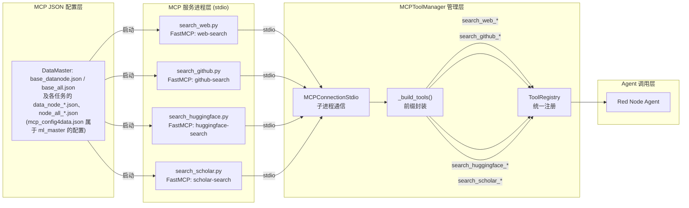
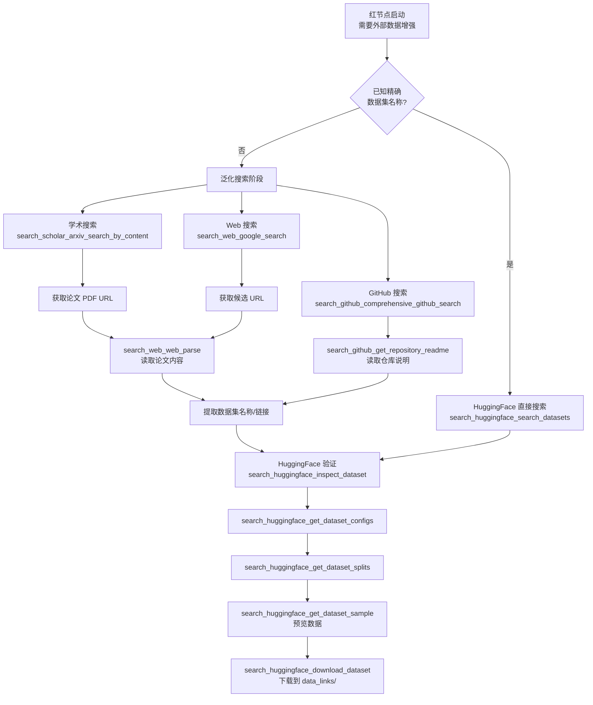

DataMaster 的**红节点**（Red Node）承担着从外部数据源发现、检索并下载数据集的核心职责。为支撑这一能力，系统提供了一套完整的**数据集搜索工具集**，涵盖 HuggingFace Hub、GitHub、Web 搜索引擎和学术论文检索四大信息源。这四个工具各自以独立 MCP（Model Context Protocol）服务进程运行，通过 FastMCP 框架注册为可被 Agent 调用的工具函数，最终在 Agent 的工具注册表中以 `{server_name}_{tool_name}` 的前缀格式暴露。本文将逐一解析每个工具的架构设计、API 签名、典型工作流及跨工具协同模式。

> **📖 小白导读**
> - 这篇讲什么：红节点（专门去网上找外部数据集的 AI 节点）手里有哪些"搜索工具"：搜 HuggingFace（一个很大的机器学习数据集托管网站）、搜 GitHub（代码托管网站）、搜网页（通过 Google）、搜学术论文（arXiv、Google Scholar、DBLP）。
> - 读之前先知道：**MCP**（让 AI 调用外部工具的协议，每个搜索脚本是一个独立的小进程）；**API**（程序之间互相请求数据的"接口"）；**token / API key（令牌/密钥）**（访问某个网站服务所需的"通行证"字符串）；**stdio（标准输入输出）**（这里指 AI 程序和工具子进程用管道交换文字的方式）；**环境变量**（进程启动时带上的一组"键=值"设置）。
> - 读完你能明白：每个工具能做什么、返回什么；要让它们真正可用需要哪些密钥（以及配置里有哪些坑）；下载数据集时有哪些没有限制的"陷阱"。

Sources: [tools_manual.md](playground/search_dataset_tools/tools_manual.md#L198-L216), [search.md](playground/data_master/prompts/tools/search.md#L1-L7)

## 整体架构：四服务并行、MCP-Stdio 传输

四个搜索工具在架构上是完全对等的 MCP 服务进程。每个工具文件都通过 `FastMCP("server-name")` 初始化一个独立服务实例，使用 `@mcp.tool()` 装饰器注册工具函数，并在文件末尾以 `mcp.run()` 启动 stdio 传输模式。MCPToolManager 在 Agent 初始化阶段读取 JSON 配置文件，为每个服务创建 `MCPConnectionStdio` 子进程连接，自动发现其暴露的工具列表，并注册到统一的 ToolRegistry 中。

```
MCP Config (JSON)
    │
    ├─ search_web       → python search_web.py       (FastMCP "web-search")
    ├─ search_github    → python search_github.py     (FastMCP "github-search")
    ├─ search_huggingface → python search_huggingface.py (FastMCP "huggingface-search")
    └─ search_scholar   → python search_scholar.py    (FastMCP "scholar-search")
         │
         ▼
  MCPToolManager.add_server()  →  MCPConnectionStdio (stdio子进程)
         │
         ├─ list_tools()  →  自动发现 @mcp.tool() 注册的函数
         ├─ _build_tools()  →  封装为 MCPTool 实例，加前缀注册
         └─ register_tools()  →  注入 Agent ToolRegistry
```

需要补充：MCP 连接在整个运行中只按第一个带 MCP 配置的 agent（yaml 里的 `nouse`）初始化一次，之后所有 agent 复用同一个工具表（`evomaster/core/playground.py` 第 580-586 行）。所以并不是"只有红节点才有这四个搜索服务"，而是 initial/black/red 都能看到它们，只有红节点的提示词里写了怎么用（`{search_tools_manual}`）。

下图展示了从 MCP JSON 配置到 Agent 工具调用的完整数据流：



Sources: [mcp_config4data.json](configs/ml_master/mcp_config4data.json#L1-L53), [mcp_manager.py](evomaster/agent/tools/mcp/mcp_manager.py#L84-L118), [mcp_connection.py](evomaster/agent/tools/mcp/mcp_connection.py#L95-L117)

## HuggingFace 搜索工具：从发现到下载的全链路

`search_huggingface.py` 是四个工具中功能最丰富的，提供了从数据集搜索、元数据检查、配置枚举、划分查看、样本预览到完整下载的**七步全链路**操作能力。该工具同时实现了**沙箱代理优先**架构——每个工具函数在执行前首先尝试调用本地沙箱服务 `_sandbox_call()`（沙箱代理：一个本机上的中转服务，由它代替工具去访问网络），若沙箱不可用则回退到 HuggingFace Hub API 直接调用。这一设计的本意是方便在受限网络环境中使用；但**仓库里并没有这个沙箱服务（`localhost:8899`）的实现**，全仓只有 `search_huggingface.py` 与它的拷贝引用了 `HF_SANDBOX_URL`，所以一般会直接走回退分支（推断）。回退分支里的 `https://hf-mirror.com` 镜像端点则来自 MCP JSON 配置里的 `HF_ENDPOINT`。

Sources: [search_huggingface.py](playground/search_dataset_tools/search_huggingface.py#L50-L71)

### 七个工具函数与典型工作流

| 工具函数 | 功能 | 关键参数 | 返回格式 |
|---------|------|---------|---------|
| `search_datasets` | 关键词搜索数据集 | `query`, `limit=100`, `author` | 编号列表 + 数据集ID/作者/下载量/URL |
| `inspect_dataset` | 检查数据集完整元数据 | `dataset_id`, `config` | YAML 格式（含 features/splits/tags） |
| `get_dataset_configs` | 枚举可用配置 | `dataset_id` | 配置名列表 或 "default" 提示 |
| `get_dataset_splits` | 查看数据划分结构 | `dataset_id`, `config` | DatasetDict 字符串表示（**会先 `load_dataset` 把数据整套下载**） |
| `get_dataset_sample` | 预览实际数据样本 | `dataset_id`, `config`, `split`, `num_samples=5` | 格式化样本记录 + 列类型（**会 `load_dataset` 下载整个 split**） |
| `get_dataset_readme` | 获取 README 文档 | `dataset_id` | Markdown 原文 |
| `download_dataset` | 下载全部原始文件 | `dataset_id`, `output_dir` | 文件列表 + 大小(MB) + 路径（**无大小上限**） |

**⚠️ 重要约束**：HuggingFace 搜索**不支持语义/模糊搜索**，查询必须精确匹配关键词。建议先用学术搜索或 Web 搜索确定数据集名称，再回到 HuggingFace 执行精确检索。

补充几个已核对的行为：
- 返回值都是纯文本（`get_dataset_configs` 在有多个配置时返回 Python 列表，其余是字符串；出错时返回以 `Error ...` 开头的字符串，不抛异常）。
- `search_datasets` 的文档字符串说"gated 数据集会被自动排除"，但回退分支的代码只是 `list_datasets(search=..., limit=...)`，并没有过滤 gated（需要申请权限的）数据集（推断：以回退分支代码为准）。
- `get_dataset_sample` 若指定的 split 不存在，会在输出开头加一行提示并改用第一个 split。
- 沙箱调用默认超时 30 秒，`get_dataset_sample` 120 秒，`download_dataset` 600 秒；另外整个 MCP 调用有 1800 秒的总超时。

Sources: [search_huggingface.py](playground/search_dataset_tools/search_huggingface.py#L174-L233), [search.md](playground/data_master/prompts/tools/search.md#L9-L37)

### 沙箱代理与回退机制

HuggingFace 工具的每个函数都嵌入了 `_sandbox_call()` 优先调用逻辑。沙箱服务地址由环境变量 `HF_SANDBOX_URL`（默认 `http://localhost:8899`）指定。当沙箱返回 HTTP 200 时，直接使用其 JSON 响应；若连接失败或超时，则回退到原生 `huggingface_hub` / `datasets` 库调用。这一双层架构在沙箱不可用时仍保证基本功能可用：

```python
# 每个工具函数的统一模式（以 search_datasets 为例）
sb = _sandbox_call("/search", {"query": query, "limit": limit, "author": author})
if sb is not None:
    return sb.get("text", str(sb))
# ── 回退到原有实现 ──
results = [ds for ds in list_datasets(**search_params)]
```

下载功能 `download_dataset` 通过 `HfFileSystem` 递归列出数据集仓库中的所有文件，再逐一调用 `hf_hub_download` 下载到指定目录，保留原始文件结构。"600 秒"只是调用沙箱代理时的超时；走回退分支（本地直接下载）时代码里没有超时设置，也没有总大小检查。单个文件下载失败时只会在结果里多一行 `Failed to download ...`，函数整体仍返回汇总文本；列文件失败或一个都没下载成才返回 `Download Error`。

Sources: [search_huggingface.py](playground/search_dataset_tools/search_huggingface.py#L109-L157), [search_huggingface.py](playground/search_dataset_tools/search_huggingface.py#L700-L771)

### 环境变量配置

| 环境变量 | 用途 | 默认值/示例 |
|---------|------|------------|
| `HF_TOKEN` | 访问 gated 数据集的认证令牌 | — |
| `HF_ENDPOINT` | 镜像端点 URL | `https://hf-mirror.com`（写在 MCP JSON 配置里，不是代码默认值） |
| `HF_HOME` | 缓存目录 | — |
| `HF_SANDBOX_URL` | 本地沙箱代理地址 | `http://localhost:8899` |

Sources: [search_huggingface.py](playground/search_dataset_tools/search_huggingface.py#L1-L16), [mcp_config4data.json](configs/ml_master/mcp_config4data.json#L32-L42)

## GitHub 搜索工具：多实体类型与查询构造

`search_github.py` 封装了 GitHub Search API 的五类搜索端点（代码、Issues、PR、仓库、用户），并提供了一个**综合搜索**入口 `comprehensive_github_search`，可在一次调用中跨多种实体类型检索。所有 API 调用通过 `GitHubSearchClient` 类统一管理，使用 Bearer Token 认证。

### GitHubSearchClient 的查询构造与结果归一化

`GitHubSearchClient` 的核心设计在于**查询构造器** `_build_query()` 和**结果归一化器** `_normalize()`。查询构造器将关键词与各种限定符（`repo:`、`user:`、`language:`、`path:`、`state:`、`is:issue`/`is:pr`）拼接为 GitHub Search API 的 `q` 参数格式。结果归一化器则将不同搜索类型的原始 JSON 响应统一为 `{type, name, full_name, url, score, extra}` 结构，`extra` 字段根据搜索类型携带类型特有信息（如仓库的 stars/language、Issue 的 state/number）：

Sources: [search_github.py](playground/search_dataset_tools/search_github.py#L7-L83)

### 七个工具函数

| 工具函数 | GitHub API 端点 | 特有过滤参数 |
|---------|----------------|-------------|
| `search_code` | `/search/code` | `repo`, `user`, `language`, `path` |
| `search_repositories` | `/search/repositories` | `user`, `language`, `sort`(stars/forks/updated), `order` |
| `search_issues` | `/search/issues` (is:issue) | `repo`, `user`, `state`(open/closed) |
| `search_pull_requests` | `/search/issues` (is:pr) | `repo`, `user`, `state` |
| `search_users` | `/search/users` | `qualifiers`(列表) |
| `get_repository_readme` | `/repos/{owner}/{repo}/readme` | `owner`, `repo` |
| `comprehensive_github_search` | 聚合以上五类 | `search_type`(all/repos/code/users/issues/prs) |

`get_repository_readme` 是一个特殊的非搜索工具——它通过 GitHub API 获取仓库 README，对 base64 编码的内容进行解码，返回 Markdown 原文。这在红节点 Agent 发现感兴趣的仓库后深入了解数据集详情时非常有用。

`comprehensive_github_search` 则是聚合入口，它根据 `search_type` 参数决定调用哪些搜索类型，每类展示前 5 条结果，最终拼装为一份分类报告。这适合 Agent 在不确定目标实体类型时进行广泛探索。

Sources: [search_github.py](playground/search_dataset_tools/search_github.py#L508-L588), [search_github.py](playground/search_dataset_tools/search_github.py#L160-L182)

### 环境变量

GitHub 工具仅需一个环境变量 `GITHUB_TOKEN`，在 `get_github_client()` 工厂函数中从环境读取，若未设置**或为空字符串**则抛出 `ValueError("GITHUB_TOKEN environment variable is required")`（代码是 `if not token`，空串同样判为未设置）。而在 MCP 配置中 `GITHUB_TOKEN` 被写死为空字符串（`"env": {"GITHUB_TOKEN": ""}`，`base_datanode.json`、`base_all.json`、各任务 json 都是如此）。原文据此认为"未配置时 GitHub API 仍可工作，只是受未认证速率限制"，这是错误的：每个 GitHub 工具都在 `try` 里调用 `get_github_client()`，所以会被 `except` 捕获并作为文字返回 `Error searching ...: GITHUB_TOKEN environment variable is required`，工具实际不可用，除非手动把令牌填进 JSON。另外，shell 里导出的 `GITHUB_TOKEN` 大概率也传不进去，因为 MCP 子进程的环境由配置里的 `env` 决定（推断，依据 MCP SDK 的行为，未在仓库内验证）。

Sources: [search_github.py](playground/search_dataset_tools/search_github.py#L185-L193), [mcp_config4data.json](configs/ml_master/mcp_config4data.json#L23-L31)

## Web 搜索工具：两步式搜索-解析工作流

`search_web.py` 是四个工具中最精简的，仅提供两个工具函数，但设计上遵循了**先搜索后解析**的两步式工作流模式。两个工具都通过 Serper.dev API 实现，需要 `SERPER_API_KEY` 环境变量。


| 工具函数 | Serper API 端点 | 功能 | 返回 |
|---------|----------------|------|------|
| `google_search` | `google.serper.dev/search` | Google 搜索，返回标题/摘要/URL | JSON 字符串 |
| `web_parse` | `scrape.serper.dev/` | 提取指定 URL 的完整正文内容 | JSON 字符串（含 Markdown） |

两个工具都没有做任何错误处理，直接把 Serper 返回的原始文本（JSON 字符串）交给 AI；如果没有可用的 `SERPER_API_KEY`（请求头里就是 `None` 或字面量 `${SERPER_API_KEY}`），会得到 HTTP 错误内容或异常，而不是友好的提示。`web_parse` 工具在请求中设置 `includeMarkdown: True`，返回干净的主体内容（去除页眉、页脚、广告等）。该工具**不应**用于通用搜索，而应配合 `google_search` 返回的 URL 使用。这两个工具是跨工具协同的关键枢纽——学术搜索发现的论文 PDF URL、GitHub 仓库 README 页面、HuggingFace 数据集页面，都可以通过 `web_parse` 提取全文内容。

Sources: [search_web.py](playground/search_dataset_tools/search_web.py#L1-L69)

## 学术搜索工具：arXiv + Google Scholar + DBLP 三源覆盖

`search_scholar.py` 整合了三个学术信息源：arXiv 预印本库、Google Scholar 学术搜索、DBLP 计算机科学文献库。该工具的特点是**混合同步/异步**——arXiv 和 Google Scholar 工具为同步函数，而 DBLP 的三个工具为 `async` 函数（使用 `httpx.AsyncClient` 配合指数退避重试）。

### 六个工具函数

| 工具函数 | 数据源 | 排序方式 | 关键返回字段 |
|---------|-------|---------|-------------|
| `arxiv_search_by_author` | arXiv | SubmittedDate (最新) | 标题/作者/日期/摘要/PDF URL |
| `arxiv_search_by_content` | arXiv | Relevance (相关度) | 标题/作者/日期/摘要/PDF URL |
| `google_scholar_search` | Google Scholar (via Serper) | — | 原始 JSON |
| `search_dblp_papers` | DBLP | — | 标题/作者/Venue/Type/DOI Link |
| `search_dblp_authors` | DBLP | — | 姓名/机构/奖项/Profile Link |
| `search_dblp_venues` | DBLP | — | 会议/期刊名/缩写/类型/Link |

arXiv 搜索结果中包含 `pdf` 字段，其值通过将 `entry_id` 中的 `abs` 替换为 `pdf` 生成。**关键提示**：搜索到 PDF URL 后，可使用 `search_web_web_parse` 工具读取论文全文内容，形成"学术论文搜索 → PDF 内容解析"的跨工具链路。

DBLP 工具使用 `_fetch_dblp()` 内部辅助函数，实现了指数退避重试机制（最多 3 次，基础延迟 1 秒，倍率 2）。`_safe_str()` 辅助函数处理 DBLP XML-to-JSON 转换中不一致的列表/字符串类型问题。

Sources: [search_scholar.py](playground/search_dataset_tools/search_scholar.py#L1-L11), [search_scholar.py](playground/search_dataset_tools/search_scholar.py#L111-L143), [search_scholar.py](playground/search_dataset_tools/search_scholar.py#L15-L49)

## 跨工具协同：红节点的数据集发现策略

红节点 Agent 的系统提示词明确指出其职责是"finding, downloading, and integrating relevant external data sources"。搜索提示词文档 `search.md` 提供了一套分层的搜索策略，引导 Agent 在不同信息源间切换。下图展示了典型的跨工具协同模式：



搜索提示词文档明确指出了一条重要的使用建议：由于 HuggingFace 不支持模糊搜索，Agent 应**先使用** `search_scholar`、`search_web` 等泛化搜索工具确定数据集的精确名称，再回到 HuggingFace 执行精确检索。此外，提示词还引导 Agent 参考 awesome-public-datasets 等公开数据集列表，并可使用 `execute_bash` 工具直接下载（`search.md` 里这一处写的是下载到 workspace 的 `new_data` 文件夹，与其他地方统一要求的 `data_links/` 不一致，以 `data_links/` 为准）。

下载的数据集统一存放到 `{workspace}/data_links/` 文件夹下（这是提示词的要求，代码并不强制）。对于涉及图像等 CV 任务的数据集，提示词还特别警告 Agent 必须检查外部数据与原始训练数据的分布一致性。`search.md` 手册里推荐了 `visual_inspect_images_details` 和 `visual_inspect_images_info` 两个"图像检查"工具，但这两个工具在代码里并不存在（全仓检索不到实现，也不在任何 MCP 配置里），红节点调用它们多半会得到"工具不存在"之类的错误（推断），实际只能靠 `execute_bash` 自己写脚本检查。

Sources: [search.md](playground/data_master/prompts/tools/search.md#L1-L82), [system_prompt.md](playground/data_master/prompts/red/system_prompt.md#L1-L13), [search_zh.md](playground/data_master/prompts/tools/search_zh.md#L1-L87)

## 技能系统集成：CLI 脚本封装层

除了 MCP 服务模式，这四个搜索工具还被封装为**技能系统**中的 CLI 脚本。在 `evomaster/skills/dataset-search-tools/` 目录下，每个工具都有对应的 CLI 封装脚本（`hf_search.py`、`github_search.py`、`scholar_search.py`、`web_search.py`），它们使用 `argparse` 将 MCP 工具函数暴露为命令行子命令。`src/` 子目录保存了从 `playground/search_dataset_tools/` 复制的源实现。

| CLI 脚本 | 子命令示例 | 对应 MCP 工具 |
|---------|-----------|-------------|
| `hf_search.py` | `search -q "sentiment" -l 10` | `search_datasets` |
| `hf_search.py` | `inspect --id stanfordnlp/sst2` | `inspect_dataset` |
| `hf_search.py` | `download --id stanfordnlp/sst2 -o ./data_links/sst2` | `download_dataset` |
| `github_search.py` | `comprehensive -k "benchmark dataset" --search-type all` | `comprehensive_github_search` |
| `github_search.py` | `readme --owner awesomedata --repo awesome-public-datasets` | `get_repository_readme` |
| `web_search.py` | `search -q "public NLP dataset download"` | `google_search` |
| `web_search.py` | `parse -u "https://..."` | `web_parse` |
| `scholar_search.py` | `arxiv -q "benchmark dataset" -n 10` | `arxiv_search_by_content` |
| `scholar_search.py` | `dblp-papers -q "Diffusion Model" -n 5` | `search_dblp_papers` |

这种双重封装使同一套工具既可通过 MCP 协议被 Agent 直接调用（工具名自动添加 `search_huggingface_` 等前缀），也可通过 Bash 工具以 CLI 方式执行（适合脚本化批处理场景）。

不过有两点要提醒：第一，DataMaster 的 agent 配置里没有 `skills:` 键，这套 skills 目录在 DataMaster 中并未被使用；第二，这些 CLI 脚本本身的导入路径并不一致：`github_search.py` 用的是 `from src.search_github import ...`，而 `hf_search.py`、`web_search.py`、`scholar_search.py` 写的是 `from search_huggingface import ...` 之类，但 `scripts/` 目录下并没有同名文件（实现都在 `scripts/src/` 里），按代码字面看这三个脚本会在导入时报 `ImportError`（推断，未运行验证）。另外 `src/` 里的 `search_github.py` 与 `playground/search_dataset_tools/` 的已经不完全相同（拷贝漂移）。

Sources: [SKILL.md](evomaster/skills/dataset-search-tools/SKILL.md#L1-L96), [hf_search.py](evomaster/skills/dataset-search-tools/scripts/hf_search.py#L1-L87), [base.py](evomaster/skills/base.py#L33-L41)

## MCP 配置与工具命名

所有搜索工具在 MCP JSON 配置中以 `"stdio"` 传输模式启动。MCPToolManager 在 `_build_tools()` 方法中为每个工具添加 `{server_name}_` 前缀，因此 Agent 在调用时使用的完整工具名为：

| MCP 服务名 | 工具原名 | Agent 调用名 |
|-----------|---------|-------------|
| `search_web` | `google_search` | `search_web_google_search` |
| `search_web` | `web_parse` | `search_web_web_parse` |
| `search_github` | `search_code` | `search_github_search_code` |
| `search_github` | `comprehensive_github_search` | `search_github_comprehensive_github_search` |
| `search_huggingface` | `search_datasets` | `search_huggingface_search_datasets` |
| `search_huggingface` | `download_dataset` | `search_huggingface_download_dataset` |
| `search_scholar` | `arxiv_search_by_content` | `search_scholar_arxiv_search_by_content` |
| `search_scholar` | `search_dblp_papers` | `search_scholar_search_dblp_papers` |

MCPTool 的 `execute()` 方法在调用时将 `args_json` 解析为字典，通过 `_call_mcp_tool_sync()` 将协程（可暂停、可恢复的函数）提交到持久的 MCP 事件循环中执行。普通工具的超时为 1800 秒，名字里含 `run_code` 的工具为 5400 秒；超时后抛出的错误信息永远写"timed out after 1800 seconds"（即使是 `run_code` 的 5400 秒超时），这是代码里的小瑕疵。

Sources: [mcp_config4data.json](configs/ml_master/mcp_config4data.json#L1-L53), [mcp_manager.py](evomaster/agent/tools/mcp/mcp_manager.py#L99-L118), [mcp.py](evomaster/agent/tools/mcp/mcp.py#L149-L186)

## 凭证管理总结

四个工具涉及三个外部 API 凭证。MCP JSON 配置的 `env` 字段里，`SERPER_API_KEY`、`HF_TOKEN`、`HF_HOME` 写成了 `${VAR_NAME}` 占位符，**`GITHUB_TOKEN` 则是写死的空字符串**：

| 凭证 | 使用工具 | 配置位置 | 用途 |
|------|---------|---------|------|
| `SERPER_API_KEY` | search_web, search_scholar | `base_datanode.json` / `base_all.json` / 各任务 json 的 env（`mcp_config4data.json` 属于 ml_master） | Google Search / Scholar / 网页解析 |
| `GITHUB_TOKEN` | search_github | `base_datanode.json` env（值为 `""`） | GitHub API 认证；**为空时 GitHub 工具会直接报错，不能留空** |
| `HF_TOKEN` | search_huggingface | `base_datanode.json` env | HuggingFace gated 数据集访问 |
| `HF_ENDPOINT` | search_huggingface | `base_datanode.json` env | 镜像端点（`https://hf-mirror.com`） |

配置体系会为每个任务生成专属的 `data_node_*.json`（仓库里已经生成好的放在 `configs/data_master/json_configs/` 下），其中 `ML_MASTER_DATA_EXPID` 和 `ML_MASTER_GRADING_SERVERS` 随任务变化，而搜索工具的配置部分保持一致。

**关于 `${VAR_NAME}` 占位符的重要提醒**：`${VAR}` 的环境变量展开只发生在主 yaml 配置里（`evomaster/config.py` 的 `_substitute_env`）；MCP 的 JSON 配置是被 `evomaster/core/playground.py` 的 `_setup_mcp_tools` 直接 `json.load` 读入的，没有任何展开步骤，因此子进程收到的 `SERPER_API_KEY`、`HF_TOKEN`、`HF_HOME` 很可能就是字面文本 `${SERPER_API_KEY}` 等，而不是你环境里的真实值（推断，未实测）。这意味着：要让这些工具真正可用，需要把真实密钥直接写进 JSON，或另外改造展开逻辑。

Sources: [base_datanode.json](configs/data_master/base_datanode.json#L1-L64), [data_node_aerial-cactus-identification.json](configs/data_master/json_configs/aerial-cactus-identification/data_node_aerial-cactus-identification.json#L1-L64)

了解搜索工具的全貌后，建议继续阅读 [Agent 内置工具（Bash / Editor / Think / Finish）与 MCP 协议集成](17-agent-nei-zhi-gong-ju-bash-editor-think-finish-yu-mcp-xie-yi-ji-cheng) 以深入理解 MCPTool 的底层执行机制，或阅读 [Data Pool 与外部数据源引入（红节点数据下载）](14-data-pool-yu-wai-bu-shu-ju-yuan-yin-ru-hong-jie-dian-shu-ju-xia-zai) 了解下载的数据如何被整合到实验流程中。
