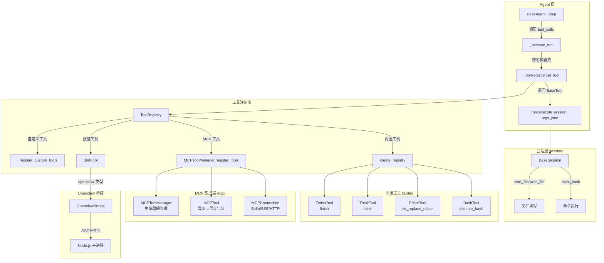
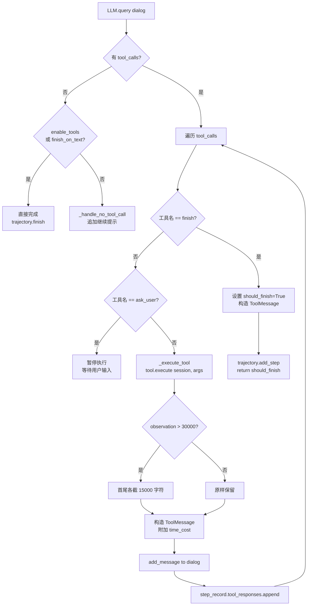
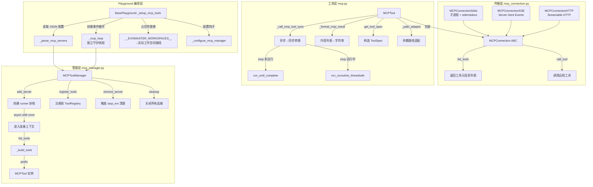
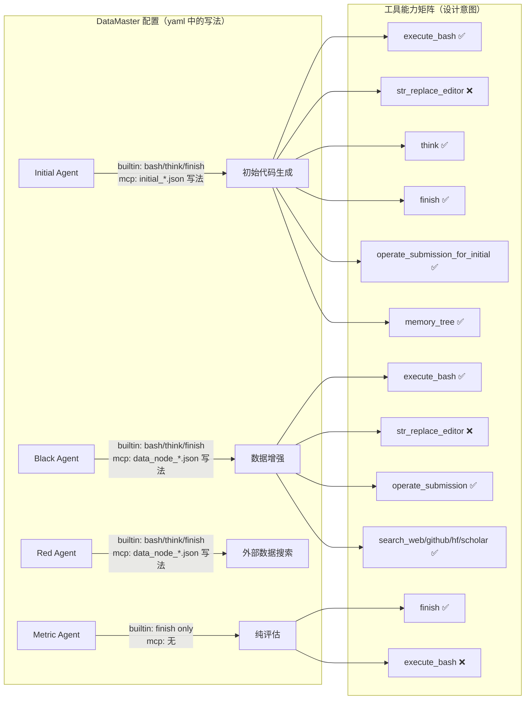

EvoMaster 的 Agent 工具系统是一个分层抽象框架，将 LLM 的 function calling 能力与环境执行层桥接起来。系统由三层构成：**BaseTool 抽象基类**定义统一接口契约，**四类内置工具**（Bash / Editor / Think / Finish）提供核心生存能力，**MCP 协议集成层**通过动态服务发现将外部工具无缝注册进同一注册表。这种设计使得 Agent 在不修改任何代码的前提下，仅通过配置文件即可获得从文件系统操作到学术搜索等数十种异构工具的调用能力。

> 📖 **小白导读**
> - 这篇讲什么：Agent（能自己决定下一步做什么的 LLM 程序）靠哪些"工具"去操作电脑、读写文件、搜索数据，以及这些工具是怎么被登记、暴露给模型、再被真正执行的。
> - 先知道几个概念：**LLM**（大语言模型）；**function calling**（模型不直接动手，而是输出"我要调用某工具、参数是什么"，由程序代它执行）；**MCP**（Model Context Protocol，一种让外部程序以统一方式把工具提供给 Agent 的协议）；**session**（工具与运行环境之间的"传话人"，详见第 21 篇）。
> - 读完能明白：四个内置工具各做什么；MCP 工具如何接进来；"登记了"和"模型能看到"为什么是两回事；以及原文档里几处与代码实际行为不符的地方（本文已改正）。

## 工具体系架构总览

上图展示了从 Agent 的 `_step` 方法到最终环境执行的全链路。关键设计决策是：**所有工具——无论内置还是 MCP——都注册到同一个 `ToolRegistry` 实例中**，Agent 通过 `_get_tool_specs` 统一暴露给 LLM，通过 `_execute_tool` 统一调度执行。MCP 工具通过 `_is_mcp_tool` 元数据标记实现区分，但不影响调用路径。

> **先分清两个动作（本文反复用到）**：**注册**（register）是把工具放进 `ToolRegistry` 这本"总名册"，决定"能不能被找到并执行"；**暴露**（expose）是把工具的说明书（名称、参数 schema）塞进发给 LLM 的请求里，决定"模型知不知道有这个工具"。DataMaster 的做法是：不管 yaml 怎么写，四个内置工具和 `use_skill` 都会注册（见下文），yaml 的 `builtin`、`mcp` 只控制"暴露"。而 `_execute_tool` 在执行时只按名字去名册里查，**不检查这个名字是否在暴露列表里**（`agent.py` 的 `_execute_tool`，只调用 `self.tools.get_tool`）。所以如果模型"幻觉"出一个没暴露、但已注册的工具名（例如 `str_replace_editor`），它仍会被真正执行。这是读代码得出的推论，未实测（推断）。

Sources: [agent.py](evomaster/agent/agent.py#L447-L533), [base.py](evomaster/agent/tools/base.py#L67-L130), [__init__.py](evomaster/agent/tools/__init__.py#L1-L59)

## BaseTool 抽象与 ToolRegistry 设计

工具系统的根基是 `BaseTool` 抽象类和 `BaseToolParams` Pydantic 模型。每个工具由两部分组成：一个继承 `BaseToolParams` 的参数类（定义 LLM 可见的 JSON Schema），一个继承 `BaseTool` 的执行类（实现 `execute` 方法）。`BaseToolParams` 利用 Pydantic 的 `model_json_schema()` 自动生成参数 schema，并通过 `_remove_unused_schema_info` 函数清除 `default`、`title`、`additionalProperties` 等冗余字段，确保暴露给 LLM 的 function calling 描述精简无噪。

`ToolRegistry` 作为中央注册表，提供了 `register` / `unregister` / `get_tool` / `get_tool_specs` 等标准方法，同时通过 `_is_mcp_tool` 属性标记实现了内置工具与 MCP 工具的分类查询能力。`get_mcp_tools`、`get_builtin_tools`、`get_tools_by_server` 等方法为运维和调试提供了按维度切片的视角。

工厂函数 `create_registry` 是工具初始化的核心入口。它接受 `builtin_names` 参数控制注册哪些内置工具——`["*"]` 注册全部，`[]` 不注册任何内置（纯 MCP/Skill 场景），`["execute_bash", "finish"]` 精确选择。这种设计使得不同 Agent 角色可以拥有不同的工具子集，例如 Metric Agent 只需要 `finish` 工具而无需 Bash 或 Editor。

**但要注意，DataMaster 实际走的路径并不使用这个"精确选择"能力**：`BasePlayground._setup_tools` 里写死 `create_registry(builtin_names=["*"], ...)`（`evomaster/core/playground.py` 约 L574），也就是说无论 yaml 里 `builtin` 写了什么，四个内置工具都会被注册；yaml 的 `builtin` 列表只被用来拼出"暴露给 LLM 的工具名单"（`enabled_tool_names`，同文件 `_create_agent`）。下表第一列描述的是 `create_registry` 函数本身的行为，不是 DataMaster 的运行时行为。

| 参数值 | 行为 | 典型场景 |
|--------|------|----------|
| `["*"]` 或 `None` | 注册全部四个内置工具 | `create_registry` 的默认值；DataMaster 的 `_setup_tools` 总是传这个值；ML-Master 基线 yaml 也写 `["*"]` |
| `["execute_bash", "think", "finish"]` | 精确选择，排除 Editor | DataMaster 的 yaml 里 nouse/Initial/Black/Red 四个 Agent 写的就是这个名单（`config_base.yaml` L36、L54、L72、L90），但它只决定"暴露"，不决定"注册" |
| `["finish"]` | 仅注册完成工具 | Metric Agent 的 yaml 写法（`config_base.yaml` L108）；同样只决定暴露 |
| `[]` | 不注册任何内置 | 纯 Skill / MCP 场景 |

Sources: [base.py](evomaster/agent/tools/base.py#L53-L116), [base.py](evomaster/agent/tools/base.py#L249-L336)

## 四类内置工具详解

### BashTool：执行 Shell 命令（描述说"持久"，本地模式实际并不持久）

`BashTool` 是 Agent 与计算环境交互的主要通道。它通过 `session.exec_bash` 执行命令。工具名称为 `execute_bash`，接受三个参数：`command`（要执行的命令字符串）、`is_input`（是否为对运行中进程的输入）、`timeout`（超时秒数，不填则用 session 的默认超时）。

**重要：工具说明书（`BashToolParams` 的 docstring，也就是发给 LLM 的那段描述）写的是"持久 Shell 会话，环境变量、虚拟环境和工作目录在命令间保持"，并说有"10 秒软超时、返回 -1 时可用 `is_input` 继续交互"。这只对 Docker 模式（后面第 21 篇会讲，它用 tmux 维持一个长期存在的 bash）成立。DataMaster 默认用的是本地模式（`config_base.yaml` 中 `session.type: "local"`），而本地模式的真实行为是：**

- 每次调用都是一个**全新的子进程**（`LocalEnv.local_exec` 里的 `subprocess.run(command, shell=True, ...)`，`evomaster/env/local.py` 约 L508-516）。所谓子进程（subprocess），就是 Python 程序临时启动的一个独立命令行进程，命令跑完它就消失了。所以上一条 `cd data` 或 `export X=1` 对下一条**完全不生效**；想切目录必须写成 `cd data && python a.py` 这种同一条命令。
- `is_input=true` 直接返回错误 `ERROR: Local session does not support is_input mode.`（`evomaster/agent/session/local.py` L145-151），没有"软超时后继续交互"这回事。
- 没有 10 秒软超时。超时时间取参数 `timeout`，否则取 `session.local.timeout`（`config_base.yaml` 为 600 秒；代码默认 300）。超时后 `subprocess.run` 抛 `TimeoutExpired`，被捕获并返回 `exit_code = -1` 和文本 `Command timed out after Ns`——此时命令是被终止了，而不是"仍在运行"。因此说明书里"返回 -1 表示仍在运行"在本地模式下是错的。另外，`shell=True` 只会终止外层 shell，命令派生出的孙进程是否残留取决于系统（推断，未实测）。
- 工作目录固定是 session 的 workspace（或线程私有的覆盖路径），每次命令都从那里开始；返回的 `[Current working directory: ...]` 只是把这个固定路径回显出来，并不代表 shell 真的"停留"在那里。

这个"说明书与实际不符"会直接误导模型：模型可能先写 `cd xxx` 再单独写 `python y.py`，第二条会在错误的目录里跑。读者在设计 prompt 或排查"为什么 agent 找不到文件"时请先想到这一点。

**Windows 注意**：`subprocess.run(shell=True)` 在 Windows 上调用的是 `cmd.exe`，不是 bash，`ls`、`export`、`$VAR`、`;` 串联等 bash 写法都不能直接用；代码里 `taskset`（限制 CPU 核）也特意用 `sys.platform != "win32"` 跳过。而整个仓库本来就只在 Linux 上安装运行（`pyproject.toml` L551 限定 `sys_platform == 'linux'`），所以这里是"文档与代码都不要在 Windows 上指望它工作"，不是一个被支持的场景。

软超时与进程交互机制（`exit_code == -1`、发空串取日志、发 `C-c`）因此**只适用于 Docker 模式**。输出方面，工具优先取合并后的 `output`（stdout 与 stderr 拼在一起），以确保错误信息可见，并附加当前工作目录和退出码信息。

Sources: [bash.py](evomaster/agent/tools/builtin/bash.py#L19-L105)

### EditorTool：带撤销历史的文件编辑器

`EditorTool`（名称 `str_replace_editor`）是一个功能完备的文件编辑器，支持五种命令：`view`（查看文件或目录）、`create`（创建新文件）、`str_replace`（精确字符串替换）、`insert`（按行号插入）、`undo_edit`（撤销最后一次编辑）。

该工具的核心约束是**精确匹配与唯一性**：`str_replace` 命令要求 `old_str` 必须在文件中唯一匹配，否则拒绝执行并报告所有匹配行号。如果精确匹配失败，工具会尝试 strip 空白后重新匹配作为容错。每次编辑操作前，原始内容被压入 `_file_history` 字典维护的撤销栈中，`undo_edit` 从栈顶弹出并恢复。输出格式模拟 `cat -n` 效果，带行号显示，并通过 `maybe_truncate` 函数在输出超过 16000 字符时执行中间截断（保留首尾各半），附带 `<response clipped>` 提示引导 Agent 使用 `grep -n` 精确定位。

**在 DataMaster 里这个工具其实用不上**：Initial/Black/Red 的 yaml 都没有把 `str_replace_editor` 放进 `builtin` 名单（见下文），代码是通过 MCP 的 `operate_submission` 系列工具写入的。它虽被注册（见上文），但不会出现在模型看到的工具清单里。

所有路径操作通过 `BaseSession` 的抽象方法完成——`session.is_file`、`session.is_directory`、`session.read_file`、`session.write_file`——这使得 EditorTool 在 LocalSession 和 DockerSession 中行为一致。

| 命令 | 必需参数 | 关键约束 | 撤销支持 |
|------|----------|----------|----------|
| `view` | `path` | 目录仅支持 `view`；`view_range` 仅用于文件 | — |
| `create` | `path`, `file_text` | 目标路径不能已存在 | — |
| `str_replace` | `path`, `old_str`, `new_str` | `old_str` 必须唯一匹配；新旧字符串必须不同 | ✅ |
| `insert` | `path`, `insert_line`, `new_str` | `insert_line` 范围 `[0, n_lines]` | ✅ |
| `undo_edit` | `path` | 需有编辑历史 | — |

Sources: [editor.py](evomaster/agent/tools/builtin/editor.py#L1-L41), [editor.py](evomaster/agent/tools/builtin/editor.py#L103-L362)

### ThinkTool：无副作用的推理日志

`ThinkTool` 是一个设计精巧的认知工具。它不执行任何环境操作，仅将 Agent 的思考内容记录到日志中并返回确认消息。其 docstring 明确定义了五个使用场景：bug 修复方案头脑风暴、测试失败修复策略、重构方案对比、架构设计推演、复杂调试假设组织。

这个工具的核心价值在于**为 LLM 提供显式的推理锚点**——在 ReAct 模式中，Agent 的思考过程如果不通过工具调用表达，就可能被上下文截断策略丢失。通过将思考包装为工具调用，思考内容会作为一对"assistant 的工具调用 + `ToolMessage` 回复（固定文本 `Your thought has been logged.`）"留在对话历史里。需要纠正原文的一处说法：原文称它"受 `preserve_recent_turns` 保护"，但 DataMaster 的上下文策略是 `latest_half`（见第 19 篇），该策略根本不读取 `preserve_recent_turns`，只是简单保留后半段历史；因此 `think` 的内容**和其他消息一样**，一旦落在被丢弃的前半段就会消失。另外，被记录下来的 `thought` 全文只放在工具调用的参数里，`ThinkTool` 自己只在 debug 级别日志打印前 100 个字符。

Sources: [think.py](evomaster/agent/tools/builtin/think.py#L18-L55)

### FinishTool：任务终止信号

`FinishTool` 是 Agent 唯一的主动终止机制。它接受 `message`（最终总结消息）和 `task_completed`（完成状态，枚举值为 `"true"` / `"false"` / `"partial"`）。在 Agent 的 `_step` 方法中，`finish` 工具调用受到特殊处理：不通过常规的 `_execute_tool` 路径执行，而是直接设置 `should_finish = True`，构造一条 `ToolMessage`（内容为 "Task marked as finished."）并中断工具调用循环。

这里有几个容易误解的细节（均已对照 `agent.py` 与 `finish.py` 验证）：

- `FinishTool.execute`（返回 `Task marked as ...`）在 Agent 循环里**从不会被调用**，因为 `_step` 在 `tool_call.function.name == "finish"` 时直接走特殊分支。所以模型填的 `task_completed`（`true`/`false`/`partial`）只会被打到日志里，**不会影响任何状态**；写入对话历史的 `ToolMessage` 的 meta 里 `task_completed` 被硬编码成 `True`。
- 正常调用 `finish` 后，`BaseAgent.run` 会把轨迹状态设为 `completed`；如果跑满 `max_turns`（DataMaster 里 Initial/nouse 为 20，Black/Red 为 50，Metric 为 4，见 `config_base.yaml`）都没调用 `finish`，则状态为 `failed`，原因写 `max_turns_exceeded`。也就是说，`finish(task_completed="false")` 的轨迹状态仍然是 `completed`，而"没调 finish 的纯文本回答"反倒算 `failed`。
- 但 DataMaster 的各个 exp 并不读取这个状态：在 `playground/data_master` 里搜索不到对 `traj.status` 的任何使用。它们的做法是取对话里"最后一条有文字内容的 assistant 消息"（`extract_agent_response`，`playground/data_master/core/utils/runtime.py`），再去检查磁盘上有没有生成的代码文件。因此 `finish` 的 `message` 参数（放在工具调用参数里，不是 assistant 消息的 `content`）不会被这个函数读到；节点好坏要看实际产物，而不是看 Agent 自称是否完成。
- 对于只暴露 `finish` 的 Metric Agent：它的 prompt 要求"只输出纯 JSON"，模型直接用文字回答、不调用工具时，`_step` 会追加一句"请继续，完成后用 finish 工具"并进入下一轮，直到 `max_turns=4` 耗尽，轨迹状态为 `failed`，但因为上面的取值方式，最后一条文字回答仍会被拿去解析指标。每多一轮就多一次 LLM 调用的开销（推断：是否真的出现多轮取决于模型行为，未实测）。

Sources: [finish.py](evomaster/agent/tools/builtin/finish.py#L18-L65), [agent.py](evomaster/agent/agent.py#L452-L477)

## Agent 工具调度与执行流水线

Agent 的工具执行流水线在 `_step` 方法中实现。ReAct 是一种常见的 Agent 工作方式：模型先"推理"（Reason）再"行动"（Act，即调用工具），拿到工具结果后再接着推理，如此循环。这里的实现在此基础上有多处增强：

`_execute_tool` 方法是所有工具的统一执行入口。它通过 `self.tools.get_tool(tool_name)` 从注册表查找工具实例，调用 `tool.execute(self.session, tool_args)` 获取结果。工具输出超过 30000 字符时执行中间截断（首 15000 + 尾 15000），这一保护在 Agent 层和 `_execute_tool` 内部各执行一次形成双重保险。每次工具调用的耗时被记录在 `ToolMessage.meta.time_cost` 中，写入轨迹文件供后续分析。

`_get_tool_specs` 方法控制 LLM 可见的工具列表。`enable_tools=False` 时返回空列表（适用于纯对话 Agent）；`enabled_tool_names` 为非空列表时仅返回名字在其中的工具 spec。代码里的判断是 `if self.enabled_tool_names:`（真值判断），所以**空列表和 None 一样会返回全部已注册工具**；另外 `BaseAgent` 构造函数文档说 `["*"]` 表示全部，但这一层并不认识 `"*"`，是 Playground 事先把 `["*"]` 展开成四个具体名字的（`_create_agent`）。在 Playground 的 `_create_agent` 方法中，`enabled_tool_names` 由配置文件的 `builtin`、`mcp` 和 `skills` 字段组装而成：`mcp` 非空时，会把"MCP 管理器里**所有**工具的名字"都加进去（`self.mcp_manager.get_tool_names()`），而不是只加该 Agent 自己 JSON 里列的那些，详见下文 MCP 配置一节。

两点补充：流程图里的 `ask_user` 分支只在飞书机器人场景下由 `dispatcher.py` 注入该工具，DataMaster 的搜索流程用不到；输出超长截断在 `_execute_tool` 里已经做过一次（首尾各 15000 字符，中间插入 `...[truncated]...` 约 18 个字符），此时长度仍略大于 30000，所以 `_step` 里的第二次检查会再触发一次，最终结果依然是"保留首尾各约 15000 字符"，不影响理解。

Sources: [agent.py](evomaster/agent/agent.py#L346-L533), [agent.py](evomaster/agent/agent.py#L626-L647), [playground.py](evomaster/core/playground.py#L834-L870)

## MCP 协议集成架构

MCP（Model Context Protocol）集成是工具系统中最复杂的子系统，采用**混合方案（Hybrid Approach C）**：对外将 MCP 工具注册到统一 `ToolRegistry`，对内由 `MCPToolManager` 独立管理连接生命周期和事件循环。

### 三层结构

### 传输层：三种连接模式

`MCPConnection` 抽象基类统一封装了与 MCP 服务器的通信，支持三种传输方式。所有连接都是异步上下文管理器，通过 `AsyncExitStack` 管理资源生命周期。`__aenter__` 创建连接上下文，获取 `(read, write)` 通道后初始化 `ClientSession`，最后调用 `session.initialize()` 完成握手。`list_tools` 和 `call_tool` 方法直接委托给 MCP SDK 的 `ClientSession`。

| 传输方式 | 类名 | 通信机制 | 适用场景 | 配置参数 |
|----------|------|----------|----------|----------|
| stdio | `MCPConnectionStdio` | 启动子进程，通过 stdin/stdout 通信 | 本地脚本工具（Python/Node） | `command`, `args`, `env` |
| SSE | `MCPConnectionSSE` | Server-Sent Events 长连接 | 远程 SSE 服务端 | `url`, `headers` |
| HTTP | `MCPConnectionHTTP` | Streamable HTTP | 远程 HTTP 服务端 | `url`, `headers` |

工厂函数 `create_connection` 根据传入的 `transport` 参数（`"stdio"` / `"sse"` / `"http"`）实例化对应的连接类，并验证必需参数。

Sources: [mcp_connection.py](evomaster/agent/tools/mcp/mcp_connection.py#L19-L199)

### 工具层：MCPTool 异步同步桥接

`MCPTool` 是 `BaseTool` 的特殊子类，它不使用 `params_class`（MCP 工具的 schema 来自远程服务器），而是直接存储 `input_schema` 字典并在 `get_tool_spec` 中构造 `ToolSpec`。每个 MCP 工具的名称采用 `{server_name}_{original_tool_name}` 前缀格式，避免跨服务器命名冲突。

异步到同步的转换是 `MCPTool` 最关键的技术挑战。（背景：asyncio 是 Python 的"异步"机制，函数不用傻等结果，而 Agent 主循环是普通的"同步"代码，需要一座桥。）`_call_mcp_tool_sync` 方法处理两种场景：当 MCP 事件循环未运行时，直接调用 `loop.run_until_complete(coro)`（这条分支没有设置超时）；当循环正在运行时（如 `run_forever` 在后台线程中），使用 `asyncio.run_coroutine_threadsafe(coro, loop)` 进行线程安全提交。原文称第一种是"最常见的场景"，这与 DataMaster 不符：`_setup_mcp_tools` 会把事件循环放进一个守护线程里 `run_forever()`，所以实际走的总是**第二条分支**（带超时那条）。注释明确警告不能使用 `asyncio.run()`，因为临时循环会导致 anyio/mcp 流死锁和 `ClosedResourceError`。

超时策略按工具类型区分（仅在第二条分支生效，`mcp.py` L176-181）：普通工具 1800 秒超时，远程工具名里包含 `run_code` 的（代码执行类）5400 秒超时。注意超时后抛出的错误信息写死是 "timed out after 1800 seconds"（L184），即使真实上限是 5400 秒也一样；此外，超时只是让调用方不再等待，没有看到取消远端协程的代码（推断）。要区分的还有别的超时：`run_code` 工具自己的默认 timeout 为 3600 秒、`run_code_sync` 兜底默认 300 秒（这两个在 operate_submission 一侧，第 15 篇讲），而 yaml 里的 `session.local.timeout: 600` 只管 `execute_bash`。`_format_mcp_result` 方法处理 MCP 返回的异构内容列表，支持 Pydantic 模型（`item.text`）、字典（`item['text']` 或 `item['type']=='text'`）和其他类型的 JSON 序列化。

可选的 `_path_adaptor` 属性在工具执行前对参数进行路径转换——例如将本地工作空间路径转换为远程 URL 或注入凭证，由 Playground 的 `_configure_mcp_manager` 钩子方法设置。

Sources: [mcp.py](evomaster/agent/tools/mcp/mcp.py#L21-L259)

### 管理层：MCPToolManager 生命周期控制

`MCPToolManager` 管理多服务器连接的完整生命周期。其核心数据结构包括：`connections`（服务器名→连接实例）、`tools_by_server`（服务器名→{工具名→MCPTool}）、`_server_tasks`（服务器名→asyncio Task）、`_server_stop` / `_server_ready`（服务器名→asyncio.Event 信号）。

`add_server` 方法采用**事件驱动初始化模式**：创建 `runner` 协程任务，在协程内部进入连接上下文、获取工具列表、构建 `MCPTool` 实例。如果此时已有关联的 `ToolRegistry`，立即将新工具注册进去。`ready_evt.set()` 通知调用方初始化完成，协程随后挂起在 `stop_evt.wait()` 上，直到 `remove_server` 发出停止信号才退出 `async with` 块（触发 `__aexit__` 清理连接）。这种设计确保连接的创建和清理都在同一个 asyncio Task 中发生，避免跨 Task 资源泄漏。

`tool_include_only` 字典提供了按服务器粒度的工具过滤能力，配置为 `{"server1": ["tool-a", "tool-b"]}` 时仅加载指定工具。`path_adaptor_servers` 和 `path_adaptor_factory` 支持为特定服务器注入参数转换器。`reload_server` 方法实现了热重载——先 `remove_server` 再重新获取工具列表和创建实例。`get_stats` 方法返回嵌套统计字典，包含每服务器的工具数量和每个工具的调用计数、最后错误信息。

Sources: [mcp_manager.py](evomaster/agent/tools/mcp/mcp_manager.py#L17-L386)

### Playground 编排层：_setup_mcp_tools

`BasePlayground._setup_mcp_tools` 是 MCP 集成的顶层编排方法（Playground 可理解为"把配置、Agent、工具、环境组装起来并驱动整个实验的总控类"）。**关键限制**：它只会被调用**一次**。`_setup_tools` 里有 `if self.mcp_manager is None: ... = self._setup_mcp_tools(...)`，之后的 Agent 只是 `register_tools` 复用同一个管理器。而 Agent 创建顺序是 yaml 里 `agents:` 的书写顺序，第一个带 MCP 配置的是 `nouse`（它用 `$mcp_node_all`），所以真正被加载的是 node_all 那一套服务器；Initial 的 `$mcp_initial`、Black/Red 的 `$mcp_data_node` 两个 JSON 文件**不会被读取**。流水线如下：

1. **配置文件解析**：从 `config_dir` 解析相对路径，用 `json.load` 直接加载 JSON 配置文件（注意：这里没有做 `${VAR}` 环境变量替换，见下文）。
2. **占位符替换**：递归遍历配置中的所有字符串，将 `__EVOMASTER_WORKSPACES__` 替换为 `run_dir/workspaces` 的绝对路径，使 MCP 服务器能定位到正确的工作空间。
3. **服务器解析**：`_parse_mcp_servers` 方法区分标准格式（含 `command` 字段→stdio 传输）和扩展格式（含 `transport` 字段→HTTP/SSE）。同时从主配置读取 `grading_servers` 列表，注入到标记了 `ML_MASTER_GRADING_SERVERS` 的服务器环境变量中。
4. **事件循环创建**：创建独立的 `asyncio.new_event_loop()`，通过 `_start_loop_in_thread` 在守护线程中 `run_forever()`。这个长生命周期的循环被注入到 `MCPToolManager.loop` 和每个 `MCPTool._mcp_loop`。
5. **异步初始化**：通过 `asyncio.run_coroutine_threadsafe` 将 `init_mcp_servers` 协程提交到 MCP 循环，`future.result()` 阻塞等待所有服务器初始化完成。
6. **注册到主注册表**：`manager.register_tools(self.tools)` 将所有 MCP 工具注册到 Agent 使用的 `ToolRegistry`。
7. **配置钩子**：`_configure_mcp_manager` 是一个空实现的方法，子类可覆写以注入自定义的 path adaptor 或 tool_include_only 配置。

Sources: [playground.py](evomaster/core/playground.py#L1027-L1194), [playground.py](evomaster/core/playground.py#L166-L195)

## MCP 配置体系：三套 JSON 文件（但运行时只有一套生效）

EvoMaster 的 MCP 配置在文件层面分了**多套粒度**，从全局到节点级逐层细化。**但是对 DataMaster 而言，如上所述只有第一个创建的 Agent（`nouse`）所指的 `node_all_*.json` 会被加载**，initial/data_node 两套文件目前不会被读取，Initial、Black、Red 三种 Agent 看到的是同一套完整 MCP 工具集，彼此的区别只靠各自的 prompt 约束（以下表格描述的是文件的设计意图）：

| 配置层级 | 文件示例 | 服务器集合 | 适用场景 |
|----------|----------|-----------|----------|
| 全局（ML-Master） | `mcp_config4data.json` | filesystem + 4 个搜索工具 | 统一搜索环境 |
| 节点全集（node_all） | `node_all_*.json` | operate_submission_for_initial + operate_submission + memory_tree + 4 搜索工具 | 全功能节点 |
| Initial 专用 | `initial_*.json` | operate_submission_for_initial + memory_tree | 初始代码生成阶段 |
| Data Node 专用 | `data_node_*.json` | operate_submission + memory_tree + 4 搜索工具 | Black/Red 节点阶段 |

每个 JSON 文件遵循标准 MCP 配置格式，`mcpServers` 对象的键为服务器名称，值为包含 `command`、`args`、`env` 的配置字典。JSON 里的 `env` 值可以写成 `${DATA_ROOT}`、`${SERPER_API_KEY}`、`${HF_TOKEN}` 这样的形式，但原文说它"支持环境变量引用"并不准确：`${VAR}` 的展开只发生在**主 yaml** 加载时（`evomaster/config.py` L242 调用 `_substitute_env`）；MCP 的 JSON 由 `_setup_mcp_tools` 直接 `json.load`，只会替换 `__EVOMASTER_WORKSPACES__` 这一个占位符，`${...}` 会被原样当字面字符串作为环境变量传给 MCP 子进程。子进程最终拿到的值是什么，还取决于 MCP SDK 如何合并环境变量（未验证）。另外在主 yaml 里，变量未设置时 `${VAR}` 会被静默替换成空字符串，不会报错。

DataMaster 的 YAML 配置通过模板变量 `$mcp_node_all`、`$mcp_initial`、`$mcp_data_node` 引用对应的 JSON 文件路径（`$xxx` 是 Python `string.Template` 的占位符，在生成任务专属 yaml 时被替换成真实路径）。设计意图是：Initial Agent 使用 `$mcp_initial`（仅提交工具和记忆树），Black/Red Agent 使用 `$mcp_data_node`（提交工具、记忆树和全部搜索工具），Metric Agent 不配置 MCP。**实际运行时**：只有 Metric Agent 因为没配 MCP 而看不到任何 MCP 工具；其余 Agent 的暴露名单都是"内置工具 + MCP 管理器里的全部工具"。

Sources: [config_base.yaml](configs/data_master/config_base.yaml#L31-L118), [node_all_aerial-cactus-identification.json](configs/data_master/json_configs/aerial-cactus-identification/node_all_aerial-cactus-identification.json#L1-L75), [mcp_config4data.json](configs/ml_master/mcp_config4data.json#L1-L53)

## Openclaw 桥接：TypeScript 工具通道

> 说明：这一节和下面的 `use_skill`（Skill 工具）在代码里存在，但 DataMaster 的 yaml 没有配置任何 `skills:` 键，也没有启用 openclaw，所以**本项目运行时用不到**这条通道，见第 18 篇。

除了 MCP 协议，系统还通过 `OpenclawBridge` 提供了一条通往 TypeScript/Node.js 工具生态的通道。这条路径不经过 MCP 协议，而是通过 `stdin/stdout` 上的 JSON-RPC 协议与 Node.js 子进程通信。

`OpenclawBridge` 在 `start(plugins)` 时启动 `npx tsx bridge/server.ts` 子进程，发送 `init` 消息加载指定插件，接收返回的工具列表。`execute_tool(tool_name, args)` 方法发送 `execute` 消息，等待同步响应并提取 `content[0].text`。通信通过线程锁 `_lock` 保护，stderr 由独立守护线程读取转发到日志。

`SkillTool` 在执行 `run_script` 动作时检查 `skill.meta_info.type == "openclaw"`，如果是则委托给 `OpenclawBridge.execute_tool`，否则通过 `session.exec_bash` 执行 Python/Shell/JS 脚本。这使得飞书文档操作等 TypeScript 插件工具能被 Agent 统一调用。

Sources: [openclaw_bridge.py](evomaster/agent/tools/openclaw_bridge.py#L20-L173), [skill.py](evomaster/agent/tools/skill.py#L216-L335)

## 工具配置与 Agent 角色的映射关系

上图展示了 DataMaster 中四种 Agent 角色在 yaml 里**写出来**的工具配置差异（图中矩阵是"设计意图"；实际运行时 Initial、Black、Red 因为共用同一套 MCP 管理器，看到的是同一批 MCP 工具，见上文）。值得注意的是，DataMaster 的所有数据操作 Agent 都不配置 `str_replace_editor`——代码管理完全通过 `operate_submission` MCP 工具完成。相比之下，ML-Master 基线配置 `builtin: ["*"]`（包含 Editor），体现了不同框架在代码管理策略上的分歧。

Sources: [config_base.yaml](configs/data_master/config_base.yaml#L31-L118), [config.yaml](configs/ml_master/config.yaml#L53-L129)

## Session 抽象层：工具的环境执行中介

所有工具的 `execute` 方法签名为 `(session: BaseSession, args_json: str) -> tuple[str, dict]`，其中 `session` 是工具与具体环境交互的唯一中介。`BaseSession` 定义了以下抽象方法：

- `exec_bash(command, timeout, is_input)` → `{stdout, stderr, exit_code, working_dir}`
- `read_file(path, encoding)` → `str`（内部通过 `download` + `decode` 实现）
- `write_file(path, content, encoding)` → `None`（内部通过临时文件 + `upload` 实现）
- `is_file(path)` / `is_directory(path)` / `path_exists(path)` → `bool`（内部通过 `exec_bash` 执行 `test` 命令实现）

这种设计使得 `BashTool` 和 `EditorTool` 的代码与具体环境基本解耦——`LocalSession` 在本地 Shell 执行命令，`DockerSession` 在容器内执行，工具代码无需任何修改。"基本"是因为两种 session 的 `exec_bash` 行为并不等价（本地每次新进程、Docker 才是持久 tmux 会话，见上文 BashTool 一节；详细对比见第 21 篇）。`is_file` 和 `is_directory` 方法使用精确字符串匹配（`stdout == "file"` 而非 `"file" in stdout`）来避免 `"not_file"` 误匹配。

Sources: [base.py](evomaster/agent/session/base.py#L22-L181)

## 综合对比：内置工具 vs MCP 工具 vs Skill 工具

| 维度 | 内置工具 | MCP 工具 | Skill 工具 |
|------|----------|----------|-----------|
| **基类** | `BaseTool` + `BaseToolParams` | `MCPTool` (extends `BaseTool`) | `SkillTool` (extends `BaseTool`) |
| **Schema 来源** | Pydantic 模型自动生成 | MCP 服务器运行时返回 | Pydantic 固定模型 |
| **执行方式** | 同步，直接操作 session | 异步→同步转换，通过 MCP 协议 | 分发到脚本或 OpenclawBridge |
| **生命周期** | 随 ToolRegistry 创建/销毁 | `MCPToolManager` 管理，独立事件循环 | 随 ToolRegistry 创建/销毁 |
| **名称格式** | 固定（如 `execute_bash`） | `{server}_{tool}` 前缀 | 固定 `use_skill` |
| **描述动态性** | 静态 docstring | 运行时从服务器获取 | 动态注入 skill 元数据 |
| **配置入口** | `builtin` 字段 | `mcp` 字段（JSON 文件路径） | `skills` 字段 |
| **路径适配** | 无 | 可选 `_path_adaptor` | 无 |

## 向前导航

本文档聚焦于工具系统的内部架构。以下页面提供了工具系统与更广泛框架的关联视角：

- **[Skills 技能系统：知识型与操作型技能的三级结构](18-skills-ji-neng-xi-tong-zhi-shi-xing-yu-cao-zuo-xing-ji-neng-de-san-ji-jie-gou)**：`SkillTool` 的上层——Skill 注册表、三级信息加载机制（meta_info → full_info → scripts）以及 SKILL.md 格式解析。
- **[Agent 基类：对话管理、轨迹记录与上下文截断策略](19-agent-ji-lei-dui-hua-guan-li-gui-ji-ji-lu-yu-shang-xia-wen-jie-duan-ce-lue)**：`_step` 和 `_execute_tool` 的完整上下文——Agent 如何管理对话历史、记录执行轨迹以及处理上下文溢出。
- **[会话与环境管理：LocalSession 与 Docker 隔离环境](21-hui-hua-yu-huan-jing-guan-li-localsession-yu-docker-ge-chi-huan-jing)**：`BaseSession` 的两个具体实现——本地 Shell 执行与 Docker 容器隔离的差异。
- **[配置体系解析：YAML 配置、MCP JSON 与任务级配置生成](22-pei-zhi-ti-xi-jie-xi-yaml-pei-zhi-mcp-json-yu-ren-wu-ji-pei-zhi-sheng-cheng)**：三级 MCP 配置如何通过模板变量和脚本生成绑定到不同 Agent 角色。
- **[operate_submission：代码管理、执行与提交校验流水线](15-operate_submission-dai-ma-guan-li-zhi-xing-yu-ti-jiao-xiao-yan-liu-shui-xian)**：作为 MCP 服务器运行的 `for_initial_exp.py` 和 `for_datanode.py` 的具体实现。

## 本文修订记录

- `execute_bash` 的描述与实际行为不符：原文称"持久 Shell、环境变量与工作目录保持"，而本地模式每次都是新子进程（`evomaster/env/local.py` 约 L508-516 `subprocess.run(shell=True)`），`is_input` 直接报错（`evomaster/agent/session/local.py` L145-151），也没有 10 秒软超时；`exit_code=-1` 在本地表示"超时被终止"。已改写并补充 Windows（cmd.exe）说明。
- 工具"暴露"与"注册"的区别：补充说明 `_setup_tools` 总以 `["*"]` 注册全部内置工具（`playground.py` L574），yaml 的 `builtin` 只影响暴露名单；`_execute_tool` 不做白名单检查；`_get_tool_specs` 用真值判断，空列表等同于全部。已修正 `create_registry` 参数表里"典型场景"一列。
- MCP 只初始化一次：原文说 Initial/Black/Red 各自绑定不同 MCP 集合，实际只按第一个带 MCP 配置的 Agent（`nouse`，`$mcp_node_all`）加载一套，三者看到同一批 MCP 工具；已改正标题、表格前说明和角色映射说明。
- `${VAR}` 展开：原文称 MCP JSON 支持环境变量引用，实际只有主 yaml 展开（`evomaster/config.py` L242），MCP JSON 仅替换 `__EVOMASTER_WORKSPACES__`；已改正。
- MCP 超时与调用分支：补充 DataMaster 实际总走 `run_coroutine_threadsafe` 分支（循环在守护线程里 run_forever），报错信息固定写 1800 秒；区分 `execute_bash`/`run_code`/`run_code_sync` 各自的超时。
- `think` 受 `preserve_recent_turns` 保护的说法有误：`latest_half` 不读这个参数。`finish` 补充：`task_completed` 不影响任何状态、`FinishTool.execute` 从不被调用、`max_turns` 耗尽判 `failed`、DataMaster 不读轨迹状态。
- 补充小白导读、"注册 vs 暴露"说明、ReAct/asyncio/subprocess 等术语解释；标注 Openclaw/Skill 在本项目中未启用（见第 18 篇）。
- 未验证：MCP SDK 如何合并子进程环境变量；`shell=True` 超时后孙进程是否残留；`_execute_tool` 对未暴露工具的实际触发情况。
