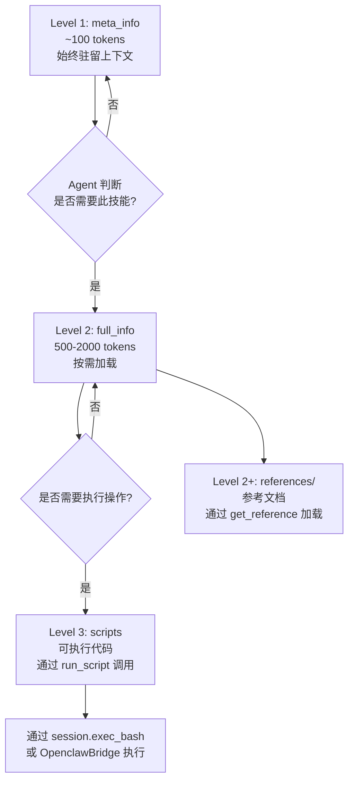
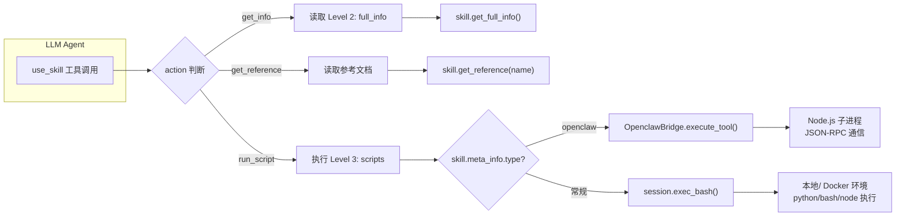
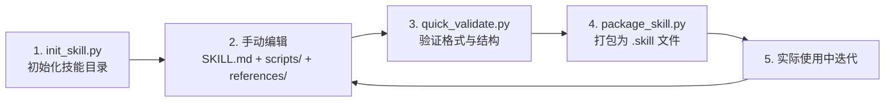
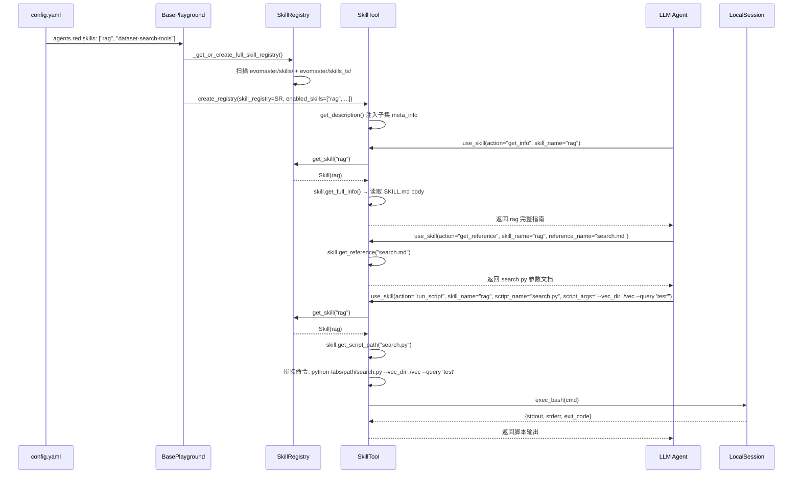

Skills 是 EvoMaster 框架中实现 **领域知识注入与可执行能力扩展** 的核心子系统。它通过一套精心设计的三级渐进式加载机制，在不撑爆上下文窗口的前提下，将专业领域知识、工作流指南和可执行脚本按需交付给 LLM Agent。本文将深入剖析 Skills 系统的架构设计、三级信息结构、技能注册与发现机制、以及 `use_skill` 工具的完整执行链路。

> 📖 **小白导读**
> - **先说结论**：这套 Skills（技能）机制在 EvoMaster 框架里**确实存在、代码完整**，但 **DataMaster 这个项目并没有使用它**。核对 `configs/data_master/config_base.yaml` 及其生成的任务 yaml，所有 agent 配置里都没有 `skills:` 键，Black/Red 等 agent 真正用的是 MCP 工具（见第 17 篇）。读这一篇是为了理解框架的能力，不要以为 DataMaster 运行时会走这里。
> - 先知道几个概念：**LLM**（大语言模型）、**tool / function calling**（模型输出"调用某工具"的请求，由程序代为执行）、**frontmatter**（Markdown 文件开头用 `---` 包起来的一小段元信息）、**token**（模型计费和上下文长度的最小单位，约等于半个到一个汉字或几个英文字母）。
> - 容易混淆的一点：Black 节点的 prompt（`playground/data_master/prompts/black/system_prompt.md` 第 5、7 行）写到"你可以使用一个 skills catalog，从中选用技能"。但在 prompts 目录里没有找到任何把技能目录注入 prompt 的占位符，Black agent 也没有暴露 `use_skill`，所以这句话更像是 prompt 措辞，并不对应本篇讲的这套机制（推断）。
> - 读完能明白：一个"技能"由哪些文件组成、模型怎样分三步逐级读取它、以及为什么说"登记了技能"与"模型能看到技能"是两件事。

Sources: [skills.md](docs/skills.md#L1-L55), [base.py](evomaster/skills/base.py#L1-L40)

## 三级信息结构：渐进式上下文加载的设计哲学

Skills 系统的核心设计原则是 **渐进式披露（Progressive Disclosure）**——将技能信息按粒度分为三个层级，Agent 根据当前需求逐级加载，从而在上下文窗口这一"公共资源"中实现最大效率。



**Level 1（meta_info）** 是技能的元数据，从 `SKILL.md` 的 YAML frontmatter 解析而来，包含 `name`、`description`、`license`、`type`、`tool_name` 等字段。这些信息会被拼进 `use_skill` 这个工具的描述文字里（通过 `SkillRegistry.get_meta_info_context()`，由 `SkillTool.get_description()` 调用），帮助 LLM 判断当前任务是否需要调用某个技能；也就是说，只有当 `use_skill` 被暴露给模型时，模型才看得到这些元数据。单个技能的 meta_info 约占 100 tokens，当注册十几个技能时，总开销控制在 1000-2000 tokens 以内，对上下文窗口的压力可以忽略。

**Level 2（full_info）** 是技能的完整指导文档。当 Agent 决定使用某技能后，通过 `action: "get_info"` 加载 Level 2 信息。加载优先级为：若技能目录下存在 `job_submit.md` 文件，则读取该文件作为 full_info；否则提取 `SKILL.md` 的 body 部分（frontmatter 之后的 Markdown 内容）。这一设计允许技能作者将核心指南放在 `SKILL.md` body 中，而将特定任务指令放在独立的 `job_submit.md` 中，实现关注点分离。Level 2 的加载结果会被缓存（`_full_info_cache`），避免重复 I/O。

**Level 3（scripts）** 是可执行脚本层，仅操作型技能拥有。脚本存放在技能目录的 `scripts/` 子目录下，支持 `.py`、`.sh`、`.js` 三种格式。Agent 通过 `action: "run_script"` 触发脚本执行，系统根据文件后缀自动选择解释器（`python`/`bash`/`node`），拼接参数后通过 `session.exec_bash()` 在 Agent 的会话环境中执行。

Sources: [base.py](evomaster/skills/base.py#L33-L55), [base.py](evomaster/skills/base.py#L121-L141), [skill-creator SKILL.md](evomaster/skills/skill-creator/SKILL.md#L114-L124)

## 技能类型分类：知识型、操作型与 Openclaw 桥接型

从实现角度看，EvoMaster 的实际代码库中所有技能均使用统一的 `Skill` 类（而非文档中描述的 `KnowledgeSkill`/`OperatorSkill` 分体设计）。`Skill` 类继承自 `BaseSkill`，在初始化时扫描 `scripts/` 目录：若存在脚本文件则为操作型技能，若不存在则自然退化为知识型技能。这一设计简化了类层次，同时保留了行为差异。

### 知识型技能 vs 操作型技能

| 维度 | 知识型技能 | 操作型技能 |
|------|-----------|-----------|
| **Level 1** | meta_info（始终在上下文） | meta_info（始终在上下文） |
| **Level 2** | full_info（按需加载） | full_info（按需加载） |
| **Level 3** | 无 | scripts/（可执行脚本） |
| **references/** | 有，按需加载参考文档 | 有，按需加载参考文档 |
| **上下文表示** | `[Skill: name] description (Scripts: No scripts)` | `[Skill: name] description (Scripts: script1.py, script2.py)` |
| **典型示例** | `black-dataops`、`bohrium-oss`、`calculation` | `rag`、`operate-tools`、`dataset-search-tools`、`memory-tools`、`pdf` |

### Openclaw 桥接型技能

第三种技能类型通过 `type: "openclaw"` 标识，存放在 `evomaster/skills_ts/` 目录下。这类技能的 `SKILL.md` frontmatter 包含 `type: openclaw` 和 `tool_name` 字段，其执行路径不经过本地脚本，而是通过 `OpenclawBridge` ——一个 Node.js 子进程——调用 TypeScript 插件注册的工具。`OpenclawBridge` 使用 JSON-RPC over stdin/stdout 协议与子进程通信，支持 `init`（加载插件）、`execute`（执行工具）、`shutdown`（关闭子进程）三种方法。

Sources: [base.py](evomaster/skills/base.py#L174-L227), [openclaw_bridge.py](evomaster/agent/tools/openclaw_bridge.py#L20-L101), [feishu-doc SKILL.md](evomaster/skills_ts/feishu-doc/SKILL.md#L1-L7)

## 技能目录结构规范

每个技能是一个自包含的目录，以 `SKILL.md` 为唯一必需文件，其余资源按约定组织：

```text
skill-name/
├── SKILL.md              # [必需] 技能定义：YAML frontmatter + Markdown body
├── job_submit.md         # [可选] 独立的 full_info 文件（优先于 SKILL.md body）
├── scripts/              # [可选] 可执行脚本（.py / .sh / .js）
│   ├── main.py
│   └── helper.sh
├── references/           # [可选] 参考文档（按需加载）
│   ├── guide.md
│   └── api.md
├── reference/            # [可选] 参考文档（替代目录名，部分技能使用）
│   └── search.md
├── forms.md              # [可选] 顶级参考文件（如 pdf 技能）
├── LICENSE.txt           # [可选] 许可证文件
└── assets/               # [可选] 输出资源文件（模板、图标等）
```

`get_reference()` 方法在查找参考文档时，会依次尝试三个路径：`skill_path/reference_name`、`skill_path/references/reference_name`、`skill_path/reference/reference_name`，兼容 `references/` 和 `reference/` 两种目录命名约定，也支持顶级文件直接引用。

Sources: [base.py](evomaster/skills/base.py#L143-L163), [skill-creator SKILL.md](evomaster/skills/skill-creator/SKILL.md#L47-L62)

### 仓库中的完整技能清单

当前仓库共包含 **10 个 Python 技能**（`evomaster/skills/`）和 **4 个 TypeScript/Openclaw 技能**（`evomaster/skills_ts/` 下的 feishu 系列；同目录的 `bridge/`、`openclaw-compat/`、`plugins/` 是桥接基础设施，不属于技能）：

| 技能名称 | 类型 | 含脚本 | 描述 |
|---------|------|-------|------|
| `rag` | 操作型 | ✅ | 检索增强生成：向量搜索、文本编码、FAISS 索引构建 |
| `operate-tools` | 操作型 | ✅ | DataNode 代码管理、执行、验证与评分流水线 |
| `dataset-search-tools` | 操作型 | ✅ | HuggingFace / GitHub / Web / 学术论文数据集搜索 |
| `memory-tools` | 操作型 | ✅ | 树状记忆管理：全局记忆、数据链接、节点 manifest |
| `pdf` | 操作型 | ✅ | PDF 文本提取、表单填充、合并拆分、验证图生成 |
| `mcp-builder` | 操作型 | ✅ | MCP Server 开发指南与评估工具 |
| `skill-creator` | 操作型 | ✅ | 技能创建脚手架：初始化、打包、验证 |
| `black-dataops` | 知识型 | ❌ | 黑节点数据清洗、外部数据合并、验证诊断指南 |
| `bohrium-oss` | 知识型 | ❌ | Bohrium OSS 文件上传指南 |
| `calculation` | 知识型 | ❌ | 材料计算 MCP 工具调用规范 |
| `feishu-doc` | Openclaw | ❌ | 飞书文档读写操作（通过 TS 插件执行） |
| `feishu-drive` | Openclaw | ❌ | 飞书云盘操作 |
| `feishu-perm` | Openclaw | ❌ | 飞书权限管理 |
| `feishu-wiki` | Openclaw | ❌ | 飞书知识库操作 |

Sources: [skills directory](evomaster/skills), [skills_ts directory](evomaster/skills_ts), [rag SKILL.md](evomaster/skills/rag/SKILL.md#L1-L5), [operate-tools SKILL.md](evomaster/skills/operate-tools/SKILL.md#L1-L5), [black-dataops SKILL.md](evomaster/skills/black-dataops/SKILL.md#L1-L5)

## SkillMetaInfo：YAML Frontmatter 解析机制

`SkillMetaInfo` 是 Level 1 的数据载体，使用 Pydantic BaseModel 定义。它从 `SKILL.md` 的 YAML frontmatter 中解析得到，包含以下字段：

```python
class SkillMetaInfo(BaseModel):
    name: str           # 技能名称（用于 SkillRegistry 索引）
    description: str    # 技能描述（含使用场景和触发条件）
    license: str | None = None       # 许可证信息
    type: str | None = None          # 技能类型，如 "openclaw"
    tool_name: str | None = None     # Openclaw 工具名，如 "feishu_doc"
```

值得注意的是，`base.py` 中的 frontmatter 解析器是 **手写的轻量级 YAML 解析器**，而非使用 PyYAML 库。它通过正则匹配 `^---\s*\n(.*?)\n---\s*\n` 提取 frontmatter 文本，然后逐行解析 `key: value` 格式，支持 `|` 和 `>` 多行块语法。这一设计避免了在技能加载阶段引入 PyYAML 依赖，但也意味着 frontmatter 语法必须严格遵循解析器支持的格式。

Sources: [base.py](evomaster/skills/base.py#L20-L31), [base.py](evomaster/skills/base.py#L57-L119)

## SkillRegistry：自动发现与子集管理

`SkillRegistry` 是技能系统的注册中心，负责技能的自动发现、加载、检索和上下文生成。其工作流程分为两个阶段：

### 自动发现与加载

`SkillRegistry.__init__` 接收 `skills_root`（技能根目录）和可选的 `skills`（技能目录名过滤列表）。加载逻辑遍历 `skills_root` 下的每个子目录，检查是否存在 `SKILL.md` 文件，若存在则实例化 `Skill` 对象并以 `meta_info.name` 为键存入 `_skills` 字典。当指定了 `skills` 过滤列表时，仅加载列表中的技能目录。

`load_from_directory` 方法支持从额外目录加载技能，用于将 `evomaster/skills_ts/` 中的 Openclaw 技能合并到同一个注册表中。当检测到同名技能时，会发出警告并覆盖。

### 子集创建与 Agent 级隔离

`create_subset` 方法是技能系统的关键设计之一。它通过 `object.__new__(SkillRegistry)` 绕过 `__init__`，创建一个仅包含指定技能的轻量子注册表。这一机制确保了不同 Agent 可以看到不同的技能视图，同时共享底层 `Skill` 对象实例。

在 Playground 的 `_setup_tools` 方法中，这一机制被用于实现 **暴露控制与执行隔离** 的分离：`SkillTool` 始终持有完整的 `SkillRegistry`（用于执行任何已注册技能），但通过 `enabled_skills` 参数控制哪些技能的 meta_info 被注入到工具描述中暴露给 LLM。需要订正原文一处细节：`create_subset` 并不是在 `_setup_tools` 里调用的，而是在 `SkillTool.get_description()`（`evomaster/agent/tools/skill.py` L84-90）里，每次生成工具说明时才创建子集。这意味着即使某个技能未在配置中启用，Agent 也无法"看到"它；但 `SkillTool.execute` 查技能时用的是完整注册表，并不检查它是否在 `enabled_skills` 里，所以只要模型"猜"对了 `use_skill` 的名字和技能名，仍然可以执行（代码推论，未实测，推断）。

Sources: [base.py](evomaster/skills/base.py#L229-L375), [playground.py](evomaster/core/playground.py#L434-L486), [playground.py](evomaster/core/playground.py#L527-L578)

## use_skill 工具：三级访问的统一入口

`SkillTool` 是 Agent 访问技能系统的唯一入口，注册名为 `use_skill`。它将三级信息结构封装为三种 action，通过统一的参数接口暴露给 LLM：



### get_info：加载完整指导文档

`action: "get_info"` 调用 `skill.get_full_info()`，返回 Level 2 信息。这是 Agent 决定使用某技能后的第一步操作——获取该技能的完整使用指南、CLI 参数说明、推荐工作流等。返回格式为 `# Skill: {name}\n\n{full_info}`。

### get_reference：按需加载参考文档

`action: "get_reference"` 调用 `skill.get_reference(reference_name)`，加载技能目录下的参考文档。这一设计遵循 **渐进式披露** 的核心原则：`SKILL.md` body 保持精简（建议 < 500 行），将详细的技术规范、API 文档、领域知识推入 `references/` 子目录，Agent 仅在需要时加载特定参考文件，而非一次性加载全部内容。

### run_script：执行可执行脚本

`action: "run_script"` 是 Level 3 的访问入口，执行路径根据技能类型分叉：

对于 **常规技能**（`type != "openclaw"`），系统通过 `skill.get_script_path(script_name)` 定位脚本文件，根据后缀选择解释器（`.py` → `python`，`.sh` → `bash`，`.js` → `node`），拼接 `script_args` 参数后通过 `session.exec_bash(cmd)` 在 Agent 会话环境中执行。执行结果包含 stdout、stderr 和 exit_code，Agent 可据此判断执行是否成功并决定后续操作。

对于 **Openclaw 技能**（`type == "openclaw"`），系统跳过脚本查找，直接通过 `OpenclawBridge.execute_tool(tool_name, args)` 将 JSON 格式的参数传递给 Node.js 子进程。`script_args` 在此场景下被解析为 JSON 对象而非命令行参数。

Sources: [skill.py](evomaster/agent/tools/skill.py#L1-L103), [skill.py](evomaster/agent/tools/skill.py#L194-L336)

### 工具描述的动态注入

`SkillTool.get_description()` 是一个精心设计的动态方法。它在基类描述文本的基础上，根据 `enabled_skills` 配置动态注入技能 meta_info 上下文：

- `enabled_skills = None`（等价于 `skills: ["*"]`）：注入全部技能的 meta_info
- `enabled_skills = []`：不注入任何技能信息（技能对 Agent 不可见）
- `enabled_skills = ["rag", "memory-tools"]`：创建子集注册表，仅注入指定技能的 meta_info

注入的上下文格式为 `# Available Skills\n[Skill: name] description (Scripts: ...)`，附加使用说明和 `script_args` 示例，帮助 LLM 理解如何正确调用 `use_skill` 工具。

Sources: [skill.py](evomaster/agent/tools/skill.py#L78-L103), [base.py](evomaster/skills/base.py#L316-L329)

## 配置体系：从 YAML 到 Agent 的技能装配

技能系统在配置层面涉及两个维度的配置：**全局技能加载** 和 **Agent 级技能暴露**。

### 全局配置

`EvoMasterConfig.skills` 字段控制全局技能加载行为：

```yaml
skills:
  enabled: true                    # 是否启用技能系统
  skills_root: "evomaster/skills"  # Python 技能根目录
```

（这是 `EvoMasterConfig.skills` 字段的写法示意；DataMaster 的 `config_base.yaml` 里并没有这一段，代码默认值是 `{"enabled": False, "skills_root": "evomaster/skills"}`。）

Playground 的 `_get_or_create_full_skill_registry()` 方法读取此配置，创建完整 `SkillRegistry` 并缓存到 `_base_skill_registry`。需要注意：它只读 `skills_root`，**从不读 `enabled`**——也就是说即使 `enabled` 是 False（默认值），技能注册表照样会被加载，`SkillTool` 照样会被注册（只要目录下找得到技能）。`skills_root` 默认是相对路径 `evomaster/skills`，相对于**启动程序时的当前目录**，不在仓库根目录启动就会找不到而得到空注册表（此时不注册 `SkillTool`）。它同时扫描 `evomaster/skills_ts/` 目录，通过 `load_from_directory()` 将 Openclaw 技能合并到同一注册表。

### Agent 级配置

每个 Agent 配置下可以定义 `skills` 和 `skill_dir` 字段（**下面是框架支持的写法示例，不是 DataMaster 的真实配置**：DataMaster 的 `agents.black` 等没有 `skills` 键，因此 `get_agent_skills_config` 返回 `{"skills": []}`，`use_skill` 不会暴露给任何 agent）：

```yaml
agents:
  black:
    llm: "local_sglang"
    max_turns: 50
    tools:
      builtin: ["execute_bash", "think", "finish"]
      mcp: "$mcp_data_node"
    skills: ["operate-tools", "memory-tools", "black-dataops"]  # 暴露给此 Agent 的技能
    skill_dir: "./evomaster/skills"                              # 技能目录路径
```

`ConfigManager.get_agent_skills_config()` 方法解析此配置，支持以下格式：

| 配置值 | 含义 |
|-------|------|
| `skills` 字段缺失 | 不暴露任何技能（`{"skills": []}`） |
| `skills: "*"` | 暴露所有技能 |
| `skills: ["rag", "pdf"]` | 仅暴露指定技能 |
| `skills: []` | 不暴露任何技能 |

`skill_dir` 字段在 `get_agent_skills_config` 里默认为 `./evomaster/skills_ts`，而在 `_get_or_create_skill_registry` 里读取时的默认值却是 `./evomaster/skills`，两处默认值不一致；并且 `_resolve_skill_registry` 产出的注册表只被存进 `Agent.skill_registry` 属性，没有看到其他代码使用它（推断：`use_skill` 实际用的是 `_setup_tools` 里创建的完整注册表）。`"*"` 不能与具体技能名混用。

### 注册与暴露的分离

`_setup_tools` 方法中的核心逻辑体现了 **始终注册、配置仅控制暴露** 的设计原则：

1. **始终加载完整注册表**：`_get_or_create_full_skill_registry()` 加载所有技能
2. **始终注册 SkillTool**：`create_registry()` 中，只要 `skill_registry` 非空且包含技能，就注册 `SkillTool`
3. **配置仅控制 LLM 可见性**：`enabled_skills` 参数传递给 `SkillTool`，仅影响 `get_description()` 中注入的 meta_info 上下文

这一设计确保了代码层面的技能调用始终可用（通过 `skill_registry.get_skill()`），而配置层面的暴露控制仅影响 LLM 的自主决策能力。

Sources: [config.py](evomaster/config.py#L159-L163), [config.py](evomaster/config.py#L471-L506), [playground.py](evomaster/core/playground.py#L434-L578), [base.py](evomaster/agent/tools/base.py#L287-L334)

## SKILL.md 编写规范与最佳实践

`skill-creator` 技能为新技能的创建提供了完整的脚手架和工作流指南。以下从源码和指南中提炼的核心规范：

### Frontmatter 规范

```yaml
---
name: skill-name           # 必需，用作 SkillRegistry 索引键
description: ...           # 必需，包含功能描述和触发条件（这是 LLM 判断是否使用技能的唯一依据）
license: ...               # 可选
type: openclaw             # 可选，仅 Openclaw 技能需要
tool_name: feishu_doc      # 可选，仅 Openclaw 技能需要
---
```

`description` 是最关键的字段——它是技能的 **主触发机制**。由于 Level 1 的 meta_info 始终在上下文中，`description` 的质量直接决定 LLM 能否在正确场景下选择正确的技能。应同时包含 **做什么** 和 **何时使用** 两部分信息。

### Body 规范

Body 部分应遵循以下原则：

- **保持精简**：建议 < 500 行，超出时拆分到 `references/` 子目录
- **使用祈使语态**：以指令形式编写，而非叙述
- **提供 CLI 示例**：以表格形式列出工具名与 CLI 命令的映射
- **引用参考文档**：在 Body 中清晰标注何时应加载哪个参考文件
- **避免冗余**：只包含 LLM 不可能自行推断的领域专业知识

### 自由度分级

技能设计应根据任务的脆弱性和可变性匹配适当的自由度：

| 自由度 | 适用场景 | 实现方式 | 示例 |
|-------|---------|---------|------|
| **高自由度** | 多种方案均可行 | 纯文本指令 | `black-dataops` 的数据清洗指南 |
| **中自由度** | 有首选模式但允许变化 | 伪代码或带参数的脚本 | `rag` 的 search.py 参数化调用 |
| **低自由度** | 操作脆弱、一致性关键 | 固定脚本、少量参数 | `operate-tools` 的代码组装流水线 |

Sources: [skill-creator SKILL.md](evomaster/skills/skill-creator/SKILL.md#L26-L46), [skill-creator SKILL.md](evomaster/skills/skill-creator/SKILL.md#L114-L200), [skill-creator SKILL.md](evomaster/skills/skill-creator/SKILL.md#L300-L357)

## 技能创建工具链

`skill-creator` 技能提供了三个脚本，构成完整的技能创建工作流：



| 脚本 | 功能 |
|------|------|
| `init_skill.py` | 生成技能目录模板，包含 SKILL.md frontmatter、scripts/、references/、assets/ 示例文件 |
| `quick_validate.py` | 验证 YAML frontmatter 格式、命名约定、目录结构、描述完整性 |
| `package_skill.py` | 先验证后打包，生成 .skill 文件（zip 格式），用于分发 |

创建新技能的推荐流程为：运行 `init_skill.py` 生成骨架 → 编写 SKILL.md 和资源文件 → 运行 `quick_validate.py` 验证 → 在实际任务中测试迭代 → 运行 `package_skill.py` 打包分发。

Sources: [skill-creator SKILL.md](evomaster/skills/skill-creator/SKILL.md#L202-L357), [skill-creator scripts](evomaster/skills/skill-creator/scripts)

## 完整调用链路：从配置加载到脚本执行

以下是一个**假设**的调用链路（假设某个 agent 配置了 `skills: ["rag", "dataset-search-tools"]`；DataMaster 本身没有这样配置），展示 Agent 使用 `rag` 技能执行语义搜索的过程：



Sources: [playground.py](evomaster/core/playground.py#L405-L578), [skill.py](evomaster/agent/tools/skill.py#L105-L280), [base.py](evomaster/skills/base.py#L229-L329)

## 与其他子系统的关系

Skills 系统在 EvoMaster 架构中处于 **工具层与 Agent 层之间** 的位置，与多个子系统存在交互：

- **与 [Agent 内置工具](17-agent-nei-zhi-gong-ju-bash-editor-think-finish-yu-mcp-xie-yi-ji-cheng) 的关系**：`SkillTool` 与 `BashTool`、`EditorTool`、`ThinkTool`、`FinishTool` 并列注册在 `ToolRegistry` 中，但它是唯一一个能够动态修改自身描述（`get_description`）的工具。技能的脚本执行最终通过 `session.exec_bash()` 复用 Bash 工具的执行通道。

- **与 [Memory Tree](12-memory-tree-yu-uct-shu-dui-ying-de-wen-jian-xi-tong-she-ji) 的关系**：`memory-tools` 技能封装了 Memory Tree 的 CLI 接口（`memory_cli.py`），按设计 Agent 可通过 `use_skill` 调用它读写节点 manifest、全局记忆和数据链接记录。但 DataMaster 实际是通过 MCP 服务器 `memory_tree`（`playground/search_dataset_tools/memory_tree_interface.py`）访问记忆树的，并不经过技能。

- **与 [operate_submission 流水线](15-operate_submission-dai-ma-guan-li-zhi-xing-yu-ti-jiao-xiao-yan-liu-shui-xian) 的关系**：`operate-tools` 技能是 operate_submission 流水线的技能化副本，但 Black/Red 节点 Agent 实际是通过 MCP 工具 `operate_submission_*` 执行代码读写、运行、验证和评分，**并不使用这个技能**。另外，`evomaster/skills/*/scripts` 里的脚本是 `playground/search_dataset_tools` 的拷贝且已经出现差异（例如 `operate-tools/scripts/for_datanode.py`、`_submission_utils.py` 与 playground 版不同；`memory_tree.py` 目前一致），两处修改需要手动同步。

- **与 [配置体系](22-pei-zhi-ti-xi-jie-xi-yaml-pei-zhi-mcp-json-yu-ren-wu-ji-pei-zhi-sheng-cheng) 的关系**：技能的加载和暴露完全由 YAML 配置驱动，`ConfigManager.get_agent_skills_config()` 负责解析和规范化配置，`BasePlayground._setup_tools()` 负责将配置转化为运行时的 `SkillRegistry` 和 `SkillTool` 实例。

- **与 [二次开发](30-er-ci-kai-fa-zhi-nan-zhu-ce-zi-ding-yi-playground-exp-yu-agent) 的关系**：开发者可以通过在 `evomaster/skills/` 下创建新目录并编写 `SKILL.md` 来扩展 Agent 能力，无需修改框架核心代码。`skill-creator` 技能提供了完整的创建工具链。
