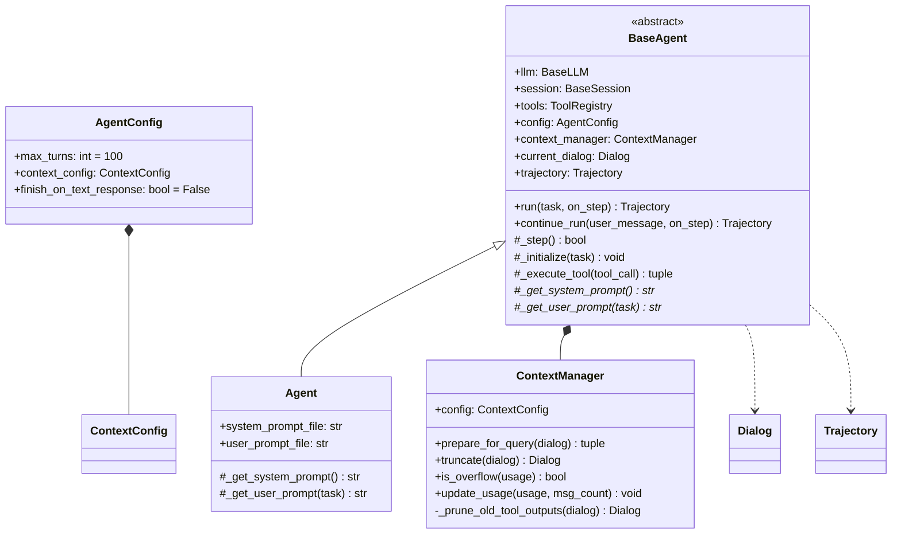
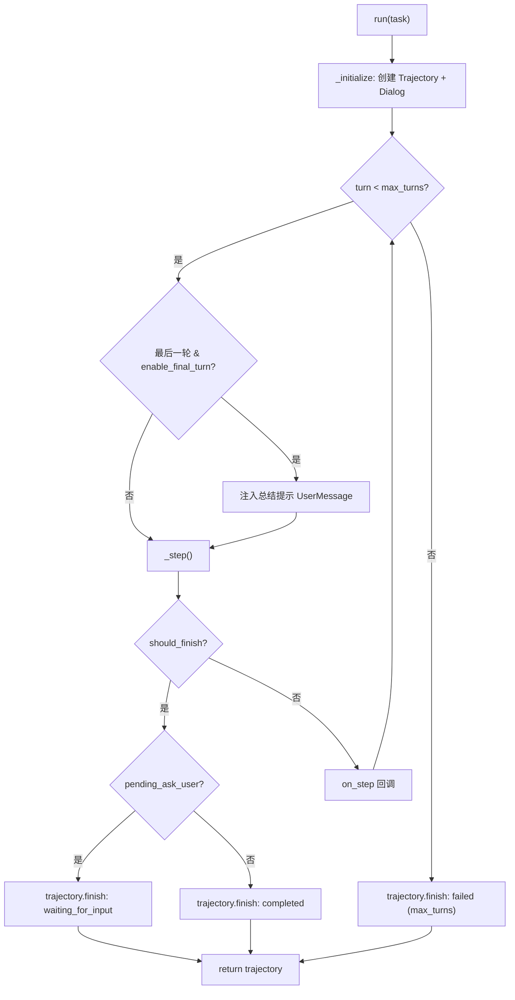
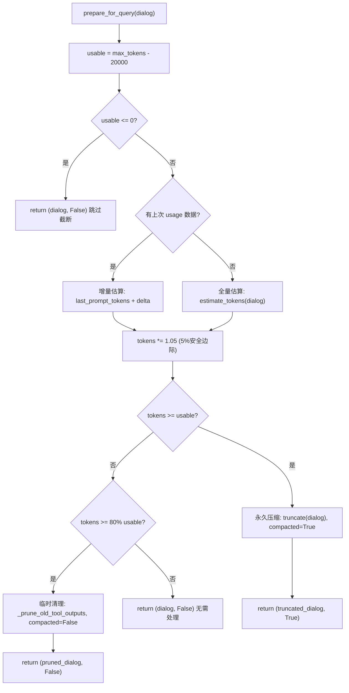
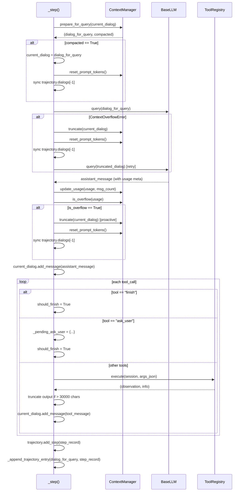

Agent 基类是 EvoMaster 框架中所有智能体的根基。它封装了 LLM 对话循环、工具调用执行、轨迹持久化以及上下文窗口管理四大核心能力，使得子类只需关注 prompt 构造即可获得完整的 Agent 运行时。本文将深入剖析 `BaseAgent` 的内部架构，涵盖对话生命周期管理、多层上下文截断策略、线程安全的轨迹记录机制，以及 `ContextManager` 的双层溢出检测体系。

> 📖 **小白导读**
> - 这篇讲什么：一个 Agent 每一"步"到底做了什么（问模型 → 执行工具 → 记录），以及对话越聊越长、超过模型"记忆上限"时程序怎么办。
> - 先知道几个概念：**LLM**（大语言模型）；**token**（模型处理文字的计量单位，一个汉字约 1 到 2 个 token，一段英文单词约 1 个 token；模型一次能读入的总量叫**上下文窗口**，超了就会报错）；**对话历史**（每次问模型都要把之前的所有消息重新发一遍，模型自己不会"记住"）；**线程锁**（多个线程同时写同一个文件时，让它们排队的机制）。
> - 读完能明白：`max_turns` 与 `finish` 如何决定任务结束；`latest_half` 策略到底丢了什么（它直接丢掉前半段历史，**不做摘要**，这是 DataMaster 实际使用的策略）；轨迹文件里到底存了什么、哪些文件其实不会产生。

## 架构总览：BaseAgent 的核心职责

`BaseAgent` 定义为抽象基类，其核心设计哲学是**模板方法模式**：基类控制执行循环的骨架，子类通过两个抽象方法 `_get_system_prompt()` 和 `_get_user_prompt(task)` 注入特定领域的提示词。整个 Agent 的依赖项在构造函数中通过依赖注入方式传入——`llm`（语言模型实例）、`session`（环境会话）、`tools`（工具注册表）、`config`（配置对象）——这种设计使得 Agent 的每个组件都可以独立替换和测试。（依赖注入的通俗理解：Agent 自己不去创建模型、环境、工具，而是在被创建时由外部把它们"递进来"，所以换一个模型或换一个运行环境不用改 Agent 代码；模板方法则像填表格——基类写好流程，子类只填"系统提示词""用户提示词"两个空。）

`AgentConfig` 作为 Pydantic 模型（一种按声明的字段类型自动检查数据的 Python 库）提供配置验证，其中 `max_turns` 控制执行循环上限（类默认值 100 轮；DataMaster 的 yaml 里覆盖为 nouse/Initial 20 轮、Black/Red 50 轮、Metric 4 轮，见 `config_base.yaml` L34、52、70、88、106）。一"轮"就是一次 LLM 调用加上它触发的工具执行，不等同于"一个搜索节点"（Playground 在 yaml 没写 `max_turns` 时的兜底值是 20，`_create_agent`）。`context_config` 嵌套了上下文管理配置，`finish_on_text_response` 标志用于会话型场景——当 LLM 返回纯文本（无工具调用）时直接结束任务。`BaseAgent` 的类级别属性包括轨迹文件锁 `_trajectory_file_lock` 和原始日志文件锁 `_raw_log_file_lock`，它们是 `threading.Lock` 实例，确保多 Agent 实例并发写入时的线程安全性。类级别的 `_current_exp_name` 和 `_current_exp_index` 则记录当前实验阶段信息，供轨迹记录时标注上下文。

Sources: [agent.py](evomaster/agent/agent.py#L39-L148), [types.py](evomaster/utils/types.py#L94-L165)

## 对话生命周期管理

### Dialog 数据模型

对话管理的核心数据结构是 `Dialog`——一个 Pydantic 模型，包含 `messages`（消息列表）、`tools`（工具规格列表）和 `meta`（元数据字典）。消息体系基于四种角色类型：`SystemMessage`（系统提示）、`UserMessage`（用户输入，支持多模态内容块）、`AssistantMessage`（LLM 响应，可携带 `tool_calls`）、`ToolMessage`（工具执行结果，关联 `tool_call_id`）。所有消息类型继承自 `BaseMessage`，后者统一提供 `content`、`time_cost` 和 `meta` 字段。

`Dialog.get_messages_for_api()` 方法负责将内部消息格式转换为 LLM API 所需的字典列表，处理了多种边缘情况：当 `AssistantMessage` 携带 `tool_calls` 但内容为空时填充空白字符（兼容 Claude/OpenRouter 要求），`ToolMessage` 的 `tool_call_id` 和 `name` 字段映射，以及多模态内容块的直通传递。`Dialog.add_message()` 是最基础的消息追加接口，所有上层方法最终都通过它向对话中添加消息。

Sources: [types.py](evomaster/utils/types.py#L36-L131)

### 执行循环：run() 与 continue_run()

`run()` 方法是 Agent 的主入口，其执行流程遵循**初始化→循环→终止**三段式结构。首先调用 `_initialize(task)` 创建 `Trajectory` 对象、获取初始提示词、构建包含 `SystemMessage` + `UserMessage` 的初始 `Dialog`。如果任务携带图片，则通过 `build_multimodal_content()` 将文本提示与 base64 编码的图片组装为多模态内容块。初始化后进入 `for turn in range(self.config.max_turns)` 循环，每轮调用 `_step()` 执行一步推理。

`run()` 方法还支持两个高级特性：**末轮总结提示注入**——当 `enable_final_turn=True` 且到达最后一轮时，向对话追加一个 `UserMessage` 携带 `enable_final_turn_prompt` 内容，引导 LLM 进行总结；**步骤回调**——通过 `on_step` 参数接收签名 `(StepRecord, step_number, max_steps) -> None` 的回调函数，每步执行后触发，回调异常不会中断主循环。

**结束状态怎么判定**（DataMaster 中每个节点 Agent 都走这套逻辑）：循环里只要某一步 `_step()` 返回 True（模型调用了 `finish`，或触发 `ask_user`），轨迹状态就设为 `completed`（`ask_user` 则是 `waiting_for_input`）；`for ... else` 的 `else` 分支只在循环**自然跑满 `max_turns` 没有 break** 时执行，此时状态为 `failed`，原因 `max_turns_exceeded`；循环中途抛异常也记 `failed` 并继续向外抛出。`finish` 的参数 `task_completed`（true/false/partial）不参与判定。这些状态值在 DataMaster 的搜索代码里并没有被读取（`playground/data_master` 下搜不到对 `traj.status` 的使用），节点成败靠产物文件和指标解析决定。另一点：每次调用 `run()` 都会执行 `_initialize()`，重新构造只含"系统提示词 + 用户提示词"的新对话，所以同一个 worker Agent 先后处理不同节点时，对话历史**不会**串到下一个节点。

DataMaster 的 Initial/Black/Red 在调用 `run()` 时都传了 `enable_final_turn=True` 和一段"这是最后一轮，请不要再调用工具，直接给出方案和代码块"的提示（`black_exp.py` L164、`initial_exp.py` L169、`red_exp.py` L137）：到第 `max_turns` 轮开始前，这条提示会被当作用户消息追加进对话，逼模型在最后一轮用文字交卷，而不是继续调用工具。

`continue_run()` 是 `run()` 的多轮对话变体，它不调用 `_initialize()`，而是保留现有 `current_dialog` 并追加新的用户消息，创建新的 `Trajectory` 对象后重置步数计数器进入执行循环。这个方法适用于飞书 Bot 等场景，用户可以在前一轮对话结束后发起新消息继续交互。

Sources: [agent.py](evomaster/agent/agent.py#L153-L300), [agent.py](evomaster/agent/agent.py#L302-L344), [llm.py](evomaster/utils/llm.py#L112-L130)

### 单步执行：_step() 的完整逻辑

`_step()` 是整个 Agent 最核心的方法，它编排了上下文准备、LLM 查询、工具执行和轨迹记录的完整流水线。其执行流程可分为五个阶段：

**阶段一：上下文准备**。调用 `context_manager.prepare_for_query(self.current_dialog)` 返回 `(dialog_for_query, compacted)` 元组。如果 `compacted=True`（永久压缩发生），则将压缩后的 Dialog 写回 `current_dialog` 并同步更新 trajectory 中的 Dialog 引用，然后调用 `reset_prompt_tokens()` 重置 token 计数器。如果 `compacted=False`（仅临时 prune 或无变化），则不写回，保留完整的工具输出以供未来摘要使用。

**阶段二：LLM 查询与被动恢复**。将准备好的 `dialog_for_query` 发送给 LLM，记录响应时间和原始日志。如果抛出 `ContextOverflowError`（LLM API 拒绝请求因为上下文过长），则执行紧急压缩：调用 `context_manager.truncate()` 截断对话、重置 token 计数器、同步 trajectory 引用，然后重试 LLM 查询。`ContextOverflowError` 的判定在 LLM 层（第 20 篇）：HTTP 413 直接算溢出；HTTP 400 时拿错误信息去匹配 12 条常见供应商的关键词（如 "maximum context length"）。其他状态码（例如服务端返回 500 或把错误塞在别的状态码里）即使是溢出也不会被识别，而会被当成普通错误重试。

**阶段三：用量记录与主动检测**。从 `assistant_message.meta` 中提取 `usage` 字典（包含 `prompt_tokens`、`completion_tokens`、`total_tokens`），调用 `context_manager.update_usage()` 记录实际 token 消耗。随后调用 `context_manager.is_overflow(usage)` 进行主动检查——即使当前调用成功，如果 token 使用量接近上限，也会立即执行截断以避免下一轮溢出。

**阶段四：工具调用处理**。如果 LLM 响应不包含 `tool_calls`，则根据 `enable_tools` 和 `finish_on_text_response` 配置决定是否直接结束任务，或通过 `_handle_no_tool_call()` 追加提示消息引导 LLM 继续工作。如果包含工具调用，则逐个处理：`finish` 工具触发结束、`ask_user` 工具暂停执行等待用户输入、其他工具通过 `_execute_tool()` 执行并截断超长输出（超过 30000 字符时保留首尾各 15000 字符）。

**阶段五：轨迹记录**。创建 `StepRecord` 封装当前步骤的 `assistant_message` 和 `tool_responses` 列表，添加到 `trajectory.steps`，然后调用 `_append_trajectory_entry()` 将本步信息持久化到轨迹文件。

Sources: [agent.py](evomaster/agent/agent.py#L346-L533), [agent.py](evomaster/agent/agent.py#L535-L577), [llm.py](evomaster/utils/llm.py#L59-L78)

### 对话操作 API

`BaseAgent` 提供了一组便捷方法用于操作对话上下文：

| 方法 | 签名 | 用途 |
|------|------|------|
| `add_user_message` | `(content: str) -> None` | 向当前对话追加用户消息 |
| `add_assistant_message` | `(content: str, tool_calls: list\|None) -> None` | 向当前对话追加助手消息（可携带工具调用） |
| `add_tool_message` | `(content, tool_call_id, name, meta) -> None` | 向当前对话追加工具响应消息 |
| `get_current_dialog` | `() -> Dialog\|None` | 获取当前对话对象 |
| `get_conversation_history` | `() -> list[Message]` | 获取消息列表的副本 |
| `reset_context` | `() -> None` | 重置对话为初始系统提示+用户提示状态 |
| `set_next_user_request` | `(content: str) -> None` | 设置下一轮用户请求（`add_user_message` 的语义别名） |

`reset_context()` 方法在多轮实验场景中尤为重要——它利用 `_initialize()` 中保存的 `_initial_system_prompt` 和 `_initial_user_prompt` 重建对话，重置步数计数器，使 Agent 可以在保持配置不变的前提下开始全新对话。所有对话操作方法都包含前置检查：如果 `current_dialog is None` 则抛出 `ValueError`，防止在未初始化状态下操作。

Sources: [agent.py](evomaster/agent/agent.py#L706-L821)

## 上下文截断策略：ContextManager 的双层防御体系

### 配置模型与截断策略枚举

`ContextConfig` 定义了上下文管理的四个字段：`max_tokens`（最大 token 数，默认 128000）、`truncation_strategy`（截断策略枚举）、`preserve_system_messages`（是否保留系统消息，默认 True）、`preserve_recent_turns`（保留最近对话轮数，默认 5）。需要说明的是：`preserve_system_messages` 在整个代码库里**只被定义、从未被读取**（`context.py` L77 之外没有任何引用），写 true 或 false 都没有效果；`preserve_recent_turns` 只被 `SLIDING_WINDOW` 和 `SUMMARY` 两种策略使用，**`LATEST_HALF` 完全不看它**。DataMaster 所有 Agent 的 yaml 都写 `truncation_strategy: "latest_half"`（`config_base.yaml` L41、59、77、95、112），因此它们的 `preserve_recent_turns: 5/2` 实际上没有作用。`TruncationStrategy` 枚举提供四种策略：

| 策略 | 枚举值 | 机制 | 写回持久化 |
|------|--------|------|-----------|
| `NONE` | `"none"` | 不截断 | — |
| `LATEST_HALF` | `"latest_half"` | 保留第一条 assistant 消息之前的内容（系统消息+初始用户消息），再保留其后消息中的**后一半**，前一半**直接丢弃，不生成摘要，也不插入"此处省略了历史"的提示** | 是 |
| `SLIDING_WINDOW` | `"sliding_window"` | 保留系统消息+最近 N 轮（一轮=一个 assistant 消息及其关联工具消息） | 是 |
| `SUMMARY` | `"summary"` | 用 LLM 将旧消息摘要压缩为对话对，保留系统消息+摘要+最近消息；若没设置摘要用 LLM 则退回 `LATEST_HALF` | 是 |

Sources: [context.py](evomaster/agent/context.py#L62-L84)

### prepare_for_query：双层溢出检测

`prepare_for_query()` 是上下文管理的入口方法，它实现了**双层溢出检测**策略，灵感来源于 OpenCode 的 `isOverflow` 逻辑。该方法的核心在于区分**永久压缩**与**临时清理**两种处理方式，并返回 `(dialog, compacted)` 元组告知调用者是否需要写回。

**第一层：永久压缩（token >= usable）**。当估算 token 数达到或超过可用空间（`max_tokens - 20000`），调用 `truncate()` 根据配置的策略执行截断。`compacted=True` 表示这是一次永久性变更，调用方应将结果写回 `current_dialog`。

**第二层：临时清理（token >= 80% usable）**。当 token 使用量达到可用空间的 80% 但尚未溢出，调用 `_prune_old_tool_outputs()` 执行轻量级清理——将旧工具输出替换为 `"[Old tool output cleared]"`。`compacted=False` 表示这只是临时视图，不写回 `current_dialog`，原始工具输出被完整保留以供未来摘要压缩使用。

**增量估算机制**避免了每次调用都进行全量 token 计算。当已有上次 LLM API 返回的真实 `prompt_tokens` 和消息计数时，仅需估算新增消息的 token 增量（`delta`），两者相加即为当前估算值。首次调用无 usage 数据时回退到 `estimate_tokens()` 全量估算。最终结果乘以 1.05 的安全边际以应对估算误差。

Sources: [context.py](evomaster/agent/context.py#L393-L443), [context.py](evomaster/agent/context.py#L56-L59)

### 三种截断策略的实现细节

**LATEST_HALF 策略**首先定位第一个 `assistant` 消息的位置 `assistant_start`，保留该位置之前的所有消息（系统消息+初始用户消息），然后从对话尾部保留一半的消息。关键细节在于确保保留区从 `assistant` 消息开始（通过 `while` 循环跳过非 assistant 消息），避免截断后对话从 `tool` 消息开始导致 API 格式错误。

举个具体例子（按 `_truncate_latest_half` 的算术推演）：假设现在有 12 条消息，下标 0 是 system，1 是 user，之后是 assistant 与 tool 交替：2=assistant、3=tool、4=assistant、5=tool……11=tool。`assistant_start=2`，可截断部分共 12−2=10 条，要保留的一半是 5 条，起点 `preserve_start=12−5=7`；下标 7 是 tool，不合格，往后挪到下标 8（assistant）。最终新对话 = 下标 0、1 + 下标 8 到 11，共 6 条。**下标 2 到 7（最早的三轮 assistant 的思考、工具调用和工具结果）被永久丢掉**，模型之后再也看不到自己早期做过什么（包括刚写入的文件名、前面试过哪些失败方案）。这就是文章开头强调的"丢前半段、不做摘要"。丢弃是永久的：`compacted=True`，结果会写回 `current_dialog` 和轨迹里的 Dialog 引用。另外，如果找不到合适的 assistant 起点（`preserve_start >= 消息总数`），函数会原样返回对话、什么也不删——此时若仍然超限，下一次请求还会报溢出。

**SLIDING_WINDOW 策略**将消息分为系统消息和其他消息两组，从其他消息尾部向前计数 `preserve_recent_turns` 个 `assistant` 消息，确定保留起始位置 `keep_from`，最终消息列表为 `system_messages + other_messages[keep_from:]`。一轮定义为从某个 `assistant` 消息开始到下一个 `assistant` 消息之前的所有消息（包括关联的 `tool` 消息）。

**SUMMARY 策略**是最复杂的压缩方式，它将对话分为三段：`system_msgs`（系统消息）、`old_msgs`（待摘要的旧消息，包含初始用户消息）、`recent_msgs`（保留的最近消息）。然后将 `old_msgs` 连同压缩指令提示（`COMPACTION_SYSTEM_PROMPT` + `COMPACTION_USER_PROMPT`）发送给摘要 LLM，生成结构化摘要（包含 Goal、Key Decisions、Accomplished、Context 四个部分）。摘要被包装为一个 `UserMessage("What did we do so far?")` + `AssistantMessage(summary)` 的对话对，插入到 `system_msgs` 和 `recent_msgs` 之间。如果摘要 LLM 调用失败或返回空摘要，则回退到 `LATEST_HALF` 策略。还有一个容易忽视的前提：摘要 LLM 要靠 `context_manager.set_summary_llm(llm)` 注入。Playground 的 `_create_agent` 会注入，但 DataMaster 给每个 worker 用的是 `copy_agent` 复制出来的 Agent，复制函数没有再调用 `set_summary_llm`（`evomaster/core/playground.py` `copy_agent`），所以即便把策略改成 `summary`，worker 里也会因为"摘要 LLM 未设置"打一条 warning 然后退回 `LATEST_HALF`（推断，未实测）。

`on_before_compaction` 回调钩子在摘要执行前触发，传入待压缩的 `old_msgs` 列表，可用于记忆提取等前置处理。

Sources: [context.py](evomaster/agent/context.py#L197-L386), [context.py](evomaster/agent/context.py#L29-L54)

### _prune_old_tool_outputs：轻量级工具输出清理

临时清理策略 `_prune_old_tool_outputs()` 的设计目标是**在不丢失结构信息的前提下减少 token 占用**。它从消息列表尾部向前扫描，保护最近 2 个用户轮次内的工具消息不被清理。超出保护范围后，对内容超过 200 字符的 `ToolMessage` 计算其 token 估算值，当累计可清理 token 超过 `_PRUNE_PROTECT_TOKENS`（40000）阈值时，将该消息标记为可清理。最终仅当可清理 token 总量超过 `_PRUNE_MINIMUM_TOKENS`（10000）时才执行实际替换，避免不必要的清理操作。

被清理的 `ToolMessage` 内容替换为 `"[Old tool output cleared]"`，但保留 `tool_call_id`、`name` 和 `meta` 字段，确保对话结构的完整性不受影响——LLM 仍能看到工具调用的存在及其关联关系，只是不再占用大量 token 存储具体输出内容。

Sources: [context.py](evomaster/agent/context.py#L458-L517), [context.py](evomaster/agent/context.py#L56-L59)

### Token 计数体系

`ContextManager` 支持两种 token 计数方式。默认使用基于字符数的简单估算（4 字符 ≈ 1 token），`estimate_tokens()` 方法不仅计算消息内容，还累加工具规格（`ToolSpec`）的 JSON 序列化字符数——因为工具规格随每次 API 请求发送，同样消耗上下文空间。多模态内容中，图片按固定估算值 3000 字符（约 750 token）计入。

`TokenCounter` 抽象基类提供了可扩展的精确计数接口，子类可实现 `count_text()` 和 `count_message()` 方法以接入 tiktoken 等精确分词器。`SimpleTokenCounter` 是内置实现，使用可配置的 `chars_per_token` 比率（默认 4.0），并为每条消息添加 4 token 的固定开销（角色、格式等）。

Sources: [context.py](evomaster/agent/context.py#L131-L174), [context.py](evomaster/agent/context.py#L520-L567)

## 轨迹记录机制

### Trajectory 数据模型

`Trajectory` 是完整的任务执行记录，包含 `task_id`、`dialogs`（对话列表）、`steps`（步骤记录列表）、`start_time`/`end_time`、`status`（枚举：running/completed/failed/cancelled/waiting_for_input）、`result`（执行结果字典）和 `meta`。每个 `StepRecord` 封装单个推理步骤的完整信息：`step_id`、`timestamp`、`assistant_message`（LLM 响应）、`tool_responses`（工具响应列表）和 `meta`。

`Trajectory.finish()` 方法设置结束时间和最终状态，可携带结果字典。状态 `waiting_for_input` 是 `ask_user` 工具触发的特殊状态，表示 Agent 暂停等待用户输入而非真正结束。

Sources: [types.py](evomaster/utils/types.py#L133-L165)

### 线程安全的轨迹持久化

轨迹文件的写入使用类级别的 `threading.Lock`（`_trajectory_file_lock`）保证线程安全，这在 DataTree 并行搜索场景中至关重要——多个 Worker 线程可能同时运行各自的 Agent 实例并写入同一个轨迹文件。文件路径通过类方法 `set_trajectory_file_path()` 设置，目录自动创建。

`_append_trajectory_entry()` 是当前使用的轨迹持久化方法，它采用**按 agent_id 聚合的增量追加**策略。每步执行完成后，构建包含 `assistant_message` 和 `tool_responses` 的 `step_messages` 列表，读取现有轨迹文件中的所有条目，按 `agent_id`（格式为 `{task_id}_{agent_name}`）查找已有条目。如果找到，则将 `step_messages` 追加到该条目的 `trajectory.messages` 列表中；如果是新 agent，则先写入初始的系统提示和用户提示作为消息列表的开头。最终以 `entry_dict` 形式去重后写回文件。

几点需要读者留意的真实行为：（1）每一步都是"读取整个文件 → 修改 → 重写整个文件"，所以文件越大每步越慢，4 个 worker 又共用一个类级别文件路径，全靠 `_trajectory_file_lock` 排队（推断：长时间运行时可能成为瓶颈，未实测）。（2）条目里 `tool_calls` 保存的是 pydantic 对象，写 JSON 时用了 `json.dump(..., default=str)`，所以最终文件里它是对象被转成的**字符串**（类似 `id='...' type='function' function=FunctionCall(...)`），而不是结构化的 JSON 数组，想用程序分析工具调用时需要自己解析这段字符串。（3）这里存的是 `trajectory.messages`，只有"每步新增的 assistant 与 tool 消息"，没有被截断前的完整 Dialog。

轨迹条目还携带实验上下文信息：`exp_name`（实验阶段名，如 "Solver"、"Critic"）和 `exp_index`（迭代索引），这些通过类方法 `set_exp_info()` 设置，所有 Agent 实例共享同一实验上下文。

Sources: [agent.py](evomaster/agent/agent.py#L68-L78), [agent.py](evomaster/agent/agent.py#L822-L856), [agent.py](evomaster/agent/agent.py#L1023-L1117)

### 原始 LLM 响应日志

`_append_raw_log_entry()` 方法将 LLM 的完整原始响应（包含在 `AssistantMessage.meta["raw_response"]` 中）以 JSONL 格式追加到原始日志文件。每个条目包含 `agent_id`、`steps`（步骤编号）和 `llm_raw_response`（原始响应体）。JSONL 格式天然支持追加写入，无需读取-修改-写回的完整周期，性能优于轨迹文件的 JSON 数组格式。原始日志使用独立的文件锁 `_raw_log_file_lock` 避免与轨迹写入竞争。

文件路径通过类方法 `set_raw_log_file_path()` 设置，与 `set_trajectory_file_path()` 一样自动创建父目录。这两个类方法使得实验框架可以在启动时统一配置所有 Agent 实例的输出路径，无需逐实例设置。

**重要：DataMaster 并不会产生 `raw_log.jsonl`**。设置原始日志路径的 `_setup_raw_log_file()` 只在基类 `BasePlayground.run` 里被调用（`evomaster/core/playground.py` L1302），而 `DataTreePlayground.run` 是重写版本，只调用了 `_setup_trajectory_file`（`playground/data_master/core/playground.py` L1143），没有调用它；于是 `_raw_log_file_path` 一直是 `None`，`_append_raw_log_entry` 在第一行就直接返回。另外 `OpenAILLM` 把完整响应放在 `meta["raw_response"]` 里，它会跟着这条 assistant 消息一直留在内存中的对话对象里（发给 API 时不会带上），对话很长时会多占一些内存（推断）。

Sources: [agent.py](evomaster/agent/agent.py#L995-L1021), [agent.py](evomaster/agent/agent.py#L833-L842)

## Agent 子类：可配置的提示词加载

`Agent` 类是 `BaseAgent` 的标准实现，它通过文件加载和模板格式化实现了可配置的提示词系统。构造函数接收 `system_prompt_file` 和 `user_prompt_file` 两个可选的文件路径参数，以及 `prompt_format_kwargs` 格式化参数字典。如果提供了文件路径，则通过 `load_prompt_from_file()` 加载并格式化提示词；否则使用 `_default_system_prompt()` 返回的默认提示词。

`load_prompt_from_file()` 支持相对路径（相对于 `config_dir`）和绝对路径，使用 Python 字符串的 `format()` 方法进行模板替换。如果格式化时遇到 `KeyError`，会抛出包含可用键列表的详细错误信息。

`Agent._get_system_prompt()` 在返回存储的系统提示词前，动态追加工作目录信息——从 `session.get_workspace_path()` 获取当前工作目录的绝对路径，并生成约束提示，确保 LLM 知道所有操作必须在指定目录内执行。**注意这里有一个潜在的坑**：`get_workspace_path()` 只在 `LocalSession` 里定义（`evomaster/agent/session/local.py` L89），`BaseSession` 和 `DockerSession` 都没有这个方法；因此如果把 `session.type` 改成 `docker`，在 `_initialize` 构造系统提示词时会抛 `AttributeError`（代码推论，未实测）。详见第 21 篇。`Agent._get_user_prompt()` 则支持通过 `{task_id}`、`{task_type}`、`{description}`、`{input_data}` 占位符将任务实例字段注入到用户提示词中。

Sources: [agent.py](evomaster/agent/agent.py#L1139-L1255), [agent.py](evomaster/agent/agent.py#L648-L704)

## 工具调用与执行

### 工具发现与过滤

`_get_tool_specs()` 控制哪些工具暴露给 LLM。当 `enable_tools=False` 时返回空列表，工具虽注册但不出现在提示词中。当 `enabled_tool_names` 被设置时，从全部工具规格中过滤出指定名称的工具；未设置时返回所有注册工具的规格。这个机制允许同一 `ToolRegistry` 中的工具按需暴露给不同 Agent 实例。

`ToolRegistry` 本身是一个简单的字典容器，提供 `register()`、`get_tool()`、`get_tool_specs()` 等方法。`BaseTool` 的 `get_tool_spec()` 通过 Pydantic 的 `model_json_schema()` 自动从参数类生成 JSON Schema，并通过 `_remove_unused_schema_info()` 清理 `default`、`title`、`additionalProperties` 等冗余字段以减少 token 消耗。

Sources: [agent.py](evomaster/agent/agent.py#L626-L646), [base.py](evomaster/agent/tools/base.py#L67-L130), [base.py](evomaster/agent/tools/base.py#L133-L200)

### 工具执行与输出截断

`_execute_tool()` 方法接收 `tool_call` 对象，通过 `ToolRegistry` 查找对应工具实例并调用其 `execute(session, args_json)` 方法。返回值是 `(observation, info)` 元组。工具执行结果经过双重截断保护：`_execute_tool()` 内部对超过 30000 字符的输出保留首尾各 15000 字符；`_step()` 方法在创建 `ToolMessage` 前再次检查并对超过 30000 字符的输出进行截断。这种双重保护确保即使工具实现内部未做截断，超长输出也不会撑爆上下文窗口。

工具执行过程中的时间计量被记录到 `ToolMessage.meta["time_cost"]` 中，LLM 响应时间记录到 `AssistantMessage.time_cost` 中，这些数据为性能分析提供了细粒度的计时信息。

Sources: [agent.py](evomaster/agent/agent.py#L447-L533), [agent.py](evomaster/agent/agent.py#L535-L577)

## 上下文管理在执行循环中的完整交互

以下时序图展示了 `_step()` 方法中上下文管理器与各组件的完整交互流程：

可以看到，上下文管理在单步执行中参与了**三个关键时机**：查询前的准备（主动压缩）、查询失败的恢复（被动压缩）、查询成功后的检测（预防性压缩）。这三个时机共同构成了一个完整的上下文安全网，确保 Agent 在长任务执行中不会因上下文溢出而崩溃。

Sources: [agent.py](evomaster/agent/agent.py#L346-L533), [context.py](evomaster/agent/context.py#L393-L456)

## Agent 基类的扩展要点

开发自定义 Agent 子类时，需关注以下设计约束和扩展点：

**必须实现的抽象方法**：`_get_system_prompt()` 返回系统提示词字符串，`_get_user_prompt(task)` 接收 `TaskInstance` 并返回用户提示词。如果需要文件加载功能，可直接继承 `Agent` 类而非 `BaseAgent`。

**工具暴露控制**：通过 `enable_tools` 和 `enabled_tool_names` 两个参数精细控制。`enable_tools=False` 适用于纯对话型 Agent（如 Critic 评估器），`enabled_tool_names=["execute_bash", "finish"]` 适用于限制工具集的场景（注意内置 Bash 工具的真实名字是 `execute_bash`，原文写的 `bash` 不存在；并且该名单为空列表时会退化成"暴露全部"，见第 17 篇）。

**上下文策略选择**：对于短任务（< 20 轮）使用默认 `LATEST_HALF` 即可；对于长任务（> 50 轮）建议使用 `SUMMARY` 策略并配置 `preserve_recent_turns`（这是原文的经验性建议，仓库内没有对应的实验数据支撑，也要先解决上文提到的"worker 复制后没有摘要 LLM"问题（未验证））；对于工具输出特别长的场景，双层检测机制会自动触发 prune，无需额外配置。

**轨迹文件配置**：通过类方法 `set_trajectory_file_path()` 和 `set_raw_log_file_path()` 在实验初始化时统一配置。多 Agent 并发场景下，类级别文件锁自动保证写入安全，但所有 Agent 共享同一文件路径——不同实验应设置不同路径。

Sources: [agent.py](evomaster/agent/agent.py#L80-L148), [agent.py](evomaster/agent/agent.py#L1119-L1136)

---

理解了 Agent 基类的对话管理和上下文截断机制后，建议继续阅读 [LLM 抽象层：多供应商接入与统一查询接口](20-llm-chou-xiang-ceng-duo-gong-ying-shang-jie-ru-yu-tong-cha-xun-jie-kou) 了解 `BaseLLM` 如何实现多供应商适配和 `ContextOverflowError` 的具体检测逻辑，以及 [会话与环境管理：LocalSession 与 Docker 隔离环境](21-hui-hua-yu-huan-jing-guan-li-localsession-yu-docker-ge-chi-huan-jing) 了解工具执行所依赖的 Session 层设计。如需了解 Agent 在 DataTree 搜索流程中的具体调用方式，可参考 [DataTree 搜索流程全解析：从初始化到并行搜索](7-datatree-sou-suo-liu-cheng-quan-jie-xi-cong-chu-shi-hua-dao-bing-xing-sou-suo)。

## 本文修订记录

- `latest_half` 说得不清：补充它丢弃前半段历史、不做摘要、不留提示，并给出 12 条消息的推演例子（`context.py` L197-232）；指出 `preserve_recent_turns` 对它无效、`preserve_system_messages` 全库无人读取（DataMaster 全部 Agent 用 `latest_half`，见 `config_base.yaml`）。
- `finish` 与 `max_turns` 的状态判定：补充 `completed`/`failed(max_turns_exceeded)`/`waiting_for_input` 的触发条件、`task_completed` 不参与判定、DataMaster 不读取该状态；补充 `enable_final_turn` 在 Initial/Black/Red 中的实际用法，以及每次 `run()` 重建对话。
- `ContextOverflowError`：原文说"12 种供应商模式"，实际是 12 条关键词，且仅 HTTP 413 或 400 才会判定；已改正。
- 摘要策略：补充 `copy_agent` 后的 worker 没有注入摘要 LLM，会退回 `latest_half`（推断，未实测）。
- `Agent._get_system_prompt` 调用 `session.get_workspace_path()`，而该方法只有 `LocalSession` 才有，Docker 模式会报错（推断，未实测）；示例工具名 `bash` 应为 `execute_bash`。
- 轨迹文件：补充 `tool_calls` 以 `str()` 形式落盘、每步整文件重写；`raw_log.jsonl` 在 DataMaster 中不会产生（`DataTreePlayground.run` 不调用 `_setup_raw_log_file`）。
- 补充小白导读与术语解释（token、上下文窗口、依赖注入、线程锁等）。
- 未验证：长时间运行时轨迹文件重写是否成为瓶颈；Docker 模式下的实际报错；`summary` 策略在 worker 中的回退日志。
