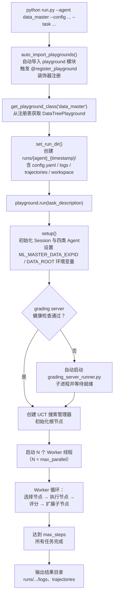

本页是一份面向初学者的实操教程，目标是让你在 15 分钟内跑通 DataMaster 的第一次 **DataTree 搜索**：从准备环境变量、选择任务配置，到执行 `run.py` 启动命令、观察搜索过程产物，再到用可视化脚本回看搜索树。本页只覆盖"跑起来"所需的最小知识面；安装细节与凭证管理请先阅读 [环境准备：安装、依赖与凭证管理](3-huan-jing-zhun-bei-an-zhuang-yi-lai-yu-ping-zheng-guan-li)，MLE-Bench 数据集的准备方式见 [MLE-Bench 数据集与任务输入准备](4-mle-bench-shu-ju-ji-yu-ren-wu-shu-ru-zhun-bei)。

> **📖 小白导读**
> - 这篇讲什么：照着做，把 DataMaster 跑起来一次，并看懂运行后生成的文件夹。
> - 读之前先知道：**命令行/终端**（输入命令运行程序的黑窗口）、**环境变量**（操作系统里按名字存放的设置，如 `DATA_ROOT`）、**YAML**（用缩进写配置的文本文件）、**grading server**（评分服务器，一个专门给提交结果打分的小网站程序）。
> - 读完你能明白：一条 `python run.py ...` 命令背后依次发生了什么；跑完后去哪找日志、轨迹和工作目录；出错时先查哪里。
> - 提醒：仅支持 Linux；本页的评分服务器"自动启动"一节有一处与代码不符，已在正文标注。

## 前置条件清单

在开始之前，请逐项确认以下条件已满足。DataMaster 的运行强依赖 **四个要素**（其中 LLM 即大语言模型，如聊天机器人背后的那类模型）：Python 环境、LLM 访问凭证、本地 benchmark 数据、任务配置文件，缺一不可。

| 序号 | 条件 | 说明 | 详细指引 |
|---|---|---|---|
| 1 | Python 3.10 ~ 3.12 | 已执行 `pip install -e .` 完成可编辑安装 | [环境准备](3-huan-jing-zhun-bei-an-zhuang-yi-lai-yu-ping-zheng-guan-li) |
| 2 | MLE-Bench / MLE-Bench Lite 数据 | 仓库**不包含**数据集，需自行准备并将 `DATA_ROOT` 指向本地目录 | [MLE-Bench 准备](4-mle-bench-shu-ju-ji-yu-ren-wu-shu-ru-zhun-bei) |
| 3 | LLM 环境变量 | `LLM_MODEL`、`LLM_API_KEY`、`LLM_BASE_URL` 三项必填 | [环境准备](3-huan-jing-zhun-bei-an-zhuang-yi-lai-yu-ping-zheng-guan-li) |
| 4 | 可选搜索凭证 | `SERPER_API_KEY`（网络/学术搜索）、`HF_TOKEN`（HuggingFace 数据集搜索） | [环境准备](3-huan-jing-zhun-bei-an-zhuang-yi-lai-yu-ping-zheng-guan-li) |

安装步骤非常简单：克隆仓库后创建虚拟环境并执行 `pip install -e .` 即可，但注意 Python 版本必须满足 `>= 3.10, < 3.13` 的约束（`pyproject.toml` 的 `requires-python`）。另外 `pyproject.toml` 把可安装环境限定为 `sys_platform == 'linux'`，所以只能在 Linux 上安装运行。（`pip install -e .` 的 `-e` 表示"可编辑安装"：改源码立刻生效，不用重装。）仓库刻意不携带任何凭据和数据文件——所有密钥通过环境变量注入，所有 benchmark 数据通过 `DATA_ROOT` 环境变量指向外部目录，这是出于安全与仓库体积的考虑。

Sources: [README_CN.md](README_CN.md#L100-L128)

## 第一步：设置环境变量

启动前需要在终端中导出环境变量。最小可运行集合如下：

```bash
export DATA_ROOT=/path/to/mle-bench-lite
export LLM_MODEL=your-model-name
export LLM_API_KEY=your-api-key
export LLM_BASE_URL=https://your-llm-endpoint/v1

# 可选：外部数据搜索能力（红节点使用）
export SERPER_API_KEY=optional-serper-key     # 网络搜索
export HF_TOKEN=optional-huggingface-token    # 数据集搜索
```

这些变量会被配置系统动态展开：任务级 YAML 配置中的 `data_root: "${DATA_ROOT}"` 和 `model: "${LLM_MODEL}"` 等占位符会在加载配置时被替换为环境变量的实际值。也就是说，你**不需要修改任何配置文件**就能切换不同的模型端点或数据目录，这是 DataMaster 凭证管理的基本设计。要注意两点：（1）`${VAR}` 只在主 YAML 里展开（`evomaster/config.py` 的 `_substitute_env`）；MCP 的 JSON 配置是直接 `json.load` 读入的，不做任何展开，里面写的 `${...}` 会原样当字面量传给子进程；（2）如果某个变量没设置，在 YAML 里不会报错，而是静默变成空字符串，所以请务必先 `echo $LLM_MODEL` 之类确认。

Sources: [README_CN.md](README_CN.md#L119-L128)、[config_detecting-insults-in-social-commentary.yaml](configs/data_master/yaml_configs/detecting-insults-in-social-commentary/config_detecting-insults-in-social-commentary.yaml#L6-L25)

## 第二步：认识任务配置文件

DataMaster 为 **75 个 MLE-Bench 任务**预先准备了任务级配置（`configs/data_master/yaml_configs/` 下恰好 75 个子目录；这些文件由旧版模板生成，不含 `ablation` 消融段，所以红节点、记忆默认全部开启），全部位于 `configs/data_master/yaml_configs/<任务名>/config_<任务名>.yaml`。以官方示例任务 `detecting-insults-in-social-commentary`（社交评论侮辱检测）为例，一个任务配置文件包含以下核心区块：

| 配置区块 | 作用 | 关键字段示例 |
|---|---|---|
| `exp_id` / `data_root` | 实验标识与数据根目录 | `exp_id: "detecting-insults-in-social-commentary"` |
| `llm` | LLM 提供商与模型参数 | `provider: "openai"`、`temperature: 0.7` |
| `agents` | 各类 Agent 的 LLM/工具/提示词配置 | `initial` / `black` / `red` / `metric` 槽位（另有未使用的 `nouse`） |
| `mcp` | MCP 工具服务器配置文件路径 | `config_file: "../../json_configs/..."` |
| `session` | 执行环境（local/docker）、GPU/CPU 分配、并行度（`session.local.parallel.max_parallel`） | `type: "local"`、`max_parallel: 4` |
| `grading_servers` | 评测服务器地址列表（实际只取配置里的地址，端口因任务而异） | `- "http://127.0.0.1:55496"` |
| `max_steps` | 搜索最大步数 | `max_steps: 150` |

其中 `agents` 区块定义了 DataTree 搜索的四类核心 Agent：**Initial Agent** 负责生成初始代码（`max_turns: 20`）、**Black Agent** 负责数据增强与特征工程（`max_turns: 50`）、**Red Agent** 负责外部数据搜索与引入（`max_turns: 50`）、**Metric Agent** 负责评估（`max_turns: 4`）。（`max_turns` 指 agent 与 LLM 最多来回对话多少轮；**prompt/提示词**就是发给 LLM 的那段指令文字；**MCP** 是让 agent 调用外部工具服务的协议。）每类 Agent 绑定了不同的提示词文件（位于 `playground/data_master/prompts/` 下的 `initial/`、`black/`、`red/`、`metric/` 子目录）和不同的 MCP 工具集。作为初学者，你暂时不需要理解这些区块的全部含义——只需知道：**换任务 = 换配置文件**，配置的深度解析见 [配置体系解析：YAML 配置、MCP JSON 与任务级配置生成](22-pei-zhi-ti-xi-jie-xi-yaml-pei-zhi-mcp-json-yu-ren-wu-ji-pei-zhi-sheng-cheng)。

Sources: [config_detecting-insults-in-social-commentary.yaml](configs/data_master/yaml_configs/detecting-insults-in-social-commentary/config_detecting-insults-in-social-commentary.yaml#L1-L118)、[config_detecting-insults-in-social-commentary.yaml](configs/data_master/yaml_configs/detecting-insults-in-social-commentary/config_detecting-insults-in-social-commentary.yaml#L120-L276)

## 第三步：启动你的第一个搜索任务

一切就绪后，执行以下命令即可启动第一个 DataTree 搜索任务：

```bash
python run.py \
  --agent data_master \
  --config configs/data_master/yaml_configs/detecting-insults-in-social-commentary/config_detecting-insults-in-social-commentary.yaml \
  --task "$DATA_ROOT/detecting-insults-in-social-commentary/prepared/public/description.md"
```

命令解析：`--agent data_master` 指定使用 DataTree 工作流（另一个可选值 `ml_master` 是基线工作流）；`--config` 指向任务级 YAML 配置；`--task` 可以直接传任务描述文本，也可以传一个 `.md` / `.txt` 任务描述文件路径——`run.py` 会自动检测后缀、确认文件存在后读取内容作为任务描述（文件为空会直接报错退出；后缀对但文件不存在时，路径字符串本身会被当作任务描述，不报错，要留意拼写）。

如果想从一个**已写好的初始方案**出发（而非让 Initial Agent 从零自由发挥），追加 `--initial-code` 参数即可：

```bash
python run.py \
  --agent data_master \
  --config configs/data_master/yaml_configs/detecting-insults-in-social-commentary/config_detecting-insults-in-social-commentary.yaml \
  --task "$DATA_ROOT/detecting-insults-in-social-commentary/prepared/public/description.md" \
  --initial-code initial_code/data_loader_format/detecting-insults-in-social-commentary/full_code.py
```

仓库在 `initial_code/data_loader_format/` 下为 22 个任务提供了初始代码模板（starter code，即"起步代码"）（每个任务目录含 `algo.py`、`data_loader.py`、`full_code.py` 三个文件），`full_code.py` 是可直接作为初始方案的完整代码。

Sources: [README_CN.md](README_CN.md#L132-L154)、[run.py](run.py#L125-L146)

### 命令行参数速查表

`run.py` 的完整参数定义如下表所示，初学者重点关注前五个参数即可：

| 参数 | 是否必填 | 说明 |
|---|---|---|
| `--agent <name>` | ✅ 必填 | Playground 名称，DataTree 搜索用 `data_master`，基线用 `ml_master` |
| `--task <text\|file>` | 🔶 三选一 | 单任务描述，或指向 `.md`/`.txt` 任务文件的路径 |
| `--task-file <json>` | 🔶 三选一 | JSON 任务文件，批量运行多个任务 |
| `--interactive` | 🔶 三选一 | 交互式输入任务描述（输入空行结束） |
| `--config <path>` | 建议 | 配置文件路径，缺省为 `configs/{agent}/config.yaml` |
| `--run-dir <path>` | 可选 | 运行目录，缺省自动生成 `runs/{agent}_{时间戳}/` |
| `--initial-code <path>` | 可选 | Initial 节点的初始代码文件路径 |
| `--initial-instruction <text>` | 可选 | Initial 节点的自然语言指令 |
| `--images <files...>` | 可选 | 多模态任务输入的图片路径（支持 PNG/JPG） |
| `--parallel` | 可选 | 并行运行多个任务（仅配合 `--task-file` 使用） |
| `--test-feedback` | 可选 | 启用测试集反馈模式选择最佳节点 |
| `--force-minimize` / `--force-maximize` | 可选 | 配合 test-feedback 强制指标方向（两者互斥） |

任务输入采用**互斥组设计**：`--task`、`--task-file`、`--interactive` 三者必须且只能选一个；同理 `--force-minimize` 与 `--force-maximize` 互斥。另外注意 `--test-feedback` 启用时必须同时指定方向参数，否则程序会直接报错退出。即使指定了，该模式在当前代码里也有已知问题：构造 metric_test agent 时 `system_prompt_file` 是未展开的字面量 `"${PROJECT_ROOT}/..."` 且没传 `config_dir`，会抛 ValueError（未实测）；而且它会把测试集分数带进搜索，等于"偷看答案"，初学者请不要使用。

Sources: [run.py](run.py#L38-L111)、[run.py](run.py#L239-L249)

## 启动后发生了什么：执行流程全景

命令敲下回车后，DataMaster 内部经历一条清晰的执行链路。下面的流程图展示了从命令行到搜索循环的完整路径，理解它能帮你判断"卡在哪一步"：



几个关键细节值得初学者留意。第一，`auto_import_playgrounds()` 会遍历 `playground/` 目录下的所有子目录并尝试导入其 `core/playground` 模块，这一步通过装饰器模式将 `DataTreePlayground` 注册到全局注册表，之后 `get_playground_class("data_master")` 才能找到它。第二，**grading server（评测服务器）的启动逻辑**：`run()` 开头（以及每个节点开始前）都会调用 `_ensure_grading_server_ready()`，对配置中 `grading_servers` 的地址做健康检查；如果服务不健康，代码会尝试在同一端口启动 `grading_server_runner.py` 子进程并最多等 20 秒。**但这条"自动拉起"路径目前有路径错误**：`_start_grading_server_process` 里拼出的 runner 路径是 `<仓库根>/search_dataset_tools/operate_submission/grading_server_runner.py`，少了中间的 `playground/` 一层，而真实文件在 `playground/search_dataset_tools/operate_submission/` 下，所以会抛 RuntimeError（playground.py:195-201）。因此更稳妥的做法是先按[评分服务器一页](24-grading-server-ping-ce-fu-wu-qi-bu-shu-jian-kang-jian-cha-yu-api-jie-kou)手动启动评分服务并确认可访问（此结论依据读代码，未实际运行）。第三，搜索主体是**多 Worker 并行循环**：每个 Worker（工人，这里是一个线程：同一个程序里并排跑的多条执行线）反复执行"选节点 → 跑代码 → 评分 → 扩展"的循环，直到达到 `max_steps` 上限。**注意**：默认配置 `split_workspace_for_exp: false`，4 个 Worker 共用**同一个** workspace，并不是各自独立的子目录（只有设为 true 时才会分成 `exp_0`、`exp_1`…；见 playground.py:409-417）。`max_steps` 统计的是已完成的节点数（含 bug 节点和 initial 节点），默认 150；因为并行，实际会多跑几个节点；它不是训练轮数。

Sources: [run.py](run.py#L399-L436)、[registry.py](evomaster/core/registry.py#L56-L84)、[run.py](run.py#L253-L273)、[playground.py](playground/data_master/core/playground.py#L181-L234)、[playground.py](playground/data_master/core/playground.py#L1138-L1221)

### 搜索过程中你会看到什么

在终端中，启动时会打印一段运行信息横幅（Agent 名称、Config 路径、Run Directory、任务数），随后进入搜索循环。由于配置默认开启 `llm_output.show_in_console: true`，你将实时看到各节点 Agent 的 LLM 输出（stdout，即程序打印到终端的内容，也会被各节点记录）。搜索过程中的节点类型如下表：

| 节点类型 | 职责 | 对应 Agent 配置槽位 |
|---|---|---|
| **Initial（初始）** | 从任务描述生成初始版本代码 | `agents.initial` |
| **Black（黑节点）** | 对现有训练数据进行数据增强、数据整合 | `agents.black` |
| **Red（红节点）** | 调用外部搜索接口下载数据集、引入新数据源 | `agents.red` |
| **Metric（评分）** | 解析节点执行输出、提取验证分数与 buggy 判定 | `agents.metric`（各节点执行后内部调用） |

另外配置里还存在一个 `agents.nouse` 槽位（继承全套 MCP 工具，名字暗示"不使用"；但要注意：MCP 工具只按第一个带 mcp 配置的 agent——也就是 `nouse`——初始化一次，initial/black/red 实际看到的是同一套完整 MCP 工具，三类节点的区别主要靠 prompt 约束，未逐行验证）。

每个节点最终都会提交一份完整代码进行评判，以 **validation score（验证分数，在留出的验证集上算出的指标，用来比较好坏）** 作为评判依据，节点内部状态（plan、code、stdout、metric、visits、total_reward 等）由 UCT 搜索管理器统一维护。这些机制的深度解析分别见 [三类节点实验：Initial、Black 与 Red 的职责划分](8-san-lei-jie-dian-shi-yan-initial-black-yu-red-de-zhi-ze-hua-fen) 与 [UCT 搜索算法：节点选择、奖励更新与衰减策略](9-uct-sou-suo-suan-fa-jie-dian-xuan-ze-jiang-li-geng-xin-yu-shuai-jian-ce-lue)。

Sources: [run.py](run.py#L532-L545)、[config_detecting-insults-in-social-commentary.yaml](configs/data_master/yaml_configs/detecting-insults-in-social-commentary/config_detecting-insults-in-social-commentary.yaml#L239-L246)、[README.md](playground/data_master/README.md#L7-L12)、[README.md](playground/data_master/README.md#L45-L56)

## 运行产物：解读结果目录

任务结束后（或运行中），`runs/` 下会生成一个以 `data_master_时间戳` 命名的运行目录。如果你使用了 `--run-dir` 自定义路径则以此为准。目录结构如下表：

| 路径 | 内容 | 生成时机 |
|---|---|---|
| `runs/{agent}_{timestamp}/config.yaml` | 本次运行所用配置的完整拷贝 | 启动时复制 |
| `runs/.../logs/` | 运行日志（含 `uct_nodes/node.json` 节点记录） | 运行全程持续写入 |
| `runs/.../trajectories/` | 对话轨迹（各节点 Agent 的完整交互记录） | 每节点完成时追加 |
| `runs/.../workspace/` | `set_run_dir` 在不传 `task_id` 时使用的工作区路径；但 `run.py` 即使单任务也会传 `task_id="task_0"`，所以实际产生的是下一行的目录 | 通常不会出现 |
| `runs/.../workspaces/{task_id}/` | Agent 工作区（代码、提交文件、数据软链接——symlink，指向别处文件的"快捷方式"）；单任务时即 `workspaces/task_0/` | 启动时创建 |

`evomaster/core/playground.py` 的 `set_run_dir` 确实有"不传 task_id → `workspace/`；传了 → `workspaces/{task_id}/`"两种分支，但 `run.py` 的单任务模式也构造了 `id="task_0"` 的任务并传入，所以实际单任务也落在 `workspaces/task_0/`（`run.py` 结尾打印的 `workspace/` 提示因此是不准的）；可视化脚本也是按 `workspaces/task_0/submission` 去找提交（vis_node_by_tree_with_grade.py:186-189）。批量模式下每个任务获得各自的 `workspaces/{task_id}/` 目录，避免多任务互相干扰。任务全部结束后，`run.py` 会在终端打印汇总信息：单任务显示状态与步数，批量任务显示成功/失败计数及每个任务的状态明细。

Sources: [run.py](run.py#L589-L597)、[playground.py](evomaster/core/playground.py#L197-L245)、[run.py](run.py#L565-L588)

## 进阶玩法：批量任务与初始代码控制

跑通单任务后，你可以尝试两种常见的进阶用法。

**批量运行多个任务**：准备一个 JSON 任务文件（支持简单列表 `["任务1", "任务2"]` 或对象列表 `[{"id": "task_1", "description": "..."}]` 格式），然后加上 `--parallel` 参数：

```bash
python run.py --agent data_master --task-file tasks.json --parallel
```

批量模式下，`run.py` 使用 `ProcessPoolExecutor`（进程池，默认最多 4 个进程）并行执行各任务，每个任务拥有独立的 workspace 与进程隔离。单 Worker 内部的搜索并行度则由配置中 `session.local.parallel.max_parallel` 控制（默认 4），两者叠加决定了实际资源占用——初学者建议先把 `max_parallel` 调低到 1~2 观察行为。

**控制 Initial 节点起点**：除了 `--initial-code` 传入完整代码外，还可以用 `--initial-instruction` 只传自然语言指令（让 Agent 按指令自行写代码），两者可组合使用。若两者都不提供，Initial 节点进入**自由模式**（free mode），完全依据任务描述生成方案——`playground/data_master/prompts/initial/` 目录下的 `mode_code_only.md`、`mode_instruction_only.md`、`mode_code_and_instruction.md`、`mode_free.md` 四个模板对应这四种模式，详见 [Prompt 模板工程：Initial 四种模式与节点级提示词组装](23-prompt-mo-ban-gong-cheng-initial-si-chong-mo-shi-yu-jie-dian-ji-ti-shi-ci-zu-zhuang)。

Sources: [run.py](run.py#L173-L210)、[run.py](run.py#L330-L378)、[run.py](run.py#L486-L508)、[config_detecting-insults-in-social-commentary.yaml](configs/data_master/yaml_configs/detecting-insults-in-social-commentary/config_detecting-insults-in-social-commentary.yaml#L158-L162)

## 用可视化脚本回看搜索树

搜索结束后，用官方可视化脚本可以生成交互式 DataTree 视图：

```bash
python scripts/vis_node_by_tree_with_grade.py \
  --run-dir ${PROJECT_ROOT}/runs/data_master_20260326_165235 \
  --port 8789 \
  --dataset leaf-classification
```

该脚本会（默认还会自动打分）加载运行目录中的节点记录与分数数据，在本地端口启动一个 Web 界面，支持在 **validation score 与 test score** 之间切换显示。注意：脚本 docstring 中提到的 `--auto-grade` / `--force-grade` 参数**并未在 argparse 中实现**——实际行为是：启动时自动检查 `grade_results.json`，不存在就自动对 submission 批量打分（等效于文档描述的 auto-grade），已存在则跳过；想强制重新打分需删除 `trajectories/task_0/grade_results.json` 后重跑。

Sources: [vis_node_by_tree_with_grade.py](scripts/vis_node_by_tree_with_grade.py#L1-L11)、[README_CN.md](README_CN.md#L158-L167)

## 常见问题排查

初学者首次运行最容易遇到以下问题，对照排查表定位：

| 症状 | 可能原因 | 解决方案 |
|---|---|---|
| `配置文件不存在: configs/data_master/config.yaml` | 未传 `--config` 且默认路径无文件 | 明确指定 `--config` 指向任务级 YAML |
| `grading server failed to become healthy` 或 `grading server exited early` | 指定端口被占用或数据路径错误；另外自动拉起路径本身有上文所述的路径缺陷 | 运行 `python scripts/check_port_conflicts.py` 诊断端口；确认 `DATA_ROOT` 有效 |
| Playground 未注册警告（`Failed to import`） | 依赖缺失导致模块导入失败 | 检查 `pip install -e .` 是否完整执行 |
| LLM 调用超时/失败 | `LLM_BASE_URL`、`LLM_API_KEY` 配置错误 | 回到 [环境准备](3-huan-jing-zhun-bei-an-zhuang-yi-lai-yu-ping-zheng-guan-li) 核对凭证 |
| 想为新任务生成配置 | 仓库未预置该任务配置 | 脚本 `scripts/auto_config_exp.py <exp_name> <task_path>` 本意是从模板生成，但目前它用 `string.Template.substitute` 且没传 `use_red_node`、`use_memory`，而 `config_base.yaml` 第 285-286 行有这两个占位符，会抛 KeyError（读代码得出，未实测）；建议改为复制已有任务的 YAML 手工修改 |
| 红节点搜索无结果 | 缺少 `SERPER_API_KEY` / `HF_TOKEN` | 导入对应环境变量（README 将其标为可选；缺失是否会让搜索中途报错未验证） |

其中 grading server 的健康检查机制值得了解：`run()` 启动时若发现配置中的评分地址不可达，设计上会拉起 `grading_server_runner.py` 子进程并在 20 秒内轮询健康状态，超时则报错终止，因此端口冲突会直接导致启动失败；而前文提到的 runner 路径缺陷会让"自动拉起"本身失败。评分服务器的部署细节见 [Grading Server：评测服务器部署、健康检查与 API 接口](24-grading-server-ping-ce-fu-wu-qi-bu-shu-jian-kang-jian-cha-yu-api-jie-kou)。

Sources: [run.py](run.py#L460-L462)、[playground.py](playground/data_master/core/playground.py#L218-L234)、[auto_config_exp.py](scripts/auto_config_exp.py#L1-L11)、[README.md](scripts/README.md#L1-L9)

## 下一步阅读

恭喜你完成第一次 DataTree 搜索！建议按以下路径继续深入：

1. **理解你刚跑过的流程** → [DataTree 搜索流程全解析：从初始化到并行搜索](7-datatree-sou-suo-liu-cheng-quan-jie-xi-cong-chu-shi-hua-dao-bing-xing-sou-suo)
2. **理解三类节点的分工** → [三类节点实验：Initial、Black 与 Red 的职责划分](8-san-lei-jie-dian-shi-yan-initial-black-yu-red-de-zhi-ze-hua-fen)
3. **读懂搜索树如何长出来** → [UCT 搜索算法：节点选择、奖励更新与衰减策略](9-uct-sou-suo-suan-fa-jie-dian-xuan-ze-jiang-li-geng-xin-yu-shuai-jian-ce-lue)
4. **深入评测环节** → [评估反馈闭环：Metric Agent 与验证指标解析](11-ping-gu-fan-kui-bi-huan-metric-agent-yu-yan-zheng-zhi-biao-jie-xi)
5. **掌握可视化分析** → [搜索过程可视化：DataTree 交互式树分析与分数对照](25-sou-suo-guo-cheng-ke-shi-hua-datatree-jiao-hu-shi-shu-fen-xi-yu-fen-shu-dui-zhao)

## 本文修订记录
- 原文称 grading server 会被自动拉起、"无需手动启动"；代码里 runner 路径缺了 `playground/` 一层（playground.py:195-201，`project_root = parents[3]`），自动拉起会抛 RuntimeError。已改写并建议手动启动。
- 原文称每个 Worker 在自己的 workspace 子目录里工作；默认 `split_workspace_for_exp: false`，4 个 Worker 共用同一 workspace（playground.py:409-417）。已改正，并补充 Worker 是线程、`max_steps` 的含义。
- 原文把单任务产物写成 `runs/.../workspace/`；`run.py` 单任务也传 `task_id="task_0"`，实际是 `workspaces/task_0/`（run.py:536-540 与 vis 脚本 :186）。已改正。
- 补充 `${VAR}` 只在主 YAML 展开、未设置变量静默变空串；补充 `--test-feedback` 已知缺陷；`auto_config_exp.py` 模板占位符缺失会抛 KeyError（读代码得出，未实测）。
- 补充 `nouse` 槽位实际决定 MCP 初始化；75 份任务 YAML 不含 ablation 段。
- 未验证：缺少搜索 API Key 时红节点的具体行为；`--test-feedback` 与 auto_config_exp 报错均未实际运行。
- 新增小白导读及 LLM、YAML、环境变量、symlink、worker、stdout、prompt、MCP 等术语解释。
