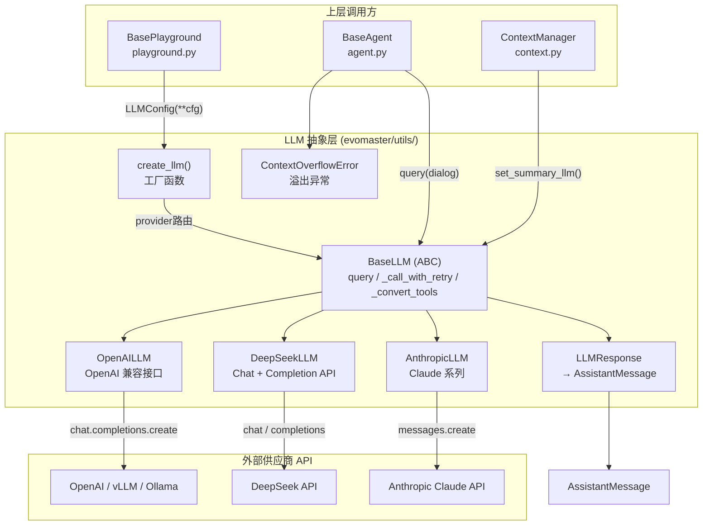
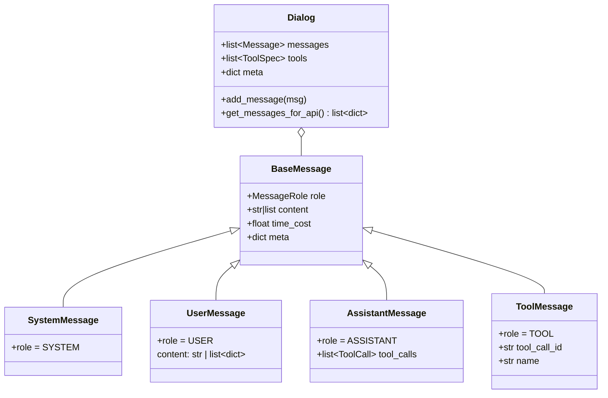
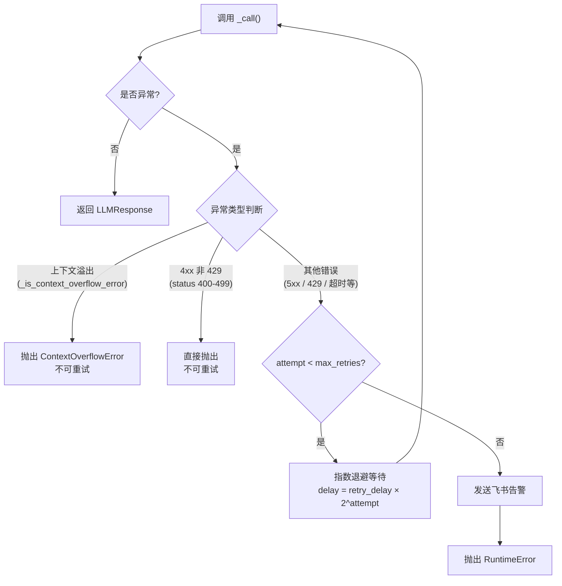

DataMaster 的 LLM 抽象层是整个 Agent 框架与外部大语言模型交互的统一门户。它通过 **策略模式**（Strategy Pattern）将不同供应商的 API 差异封装在各自子类中，向上层暴露一致的 `query()` 接口，使 Agent 无需感知底层供应商细节。该层还集成了重试退避、上下文溢出检测、多模态内容构建、日志追踪与飞书告警等横切关注点，是 Agent 能够稳定执行多轮对话的关键基础设施。

> 📖 **小白导读**
> - 这篇讲什么：Agent 想"问模型一句话"时，代码如何把对话整理成各家 API 接受的格式、发出请求、失败了怎么重试、结果怎么变回统一格式。
> - 先知道几个概念：**LLM**（大语言模型）；**API**（程序之间约定好的调用接口，这里指向模型服务发 HTTP 请求）；**provider**（供应商，如 OpenAI、Anthropic、DeepSeek）；**function calling**（模型返回"请调用某工具"的结构化请求，而不是普通文字，服务端必须支持）；**token** 与 **usage**（用量统计，服务端在响应里告诉你用了多少 token）；**指数退避**（失败后等待时间 1 秒、2 秒、4 秒……逐次翻倍再重试）。
> - 读完能明白：DataMaster 默认走的是哪个类（是 `OpenAILLM`，不是 DeepSeek 那个）；它能传哪些参数、不能传哪些；服务端不返回用量或推理内容时会发生什么；重试次数到底怎么算，以及和 OpenAI 官方 SDK 自带重试叠加的后果。

Sources: [llm.py](evomaster/utils/llm.py#L1-L4), [types.py](evomaster/utils/types.py#L1-L4)

---

## 整体架构概览

LLM 抽象层位于 `evomaster/utils/` 目录下，由两个核心文件构成：`llm.py` 定义所有 LLM 类与工厂函数，`types.py` 定义消息类型与对话结构。整个层采用经典的 **抽象基类 + 具体实现 + 工厂函数** 三段式架构。



上图展示了 LLM 抽象层在系统中的定位：**Playground** 通过 `create_llm()` 工厂函数创建 LLM 实例并注入 Agent；**Agent** 在每一步执行中调用 `llm.query(dialog)` 获取模型响应；**ContextManager** 在摘要压缩时复用同一个 LLM 实例。工厂函数根据 `provider` 字段路由到具体的子类实现，所有子类共享基类 `BaseLLM` 提供的重试、日志与工具转换逻辑。

Sources: [llm.py](evomaster/utils/llm.py#L1052-L1073), [playground.py](evomaster/core/playground.py#L886-L886), [agent.py](evomaster/agent/agent.py#L368-L369)

---

## 核心数据模型

### 消息类型体系

LLM 抽象层建立在 `types.py` 中定义的类型体系之上。该体系以 `BaseMessage` 为基类，派生出四种消息角色，并通过 `Dialog` 类封装完整的对话上下文。



`Dialog.get_messages_for_api()` 是连接内部消息模型与外部 API 格式的桥梁。该方法将 Pydantic 消息对象序列化为供应商 API 所需的字典列表，处理了两个关键兼容性问题：**AssistantMessage 带有 tool_calls 但 content 为空时填入空格**（部分 API 拒绝空 content），以及 **ToolMessage 的 `tool_call_id` 和 `name` 字段映射**。这使得上层只需操作强类型的消息对象，无需关心各供应商的序列化差异。

Sources: [types.py](evomaster/utils/types.py#L36-L130), [types.py](evomaster/utils/types.py#L104-L130)

### LLMConfig 配置模型

`LLMConfig` 是一个 Pydantic BaseModel，定义了创建 LLM 实例所需的全部参数。其中 `provider` 字段使用 `Literal` 类型约束为四种合法值，确保配置在类型层面即可被 IDE 和验证器检查。

| 参数 | 类型 | 默认值 | 说明 |
|------|------|--------|------|
| `provider` | `Literal["openai", "anthropic", "deepseek", "openrouter"]` | — | LLM 供应商标识 |
| `model` | `str` | — | 模型名称 |
| `api_key` | `str` | — | API 密钥 |
| `base_url` | `str \| None` | `None` | API 基地址（自部署时必填） |
| `temperature` | `float` | `0.7` | 采样温度，范围 `[0.0, 2.0]` |
| `max_tokens` | `int \| None` | `None` | 最大生成 token 数 |
| `timeout` | `int` | `300` | 请求超时（秒） |
| `max_retries` | `int` | `3` | 最大**尝试**次数（含第一次，详见下文"重试"一节；设 3 实际是 1 次正常调用 + 最多 2 次重试） |
| `retry_delay` | `float` | `1.0` | 重试初始延迟（秒，指数退避基数） |
| `use_completion_api` | `bool` | `False` | 是否使用 Completion API（仅 DeepSeek） |

补充：`api_key` 必填且不会回退读环境变量，空字符串会在 `OpenAILLM._setup` 里抛 `ValueError`；`base_url` 若为 `None` 或空字符串，客户端会使用 OpenAI 官方默认地址（`if self.config.base_url:` 才传入）。因为 yaml 里 `${LLM_BASE_URL}` 变量没设置时会被静默替换成空字符串，这意味着**忘设 `LLM_BASE_URL` 时请求不会报"缺地址"，而是悄悄发往 OpenAI 官方服务**，并且把你的 `LLM_API_KEY` 一起带过去（由代码推论，未实测）。

Sources: [llm.py](evomaster/utils/llm.py#L168-L179)

---

## BaseLLM 抽象基类：统一调用骨架

`BaseLLM` 是所有具体 LLM 实现的抽象基类，定义了从 **Dialog 到 AssistantMessage** 的完整调用链路。其核心设计理念是 **模板方法模式**（Template Method Pattern）：基类控制调用流程（日志 → 重试 → 响应转换），子类只需实现供应商特定的 `_call()` 方法和 `_setup()` 初始化逻辑。

### query 方法：对外统一入口

`query()` 是上层 Agent 唯一需要调用的方法。它接收一个 `Dialog` 对象，返回一个 `AssistantMessage`。方法内部依次执行：通过 `dialog.get_messages_for_api()` 将消息转为 API 格式 → 调用 `_convert_tools()` 转换工具规格 → 可选地记录请求日志 → 调用 `_call_with_retry()` 执行带重试的 API 请求 → 记录响应日志 → 通过 `response.to_assistant_message()` 转换为 Agent 可消费的消息对象。

Sources: [llm.py](evomaster/utils/llm.py#L315-L346)

### _call_with_retry：重试与溢出检测

重试机制是保障 LLM 调用可靠性的核心环节。`_call_with_retry()` 实现了三层错误分级策略（循环是 `for attempt in range(max_retries)`，所以 `max_retries=3` 表示**总共最多调用 3 次**；失败后依次等待 1 秒、2 秒，第 3 次失败后不再等待，直接告警并抛错）：



该策略参考了 OpenCode 的错误处理设计。上下文溢出检测通过 `_is_context_overflow_error()` 静态方法实现，它维护了一个包含 **12 条错误关键词**的列表（注释标注了各家供应商），通过小写匹配检测错误消息。HTTP 状态码 `413`（Request Entity Too Large）被直接判定为溢出，`400` 状态码配合关键词匹配也判定为溢出；**其他状态码不做关键词匹配**。当检测到溢出时，立即抛出 `ContextOverflowError`，**不进行重试**，而是将恢复责任交给上层 Agent 的上下文管理器执行紧急压缩后重试。

**与 OpenAI SDK 自带重试的叠加（推断）**：`OpenAILLM._setup` 创建客户端时只传了 `api_key` 和 `base_url`，没有设置 `max_retries`。官方 `openai` 库自己带重试，默认 2 次（我在本机安装的 1.109.1 版 `_constants.py` 中看到 `DEFAULT_MAX_RETRIES = 2`；仓库锁定的是 2.3.0，我没有核对该版本，推断默认值相同），遇到连接错误、超时、408/409/429、5xx 时会自动再试并带退避。于是一次 `_call()` 内部可能已经发了最多 3 个 HTTP 请求，外层 `_call_with_retry` 又最多调用 3 次 `_call()`，最坏情况下对同一个问题最多发出约 9 次请求，每次还可能各等满 `timeout`（默认 300 秒）。这不是 bug，但会让"3 次重试"的直觉失真，排查服务端压力、计费或"卡了很久才报错"时要把它考虑进去。

另外注意：**只有重试耗尽才会发飞书告警**；4xx（非 429）和上下文溢出是直接抛出，不告警。

Sources: [llm.py](evomaster/utils/llm.py#L470-L538), [llm.py](evomaster/utils/llm.py#L64-L78)

### 日志追踪机制

`BaseLLM` 内建了精细的请求/响应日志系统。`_log_request()` 通过 `_logged_message_count` 计数器实现了**增量日志**：首次请求记录全部消息（包括系统消息和初始任务描述），后续请求仅记录新增消息。当检测到消息数量减少（通常是上下文截断或重置导致），计数器自动重置。每条消息按角色着色（system=品红、user=绿色、assistant=蓝色、tool=黄色），工具调用参数被 JSON 格式化并截断到 500 字符以内。

Sources: [llm.py](evomaster/utils/llm.py#L348-L391), [llm.py](evomaster/utils/llm.py#L393-L468)

### 飞书告警集成

当 LLM 调用在所有重试耗尽后仍失败时，`_send_feishu_alert_on_llm_failure()` 会通过懒加载的 `FeishuAlertManager` 单例发送飞书告警。告警内容包含时间戳、模型名称、供应商标识、尝试次数、错误类型与错误信息。该机制采用**防御式设计**——告警发送本身的失败不会影响主流程，仅记录 debug 日志。

Sources: [llm.py](evomaster/utils/llm.py#L243-L294)

---

## 三大供应商实现对比

### 实现策略对照

| 维度 | OpenAILLM | DeepSeekLLM | AnthropicLLM |
|------|-----------|-------------|--------------|
| **SDK 依赖** | `openai` Python 包 | `openai` Python 包（复用） | `anthropic` Python 包 |
| **API 端点** | `chat.completions.create()` | `chat.completions.create()` 或 `completions.create()` | `messages.create()` |
| **多模态格式** | OpenAI 原生 `image_url` 格式 | 继承 OpenAI 格式 | 转换为 `image` + `source` 格式 |
| **工具格式** | OpenAI 原生 `function` 嵌套 | OpenAI 格式（清理 `strict=None`） | 转换为 `name` + `input_schema` |
| **系统消息** | 嵌入 messages 列表 | 嵌入 messages 列表 | **提取为独立 `system` 参数** |
| **tool 消息** | `role: "tool"` 原生支持 | 同 OpenAI | **转换为 `role: "user"` + `tool_result` 块** |
| **特殊功能** | — | 支持 Completion API（R1 推理模型） | — |
| **思考模式** | — | `extra_body={"chat_template_kwargs": {"thinking": True}, "separate_reasoning": True}`（写死，仅 Chat 路径） | — |

Sources: [llm.py](evomaster/utils/llm.py#L552-L636), [llm.py](evomaster/utils/llm.py#L638-L813), [llm.py](evomaster/utils/llm.py#L816-L1049)

### OpenAILLM：通用兼容层

`OpenAILLM` 是最基础的实现，也是 `openrouter` 供应商标识的路由目标。它在 `_setup()` 中创建 `openai.OpenAI` 客户端实例，支持通过 `base_url` 指向任何 OpenAI 兼容端点（vLLM、Ollama、OpenRouter 等）。`_call()` 方法构建请求参数字典并调用 `chat.completions.create()`，解析返回的 `choices[0].message` 中的文本内容和工具调用，将其包装为统一的 `LLMResponse`。值得注意的是，该实现始终在 `meta` 中携带 `raw_response`（通过 `response.model_dump()`），为后续调试和轨迹记录保留了完整的原始响应。

**对 DataMaster 最重要的一点**：`config_base.yaml` 里的 LLM 配置写的是 `provider: "openai"`，所以 DataMaster 默认用的是 `OpenAILLM`，而不是 `DeepSeekLLM`。`ml_master/deepseek_config.yaml` 才用 `provider: "deepseek"`。下面这些行为都是对着 `OpenAILLM._call`（`evomaster/utils/llm.py` L578-636）核对出来的：

- **能传的参数只有这几个**：`model`、`messages`、`temperature`、`timeout`、`max_tokens`（配置值为 0 或 None 时不传）、`tools` 和 `tool_choice`（默认 `"auto"`，有工具时才传）。`query(**kwargs)` 里也只认 `temperature`、`timeout`、`max_tokens`、`tool_choice` 这四个键。**不能传** `extra_body`、`top_p`、`stop`、`seed`、`response_format`、`reasoning_effort` 等；想打开某个自部署服务的"思考模式"（需要 `extra_body`）只能改代码，yaml 里加这类字段，`LLMConfig` 里没有对应字段，会被忽略（pydantic 的默认行为，未实测）。
- **服务端必须支持 function calling**：只要 Agent 暴露了工具，每个请求都会带 `tools` 和 `tool_choice="auto"`。不支持的服务（或模型）会直接报 4xx。工具定义里还带着 `strict: null`（`ToolSpec.model_dump()` 的产物），`OpenAILLM` 不像 `DeepSeekLLM._call_chat` 那样把它清掉，个别严格的服务可能因此拒绝（推断，未实测）。
- **`reasoning_content` 不进对话历史**：代码只读取 `choice.message.content` 和 `message.tool_calls`。如果推理模型把思考过程放在 `reasoning_content` 字段，它不会被读入 `AssistantMessage.content`，因此下一轮请求里不会带上它；它只会存在于 `meta["raw_response"]`（`model_dump()` 保留了服务端返回的额外字段，推断）这个仅内存可见的字典里。
- **服务端不返回 `usage` 时会抛异常（推断）**：代码直接写 `response.usage.prompt_tokens`。如果服务端响应里没有 `usage`（有些自部署服务在特定设置下如此），`response.usage` 为 `None`，会触发 `AttributeError`。这个异常发生在 `_call()` 里，会被 `_call_with_retry` 当成"普通可重试错误"重试 3 次——而每一次请求其实都成功拿到了模型回答并且已经产生了计算开销，只是解析时丢弃了——最终抛 `RuntimeError`。
- `content` 可能为 `None`（只有工具调用时），下游已按此处理。

Sources: [llm.py](evomaster/utils/llm.py#L552-L636)

### DeepSeekLLM：双模式切换

`DeepSeekLLM` 是唯一支持双 API 模式的实现。当 `use_completion_api=True` 时，它调用 `_call_completion()`，通过 `_messages_to_prompt()` 将结构化消息列表展平为单一 prompt 字符串——这个转换遵循 DeepSeek R1 的 Jinja 模板格式，使用 `<｜User｜>` 和 `<｜Assistant｜>` 标记包裹用户消息，工具输出用 `<execution_results>` 标签包裹。当 `use_completion_api=False` 时，它调用 `_call_chat()`，走标准 Chat Completion 路径，但在请求参数中注入了 `extra_body.chat_template_kwargs.thinking=True` 和 `separate_reasoning=True` 以启用 DeepSeek 的思考链模式。此外，`_call_chat()` 会清理工具定义中的 `strict=None` 字段，因为部分 API 不接受 `None` 值。

Sources: [llm.py](evomaster/utils/llm.py#L638-L813)

### AnthropicLLM：格式转换枢纽

`AnthropicLLM` 是格式转换最复杂的实现，因为 Claude API 的消息结构与 OpenAI 格式存在根本性差异。它通过三个静态方法完成全部转换工作：

**`_convert_messages_for_anthropic()`** 处理消息列表的核心转换。Claude API 要求 system 消息作为顶层参数而非消息列表元素，因此该方法首先提取所有 system 消息为单独的字符串。对于 assistant 消息带 tool_calls 的情况，它将 OpenAI 的扁平 `tool_calls` 列表转换为 Anthropic 的 `content` 块列表——文本部分成为 `{"type": "text"}` 块，每个工具调用成为 `{"type": "tool_use"}` 块，其中 `input` 字段从 JSON 字符串解析为字典。对于连续的 `role: "tool"` 消息，该方法将它们合并为单条 `role: "user"` 消息，内含多个 `tool_result` 内容块。

**`_convert_tools_for_anthropic()`** 将工具从 OpenAI 的 `{"type": "function", "function": {...}}` 嵌套结构转换为 Anthropic 的扁平 `{"name": ..., "description": ..., "input_schema": ...}` 结构。

**`_convert_content_for_anthropic()`** 处理多模态内容，将 OpenAI 的 `image_url` 格式（`data:` URI）解析出 MIME 类型和 base64 数据，重构为 Anthropic 的 `source` 结构。

在响应解析端，`AnthropicLLM._call()` 遍历 `response.content` 列表，将 `text` 类型的内容块提取为 `content`，将 `tool_use` 类型的块转换回 `ToolCall` 对象（将 `input` 字典序列化为 JSON 字符串以匹配 `FunctionCall.arguments` 的类型约束）。

Sources: [llm.py](evomaster/utils/llm.py#L816-L1049), [llm.py](evomaster/utils/llm.py#L844-L981)

---

## 工厂函数与供应商路由

`create_llm()` 是整个抽象层对外的唯一构造入口。该函数接收 `LLMConfig` 和可选的 `output_config`，根据 `config.provider` 字段路由到对应的子类构造器。路由逻辑简单而明确：`"openai"` 和 `"openrouter"` 共享 `OpenAILLM` 实现（因为 OpenRouter 兼容 OpenAI API 协议），`"anthropic"` 映射到 `AnthropicLLM`，`"deepseek"` 映射到 `DeepSeekLLM`。不支持的 provider 值会直接抛出 `ValueError`。

在 `BasePlayground._create_agent()` 中，每个 Agent 创建时都会通过 `create_llm(LLMConfig(**llm_config), output_config=output_config)` 构造一个**独立的 LLM 实例**。这意味着即使多个 Agent 使用相同的模型配置，它们也各自持有独立的日志计数器和客户端连接，确保日志隔离和并发安全。同时，Agent 的 `ContextManager` 通过 `set_summary_llm(llm)` 复用同一个 LLM 实例进行上下文摘要压缩，避免创建额外的连接。

Sources: [llm.py](evomaster/utils/llm.py#L1052-L1073), [playground.py](evomaster/core/playground.py#L886-L931)

---

## LLMResponse：统一响应封装

`LLMResponse` 是所有供应商 API 响应的统一封装。它提取了不同 API 响应中的共性信息——文本内容（`content`）、工具调用列表（`tool_calls`）、结束原因（`finish_reason`）、token 使用统计（`usage`）和元数据（`meta`）——并提供了 `to_assistant_message()` 方法将其转换为 Agent 消息流中使用的 `AssistantMessage`。

值得注意的是 token 统计字段的供应商差异：OpenAI 和 DeepSeek 使用 `prompt_tokens` / `completion_tokens` / `total_tokens` 三字段；Anthropic 使用 `input_tokens` / `output_tokens` 两字段，在 `AnthropicLLM._call()` 中被映射为 `prompt_tokens` / `completion_tokens`，`total_tokens` 则通过求和计算。`raw_response` 字段始终保留完整原始响应，供调试和轨迹记录使用。

Sources: [llm.py](evomaster/utils/llm.py#L182-L210), [llm.py](evomaster/utils/llm.py#L1035-L1049)

---

## 多模态内容构建

LLM 抽象层通过三个辅助函数支持多模态输入。`encode_image_to_base64()` 将图片文件读取并编码为 base64 字符串；`get_image_media_type()` 根据文件扩展名返回 MIME 类型（支持 PNG、JPG/JPEG，默认 PNG）；`build_multimodal_content()` 将文本和多张图片组装为 OpenAI 格式的内容块列表——图片在前、文本在后，每张图片编码为 `{"type": "image_url", "image_url": {"url": "data:{mime};base64,{data}"}}`。

在 `BaseAgent._initialize()` 中，当 `TaskInstance` 携带 `images` 路径列表时，系统调用 `build_multimodal_content(user_prompt, task.images)` 构建多模态用户消息。对于 Anthropic 供应商，该 OpenAI 格式的多模态内容会在 `AnthropicLLM._convert_content_for_anthropic()` 中被自动转换。

Sources: [llm.py](evomaster/utils/llm.py#L81-L147), [agent.py](evomaster/agent/agent.py#L327-L337)

---

## 与上下文管理的联动

LLM 抽象层与 `ContextManager` 之间存在紧密的双向联动，共同构成了 **上下文溢出防护体系**。这个体系采用主动检测与被动恢复相结合的策略：

**主动检测**（Proactive）：在 Agent 每一步执行前，`ContextManager.prepare_for_query()` 根据上一次 LLM API 返回的实际 `prompt_tokens` 加上增量估算，判断当前 token 使用量是否接近上限。如果达到可用容量的 80%，执行轻量级 `_prune_old_tool_outputs()`（清除旧工具输出，保护最近两轮）；如果达到 100%，执行完整截断（`truncate()`，按配置的策略；DataMaster 用的 `latest_half` 是丢掉前半段历史，且不做摘要，见第 19 篇）。

**被动恢复**（Reactive）：即使主动检测未能阻止，当 API 返回上下文溢出错误时，`_call_with_retry()` 会抛出 `ContextOverflowError`。Agent 的 `_step()` 方法捕获该异常后调用 `context_manager.truncate()` 执行紧急压缩，然后用压缩后的对话重试 LLM 调用。这种两级防护确保了在任何情况下 Agent 都不会因上下文溢出而永久中断。

Sources: [agent.py](evomaster/agent/agent.py#L354-L417), [context.py](evomaster/agent/context.py#L393-L456)

---

## 配置实践

LLM 配置通过 YAML 文件定义，支持多供应商共存和环境变量替换（yaml 是一种用缩进表示层级的配置文件格式）。以下是一个**示意性**配置，综合了 DataMaster 与 ML-Master 两份配置的写法：其中名为 `openai` 的一项取自 `config_base.yaml` 的字段（真实文件里这一项叫 `local_sglang`，provider 为 `openai`），`deepseek_local` 这个名字则是示例，并非仓库原文（`ml_master/deepseek_config.yaml` 里对应的是叫 `local_sglang`、provider 为 `deepseek` 的那一项）：

```yaml
llm:
  openai:
    provider: "openai"
    model: "${LLM_MODEL}"
    api_key: "${LLM_API_KEY}"
    base_url: "${LLM_BASE_URL}"
    temperature: 0.7
    max_tokens: 16384
    timeout: 300
    max_retries: 3
    retry_delay: 1.0

  deepseek_local:
    provider: "deepseek"
    model: "volcengine/deepseek-v3-2-251201"
    api_key: "${LLM_API_KEY}"
    base_url: "${LLM_BASE_URL}"
    temperature: 0.7
    max_tokens: 8192
    timeout: 300
    max_retries: 3
    retry_delay: 1.0

  default: "deepseek_local"

agents:
  initial:
    llm: "deepseek_local"    # 引用上面定义的 LLM 配置名
    max_turns: 20
    context:
      max_tokens: 128000
      truncation_strategy: "latest_half"
      preserve_recent_turns: 5
```

配置中的 `${VAR}` 占位符由 `ConfigManager` 在加载时通过 `_substitute_env()` 替换为环境变量值；变量未设置时会被替换成**空字符串**而不是报错（`evomaster/config.py` L28-47、L242），空的 `api_key` 会在创建 LLM 时抛 `ValueError`，空的 `base_url` 则如上文所述悄悄退回官方地址。每个 Agent 通过 `llm` 字段引用已定义的 LLM 配置名，未配置时回退到 `default` 指定的默认配置。`ConfigManager.get_agent_llm_config()` 方法实现了两级查找：先在 agent 配置中找 `llm` 字段指定的配置名，找不到则发出警告并使用默认配置。

Sources: [config_base.yaml](configs/data_master/config_base.yaml#L12-L25), [deepseek_config.yaml](configs/ml_master/deepseek_config.yaml#L4-L39), [config.py](evomaster/config.py#L292-L360)

---

## 扩展新供应商

当需要接入当前不支持的供应商时，扩展流程遵循基类定义的模板：

1. **创建子类**：继承 `BaseLLM`，实现 `_setup()`（初始化 SDK 客户端）和 `_call()`（调用供应商 API 并解析为 `LLMResponse`）
2. **处理格式差异**：如果供应商的消息/工具格式与 OpenAI 不同，实现对应的转换方法（参照 `AnthropicLLM` 的三个静态转换方法）
3. **注册路由**：在 `LLMConfig.provider` 的 `Literal` 类型中添加新供应商标识，在 `create_llm()` 中添加路由分支
4. **更新溢出模式**：如果供应商有独特的上下文溢出错误消息，在 `_OVERFLOW_PATTERNS` 列表中添加对应的匹配模式

Sources: [llm.py](evomaster/utils/llm.py#L168-L170), [llm.py](evomaster/utils/llm.py#L1052-L1073), [llm.py](evomaster/utils/llm.py#L64-L78)

---

## 导航

- **上游理解**：LLM 实例由 Playground 创建并注入 Agent，了解这一组装流程请参阅 [Agent 基类：对话管理、轨迹记录与上下文截断策略](19-agent-ji-lei-dui-hua-guan-li-gui-ji-ji-lu-yu-shang-xia-wen-jie-duan-ce-lue)
- **下游关联**：LLM 调用产生的 `ContextOverflowError` 由 Agent 的上下文管理器处理，了解溢出恢复策略请参阅 [Agent 基类：对话管理、轨迹记录与上下文截断策略](19-agent-ji-lei-dui-hua-guan-li-gui-ji-ji-lu-yu-shang-xia-wen-jie-duan-ce-lue)
- **配置接入**：LLM 的 YAML 配置结构与环境变量替换机制请参阅 [配置体系解析：YAML 配置、MCP JSON 与任务级配置生成](22-pei-zhi-ti-xi-jie-xi-yaml-pei-zhi-mcp-json-yu-ren-wu-ji-pei-zhi-sheng-cheng)
- **运行环境**：Agent 持有 LLM 实例后在 Session 中执行，了解 Local 与 Docker 隔离环境请参阅 [会话与环境管理：LocalSession 与 Docker 隔离环境](21-hui-hua-yu-huan-jing-guan-li-localsession-yu-docker-ge-chi-huan-jing)

## 本文修订记录

- 补充 DataMaster 默认用的是 `OpenAILLM`（`config_base.yaml` 写 `provider: "openai"`），并列出它能传/不能传的参数（`llm.py` L578-636）：只有 model/messages/temperature/timeout/max_tokens/tools/tool_choice，不能传 `extra_body`、`top_p`、`stop` 等。
- 原表格把 DeepSeek 的思考模式写成 `extra_body.thinking=True`，实际是 `extra_body={"chat_template_kwargs": {"thinking": True}, "separate_reasoning": True}`，且只在 DeepSeek Chat 路径生效；已改正。
- `max_retries` 的含义：原文称"最大重试次数"，代码是 `range(max_retries)`，即总尝试次数；补充退避等待序列（1 秒、2 秒）以及只有重试耗尽才发飞书告警（`llm.py` L470-531）。
- 补充与 OpenAI SDK 自带重试的叠加（推断：本机 1.109.1 版默认 2 次，仓库锁定 2.3.0 未核对），最坏约 9 次请求。
- 补充服务端不返回 `usage` 时 `response.usage.prompt_tokens` 抛异常并被当作可重试错误（推断，未实测）、`reasoning_content` 不进入对话历史、`strict: null` 不被清理（推断）。
- 溢出检测：原文"12 种供应商模式"改为"12 条关键词，仅 400/413 才判定"；原文"保留系统消息和最近若干轮"改为按策略（`latest_half` 丢前半段）。
- 补充 `${LLM_BASE_URL}` 未设置时 `base_url` 为空字符串、请求悄悄发往 OpenAI 官方（代码推论，未实测）；配置示例标注为示意，`deepseek_local` 名称并非仓库原文。
- 补充小白导读与术语解释。未验证：服务端是否真的返回/不返回 usage；`reasoning_content` 是否出现在 `raw_response`；openai 2.3.0 的重试默认值。
