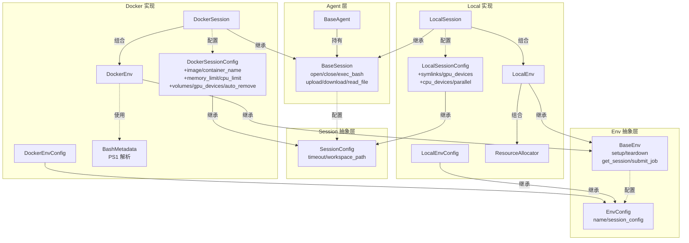
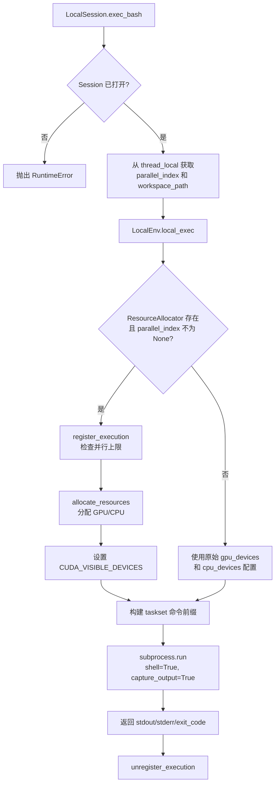
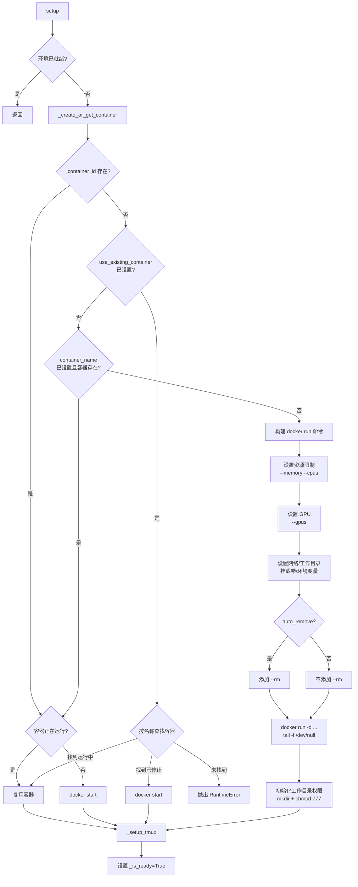
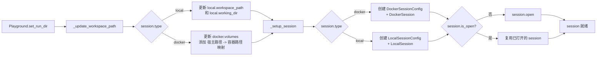

在 EvoMaster 框架中，Agent 需要一个可执行的运行环境来运行代码、操作文件、提交实验任务。这一职责由 **Session**（会话）和 **Env**（环境）两个层次共同承担：Session 是 Agent 与执行环境之间的接口抽象，Env 是底层操作的具体实现。二者通过组合关系协作——Session 持有一个 Env 实例，将高层语义操作（执行 bash、上传文件）委托给 Env 的低层操作接口。当前框架提供了两种完整的 Session/Env 实现：**LocalSession / LocalEnv** 直接在本地进程执行命令，适用于开发调试和并行资源管理；**DockerSession / DockerEnv** 通过 Docker 容器提供隔离的持久 bash 环境，适用于需要环境隔离的场景。

> 📖 **小白导读**
> - 这篇讲什么：Agent 要"真正动手"（跑命令、读写文件）时，是通过哪一层去操作电脑的，以及本地直接跑与放进 Docker 容器里跑有什么区别。
> - 先知道几个概念：**subprocess**（子进程：程序临时启动的一个独立命令行进程，命令执行完就消失）；**Docker 容器**（一个与宿主机隔离的轻量"小电脑"，有自己的文件系统和进程）；**volume / 挂载卷**（把宿主机的一个目录映射进容器，两边看到的是同一份文件）；**symlink**（软链接，一个指向别处文件或目录的"快捷方式"）；**tmux**（一个终端复用工具，可以在后台保持一个一直开着的命令行）；**线程本地存储**（每个线程各自一份、互不干扰的变量）；**GPU / CPU 亲和性**（限定某个任务只能用哪几块显卡、哪几个 CPU 核）。
> - 读完能明白：两种 session 在"命令之间状态是否保留"上的根本差异（本地**不保留**，Docker 保留）；DataMaster 默认用本地模式；Docker 模式在本仓库里有几处未接通的地方（缺方法、挂载重复），实际基本不可用（见文中标注）。

Sources: [base.py](evomaster/agent/session/base.py#L1-L5), [base.py](evomaster/env/base.py#L1-L4)

## 架构总览：Session 与 Env 的分层设计

整个会话与环境管理体系遵循 **抽象-实现分离** 原则。`BaseSession` 定义了 Agent 调用的统一接口（`open`、`close`、`exec_bash`、`upload`、`download` 等），`BaseEnv` 定义了环境管理的统一接口（`setup`、`teardown`、`get_session`、`submit_job` 等）。具体的 Session 子类在初始化时创建对应的 Env 子类实例，将操作委托下去。这种设计使得 Agent 代码无需感知底层是本地执行还是容器执行——它只与 `BaseSession` 接口交互。

以下 Mermaid 图展示了完整的类继承与组合关系：



关键设计要点在于 **Session 创建 Env** 的方向：`LocalSession.__init__` 中构造 `LocalEnv` 实例，`DockerSession.__init__` 中构造 `DockerEnv` 实例。Env 的配置（`EnvConfig`）内部嵌套了 Session 配置（`SessionConfig`），形成配置的嵌套引用关系。由于 Pydantic 模型间存在循环依赖（EnvConfig 引用 SessionConfig，SessionConfig 子类又被 Env 引用），`evomaster/env/__init__.py` 中通过 `_rebuild_env_configs()` 延迟重建模型来解决这一问题。

Sources: [base.py](evomaster/agent/session/base.py#L1-L182), [base.py](evomaster/env/base.py#L1-L115), [__init__.py](evomaster/env/__init__.py#L1-L47), [local.py](evomaster/agent/session/local.py#L53-L63), [docker.py](evomaster/agent/session/docker.py#L40-L50)

## BaseSession：Agent 与环境交互的统一契约

`BaseSession` 是所有 Session 实现的抽象基类，定义了 Agent 执行工具时所需的全部操作接口。其核心方法分为三组：**生命周期管理**（`open` / `close`）、**命令执行**（`exec_bash`）、**文件操作**（`upload` / `download` / `read_file` / `write_file` / `path_exists` / `is_file` / `is_directory`）。

`exec_bash` 是最核心的方法，签名为 `exec_bash(command, timeout=None, is_input=False) -> dict`。它返回一个包含 `stdout`、`stderr`、`exit_code`、`working_dir` 和 `output` 字段的结果字典。`is_input` 参数用于与正在运行的进程交互——当上一条命令仍在执行时，后续的 `exec_bash(is_input=True)` 调用可以向前台进程发送输入或控制信号，而非启动新命令。

`BaseSession` 还提供了一组基于 `exec_bash` 和 `download` 实现的**具体方法**（非抽象方法）：`read_file` 通过 `download` 获取字节后解码为文本，`write_file` 通过临时文件 + `upload` 实现写入，`path_exists` / `is_file` / `is_directory` 通过执行 `test` 命令并检查输出来判断路径状态。这些方法在基类中提供了默认实现，子类可以按需覆盖以优化性能（如 `LocalSession` 和 `DockerSession` 都覆盖了这些方法以利用各自的底层优化路径）。

`BaseSession` 同样实现了上下文管理器协议（`__enter__` / `__exit__`），确保在 `with` 语句块中自动管理会话的开启和关闭。

Sources: [base.py](evomaster/agent/session/base.py#L22-L182)

## LocalSession：本地直接执行与并行资源管理

`LocalSession` 是面向本地执行环境的 Session 实现，它不依赖 Docker 或任何容器技术，直接在宿主机上通过 `subprocess.run` 执行命令。**这意味着每条命令都是一个全新的进程，`cd`、`export` 等不会保留到下一条命令**（Agent 的 `execute_bash` 工具说明书却写着"持久 Shell"，两者不符，详见第 17 篇）。其初始化过程创建一个 `LocalEnv` 实例并将自身配置传入，后续所有操作委托给这个 Env 实例。

### 配置体系

`LocalSessionConfig` 继承自 `SessionConfig`，扩展了以下关键字段：

| 配置字段 | 类型 | 默认值 | 说明 |
|---|---|---|---|
| `timeout` | `int` | `300` | 命令执行超时（秒） |
| `workspace_path` | `str` | `/workspace` | 工作目录路径 |
| `encoding` | `str` | `utf-8` | 文件编码 |
| `symlinks` | `dict[str, str]` | `{}` | 软链接配置：`{源目录路径: 工作空间内目标路径}` |
| `config_dir` | `str \| None` | `None` | 配置文件目录，用于解析 symlinks 中的相对路径 |
| `gpu_devices` | `str \| list[str] \| None` | `None` | GPU 设备分配，如 `"2"` 或 `["0", "1"]` |
| `cpu_devices` | `str \| list[int] \| None` | `None` | CPU 设备分配，如 `"0-15"` 或 `[0, 1, 2, 3]` |
| `parallel` | `dict \| None` | `None` | 并行执行配置，包含 `enabled`、`max_parallel`、`split_workspace_for_exp` |

Sources: [local.py](evomaster/agent/session/local.py#L18-L41)

### 命令执行与资源分配

`LocalSession.exec_bash` 方法将命令委托给 `LocalEnv.local_exec` 执行。在委托之前，它会从**线程本地存储**中获取 `parallel_index` 和 `workspace_path`，用于并行场景下的资源隔离。这两个值通过 `set_parallel_index` 和 `set_workspace_path` 方法设置，存储在 `_thread_local` 中，确保多线程并行时各线程独立设置自己的资源索引和工作空间。

`LocalEnv.local_exec` 是本地命令执行的核心逻辑。当并行资源分配器（`ResourceAllocator`）存在且 `parallel_index` 不为 `None` 时，它会调用 `allocate_resources(parallel_index)` 获取 GPU 和 CPU 分配，然后通过环境变量 `CUDA_VISIBLE_DEVICES` 限制 GPU 访问、通过 `taskset -c` 命令限制 CPU 亲和性。最终命令通过 `subprocess.run(shell=True, capture_output=True, text=True)` 在指定工作目录下执行。几个容易踩的细节（均已对照 `evomaster/env/local.py` L417-537 与 `session/local.py` L122-177）：

- **超时**：参数 `timeout` 优先，其次是 `session.local.timeout`（`config_base.yaml` 里为 600 秒，代码默认 300 秒）。超时被捕获后返回 `exit_code=-1` 和 `Command timed out after Ns`，命令已被终止；`is_input=True` 直接返回 `ERROR: Local session does not support is_input mode.`。
- **工作目录静默回退**：`cwd = workdir if Path(workdir).exists() else None`——如果配置的工作目录不存在，不会报错，而是**在启动程序时所在的目录里**执行命令（代码推论，未实测）。
- **Windows**：`shell=True` 在 Windows 上走的是 `cmd.exe`，不是 bash；`taskset` 在 `sys.platform == "win32"` 时被跳过；整个仓库本来就只支持 Linux 安装（`pyproject.toml` L551）。所以不要把本地模式当成在 Windows 上可用。
- **GPU 分配与注释不符**：`gpu_devices: ["0","1","2","3"]` 配 4 个并行时，`ResourceAllocator` 的算法是 `parallel_index % 4`，每个并行槽只分到 **1 张**卡；yaml 里的注释却写"8 卡机器上 4 并行，每个任务 2 卡"，与代码不一致。CPU 方面 `cpu_devices: null` 就不会执行 `taskset`。



在 DataMaster 里，每个 worker 线程的 `parallel_index` 是在基类 `execute_parallel_tasks` 里调用 `session.set_parallel_index(i)` 设置的（`evomaster/core/playground.py` L1419；仅当 session 是 `LocalSession` 且 `parallel.enabled` 为真时），所以该机制只对本地模式生效。`ResourceAllocator` 是并行资源管理的核心组件。它根据 `parallel_index` 和 `max_parallel` 将 GPU 和 CPU 资源分配给不同的并行执行槽。GPU 分配采用**取模轮转**策略：`gpu_index = parallel_index % len(gpu_list)`，当任务数超过 GPU 数时自动共享。CPU 分配采用**均分切片**策略：将总 CPU 数除以 `max_parallel` 得到每个并行槽的 CPU 数量，最后一个槽获取所有剩余 CPU。`register_execution` 和 `unregister_execution` 方法通过线程锁保证并行安全，防止超过 `max_parallel` 的任务同时执行。

Sources: [local.py](evomaster/agent/session/local.py#L43-L177), [local.py](evomaster/env/local.py#L31-L178), [local.py](evomaster/env/local.py#L417-L541)

### 工作空间与软链接管理

`LocalEnv.setup` 在初始化时创建工作空间目录，并根据 `symlinks` 配置创建软链接。软链接机制允许将项目中的 `playground`、`configs` 等目录的内容映射到工作空间中，使 Agent 在工作空间内即可访问项目资源。当 `split_workspace_for_exp` 启用时，主工作空间跳过软链接创建，改为在每个实验的独立工作空间中单独创建（通过 `setup_exp_workspace` 方法）。

软链接的路径解析逻辑支持相对路径和绝对路径。对于相对路径，会从 `config_dir` 开始向上搜索包含 `evomaster` 目录的项目根，然后相对于项目根解析。`_link_directory_contents` 方法将源目录中的每个条目逐一创建为符号链接到目标目录，已存在的目标会被跳过。

Sources: [local.py](evomaster/env/local.py#L223-L416)

## DockerSession：容器隔离与 tmux 持久会话

`DockerSession` 通过 Docker 容器提供完全隔离的执行环境。与 `LocalSession` 的无状态命令执行不同，`DockerSession` 通过 **tmux** 维护一个持久的 bash 会话，使环境变量、工作目录等状态在多次命令间保持连续。这对于需要多步操作的实验流程（如先安装依赖、再运行训练）至关重要。

### 配置体系

`DockerSessionConfig` 继承自 `SessionConfig`，扩展了容器相关的全部配置：

| 配置字段 | 类型 | 默认值 | 说明 |
|---|---|---|---|
| `image` | `str` | `python:3.11-slim` | Docker 镜像名称 |
| `container_name` | `str \| None` | `None` | 容器名，`None` 自动生成 |
| `working_dir` | `str` | `/workspace` | 容器内工作目录 |
| `memory_limit` | `str` | `4g` | 内存限制 |
| `cpu_limit` | `float` | `2.0` | CPU 核数限制 |
| `gpu_devices` | `str \| list \| None` | `None` | GPU 设备，`"all"` 或 `["0", "1"]` |
| `network_mode` | `str` | `bridge` | 网络模式 |
| `volumes` | `dict[str, str]` | `{}` | 挂载卷 `{宿主路径: 容器路径}` |
| `env_vars` | `dict[str, str]` | `{}` | 环境变量 |
| `auto_remove` | `bool` | `True` | 容器退出后是否自动删除 |
| `use_existing_container` | `str \| None` | `None` | 使用已有容器名，设置后不创建新容器 |

Sources: [docker.py](evomaster/agent/session/docker.py#L18-L31)

### 容器生命周期管理

`DockerEnv.setup` 负责 Docker 容器的创建或获取，其决策流程如下：



容器创建命令使用 `docker run -d` 以分离模式启动，最终命令为 `tail -f /dev/null` 以保持容器持续运行。资源限制通过 `--memory` 和 `--cpus` 参数设置，GPU 通过 `--gpus` 参数配置。容器启动后立即执行 `mkdir -p {working_dir} && chmod 777 {working_dir}` 确保工作目录可写。

`DockerEnv.teardown` 根据 `auto_remove` 配置决定容器命运：`auto_remove=True` 时执行 `docker stop` + `docker rm -f` 完全清理；`auto_remove=False` 时仅标记环境关闭，容器保持运行以供下次复用。这种设计支持容器的**热复用**——多个实验可以共享同一个容器，避免反复创建/销毁的开销。

Sources: [docker.py](evomaster/env/docker.py#L80-L147), [docker.py](evomaster/env/docker.py#L175-L353)

### tmux 持久会话与 PS1 协议

Docker 环境的核心创新在于通过 **tmux + PS1 标记协议** 实现持久的、可解析的命令执行。`_setup_tmux` 方法在容器内创建一个名为 `evo-{container_id前8位}` 的 tmux 会话，并通过 `tmux pipe-pane` 将所有输出管道到日志文件 `/tmp/evo-{container_id前8位}.log`。

**PS1 标记协议** 是命令完成检测的关键机制。`BashMetadata.to_ps1_prompt` 方法生成一个特殊的 PS1 提示符，其格式为 `===PS1JSONBEGIN==={json}===PS1JSONEND===`，其中 JSON 包含 `pid`（`$!`）、`exit_code`（`$?`）和 `working_dir`（`$(pwd)`）。每次命令执行完毕后，bash 会自动输出这个标记，`DockerSession` 通过正则表达式 `PS1_PATTERN` 在 tmux 日志中检测新标记的出现来判断命令是否完成。

`DockerSession.exec_bash` 的执行逻辑围绕 **PS1 计数** 展开：

1. 通过 `tmux send-keys` 向 tmux 会话发送命令
2. 轮询 `get_tmux_logs()` 读取日志，用正则匹配 PS1 标记
3. 当 PS1 标记数量增加时，判定命令完成
4. 从前后两个 PS1 标记之间提取命令输出
5. 从最后一个 PS1 标记中解析 `exit_code` 和 `working_dir`

对于 `is_input=True` 的交互模式，`DockerSession` 支持发送控制信号（如 `C-c` 通过 `C-` 前缀识别）和文本输入。当上一条命令仍在运行（`_prev_command_status == "timeout"`）时，新的非输入命令会被拒绝，必须先通过输入模式与前一条命令交互。这套"软超时 + 交互"机制才是 `execute_bash` 工具说明书所描述的行为，只在 Docker 模式下成立。

**一个需要提醒的限制（推断）**：整个 Docker 容器只有**一个** tmux 会话，`DockerSession` 里的 `_last_ps1_count`、`_prev_command_status` 也是整个对象共享的一份状态；而 DataMaster 的多个 worker 线程共用同一个 session 对象。若在 Docker 模式下并行执行，多个线程的命令会插进同一个终端、互相覆盖输出，且代码里没有对 `exec_bash` 加锁（未实测）。另外 `_setup_tmux` 会在容器里执行 `apt-get update && apt-get install -y tmux || true`，需要容器能联网且有权限安装。

Sources: [docker.py](evomaster/env/docker.py#L31-L77), [docker.py](evomaster/env/docker.py#L355-L384), [docker.py](evomaster/agent/session/docker.py#L56-L211)

### 挂载卷感知的文件操作

`DockerEnv` 实现了一个智能的文件操作策略：**挂载卷感知**。`is_mounted_path` 方法检查容器内路径是否落在某个挂载卷内，如果落在挂载卷内，则直接在宿主机上执行文件操作（`shutil.copy2`、`open` 等），避免了 `docker cp` 的开销；如果不在挂载卷内，则回退到 `docker cp` 命令。

这一策略贯穿于所有文件操作方法——`upload_file`、`download_file`、`read_file_content`、`write_file_content`、`path_exists`、`is_file`、`is_directory` 都遵循相同的分支逻辑。当 Agent 在挂载卷内工作（通常 `/workspace` 被挂载到宿主目录）时，文件操作性能与本地操作无异。

Sources: [docker.py](evomaster/env/docker.py#L467-L740)

## Session 的选择与初始化流程

Session 的创建由 `BasePlayground._setup_session` 方法负责，它根据配置文件中的 `session.type` 字段决定使用 `LocalSession` 还是 `DockerSession`。在创建之前，`_update_workspace_path` 方法会将运行时的工作空间路径动态注入到配置中——对于 Docker 模式，这还涉及自动更新 `volumes` 挂载映射，将宿主工作空间路径挂载到容器的 `working_dir`。



**Docker 模式在本仓库中存在两处未接通的地方（均为代码推论，未实测）**：

1. **缺少 `get_workspace_path`**：`Agent._get_system_prompt` 会调用 `self.session.get_workspace_path()`（`evomaster/agent/agent.py` L1222），但这个方法只在 `LocalSession` 里定义（`session/local.py` L89），`BaseSession` 和 `DockerSession` 都没有。Docker 模式下构造 Agent 的系统提示词时会抛 `AttributeError`。同理 `set_parallel_index`、`set_workspace_path` 也只有 `LocalSession` 有，基类的 `execute_parallel_tasks` 因此用 `isinstance(self.session, LocalSession)` 绕开它们。
2. **volume 重复挂载**：`config_base.yaml` 的 `docker.volumes` 已经写了 `{"./playground/data_master/workspace": "/workspace"}`，而 `_update_workspace_path` 又往同一个字典里追加 `{<run_dir 下的绝对路径>: "/workspace"}`（`evomaster/core/playground.py` L278-279）。结果 `docker run` 会收到两个都挂到 `/workspace` 的 `-v`，Docker 通常会报"重复挂载点"错误；即使不报错，`DockerEnv.is_mounted_path` 按字典顺序命中的是第一个（相对路径），宿主侧文件读写可能落到错误目录。

配置同步逻辑确保 `working_dir` 和 `workspace_path` 保持一致——如果只设置了其中一个，另一个会自动同步；如果两者都未设置，默认使用 `/workspace`。对于 `LocalSession`，还会将 `config_dir` 注入配置用于解析软链接相对路径。

Sources: [playground.py](evomaster/core/playground.py#L247-L296), [playground.py](evomaster/core/playground.py#L487-L525)

## 两种实现的对比分析

| 维度 | LocalSession | DockerSession |
|---|---|---|
| **执行环境** | 宿主机直接执行 | Docker 容器隔离 |
| **状态持久性** | 无状态（每次命令独立 subprocess，`cd`/`export` 不保留） | 有状态（tmux 持久 bash 会话） |
| **环境隔离** | 无（共享宿主环境） | 完全隔离（独立文件系统/网络/进程空间） |
| **GPU 管理** | `CUDA_VISIBLE_DEVICES` 环境变量 + `taskset` CPU 亲和性 | `--gpus` Docker 参数 |
| **并行支持** | `ResourceAllocator` 轮转分配 GPU/CPU | 容器级别隔离；但单容器单 tmux 会话，多线程共用有串扰风险（推断） |
| **文件操作** | 直接本地文件系统操作 | 挂载卷感知：卷内直接操作，卷外 `docker cp` |
| **交互模式** | 不支持 `is_input` | 支持（tmux send-keys 发送控制信号和输入） |
| **资源限制** | 仅 GPU/CPU 设备限制 | 内存、CPU、网络全局限 |
| **适用场景** | DataMaster 的默认选择，也是仓库里实际跑通的路径；仅限 Linux | 设计上用于环境隔离、多步状态依赖的实验；与 DataMaster 搭配有上面两处未接通的问题 |
| **启动开销** | 极低（仅创建目录和软链接） | 较高（拉取/创建容器、安装 tmux） |
| **复用能力** | 天然复用（同一进程） | `auto_remove=False` 时容器热复用 |

Sources: [local.py](evomaster/agent/session/local.py#L43-L227), [docker.py](evomaster/agent/session/docker.py#L33-L282), [README.md](evomaster/agent/session/README.md#L23-L94)

## 配置示例

以下 YAML 配置展示了两种模式的典型设置，来源于项目基础配置文件：

```yaml
session:
  type: "local"  # 或 "docker"

  local:
    working_dir: "./playground/data_master/workspace"
    workspace_path: "./playground/workspace"
    timeout: 600
    gpu_devices: ["0", "1", "2", "3"]
    cpu_devices: null
    parallel:
      enabled: true
      max_parallel: 4
      split_workspace_for_exp: false

  docker:
    image: "evomaster/base:latest"
    container_name: null
    working_dir: "/workspace"
    memory_limit: "64g"
    cpu_limit: 16.0
    gpu_devices: "0"
    network_mode: "host"
    volumes: {"./playground/data_master/workspace": "/workspace"}
    env_vars: {}
    auto_remove: false
    timeout: 300
```

Sources: [config_base.yaml](configs/data_master/config_base.yaml#L130-L204)

## 扩展方向

当前架构为未来扩展预留了清晰的路径。`BaseSession` 和 `BaseEnv` 的抽象接口设计使得新增环境类型（如 `RemoteSession` / `KubernetesSession`）只需实现抽象方法即可接入。Env 模块下的 `bohrium.py` 已经展示了这一方向——它不是一种新的 Env，而是为 Bohrium 平台提供认证注入和存储配置的工具函数，通过 `get_bohrium_credentials`、`get_bohrium_storage_config` 和 `inject_bohrium_executor` 三个函数与 MCP 计算路径适配器协作。`k8s/run-mle.yaml` 则提供了一个 Kubernetes Pod 定义模板，展示了在集群环境中运行 GPU 任务的资源配置方式。

理解了会话与环境管理机制后，建议继续阅读 [配置体系解析](22-pei-zhi-ti-xi-jie-xi-yaml-pei-zhi-mcp-json-yu-ren-wu-ji-pei-zhi-sheng-cheng) 以了解 Session 配置如何从 YAML 文件加载并被 ConfigManager 管理，以及 [Agent 基类](19-agent-ji-lei-dui-hua-guan-li-gui-ji-ji-lu-yu-shang-xia-wen-jie-duan-ce-lue) 以了解 Agent 如何通过 `self.session` 调用 Session 接口执行工具操作。
