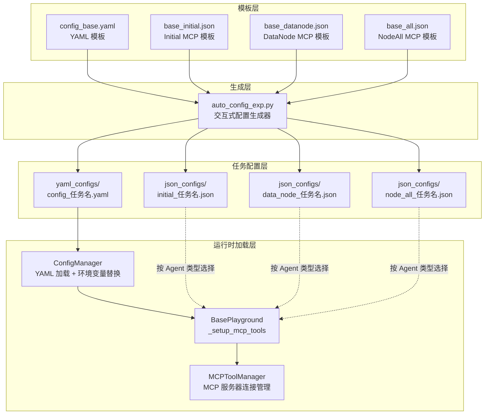
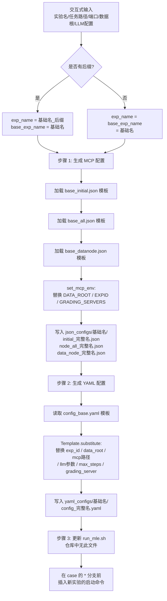
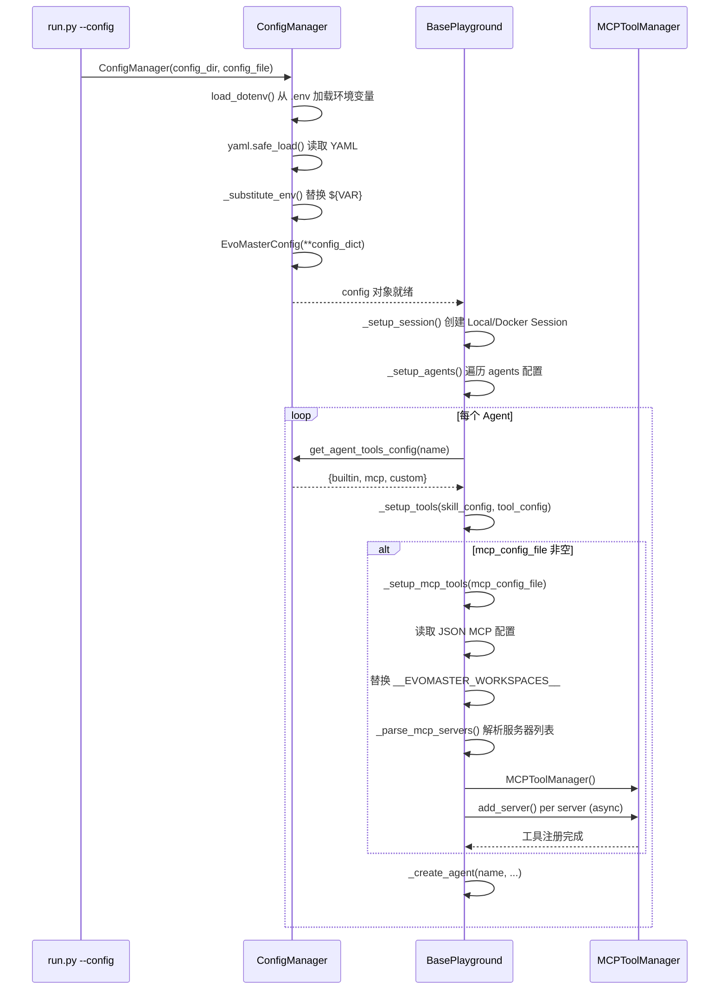

DataMaster 的配置体系是一套分层递进、模板驱动的基础设施。它将 LLM 参数、多智能体定义、工具链挂载、会话环境、评测服务器等异构配置统一收纳在 YAML 文件中，同时将 MCP（Model Context Protocol）服务器定义独立为 JSON 文件实现按需组合。面对 75 个 Kaggle 竞赛任务的差异化需求，系统通过 `auto_config_exp.py` 脚本从模板批量生成任务级 YAML + JSON 配置对，使每个实验拥有独立的端口、数据路径和工具集。本文将逐层拆解这套配置体系的架构设计、加载机制和生成流水线。

> **📖 小白导读**
> - 这篇讲什么：DataMaster 的"设置文件"是怎么组织的——一份主设置（YAML）、几份工具设置（JSON），以及一个想把"模板"批量变成"每个任务一份设置"的脚本。
> - 先知道几个概念：YAML/JSON（两种写设置的文本格式）、环境变量（操作系统里的"名字=值"，如 `LLM_API_KEY`）、模板（带空位的文本，空位待填）、MCP（让 AI 调用外部工具的一种协议）。
> - 读完能明白：设置文件从哪来、`${VAR}` 在哪一步被替换（只有 YAML 里会，JSON 里不会）、以及"为什么现在这个生成脚本跑不通"。
> - 重要提醒：本篇的"任务级配置生成"一节里，脚本与模板已对不上，请以该节的核对结果为准。

Sources: [config.py](evomaster/config.py#L1-L27), [auto_config_exp.py](scripts/auto_config_exp.py#L1-L5)

## 配置体系全局架构

整个配置体系由三大支柱构成：**YAML 主配置**（定义实验全局参数与多智能体行为）、**MCP JSON 配置**（定义外部工具服务器的启动方式与环境变量）、**任务级配置生成器**（从模板批量产出上述两种文件）。这三者通过 `ConfigManager` → `BasePlayground` → `MCPToolManager` 的调用链在运行时被组装为完整的实验执行环境。



`ConfigManager`（负责读设置文件的类）在加载 YAML 时执行两级处理：首先从 `config_dir` 向上搜索 `.env` 文件并加载环境变量，然后通过正则 `\$\{([A-Za-z0-9_]+)\}` 将 YAML 中所有 `${VAR}` 占位符递归替换为 `os.environ` 中的实际值。这一机制使得 API Key、数据路径等敏感信息可以安全地留在 `.env` 中，而 YAML 文件本身仅包含占位符引用。注意：环境变量里没有设置的变量会被静默替换成空字符串，不会报错（`os.environ.get(name, "")`，config.py:39-43）。

Sources: [config.py](evomaster/config.py#L27-L48), [config.py](evomaster/config.py#L212-L246)

## YAML 主配置结构解析

### 顶层字段一览

`EvoMasterConfig` 作为 Pydantic 模型定义了 YAML 配置的顶层结构。所有配置类继承自 `BaseConfig`，后者设置 `extra = "allow"` 和 `arbitrary_types_allowed = True`，允许 YAML 中出现未显式声明的额外字段（如 `exp_id`、`data_root`、`grading_servers`、`ablation` 等），这些字段通过 Pydantic 的 `extra` 机制被保留在模型实例上。

| 顶层字段 | 类型 | 用途 | 典型值 |
|---|---|---|---|
| `exp_id` | str | 实验标识符（竞赛名称） | `"detecting-insults-in-social-commentary"` |
| `data_root` | str | 本地数据根目录 | `"${DATA_ROOT}"` |
| `llm` | dict | 多 LLM 供应商配置 | 含 `openai`/`anthropic`/`local_sglang` |
| `agents` | dict | 多智能体定义 | `initial`/`black`/`red`/`metric` |
| `mcp` | dict | MCP 全局开关与配置文件路径 | `config_file`/`enabled` |
| `session` | dict | 会话环境配置 | `local`/`docker` |
| `logging` | LoggingConfig | 日志级别与格式 | `level: "INFO"` |
| `llm_output` | dict | LLM 输出显示控制 | `show_in_console`/`log_to_file` |
| `grading_servers` | list | 评测服务器 URL 列表 | `["http://127.0.0.1:5003"]` |
| `ablation` | dict | 消融实验开关（模板里只写了 `use_red_node`/`use_memory`；`black_mode` 是代码里读取的可选键，默认 `"agent"`） | `use_red_node`/`use_memory` |
| `max_steps` | int | 最大搜索步数 | `150` |

Sources: [config.py](evomaster/config.py#L55-L182), [config_base.yaml](configs/data_master/config_base.yaml#L1-L7)

### LLM 配置块

LLM 配置采用"命名实例 + default 指向"的模式。YAML 中可以定义多个 LLM 配置块（如 `openai`、`anthropic`、`local_sglang`），每个块包含 `provider`、`model`、`api_key`、`base_url`、`temperature`、`max_tokens`、`timeout` 等字段。`default` 字段指定默认使用的 LLM 名称。`ConfigManager.get_agent_llm_config()` 方法实现了二级查找：先检查 Agent 配置中是否指定了 `llm` 字段，若无则回退到 `default`。

```yaml
llm:
  local_sglang:
    provider: "openai"
    model: "${LLM_MODEL}"
    api_key: "${LLM_API_KEY}"
    base_url: "${LLM_BASE_URL}"
    temperature: 0.7
    max_tokens: 16384
    timeout: 300
    max_retries: 3
    retry_delay: 1.0
  default: "local_sglang"
```

在 ML-Master 的 `config.yaml` 中，配置了三个 LLM 供应商（`openai`、`anthropic`、`local_sglang`），其中 `default` 指向 `local_sglang`（provider 为 `deepseek`，模型为 `volcengine/deepseek-v3-2-251201`）。每个 Agent 可以通过 `llm: "local_sglang"` 字段独立指定其使用的 LLM 实例，实现不同 Agent 使用不同模型的灵活性。

Sources: [config.py](evomaster/config.py#L292-L360), [config.yaml](configs/ml_master/config.yaml#L12-L48), [config_base.yaml](configs/data_master/config_base.yaml#L12-L25)

### 多智能体配置块

`agents` 字段是整个配置体系中最复杂的部分。DataMaster 定义了五类 Agent：`nouse`（备用）、`initial`（初始代码生成）、`black`（数据增强与特征工程）、`red`（外部数据搜索）、`metric`（评估任务）。每个 Agent 的配置包含以下子字段：

| 子字段 | 类型 | 用途 | 示例 |
|---|---|---|---|
| `llm` | str | 引用的 LLM 配置名称 | `"local_sglang"` |
| `max_turns` | int | 最大执行轮数 | `20`（initial）/ `50`（black/red）/ `4`（metric） |
| `tools` | dict | 工具配置 | `{builtin: [...], mcp: "..."}` |
| `context` | dict | 上下文管理配置 | `max_tokens`/`truncation_strategy` |
| `system_prompt_file` | str | 系统提示词文件路径 | `"../../prompts/initial/system_prompt.md"` |
| `user_prompt_file` | str | 用户提示词文件路径 | `"../../prompts/initial/user_prompt.md"` |

`context` 子块控制 Agent 的上下文窗口管理策略，包含 `max_tokens`（上下文最大 token 数）、`truncation_strategy`（截断策略，如 `"latest_half"`）、`preserve_system_messages`（是否保留系统消息）、`preserve_recent_turns`（保留最近对话轮数）。不同 Agent 的上下文配置存在显著差异——Metric Agent 的 `max_tokens` 仅为 64000 且 `preserve_recent_turns` 为 2，而 Black/Red Agent 则拥有 128000 token 窗口和 5 轮保留。

Sources: [config_base.yaml](configs/data_master/config_base.yaml#L31-L118), [config.py](evomaster/config.py#L313-L360)

### 工具配置的多格式解析

`ConfigManager.get_agent_tools_config()` 方法是 YAML 配置解析中最具弹性的部分。它支持九种 `tools` 字段写法，最终归一化为 `{"builtin": list[str], "mcp": str, "custom": dict}` 的标准格式：

| YAML 写法 | 归一化结果 | 语义 |
|---|---|---|
| 缺省（无 `tools` 键） | `{"builtin": ["*"], "mcp": "", "custom": {}}` | 启用所有内置工具，无 MCP |
| `tools: "default"` | 同上 | 显式指定默认 |
| `tools:` (null) | `{"builtin": [], "mcp": "", "custom": {}}` | 禁用所有工具 |
| `tools: []` | 同上 | 空列表 = 禁用全部 |
| `tools: {builtin: ["*"], mcp: ["*"]}` | `{"builtin": ["*"], "mcp": "mcp_config.json", ...}` | 全部内置 + 默认 MCP |
| `tools: {builtin: ["execute_bash","finish"]}` | `{"builtin": [...], "mcp": "", ...}` | 仅指定内置工具 |
| `tools: {builtin: []}` | `{"builtin": [], "mcp": "", ...}` | 禁用内置工具 |
| `tools: {mcp: "custom.json"}` | `{"builtin": ["*"], "mcp": "custom.json", ...}` | 指定 MCP 配置文件 |
| `tools: {search: "google_search"}` | `{"builtin": ["*"], "mcp": "", "custom": {"search": "..."}}` | 自定义工具配置 |

`mcp` 字段的解析逻辑尤为关键：`"*"` 或 `["*"]` 被映射为默认的 `mcp_config.json`；字符串值直接作为配置文件路径使用；空列表禁用 MCP。在 DataMaster 的实际配置中，每个 Agent 的 `mcp` 字段指向不同的任务级 JSON 文件——`initial` Agent 使用 `initial_任务名.json`，`black`/`red` Agent 使用 `data_node_任务名.json`，`nouse` Agent 使用 `node_all_任务名.json`。

Sources: [config.py](evomaster/config.py#L362-L469), [config_base.yaml](configs/data_master/config_base.yaml#L36-L55)

### Session 配置块

Session 配置决定了实验执行的环境隔离方式，支持 `local` 和 `docker` 两种类型。`type` 字段控制选择哪种 Session。Local Session 的核心配置包括：

```yaml
session:
  type: "local"
  local:
    working_dir: "./playground/data_master/workspace"
    workspace_path: "./playground/workspace"
    timeout: 600
    gpu_devices: ["0", "1", "2", "3"]  # 4 卡并行
    cpu_devices: null
    parallel:
      enabled: true
      max_parallel: 4
      split_workspace_for_exp: false
    symlinks:
      "${DATA_ROOT}/detecting-insults-in-social-commentary/prepared/public": "input"
```

`gpu_devices` 支持三种格式：`null`（不限制）、字符串 `"2"`（单 GPU）、列表 `["0,1", "2,3"]`（多 GPU 分组，每个任务使用一组）。`parallel` 子块控制并行执行：`max_parallel` 定义最大并行数，`split_workspace_for_exp` 决定是否为每个 worker 创建独立工作目录。DataMaster 中此值为 `false`（共享工作区），而 ML-Master 中为 `true`（隔离工作区）。

Sources: [config_base.yaml](configs/data_master/config_base.yaml#L133-L166), [config.yaml](configs/ml_master/config.yaml#L143-L176)

### 消融实验配置

`config_base.yaml` 的末尾包含一个 `ablation` 配置块，这是 DataMaster 特有的组件消融开关：

```yaml
ablation:
  use_red_node: $use_red_node
  use_memory: $use_memory
```

模板里只有两个占位符（`$use_red_node`、`$use_memory`），**没有** `$black_mode`（config_base.yaml:285-286）。它们本应由 `auto_config_exp.py` 用 `string.Template.substitute()` 填成实际值，但脚本实际没有传这两个值，见下文"为什么现在生成不了"。在运行时，`DataTreePlayground.__init__()` 通过 `getattr(self.config, "ablation", {})` 读取开关，转换为实例属性：`use_red_node` 与 `use_memory` 缺省都是 `True`，`black_mode` 缺省为 `"agent"`（playground.py:79-90）。也就是说，仓库里现有的 75 份任务 yaml 没有 `ablation` 段（它们由旧版模板生成，已核对 detecting-insults 一份），不手动加的话红节点和记忆默认开启。

Sources: [config_base.yaml](configs/data_master/config_base.yaml#L281-L286), [playground.py](playground/data_master/core/playground.py#L79-L90)

## MCP JSON 配置体系

### MCP JSON 标准格式

MCP JSON 配置文件遵循 Model Context Protocol 的标准格式，顶层为 `mcpServers` 对象，每个 key 是服务器名称，value 包含 `command`、`args`、`env` 三个字段：

```json
{
  "mcpServers": {
    "search_web": {
      "command": "python",
      "args": ["playground/search_dataset_tools/search_web.py"],
      "env": {
        "SERPER_API_KEY": "${SERPER_API_KEY}"
      }
    }
  }
}
```

`command` 指定启动命令（如 `python` 或 `npx`），`args` 是命令参数列表（通常是脚本路径），`env` 定义传递给子进程的环境变量。**注意：JSON 里的 `${VAR}` 不会被展开。** `_substitute_env()` 只在 `ConfigManager.load()` 里对主 YAML 的内容调用一次（config.py:242）；MCP JSON 是 `_setup_mcp_tools()` 另外用 `json.load` 直接读的（evomaster/core/playground.py:1051-1052），之后只替换 `__EVOMASTER_WORKSPACES__`，没有任何 `${VAR}` 展开；`_parse_mcp_servers()` 也只是把 yaml 里 `grading_servers` 的地址覆盖进 `ML_MASTER_GRADING_SERVERS`（playground.py:1158-1170）。所以子进程拿到的 `ML_MASTER_DATA_ROOT` 就是字面量字符串 `${DATA_ROOT}`，`SERPER_API_KEY` 同理（仓库里没有看到子进程内再做展开的代码，是否因此导致读不到数据路径，未实际运行验证）。

Sources: [mcp_config4data.json](configs/ml_master/mcp_config4data.json#L1-L53), [config.py](evomaster/config.py#L30-L48)

### 三类 MCP 模板与服务器的工具矩阵

DataMaster 使用三个基础 JSON 模板来定义不同节点类型可用的 MCP 服务器集合。这三种模板按工具集从最小到最大递增：

| 模板文件 | 包含的 MCP 服务器 | 适用 Agent |
|---|---|---|
| `base_initial.json` | `operate_submission_for_initial` + `memory_tree` | Initial Agent |
| `base_datanode.json` | `operate_submission` + `memory_tree` + `search_web` + `search_github` + `search_huggingface` + `search_scholar` | Black/Red Agent |
| `base_all.json` | `operate_submission_for_initial` + `operate_submission` + `memory_tree` + 4 个搜索工具 | NodeAll（全部工具） |

这种分层设计的核心逻辑是：Initial Agent 只需要提交初始代码和访问 Memory Tree，不需要外部数据搜索能力；Black/Red Agent 需要完整的数据增强和搜索工具集来执行特征工程和外部数据引入；`node_all` 配置则合并了所有工具，用于需要全量工具访问的场景（如 `nouse` Agent）。

每个 MCP 服务器（独立的小程序，由主程序作为子进程启动）都携带 `ML_MASTER_DATA_ROOT`、`ML_MASTER_DATA_EXPID`、`ML_MASTER_GRADING_SERVERS` 三个环境变量，使子进程能够定位数据集、标识实验 ID 和连接评测服务器。运行时 `ML_MASTER_GRADING_SERVERS` 还会被主 yaml 的 `grading_servers` 覆盖（见上）。在模板文件中，这些值使用默认占位符（如 `detecting-insults-in-social-commentary` 和 `http://127.0.0.1:5003`），在任务级配置生成时被替换为实际值。

Sources: [base_initial.json](configs/data_master/base_initial.json#L1-L26), [base_datanode.json](configs/data_master/base_datanode.json#L1-L65), [base_all.json](configs/data_master/base_all.json#L1-L76)

### ML-Master 的 MCP 配置

ML-Master 基线使用单一的 `mcp_config4data.json` 文件，其工具集与 DataMaster 的 `base_all.json` 类似但结构更简洁。它定义了 `filesystem`（使用 `@modelcontextprotocol/server-filesystem` npm 包）、`search_web`、`search_github`、`search_huggingface`、`search_scholar` 五个 MCP 服务器。值得注意的是，`filesystem` 服务器使用了 `__EVOMASTER_WORKSPACES__` 占位符作为工作区路径，该占位符在 `_setup_mcp_tools()` 中被递归替换为实际的 `run_dir/workspaces` 路径。

ML-Master 的 `config_simple.yaml` 是一个精简配置示例，它将所有 Agent 的 `builtin` 设为空列表、`mcp.enabled` 设为 `false`，即完全禁用工具调用，仅依赖 LLM 的代码生成能力。而 `deepseek_config.yaml` 则展示了 MCTS 搜索参数的独立配置块（`mcts` 字段），包含 `steps`、`time_limit`、`num_drafts`、`exploration_constant` 等 UCT 搜索超参数。

Sources: [mcp_config4data.json](configs/ml_master/mcp_config4data.json#L1-L53), [config_simple.yaml](configs/ml_master/config_simple.yaml#L54-L135), [deepseek_config.yaml](configs/ml_master/deepseek_config.yaml#L58-L81)

### MCP 配置的运行时加载

`BasePlayground._setup_mcp_tools()` 方法是 MCP JSON 配置进入运行时的入口。当 Agent 的 `tool_config["mcp"]` 非空时，该方法被调用，执行以下步骤：

1. **路径解析**：将相对路径解析为相对于 `config_dir` 的绝对路径
2. **JSON 加载**：读取 MCP 服务器配置
3. **占位符替换**：递归将 `__EVOMASTER_WORKSPACES__` 替换为 `run_dir/workspaces` 的绝对路径
4. **服务器解析**：`_parse_mcp_servers()` 提取每个服务器的 `name`/`transport`/`command`/`args`/`env`
5. **异步初始化**：创建专用 asyncio 事件循环（运行在守护线程中），通过 `MCPToolManager.add_server()` 逐一建立连接
6. **工具注册**：`manager.register_tools(self.tools)` 将所有 MCP 工具注册到全局 ToolRegistry

`MCPToolManager` 内部为每个服务器创建一个 `MCPConnection` 实例（支持 `stdio`/`SSE`/`HTTP` 三种传输方式）。通过 `stdio` 传输时，服务器作为子进程启动，通过标准输入输出通信。工具名称采用 `{server_name}_{original_name}` 的前缀命名策略，避免不同服务器的同名工具冲突。

Sources: [playground.py](evomaster/core/playground.py#L1027-L1120), [mcp_connection.py](evomaster/agent/tools/mcp/mcp_connection.py#L95-L199), [mcp_manager.py](evomaster/agent/tools/mcp/mcp_manager.py#L84-L196)

## 任务级配置自动生成

### 一个任务的配置是怎么从模板变成可运行文件的

可以把它想成"填表"：`config_base.yaml` 是一张带空格的表（空格写作 `$exp_id`、`$mcp_initial` 等），脚本问你几个问题（实验名、端口、数据目录、LLM、步数），把答案填进去，就得到这个任务专属的 `config_任务名.yaml`；同理三份 `base_*.json` 填好后变成 3 份任务专属 JSON。理想中第三步还会往 `run_mle.sh` 里追加启动命令。

### 为什么现在生成不了

按当前仓库内容，脚本跑到第 2 步会失败，核对结果如下：

- **确定**（按 Python `string.Template` 的规则）：`substitute()` 遇到模板里有、但调用没传的占位符，会抛 `KeyError`。脚本没传 `use_red_node`、`use_memory`（auto_config_exp.py:149-159），而 config_base.yaml:285-286 有这两个占位符，所以必报错。
- **确定**：`Template` 把 `${LLM_MODEL}` 也当成自己的占位符（带花括号的写法同样被识别）。而模板第 16-18 行写的正是 `${LLM_MODEL}`、`${LLM_API_KEY}`、`${LLM_BASE_URL}`，脚本传入的键是小写的 `llm_model` 等，大小写敏感，对不上，同样会抛 `KeyError`；第 166 行注释里的 `${DATA_ROOT}` 也会被匹配。换句话说，原文表里的 `$llm_model`、`$llm_api_key`、`$llm_base_url` 在当前模板里并不存在。（以上均是对代码的静态推理，未实际运行。）
- **推断**：仓库里 75 份 yaml 里写的是 `model: "${LLM_MODEL}"`，说明它们是旧版模板（用 `$llm_model` 等占位符）生成的；之后模板改成了直接用环境变量，脚本没跟着改。
- 第 3 步要更新的 `run_mle.sh` 在仓库里**不存在**，`update_run_mle_sh()` 会在 `open(script_path)` 处抛 FileNotFoundError（它被外层 try 捕获后打印错误并返回 1）。不过因为第 2 步已先失败，实际走不到这里。

### auto_config_exp.py 三步流水线

`scripts/auto_config_exp.py` 是一个交互式配置生成工具，它从模板批量生成任务级配置文件。整个流程分为三步：生成 MCP JSON 配置 → 生成 YAML 配置 → 更新 `run_mle.sh` 启动脚本（该文件仓库中不存在，见上）。



Sources: [auto_config_exp.py](scripts/auto_config_exp.py#L424-L532)

### MCP 环境变量注入

`set_mcp_env()` 函数是任务级 MCP 配置生成的核心。它遍历 JSON 配置中所有服务器的 `env` 字典，将三个关键环境变量替换为任务实际值：

- `ML_MASTER_DATA_ROOT` ← 用户输入的数据根目录（默认 `${DATA_ROOT}`）
- `ML_MASTER_DATA_EXPID` ← 基础实验名（去除后缀的纯净竞赛名称）
- `ML_MASTER_GRADING_SERVERS` ← `http://127.0.0.1:{port}`（端口由用户指定或自动分配）

值得注意的是，`ML_MASTER_DATA_EXPID` 始终使用去除后缀的 `base_exp_name`，而非可能带后缀的完整 `exp_name`。这是因为在同一竞赛的不同配置变体（如 `dog-breed-identification_effnetb3`）中，数据集路径仍然指向原始竞赛目录 `dog-breed-identification`。而文件名则使用完整的 `exp_name` 以区分不同变体。

以 `detecting-insults-in-social-commentary` 任务为例，其生成的 `initial_detecting-insults-in-social-commentary.json` 与模板 `base_initial.json` 的唯一差异在于 `ML_MASTER_GRADING_SERVERS` 的值从模板中的 `http://127.0.0.1:5003` 变为实际端口 `http://127.0.0.1:55496`。

Sources: [auto_config_exp.py](scripts/auto_config_exp.py#L55-L122), [base_initial.json](configs/data_master/base_initial.json#L9-L12), [initial_detecting-insults-in-social-commentary.json](configs/data_master/json_configs/detecting-insults-in-social-commentary/initial_detecting-insults-in-social-commentary.json#L8-L12)

### YAML 模板的变量替换

`config_base.yaml` 模板使用 Python `string.Template` 的 `$variable` 语法，同时又保留了 `${VAR}` 写法给运行时的环境变量展开用。**两种写法会打架**：`string.Template` 也认 `${name}`，所以模板里的 `${LLM_MODEL}` 等会被脚本当成待填空位（见上文）。模板中真正出现的 `$` 占位符如下，脚本传入情况另列：

| 模板变量 | 替换来源 | 示例值 |
|---|---|---|
| `$exp_id` | `base_exp_name`（去后缀） | `"detecting-insults-in-social-commentary"` |
| `$data_root` | 用户输入 | `"${DATA_ROOT}"` |
| `$grading_server` | `http://127.0.0.1:{port}` | `"http://127.0.0.1:55496"` |
| `$mcp_initial` | 生成的 JSON 相对路径 | `"../../json_configs/.../initial_...json"` |
| `$mcp_node_all` | 生成的 JSON 相对路径 | `"../../json_configs/.../node_all_...json"` |
| `$mcp_data_node` | 生成的 JSON 相对路径 | `"../../json_configs/.../data_node_...json"` |
| `$max_steps` | 用户输入 | `150` |
| `$use_red_node` | 脚本**没有**传入 | 缺失，抛 KeyError |
| `$use_memory` | 脚本**没有**传入 | 缺失，抛 KeyError |

另外脚本还会传 `llm_model`、`llm_api_key`、`llm_base_url` 三个键（默认值分别是 `Vendor2/GPT-5.3-codex`、`${LLM_API_KEY}`、`${LLM_BASE_URL}`），但当前模板里没有对应的 `$llm_*` 空位，这三个值被白白传入；模板里 LLM 设置写的是 `${LLM_MODEL}` 等环境变量写法。

替换后的 YAML 文件中，`agents.initial.tools.mcp` 字段指向 `../../json_configs/detecting-insults-in-social-commentary/initial_detecting-insults-in-social-commentary.json`——这是相对于 `yaml_configs/detecting-insults-in-social-commentary/` 目录的路径，向上两级到达 `configs/data_master/`，再进入 `json_configs/` 子目录。

Sources: [config_base.yaml](configs/data_master/config_base.yaml#L1-L8), [auto_config_exp.py](scripts/auto_config_exp.py#L125-L168), [config_detecting-insults-in-social-commentary.yaml](configs/data_master/yaml_configs/detecting-insults-in-social-commentary/config_detecting-insults-in-social-commentary.yaml#L55-L56)

### 端口分配与并发安全

`auto_config_exp.py` 实现了端口可用性检查机制：`check_port_available()` 通过 `socket.connect_ex()` 探测端口占用，`get_available_port()` 从 `5003` 起递增搜索可用端口。这一设计确保了在多实验并行运行时，每个实验的 Grading Server 使用独立端口，避免冲突。

在生成的任务级 JSON 配置中，`ML_MASTER_GRADING_SERVERS` 被写入每个 MCP 服务器的 `env` 字段。运行时，`DataTreePlayground._ensure_grading_server_ready()` 会从 `config.grading_servers` 读取唯一的 URL，通过健康检查端点 `/health` 验证服务器状态，并在必要时通过 `_start_grading_server_process()` 尝试在同端口重启服务器（但该函数里的 runner 脚本路径写错，实际会抛错，详见第 24 篇）。

Sources: [auto_config_exp.py](scripts/auto_config_exp.py#L234-L251), [playground.py](playground/data_master/core/playground.py#L143-L277)

### 实验后缀与变体管理

`auto_config_exp.py` 支持实验名称后缀机制，用于区分同一竞赛的不同配置变体。例如 `dog-breed-identification` 竞赛可以生成 `dog-breed-identification`（默认）、`dog-breed-identification_effnetb3`（EfficientNet-B3 配置）、`dog-breed-identification_resnet50_basics`（ResNet-50 基础配置）三个变体。

后缀处理的核心规则是：文件名使用完整的 `exp_name`（含后缀），但目录路径和 `ML_MASTER_DATA_EXPID` 使用 `base_exp_name`（不含后缀）。这确保了同一竞赛的所有变体配置文件存储在同一 `json_configs/` 子目录下，同时数据集路径仍指向原始竞赛目录。在 `json_configs/dog-breed-identification/` 目录下，可以看到六个文件（三个变体 × 三种 MCP 类型），清晰展示了这一组织策略。

Sources: [auto_config_exp.py](scripts/auto_config_exp.py#L69-L122), [json_configs directory](configs/data_master/json_configs/dog-breed-identification)

## 配置加载的运行时流程

### 从 CLI 到配置就绪的完整链路

`run.py` 作为系统入口，通过 `--config` 参数指定 YAML 配置文件路径。当未提供时，默认使用 `configs/{agent}/config.yaml`。配置路径传入 `get_playground_class()`，后者通过 `ConfigManager` 加载 YAML 并构造 `EvoMasterConfig` 对象。



Sources: [run.py](run.py#L439-L463), [playground.py](evomaster/core/playground.py#L741-L763), [playground.py](evomaster/core/playground.py#L527-L591)

### ConfigManager 的点路径查询

`ConfigManager.get()` 方法支持点分隔的嵌套键查询，如 `"agent.max_turns"`。它通过 `config.model_dump()` 将 Pydantic 模型转为字典，然后逐级 `dict.get()` 导航。这一设计使得在代码中可以灵活地获取任意层级的配置值，而无需定义专门的 getter 方法。

全局单例模式通过 `get_config_manager()` 实现：首次调用时创建 `ConfigManager` 实例，后续调用返回同一实例。`load_config()` 和 `get_config()` 作为快捷函数封装了这一模式。

Sources: [config.py](evomaster/config.py#L266-L290), [config.py](evomaster/config.py#L563-L603)

## 辅助配置文件

### prefetch_models.json

`prefetch_models.json` 是一个特殊的辅助配置文件，记录了所有 `initial_code` 模板中引用的预训练模型标识符。它由 `scripts/prefetch_models.py` 从 `playground/data_master/initial_code/**/initial_code.py` 自动扫描生成，分为三类：`timm_models`（如 `efficientnet_b0`、`convnext_base`）、`torchvision_models`（如 `resnet50`、`fasterrcnn_resnet50_fpn`）、`transformers_models`（如 `microsoft/deberta-v3-base`、`t5-small`）。该文件用于在实验开始前预下载模型权重到 HF 缓存或 torchvision 缓存，避免在实验过程中因下载中断导致失败。

Sources: [prefetch_models.json](configs/data_master/prefetch_models.json#L1-L33)

## 配置体系对比：DataMaster vs ML-Master

| 维度 | DataMaster | ML-Master |
|---|---|---|
| YAML 模板 | `config_base.yaml`（含 `$var` 占位符） | 无模板，直接使用 `config.yaml` |
| MCP JSON 模板 | 3 个（`base_initial`/`base_datanode`/`base_all`） | 1 个（`mcp_config4data.json`） |
| 任务级配置 | 75 个任务各自独立的 YAML + 3 个 JSON（已生成好的存档，75 为 yaml_configs 下的目录数） | 单一 `config.yaml` |
| 配置生成 | `auto_config_exp.py` 交互式生成（当前与模板不匹配，会报错） | 手动编辑 |
| Agent 类型 | `initial`/`black`/`red`/`metric` | `draft`/`debug`/`improve`/`metric`（simple） |
| Agent 间 MCP 差异 | 每个 Agent 使用不同的 JSON 文件 | 所有 Agent 共用同一 JSON |
| 消融配置 | `ablation` 块（模板含 `use_red_node`/`use_memory`，代码另读可选的 `black_mode`；现有 75 份任务 yaml 无此段） | 无 |
| Grading Server | 内嵌或独立进程，端口动态分配 | 外部配置 `grading_servers` 列表 |
| 搜索算法参数 | `max_steps` 在 YAML 顶层 | `mcts` 块含 UCT 参数（`deepseek_config.yaml`） |

DataMaster 的配置体系显著更复杂，因为需要支持 75 个竞赛任务的批量配置、节点类型差异化工具集、以及消融实验开关。ML-Master 作为基线系统，配置更简洁直接。

Sources: [config_base.yaml](configs/data_master/config_base.yaml#L1-L286), [config.yaml](configs/ml_master/config.yaml#L1-L284), [config_simple.yaml](configs/ml_master/config_simple.yaml#L1-L281), [deepseek_config.yaml](configs/ml_master/deepseek_config.yaml#L1-L148)

## 延伸阅读

- 配置文件中 `system_prompt_file` 和 `user_prompt_file` 的路径解析与模板组装机制，详见 [Prompt 模板工程：Initial 四种模式与节点级提示词组装](23-prompt-mo-ban-gong-cheng-initial-si-chong-mo-shi-yu-jie-dian-ji-ti-shi-ci-zu-zhuang)
- `grading_servers` 配置如何驱动 Grading Server 的启动与健康检查，详见 [Grading Server：评测服务器部署、健康检查与 API 接口](24-grading-server-ping-ce-fu-wu-qi-bu-shu-jian-kang-jian-cha-yu-api-jie-kou)
- `auto_config_exp.py` 的使用说明（注意 `run_mle.sh` 在仓库中不存在），详见 [运维脚本指南：配置生成、初始代码构建与端口诊断](26-yun-wei-jiao-ben-zhi-nan-pei-zhi-sheng-cheng-chu-shi-dai-ma-gou-jian-yu-duan-kou-zhen-duan)
- `ablation` 配置块如何影响 UCT 搜索树的结构，详见 [组件消融实验：use_red_node / use_memory / black_mode 开关](29-zu-jian-xiao-rong-shi-yan-use_red_node-use_memory-black_mode-kai-guan)
