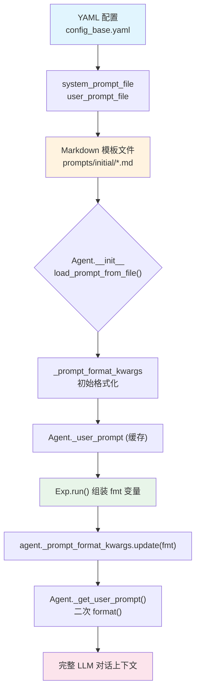

DataMaster 的提示词系统是一个**多层模板拼装架构**——从 YAML 配置中声明的 prompt 文件路径，到运行时动态注入的 `_prompt_format_kwargs`，再到 Initial 节点独有的四种模式分支选择，形成了一条从静态 Markdown 文件到完整 LLM 对话上下文的精密流水线。本文将深入剖析这条流水线的每一个环节，特别是 Initial 节点的四种模式如何根据用户输入自动路由到不同的提示词模板，以及三类节点（Initial / Black / Red）在提示词组装策略上的本质差异。

> **📖 小白导读**
> - 这篇讲什么：给 AI（LLM，大语言模型）的"任务说明书"（prompt，提示词）是怎么从一堆 Markdown 文件拼成最终发出去的那段文字。
> - 先知道几个概念：prompt（给模型的文字指令）、模板（带 `{名字}` 空位的文本）、占位符（那个空位）、Python 的 `str.format()`（把 `{名字}` 换成真实内容的方法）。
> - 读完能明白：一个节点的提示词有哪几块、Initial 节点四种模式怎么选、缺了变量会发生什么（不会报错，而是悄悄保留原样）。
> - 小提示：Initial/Black/Red 是三种"搜索节点"（分别负责写第一版代码、做数据清洗/增强、搜外部数据），详见第 8 篇。

## 整体架构：从配置到对话的提示词流水线

DataMaster 的提示词系统遵循一个清晰的分层设计：**配置层（YAML）→ 文件层（Markdown 模板）→ 运行时组装层（Python 字符串替换）→ Agent 注入层（`_prompt_format_kwargs`）**。每一层各司其职，通过 `{placeholder}` 占位符实现解耦。



理解这张图的关键在于：Agent 在初始化时会调用 `load_prompt_from_file()` 读入模板（[agent.py#L1186-L1198](evomaster/agent/agent.py#L1186-L1198)），并只在 `format_kwargs` 非空时才做第一次 `str.format()`。**DataMaster 的 yaml 没有 `prompt_format_kwargs`，传进来的是空字典 `{}`（Python 里空字典等于"假"），所以这一次格式化实际被整个跳过**，模板原样缓存。（原文说这里"缺 key 只记录警告并保留原样"不准确：该函数遇到 `KeyError` 是先打警告再 `raise`，并不会保留原样；只是 DataMaster 走不到这个分支。）运行时变量（如 `task_description`、`data_preview`、`node_id`）此时也都尚未就绪。因此，Exp 类在 `run()` 方法中会通过 `agent._prompt_format_kwargs.update(fmt)` 二次注入这些变量，然后 Agent 的 `_get_user_prompt()` 方法在每次对话初始化时再次执行 `format()` 完成最终替换（[agent.py#L1230-L1244](evomaster/agent/agent.py#L1230-L1244)）。

Sources: [config_base.yaml](configs/data_master/config_base.yaml#L46-L65), [agent.py](evomaster/agent/agent.py#L1146-L1198)

## 配置层：YAML 中的 Prompt 声明

在 `config_base.yaml` 中，每个 Agent 的提示词通过两个字段声明：

```yaml
agents:
  initial:
    system_prompt_file: "../../prompts/initial/system_prompt.md"
    user_prompt_file: "../../prompts/initial/user_prompt.md"
```

路径的解析方式有点绕：`_create_agent()` 把配置所在目录 `config_dir`（即 yaml 文件所在目录，如 `configs/data_master/yaml_configs/<任务名>/`）路径字符串里的 `configs` 替换成 `playground`，再拼上相对路径 `../../prompts/...`，所以最终落在 `playground/data_master/prompts/...`（[playground.py#L889-L904](evomaster/core/playground.py#L889-L904)）。这依赖 yaml 恰好放在两层目录深处，且路径里恰好含 `configs`（推断）。解析出的绝对路径传给 `Agent` 构造函数。同时，YAML 中还可以声明 `prompt_format_kwargs` 字段，用于在 Agent 初始化时注入静态变量（如固定的 workspace 路径），但 DataMaster 的实际配置中并未使用此字段——所有运行时变量都由 Exp 类动态注入。

各类节点的配置对比：

| Agent | system_prompt_file | user_prompt_file | max_turns | MCP 工具集 |
|-------|-------------------|-----------------|-----------|-----------|
| initial | `initial/system_prompt.md` | `initial/user_prompt.md` | 20 | `$mcp_initial` |
| black | `black/system_prompt.md` | `black/user_prompt.md` | 50 | `$mcp_data_node` |
| red | `red/system_prompt.md` | `red/user_prompt.md` | 50 | `$mcp_data_node` |
| metric | `metric/system_prompt.md` | `metric/user_prompt.md` | 4 | 无 |
| rule_black | `rule_based_black/system_prompt.md` | `rule_based_black/user_prompt.md` | — | — |

注意最后一行：`config_base.yaml` 里**没有** rule_black 这个 agent，`RuleBlackExp` 也不调用 LLM、不读任何 prompt（rule_black_exp.py 文件头注释写明"Does NOT read or use Black prompts"），所以 `rule_based_black/` 下这两个 prompt 文件在代码里从未被加载，是闲置文件。另外 yaml 里还有一个 `nouse` agent，它的 prompt 与 initial 相同（config_base.yaml:31-47）。

Initial 节点的 `max_turns` 仅为 20，远低于 Black/Red 的 50，这反映了其"快速生成第一版可提交代码"的定位——不需要反复迭代优化，而是尽快产出一个可运行的 baseline。

Sources: [config_base.yaml](configs/data_master/config_base.yaml#L46-L118)

## 文件层：Markdown 模板的占位符设计

### System Prompt：角色设定

Initial 节点的 system prompt 极其简短，仅定义角色身份：

```markdown
You are participating in *MLE-bench*, an offline version of Kaggle competitions...
You are a Kaggle grandmaster attending a competition. In order to win this competition,
you need to come up with an excellent and creative plan for a solution and then implement
this solution in Python.
```

相比之下，Black 节点的 system prompt 明确限定了"数据清洗专家"的角色边界（[black/system_prompt.md](playground/data_master/prompts/black/system_prompt.md#L3-L7)），Red 节点则声明了"外部数据搜索专家"的职责（[red/system_prompt.md](playground/data_master/prompts/red/system_prompt.md#L3-L13)）。而 `rule_based_black` 的 system prompt 声明自己是"pass-through 节点"，禁止任何修改行为（[rule_based_black/system_prompt.md](playground/data_master/prompts/rule_based_black/system_prompt.md#L3-L29)），这是为消融实验写的，但实际从未被加载（见上表说明）。

### User Prompt：结构化模板与占位符

Initial 的 user prompt 是一个**结构化骨架**，通过 `{placeholder}` 占位符预留了多个注入点：

```markdown
# Initial Node: First Valid Submission Builder

{mode_specific_content}

## Competition Task
{task_description}

## Required Code Format
### DataLoader Usage README
{data_loader_readme}

## Data preview
{data_preview}

## Tools Manual
### Operation Tools
{operation_tools_readme}

### Memory Tools
{memory_tree_manual}
```

注意 `{mode_specific_content}` 这个占位符——它是 Initial 节点独有的**模式分支注入点**，也是四种模式差异化的核心所在。Black 和 Red 节点的 user prompt 没有这个占位符，取而代之的是 `{previous_code}`、`{best_code}`、`{best_metric}`、`{memory}` 等反映搜索树状态的变量。

Sources: [initial/user_prompt.md](playground/data_master/prompts/initial/user_prompt.md#L1-L60), [black/user_prompt.md](playground/data_master/prompts/black/user_prompt.md#L1-L60), [red/user_prompt.md](playground/data_master/prompts/red/user_prompt.md#L1-L60)

## Initial 四种模式：条件路由与模板选择

### 模式判定逻辑

`_assemble_mode_specific_prompt()` 函数是 Initial 节点提示词系统的核心。它根据 `initial_code` 和 `initial_instruction` 两个可选参数的组合，选择四个不同的 Markdown 模板文件之一：

```python
has_code = bool(initial_code)
has_instruction = bool(initial_instruction)

if has_code and has_instruction:
    # 模式1: 两者都有
    template_file = Path(".../mode_code_and_instruction.md")
elif has_code:
    # 模式2: 只有代码
    template_file = Path(".../mode_code_only.md")
elif has_instruction:
    # 模式3: 只有指令
    template_file = Path(".../mode_instruction_only.md")
else:
    # 模式4: 都没有（自由模式）
    template_file = Path(".../mode_free.md")
```

注意模板路径是相对于**当前工作目录**写的（`Path("playground/data_master/prompts/initial/...")`），所以必须在仓库根目录运行；文件不存在时只打日志然后 `exit(0)`（正常退出码，不是报错）。选定模板后，函数用 `str.replace`（不是 `format`）将 `{initial_code_content}` 和 `{initial_instruction}` 两个占位符替换为实际值（或空字符串），返回组装后的文本。这段文本随后被赋值给 `fmt["mode_specific_content"]`，在 user prompt 的 `{mode_specific_content}` 位置被注入。

### 四种模式对比

| 模式 | 触发条件 | 模板文件 | Agent 行为约束 | 适用场景 |
|------|---------|---------|--------------|---------|
| **Code + Instruction** | `initial_code` 非空 且 `initial_instruction` 非空 | `mode_code_and_instruction.md` | 以参考代码为起点，按指令增强 | 有成熟代码 + 特定优化方向 |
| **Code Only** | 仅 `initial_code` 非空 | `mode_code_only.md` | 忠实重构，禁止优化/改算法 | 有成熟代码，需适配系统格式 |
| **Instruction Only** | 仅 `initial_instruction` 非空 | `mode_instruction_only.md` | 按指令选择算法，自由实现 | 有领域知识但无参考代码 |
| **Free** | 两者均为空 | `mode_free.md` | 从零分析，自由探索 | 完全自主的探索模式 |

### 四种模式的提示词内容差异

**Code + Instruction 模式**（[mode_code_and_instruction.md](playground/data_master/prompts/initial/mode_code_and_instruction.md#L1-L31)）向 Agent 同时提供参考代码和增强指令，要求"以参考代码为起点，按指令增强"：

```markdown
## Reference Code
The following reference code has already been verified to be effective:
{initial_code_content}

## Instructions
{initial_instruction}

You SHOULD:
- use the reference code as a starting point
- carefully follow the provided instructions to enhance it
```

**Code Only 模式**（[mode_code_only.md](playground/data_master/prompts/initial/mode_code_only.md#L1-L27)）的约束最为严格——明确要求"忠实重构（faithful refactoring）"：

```markdown
This node is for faithful refactoring only.
You MUST:
- preserve the original algorithm
- preserve the original preprocessing behavior
You MUST NOT:
- optimize the model
- add new data
- redesign the pipeline
```

**Instruction Only 模式**（[mode_instruction_only.md](playground/data_master/prompts/initial/mode_instruction_only.md#L1-L16)）移除了代码约束，仅提供自然语言指引：

```markdown
You SHOULD:
- carefully follow the provided instructions
- choose appropriate algorithms and techniques based on the instructions
```

**Free 模式**（[mode_free.md](playground/data_master/prompts/initial/mode_free.md#L1-L12)）赋予最大自由度，但添加了一条前瞻性约束——提醒后续阶段不可修改算法，因此初始选择需考虑"数据可扩展性"：

```markdown
* Note: In subsequent stages, you are **not allowed** to modify or optimize the algorithm.
You can only perform data augmentation and optimization. Therefore, please choose a
data-scalable algorithm with reasonable complexity and good performance.
```

这条注释体现了 DataTree 搜索架构的设计哲学：Initial 节点确立的算法骨架在整个搜索过程中保持不变，后续 Black/Red 节点只能在数据层面做增量改进。

Sources: [initial_exp.py](playground/data_master/core/exp/initial_exp.py#L21-L67), [mode_code_and_instruction.md](playground/data_master/prompts/initial/mode_code_and_instruction.md#L1-L31), [mode_code_only.md](playground/data_master/prompts/initial/mode_code_only.md#L1-L27), [mode_instruction_only.md](playground/data_master/prompts/initial/mode_instruction_only.md#L1-L16), [mode_free.md](playground/data_master/prompts/initial/mode_free.md#L1-L12)

## 运行时组装：`InitialExp.run()` 的完整变量注入

`InitialExp.run()` 方法在调用 Agent 之前，会从多个来源读取工具说明文档（路径同样相对工作目录），组装出一个包含 8 个键的 `fmt` 字典（正好覆盖 initial/user_prompt.md 里用到的全部占位符：`workspace`、`node_id`、`mode_specific_content`、`task_description`、`data_loader_readme`、`data_preview`、`operation_tools_readme`、`memory_tree_manual`，已逐个核对）：

```python
fmt = {
    "mode_specific_content": mode_specific_content,   # 四种模式之一
    "task_description": task_description,             # 竞赛任务描述
    "data_preview": self.data_preview,                # 数据预览统计
    "data_loader_readme": data_loader_usage,          # DataLoader 架构说明
    "node_id": node_id,                               # UCT 节点 ID
    "workspace": str(self.workspace),                 # 工作空间路径
    "operation_tools_readme": tools_manual_readme,    # 操作工具手册
    "memory_tree_manual": memory_tree_manual,         # 记忆树工具手册
}
```

这 8 个变量分别来自三个来源：

1. **文件读取**（3 个）：`dataloader_en.md`（DataLoader 架构说明）、`for_initial_exp_en.md`（Initial 专用操作工具手册）、`memory.md`（记忆树工具说明）
2. **运行时参数**（3 个）：`task_description`（竞赛描述）、`data_preview`（数据预览）、`node_id` / `workspace`（节点标识与工作空间）
3. **模式组装**（1 个）：`mode_specific_content`（四种模式的条件输出）

注入采用**备份-更新-恢复**模式，确保 Agent 实例在并行 worker 间复用时不会产生变量污染：

```python
orig_fmt = self.agent._prompt_format_kwargs.copy()
self.agent._prompt_format_kwargs.update(fmt)
try:
    traj = self.agent.run(task, ...)
finally:
    self.agent._prompt_format_kwargs = orig_fmt
```

这一模式在 Black 和 Red 的 Exp 类中完全一致（[black_exp.py#L154-L168](playground/data_master/core/exp/black_exp.py#L154-L168)），是整个 DataMaster 提示词注入的标准范式。

Black 的 `fmt` 有 13 个键，Red 另有 `search_tools_manual` 共 14 个，覆盖了各自 user_prompt.md 里全部占位符（已逐个核对）。Red 的 user prompt 里没有 `{task_description}`，但 `fmt` 仍会传这个键，多传不会出错。**一个小坑**：`red_exp.py:111` 写了 `search_tool_manual.format(workspace=...)` 但没有接收返回值（字符串不可变），所以 `search.md` 里的 `{workspace}` 不会被替换，最终 prompt 里是字面量 `{workspace}`。同样，所有被当作"值"注入的文档（`memory.md`、`for_*_en.md`、`search.md` 等）里出现的 `{node_id}`、`{workspace}` 都**不会**再被二次替换——`str.format()` 只替换模板本身的占位符，不会递归处理替换进去的文本。

Sources: [initial_exp.py](playground/data_master/core/exp/initial_exp.py#L103-L173), [black_exp.py](playground/data_master/core/exp/black_exp.py#L135-L168)

## 三类节点的提示词组装差异

虽然三类节点都使用相同的 `_prompt_format_kwargs` 注入机制，但其 `fmt` 字典的内容存在本质差异，反映了各自在搜索树中的不同职责：

| 维度 | Initial | Black | Red |
|------|---------|-------|-----|
| **工具手册** | `for_initial_exp_en.md` | `for_datanode_en.md` | `for_datanode_en.md` + `search.md` |
| **代码权限** | template + dataloader 均可写 | 仅 dataloader 可写 | 仅 dataloader 可写 |
| **上下文代码** | 无（从零开始） | `{previous_code}` + `{best_code}` + `{parent_dataloader}` | `{previous_code}` + `{best_code}` + `{parent_dataloader}` |
| **记忆注入** | `{memory_tree_manual}` | `{memory_tree_manual}` + `{memory}` | `{memory_tree_manual}` + `{memory}` |
| **模式分支** | `{mode_specific_content}`（四种模式） | 无 | 无 |
| **搜索工具** | 无 | 无 | `{search_tools_manual}` |

工具手册的差异最为关键。Initial 节点使用 `for_initial_exp_en.md`，其中提供了 `write_code`、`fix_code`、`run_code` 等工具的使用说明，且明确指出"两个文件都可以修改"（[for_initial_exp_en.md](playground/data_master/prompts/tools/operate/for_initial_exp_en.md#L25-L29)）。而 Black/Red 节点使用 `for_datanode_en.md`，其中强调"模板文件继承自父节点，只读不可修改"（[for_datanode_en.md](playground/data_master/prompts/tools/operate/for_datanode_en.md#L10-L12)）。这种工具权限的收敛正是 DataTree 架构"算法冻结、数据演化"原则在提示词层面的体现。

Sources: [initial_exp.py](playground/data_master/core/exp/initial_exp.py#L118-L154), [black_exp.py](playground/data_master/core/exp/black_exp.py#L105-L149), [red/user_prompt.md](playground/data_master/prompts/red/user_prompt.md#L1-L156), [for_initial_exp_en.md](playground/data_master/prompts/tools/operate/for_initial_exp_en.md#L1-L50), [for_datanode_en.md](playground/data_master/prompts/tools/operate/for_datanode_en.md#L1-L50)

## 工具说明文档的模块化设计

DataMaster 将工具说明拆分为独立的 Markdown 文件，通过运行时读取注入到 user prompt 中。这种设计实现了**工具文档与节点模板的解耦**——同一份 `memory.md` 可以被三类节点共用，而无需在各自的 user prompt 中重复编写。

提示词工具文档的目录结构：

```
prompts/tools/
├── dataloader_en.md          # DataLoader 架构规范（BaseDataLoader 接口）
├── memory.md                 # 记忆树工具说明（manifest.md 格式 + API）
├── search.md                 # 搜索工具说明（HuggingFace/GitHub/Web/Scholar）
├── search_zh.md              # 搜索工具中文版
├── dataloader.md             # DataLoader 中文版
├── memory_zh.md              # 记忆树中文版
└── operate/
    ├── for_initial_exp_en.md # Initial 专用操作工具（template + dataloader 可写）
    ├── for_datanode_en.md    # Black/Red 通用操作工具（仅 dataloader 可写）
    ├── for_initial_exp.md    # 中文版
    └── for_datanode.md       # 中文版
```

`dataloader_en.md` 是所有节点共享的核心文档，定义了 `BaseDataLoader` 抽象类的完整接口、`MyDataLoader` 子类的编写规范，以及关键的**固定验证集约束**——禁止使用 `train_test_split` 随机分割，必须使用 `input/val.csv` 作为统一验证集（[dataloader_en.md#L111-L147](playground/data_master/prompts/tools/dataloader_en.md#L111-L147)）。这条约束确保了搜索树中所有节点的指标可比较性。

Sources: [dataloader_en.md](playground/data_master/prompts/tools/dataloader_en.md#L1-L147), [memory.md](playground/data_master/prompts/tools/memory.md#L1-L153), [search.md](playground/data_master/prompts/tools/search.md#L1-L126)

## 入口层：从命令行到模式选择

用户通过 `run.py` 的 `--initial-code` 和 `--initial-instruction` 两个命令行参数控制 Initial 节点的模式选择：

```bash
# Free 模式（默认）
python run.py --agent data_master --task "competition description"

# Code Only 模式
python run.py --agent data_master --task "..." --initial-code path/to/solution.py

# Instruction Only 模式
python run.py --agent data_master --task "..." --initial-instruction "Use LightGBM with 5-fold CV"

# Code + Instruction 模式
python run.py --agent data_master --task "..." --initial-code solution.py --initial-instruction "Add data augmentation"
```

`run.py` 在 `main()` 函数中读取 `--initial-code` 指定的文件内容（[run.py#L490-L501](run.py#L490-L501)），将其作为字符串传递给 `playground.set_initial_config()`（[run.py#L261-L262](run.py#L261-L262)），后者存储到 `self.initial_code` 和 `self.initial_instruction` 属性中（[playground.py#L92-L101](playground/data_master/core/playground.py#L92-L101)）。当 `_run_one_node()` 创建 `InitialExp` 实例时，这两个值被传入构造函数（[playground.py#L526-L540](playground/data_master/core/playground.py#L526-L540)），最终在 `_assemble_mode_specific_prompt()` 中决定模式分支。

另外要注意：`--initial-code` 的参数是**文件路径**（`run.py` 会读出文件内容），而 `--initial-instruction` 的参数直接就是指令**文本**本身。

此外，项目还维护了一个 `initial_code.json` 文件（[initial_code.json](playground/data_master/initial_code.json#L1-L50)），是一个 75 个键的字典（竞赛名 → 初始代码字符串）。我在仓库的 .py/.sh/.md 里没有搜到任何地方引用它，所以原文说的"可通过自动化脚本批量注入"没有代码依据（未验证有无外部脚本使用）。

Sources: [run.py](run.py#L486-L508), [playground.py](playground/data_master/core/playground.py#L92-L101), [initial_code.json](playground/data_master/initial_code.json#L1-L50)

## Agent 层：双重 format 与 KeyError 容错

`Agent` 类（继承自 `BaseAgent`）的提示词加载机制包含一个精巧的**双重 format 设计**。在 `__init__` 中，Agent 用初始的 `_prompt_format_kwargs` 对模板文件做第一次 `format()`（[agent.py#L1186-L1198](evomaster/agent/agent.py#L1186-L1198)），不过如上所述，DataMaster 里传入的是空字典，这次 format 实际被跳过（若真传了不完整的字典，`load_prompt_from_file` 会 raise，最终变成 RuntimeError，而不是保留原样）。真正起作用的是 `_get_user_prompt()`：它对缓存的模板执行 `format()`，并传入完整的 `_prompt_format_kwargs`（此时已被 Exp 更新，另外还自动带上 `task_id`、`task_type`、`description`、`input_data` 四个键）：

```python
def _get_user_prompt(self, task: TaskInstance) -> str:
    if self._user_prompt:
        try:
            return self._user_prompt.format(
                task_id=task.task_id,
                task_type=task.task_type,
                description=task.description,
                input_data=task.input_data,
                **self._prompt_format_kwargs
            )
        except KeyError:
            return self._user_prompt
```

这里有一个关键的容错设计：如果 `format()` 抛出 `KeyError`，则直接返回未格式化的原始内容（[agent.py#L1242-L1244](evomaster/agent/agent.py#L1242-L1244)）。这意味着即使模板中有未被注入的占位符，Agent 也不会崩溃——但**整份** user prompt 都会放弃替换，所有占位符（包括本来已提供的）都原样出现在 prompt 中，LLM 会看到一堆 `{task_description}` 之类的文本，而且这个 KeyError 被悄悄吞掉，没有日志。这是静默失败，写新模板时要特别小心。（只捕获 `KeyError`；模板里若有 `{}` 之类位置占位或不合法的花括号，抛的是别的异常，不会被这里捕获。）

但由于 `str.format()` 对花括号 `{}` 敏感，模板中如果包含 JSON 示例或其他使用花括号的内容，需要使用 `{{}}` 转义。DataMaster 的模板文件通过将 JSON 示例放在代码块中并使用纯文本描述来规避这一问题。

Sources: [agent.py](evomaster/agent/agent.py#L1139-L1255)

## Metric Agent 的提示词设计

Metric Agent（负责读代码运行输出、抽出评分的小助手）虽然不属于三类搜索节点，但其提示词设计值得一提。其 system prompt 极其简洁——仅一句 "You are a helpful assistant."（28 字节、没有结尾换行，所以 `wc -l` 会显示 0 行，但文件**不是**空的）（[metric/system_prompt.md](playground/data_master/prompts/metric/system_prompt.md#L1-L1)），而 user prompt 则通过 `{code}` 和 `{stdout}` 两个占位符接收代码执行结果（由 exp/__init__.py:87 注入），要求 Agent 解析出 `metric`、`is_bug`、`has_submission` 等结构化字段（[metric/user_prompt.md](playground/data_master/prompts/metric/user_prompt.md#L1-L34)）。

在 test-feedback 模式下，系统会创建一个独立的 `test_metric_agent`，使用 `metric_test/` 目录下的提示词模板，其 user prompt 包含 `{grade_output}`、`{direction}`、`{lower_is_better}` 三个占位符，用于解析 grading server 的测试集评分输出（[metric_test/user_prompt.md](playground/data_master/prompts/metric_test/user_prompt.md#L1-L31)）。这个 Agent 的 `enable_tools=False`，`max_turns=1`，是一个纯文本解析器。但要注意：创建它时 prompt 路径写的是字面量 `"${PROJECT_ROOT}/playground/..."`（playground.py:132-133），这里没有任何环境变量展开，也没传 `config_dir`；该字符串不是绝对路径，`load_prompt_from_file` 会因 `config_dir` 为空而抛 ValueError（被外层包成 RuntimeError 之前的原始错误），所以 `--test-feedback` 模式在这一步会失败。

Sources: [metric/system_prompt.md](playground/data_master/prompts/metric/system_prompt.md#L1-L1), [metric/user_prompt.md](playground/data_master/prompts/metric/user_prompt.md#L1-L34), [metric_test/user_prompt.md](playground/data_master/prompts/metric_test/user_prompt.md#L1-L31), [playground.py](playground/data_master/core/playground.py#L116-L141)

## 设计原则总结

DataMaster 的提示词工程体现了以下核心设计原则：

1. **模板与逻辑分离**：所有自然语言提示词存储为独立 Markdown 文件，Python 代码仅负责选择和注入，不包含硬编码的提示词文本
2. **模式分支的声明式设计**：四种模式通过文件存在性判定，每种模式的约束直接写在对应的 Markdown 中，而非用条件分支在代码中拼接
3. **权限收敛**：从 Initial（template + dataloader 可写）到 Black/Red（仅 dataloader 可写），工具手册的差异在提示词层面强制执行了"算法冻结"原则
4. **备份-更新-恢复**：所有 Exp 类在更新 `_prompt_format_kwargs` 前备份原始值，确保 Agent 实例在并行 worker 间安全复用
5. **前瞻性约束**：Free 模式中的"data-scalable algorithm"提示，将后续搜索阶段的约束前置到 Initial 节点的决策中

要深入理解 DataTree 搜索流程中三类节点的完整协作机制，建议继续阅读 [三类节点实验：Initial、Black 与 Red 的职责划分](8-san-lei-jie-dian-shi-yan-initial-black-yu-red-de-zhi-ze-hua-fen) 和 [DataTree 搜索流程全解析：从初始化到并行搜索](7-datatree-sou-suo-liu-cheng-quan-jie-xi-cong-chu-shi-hua-dao-bing-xing-sou-suo)。如需了解 Agent 类的对话管理与上下文截断策略，请参阅 [Agent 基类：对话管理、轨迹记录与上下文截断策略](19-agent-ji-lei-dui-hua-guan-li-gui-ji-ji-lu-yu-shang-xia-wen-jie-duan-ce-lue)。

## 本文修订记录

- 补充小白导读，解释 prompt、占位符、`str.format()` 等术语。
- 纠正：DataMaster 的 yaml 没有 `prompt_format_kwargs`，Agent 初始化时的第一次 format 因空字典被整个跳过，而不是"缺 key 保留原样"（agent.py:690-702、1181-1198）。
- 纠正：prompt 路径是 `config_dir` 里 `configs` 换成 `playground` 后再拼相对路径，不是简单相对 `playground/data_master/`（evomaster/core/playground.py:889-904）。
- 补充：`_get_user_prompt` 遇到任一缺失占位符会让整份 prompt 全部不替换并静默返回原文；被注入文本里的 `{node_id}` 不会二次替换；`red_exp.py:111` 的 `.format` 结果被丢弃，`search.md` 的 `{workspace}` 保持字面量。
- 纠正/补充：`rule_based_black` 两个 prompt 从未被加载（RuleBlackExp 不用 prompt）；`initial_code.json` 无代码引用，原文"可批量注入"无依据；`--initial-code` 传文件路径、`--initial-instruction` 传文本。
- 核对：Initial/Black/Red 的占位符全部被 `fmt` 提供；`metric/system_prompt.md` 并非空文件（内容为 "You are a helpful assistant."，无结尾换行）。
- 补充：`--test-feedback` 的 `${PROJECT_ROOT}` 字面量路径会报错（playground.py:132-133）。
- 未验证：`config_dir` 的 configs 换 playground 规则对其他目录布局是否成立（推断）。
