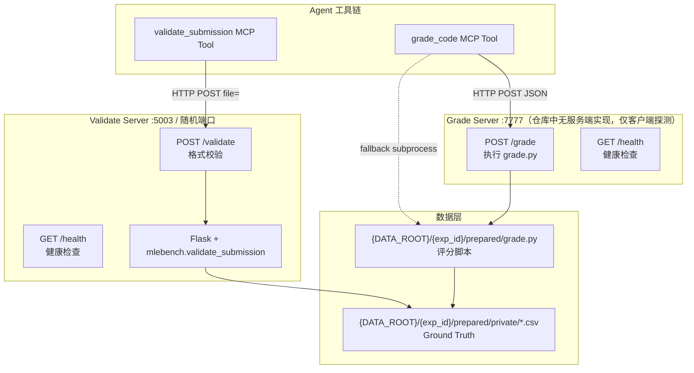
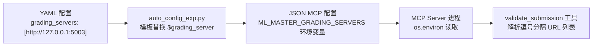
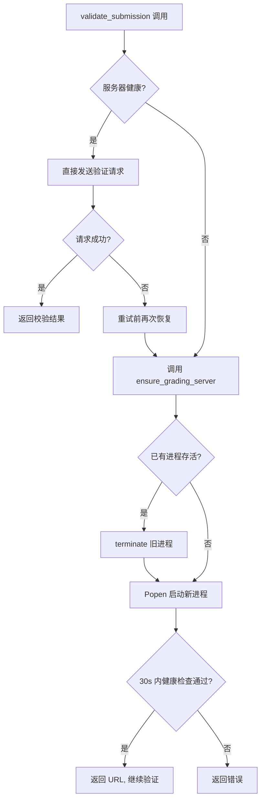
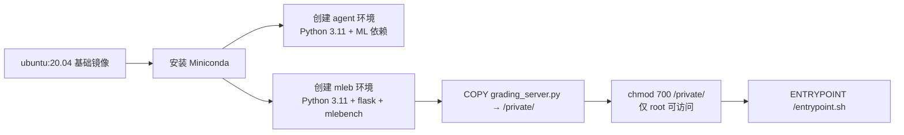

Grading Server 是 DataMaster 搜索框架中负责提交校验与评分的核心基础设施。它以 Flask HTTP 服务的形式常驻运行，为 Agent 在搜索过程中生成的每个提交文件提供格式校验（validate）和评分（grade）能力。本文档涵盖其部署架构、健康检查机制、API 接口规范以及与 Agent 工具链的集成方式。

> **📖 小白导读**
> - 这篇讲什么：搜索过程中，AI 每写出一份答案文件（submission，提交文件，一般是 CSV 表格），要有人检查"格式对不对"并算分。负责这件事的就是"评测服务器"。
> - 先知道几个概念：HTTP 服务（一个常驻的小程序，通过网址/端口接收请求，如 `http://127.0.0.1:5003`）、端口（同一台机器上区分不同服务的编号）、Flask（Python 写小型网络服务的库）、subprocess（子进程，让程序再启动另一个程序）、健康检查（访问 `/health` 看服务是否活着）。
> - 读完能明白：格式校验服务（Validate Server）怎么起、挂了怎么重启；评分（grade）为什么实际是"直接跑脚本"；以及当前仓库里哪些启动路径是坏的。
> - 重要提醒：文中涉及"Grade Server（7777 端口）"的内容，仓库里没有服务端实现，请以核对说明为准。

## 架构总览

DataMaster 中涉及两个"服务器"概念：**Validate Server**（格式校验服务器，仓库里有完整实现）和 **Grade Server**（评分服务器，客户端代码写了，但**仓库里没有服务端实现**，见下）。前者基于 MLE-Bench 的 `validate_submission` 函数验证提交文件的格式合法性；后者本应是一个监听 7777 端口的 HTTP 服务，但没有任何代码启动它，评分实际总是回落到直接用 subprocess 运行竞赛 `grade.py` 脚本。



上图展示了两个服务器的分工：Validate Server 接收 multipart 文件上传，通过 `mlebench.grade.validate_submission` 验证格式；Grade Server 在设计上接收 JSON 请求，再执行 `grade.py`。但我在仓库里搜索 `7777`，只在客户端 `_submission_utils.py`（以及 `evomaster/skills/operate-tools/scripts/` 下的一份拷贝）里出现，没有任何一个文件实现 `/grade` 路由或启动 7777 端口的服务；`docs/grade_server_setup.md` 提到的 `initialize_grade_port.py` 和环境变量 `ML_MASTER_GRADE_SERVER` 在代码里同样不存在（用 `find`/`grep` 核对过）。所以现实是：`grade_code` 先探测 7777 失败，**总是**回落为直接 subprocess 调用 `grade.py`。（除非使用者自己在 7777 端口另起了一个兼容服务，这点未验证。）

Sources: [grading_server.py](mle-bench/environment/grading_server.py#L1-L44), [_submission_utils.py](playground/search_dataset_tools/operate_submission/_submission_utils.py#L374-L408), [grading_server.py](playground/data_master/core/utils/grading_server.py#L36-L65)

## Validate Server：部署与生命周期

### 服务实现

Validate Server 的核心实现位于 `_create_app` 函数中，同时存在两份代码：一份在 `playground/data_master/core/utils/grading_server.py`（嵌入式启动），另一份在 `playground/search_dataset_tools/operate_submission/_submission_utils.py`（MCP 工具共享层）。逐段对比后，两份 `/validate` 与 `/health` 的逻辑**功能等价**（同样的取文件、读 `exp-id` 头、调用 `mlebench` 校验、异常返回 500 JSON），只是后者把 500 响应的 `jsonify` 排成了多行，属于排版差异。两者均创建 Flask 应用，绑定到指定的数据集目录，并注册这两个路由。**两份都把上传文件固定保存到 `/tmp/submission_to_validate.csv`**（这一写法源自 MLE-Bench 原版 `mle-bench/environment/grading_server.py`），多个任务/服务同时校验时会互相覆盖这个临时文件，且只能在 Linux 类系统上运行（推断：并发覆盖的后果未实测）。

Flask 应用初始化时，会调用 `registry.set_data_dir(Path(base_dir))` 创建一个新的 Registry 实例，将私有数据目录指向竞赛数据根路径。每次 `/validate` 请求到来时，服务器从 HTTP Header `exp-id` 中读取竞赛 ID，通过 Registry 获取对应的 `Competition` 对象，再调用 `mlebench.grade.validate_submission` 执行格式校验。

Sources: [grading_server.py](playground/data_master/core/utils/grading_server.py#L36-L65), [grade.py](mle-bench/mlebench/grade.py#L98-L124)

### 三种启动模式

DataMaster 提供三种启动 Validate Server 的方式，按使用场景区分（**原文把"嵌入式线程"说成由 `setup()` 触发是错误的**，实际触发点见下）：

| 模式 | 启动方式 | 适用场景 | 生命周期管理 |
|------|---------|---------|-------------|
| **嵌入式线程** | `core/utils/grading_server.py` 的 `ensure_grading_server()` 内联启动 | 节点结算时校验（`core/utils/grading.py::validate_submission`）自动拉起 | `atexit` 注册自动关闭 |
| **独立进程** | `grading_server_runner.py` 脚本启动 | MCP 工具自动拉起 | 子进程 terminate |
| **手动启动** | 命令行直接运行 | 开发调试 | 手动管理 |

**嵌入式线程模式** 并非由 `DataTreePlayground.setup()` 触发（`setup()` 里没有调用 `ensure_grading_server()`）。它是在节点结算时，由 `UCTSearchManager` 的 grader（playground.py:653）调用 `core/utils/grading.py::validate_submission`，后者在传了 `dataset_root` 时调用 `ensure_grading_server()` 触发。该函数首先检查配置的 URL 是否已健康，若不健康则通过 `werkzeug.serving.make_server` 在守护线程中启动 Flask 服务。启动后通过 `_wait_for_health` 轮询健康检查接口，确认服务就绪后返回 URL。进程退出时由 `atexit.register(stop_grading_server)` 自动关闭。

**主进程每一步还有一道"守门"**：`DataTreePlayground.run()` 开头（playground.py:1141）和每个节点开始执行时（:871）都会调用 `_ensure_grading_server_ready()`。它先访问配置的 `/health`；服务健康就直接用，不健康就走 `_restart_grading_server_same_port()` → `_start_grading_server_process()`，用 `subprocess.Popen` 启动 runner 脚本。**这里有个路径 bug**：playground.py:195-201 里 `project_root = Path(__file__).resolve().parents[3]` 是仓库根目录，拼出的 runner 路径是 `<仓库根>/search_dataset_tools/operate_submission/grading_server_runner.py`，**少了 `playground/` 这一层**，文件不存在，子进程会立即退出，函数抛 `RuntimeError("grading server exited early ...")`。结论（推断，未实测）：如果开跑时配置的端口上还没有一个健康的评分服务，主进程会在 `run()` 开头就失败；想正常跑，需要先让该端口上有服务在跑（比如手动用 `grading_server_runner.py` 启动）。MCP 侧的 `_submission_utils.ensure_grading_server`（下一段）的路径是对的（含 `playground/`）。

**独立进程模式** 由 MCP 工具（如 `validate_submission`）在检测到服务器不可用时触发（MCP 工具即 AI 能调用的外部小程序，运行在单独的子进程里）。它通过 `subprocess.Popen` 启动 `grading_server_runner.py`，传入 `--data-root`、`--host`、`--port` 参数。该脚本内部同样使用 `werkzeug.make_server` 创建服务，但以独立进程方式运行。另外一个容易踩的坑（推断）：MCP 子进程里的 `ML_MASTER_DATA_ROOT` 来自 MCP JSON 的 `env`，而 JSON 里的 `${DATA_ROOT}` 不会被展开（见第 22 篇），传给 `--data-root` 的就可能是字面量 `${DATA_ROOT}`，runner 会因"data root does not exist"退出，导致 MCP 侧的重启也失败。

Sources: [grading_server.py](playground/data_master/core/utils/grading_server.py#L162-L233), [grading_server_runner.py](playground/search_dataset_tools/operate_submission/grading_server_runner.py#L1-L43), [_submission_utils.py](playground/search_dataset_tools/operate_submission/_submission_utils.py#L505-L613)

### 配置传递机制

Validate Server 的 URL 通过三层配置传递到 Agent 工具链：



YAML 配置文件中的 `grading_servers` 字段是一个列表，但 DataMaster 强制要求只配置一个 URL（`_get_configured_grading_server_url` 在不是恰好一个时抛 ValueError）。`auto_config_exp.py` 在生成任务级配置时，将 `$grading_server` 占位符替换为实际 URL 值，同时写入 MCP JSON 配置的 `env.ML_MASTER_GRADING_SERVERS` 字段（注意：该脚本与当前模板不匹配，现在跑不通，见第 22 篇）。另外运行时 `_parse_mcp_servers()` 还会用 yaml 里的 `grading_servers` 覆盖 JSON 里的这个值（playground.py:1158-1170），所以以 yaml 为准。MCP Server 进程启动时拿到该环境变量，工具函数通过 `os.environ["ML_MASTER_GRADING_SERVERS"]` 读取。

Sources: [config_base.yaml](configs/data_master/config_base.yaml#L265-L267), [auto_config_exp.py](scripts/auto_config_exp.py#L55-L66), [_submission_utils.py](playground/search_dataset_tools/operate_submission/_submission_utils.py#L981-L984)

### 端口冲突检测

由于多个并行任务可能各自启动 Validate Server，端口冲突是一个常见问题。`scripts/check_port_conflicts.py` 脚本递归扫描 YAML 配置目录，提取所有 `grading_servers` 列表中的端口号，报告冲突情况：

```bash
python scripts/check_port_conflicts.py configs/data_master/yaml_configs
```

该脚本默认扫描 `configs/data_master/yaml_configs` 目录，输出端口使用统计和冲突列表。退出码 0 表示无冲突，1 表示存在冲突。`_pick_bind_target` 函数在运行时也实现了端口选择逻辑：优先使用配置的端口，若被占用则从默认端口起向上扫描最多 200 个端口寻找空闲端口。

Sources: [check_port_conflicts.py](scripts/check_port_conflicts.py#L30-L83), [grading_server.py](playground/data_master/core/utils/grading_server.py#L125-L159), [README.md](scripts/README.md#L1-L9)

## Grade Server：评分服务

### 独立端口与回退机制

`_grade_code_async` 函数硬编码 Grade Server 地址为 `http://127.0.0.1:7777`（与 `ML_MASTER_GRADING_SERVERS` 无关，源码注释也特别说明），先用 `aiohttp`（异步 HTTP 客户端）访问 `/health`，且要求返回的 JSON 里 `status == "healthy"` 才算健康。由于仓库里没有任何代码启动这个服务，健康检查通常失败，于是自动回退为 `_grade_via_subprocess` 直接执行 `grade.py` 脚本。下表中 Grade Server 一列描述的是**客户端代码预期的**协议，不代表仓库里真有这样一个服务。

| 特性 | Validate Server | Grade Server |
|------|----------------|-------------|
| **默认端口** | 5003 起（实际由 yaml `grading_servers` 决定，生成的配置常是随机端口如 55496） | 7777（客户端硬编码，无服务端实现） |
| **请求格式** | multipart/form-data 文件上传 | JSON body |
| **响应格式** | `{result, is_valid}` | `{success, stdout, stderr, returncode}` |
| **底层实现** | `mlebench.validate_submission` | `subprocess` 执行 `grade.py` |
| **回退方式** | 无（返回错误） | subprocess 直调 |
| **客户端库** | `requests`（同步） | `aiohttp`（异步） |

Sources: [_submission_utils.py](playground/search_dataset_tools/operate_submission/_submission_utils.py#L1147-L1173), [grade_server_setup.md](docs/grade_server_setup.md#L82-L117)

### Subprocess 回退路径

这条路径是目前**实际使用的评分路径**。`_grade_via_subprocess` 函数直接定位 `{data_root}/{exp_id}/prepared/grade.py` 脚本和 `{data_root}/{exp_id}/prepared/private/` 目录下的第一个 CSV 文件作为 Ground Truth，通过 `asyncio.create_subprocess_exec` 执行 `python grade.py -g <答案csv> -s <提交csv>`。注意它调用的是 PATH 里的 `python`（不一定是运行本项目的那个 Python 环境，推断）。超时时通过 `os.killpg` 杀死整个进程组，确保不留僵尸进程。

Sources: [_submission_utils.py](playground/search_dataset_tools/operate_submission/_submission_utils.py#L1259-L1310)

## 健康检查机制

### 健康检查端点

两个服务器都提供 `GET /health` 端点，但返回格式略有不同：

| 服务器 | 端点 | 响应示例 |
|--------|------|---------|
| Validate Server | `GET /health` | `{"status": "running"}` (HTTP 200) |
| Grade Server（客户端预期） | `GET /health` | `{"status": "healthy", "service": "grade-server"}` (HTTP 200)（来自 `docs/grade_server_setup.md`，仓库无实现） |

Validate Server 的健康检查逻辑分散在多处实现中，但核心判断一致：HTTP 状态码为 200 即视为健康。Grade Server 的健康检查额外验证响应 JSON 中 `status` 字段等于 `"healthy"`。

Sources: [grading_server.py](playground/data_master/core/utils/grading_server.py#L61-L63), [_submission_utils.py](playground/search_dataset_tools/operate_submission/_submission_utils.py#L404-L406), [_submission_utils.py](playground/search_dataset_tools/operate_submission/_submission_utils.py#L1234-L1256)

### 自动恢复策略

DataMaster 实现了多层自动恢复机制，确保搜索过程中 Validate Server 持续可用（下图是 MCP 工具侧的逻辑，使用的是 `_submission_utils.ensure_grading_server`，不是主进程里 runner 路径写错的那条）：



`_validate_submission_async` 函数实现了严格的三阶段恢复：首先检查目标 URL 健康性；不健康时调用 `ensure_grading_server` 在同一端口重启；重启后再次验证健康性。验证请求本身也支持最多 2 次重试，每次重试前再次尝试恢复服务器。这种"同端口重启"策略确保配置的 URL 始终有效，避免端口漂移。

Sources: [_submission_utils.py](playground/search_dataset_tools/operate_submission/_submission_utils.py#L969-L1139), [grading_server.py](playground/data_master/core/utils/grading_server.py#L162-L233)

### 本地代理绕过

健康检查和验证请求中一个容易被忽略的细节是对 localhost 请求的代理绕过处理。`_is_local_url` 函数检测目标 URL 的 host 是否为 `127.0.0.1`、`localhost`、`::1` 或 `0.0.0.0`，若是则创建 `requests.Session` 并设置 `session.trust_env = False`，防止环境变量中的 `http_proxy` / `https_proxy` 干扰本地连接。这一处理在所有 HTTP 请求路径中一致应用。

Sources: [grading_server.py](playground/data_master/core/utils/grading_server.py#L68-L79), [_submission_utils.py](playground/search_dataset_tools/operate_submission/_submission_utils.py#L411-L422)

## API 接口规范

### POST /validate（Validate Server）

验证提交文件的格式合法性，不计算最终分数。

**请求**：
- Method: `POST`
- URL: `http://{host}:{port}/validate`
- Headers: `exp-id: {competition_id}`（指定竞赛 ID）
- Body: `multipart/form-data`，字段名 `file`，值为提交 CSV 文件

**响应**：

| HTTP 状态 | 响应体 | 含义 |
|-----------|--------|------|
| 200 | `{"result": "Submission is valid.", "is_valid": true}` | 校验成功 |
| 200 | `{"result": "Submission invalid! ...", "is_valid": false}` | 格式不合法 |
| 500 | `{"error": "An unexpected error occurred.", "details": "..."}` | 服务器内部错误 |

`validate_submission` 底层执行三层检查：文件存在性、文件扩展名为 `.csv`、以及通过竞赛 grader 函数实际执行评分以验证格式正确性（不记录分数，仅检测是否抛出异常）。

Sources: [grading_server.py](playground/data_master/core/utils/grading_server.py#L47-L59), [grade.py](mle-bench/mlebench/grade.py#L98-L124)

### POST /grade（Grade Server，仓库无服务端实现）

以下是客户端 `_grade_via_http` 发出的请求格式和它期望的响应格式，以及 `docs/grade_server_setup.md` 的说明；仓库里没有处理这个请求的服务端代码，所以这是一份"约定"，不是可直接运行的接口。

**请求**：
- Method: `POST`
- URL: `http://127.0.0.1:7777/grade`
- Headers: `Content-Type: application/json`
- Body:
```json
{
    "exp_id": "leaf-classification",
    "submission_path": "/path/to/submission.csv",
    "timeout": 300
}
```

**响应**：

| HTTP 状态 | 响应体 | 含义 |
|-----------|--------|------|
| 200 | `{"success": true, "stdout": "metric = 0.95678\n...", "stderr": "", "returncode": 0}` | 评分成功 |
| 200 | `{"success": false, "error": "..."}` | 评分失败 |

Sources: [grade_server_setup.md](docs/grade_server_setup.md#L84-L105), [_submission_utils.py](playground/search_dataset_tools/operate_submission/_submission_utils.py#L1181-L1231)

### GET /health

两个服务器共用的健康检查端点。

**请求**：
- Method: `GET`
- URL: `http://{host}:{port}/health`

**响应**：

| 服务器 | 响应体 |
|--------|--------|
| Validate Server | `{"status": "running"}` |
| Grade Server（仅文档/客户端预期） | `{"status": "healthy", "service": "grade-server"}` |

Sources: [grading_server.py](playground/data_master/core/utils/grading_server.py#L61-L63), [grade_server_setup.md](docs/grade_server_setup.md#L107-L117)

## MLE-Bench Docker 环境中的 Grading Server

MLE-Bench 原生的 Grading Server 部署在 Docker 容器内，作为容器的 entrypoint 常驻服务。其生命周期与容器一致，在整个实验期间为 Agent 提供校验服务。

### Dockerfile 构建链路

Dockerfile 中构建了一个独立的 Conda 环境 `mleb` 用于运行 Grading Server，与 Agent 使用的 `agent` 环境隔离：



`/private` 目录权限设为 `700`（仅 root 可访问），Grading Server 和测试集答案都放在该目录下，防止 Agent 进程直接读取 Ground Truth 数据。

Sources: [Dockerfile](mle-bench/environment/Dockerfile#L63-L92), [grading_server.py](mle-bench/environment/grading_server.py#L1-L44)

### Entrypoint 启动流程

容器启动时，`entrypoint.sh` 首先设置 `/home` 目录权限（排除只读的 `/home/data` 卷），然后以 `mleb` Conda 环境运行 `/private/grading_server.py`。该脚本是 MLE-Bench 原生实现，端口固定为 5003，`COMPETITION_ID` 通过环境变量在容器运行时注入。

与 DataMaster 的实现不同，MLE-Bench 原生版本的 `/validate` 端点不通过 HTTP Header 传递竞赛 ID，而是直接读取环境变量 `COMPETITION_ID`。这是因为每个容器只服务于一个竞赛任务。

Sources: [entrypoint.sh](mle-bench/environment/entrypoint.sh#L1-L20), [grading_server.py](mle-bench/environment/grading_server.py#L11-L19)

### Agent 端的校验脚本

MLE-Bench 还提供了 `validate_submission.sh` shell 脚本，供 Agent 直接通过命令行调用校验接口。该脚本默认连接 `http://localhost:5000/validate`（注意端口与 DataMaster 默认的 5003 不同），通过 `curl -F` 上传文件。

Sources: [validate_submission.sh](mle-bench/environment/validate_submission.sh#L1-L21)

## Agent 工具链集成

### 工具调用流程

Agent 通过 MCP 协议调用 `operate_submission` 工具集，该工具集根据节点类型提供不同的实现：

| 工具 | Initial 节点 | Black/Red 节点 | 旧版独立脚本 |
|------|-------------|---------------|-------------|
| `write_code` | 可写 template + dataloader | 仅 dataloader | 单文件 |
| `fix_code` | 可改 template + dataloader | 仅 dataloader | 单文件 |
| `run_code` | 自动拼装三段代码 | 自动拼装三段代码 | 单文件 |
| `validate_submission` | HTTP → Validate Server | HTTP → Validate Server | HTTP → Validate Server |
| `grade_code` | 先探测 7777（无服务）→ 实际 Subprocess | 同左 | Subprocess |

Initial 节点使用 `for_initial_exp.py`，Black/Red 节点使用 `for_datanode.py`，两者共享 `_submission_utils.py` 中的异步实现。旧版 `operate_submission.py` 提供同步实现，作为兼容入口。

Sources: [for_initial_exp.py](playground/search_dataset_tools/operate_submission/for_initial_exp.py#L1-L158), [for_datanode.py](playground/search_dataset_tools/operate_submission/for_datanode.py#L1-L139), [operate_submission.py](playground/search_dataset_tools/operate_submission.py#L297-L505)

### validate_submission 工具的完整调用链

以 Black/Red 节点的异步实现为例，`validate_submission` 工具的完整调用链如下：

1. 从环境变量读取 `ML_MASTER_DATA_EXPID` 和 `ML_MASTER_GRADING_SERVERS`
2. 解析提交文件路径 `submission/submission_{node_id}.csv`
3. 检查服务器健康性，不健康时调用 `ensure_grading_server` 重启
4. 通过 `asyncio.to_thread` 异步发送 HTTP POST 请求
5. 解析响应 JSON，区分 `success`/`is_valid`/`result` 字段
6. 失败时重试（最多 2 次），每次重试前再次尝试恢复服务器
7. 返回 JSON 字符串结果给 Agent

Sources: [_submission_utils.py](playground/search_dataset_tools/operate_submission/_submission_utils.py#L969-L1139)

### grade_code 工具的双路径设计

`grade_code` 工具采用"HTTP 优先，subprocess 兜底"的双路径设计。它首先检查 `http://127.0.0.1:7777/health`，若健康则通过 `_grade_via_http` 发送异步 HTTP 请求；否则通过 `_grade_via_subprocess` 直接定位并执行 `grade.py`。这种设计确保即使 Grade Server 未部署，评分功能仍能正常工作——而在当前仓库里，它**就是**未部署的，所以每次都走 subprocess。另外，`--test-feedback` 模式下主进程用的是同文件里的 `grade_code_sync`（exp/__init__.py:44-46），同样走这套逻辑；该模式还有其他问题，见第 23 篇。

Sources: [_submission_utils.py](playground/search_dataset_tools/operate_submission/_submission_utils.py#L1147-L1178), [operate_submission.py](playground/search_dataset_tools/operate_submission.py#L417-L500)

## 评分算法与奖牌阈值

### Grader 类与评分函数

`Grader` 类是评分的核心抽象，它通过 `import_fn` 动态导入竞赛配置中指定的评分函数。评分函数接收提交 DataFrame 和答案 DataFrame，返回浮点数分数。`Grader.__call__` 方法捕获 `InvalidSubmissionError` 和其他异常，返回 `None` 表示无效提交，有效分数则四舍五入到 5 位小数。

Sources: [grade_helpers.py](mle-bench/mlebench/grade_helpers.py#L14-L55)

### 奖牌阈值计算

`rank_score` 方法根据竞赛排行榜计算提交的奖牌等级，阈值遵循 Kaggle 的晋级规则：

| 参赛队伍数 | 金牌阈值 | 银牌阈值 | 铜牌阈值 |
|-----------|---------|---------|---------|
| 1-99 | 前 10% | 前 20% | 前 40% |
| 100-249 | 第 10 名 | 前 20% | 前 40% |
| 250-999 | 10 + 0.2% 名 | 第 50 名 | 第 100 名 |
| 1000+ | 10 + 0.2% 名 | 前 5% | 前 10% |

`is_lower_better` 方法通过比较排行榜首尾分数自动判断优化方向。中位数阈值始终取排行榜分数的中位数。这些阈值信息在 `CompetitionReport` 中完整记录，用于后续的搜索过程可视化与结果分析。

Sources: [grade_helpers.py](mle-bench/mlebench/grade_helpers.py#L57-L159), [grade.py](mle-bench/mlebench/grade.py#L52-L95)

## 运维指南

### 服务器部署检查清单

| 检查项 | 命令 | 预期结果 |
|--------|------|---------|
| 端口占用 | `lsof -i :5003` | 无输出（端口空闲） |
| 健康检查 | `curl http://127.0.0.1:5003/health` | `{"status": "running"}` |
| 数据集就绪 | `ls ${DATA_ROOT}/{exp_id}/prepared/private/*.csv` | Ground Truth 文件存在 |
| 评分脚本就绪 | `ls ${DATA_ROOT}/{exp_id}/prepared/grade.py` | grade.py 文件存在 |
| 环境变量 | `echo $ML_MASTER_GRADING_SERVERS` | 配置的 URL |
| 端口冲突 | `python scripts/check_port_conflicts.py` | 退出码 0 |

Sources: [grade_server_setup.md](docs/grade_server_setup.md#L119-L192), [check_port_conflicts.py](scripts/check_port_conflicts.py#L128-L164)

### 常见故障排查

**问题：validate_submission 返回 "Grading server unavailable"**

根因通常是服务器未启动或端口被占用。首先检查健康端点是否可访问，若不可访问则检查 `ML_MASTER_GRADING_SERVERS` 环境变量是否正确设置。DataMaster 的自动恢复机制会在同一端口尝试重启，但若端口被其他进程占用（非 grading server），重启会失败。此时需手动释放端口或修改配置使用其他端口。

**问题：grade_code 超时**

端口 7777 上没有仓库自带的服务，系统会回退到 subprocess 方式。subprocess 方式的默认超时为 300 秒，若评分脚本执行时间较长（如深度学习模型推理），需通过 `timeout` 参数调整。同时检查 `grade.py` 脚本是否依赖 GPU 资源，在资源紧张时可能排队等待。

**问题：校验通过但评分为 None**

这通常意味着提交文件格式正确但内容无效。`validate_submission` 仅检查 grader 函数是否能无异常执行，而 `grade_csv` 中的 `Grader.__call__` 捕获 `InvalidSubmissionError` 返回 `None`。需检查提交文件的列名、数据类型和值范围是否符合竞赛要求。

Sources: [grade_server_setup.md](docs/grade_server_setup.md#L161-L192), [grade_helpers.py](mle-bench/mlebench/grade_helpers.py#L36-L55)

### systemd 部署（文档与代码已不一致）

`docs/grade_server_setup.md` 里给了一份 systemd（Linux 的服务管理器）配置模板，但它的 `ExecStart` 指向的是 `initialize_grade_port.py`（端口 5004），该文件在仓库里**不存在**，文档里的环境变量 `ML_MASTER_GRADE_SERVER` 也没有任何代码读取，而代码硬编码的是 7777——这份文档与代码已对不上，可视为过期文档。若想用 systemd 托管 Validate Server，需要自行把 `ExecStart` 改成 `playground/search_dataset_tools/operate_submission/grading_server_runner.py`（参数 `--data-root/--host/--port`，推断可行，未实测）。

Sources: [grade_server_setup.md](docs/grade_server_setup.md#L39-L66)

## 与可视化系统的集成

`scripts/vis_node_by_tree_with_grade.py` 脚本在搜索完成后对 submission 文件进行批量评分，生成 `grade_results.json` 供可视化使用。该脚本不依赖 Grading Server，而是直接调用 `grade.py` 脚本（具体路径与细节见第 25 篇），通过 `ThreadPoolExecutor` 并行执行（最多 10 个并发），从脚本输出中正则提取 `metric = X.XXXXX` 格式的分数。

评分结果通过 `add_grade_scores_to_tree` 函数注入 UCT 节点树的 `test_score` 字段，节点 ID 与 submission ID 通过前 8 位前缀匹配。可视化界面提供按钮切换显示验证集分数（`val_score`）和测试集分数（`test_score`），便于分析搜索过程中的过拟合现象。

Sources: [vis_node_by_tree_with_grade.py](scripts/vis_node_by_tree_with_grade.py#L144-L284), [vis_node_by_tree_with_grade.py](scripts/vis_node_by_tree_with_grade.py#L362-L393)

## 延伸阅读

- [评估反馈闭环：Metric Agent 与验证指标解析](11-ping-gu-fan-kui-bi-huan-metric-agent-yu-yan-zheng-zhi-biao-jie-xi) — 了解 Metric Agent 如何利用 Grading Server 的分数进行 UCT 奖励更新
- [operate_submission：代码管理、执行与提交校验流水线](15-operate_submission-dai-ma-guan-li-zhi-xing-yu-ti-jiao-xiao-yan-liu-shui-xian) — 工具链全流程解析，包含代码拼装与执行细节
- [配置体系解析：YAML 配置、MCP JSON 与任务级配置生成](22-pei-zhi-ti-xi-jie-xi-yaml-pei-zhi-mcp-json-yu-ren-wu-ji-pei-zhi-sheng-cheng) — grading_servers 配置如何从模板生成
- [搜索过程可视化：DataTree 交互式树分析与分数对照](25-sou-suo-guo-cheng-ke-shi-hua-datatree-jiao-hu-shi-shu-fen-xi-yu-fen-shu-dui-zhao) — grade_results.json 在可视化中的应用
- [运维脚本指南：配置生成、初始代码构建与端口诊断](26-yun-wei-jiao-ben-zhi-nan-pei-zhi-sheng-cheng-chu-shi-dai-ma-gou-jian-yu-duan-kou-zhen-duan) — check_port_conflicts.py 的完整使用说明
