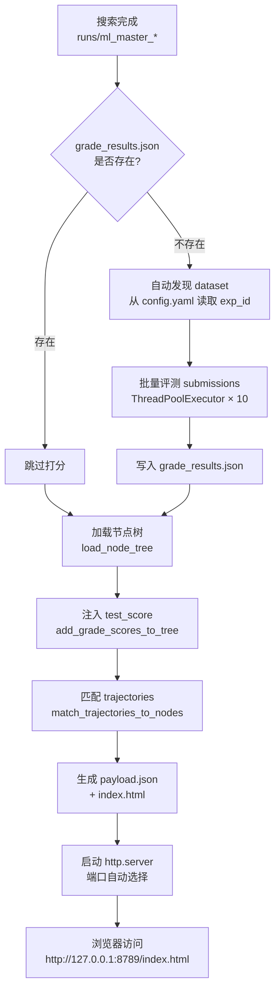

DataMaster 框架在 UCT 搜索过程中产生大量结构化数据——节点树、轨迹记录、验证集分数、测试集分数——这些数据分散在运行目录的不同子路径中。可视化子系统将这些碎片重新组装为一棵可交互的 D3 树图，让开发者能够直观地追踪搜索的每一步决策、观察分数演变、诊断过拟合与泛化问题。本文档覆盖三套可视化工具的架构差异、数据管线流程、前端交互逻辑以及分数对照机制，帮助你在搜索完成后高效地回溯和分析整个实验过程。

> **📖 小白导读**
> - 这篇讲什么：搜索跑完后，怎么把"一棵由很多代码节点组成的树"画成网页，点开每个节点能看到分数、代码和 AI 的对话。
> - 先知道几个概念：UCT 搜索树（每个节点是一版代码，子节点是在它基础上的改进，详见第 9 篇）、JSON（一种存数据的文本格式）、D3.js（浏览器里画图的库）、轨迹 trajectory（AI 与工具的完整对话记录）、验证集分数与测试集分数（前者搜索时用，后者像"最终考试成绩"）。
> - 读完能明白：三个可视化工具读哪些文件、产出什么、怎么启动，以及几处路径写死/脚本对不上的坑（默认找不到 DataMaster 的运行目录、自动打分默认跳过等）。
> - 一个关键前提：下文的 `run_dir` 是一次运行产生的目录，默认形如 `runs/data_master_时间戳/`（run.py:469），里面有 `logs/uct_nodes/`、`trajectories/`、`workspaces/`。

Sources: [main.py](playground/data_master/vis/main.py#L1-L7), [vis_node_by_tree_with_grade.py](scripts/vis_node_by_tree_with_grade.py#L1-L11)

## 可视化工具矩阵：三套工具的定位与差异

DataMaster 仓库中存在三套独立的可视化实现，它们服务于不同场景、采用不同的部署方式，并且在功能丰富度上逐层递进。理解三者的边界是正确选择工具的前提。

| 维度 | Flask API 服务 (`app.py`) | 离线树+轨迹 (`main.py`) | Grade 增强版 (`vis_node_by_tree_with_grade.py`) |
|---|---|---|---|
| 部署模式 | Flask 常驻服务，实时刷新 | 静态 HTML 生成 + 本地 HTTP | 静态 HTML 生成 + 本地 HTTP |
| 数据源 | `logs/uct_nodes/*.json` | `node.json` + `trajectories/` | `node.json` + `trajectories/` + `grade_results.json` |
| 轨迹展示 | 无 | 完整对话历史 | 完整对话历史 |
| 分数对照 | 仅 metric 字段 | 仅 metric（验证集分数） | Val Score + Test Score 双模式切换 |
| 颜色编码 | D3 Plasma 色阶连续映射 | 按节点 stage 离散着色 | 按节点 stage 离散着色 + 形状区分 |
| 节点形状 | 统一圆形 | 统一圆形 | 圆形 / 方形 / 三角形（区分 initial / black / red） |
| 适用场景 | 搜索运行中实时监控 | 搜索完成后快速回溯 | 搜索完成后完整分析（含过拟合诊断） |

**Flask API 服务** 是最轻量的方案，它直接从 `build_tree.py` 构建的内存缓存中读取节点 JSON，通过 `/api/tree`、`/api/node/<id>`、`/api/nodes`（节点列表，供搜索自动补全）与 `/health` 四组 REST 接口提供数据，前端 `app.js` 以 D3.js v7 渲染树形布局。它的核心价值在于实时性——搜索仍在进行时，点击 Refresh 按钮即可刷新整棵树。

**离线树+轨迹工具** (`main.py`) 是数据最完整的单文件方案。它将节点树与 Agent 对话轨迹合并到一个 `payload.json` 中，生成自包含的 `index.html`，通过 Python 内置 `http.server` 模块部署。其 HTML 模板内嵌完整的 D3 渲染逻辑和对话消息解析器，适合归档和分享。

**Grade 增强版** (`vis_node_by_tree_with_grade.py`) 在 `main.py` 的基础上新增了三个关键能力：自动批量打分（通过 `grade.py` 脚本对 submission CSV 评测）、Val/Test 分数切换按钮、以及基于 D3 Symbol 的节点形状区分（三角形=红节点，方形=黑节点，圆形=初始/其他）。这是分析搜索质量时最推荐使用的工具。

**关于 `templates/visualization.html`（"Enhanced 模板"）的说明**：该模板虽然实现了路径高亮、分数差值卡片等更丰富的交互，但仓库中**没有任何 Python 入口引用或渲染它**——`app.py` 使用的是 `static/index.html` + `app.js`，两个离线脚本各自使用内嵌的 `HTML_TEMPLATE` 字符串。它目前是一个未接线的独立模板文件，本文后续涉及它的段落仅描述模板自身的实现逻辑，实际使用需要自行集成到某个入口。

Sources: [app.py](playground/data_master/vis/app.py#L16-L80), [main.py](playground/data_master/vis/main.py#L263-L282), [vis_node_by_tree_with_grade.py](scripts/vis_node_by_tree_with_grade.py#L144-L165)

## 数据管线：从 UCT 节点到可视化 Payload

可视化系统的数据流始于 `logs/uct_nodes/` 目录下的节点 JSON，终于前端 D3 渲染的 SVG 树图。需要注意两个离线脚本与 Flask 版的**数据加载路径不同**：离线版（`main.py` / Grade 版）的 `load_node_tree` 优先读取单文件 `node.json`（若含 `root` 字段则直接取其值作为树根），仅在缺失或解析失败时才回退到逐个读取目录下的独立节点文件；而 Flask 版的 `build_tree.py` 始终从独立 `*.json` 文件构建。理解这条管线中每个阶段的数据变换，是诊断"为什么某个节点没显示出来"或"为什么分数为空"等问题的关键。

```mermaid
flowchart LR
    A["logs/uct_nodes/<br/>node.json 或 *.json"] --> B["load_node_tree / load_nodes<br/>解析 + 类型归一化"]
    B --> C["nodes_by_id<br/>id → dict 映射"]
    C --> D["build_forest / build_children<br/>parent 字段链接"]
    D --> E["roots 列表<br/>+ 虚拟根处理"]
    E --> F["tree 嵌套结构<br/>含 children 数组"]
    F --> G["match_trajectories<br/>agent_id 前缀匹配"]
    G --> H["node_trajectories<br/>node_id → trajectory"]
    H --> I["add_grade_scores<br/>递归注入 test_score<br/>（仅 Grade 版）"]
    I --> J["payload.json / /api/tree<br/>前端消费"]
```



**第一阶段：节点加载与类型归一化。** `load_nodes` 函数遍历 `uct_nodes` 目录下所有 `*.json` 文件，以 `id` 字段为键建立映射。关键在于它对数值字段执行 `_safe_float` 和 `_safe_int` 转换——`metric`、`uct_value`、`reward`、`total_reward` 被强制转为 `Optional[float]`，`visits` 被转为 `Optional[int]`。这层防御性解析确保前端不会因为字符串类型的数值而崩溃。每个节点还会附加 `_file`（源文件路径）和 `_mtime`（修改时间戳），用于后续的排序和缓存失效判断。

Sources: [build_tree.py](playground/data_master/vis/build_tree.py#L38-L84)

**第二阶段：森林构建与虚拟根处理。** Flask 版的 `build_forest` 从扁平的 `nodes_by_id` 字典构建嵌套树结构。它为每个节点创建一个轻量级 shell（仅保留可视化需要的字段），然后通过 `parent` 字段将子节点链接到父节点的 `children` 数组中。如果某节点的 `parent` 不在 shells 中，该节点被标记为根节点，同时 `missing_parents` 计数器递增。当存在多个根节点时，Flask 版的 `build_tree_payload` 会创建一个 `id: "__root__"` 的虚拟根节点，而 Grade 版 `load_node_tree` 的回退路径则使用 `id: "__virtual_root__"`（两者都会将所有真实根作为 children）——这保证了 D3 的 `d3.hierarchy()` 总是接收单一根节点。

Sources: [build_tree.py](playground/data_master/vis/build_tree.py#L87-L199)

**数据从哪来。** `logs/uct_nodes/` 下的每个 `<节点id>.json` 和汇总的 `node.json` 都是搜索过程中由 `save_node_snapshot`（playground_helpers.py:85-137）写出的：前者是单节点快照，后者是整棵树 `{"task":..., "generated_at":..., "root": {...嵌套children}}`，所以离线脚本里"含 `root` 字段则取其值"。`trajectories/task_0/trajectory.json` 由 run.py 的单任务模式（任务 id 固定为 `task_0`，run.py:528）和 `_setup_trajectory_file` 写出。

**第三阶段：轨迹匹配。** `match_trajectories_to_nodes` 是连接 UCT 节点树与 Agent 对话历史的桥梁。它遍历 `trajectories/task_*/trajectory.json` 文件（这里用 `task_*` 通配，不是写死 `task_0`），从每个 trajectory entry 的 `agent_id` 中提取第一段（以 `_` 分割），然后用前缀匹配算法将其关联到节点 ID。匹配规则采用双向前缀检查——`node_id.startswith(potential_node_id) or potential_node_id.startswith(node_id[:8])`——这是因为 agent_id 中的 node 标识可能是完整 UUID 的前 8 位。当多个 trajectory 匹配到同一节点时，只保留 `steps` 最大的那个（即最深度的对话）。

Sources: [main.py](playground/data_master/vis/main.py#L181-L260), [vis_node_by_tree_with_grade.py](scripts/vis_node_by_tree_with_grade.py#L287-L359)

**第四阶段：分数注入（仅 Grade 增强版）。** `add_grade_scores_to_tree` 递归遍历树结构，通过 `node_id` 或其前 8 位前缀从 `grade_results` 字典中查找 test score，匹配成功后写入节点的 `test_score` 字段。这层注入使前端能够在同一棵树上同时展示验证集分数（`metric`）和测试集分数（`test_score`），实现过拟合诊断。

Sources: [vis_node_by_tree_with_grade.py](scripts/vis_node_by_tree_with_grade.py#L362-L393)

## 自动打分机制：批量评测 Submission

Grade 增强版的一个核心增值能力是 `run_auto_grading` 函数，它在可视化生成前自动触发 submission 的批量评测，确保 `grade_results.json` 存在且最新。

**先澄清几处与原文不同的事实。** （1）`run_auto_grading` 判断"是否已打过分"时**只**检查 `run_dir/trajectories/task_0/grade_results.json`（路径里 `task_0` 是写死的）；而"读取已有结果"的 `load_grade_results` 才会依次尝试 `trajectories/task_0/` 和 `test/` 两处。（2）命令行里**没有** `--force` 参数（`parse_args` 只有 `--run-dir/--site-dir/--host/--port/--dataset/--no-deploy`，脚本顶部 docstring 提到的 `--auto-grade`、`--force-grade` 同样没有实现），`main()` 调用 `run_auto_grading` 时 `force` 永远是默认的 `False`：想重新打分只能手动删掉 `grade_results.json`。（3）提交文件目录同样写死 `task_0`。

具体流程：若结果文件已存在，直接跳过。否则，它在两个候选路径中搜索 submission 目录——`workspaces/task_0/submission` 或 `workspaces/submission`——并查找对应的 `grade.py` 评测脚本。这里存在一个容易踩的坑：代码中的首选路径写作 `Path("${DATA_ROOT}") / dataset / "prepared" / "grade.py"`，其中 `${DATA_ROOT}` 是**未展开的字面量字符串**（很可能是公开仓库时对本机路径做的脱敏替换，推断）而非环境变量替换，它会被当成"当前目录下名叫 `${DATA_ROOT}` 的文件夹"；回退路径 `REPO_ROOT / "test" / "grade.py"` 中的 `REPO_ROOT` 也只指向 `scripts/` 目录（`Path(__file__).resolve().parent`），而非仓库根。因此在默认的仓库检出状态下两个候选路径均不存在，auto grading 会打印 `[WARNING] grade.py not found, skipping auto grading` 并直接跳过——要启用自动打分，需手动将 `grade.py` 放到 `scripts/test/` 下，或修正脚本中的路径字面量。

实际打分采用 `ThreadPoolExecutor`（线程池，同时开多个线程干活）并发执行，最多 10 个 worker 同时运行。每个 worker 调用 `subprocess.run([python, grade_script, "-s", submission_path])`，超时限制 60 秒。注意这里**只传了 `-s`**，而第 24 篇里 `_grade_via_subprocess` 调 `grade.py` 时还会传 `-g <答案csv>`；`grade.py` 是否能在缺 `-g` 时正常工作，仓库里没有这个脚本，无法验证（未验证）。分数提取使用正则表达式 `r"metric\s*=.*?(\d+\.\d+)"` 从 stdout 中解析。打分完成后，结果写入 `grade_results.json`，并打印统计摘要（最大/最小/平均分数）。

`run_auto_grading` 的函数签名只有三个参数：

| 参数 | 类型 | 默认值 | 说明 |
|---|---|---|---|
| `run_dir` | `Path` | 必填 | 运行目录路径 |
| `dataset` | `str` | `"leaf-classification"` | 数据集名称，定位 `grade.py` 脚本 |
| `force` | `bool` | `False` | 是否强制重新打分（忽略已有结果） |

超时限制（60 秒 / 单个 submission）与并发度（`ThreadPoolExecutor` 最多 10 个 worker）是函数内部写死的常量，并非可配置参数。

`dataset` 参数支持自动检测（`run_dir/config.yaml` 是 run 开始时由 `set_run_dir` 复制过去的主配置，evomaster/core/playground.py:219-223）：当命令行未提供 `--dataset` 时，`load_exp_id_from_config` 函数会尝试从 `run_dir/config.yaml` 中读取 `exp_id` 字段（检查 `config.get("exp_id")`、`config.get("competition", {}).get("exp_id")`、`config.get("config", {}).get("exp_id")` 三条路径），作为数据集名称传入打分流程。

Sources: [vis_node_by_tree_with_grade.py](scripts/vis_node_by_tree_with_grade.py#L168-L284), [vis_node_by_tree_with_grade.py](scripts/vis_node_by_tree_with_grade.py#L925-L968)

## 前端交互：D3 树渲染与节点详情面板

三套工具的前端都基于 D3.js v7 的 `d3.hierarchy` + `d3.tree` 布局，但在交互模式和视觉编码上存在显著差异。

### Flask 版前端（app.js）

Flask 版前端采用分离式架构：`index.html` 定义 UI 骨架，`app.js` 通过 `fetch` 调用 `/api/tree` 和 `/api/node/<id>` 接口获取数据。其交互特征包括：

- **颜色编码可选**：顶部下拉菜单允许在 `metric`、`uct_value`、`visits`、`reward` 四个字段间切换，使用 `d3.scaleSequential(d3.interpolatePlasma)` 连续色阶渲染节点填充色。
- **节点半径动态计算**：`nodeRadius` 函数基于 `visits` 的对数缩放（`base + log10(visits+1) * 6`），并叠加 `has_submission` 和 `is_buggy` 的额外加成，半径范围限定在 8-22px。
- **选择不触发重渲染**：点击节点仅更新 CSS class（`selected`）和侧栏内容，不重新渲染 SVG，也不重置 zoom 状态——这避免了用户在树中导航时视图"跳回"的问题。
- **节点搜索**：输入框支持按 node id 前缀搜索，匹配第一个命中节点后自动选中。
- **详情面板结构化**：`renderDetail` 按预定义字段顺序（`id → stage → parent → metric → maximize → uct_value → visits → reward → total_reward → is_buggy → has_submission → submission_file`）渲染卡片，`stdout` 字段被丢弃，`code` 字段始终放在最后。

Sources: [app.js](playground/data_master/vis/static/app.js#L41-L176), [index.html](playground/data_master/vis/static/index.html#L1-L55)

### 离线版与 Grade 版前端（内嵌 HTML 模板）

离线版 `main.py` 和 Grade 版 `vis_node_by_tree_with_grade.py` 都将完整的 D3 渲染逻辑内嵌在 Python 字符串模板 `HTML_TEMPLATE` 中，通过 `__DATA__` 占位符注入 JSON payload。这种方式生成的 HTML 是完全自包含的，不依赖任何后端服务。

两者的核心前端逻辑共享相同的结构，但 Grade 版增加了以下关键差异：

**分数切换机制。** Grade 版在顶部工具栏添加了两个切换按钮——`Val Score` 和 `Test Score (Grade)`——通过 `setScoreMode(mode)` 函数控制节点文本显示的分数来源。`getScore(node)` 根据 `scoreMode` 全局变量返回 `node.metric`（验证集）或 `node.test_score`（测试集）。切换时调用 `drawTree()` 重绘整棵树，同时刷新当前选中节点的详情面板。

**节点形状区分。** Grade 版使用 D3 Symbol API 替代简单的 `<circle>` 元素：`nodeShapeType(node)` 根据 `stage` 返回 `d3.symbolTriangle`（红节点）、`d3.symbolSquare`（黑节点）或 `d3.symbolCircle`（其他）。节点大小通过 `d3.symbol().type(shape).size(Math.PI * r * r)` 计算，保持与圆形版本相同的视觉面积。

**详情面板双分数展示。** Grade 版的 `renderNodeDetail` 同时展示两种分数——当前模式的高亮分数和两种分数的完整对比——并用颜色区分：`#4dabf7`（蓝色）表示 Val Score，`#51cf66`（绿色）表示 Test Score。

Sources: [vis_node_by_tree_with_grade.py](scripts/vis_node_by_tree_with_grade.py#L480-L666), [main.py](playground/data_master/vis/main.py#L358-L528)

## 节点颜色与形状编码体系

可视化系统使用颜色和形状两个视觉维度编码节点的多维属性。三套工具采用了不同的编码策略，理解这些策略是正确解读树图的前提。

### 按阶段离散编码（main.py 与 Grade 版）

| 节点阶段 | main.py 颜色 | Grade 版颜色 | 视觉含义 | 形状（仅 Grade 版） |
|---|---|---|---|---|
| `root` | `#ffd166`（黄色） | `#ffd166`（黄色） | 搜索起点 | 圆形 |
| `initial` | `#ffd166`（黄色） | `#4dabf7`（蓝色） | 初始代码节点 | 圆形 |
| `draft` | `#4dabf7`（蓝色） | —（落入默认色） | 草稿阶段，首次代码生成 | 圆形 |
| `debug` | `#ff8787`（浅红） | —（落入默认色） | 调试阶段，修复 bug | 圆形 |
| `improve` | `#51cf66`（绿色） | —（落入默认色） | 改进阶段，优化已有代码 | 圆形 |
| `data_search` | `#cc5de8`（紫色） | —（落入默认色） | 数据搜索阶段 | 圆形 |
| `black` | `#9775fa`（紫色） | `#51cf66`（绿色） | 黑节点：数据增强 | 方形 |
| `red` | `#ff6b6b`（红色） | `#cc5de8`（紫色） | 红节点：外部数据引入 | 三角形 |
| `terminal` | —（落入默认色） | `#868e96`（灰色） | 终端节点 | 圆形 |
| buggy | `#ff4d6d`（红色） | `#ff4d6d`（红色） | 执行出错 | 继承原形状 |
| 无轨迹 / 其他 | `#8893bd`（灰蓝） | `#8893bd`（灰蓝） | 未匹配到 trajectory / 未知阶段 | 继承原形状 |

注意两套工具的 `nodeColor` 函数不仅颜色值不同，**支持的 stage 集合也不同**：`main.py` 覆盖 `draft` / `debug` / `improve` / `data_search` 等 ML-Master 历史阶段但没有 `terminal` 分支；Grade 版只识别 `root` / `initial` / `black` / `red` / `terminal`，其余阶段一律落入默认灰蓝色 `#8893bd`。

Sources: [main.py](playground/data_master/vis/main.py#L358-L371), [vis_node_by_tree_with_grade.py](scripts/vis_node_by_tree_with_grade.py#L514-L531)

### 按数值连续编码（Flask app.js 版）

Flask 版弃用离散的阶段着色，改用 `d3.scaleSequential(d3.interpolatePlasma)` 连续色阶，基于用户选择的字段（metric / uct_value / visits / reward）动态计算 min-max 域并映射颜色。当所有节点的该字段值为 null 时，回退到固定紫色 `#7a6cff`。这种设计更适合在搜索完成后做全局性能对比，而非追踪搜索路径。

**enhanced 模板的性能梯度着色** 是一个混合方案：它首先检查 buggy 和 terminal 状态，然后对有 `metric` 的节点执行蓝绿渐变插值（domain 设为 0.7-0.95），最后回退到阶段离散着色。这种三级优先级确保了特殊状态始终被高亮，同时性能差异也能通过颜色深度直观感知。

Sources: [app.js](playground/data_master/vis/static/app.js#L65-L77), [visualization.html](playground/data_master/vis/templates/visualization.html#L142-L179)

## 分数对照与过拟合诊断

分数对照是 Grade 增强版的核心价值主张。它允许开发者在同一棵树上同时观察验证集分数（`metric`）和测试集分数（`test_score`），通过两者的差异诊断过拟合或泛化不足。

**Grade 版（实际可用的实现）**：分数对照通过顶部工具栏的 `Val Score` / `Test Score (Grade)` 切换按钮实现（`setScoreMode` / `getScore`），节点文本显示当前模式的分数（`.toFixed(3)`），切换时重绘整树并刷新选中节点的详情面板。

**Enhanced 模板（`visualization.html`，未接线）**：它的分数对照卡片使用 `submission_score` 字段（而非 Grade 版的 `test_score`）计算 `testScore - metric` 差值：差值为正时显示绿色 `↑` 标记和"Better generalization"解读；差值为负时显示红色 `↓` 标记和"Overfitting detected"解读。若要使用该模板，需自行将 `test_score` 映射到 `submission_score` 字段名。

Sources: [visualization.html](playground/data_master/vis/templates/visualization.html#L284-L337), [vis_node_by_tree_with_grade.py](scripts/vis_node_by_tree_with_grade.py#L493-L512)

## 部署机制：端口管理与进程生命周期

离线版和 Grade 版都内置了 HTTP 静态文件服务器的自动部署逻辑。这套机制包含三个关键组件：

**端口自动选择。** `_pick_free_port` 从指定端口开始，尝试最多 50 个连续端口的 `bind` 操作，返回第一个可用端口。这避免了"端口被占用导致部署失败"的问题。

**旧进程清理。** `_stop_old_process` 从 PID 文件读取上一次部署的进程号，先尝试 `SIGTERM` 优雅终止，等待最多 2 秒（20 次 × 0.1 秒），超时后升级为 `SIGKILL`。PID 文件在清理后被删除，确保不会误杀新进程。

**进程管理。** `_start_http_server` 使用 `subprocess.Popen` 启动 `python -m http.server`，通过 `start_new_session=True` 将其放入新进程组（脱离父进程控制）。两个脚本的 PID/日志文件名不同：Grade 版写入 `.vis_server.pid` / `vis_server.log`，离线版 `main.py` 写入 `.vis_node_by_tree_server.pid` / `vis_node_by_tree_server.log`。启动后等待 0.4 秒确认进程存活，否则报错。

| 配置项 | main.py 默认值 | Grade 版默认值 | 说明 |
|---|---|---|---|
| `--host` | `127.0.0.1` | `127.0.0.1` | HTTP 绑定地址 |
| `--port` | `8789` | `8789` | HTTP 起始端口 |
| `--site-dir` | `run_dir/logs/uct_nodes/vis_node_by_tree_site` | `run_dir/logs/uct_nodes/vis_site` | 静态文件输出目录 |
| `--no-deploy` | `False` | `False` | 仅生成 HTML，不启动服务器 |
| `--run-dir` | 自动发现最新 `ml_master_*` | 自动发现 | 目标运行目录 |
| `--dataset` | N/A | 自动从 config 检测 | 数据集名称（用于 grade.py 定位） |

Sources: [main.py](playground/data_master/vis/main.py#L712-L825), [vis_node_by_tree_with_grade.py](scripts/vis_node_by_tree_with_grade.py#L844-L922)

## 轨迹与对话历史渲染

离线版和 Grade 版的右侧面板不仅展示节点元数据，还完整渲染 Agent 的对话历史。`renderMessage` 函数处理三种消息内容格式：纯文本字符串、多模态内容数组（text + image_url）、以及 tool_calls 结构。

`parseToolCall` 函数支持两种 tool_call 格式：结构化对象（OpenAI 风格的 `{function: {name, arguments}}`）和字符串格式（内部 `FunctionCall(name='...', arguments='...')` 表示）。后者通过正则表达式提取函数名和参数，并处理转义单引号。`formatToolArgs` 对参数值进行 JSON 美化，使工具调用的参数在面板中以缩进格式展示，提升可读性。

消息角色通过 CSS class 区分颜色：`system` 红色、`user` 蓝色、`assistant` 绿色、`tool` 黄色。工具调用区块使用半透明黄色背景和边框，与普通文本内容视觉分离。`tool` 角色消息额外在内容顶部显示工具名称标签。

Sources: [vis_node_by_tree_with_grade.py](scripts/vis_node_by_tree_with_grade.py#L695-L818), [main.py](playground/data_master/vis/main.py#L558-L688)

## 使用流程：从命令行到可视化

以下是使用 Grade 增强版进行完整搜索分析的典型工作流：



**快速启动命令示例：**

```bash
# 方式一：自动发现最新运行目录
python scripts/vis_node_by_tree_with_grade.py --port 8789

# 方式二：指定运行目录和数据集
python scripts/vis_node_by_tree_with_grade.py \
  --run-dir /path/to/runs/ml_master_20260326_165235 \
  --port 8789 \
  --dataset leaf-classification

# 方式三：仅生成 HTML，不启动服务器（适合 CI/CD 归档）
python scripts/vis_node_by_tree_with_grade.py --no-deploy

# 方式四：Flask API 服务（实时监控搜索进度）
python -m playground.data_master.vis.app \
  --run_dir runs/ml_master_20260204_115212 \
  --port 8765 --debug
```

注意 `discover_run_dir` 的自动发现逻辑只匹配 **`ml_master_*` 前缀**的运行目录（脚本 docstring 中的 `data_master_*` 示例与实际 glob 模式不一致）。而 DataMaster 实际产生的目录是 `runs/data_master_<时间戳>/`（run.py:469，前缀取自 `--agent` 的值），所以**对 DataMaster 的运行，自动发现一定找不到，必须显式传 `--run-dir`**。此外两个脚本"去哪里找 `runs/`"也不同：Grade 版的 `REPO_ROOT` 是脚本所在的 `scripts/` 目录，默认找 `scripts/runs/`；`playground/data_master/vis/main.py` 的 `REPO_ROOT` 是当前工作目录（`os.getcwd()`），默认找 `./runs/`。上面"方式一"的命令因此在默认情况下会报 `runs dir not found`。

Flask 版的 API 接口在搜索运行期间也可使用——`/api/tree?refresh=1` 会强制重新读取磁盘上的节点文件并重建缓存，而 `/api/node/<id>` 直接从内存缓存返回节点详情。这使得开发者可以在搜索进行中实时观察树的生长。

Sources: [vis_node_by_tree_with_grade.py](scripts/vis_node_by_tree_with_grade.py#L989-L1026), [app.py](playground/data_master/vis/app.py#L41-L78)

## 路径高亮与轨迹追踪（Enhanced 模板）

`visualization.html` 模板引入了一个独特的路径高亮功能：当用户点击某个节点时，系统会构建从根节点到该节点的完整路径，并以黄色高亮显示路径上的所有节点和连线。`buildPathToNode` 通过递归查找 `parent` 字段向上回溯直到根节点，生成路径节点 ID 数组。`highlightPathToNode` 将这个数组应用到 D3 选择集上——路径上的节点获得 `on-path` CSS class（黄色描边），路径上的连线获得 `path-highlight` class（黄色加粗）。

这个功能让开发者能够直观地看到"搜索是如何到达这个节点的"——从 initial 代码出发，经过哪些 draft / debug / improve / black / red 步骤，最终产生了当前节点的代码和分数。结合分数对照功能，可以分析出哪些搜索路径产生了更好的泛化性能。

Sources: [visualization.html](playground/data_master/vis/templates/visualization.html#L198-L225)

## 技术栈依赖与兼容性

三套可视化工具的前端均依赖 D3.js v7，通过 CDN 引入（`https://cdn.jsdelivr.net/npm/d3@7`）。Flask 版额外依赖 Flask 框架。Grade 版的自动打分功能依赖 `pyyaml`（用于读取 config.yaml 中的 exp_id）和外部 `grade.py` 评测脚本。

| 依赖 | Flask 版 | 离线版 | Grade 版 | 用途 |
|---|---|---|---|---|
| D3.js v7 | 是（CDN） | 是（CDN） | 是（CDN） | 树形布局、缩放、Symbol |
| Flask | 是 | 否 | 否 | REST API 服务 |
| pyyaml | 否 | 否 | 是 | 读取 config.yaml |
| grade.py | 否 | 否 | 是 | submission 评测 |
| http.server | 否 | 是 | 是 | 静态文件服务 |

所有 Python 后端代码使用 `from __future__ import annotations`。类型注解大多使用 `Dict`、`List`、`Optional` 等 `typing` 写法，但 `main.py`、`app.py` 里也出现了 `Path | str`、`list[str]` 这类新语法（因为有 `from __future__` 才不会在旧版本报错）。仓库 `pyproject.toml` 要求 Python `>=3.10,<3.13`，所以"兼容 3.8+"的说法没有依据，此处以 3.10 以上为准。

Sources: [app.py](playground/data_master/vis/app.py#L1-L10), [vis_node_by_tree_with_grade.py](scripts/vis_node_by_tree_with_grade.py#L12-L26)

完成搜索过程的可视化分析后，建议进一步了解 UCT 搜索算法本身的选择与奖励机制（参见 [UCT 搜索算法：节点选择、奖励更新与衰减策略](9-uct-sou-suo-suan-fa-jie-dian-xuan-ze-jiang-li-geng-xin-yu-shuai-jian-ce-lue)）、节点文件系统的组织方式（参见 [Memory Tree：与 UCT 树对应的文件系统设计](12-memory-tree-yu-uct-shu-dui-ying-de-wen-jian-xi-tong-she-ji)），以及评测服务器的配置方法（参见 [Grading Server：评测服务器部署、健康检查与 API 接口](24-grading-server-ping-ce-fu-wu-qi-bu-shu-jian-kang-jian-cha-yu-api-jie-kou)），这些知识将帮助你更深入地理解可视化中呈现的数据含义。

## 本文修订记录

- 补充小白导读，解释 run_dir、trajectory、验证集/测试集分数、线程池等概念，并补了"数据从哪来"（`node.json` 与单节点 json 由 `save_node_snapshot` 写出，playground_helpers.py:85-137）。
- 纠正：原文提到的 `--force` 参数不存在，`main()` 里 `force` 恒为 False；docstring 里的 `--auto-grade/--force-grade` 也没实现（vis_node_by_tree_with_grade.py:`parse_args`、`main`）。
- 纠正：`run_auto_grading` 只检查 `trajectories/task_0/grade_results.json`，只有 `load_grade_results` 才会读 `test/` 目录；submission 目录同样写死 `task_0`（该脚本 168-284 行附近）。
- 纠正/补充：自动发现只匹配 `ml_master_*`，而 DataMaster 的默认目录是 `data_master_<时间戳>`（run.py:469），必须手动传 `--run-dir`；Grade 版默认去 `scripts/runs`，`main.py` 默认去当前目录的 `runs`。
- 补充：`${DATA_ROOT}` 是字面量（疑为脱敏残留，推断）；打分时只传 `-s` 不传 `-g`，与第 24 篇的 subprocess 路径不一致。
- 纠正：Python 版本说明改为以 `pyproject.toml` 的 `>=3.10` 为准。
- 核对无误：节点颜色/形状表、Flask 四个接口、端口选择与 PID 文件逻辑、`enhanced` 模板未被任何入口引用。
- 未验证：`grade.py` 缺少 `-g` 时的行为（仓库无该脚本）；trajectory 中 `agent_id` 的具体格式（只核对了匹配代码，未核对写入端）。
