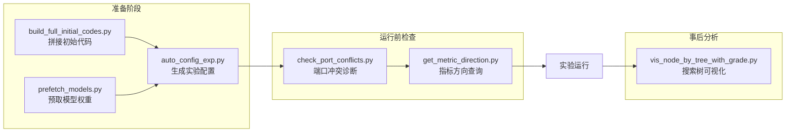
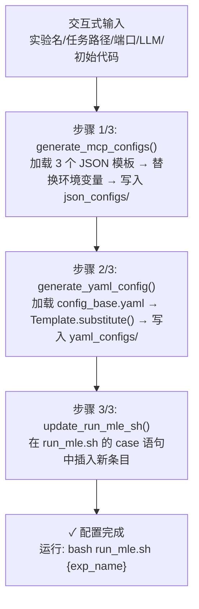

`scripts/` 目录是 DataMaster 仓库中专门存放**运维辅助脚本**的位置。这些脚本不包含实验启动器或消融实验的 shell 脚本，而是聚焦于日常运维中的三类高频任务：为新实验自动生成全套配置文件、为 MLE-Bench 任务拼接初始代码、以及诊断 grading server 端口冲突。此外还包含模型预取、指标方向查询和搜索过程可视化三个辅助工具。本文将逐一拆解每个脚本的设计逻辑、核心函数与使用方法，帮助初学者快速上手 DataMaster 的运维工作流。

> **📖 小白导读**
> - 这篇讲什么：`scripts/` 目录里六个小工具各自干什么、怎么用，以及哪些工具"开箱即用会失败"。
> - 先知道几个概念：脚本（一个可以直接运行的 .py 文件）、命令行参数（运行时跟在命令后的选项，如 `--port 8789`）、退出码（程序结束时留给系统的数字，0 通常表示成功）、占位符（模板里待填的空位，如 `${PROJECT_ROOT}`）。
> - 读完能明白：每个脚本的输入输出；为什么 `build_full_initial_codes.py`、`check_port_conflicts.py` 默认会报"目录不存在"，`auto_config_exp.py` 现在为什么生成不了配置。
> - 一句话提醒：公开仓库时，作者本机的路径被替换成了字面量 `${PROJECT_ROOT}` / `${DATA_ROOT}`，Python 不会替你展开它们，所以相关脚本需要先改路径或传参数。

Sources: [README.md](scripts/README.md#L1-L9)

## 脚本全景速览

下表汇总了 `scripts/` 目录下全部六个脚本的功能定位与典型使用场景：

| 脚本 | 功能 | 触发方式 | 输出产物 |
|---|---|---|---|
| `auto_config_exp.py` | 从模板生成任务级 MCP JSON + YAML 配置（**当前与模板不匹配，会报错**，见下） | 交互式命令行 | 理想情况：3 个 JSON + 1 个 YAML + 更新 run_mle.sh（该文件仓库中不存在） |
| `build_full_initial_codes.py` | 拼接 data_loader.py + algo.py → full_code.py（需先改脚本里的 `${PROJECT_ROOT}`） | 直接执行 | 每个 dataset 目录下生成 full_code.py |
| `check_port_conflicts.py` | 扫描 YAML 中的 grading_servers 端口冲突（默认参数会因 `${PROJECT_ROOT}` 失败，需加 `--base-dir .`） | 命令行参数 | 终端报告 / JSON |
| `prefetch_models.py` | 预下载 timm/torchvision/transformers 模型权重 | 命令行参数 | 本地缓存目录填充 |
| `get_metric_direction.py` | 从 result.csv 查询竞赛指标优化方向（仓库里没有 result.csv） | 命令行参数 | stdout 输出 `lower` 或 `higher` |
| `vis_node_by_tree_with_grade.py` | 可视化 UCT 搜索树 + 评分 | 命令行参数 | 交互式 HTML 页面 |

整体运维工作流可以用下面的流程图概括，展示了从"准备阶段"到"实验运行"再到"事后分析"三个阶段中各脚本的参与位置：



Sources: [README.md](scripts/README.md#L1-L9)

## auto_config_exp.py：实验配置自动生成器

这是 `scripts/` 目录中**最核心**的运维脚本之一（约 536 行，仅次于可视化脚本），它通过交互式命令行引导用户完成一套完整的实验配置生成流程。脚本的核心设计思路是**模板替换**：从三个基础 JSON 模板和一个 YAML 模板出发，通过变量替换生成特定于某个竞赛任务的配置文件。

### 先说结论：这个脚本现在跑不通

按当前仓库里的文件，`python scripts/auto_config_exp.py` 在"步骤 2/3：生成 YAML"处会失败（`string.Template.substitute` 抛 `KeyError`）：模板 `config_base.yaml` 里有 `$use_red_node`、`$use_memory` 两个占位符（第 285-286 行），而脚本没有传这两个值；同时模板里的 `${LLM_MODEL}` 等写法也会被 `Template` 当成占位符而因找不到对应的键报错。步骤 3 要改的 `run_mle.sh` 在仓库里根本不存在。仓库里已有的 75 份 yaml 是旧版模板生成的（不含 `ablation` 段）。详细的逐条核对见第 22 篇"为什么现在生成不了"一节（这些结论来自对代码的静态阅读，未实际运行）。下文仍按脚本**设计意图**介绍它的各个部分。

### 模板体系与三阶段生成流程

脚本依赖 `configs/data_master/` 目录下的四个模板文件作为输入。三个 JSON 模板分别对应 DataMaster 的三类节点 Agent（Initial、Black/Red DataNode、全功能 Node All），一个 YAML 模板则定义了完整的实验运行参数：

| 模板文件 | 对应节点类型 | 包含的 MCP Servers |
|---|---|---|
| `base_initial.json` | Initial Agent | operate_submission_for_initial + memory_tree |
| `base_datanode.json` | Black/Red Agent | operate_submission + memory_tree + 4 个搜索工具 |
| `base_all.json` | 全功能 Agent | 上述全部 7 个 MCP Servers |
| `config_base.yaml` | 实验主配置 | LLM / Agents / Session / Ablation 等全部参数 |

Sources: [base_initial.json](configs/data_master/base_initial.json#L1-L26), [base_datanode.json](configs/data_master/base_datanode.json#L1-L65), [base_all.json](configs/data_master/base_all.json#L1-L76), [config_base.yaml](configs/data_master/config_base.yaml#L1-L286)

脚本的 `main()` 函数将整个生成过程分为三个有序步骤：



Sources: [auto_config_exp.py](scripts/auto_config_exp.py#L424-L533)

### 环境变量替换机制

`set_mcp_env()` 是连接模板与具体实验的关键函数。它遍历 MCP 配置中每个 server 的 `env` 字典，将三个占位变量替换为用户提供的实际值：

| 环境变量 | 含义 | 示例值 |
|---|---|---|
| `ML_MASTER_DATA_ROOT` | 数据根目录 | `${DATA_ROOT}` |
| `ML_MASTER_DATA_EXPID` | 竞赛名称（实验 ID） | `leaf-classification` |
| `ML_MASTER_GRADING_SERVERS` | 评分服务器 URL | `http://127.0.0.1:59203` |

值得注意的是，脚本对**实验名称后缀**做了精细处理。当用户为同一竞赛配置不同初始代码时（例如 `dog-breed-identification` 分别用 `effnetb3` 和 `resnet50_basics`），脚本会将后缀附加到文件名以区分不同配置，但 `ML_MASTER_DATA_EXPID` 环境变量始终使用去掉后缀的纯净竞赛名称。这确保 grading server 能正确匹配数据集目录。

Sources: [auto_config_exp.py](scripts/auto_config_exp.py#L55-L122)

### YAML 模板替换

YAML 配置的生成使用 Python 标准库 `string.Template`（一种"把 `$名字` 换成真实值"的简单模板工具）进行占位符替换。`config_base.yaml` 模板中实际存在的 `$variable` 占位符有：`$exp_id`、`$data_root`、`$grading_server`、三个 MCP 文件路径（`$mcp_initial`、`$mcp_node_all`、`$mcp_data_node`）、`$max_steps`，以及脚本没有提供值的 `$use_red_node`、`$use_memory`。原文提到的 LLM 三参数 `$llm_model`、`$llm_api_key`、`$llm_base_url` 在当前模板里并不存在（模板写的是 `${LLM_MODEL}` 等环境变量写法），脚本传入这三个值也就没有被用到。生成的 YAML 文件最终被写入 `configs/data_master/yaml_configs/{base_exp_name}/config_{exp_name}.yaml`。

Sources: [auto_config_exp.py](scripts/auto_config_exp.py#L125-L168), [config_base.yaml](configs/data_master/config_base.yaml#L1-L286)

### 交互式输入与端口管理

脚本的 `interactive_input()` 函数提供了一个完整的交互式向导，依次收集以下信息：

1. **实验名称** — 仅允许字母、数字、下划线和连字符
2. **任务路径** — 描述文件路径，会检查文件是否存在
3. **端口** — 默认 5003，自动检测可用性，支持自动查找可用端口
4. **数据根目录** — 默认 `${DATA_ROOT}`
5. **可选参数** — 初始代码路径、初始指令路径、实验后缀
6. **LLM 配置** — 模型名 / API Key / Base URL，默认使用环境变量
7. **max_steps** — 默认 150

端口检测通过 `socket.connect_ex(("127.0.0.1", port))` 实现：如果连接成功（返回 0），说明端口已被占用；否则端口可用。`get_available_port()` 从指定起始端口开始递增扫描，直到找到可用端口或到达 65535 上限。

Sources: [auto_config_exp.py](scripts/auto_config_exp.py#L234-L421)

### 使用方法

直接运行脚本进入交互模式：

```bash
python scripts/auto_config_exp.py
```

脚本会依次提示输入上述参数，最终生成以下文件（以 `leaf-classification` 为例）：

```
configs/data_master/
├── json_configs/leaf-classification/
│   ├── initial_leaf-classification.json
│   ├── node_all_leaf-classification.json
│   └── data_node_leaf-classification.json
└── yaml_configs/leaf-classification/
    └── config_leaf-classification.yaml
```

（以下是设计意图，实际当前会在 YAML 步骤失败，见上。）生成完成后，脚本还会尝试在 `run_mle.sh` 的 `case` 语句中插入新的实验入口条目（在 `*)` 通配符之前插入），使你可以直接通过 `bash run_mle.sh leaf-classification` 启动实验。但 `run_mle.sh` 在仓库里不存在（`update_run_mle_sh` 读不到文件会报错），所以实际启动需要自己写命令，例如 `python run.py --agent data_master --config configs/data_master/yaml_configs/<任务>/config_<任务>.yaml --task <描述文件>`（参数形式取自脚本生成的 case 条目）。`run.py` 的 `--initial-code` 和 `--initial-instruction` 参数会被添加到 case 条目中（如果用户提供了这些可选参数）。

Sources: [auto_config_exp.py](scripts/auto_config_exp.py#L171-L231), [auto_config_exp.py](scripts/auto_config_exp.py#L484-L523), [run.py](run.py#L82-L90)

## build_full_initial_codes.py：初始代码拼接工具

这个脚本的设计目的非常明确：为每个 MLE-Bench 竞赛任务生成一个可直接运行的 `full_code.py`，方法是将 `data_loader.py`（数据加载逻辑）和 `algo.py`（算法训练逻辑）拼接在一起。

### 拼接逻辑

`build_full_code_for_dataset()` 函数的核心逻辑极其简洁——读取 `data_loader.py` 全文，读取 `algo.py` 全文，用两个换行符连接后写入 `full_code.py`。这种设计依赖于一个隐含约定：`data_loader.py` 中定义的 `MyDataLoader` 类（继承自 `BaseDataLoader`）会被 `algo.py` 中的 `main()` 函数直接引用。以 `leaf-classification` 为例，`data_loader.py` 定义了 `ImageFeatureExtractor` 和 `MyDataLoader`，而 `algo.py` 的第 124 行直接调用 `data_loader = MyDataLoader()`。

Sources: [build_full_initial_codes.py](scripts/build_full_initial_codes.py#L14-L59), [data_loader.py](initial_code/data_loader_format/leaf-classification/data_loader.py#L36-L41), [algo.py](initial_code/data_loader_format/leaf-classification/algo.py#L124-L125)

### 批量遍历与统计

`main()` 函数遍历 `initial_code/data_loader_format/` 目录下的所有子目录（当前包含 22 个竞赛数据集），对每个目录尝试生成 `full_code.py`。脚本会检查必需文件的存在性（`algo.py` 和 `data_loader.py`），缺失时打印错误并跳过。最终输出成功/失败计数和失败列表：

```
============================================================
开始为所有 dataset 生成 full_code.py
============================================================

找到 22 个 dataset 目录

处理 aerial-cactus-identification...
  ✅ 成功生成 full_code.py

处理 aptos2019-blindness-detection...
  ✅ 成功生成 full_code.py
...

============================================================
生成完成
============================================================
✅ 成功: 22/22
❌ 失败: 0/22
```

Sources: [build_full_initial_codes.py](scripts/build_full_initial_codes.py#L62-L115)

### 使用方法

```bash
python scripts/build_full_initial_codes.py
```

脚本无需任何命令行参数，直接执行即可。需要注意的是，脚本第 9 行是 `PROJECT_ROOT = Path("${PROJECT_ROOT}")`，这是**字面量字符串**而不是被展开的环境变量。不改的话，脚本会去找当前目录下一个叫 `${PROJECT_ROOT}` 的文件夹，找不到就打印"目录不存在"然后直接返回（不抛异常、也不生成任何文件）。使用前必须把它改成真实的项目根目录路径。另外，仓库里没有任何其他代码读取 `full_code.py`（全仓搜索只在这个脚本里出现），它只是方便人工查看/作为 `--initial-code` 的输入文件（后者为推断）。

Sources: [build_full_initial_codes.py](scripts/build_full_initial_codes.py#L9-L11)

## check_port_conflicts.py：端口冲突诊断工具

当多个实验同时运行时，grading server 端口冲突是一个常见的运维问题。这个脚本通过递归扫描 YAML 配置目录，自动检测所有 `grading_servers` 字段中的端口号，并报告冲突情况。

### 检测流程

```mermaid
flowchart TD
    A[输入: yaml 目录路径<br/>默认 configs/data_master/yaml_configs] --> B[递归查找所有 .yaml 文件]
    B --> C{遍历每个 YAML 文件}
    C --> D[yaml.safe_load 解析]
    D --> E{包含 grading_servers?}
    E -- 否 --> F[记录到 no_grading_servers 列表]
    E -- 是 --> G[提取每个 URL 中的端口号]
    G --> H[记录 port_usage: port → [(file, url)]]
    H --> C
    C -- 遍历完成 --> I[找出 len(files) > 1 的端口 → conflicts]
    I --> J[打印报告 / JSON 输出]
    J --> K{有冲突?}
    K -- 是 --> L[退出码 1]
    K -- 否 --> M[退出码 0]
```

Sources: [check_port_conflicts.py](scripts/check_port_conflicts.py#L30-L164)

### 端口提取与冲突判定

`extract_port_from_url()` 使用正则表达式 `:(\d+)` 从 URL 中提取端口号。例如从 `http://127.0.0.1:59203` 中提取出 `59203`。冲突判定逻辑很简单：将所有端口的使用记录按端口号分组，任何被多于一个文件引用的端口即为冲突。

脚本的返回结果是一个包含四个字段的字典：

| 字段 | 类型 | 含义 |
|---|---|---|
| `port_usage` | `dict[int, list]` | 每个端口被哪些文件使用 |
| `conflicts` | `dict[int, list]` | 仅包含冲突端口（使用次数 > 1） |
| `no_grading_servers` | `list[str]` | 未配置 grading_servers 的文件列表 |
| `total_files` / `files_with_grading_servers` | `int` | 统计计数 |

Sources: [check_port_conflicts.py](scripts/check_port_conflicts.py#L13-L18), [check_port_conflicts.py](scripts/check_port_conflicts.py#L74-L83)

### 命令行参数

| 参数 | 默认值 | 说明 |
|---|---|---|
| `yaml_dir` | `configs/data_master/yaml_configs` | YAML 配置目录路径 |
| `-q` / `--quiet` | False | 安静模式，只显示冲突信息 |
| `--json` | False | 以 JSON 格式输出结果（便于脚本集成） |
| `--base-dir` | `${PROJECT_ROOT}`（字面量，需覆盖） | 项目根目录，脚本用 `os.path.join(base_dir, yaml_dir)` 拼出实际扫描目录 |

**默认参数会失败。** `--base-dir` 的默认值是字面量 `${PROJECT_ROOT}`，拼出来的目录 `${PROJECT_ROOT}/configs/data_master/yaml_configs` 不存在，脚本会打印"错误: 目录不存在"并以退出码 1 结束（注意：这和"发现冲突"的退出码相同，容易误判）。在仓库根目录运行时，请显式加 `--base-dir .`（或写绝对路径）。第 24 篇里不带 `--base-dir` 的示例同样受此影响。

使用示例：

```bash
# 默认扫描（需要在仓库根目录运行，并显式指定 --base-dir）
python scripts/check_port_conflicts.py --base-dir .

# 安静模式，只看冲突
python scripts/check_port_conflicts.py --base-dir . -q

# JSON 输出（适合管道处理）
python scripts/check_port_conflicts.py --base-dir . --json
```

退出码的设计遵循 Unix 惯例：**0 表示无冲突，1 表示有冲突**，因此可以直接在 shell 脚本中用 `&&` / `||` 进行条件判断。

Sources: [check_port_conflicts.py](scripts/check_port_conflicts.py#L128-L164)

## prefetch_models.py：模型权重预取工具

这个脚本用于在实验运行前预下载所有初始代码模板中引用的预训练模型权重，避免在实验过程中因网络下载导致超时或失败。模型清单由 `configs/data_master/prefetch_models.json` 清单文件定义。

### 清单文件结构

`prefetch_models.json` 分为三类模型来源：

| 类别 | 库 | 示例模型 | 下载位置 |
|---|---|---|---|
| `timm_models` | timm | `efficientnet_b0`, `convnext_base`, `vit_base_patch16_224` | HF Hub |
| `torchvision_models` | torchvision | `resnet50`, `resnext50_32x4d`, `fasterrcnn_resnet50_fpn` | PyTorch Model Zoo |
| `transformers_models` | transformers | `microsoft/deberta-v3-base`, `t5-small`, `distilbert-base-uncased` | HF Hub |

Sources: [prefetch_models.json](configs/data_master/prefetch_models.json#L1-L35)

### 三类模型的预取策略

脚本针对三个库的 API 差异分别实现了独立的预取函数：

**timm**（`prefetch_timm`）：调用 `timm.create_model(name, pretrained=True, num_classes=0, global_pool="avg")` 触发权重下载，然后立即 `del` 释放内存。

**torchvision**（`prefetch_torchvision`）：兼容新旧两套 API。优先尝试新式 `weights=...` 参数（如 `ResNet50_Weights.DEFAULT`），失败时回退到旧式 `pretrained=True`。对于检测模型 `fasterrcnn_resnet50_fpn` 有特殊处理分支。分类模型还会执行一次前向推理 `m(torch.zeros(1, 3, 224, 224))` 以确保完整加载。

**transformers**（`prefetch_transformers`）：依次加载 `AutoConfig` → `AutoTokenizer` → 模型。模型加载采用降级策略，按顺序尝试 `AutoModelForQuestionAnswering` → `AutoModelForSequenceClassification` → `AutoModel`，第一个成功的构造器胜出。对 `t5-small` 额外使用 `T5ForConditionalGeneration` 直接加载，因为某些初始代码直接 import T5 类。

Sources: [prefetch_models.py](scripts/prefetch_models.py#L76-L193)

### 环境变量继承

脚本支持从 MCP 配置文件中继承环境变量（`--env-from-mcp` 参数），这确保预取的模型缓存路径与实验运行时一致。`_apply_env_from_mcp_config()` 读取指定 MCP JSON 中 `mcpServers.operate_submission.env` 字段（注意键名恰好是 `operate_submission`），将 `HF_HOME`、`HF_ENDPOINT` 等变量注入当前进程，并自动设置相关的缓存路径变量（`HF_HUB_CACHE`、`TRANSFORMERS_CACHE`、`HF_ASSETS_CACHE`）以避免不同库之间的缓存不一致。

Sources: [prefetch_models.py](scripts/prefetch_models.py#L25-L53), [prefetch_models.py](scripts/prefetch_models.py#L196-L263)

### 使用方法

```bash
# 预取全部模型
python scripts/prefetch_models.py \
  --manifest configs/data_master/prefetch_models.json \
  --env-from-mcp configs/data_master/json_configs/leaf-classification/initial_leaf-classification.json

# 仅预取 timm 模型
python scripts/prefetch_models.py --only timm

# 仅预取 transformers 模型
python scripts/prefetch_models.py --only transformers
```

`--only` 参数接受 `all`（默认）、`timm`、`torchvision`、`transformers` 四个值。脚本退出码：0 表示全部成功，1 表示有失败，2 表示清单文件或 MCP 配置文件不存在。

Sources: [prefetch_models.py](scripts/prefetch_models.py#L196-L263)

**两个容易踩的坑**：（1）`initial_*.json` 里没有名为 `operate_submission` 的服务器（只有 `operate_submission_for_initial`），所以原文使用方法里的 `--env-from-mcp .../initial_leaf-classification.json` 示例会"成功但什么也没注入"（脚本里 `cfg.get(...)` 逐层取空字典，不报错）；真正含 `operate_submission` 及 `HF_*` 变量的是 `data_node_*.json` 和 `node_all_*.json`。（2）这些 JSON 里的 `HF_HOME` 写的是字面量 `"${HF_HOME}"`（base_datanode.json:49-51），MCP JSON 里的 `${VAR}` 不会被展开（见第 22 篇），脚本会把字面量字符串直接设成环境变量，缓存目录就变成名为 `${HF_HOME}` 的文件夹（推断）；脚本 docstring 引用的 `mcp_config4data_aptos2019.json` 在仓库里也不存在。

## get_metric_direction.py：指标方向查询工具

这个脚本是一个轻量级的**运行时辅助工具**，用于在实验启动时确定竞赛指标的优化方向（越小越好还是越大越好）。原文称它"被 `run.py` 的 `--test-feedback` 模式间接调用"，但我在仓库的 .py/.sh/.md 里没有搜到任何调用它的地方：`run.py` 要求使用 `--test-feedback` 时由人手动指定 `--force-minimize` 或 `--force-maximize`（run.py:239-244），并不查 `result.csv`。所以它更像是外部 shell 脚本可以用来决定该传哪个方向参数的辅助工具（推断，未验证有无外部调用）。

### 工作原理

脚本的工作流程分为两步：

1. **从 config.yaml 提取 exp_id**：读取运行目录下的 `config.yaml`，获取 `exp_id` 字段值。
2. **从 result.csv 查询方向**：在 `result.csv` 中按行搜索以 `{exp_id},` 开头的行，提取第二个字段作为方向值。

`result.csv` 的格式为 `竞赛ID,方向`：脚本逐行读取，找第一行以 `{exp_id},` 开头的，取逗号后的第二个字段、转小写，只接受 `lower` 或 `higher`（没有表头特殊处理，也不是用 csv 库解析，所以竞赛 ID 里不能有逗号）。**仓库里没有 `result.csv` 文件**（全仓搜索未找到），也没有任何代码生成它，所以下面只是格式示意，具体每个竞赛的方向值要以你自己的文件为准（原文示例里把 `new-york-city-taxi-fare-prediction` 写成 `higher`，该竞赛一般以 RMSE 评分、越小越好，原示例看起来不对，已改为 `lower`，推断）：

```csv
leaf-classification,lower
dog-breed-identification,lower
new-york-city-taxi-fare-prediction,lower
```

另外，脚本第 2 个参数缺省时，`result.csv` 路径默认是字面量 `"${PROJECT_ROOT}/result.csv"`，同样不会被展开，不传第二个参数就会报"result.csv not found"。使用时请显式传入路径。

Sources: [get_metric_direction.py](scripts/get_metric_direction.py#L10-L50), [get_metric_direction.py](scripts/get_metric_direction.py#L53-L87)

### 使用方法

```bash
# 基本用法
python scripts/get_metric_direction.py /path/to/run_dir

# 指定 result.csv 路径
python scripts/get_metric_direction.py /path/to/run_dir /path/to/result.csv
```

脚本将方向值通过 stdout 输出（可被 shell 捕获），诊断信息通过 stderr 输出。退出码 0 表示成功，1 表示找不到 exp_id 或方向值无效。

Sources: [get_metric_direction.py](scripts/get_metric_direction.py#L53-L87)

## vis_node_by_tree_with_grade.py：搜索树可视化与评分

这是 `scripts/` 目录中代码量最大的脚本（约 1030 行），用于将 UCT 搜索过程的节点树以交互式 HTML 页面的形式可视化，并支持对 submission 文件进行批量评分。该脚本的主要功能已在 [搜索过程可视化：DataTree 交互式树分析与分数对照](25-sou-suo-guo-cheng-ke-shi-hua-datatree-jiao-hu-shi-shu-fen-xi-yu-fen-shu-dui-zhao) 页面详细介绍，此处仅从运维角度概述其入口用法。

### 核心功能

脚本加载运行目录下 `logs/uct_nodes/node.json` 中的 UCT 节点树数据，构建父子关系，并可选地加载 `grade_results.json` 中的评分数据。如果评分文件不存在，脚本会自动触发评分流程：试图找到 `${DATA_ROOT}/{dataset}/prepared/grade.py` 评分脚本（这里的 `${DATA_ROOT}` 同样是未展开的字面量，默认找不到，则打印警告并跳过评分，详见第 25 篇），使用线程池（max_workers=10）并行对所有 `submission_*.csv` 文件执行评分，将结果写入 `trajectories/task_0/grade_results.json`。注意：脚本 docstring 中提到的 `--auto-grade` / `--force-grade` 参数**并未在 argparse 中实现**（已核对，此处原文正确）——auto-grading 是无条件自动执行的，想强制重新评分需删除已有的 `grade_results.json` 后重跑。

Sources: [vis_node_by_tree_with_grade.py](scripts/vis_node_by_tree_with_grade.py#L1-L11), [vis_node_by_tree_with_grade.py](scripts/vis_node_by_tree_with_grade.py#L168-L270)

### 使用方法

```bash
# 自动发现最近的运行目录（只会找 scripts/runs/ml_master_*，DataMaster 的运行目录是 runs/data_master_*，
# 所以这条命令对 DataMaster 实际会报错，建议总是显式传 --run-dir）
python scripts/vis_node_by_tree_with_grade.py --port 8789 --dataset leaf-classification

# 指定运行目录（推荐；下面的时间戳只是示例）
python scripts/vis_node_by_tree_with_grade.py \
  --run-dir runs/data_master_20260326_165235 \
  --port 8789 \
  --dataset leaf-classification

# 强制重新评分（删除已有结果后重跑即可；注意路径在运行目录里面）
rm runs/data_master_20260326_165235/trajectories/task_0/grade_results.json
python scripts/vis_node_by_tree_with_grade.py \
  --run-dir runs/data_master_20260326_165235 \
  --dataset leaf-classification
```

Sources: [vis_node_by_tree_with_grade.py](scripts/vis_node_by_tree_with_grade.py#L1-L11)

## 常见运维场景与故障排除

### 场景一：为新竞赛创建全套配置

当你需要为一个新的 MLE-Bench 竞赛任务启动实验时，按以下顺序操作：

1. 运行 `python scripts/build_full_initial_codes.py` 确保 `full_code.py` 已生成（先改好脚本里的 `${PROJECT_ROOT}`）
2. 运行 `python scripts/prefetch_models.py` 预下载模型权重
3. 运行 `python scripts/auto_config_exp.py` 交互式生成配置（当前会因模板不匹配报错，需先修脚本或模板）
4. 运行 `python scripts/check_port_conflicts.py --base-dir .` 确认无端口冲突
5. 启动实验：`bash run_mle.sh {exp_name}`（`run_mle.sh` 不存在，改用 `python run.py --agent data_master --config ... --task ...`）

### 场景二：端口冲突排查

当实验启动报错 "端口已被占用" 时：

```bash
# 扫描所有 YAML 配置（在仓库根目录运行）
python scripts/check_port_conflicts.py --base-dir .

# 如果需要 JSON 格式输出以便脚本处理
python scripts/check_port_conflicts.py --base-dir . --json
```

冲突报告会明确指出哪些端口号被哪些配置文件重复使用。解决方法是用 `auto_config_exp.py` 重新生成配置时选择一个不同的端口（脚本会自动检测可用性）。

Sources: [check_port_conflicts.py](scripts/check_port_conflicts.py#L86-L126)

### 场景三：实验后分析

实验运行完成后，使用可视化脚本分析搜索过程：

```bash
python scripts/vis_node_by_tree_with_grade.py \
  --run-dir runs/data_master_20260326_165235 \
  --dataset leaf-classification \
  --port 8789
```

浏览器访问 `http://localhost:8789` 即可查看交互式 UCT 树，支持切换 `val_score` 和 `test_score` 视图。

Sources: [vis_node_by_tree_with_grade.py](scripts/vis_node_by_tree_with_grade.py#L1-L11)

## 下一步阅读

- 配置体系的完整解析（包括 YAML 结构、MCP JSON 格式和模板占位符全表）请参阅 [配置体系解析：YAML 配置、MCP JSON 与任务级配置生成](22-pei-zhi-ti-xi-jie-xi-yaml-pei-zhi-mcp-json-yu-ren-wu-ji-pei-zhi-sheng-cheng)
- 可视化脚本的深度使用（包括 HTML 交互功能和分数对照表）请参阅 [搜索过程可视化：DataTree 交互式树分析与分数对照](25-sou-suo-guo-cheng-ke-shi-hua-datatree-jiao-hu-shi-shu-fen-xi-yu-fen-shu-dui-zhao)
- 初始代码模板的组织方式和四种 Initial 模式请参阅 [Prompt 模板工程：Initial 四种模式与节点级提示词组装](23-prompt-mo-ban-gong-cheng-initial-si-chong-mo-shi-yu-jie-dian-ji-ti-shi-ci-zu-zhuang)
- 75 个 MLE-Bench 任务的配置定制详情请参阅 [MLE-Bench 集成与 75 个任务的配置定制](28-mle-bench-ji-cheng-yu-75-ge-ren-wu-de-pei-zhi-ding-zhi)

## 本文修订记录

- 补充小白导读与术语（脚本、命令行参数、退出码、占位符）。
- 纠正（严重）：`auto_config_exp.py` 当前跑不通——`use_red_node`/`use_memory` 未传入必抛 KeyError；`$llm_*` 在模板里不存在；`run_mle.sh` 不存在（auto_config_exp.py:149-159 对照 config_base.yaml:285-286）。已在总览表、专节、使用方法、场景一中标注，细节指向第 22 篇。
- 纠正：`build_full_initial_codes.py` 的 `PROJECT_ROOT = Path("${PROJECT_ROOT}")`、`check_port_conflicts.py` 的 `--base-dir` 默认值、`get_metric_direction.py` 的 result.csv 默认路径都是未展开的字面量，默认运行会失败（check_port_conflicts 失败时退出码也是 1，易与"有冲突"混淆）；示例命令已加 `--base-dir .`。
- 纠正：`get_metric_direction.py` 并未被 `run.py` 调用（run.py:239-244 要求手动传 `--force-minimize/--force-maximize`）；仓库无 `result.csv`；原示例里 taxi-fare 的方向 `higher` 疑似写错，已改为 `lower`（推断）。
- 补充：`prefetch_models.py --env-from-mcp` 只读 `operate_submission` 服务器的 env，对 `initial_*.json` 无效；`HF_HOME` 的字面量 `${HF_HOME}` 不会展开（推断）。
- 纠正：可视化脚本示例改用 `runs/data_master_*`（run.py:469），并说明 `${DATA_ROOT}` 字面量导致自动打分默认被跳过；`--auto-grade/--force-grade` 未实现这一点原文正确，已确认。
- 核对无误：22 个 dataset 目录、拼接逻辑与 algo.py:124 的 `MyDataLoader()` 调用、端口检测与 PID 相关逻辑、prefetch 三类模型的预取策略与退出码。
- 未验证：各脚本在 Linux 上的实际运行结果（未运行任何代码，以上均来自静态阅读）。
