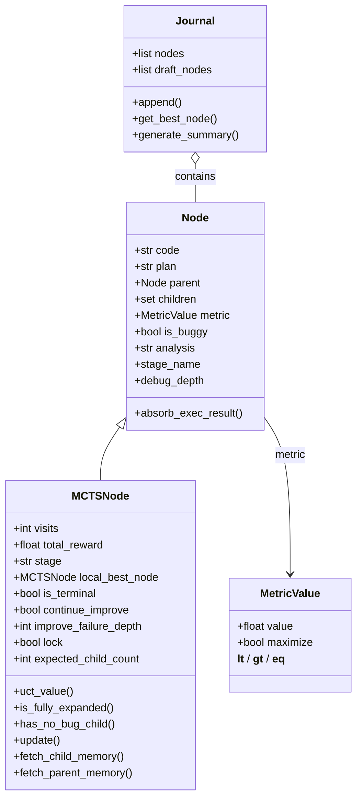
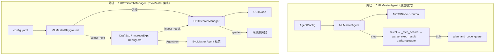

ML-Master 是一个基于**蒙特卡洛树搜索（MCTS）**的自动化机器学习智能体，用于解决 Kaggle 风格的竞赛任务。它通过"生成代码→执行→评估→迭代改进"的闭环，构建一棵不断生长的解决方案树，在有限的步数和时间预算内搜索最优解。本文深入剖析该基线的核心数据结构、MCTS 四阶段流程、双实现路径、并行搜索机制，以及它与 EvoMaster 框架的集成方式。

> 📖 **小白导读**
> - 这篇讲什么：仓库里作为对照组（baseline，即"拿来比较的基准方案"）的 ML-Master 是怎么搜索解法的，以及它和主角 DataMaster（`data_master`）有什么不同。
> - 先知道几个概念：**MCTS/UCT**（蒙特卡洛树搜索，一种"边试边记账、更常去试成绩好的分支，但也留一点机会给没试过的分支"的搜索办法，UCT 是其中给每个分支打分的公式）；**agent**（智能体，这里指"一段提示词 + 一个大模型 LLM"的组合）；**playground**（本仓库里把一整套流程串起来的"总导演"类）；**yaml**（一种配置文件格式）。
> - 读之前请注意：原文把"仓库里有的代码"和"真正会被运行的代码"混在了一起。实际上 `mcts_agent.py` 这条"独立模式"目前**无法被导入、也没有任何地方使用**，真正运行的是 `playground.py + uct.py` 这条路径。本文已按代码改正，并在相关章节逐处标注。
> - 读完能明白：ML-Master 的节点有哪三类（draft/debug/improve）、一次搜索如何循环、哪些参数是写死的、哪些 yaml 参数其实不起作用。

## 先看清：哪些代码真的在运行

先给结论，后面的章节会逐项展开：

| 项目 | 实际情况 | 依据 |
|---|---|---|
| 真正被 `python run.py --agent ml_master` 调用的类 | `MLMasterPlayground`（`core/playground.py`）+ `UCTSearchManager`/`UCTNode`（`core/utils/uct.py`） | `core/__init__.py` 只导出这些；`playground.py` 只导入 `uct.py` |
| `MLMasterAgent`、`MCTSNode`、`Journal`、`AgentConfig`、`mcts_utils.py` 的衰减函数 | **没有任何地方引用**。而且 `mcts_agent.py` 第 18 行 `from ..core import MCTSNode, Journal, ...` 会失败：`core/__init__.py` 并没有导出这些名字，所以 import 会报 ImportError（由代码阅读推断，未实际运行） | 全仓库 grep `MLMasterAgent` 只命中定义处 |
| 可调的搜索参数 | `UCTSearchConfig()` 和 `UCTDecayConfig()` 都用 Python 里的默认值，**yaml 改不了**；`deepseek_config.yaml` 里的 `agent:`、`mcts:` 段没有任何代码读取 | `playground.py` 的 `run()` |
| 总步数上限 | `max_steps = 40`，**写死在 `run()` 函数里**，不读 yaml。一个"步"指一个节点跑完（含失败节点） | `playground.py` 中 `max_steps = 40` |
| LLM 调用方式 | 四个 agent 配置里 `enable_tools: false`：agent 只发一次请求，得到文字回复就结束（没有多轮工具调用）；`config_simple.yaml` 里 `mcp.enabled: false`，不使用 MCP（让大模型能调用外部工具的一种协议）工具 | `evomaster/agent/agent.py` 约 430-436 行 |
| agent 名字 | 代码强制要求 `draft`、`debug`、`improve`、`metric` 四个 agent；`config.yaml` 里写的是 `initial/black/red/metric`（DataMaster 的名字），**对不上**，会在 `setup()` 里抛 ValueError（且 `prompts/initial` 等目录在 `playground/ml_master/prompts/` 下不存在） | `playground.py` 的 `required_slots` |

所以下文中，凡是出自 `mcts_agent.py`、`mcts_node.py`、`journal.py`、`mcts_utils.py` 的描述，都只是"这份旧实现里写了什么"，并不代表你运行时发生的事；运行时的真实行为以 `uct.py` 为准。

## 核心数据结构：从 Node 到 MCTSNode 的分层继承

> 提示：本节的 `Node`/`MCTSNode`/`MetricValue`/`Journal` 属于上面说的"未被使用的旧实现"（`MetricValue` 在 `uct.py` 里另有一份同名实现）。运行时真正的树节点是 `uct.py` 里的 `UCTNode`，字段与 `MCTSNode` 类似，只是用 `locked` 代替 `lock`。

ML-Master 的解决方案树由三层数据结构构建而成，每一层职责清晰、逐层扩展。

**Node** 是最基础的节点类，存储代码字符串（`code`）、自然语言方案（`plan`）、执行结果（`_term_out`、`exec_time`、`exc_type`）和评估信息（`metric`、`is_buggy`、`analysis`）。它通过 `parent`/`children` 构成树形拓扑，并在 `__post_init__` 中自动将自身注册到父节点的 `children` 集合中。`stage_name` 属性根据父节点是否有 bug 来推断当前阶段——若父节点 `is_buggy` 为 True 则返回 `"debug"`，否则返回 `"improve"`；无父节点则返回 `"draft"`。

Sources: [node.py](playground/ml_master/core/node.py#L12-L119)

**MCTSNode** 继承自 Node，增加了 MCTS 搜索所需的全部状态：`visits`（访问次数）、`total_reward`（累计奖励）、`stage`（显式阶段标记 `"root"`/`"draft"`/`"improve"`/`"debug"`）、`local_best_node`（子树局部最优节点）、`is_terminal`、`continue_improve`、`improve_failure_depth`、`lock`（并行锁），以及 `expected_child_count`（预期子节点计数，用于并行搜索协调）。值得注意的是，`_child_count_lock` 是一个 `threading.Lock` 实例，保证多线程环境下 `add_expected_child_count()` 和 `sub_expected_child_count()` 的原子性；同时通过 `__getstate__`/`__setstate__` 处理 pickle 序列化时锁的移除与恢复。

Sources: [mcts_node.py](playground/ml_master/core/mcts_node.py#L17-L246)

**MetricValue** 是一个 frozen dataclass，封装了带方向语义的指标值——`maximize=True` 表示越大越好，`False` 表示越小越好。它通过重载比较运算符（`__lt__`、`__gt__` 等）实现了统一的比较接口，无需在调用处判断方向。`WorstMetricValue` 子类提供最差值占位（maximize 时为 -1e9，minimize 时为 1e9），用于 bug 节点和初始状态。

Sources: [metric.py](playground/ml_master/core/metric.py#L8-L82)

**Journal** 是解决方案树的容器类，维护 `nodes` 列表和 `draft_nodes` 列表。除了 `append`、`get_best_node`、`generate_summary` 等基础方法外，它还提供了一组树结构工具函数：`get_path_to_node` 回溯从根到目标节点的路径，`filter_for_best_path` 过滤出仅包含最优路径的精简 Journal，`journal_to_string_tree` 将整棵树渲染为带 bug 标记和 metric 值的文本树形图。

Sources: [journal.py](playground/ml_master/core/journal.py#L14-L293)



## MCTS 四阶段流程：选择、扩展、模拟、反向传播

ML-Master 的 MCTS（蒙特卡洛树搜索：把"尝试过的解法"组成一棵树，反复"挑一个节点 → 在它下面生成新解法 → 运行并打分 → 把分数记回沿途所有祖先"）循环，在运行时由 `UCTSearchManager`（`uct.py`）+ `MLMasterPlayground`（`playground.py`）实现；下面按 `mcts_agent.py` 里 `MLMasterAgent.step()` 的写法讲解每个阶段，并在每节指出运行时对应的 `uct.py` 实现。注意 `MLMasterAgent` 本身当前无法导入（见上文）。

### 选择阶段（Selection）：UCT 递归下降

`select()` 方法从虚拟根节点开始，沿树向下递归选择扩展点。核心逻辑由 `is_fully_expanded_with_expected()` 和 `_uct_select()` 两个方法驱动：

- 若当前节点**未完全扩展**（`expected_child_count` 未达到上限），则检查特殊情况：如果节点有 bug 且调试成功（`is_debug_success`），或者节点标记了 `continue_improve` 且已有子节点，则继续向下选择；否则直接返回该节点作为扩展点。
- 若当前节点**已完全扩展**，则通过 `_uct_select()` 选择 UCT 值最高的子节点继续下降。

`_uct_select()` 在虚拟根节点处会**过滤掉已锁定的 draft 节点**（`child.lock == True`），防止并行搜索时多个线程同时扩展同一个 draft 分支。选中 draft 节点后立即设置 `lock = True`，形成乐观锁机制。

**运行时的真实实现**是 `UCTSearchManager.select_next()`（`uct.py`）：从虚拟根节点出发循环——节点未完全扩展时，若它是"已被成功修复的 bug 节点"或"标记 `continue_improve` 且有子节点"就用 `_uct_select` 往下走，否则返回它作为扩展点；已完全扩展则 `_uct_select` 往下走。"完全扩展"的判定是 `expected_child_count`（已创建/预期的子节点数）达到上限：根节点 5（`num_drafts`）、bug 节点 1（`num_bugs`，已有非 bug 子节点则视为已满）、普通节点 3（`num_improves`）。与旧实现不同，这里每一步 UCT 值都是**当场重新计算**的，不存在"入堆时算一次"的问题（那是 data_master 的做法）。

一个值得留意的风险（推断，未实测）：`_uct_select` 在根节点处若所有 draft 子节点都被 `locked`，会原样返回根节点；而根节点此时已"完全扩展"，`select_next` 的 while 循环就会一直返回根节点、无法退出，并且这时 `playground.py` 正持有状态锁。并行（默认 4 个 worker）且尚未跑完的 draft 都被等待中的 worker 反复"选中并上锁"时可能发生。

Sources: [mcts_agent.py](playground/ml_master/core/mcts_agent.py#L719-L768), [uct.py](playground/ml_master/core/utils/uct.py#L445-L468), [uct.py](playground/ml_master/core/utils/uct.py#L721-L739)

### UCT 公式实现

UCT 值的计算在 `MCTSNode.uct_value()` 中实现：

```
UCT = Q + c × √(ln(N) / n)
```

其中 `Q = total_reward / visits`（平均奖励），`c` 为探索常数（由衰减策略动态决定），`N` 为父节点访问次数，`n` 为当前节点访问次数。未访问节点（`visits == 0`）返回正无穷（infinity，无穷大），确保新节点优先被探索。运行时用的是 `UCTNode.uct_value(exploration_constant, parent_visits)`，公式相同。

Sources: [mcts_node.py](playground/ml_master/core/mcts_node.py#L51-L76), [uct.py](playground/ml_master/core/utils/uct.py#L326-L333)

### 扩展阶段（Expansion）：Draft / Improve / Debug 三路分支

`_step_search()` 根据被选中节点的状态决定生成策略：

| 父节点状态 | 生成方法 | 新节点 stage | local_best_node 继承 |
|---|---|---|---|
| `== virtual_root` | `_draft()` | `"draft"` | virtual_root |
| `is_buggy == True` | `_debug()` | `"debug"` | parent.local_best_node |
| `is_buggy == False` | `_improve()` | `"improve"` | parent.local_best_node |

三种生成方法都遵循相同的模式：构建阶段专属 prompt（提示词，即发给大模型的指令文本，包含任务描述、记忆、数据预览、实现指南）→ 调用 LLM（大语言模型）生成 plan + code → 创建新节点 → 增加父节点的预期计数。

运行时的对应关系：阶段由 `MLMasterPlayground._select_stage_and_inputs` 决定（`stage == "root"` → draft；`is_buggy` 或 `metric.value is None` → debug；否则 improve），然后 `search_mgr.create_child` 创建空节点（此时 `plan`、`code` 为空串，`parent.expect_child()` 把预期计数加一），再由 `DraftExp`/`DebugExp`/`ImproveExp` 去调用对应 agent。**每个 agent 只调用一次大模型，不使用工具**（`enable_tools: false`），回复里第一个代码块被当作代码，代码块之前的文字被当作 plan。

Sources: [mcts_agent.py](playground/ml_master/core/mcts_agent.py#L248-L433), [playground.py](playground/ml_master/core/playground.py#L120-L126)

### 执行与评估（Simulation）：Feedback LLM 审查

`parse_exec_result()` 方法负责评估代码执行结果。它首先通过 `absorb_exec_result()` 将终端输出、执行时间、异常信息写入节点，然后构建 review prompt 调用 feedback LLM 获取结构化评估（JSON 格式，包含 `is_bug`、`metric`、`summary`、`lower_is_better`）。bug 判定遵循**四重 OR 逻辑**：LLM 认定有 bug **或** 存在异常类型 **或** metric 为 None **或** 缺少 submission.csv 文件。

**运行时的真实流程**与上面不同：代码由 `run_code_via_bash` 用 `python solution_{节点id}.py` 跑（stdout 即程序打印的文字输出），然后由 **metric agent**（一个独立的 LLM 调用）读代码和输出，回复一段 JSON（`metric`、`is_bug`、`lower_is_better` 等，由 `parse_metric_content` 解析，解析失败就当作 bug）。再由 `build_review` 汇总：`is_bug = metric agent 说的 is_bug 或 metric 为 None`；`summary` 取 stdout 的**最后 500 个字符**（metric agent 自己写的 summary 没被使用）；最后 `ingest_result` 里再加一条：`is_buggy = is_bug 或 metric 为 None 或 没有 submission 文件`。随后还会调用评分函数 `validate_submission` 检查提交文件格式，格式非法也会被改成 bug；并有 `_check_metric_valid`（新旧指标比值超过 100 倍视为异常）兜底。

Sources: [mcts_agent.py](playground/ml_master/core/mcts_agent.py#L435-L509), [playground_helpers.py](playground/ml_master/core/utils/playground_helpers.py#L36-L47), [uct.py](playground/ml_master/core/utils/uct.py#L470-L617)

### 改进检查（Check Improvement）：局部最优与终止决策

`check_improvement()` 是控制搜索深度的关键决策点，区分非 bug 节点和 bug 节点两种路径：

**非 bug 节点路径**：计算 `improvement = new_metric - local_best_metric`（根据 maximize 方向调整）。若改进低于阈值（`metric_improvement_threshold`），且失败深度未达上限（`max_improve_failure`），则递增 `improve_failure_depth`，设 `continue_improve = True`，返回 False（继续改进）。若失败深度已达上限，则设 `is_terminal = True`，返回 True（触发反向传播）。若改进达标，则更新 `local_best_node = cur_node`，重置失败深度，继续改进。

**bug 节点路径**：若 `debug_depth >= back_debug_depth`，触发反向传播；若 `debug_depth >= max_debug_depth`，设为终止节点。

运行时的 `UCTSearchManager._check_improvement` 逻辑相同，但参数是 `UCTSearchConfig` 的默认值（写死，不读 yaml）：`metric_improvement_threshold=0.0001`、`max_improve_failure=3`、`back_debug_depth=3`、`max_debug_depth=20`、`num_bugs=1`、`num_drafts=5`、`num_improves=3`、`invalid_metric_upper_bound=100`。另外，如果父节点本身是 bug（即这是一个调试成功的节点），则直接令 `continue_improve=False` 返回，不做改进比较。需要说明：bug 节点路径里 `debug_depth >= back_debug_depth` 并没有任何额外动作，只有达到 `max_debug_depth` 才设为终止节点。

Sources: [mcts_agent.py](playground/ml_master/core/mcts_agent.py#L545-L604), [uct.py](playground/ml_master/core/utils/uct.py#L677-L719)

### 反向传播（Backpropagation）：奖励传播与状态清理

`backpropagate()` 从当前节点向根节点逐层传播，在每一层执行四项操作：更新调试成功状态（若子节点无 bug 且父节点有 bug，标记父节点 `is_debug_success = True`）、传播 `continue_improve` 标志、解锁 draft 节点（`lock = False`）、重置 `improve_failure_depth`，最后调用 `node.update(value)` 递增访问次数和累计奖励。

奖励计算由 `_get_node_reward()` 完成：bug 或无 metric 返回 -1；相比全局最优有改进则 +1；基础奖励 +1；修复了父节点的 bug 则额外 +1（总计可达 3）。

运行时的对应实现：`ingest_result` 里先处理"子节点修好了 bug 父节点 → 父节点 `is_debug_success=True` 且 `is_buggy` 改为 False"、`continue_improve` 的传递，再调用 `_backpropagate`——它只做两件事：沿父链向上，把 draft 节点的 `locked` 解开，并给每个祖先 `visits += 1`、`total_reward += reward`。奖励规则相同（bug -1；基础 +1；修好了 bug 父节点 +1；比历史最优好 +1，最高 3）。

Sources: [mcts_agent.py](playground/ml_master/core/mcts_agent.py#L511-L635), [uct.py](playground/ml_master/core/utils/uct.py#L621-L663)

## 探索常数衰减策略：从线性到动态分段

探索常数 C 控制"多愿意去试没怎么试过的分支"：C 大就偏向探索，C 小就偏向挑成绩好的。ML-Master 支持五种探索常数衰减策略。下表是旧实现（`DecayConfig` + `get_C()`，当前不会被运行）的参数；**运行时**用的是 `uct.py` 的 `UCTDecayConfig`，类型名为 `constant/linear/exponential/piecewise/dynamic_piecewise`，默认 `piecewise`，初始 C=1.414、下限 0.5、`linear_alpha=0.01`、`exponential_gamma=0.99`、`piecewise_alpha=0.01`、分段比例 (0.3, 0.7)，且 `playground.py` 直接用 `UCTDecayConfig()` 默认值，yaml 改不了。

默认 piecewise 有个特别之处：它的分界点是 `t1=round(0.3*max(current_step,1))`、`t2=round(0.7*max(current_step,1))`，也就是"当前步数的 30%/70%"，而不是总步数的 30%/70%。所以只要当前步数 t≥2，就有 t>t2，C 会立刻变成下限 0.5（推断，由公式推出，未实测）；搜索初期（t 为 0 或 1）C 约为 1.41。也就是说它实际上几乎不"衰减"，基本是常数 0.5。衰减的核心思想是：搜索初期保持高探索（偏向未访问节点），后期转向高利用（偏向高奖励节点）。

| 策略 | 公式 | 关键参数 | 适用场景 |
|---|---|---|---|
| `none` | C = initial_C（恒定） | — | 快速实验、基线对照 |
| `linear` | C = max(initial_C - α×t, lower_bound) | α=0.01 | 均匀衰减 |
| `exponential` | C = max(initial_C × γ^t, lower_bound) | γ=0.995 | 前期快速收敛 |
| `piecewise` | t<T1: C=initial; T1≤t≤T2: 线性衰减; t>T2: lower_bound | phase_ratios | 三阶段精确控制 |
| `dynamic_piecewise` | 基于节点生成速度估算总节点数，按进度比分段 | phase_ratios, α | 时间不确定的长时间搜索 |

`dynamic_piecewise_decay` 是最复杂的策略——它通过 `generation_speed = n_nodes / elapsed_time` 估算节点生成速率，再根据剩余时间推算预计总节点数 `N_est`，进而计算当前进度比例 `progress = n_nodes / N_est`。这使得衰减曲线能自适应不同的硬件速度和任务复杂度。

Sources: [mcts_utils.py](playground/ml_master/utils/mcts_utils.py#L13-L116), [mcts_agent.py](playground/ml_master/core/mcts_agent.py#L657-L706), [uct.py](playground/ml_master/core/utils/uct.py#L741-L785)

## 双实现路径：MLMasterAgent vs UCTSearchManager

代码库中存在**两套并行的 MCTS 实现**，但只有路径二在运行（路径一目前 import 就会失败，见开头）：

### 路径一：MLMasterAgent（独立模式，当前不可用）

`MLMasterAgent` 位于 `core/mcts_agent.py`，是一个**自包含的 MCTS 智能体**，直接封装了 LLM 调用（通过 `utils/llm_query.py`）、代码执行（通过 `exec_callback` 回调）、评估解析（通过 `feedback_llm`）的完整链路。它使用 `Node`/`MCTSNode`/`Journal` 数据结构，通过 `step()` 方法驱动单步搜索，支持 `plan_and_code_query`（纯 LLM 模式）和 `plan_and_code_query_with_agent`（Agent 工具调用模式）两种代码生成方式。

该路径的配置入口是 `AgentConfig`，搜索参数通过 `SearchConfig` 传递，衰减配置通过 `DecayConfig` 管理。它依赖的 `MCTSNode`、`Journal` 等没有从 `core/__init__.py` 导出，导致 `from ..core import MCTSNode, ...` 报错；全仓库也没有代码构造 `MLMasterAgent`。（该 import 失败是读代码推断，未实际运行。）

Sources: [mcts_agent.py](playground/ml_master/core/mcts_agent.py#L50-L99)

### 路径二：UCTSearchManager（EvoMaster 集成模式）

`UCTSearchManager` 位于 `core/utils/uct.py`，是专为 `MLMasterPlayground` 集成设计的**状态管理器**。它将 MCTS 逻辑与 LLM 调用解耦——`select_next()` 返回待扩展节点，`ingest_result()` 接收外部执行结果并完成评估/改进检查/反向传播。这种设计允许 Playground 层灵活编排 Agent 调用、代码执行和评测服务器交互。

该路径使用独立的 `UCTNode`（而非 `MCTSNode`）和 `MetricReview`（标准化的度量结果容器）。`UCTSearchManager` 额外集成了**提交文件格式校验**（通过 `grader` 回调调用评测服务器）和**metric 合法性防护**（`_check_metric_valid` 通过比值上界检测异常指标），这些是 `MLMasterAgent` 中不具备的安全层。

Sources: [uct.py](playground/ml_master/core/utils/uct.py#L383-L780)



## EvoMaster 集成：Playground 编排与 Worker 并行

### MLMasterPlayground 的编排逻辑

`MLMasterPlayground` 注册为 `"ml_master"` 类型的 Playground，是路径二的核心编排器。它的 `run()` 方法构建了一个完整的搜索循环：

0. **准备**：`setup()` 检查配置里必须有 `draft`、`debug`、`improve`、`metric` 四个 agent（缺任何一个抛 ValueError），并尝试把任务目录下 `prepared/baseline.json`、`prepared/grade.py` 用软链接（symlink，一种指向别处文件的快捷方式）放进工作区（workspace，程序运行时存放输入输出文件的目录）。

1. **初始化**：创建 `UCTSearchManager`（含搜索配置、衰减配置、grader 回调）、为每个 worker 索引创建独立的 Agent 副本（`_create_worker_agents`），配置 workspace 隔离（`split_workspace_for_exp` 时每个 worker 有独立子目录）。

2. **Worker 循环**：每个 worker 线程在 `worker_loop` 中反复执行：获取状态锁 → 调用 `search_mgr.select_next()` 选择节点 → 判断阶段（`_select_stage_and_inputs`）→ 创建子节点 → 释放锁 → 执行 `_run_one_node` → 重新获取锁 → `ingest_result` 写回结果 → 更新最佳状态。具体地：每个 worker（并行干活的线程）进入循环先查 `current_step >= max_steps`（`max_steps = 40`，写死在 `run()` 里）；若选出的节点还没被评估完（`is_buggy is None`）就 `sleep(0.1)` 再试。因为"步数检查在选节点之前、步数在结果写回后才加一"，4 个 worker 并行时最后可能多跑几个节点，总数会略超过 40（推断）。线程锁（`state_lock`，同一时刻只让一个线程改共享数据的"门锁"）只保护选点和写回，真正耗时的"调用大模型 + 跑代码"在锁外。

   并行 worker 数来自 yaml 的 `session.local.parallel.max_parallel`（两份基线 yaml 都是 4；`enabled` 为 false 时退化为 1），且两份 yaml 都设了 `split_workspace_for_exp: true`，所以每个 worker 有自己的 `exp_0`~`exp_3` 子目录（与 data_master 默认共用一个 workspace 不同）。

3. **阶段路由**：`_select_stage_and_inputs` 根据目标节点状态决定执行哪种实验——`stage == "root"` 时为 draft，`is_buggy or metric is None` 时为 debug，否则为 improve。对应的 `DraftExp`/`DebugExp`/`ImproveExp` 各自封装了 prompt 组装、Agent 调用、代码执行、metric 解析的流程。

Sources: [playground.py](playground/ml_master/core/playground.py#L32-L399)

### 实验执行：NodeExp 基类与三种子类

（"exp"即 experiment，这里指"对一个节点做的一次完整尝试"。）

`NodeExp` 是所有实验的基类，持有 agent、metric_agent、session、workspace 等共享依赖，并提供 `_run_metric_agent()` 方法统一处理 metric 解析。三个子类的差异在于 prompt 格式参数和返回结构：

| 实验 | 输入参数 | Agent 类型 | 输出 |
|---|---|---|---|
| `DraftExp` | task_description, memory | draft_agent | plan, code, exec, metric |
| `DebugExp` | task_description, prev_code, term_out, issue | debug_agent | code, exec, metric |
| `ImproveExp` | task_description, best_code, best_metric, memory, term_out | improve_agent | plan, code, exec, metric |

所有实验通过 `run_code_via_bash()` 执行代码——它将代码写入 `solution_{node_id}.py`，然后模拟一个 OpenAI tool call（`BashTool`）经由 Agent → Session 链路执行，确保执行过程在框架的会话管理之下。

Sources: [draft_exp.py](playground/ml_master/core/exp/draft_exp.py#L19-L57), [debug_exp.py](playground/ml_master/core/exp/debug_exp.py#L14-L51), [improve_exp.py](playground/ml_master/core/exp/improve_exp.py#L19-L66), [runtime.py](playground/ml_master/core/utils/runtime.py#L41-L64)

### 节点快照与轨迹记录

每次节点创建和完成时，`save_node_snapshot()` 将节点状态序列化为 JSON 文件（包含 stage、metric、reward、visits、UCT 值等，写在 `logs/uct_nodes/{节点id}.json`），同时维护一棵完整的 `logs/uct_nodes/node.json` 树快照供可视化使用。轨迹记录（`append_trajectory`）则捕获每步的时间戳、阶段、节点 ID、父节点、bug 状态、metric 等信息。

Sources: [playground_helpers.py](playground/ml_master/core/utils/playground_helpers.py#L61-L193)

## 配置体系：从 YAML 到运行时参数

ML-Master 提供三套配置文件，适配不同的使用场景：

| 配置文件 | 特点 | 适用场景 |
|---|---|---|
| `config.yaml` | 四 Agent 槽位写的是 initial/black/red/metric（DataMaster 的名字），MCP 启用，4 并行 | **与 `MLMasterPlayground` 不匹配**：代码要求 draft/debug/improve/metric，缺失会抛 ValueError；而且 `prompts/initial` 等目录在 `playground/ml_master/prompts/` 下并不存在。`run.py --agent ml_master` 不指定 `--config` 时默认读的恰好是它（`configs/{agent}/config.yaml`），所以必须手动加 `--config configs/ml_master/config_simple.yaml` |
| `config_simple.yaml` | 四 Agent 槽位（draft/debug/improve/metric），`enable_tools: false`，MCP 禁用，4 并行，各 worker 独立 workspace | 真正可用的 ML-Master 基线配置，prompt 目录 `playground/ml_master/prompts/{draft,debug,improve,metric}/` 与之对得上 |
| `deepseek_config.yaml` | 只有 `llm/agent/mcts/session/mcp/...` 段，**没有 `agents` 段**；`agent:`、`mcts:` 两段没有任何代码读取 | 旧版 `MLMasterAgent` 的配置遗留，当前基本是死配置（未验证是否有外部脚本使用） |

补充：配置文件里的 `${DATA_ROOT}` 之类变量由 EvoMaster 的配置加载器在 yaml 里展开（详见相关文章）；`config_simple.yaml` 的 `symlinks` 里还写死了某个具体任务（`detecting-insults-in-social-commentary`）的数据目录，换任务要手动改。

下面的 `AgentConfig` 是**旧实现 `mcts_agent.py` 的参数表**（当前不被任何代码使用），仅供理解旧设计；运行时参数见前文的 `UCTSearchConfig` 默认值：

| 参数 | 类型 | 默认值 | 说明 |
|---|---|---|---|
| `steps` | int | 500 | 最大搜索步数 |
| `time_limit` | int | 43200 | 时间限制（12 小时，秒） |
| `code_model` | str | "gpt-4" | 代码生成模型 |
| `code_temp` | float | 0.5 | 代码生成温度 |
| `feedback_model` | str | "gpt-4o" | 反馈评估模型 |
| `feedback_temp` | float | 0.0 | 反馈评估温度 |
| `num_drafts` | int | 5 | Draft 节点最大子节点数 |
| `num_bugs` | int | 3 | Bug 节点最大调试次数 |
| `num_improves` | int | 3 | Normal 节点最大改进次数 |
| `parallel_search_num` | int | 3 | 并行搜索线程数 |
| `exploration_constant` | float | 1.414 | UCT 探索常数 C |
| `metric_improvement_threshold` | float | 0.001 | 改进阈值 |
| `max_improve_failure` | int | 2 | 最大改进失败次数 |
| `max_debug_depth` | int | 3 | 最大调试深度 |
| `back_debug_depth` | int | 1 | 回退调试深度 |
| `steerable_reasoning` | bool | False | 启用推理模式（提取 `` 后内容） |
| `check_format` | bool | False | 启用提交格式验证 |
| `preprocess_data` | bool | False | 启用数据预处理 |
| `use_agent_mode` | bool | False | 使用 Agent 框架（支持多轮工具调用） |
| `max_turns` | int | 10 | Agent 模式每轮最大对话数 |

Sources: [mcts_agent.py](playground/ml_master/core/mcts_agent.py#L50-L98), [deepseek_config.yaml](configs/ml_master/deepseek_config.yaml#L44-L82)

## 全局状态维护：虚拟根、锁机制与局部最优

### 虚拟根节点

MLMasterAgent 在初始化时创建一个 `stage="root"` 的虚拟根节点，所有 draft 节点都是它的直接子节点。这一设计使得多个独立的初始方案分支共享统一的搜索起点，UCT 选择从虚拟根开始下降，自然地在不同 draft 分支之间分配搜索预算。

Sources: [mcts_agent.py](playground/ml_master/core/mcts_agent.py#L157-L165)

### 并行协调：锁与预期计数

并行搜索面临的核心问题是多个线程可能同时选择同一个节点进行扩展。ML-Master 采用**乐观锁 + 预期计数**的双重机制解决这一问题：

- **Draft 节点锁**：`_uct_select()` 在虚拟根处选中 draft 节点后立即设 `lock = True`，其他线程在过滤时跳过已锁定节点。锁在 `backpropagate()` 中释放。
- **预期子节点计数**：`add_expected_child_count()` 在节点创建**之前**原子递增父节点的 `expected_child_count`，使 `is_fully_expanded_with_expected()` 能在子节点实际创建完成前就阻止过度扩展。

Sources: [mcts_node.py](playground/ml_master/core/mcts_node.py#L103-L125), [mcts_agent.py](playground/ml_master/core/mcts_agent.py#L756-L768)

### 局部最优追踪

每个 MCTSNode 维护 `local_best_node` 指针，记录其子树中的最优节点。新建 improve/debug 节点时继承父节点的 `local_best_node`；当新节点改进达标时，将 `local_best_node` 更新为自身。`check_improvement()` 使用 `local_best_node.metric` 作为改进基准，而非全局最优——这使得不同分支的改进评估相互独立，避免了一个强分支"压制"其他分支的探索。

Sources: [mcts_agent.py](playground/ml_master/core/mcts_agent.py#L545-L604)

## 记忆机制：上下文组装与跨节点知识传递

ML-Master 的 prompt 组装中有一个关键的"记忆"（Memory）组件，由 `fetch_child_memory()` 和 `fetch_parent_memory()` 两个方法提供。运行时用的是 `uct.py` 里 `UCTNode` 的同名方法（下面引用的 `mcts_node.py` 是旧实现，逻辑相同）。具体用法：draft 阶段取"虚拟根节点的子节点们"的记忆，其他阶段取"被选中节点的子节点们"的记忆（`playground.py` 的 `memory = search_mgr.root.fetch_child_memory() if stage == "draft" else target.fetch_child_memory()`）。其中 `Design:` 是节点的 plan（ml_master 里 plan 是 agent 回复中代码块之前的文字，所以非空；这点与 data_master 不同），`Results:` 是节点的 `analysis`，即 stdout 的最后 500 个字符。

`fetch_child_memory()` 遍历当前节点的所有子节点，为每个已评估的子节点生成格式化的摘要（包含 Design、Results、Validation Metric），用 `-------------------------------` 分隔。bug 子节点的摘要会附加洞察提示："Using a different approach may not result in the same bugs"。这一记忆被注入 draft 和 improve 的 prompt 中，使 LLM 能参考同级的失败/成功经验。

`fetch_parent_memory()` 在父节点为非 bug 节点时，生成父节点的设计和结果摘要，用于 improve prompt 中提供"待改进的基础方案"的上下文。

Sources: [mcts_node.py](playground/ml_master/core/mcts_node.py#L154-L205), [uct.py](playground/ml_master/core/utils/uct.py#L338-L378)

## Agent 模式：从单次 LLM 调用到多轮工具交互

> 注意：`use_agent_mode` 只存在于旧实现 `mcts_agent.py`/`llm_query.py` 中，当前运行路径不读取它。运行时是否"多轮工具交互"取决于 agent 配置里的 `enable_tools`：`config_simple.yaml` 里四个 agent 都是 `false`（只发一次请求，得到文字回复就结束，`agent.py` 约 430-436 行）；`config.yaml` 里 `enable_tools` 也是 `false`，只是工具与 MCP 配置还留着。

当 `use_agent_mode=True` 时（旧实现），代码生成从单次 LLM 调用升级为 Agent 多轮交互。`plan_and_code_query_with_agent()` 创建一个 EvoMaster `Agent` 实例，注入 system prompt 和 tool usage instructions，让 LLM 可以使用 `execute_bash`、`str_replace_editor`、`think` 等工具在生成代码前进行探索性操作（如查看数据文件、测试代码片段）。Agent 运行最多 `max_turns` 轮后，从最终对话中提取 plan 和 code。

这一模式的优势在于 LLM 能获得环境反馈（如数据文件结构、包可用性），生成更贴合实际环境的代码；代价是每步搜索的 LLM 调用次数大幅增加。

Sources: [llm_query.py](playground/ml_master/utils/llm_query.py#L264-L364)

## 与原始 ML-Master 的差异

| 维度 | 原始 ML-Master | playground 版本 |
|---|---|---|
| MCTS 核心 | ✅ 完整 | ✅ 完整（双实现） |
| Draft/Improve/Debug | ✅ | ✅ |
| Steerable Reasoning | ✅ | ✅ |
| 提交格式验证 | ✅ | ✅（集成评测服务器） |
| 数据预处理 | ✅ | ✅ |
| 并行代码执行 | ✅ 多进程 | ⚠️ 框架线程池 |
| EvoMaster 集成 | ❌ | ✅ |
| Agent 工具调用模式 | ❌ | ✅ |
| Metric 合法性防护 | ❌ | ✅（UCTSearchManager） |
| 节点快照可视化 | ❌ | ✅ |

Sources: [README.md](playground/ml_master/README.md#L766-L779)

> 上表中"Agent 工具调用模式""Metric 合法性防护""节点快照可视化"等行是原文自行补充的，README 的对比表里没有这几行；其中"Agent 工具调用模式"对应的 `use_agent_mode` 在当前运行路径里并不生效（见上文）。（未验证原始 ML-Master 项目本身的功能。）

### 与 data_master（DataMaster）的主要差异

| 维度 | ml_master（本文） | data_master |
|---|---|---|
| 节点类型 | `draft`/`debug`/`improve`，由父节点状态决定 | `initial`/`black`/`red`（另有规则式黑节点），需要的 agent 名不同 |
| 一个节点里的 LLM 调用 | agent 只调一次大模型，不用工具（`enable_tools: false`）；另有一次 metric agent 调用解析分数 | agent 可调用 MCP 工具（如搜索、运行代码）做多轮探索（见相关文章） |
| MCP 工具 | `config_simple.yaml` 里 `mcp.enabled: false` | 启用 |
| 总步数 | `max_steps = 40`，写死在 `playground.py` 的 `run()` 中 | 由任务 yaml 里的 `max_steps` 控制（读取自 `self.config.max_steps`；生成脚本默认 150，见相关文章） |
| 搜索参数能否用 yaml 改 | 不能，`UCTSearchConfig()`/`UCTDecayConfig()` 用默认值 | 衰减参数同样用默认值（见相关文章） |
| 工作区 | 默认每个 worker 独立 `exp_N` 子目录 | 默认 4 个 worker 共用同一个 workspace |
| 节点选择 | 每次选点时当场算 UCT | 入堆时算一次 UCT，phase 2 从堆里弹出 |

## 后续阅读

- **并行执行机制**的框架级实现细节可参考 [并行执行机制：Worker 循环与事件驱动节点扩展](10-bing-xing-zhi-xing-ji-zhi-worker-xun-huan-yu-shi-jian-qu-dong-jie-dian-kuo-zhan)
- **UCT 搜索算法**在 DataTree 中的对应实现可参考 [UCT 搜索算法：节点选择、奖励更新与衰减策略](9-uct-sou-suo-suan-fa-jie-dian-xuan-ze-jiang-li-geng-xin-yu-shuai-jian-ce-lue)
- **评测服务器**的部署与 API 细节可参考 [Grading Server：评测服务器部署、健康检查与 API 接口](24-grading-server-ping-ce-fu-wu-qi-bu-shu-jian-kang-jian-cha-yu-api-jie-kou)
- **Prompt 模板**的完整组装逻辑可参考 [Prompt 模板工程：Initial 四种模式与节点级提示词组装](23-prompt-mo-ban-gong-cheng-initial-si-chong-mo-shi-yu-jie-dian-ji-ti-shi-ci-zu-zhuang)
- **消融实验**中 ML-Master 各组件的开关效果可参考 [组件消融实验：use_red_node / use_memory / black_mode 开关](29-zu-jian-xiao-rong-shi-yan-use_red_node-use_memory-black_mode-kai-guan)
