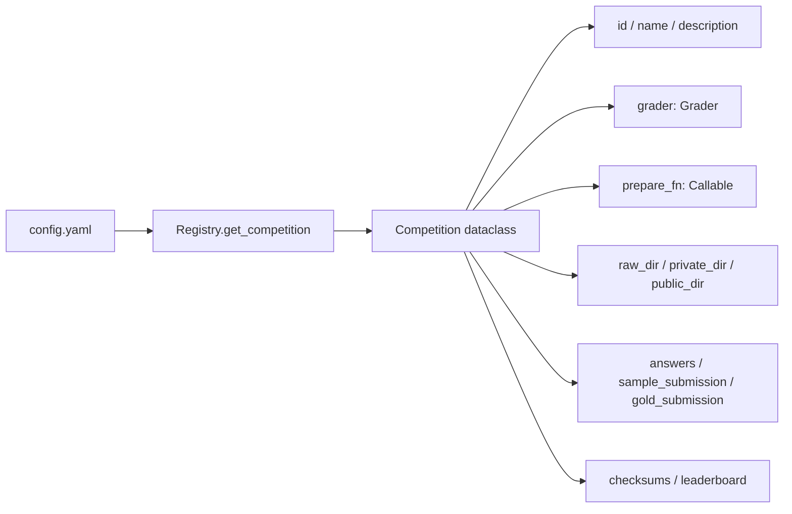
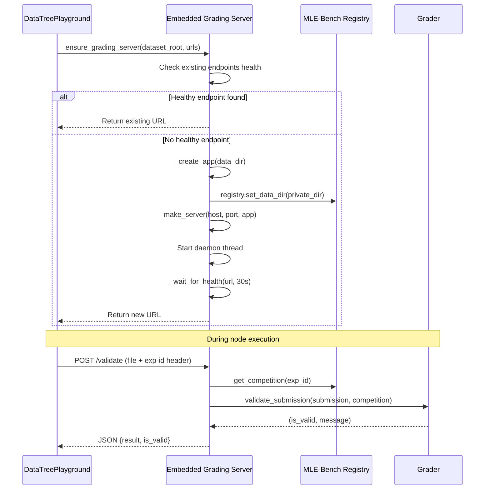
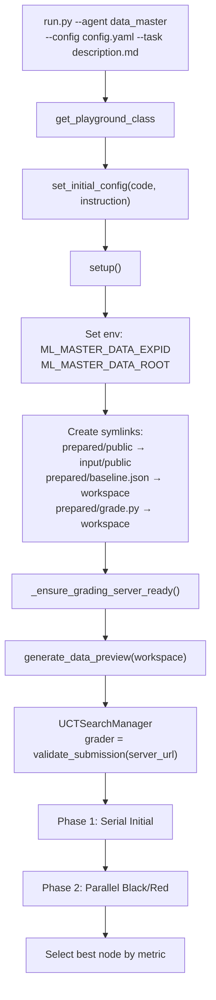
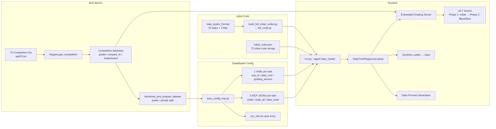

DataMaster 在 MLE-Bench 的 75 个 Kaggle 竞赛任务上构建了一套完整的配置定制体系。这个体系不是简单的参数映射，而是从竞赛注册、数据准备、评测服务器、初始代码注入到任务级 YAML/MCP 配置生成的全链路工程。本文将系统解析这条链路的每一环，揭示 75 个任务如何从原始 Kaggle 竞赛 ID 转化为 DataMaster 可执行的搜索实验。

> 📖 **小白导读**
> - 这篇讲什么：评测基准 MLE-Bench（把 Kaggle 数据科学比赛做成"机器学习智能体考试"的开源项目）是怎么接进 DataMaster 的，以及仓库里 75 个比赛各自的配置文件是怎么来的。
> - 先知道几个概念：**Kaggle**（数据科学竞赛平台）；**metric**（指标，即给方案打分的数字，如准确率）；**yaml/json**（两种配置文件格式）；**template（模板）**（带"填空位"的文件，脚本把空填上就得到具体配置）；**grading server（评分服务器）**（一个小网站，接收提交文件并检查格式、打分）。
> - 读完能明白：75 个比赛从哪里列出来、数据要先怎么准备、配置文件由谁生成、以及**当前仓库里"生成脚本"和"已生成配置"其实对不上**（本文用"重要提示"标出）。
> - 本文的"仓库只能在 Linux 上安装运行"（`pyproject.toml` 限定 linux，且大量使用 `taskset`、`os.killpg`、`/tmp` 等 Linux 特性）；Windows 下只适合读代码。

> **重要提示（核对结果）**：仓库里 `scripts/auto_config_exp.py` 当前不能直接跑通，已生成的 yaml 也与当前模板不一致，详见"DataMaster 的任务级配置生成"一节。另外，MLE-Bench 默认只给 75 个比赛中的一部分提供数据（README 中 `DATA_ROOT` 指向 "mle-bench-lite"），数据本身不在仓库里（`README.md` 第 173 行附近：仓库不含数据集）。

## MLE-Bench 的竞赛注册体系

MLE-Bench 的核心是一个 **竞赛注册表（Registry）**，它将 Kaggle 竞赛抽象为标准化的 `Competition` 数据类。每个竞赛通过 `config.yaml` 定义其完整元数据，包括 ID、名称、描述、评分器（Grader）、答案路径、样本提交路径、竞赛类型、数据准备函数以及原始/私有/公共数据目录。

`Competition` 是一个 frozen dataclass（"冻结的数据类"：创建后字段不能再被修改），包含 14 个不可变字段，在 `__post_init__` 中对每个字段执行类型断言和空值检查。`Registry.get_competition()` 方法通过读取竞赛目录下的 `config.yaml`，加载描述文件，导入数据准备函数，并构建 raw/private/public 三级数据路径来组装完整的 `Competition` 对象。

Sources: [registry.py](mle-bench/mlebench/registry.py#L16-L116)

注册表提供了三种竞赛集合的枚举方式：`list_competition_ids()` 递归扫描所有 `config.yaml` 获取全部竞赛 ID；`get_lite_competition_ids()` 从 `splits/low.txt` 读取低复杂度竞赛子集（共 22 个）；而 75 个任务的完整列表则定义在 `splits/split75.txt` 中。

Sources: [registry.py](mle-bench/mlebench/registry.py#L118-L152), [split75.txt](mle-bench/experiments/splits/split75.txt#L1-L75), [low.txt](mle-bench/experiments/splits/low.txt#L1-L22)

## 75 个任务的分集与组织

`split75.txt` 列出了完整的 75 个竞赛 ID，涵盖计算机视觉（如 `dog-breed-identification`、`histopathologic-cancer-detection`）、自然语言处理（如 `jigsaw-toxic-comment-classification-challenge`、`spooky-author-identification`）、表格数据（如 `tabular-playground-series-dec-2021`、`new-york-city-taxi-fare-prediction`）和音频处理（如 `tensorflow-speech-recognition-challenge`、`freesound-audio-tagging-2019`）等多个 ML 子领域。

此外，`experiments/splits/` 目录还提供了按复杂度划分的其他分集文件：

| 文件 | 用途 | 竞赛数 |
|------|------|--------|
| `split75.txt` | 完整 75 任务集 | 75 |
| `low.txt` | MLE-Bench Lite（低复杂度） | 22 |
| `medium.txt` | 中等复杂度子集 | 38 |
| `high.txt` | 高复杂度子集 | 15 |
| `dev.txt` | 开发调试用子集 | 7 |
| `systemcard.txt` | 系统卡片评估子集 | 30 |
| `spaceship-titanic.txt` | 单个竞赛（调试用） | 1 |

（竞赛数按非空行统计；多数文件末行没有换行符，用 `wc -l` 会少算 1，例如 `split75.txt` 是 75 行内容但 `wc -l` 显示 74。）

Sources: [split75.txt](mle-bench/experiments/splits/split75.txt#L1-L75), [low.txt](mle-bench/experiments/splits/low.txt#L1-L22)

## 数据准备流水线：从 Kaggle 到 public/private 分片

`download_and_prepare_dataset()` 是数据准备的核心函数，它执行以下流水线：校验 `prepare_fn` 签名 → 确保 leaderboard 存在 → 创建 raw/prepared 目录 → 下载竞赛 zip → 校验 checksum → 解压到 raw → 调用竞赛专属的 `prepare_fn(raw, public, private)` 生成训练/测试分片 → 写入 `description.md` → 生成并校验 checksums。

每个竞赛的 `prepare_fn` 是一个参数名依次为 `(raw, public, private)` 的可调用对象（`is_valid_prepare_fn` 要求参数名严格是 `raw, public, private` 且顺序固定；原文把 private 和 public 写反了），通过 `import_fn(config["preparer"])` 从配置中的字符串路径动态导入。这个函数负责将原始 Kaggle 数据切分为 **public**（Agent 可见的训练数据 + 测试特征）和 **private**（仅评测服务器可见的答案）两部分。

Sources: [data.py](mle-bench/mlebench/data.py#L37-L150)

## 运行前必须有的数据目录：prepared 下的文件从哪来

DataMaster 运行时假设每个比赛的数据放在 `${DATA_ROOT}/<exp_id>/prepared/` 下。代码里（`_ensure_prepared_links`、`_submission_utils.py` 的 `_grade_via_subprocess`）用到的文件有：

| 路径 | 谁在用 | 仓库里能否找到生成脚本 |
|---|---|---|
| `prepared/public/`（训练数据、`description.md` 等） | 软链接成 `workspace/input/public`；任务描述也常从这里读（README 示例） | 能：由 `mlebench prepare -c <竞赛id>`（`download_and_prepare_dataset` 调 `prepare_fn`）生成 |
| `prepared/private/*.csv`（标准答案） | 评分时取排序后第一个 csv 作为答案 | 能：同上（MLE-Bench 的 private 目录） |
| `prepared/grade.py` | 评分兜底方式：`python grade.py -g <答案csv> -s <提交csv>` | **找不到**。全仓库没有任何脚本生成它（MLE-Bench 的评分是 `mlebench` 里的 `Grader`，不是 `grade.py`） |
| `prepared/baseline.json` | 被软链接到 workspace（data_master 链到 `workspace/baseline.json`，ml_master 链到 `workspace/input/baseline.json`）；`data_preview` 只跳过 `input/baseline.json` | **找不到**生成脚本，内容格式也无从核对 |
| `input/val.csv`（固定验证集） | 若存在，提示词和 `initial_code/` 里的 data_loader 会优先用它而不是随机划分 | **找不到**生成脚本；也未见 MLE-Bench 的 `prepare` 生成它（未验证 prepare 函数是否都不产生） |

结论：`grade.py`、`baseline.json`、`val.csv` 看起来来自作者自己的（未随仓库发布的）数据准备流程；只用 `mlebench prepare` 得到的目录**不包含**它们。缺少 `grade.py` 时，评分兜底会抛 `ValueError("grade.py does not exist!")`（`_submission_utils.py` 约 1258-1260 行）。（以上"找不到"均指在本仓库内全文搜索无结果，不排除存在仓库外的脚本。）

### 取得 MLE-Bench 数据与 Windows 注意事项

MLE-Bench 的部分数据用 Git LFS 存放（LFS 是 Git 的"大文件扩展"：仓库里只放一个小指针，真正的大文件另外下载）。`mle-bench/.gitattributes` 把所有 `*.csv`、`mlebench/competitions/*/top_solutions/**`、`runs/**/*.json(l)` 设成 LFS 文件。官方 README（`mle-bench/README.md` 第 103-108 行）要求安装 git-lfs 后执行 `git lfs fetch --all` 和 `git lfs pull`。

在 Windows 上检出这个仓库可能遇到：路径太长导致检出失败（需要先 `git config core.longpaths true`）；LFS 文件在检出时自动下载太慢或失败（可先设置环境变量 `GIT_LFS_SKIP_SMUDGE=1` 跳过，之后再按需 `git lfs pull`）。这两条是常见的 Git/LFS 用法，并非仓库自带文档的内容（未在本仓库实测）。再次提醒：本项目只能在 Linux 上安装运行，Windows 只适合阅读代码。

## 评测体系：Grader 与奖牌阈值

MLE-Bench 的评测体系由三层构成：**评分函数 → 排名计算 → 奖牌判定**。

`Grader` 类封装了竞赛专属的评分函数（通过 `import_fn` 从字符串路径动态导入），并提供两个核心方法：`__call__()` 执行评分并返回保留 5 位小数的分数；`rank_score()` 根据竞赛 leaderboard 将分数映射为金/银/铜牌和中位数阈值。

奖牌阈值的计算严格遵循 Kaggle 的晋级规则，按参赛队伍数量分四档：

| 队伍数 | 金牌阈值 | 银牌阈值 | 铜牌阈值 |
|--------|----------|----------|----------|
| 1–99 | 前 10% | 前 20% | 前 40% |
| 100–249 | 前 10 名 | 前 20% | 前 40% |
| 250–999 | 前 (10 + 0.2%) 名 | 前 50 名 | 前 100 名 |
| ≥1000 | 前 (10 + 0.2%) 名 | 前 5% | 前 10% |

`is_lower_better()` 方法通过比较 leaderboard（排行榜）首尾分数自动判断优化方向——如果第一名分数低于最后一名，则越低越好。注意：这个方法只在 MLE-Bench 自己的 `rank_score()`（奖牌判定）里用到；DataMaster 的搜索并**不**调用它，搜索里的"越大越好还是越小越好"来自 metric agent（负责读运行输出并给出分数的那个 LLM agent）返回 JSON 里的 `lower_is_better` 字段（`playground_helpers.py` 的 `build_review`），test-feedback 模式下则由 `--force-minimize/--force-maximize` 强制。原文"贯穿 UCT 奖励计算"的说法不准确。

Sources: [grade_helpers.py](mle-bench/mlebench/grade_helpers.py#L14-L159), [grade.py](mle-bench/mlebench/grade.py#L52-L95)

## Grading Server：嵌入式评测服务

DataMaster 对 MLE-Bench 的评测服务器进行了**双层适配**——既支持 MLE-Bench 原生的 Docker 内 Flask 服务器，又实现了自有的嵌入式 grading server。

MLE-Bench 原生的 `grading_server.py` 是一个 Flask 应用（Flask 是 Python 里写小型网站/接口的常用库），监听 5003 端口，提供 `/validate`（POST 提交校验）和 `/health`（GET 健康检查）两个端点。它通过环境变量 `COMPETITION_ID` 获取当前竞赛 ID（一个容器只服务一个竞赛，私有数据固定在 `/private/data`），调用 `validate_submission()` 执行格式校验。

DataMaster 的 `grading_server.py` 在此基础上实现了**线程安全的懒启动嵌入式服务器**。`ensure_grading_server()` 方法采用三步策略：(1) 优先检查候选 URL 是否已有健康端点，有则直接复用；(2) 若当前进程已启动过服务器但尚未就绪，等待其健康；(3) 若都不行，则在本地 `_pick_bind_target()` 选定的端口上启动新的 Flask 服务器。端口选择策略是：优先使用配置中的候选 URL，若端口被占用则从默认端口向上扫描 200 个端口。

关键区别在于：MLE-Bench 原生服务器靠环境变量 `COMPETITION_ID` 固定只服务一个竞赛（原文说它也用 header，是错的）；DataMaster 嵌入式服务器则读取请求头（HTTP header，请求附带的元信息）`exp-id` 来决定校验哪个竞赛，因此一个服务器可以校验多个竞赛。两者的 `/validate` 都把上传文件存到固定的 `/tmp/submission_to_validate.csv`，并发请求会互相覆盖（推断）。DataMaster 版返回 JSON 里多了 `is_valid` 字段。

另外要知道，`DataTreePlayground` 里其实有**两套**拉起评分服务器的代码：(1) `run()` 开头和每个节点开头调用 `_ensure_grading_server_ready()`：先看 yaml `grading_servers`（要求恰好一个 URL）的 `/health` 是否正常，不正常则 `_start_grading_server_process()` 另起一个子进程（subprocess，由当前程序启动的独立程序）；但该函数拼出的启动脚本路径是 `<仓库根>/search_dataset_tools/operate_submission/grading_server_runner.py`，少了 `playground/` 一层，仓库里这个文件并不存在，所以会抛 RuntimeError（`playground.py` 约 143-201 行）；(2) 上面说的嵌入式服务器（`core/utils/grading_server.py`），在节点结算、校验提交文件时由 `core/utils/grading.py` 的 `validate_submission` 按需拉起。所以实际使用时，**最稳妥的做法是先自己启动评分服务并让 yaml 里的 `grading_servers` 指向它**（该启动方式的具体命令未在仓库中找到，未验证）。

Sources: [grading_server.py](mle-bench/environment/grading_server.py#L1-L44), [grading_server.py](playground/data_master/core/utils/grading_server.py#L36-L233), [playground.py](playground/data_master/core/playground.py#L143-L255)

## DataMaster 的任务级配置生成

`auto_config_exp.py` 是连接 MLE-Bench 竞赛与 DataMaster 搜索实验的**配置生成器**。它通过交互式输入（`input()` 逐项提问，不是命令行参数——虽然文件头的用法注释写的是命令行参数形式）获取实验名称、任务路径、端口、数据根目录、LLM 配置、`max_steps` 等参数，然后执行三步生成流程：

**步骤 1：生成 MCP 配置文件。** 从三个基础模板（`base_initial.json`、`base_all.json`、`base_datanode.json`）深拷贝，通过 `set_mcp_env()` 将每个 MCP server 的环境变量替换为实际值：`ML_MASTER_DATA_ROOT` → 数据根目录、`ML_MASTER_DATA_EXPID` → 竞赛 ID（去掉后缀的纯净名称）、`ML_MASTER_GRADING_SERVERS` → 评分服务器 URL。生成三份配置：`initial_{exp_name}.json`（Initial 节点用）、`node_all_{exp_name}.json`（全局工具集）、`data_node_{exp_name}.json`（Black/Red 节点用）。

**步骤 2：生成 YAML 配置文件。** 使用 Python `string.Template` 对 `config_base.yaml` 模板执行占位符替换，注入 `exp_id`、`data_root`、`grading_server`、三个 MCP 文件路径、LLM 配置和 `max_steps`。

**步骤 3：更新 `run_mle.sh`。** 在 shell 脚本（一串 Linux 命令组成的文件）的 `case` 语句中插入新的实验入口，包含 `--agent data_master`、`--config`、`--task` 以及可选的 `--initial-code` 和 `--initial-instruction` 参数。**但 `run_mle.sh` 在当前仓库里并不存在**（仓库根目录没有这个文件，`mle-bench/` 下只有 `run.sh`，用途不同），而 `update_run_mle_sh` 会直接 `open()` 它，因此第 3 步会因文件不存在而报错；此时第 1、2 步的 json/yaml 已经生成完毕（外层 `try/except` 会打印错误并返回 1）。

> **重要提示：脚本与模板对不上（静态核对，未实际运行）**
> - `config_base.yaml` 模板里有 `$use_red_node`、`$use_memory` 两个占位符（第 285-286 行），但 `generate_yaml_config` 调用 `Template.substitute(...)` 时没有传这两个变量，`substitute` 对缺失变量会抛 `KeyError`。
> - 此外模板第 16-18 行是 `"${LLM_MODEL}"`、`"${LLM_API_KEY}"`、`"${LLM_BASE_URL}"`，第 166 行的注释里还有 `${DATA_ROOT}`。`string.Template` 把 `${名字}` 也当作占位符，所以这些同样会因没提供而抛 `KeyError`。换句话说，当前模板和脚本组合起来基本不可能成功生成。
> - 脚本向 `substitute` 传了 `llm_model/llm_api_key/llm_base_url`，但当前模板里已没有对应的 `$llm_*` 占位符（多传的参数不会报错，只是无效）。`black_mode` 不在模板里。
> - 仓库里已有的 88 份 yaml 全都**没有** `ablation` 段（与当前模板不一致），说明它们是用**旧版模板**生成的；它们里的 `model:` 有 `Vendor3/glm-5`（70 份）、`Vendor2/GPT-5.3-codex`（13 份）、`claude-haiku-4-5-20251001`（4 份）、`${LLM_MODEL}`（9 份）几种，也说明历史上模板不止一版。
> - 因此：想批量生成新任务配置，要么先给模板/脚本补齐变量，要么直接复制一份现有 yaml 手改（改 `exp_id`、MCP 路径、`grading_servers`）。没有 `ablation` 段时，运行时默认红节点开启、记忆开启（见第 29 篇）。

Sources: [auto_config_exp.py](scripts/auto_config_exp.py#L55-L168), [auto_config_exp.py](scripts/auto_config_exp.py#L424-L533)

### 三类 MCP 配置的工具差异

| 配置类型 | MCP Servers | 用途 |
|----------|-------------|------|
| `initial_*.json` | `operate_submission_for_initial` + `memory_tree` | Initial 节点：代码提交 + 记忆树 |
| `node_all_*.json` | `operate_submission_for_initial` + `operate_submission` + `memory_tree` + 4 个搜索工具 | 全局工具集（nouse agent） |
| `data_node_*.json` | `operate_submission` + `memory_tree` + 4 个搜索工具 | Black/Red 节点：数据操作 + 搜索 |

其中 4 个搜索工具为 `search_web`、`search_github`、`search_huggingface`、`search_scholar`，各自携带独立的环境变量（`SERPER_API_KEY`、`GITHUB_TOKEN`、`HF_TOKEN` 等）。

Sources: [base_initial.json](configs/data_master/base_initial.json#L1-L26), [base_datanode.json](configs/data_master/base_datanode.json#L1-L65), [base_all.json](configs/data_master/base_all.json#L1-L76)

### 配置模板的占位符体系

`config_base.yaml` 模板使用 `$variable` 语法（Python `string.Template` 格式），定义了以下占位符：

| 占位符 | 含义 | 示例值 |
|--------|------|--------|
| `$exp_id` | 竞赛 ID | `detecting-insults-in-social-commentary` |
| `$data_root` | 数据根目录 | `${DATA_ROOT}` |
| `$grading_server` | 评分服务器 URL | `http://127.0.0.1:5003` |
| `$mcp_initial` | Initial MCP 配置路径 | `../../json_configs/.../initial_*.json` |
| `$mcp_node_all` | 全局 MCP 配置路径 | `../../json_configs/.../node_all_*.json` |
| `$mcp_data_node` | 数据节点 MCP 配置路径 | `../../json_configs/.../data_node_*.json` |
| `$llm_model` / `$llm_api_key` / `$llm_base_url` | LLM 配置 | 模型名/API Key/Base URL |
| `$max_steps` | 最大搜索步数 | `150` |

Sources: [config_base.yaml](configs/data_master/config_base.yaml#L1-L286)

## 已生成的 75 任务配置矩阵

`configs/data_master/` 目录下已经为全部 75 个竞赛生成了配置（75 个子目录名与 `split75.txt` 完全一致，已核对）。`yaml_configs/` 下共有 **88 份** yaml（75 个竞赛子目录，部分竞赛有多个变体，例如 `dog-breed-identification` 目录里有 `config_dog-breed-identification.yaml`、`..._effnetb3.yaml`、`..._resnet50_basics.yaml` 三份）；`json_configs/` 下对应有 88×3=**264 份** JSON（每个变体各一份 initial/node_all/data_node），而不是"每个子目录 3 个"。这些文件是用旧版模板生成的，与当前模板、脚本不一致（见上文提示）。

变体配置允许同一竞赛使用不同的初始代码或初始指令运行，通过在实验名称后添加后缀（如 `_effnetb3`、`_resnet50_basics`、`_v2`、`_BERT`）来区分。`auto_config_exp.py` 的 `exp_suffix` 机制确保后缀仅影响文件名，而 `ML_MASTER_DATA_EXPID` 环境变量始终使用去掉后缀的纯净竞赛名称，保证评测服务器能正确匹配竞赛。

Sources: [auto_config_exp.py](scripts/auto_config_exp.py#L69-L122), [json_configs/](configs/data_master/json_configs), [yaml_configs/](configs/data_master/yaml_configs)

## 初始代码注入：四种模式与 75 任务的预置代码

DataMaster 的 Initial 节点支持四种启动模式，由 `initial_code` 和 `initial_instruction` 两个参数的组合决定：

| 模式 | initial_code | initial_instruction | 提示词模板 |
|------|-------------|---------------------|-----------|
| 代码+指令 | ✓ | ✓ | `mode_code_and_instruction.md` |
| 仅代码 | ✓ | ✗ | `mode_code_only.md` |
| 仅指令 | ✗ | ✓ | `mode_instruction_only.md` |
| 自由模式 | ✗ | ✗ | `mode_free.md` |

`_assemble_mode_specific_prompt()` 函数根据这两个参数的存在性选择对应的提示词模板，并将 `{initial_code_content}` 和 `{initial_instruction}` 占位符替换为实际内容。

75 个任务的预置初始代码存储在两个位置：`initial_code/data_loader_format/` 目录为 22 个 Lite 任务提供了 `data_loader.py`（数据加载器）、`algo.py`（算法逻辑）和 `full_code.py`（拼接后的完整代码）三件套；`playground/data_master/initial_code.json` 则为全部 75 个竞赛（其中 `imet-2020-fgvc7` 和 `tensorflow2-question-answering` 为 null）提供了内联的初始代码字符串。但在仓库里全文搜索，**没有任何代码读取 `initial_code.json`**：初始代码实际是通过命令行 `--initial-code <文件路径>`（`run.py` 读取文件内容后传给 playground）传入的，所以这个 json 更像是一份资料（推断）。另外，`playground/data_master/initial_code/<任务名>/initial_code.py` 下还有 72 个任务的独立初始代码目录，同样没有被代码自动读取，需要用 `--initial-code` 手动指定文件路径。

`build_full_initial_codes.py` 脚本负责将 `data_loader.py` 和 `algo.py` 拼接为 `full_code.py`，拼接规则是 `data_loader_content + "\n\n" + algo_content`。注意脚本里 `PROJECT_ROOT = Path("${PROJECT_ROOT}")` 是一个没替换的字面量占位符，使用前必须先改成真实路径。

Sources: [initial_exp.py](playground/data_master/core/exp/initial_exp.py#L21-L67), [initial_code.json](playground/data_master/initial_code.json#L1-L77), [build_full_initial_codes.py](scripts/build_full_initial_codes.py#L14-L59), [data_loader_format/](initial_code/data_loader_format)

## Playground 的任务初始化流程

当 `run.py` 接收到 `--agent data_master --config <yaml> --task <description>` 参数时，执行以下初始化链：

1. **Playground 加载**：`get_playground_class("data_master", config_path)` 返回 `DataTreePlayground` 实例。
2. **初始配置注入**：`playground.set_initial_config(initial_code, initial_instruction)` 将初始代码和指令存入 Playground 实例属性。
3. **Setup 阶段**：`setup()` 初始化 session（会话，即"在哪里、怎样执行命令"的环境）、agents，并设置环境变量 `ML_MASTER_DATA_EXPID` 和 `ML_MASTER_DATA_ROOT`，然后 `_ensure_prepared_links` 创建软链接（symlink，指向别处文件/目录的快捷方式）：`<data_root>/<exp_id>/prepared/baseline.json → workspace/baseline.json`、`prepared/grade.py → workspace/grade.py`、`prepared/public → workspace/input/public`。
4. **Grading Server 就绪**：这一步不在 `setup()` 里，而是 `run()` 在 `setup()` 之后调用 `_ensure_grading_server_ready()`（每个节点开始时也会再调一次）：检查配置中的唯一 grading server URL 是否健康，不健康则尝试在同端口重启（但重启用的脚本路径有误，见上文）。
5. **数据预览生成**：`generate_data_preview(workspace)` 扫描 public 数据目录，生成 CSV/JSON 文件的文本预览（前 5 行、列信息、数据范围），供 Agent 理解数据结构。
6. **UCT 搜索启动**：创建 `UCTSearchManager`，绑定 grading server URL 作为校验回调，进入 Phase 1（串行 Initial）→ Phase 2（并行 Black/Red）的搜索循环。其中"黑/红节点"是 DataMaster 里分别负责处理数据、检索外部资料的两种节点（详见其他文章）。

Sources: [run.py](run.py#L213-L285), [playground.py](playground/data_master/core/playground.py#L279-L305), [playground.py](playground/data_master/core/playground.py#L1138-L1221), [data_preview.py](playground/data_master/core/utils/data_preview.py#L136-L175)

## Metric 方向判定与 test-feedback 机制

DataMaster 的 UCT 搜索需要知道 metric 的优化方向（越大越好还是越小越好）。在标准模式下，`Grader.is_lower_better()` 通过 leaderboard 自动判定。但在 **test-feedback 模式**下，用户可以通过 `--force-minimize` 或 `--force-maximize` 强制指定方向。

`get_metric_direction.py` 脚本提供了另一种方向判定路径：从运行目录的 `config.yaml` 中提取 `exp_id`，然后从 `result.csv` 中按行查找以 `<exp_id>,` 开头的那一行，取第二列作为方向（`lower` 或 `higher`）。`result.csv` 在仓库里不存在，脚本默认路径还是字面量 `${PROJECT_ROOT}/result.csv`；调用它的 shell 脚本也不在仓库里（未验证原本如何调用）。

test-feedback 模式还创建一个独立的 `test_metric_agent`，使用 `prompts/metric_test/` 下的专用提示词，在 setup 阶段从配置中初始化 LLM 和 Agent。这个 Agent 的作用是在搜索过程中使用测试集分数而非验证集分数来评估节点。需要注意两点：(1) 该模式把测试集分数带进了搜索，结果不再是干净的"盲测"；(2) `_create_test_metric_agent` 里 `system_prompt_file="${PROJECT_ROOT}/playground/data_master/prompts/metric_test/system_prompt.md"` 是未替换的字面量，且没有传 `config_dir`，按当前代码会因找不到文件而抛 ValueError（静态推断，未实际运行）。

Sources: [get_metric_direction.py](scripts/get_metric_direction.py#L1-L88), [playground.py](playground/data_master/core/playground.py#L103-L141), [run.py](run.py#L92-L111)

## MLE-Bench 原生 Agent 运行框架（对比参考）

MLE-Bench 自带了一套基于 Docker 的 Agent 运行框架，与 DataMaster 的本地运行模式形成对比。`run_agent.py` 使用 `asyncio.Queue` + worker 模式并行运行多个 (competition × seed) 组合的任务。每个任务创建一个 Docker 容器，通过 `entrypoint.sh` 启动 grading server，然后执行 Agent 的 `start.sh` 脚本。

Agent 注册表（`agents/registry.py`）通过扫描 `agents/` 目录下的 `config.yaml` 文件来发现可用 Agent。每个 Agent 配置包含 `start`（启动脚本）、`dockerfile`、`kwargs`（参数传递方式：argparse 或 omegaconf）、`env_vars`（环境变量，支持 `${{ secrets.VAR }}` 模式）和 `privileged`（是否需要特权容器）。

| 维度 | MLE-Bench 原生 | DataMaster |
|------|---------------|------------|
| 运行环境 | Docker 容器（sysbox-runc） | 本地 Session / Docker Session |
| 评测服务器 | 容器内 Flask（端口 5003） | 嵌入式或独立进程（可配置端口） |
| Agent 执行 | `start.sh` 脚本 | Python Agent + MCP 工具链 |
| 任务调度 | asyncio Queue + worker | UCT 搜索 + threading worker |
| 配置粒度 | 竞赛 ID + seed | 竞赛 ID + 初始代码 + 消融开关 |

Sources: [run_agent.py](mle-bench/run_agent.py#L37-L173), [agents/registry.py](mle-bench/agents/registry.py#L13-L105), [agents/run.py](mle-bench/agents/run.py#L87-L157), [default.json](mle-bench/environment/config/container_configs/default.json#L1-L7)

## 完整配置定制链路总结

将以上所有环节串联，75 个任务从 MLE-Bench 竞赛到 DataMaster 可执行实验的完整定制链路如下：

DataMaster 对 MLE-Bench 的集成不是简单的"包装调用"，而是在评测协议层（嵌入式 grading server）、配置生成层（模板化的 YAML/MCP 生成）、初始代码层（75 任务的预置代码 + 四种启动模式）和搜索调度层（UCT 树搜索 + 并行 worker）四个维度上进行了深度定制。每个竞赛任务最终获得一套独立的配置矩阵（3 个 MCP JSON + 1 个 YAML + 可选的初始代码），通过 `exp_id` 这个唯一标识贯穿数据准备、评测校验和搜索优化的全生命周期。

Sources: [split75.txt](mle-bench/experiments/splits/split75.txt#L1-L75), [auto_config_exp.py](scripts/auto_config_exp.py#L424-L533), [playground.py](playground/data_master/core/playground.py#L1138-L1221), [grading_server.py](playground/data_master/core/utils/grading_server.py#L162-L233), [initial_code.json](playground/data_master/initial_code.json#L1-L77)

## 延伸阅读

- [配置体系解析：YAML 配置、MCP JSON 与任务级配置生成](22-pei-zhi-ti-xi-jie-xi-yaml-pei-zhi-mcp-json-yu-ren-wu-ji-pei-zhi-sheng-cheng) — 深入理解配置模板的占位符体系与多层级配置组装
- [Grading Server：评测服务器部署、健康检查与 API 接口](24-grading-server-ping-ce-fu-wu-qi-bu-shu-jian-kang-jian-cha-yu-api-jie-kou) — 评测服务器的完整部署与运维指南
- [Prompt 模板工程：Initial 四种模式与节点级提示词组装](23-prompt-mo-ban-gong-cheng-initial-si-chong-mo-shi-yu-jie-dian-ji-ti-shi-ci-zu-zhuang) — 初始代码四种模式对应的提示词设计
- [组件消融实验：use_red_node / use_memory / black_mode 开关](29-zu-jian-xiao-rong-shi-yan-use_red_node-use_memory-black_mode-kai-guan) — 理解配置中的消融开关如何影响 75 任务的搜索行为
- [运维脚本指南：配置生成、初始代码构建与端口诊断](26-yun-wei-jiao-ben-zhi-nan-pei-zhi-sheng-cheng-chu-shi-dai-ma-gou-jian-yu-duan-kou-zhen-duan) — auto_config_exp.py 等脚本的完整使用手册

## 本文修订记录

- 更正 `prepare_fn` 参数顺序：实际是 `(raw, public, private)`，原文写成 `(raw, private, public)`（依据 `mle-bench/mlebench/data.py` 的 `is_valid_prepare_fn`）。
- 更正 grading server 区别：原生服务器靠环境变量 `COMPETITION_ID`，只有 DataMaster 嵌入式版本读 `exp-id` header；并补充 `playground.py` 里 `_start_grading_server_process` 的 runner 路径缺 `playground/` 一层、文件不存在（`playground.py` 约 143-201 行）。
- 更正"is_lower_better 贯穿搜索奖励"：它只在 MLE-Bench 的 `rank_score` 里使用，搜索里的方向来自 metric agent 的 `lower_is_better` 或 `--force-*` 参数。
- 新增"重要提示"：`auto_config_exp.py` 与当前 `config_base.yaml` 不一致（缺 `use_red_node/use_memory`，且 `${LLM_*}`、`${DATA_ROOT}` 也会触发 `KeyError`），`run_mle.sh` 不存在，88 份 yaml 均无 `ablation` 段、是旧模板产物；更正文件数量为 88 份 yaml、264 份 json。
- 补充 `split` 各文件的竞赛数；指出 `initial_code.json` 没有任何代码读取，`build_full_initial_codes.py` 与 `get_metric_direction.py` 中有未替换的 `${PROJECT_ROOT}` 字面量，`result.csv` 不存在。
- 更正初始化顺序：grading server 检查在 `run()`（及每个节点开头），不在 `setup()`；补充三个软链接的真实目标；补充 test-feedback 模式的 `ValueError` 风险。
- 新增"prepared 目录下文件来源"一节：`grade.py`、`baseline.json`、`val.csv` 在仓库内找不到生成脚本；补充 Git LFS 与 Windows 检出注意事项（`core.longpaths`、`GIT_LFS_SKIP_SMUDGE` 为通用经验，未在仓库实测）。
- 补充小白导读与术语解释。未验证：MLE-Bench 原生 Docker 运行框架一节（`run_agent.py` 等）的细节。
