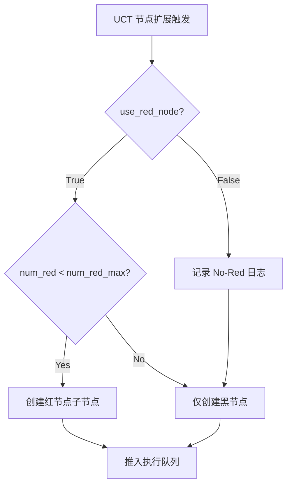
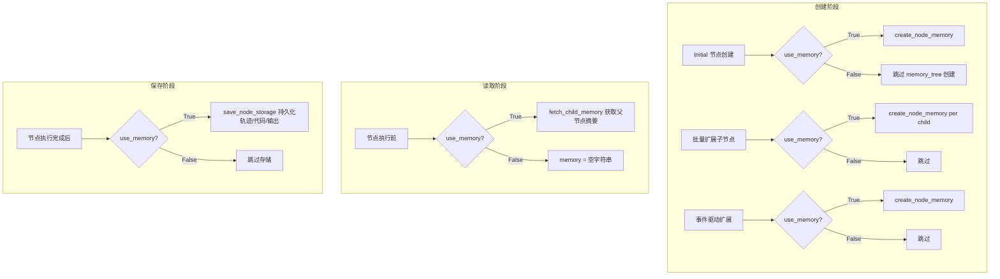

DataMaster 框架在 UCT 搜索流程中集成了三个独立的组件消融开关，分别控制红节点（外部数据引入）、记忆系统（文件系统级知识存储）以及黑节点模式（LLM 驱动 vs 规则直通）。这三个开关以 `ablation` 配置块的形式注入 `DataTreePlayground`，允许研究者在不修改代码的前提下，通过 YAML 配置文件精确裁剪搜索流程中的功能模块，从而量化每个组件对最终性能的贡献度。本文档从配置注入、代码分支、搜索行为影响三个层面，逐一解析三个开关的工程实现与消融语义。

> 📖 **小白导读**
> - 这篇讲什么："消融实验"就是"把系统里的某个零件拿掉，看成绩掉多少，从而判断这个零件有没有用"。DataMaster 提供三个开关：能不能用红节点、能不能用记忆、黑节点是"真让大模型干活"还是"原样重跑"。
> - 先知道几个概念：**UCT 搜索树**（把每次尝试当作一棵树上的节点，一边试一边决定下一步扩展哪里）；**黑节点**（让 LLM 改数据处理/特征工程的节点）；**红节点**（让 LLM 去网上搜集新数据的节点）；**memory tree（记忆树）**（在磁盘上为每个节点建一个文件夹，存放轨迹和代码）；**yaml**（配置文件格式）；**agent**（"提示词 + 大模型"组成的执行者）。
> - 读完能明白：每个开关在代码里的每个分支做了什么、默认值从哪来（`black_mode` 的默认值只来自 Python 代码，yaml 模板里没有它）、关掉后的真实行为，以及三个常见误解（例如"关红节点后变成二叉结构"其实不对）。

## 配置注入机制

三个消融开关的声明与初始化集中在 `DataTreePlayground.__init__` 中。框架从 `EvoMasterConfig` 对象上以 `getattr` 方式安全读取 `ablation` 字段——由于 `BaseConfig` 设定了 `extra = "allow"`，YAML 中所有未被 Pydantic 显式声明的顶层键都会被保留为模型属性，因此 `ablation` 配置块可以直接通过属性访问获取。

Sources: [playground.py](playground/data_master/core/playground.py#L79-L90)

配置在 YAML 模板 `config_base.yaml` 的末尾以独立段落定义，使用 `$use_red_node` 和 `$use_memory` 作为模板占位符，在配置生成时由环境变量或脚本参数注入具体值。值得注意的是，`black_mode` 并未出现在 YAML 模板中，其默认值 `"agent"` 纯粹由 Python 代码中的 `ablation_cfg.get("black_mode", "agent")` 提供。三个开关的默认值都在 `__init__` 里：没有 `ablation` 段、或段里缺某个键，就分别取 `use_red_node=True`、`use_memory=True`、`black_mode="agent"`。两个提醒：(1) `use_red_node`/`use_memory` 经过 `bool(...)` 转换，如果 yaml 里把值写成带引号的字符串 `"false"`，`bool("false")` 是 `True`，开关会反向生效（推断，应写不带引号的 `false`）；(2) `black_mode` 没有做合法性检查，只有恰好等于 `"rule_based"` 才切换，写错（比如 `rule-based`）会静默回退成 `BlackExp`（见下文代码）。

Sources: [config_base.yaml](configs/data_master/config_base.yaml#L281-L286)

（`string.Template` 是 Python 自带的"填空"工具：把文本里的 `$名字` 换成你给的值。）然而，当前 `auto_config_exp.py` 的 `generate_yaml_config` 函数在执行 `Template.substitute()` 时并未传入 `use_red_node` 和 `use_memory` 两个变量。由于 `string.Template.substitute()` 在占位符无对应值时会**直接抛出 `KeyError`**，这意味着"当前脚本 + 当前模板"的组合实际上无法完成生成（仓库中已生成的任务级 YAML——如 `aerial-cactus-identification`——是模板加入 `ablation` 段**之前**的旧版本产物，因此不含 `ablation` 段落、也不会触发该错误）。进一步核对还发现，模板里的 `"${LLM_MODEL}"`、`"${LLM_API_KEY}"`、`"${LLM_BASE_URL}"`（第 16-18 行）和注释里的 `${DATA_ROOT}`（第 166 行）也会被 `Template` 当成占位符，同样没有提供值，会抛 `KeyError`（静态推断，未实际运行）。所以只补传 `use_red_node=True, use_memory=True` 并不够。要恢复可用性，还需把这些 `${...}` 写成 `$${...}` 转义，或改用 `safe_substitute`（缺值时原样保留）。另外，`run_mle.sh` 在仓库里不存在，脚本第 3 步也会失败（见第 28 篇）。在此之前，消融配置需要研究者手动在目标 YAML 文件中追加 `ablation` 块。

Sources: [auto_config_exp.py](scripts/auto_config_exp.py#L125-L154), [config_aerial-cactus-identification.yaml](configs/data_master/yaml_configs/aerial-cactus-identification/config_aerial-cactus-identification.yaml#L270-L276)

下表汇总了三个开关的配置键、默认值、类型与消融语义：

| 开关 | 配置键 | 默认值 | 值域 | 消融语义 |
|------|--------|--------|------|----------|
| `use_red_node` | `ablation.use_red_node` | `True` | `bool` | 关闭后跳过所有红节点创建与执行 |
| `use_memory` | `ablation.use_memory` | `True` | `bool` | 关闭后跳过 memory_tree 创建与节点存储持久化 |
| `black_mode` | `ablation.black_mode` | `"agent"` | `"agent"` / `"rule_based"` | 切换黑节点实验类：LLM 驱动 vs 无操作直通 |

## use_red_node：红节点消融

### 开关机制

`use_red_node` 控制的是 UCT 搜索树中红节点（Red Node）的生命周期。红节点负责通过外部搜索接口（HuggingFace / GitHub / Web / 学术检索）下载新数据集并引入额外数据源，是 DataMaster 区别于纯模型优化框架的核心差异化组件。当 `use_red_node=False` 时，搜索树中不再创建红节点——所有节点扩展路径只走数据增强与特征工程方向（黑节点），完全切断外部数据引入通道。注意：这**不是**"二叉结构"（原文此处说法有误）：红节点上限是 1（`num_red=1`），黑节点上限是 5（`num_black=5`），关掉红节点之后，每个节点最多仍有 **5 个**黑子节点（`UCTSearchConfig` 默认值）。"二叉"在代码里没有任何依据。

### 代码分支

该开关在 `playground.py` 中共出现于五个决策点（批量扩展 1 个、兄弟扩展 2 次检查、子节点扩展 1 个、运行时守卫 1 个；外加构造函数里读取配置），覆盖了节点创建的全部路径：



**批量扩展入口**（`_select_stages_batch`）：Initial 节点完成后，系统批量创建子节点（一次把该创建的全部创建出来，而不是一个个来）。当 `use_red_node=True` 且红子节点数未达上限（`num_red < search_cfg.num_red`，默认上限为 1）时，将红节点加入待创建列表；否则跳过并记录 `"No-Red ablation enabled: skip red child creation"` 日志。随后不论红节点是否创建，都会补足黑节点：`remaining_black = num_black - 已有黑子节点数`，所以关掉红节点时，Initial 完成后一次就会创建 5 个黑子节点（推断自代码，未实测）。

Sources: [playground.py](playground/data_master/core/playground.py#L465-L500)

**兄弟节点扩展**（`_expand_parent_node`）：节点完成后的父节点扩展阶段，分两次检查 `use_red_node`，决定是否将 `"red"` 加入 `available_stages` 列表供 `random.choice` 选取。关闭时仅从黑节点候选中随机选择。

Sources: [playground.py](playground/data_master/core/playground.py#L1057-L1093)

**子节点扩展**（`_expand_current_node`）：当前节点的向下扩展逻辑中，优先尝试创建红子节点；若 `use_red_node=False`，则直接跳过红节点分支，仅在黑节点配额未满时创建黑子节点。当两种配额均已耗尽时，函数提前返回，停止向下扩展。

Sources: [playground.py](playground/data_master/core/playground.py#L1095-L1120)

**运行时守卫**（`_run_one_node`）：即使因某种逻辑错误将 `stage="red"` 的节点送入执行路径（"守卫"就是入口处的一道检查），`_run_one_node` 会在入口处检查 `self.use_red_node`，若为 `False` 则抛出 `RuntimeError("Red node execution requested while use_red_node=False")`，形成双重保险。

Sources: [playground.py](playground/data_master/core/playground.py#L578-L605)

### 搜索行为影响

| 维度 | `use_red_node=True`（默认） | `use_red_node=False` |
|------|------|------|
| 搜索树结构 | 黑+红混合子节点 | 纯黑节点（每节点最多 5 个黑子节点） |
| 外部数据引入 | 通过 RedExp 执行搜索与下载 | 完全切断 |
| 每节点最大子节点数 | `num_black=5` + `num_red=1` = 6 | `num_black=5` = 5（仍然是 5 个，不是 2 个） |
| LLM Agent 调用 | initial + black + red + metric | initial + black + metric |
| 预期适用场景 | 完整 DataMaster 能力评估 | 隔离外部数据贡献度 |

此外，`setup()` 要求 `initial/black/red/metric` 四个 agent 配置齐全，所以即使 `use_red_node=False`，红 agent 仍会被创建，只是不会被调用；MCP 工具配置也不会因此变少。（`required_slots` 见 `playground.py`。）

Sources: [uct.py](playground/data_master/core/utils/uct.py#L112-L117)

## use_memory：记忆系统消融

### 开关机制

`use_memory` 控制 Memory Tree 文件系统的创建与节点执行数据的持久化。Memory Tree 是一个与 UCT 搜索树结构一一对应的文件系统镜像，每个节点拥有独立的 `manifest.md`（知识总结）和 `storage/` 目录（轨迹记录、代码备份、输出日志、提交文件）。关闭此开关后，搜索过程不再创建文件系统记忆结构，也不再在节点执行后保存轨迹数据，**同时 prompt 里的 `{memory}` 摘要也会变成空字符串**（因为读取处同样受 `use_memory` 控制，见下文）。`fetch_child_memory()` 这个函数本身是不依赖文件系统的内存摘要，但关闭开关后根本不会被调用。

### 代码分支

`use_memory` 在 `playground.py` 中共出现在五个决策点（创建 3 处、读取 1 处、保存 1 处；原文写"六个"有误），覆盖了记忆生命周期的三个阶段：创建、读取、保存。



**创建阶段**：三处独立调用点——Initial 节点创建（Phase 1）、Initial 完成后的批量扩展（`_batch_expand_after_initial`）、以及事件驱动的节点扩展（`_create_expand_node_fn` 内的 `expand_node` 闭包）。当 `use_memory=True` 时，每创建一个新节点都会调用 `create_node_memory(workspace, child_node.id, parent_id=node.id)`，在 `memory_tree/` 下按父子层级创建目录结构、空 `manifest.md` 和 `storage/` 子目录；当 `use_memory=False` 时，跳过创建并记录 `"No-Memory ablation enabled: skip memory tree creation"` 日志。

Sources: [playground.py](playground/data_master/core/playground.py#L703-L711), [playground.py](playground/data_master/core/playground.py#L778-L788), [playground.py](playground/data_master/core/playground.py#L830-L839)

**读取阶段**：在 `_execute_and_process_node` 中，节点执行前需要从父节点获取子节点记忆摘要（`memory` 字符串），用于注入下游 Exp 的 prompt。当 `use_memory=True` 且父节点存在时，调用 `parent_node.fetch_child_memory()` 收集已完成子节点的设计方案、执行结果与验证指标，格式化为分段文本；当 `use_memory=False` 时，直接传入空字符串 `""`，使下游 Agent 无法获取历史尝试的摘要信息。要注意：只有 black/red 的 prompt 里有 `{memory}` 占位符（`prompts/black/user_prompt.md`、`prompts/red/user_prompt.md`），Initial 节点本来就不接收这个摘要。

Sources: [playground.py](playground/data_master/core/playground.py#L882-L886)

`fetch_child_memory` 本身是 `UCTNode` 的方法，其实现不依赖文件系统——它遍历内存中的 `self.children` 列表，提取每个已完成子节点的 `plan`、`analysis`、`metric.value` 和 `is_buggy` 状态，拼接为 `"Design: ... Results: ... Validation Metric: ..."` 格式的摘要文本。因此要分清两件事：函数本身不依赖文件系统；但 `_execute_and_process_node` 里调用它的那一行被 `use_memory` 门控，所以 `use_memory=False` 时 prompt 里的摘要也一并被消融（原文"消融的仅是文件系统级记忆"的说法不完整，已修正；下面"搜索行为影响"表是对的）。另外两个实际细节：(1) 摘要里 `Design:` 取的是子节点的 `plan`，而 data_master 的 initial/black/red 各个 exp 返回的 `plan` 都是空串，所以 `Design:` 恒为空（`rule_based` 模式的黑节点例外，它的 plan 是固定的一句"No-op pass-through..."）；`Results:` 是节点 `analysis`，实际是该节点 stdout 的最后 500 个字符；(2) `use_memory=False` 并不会移除 memory_tree 相关的 MCP 工具和提示词里的 `memory_tree_manual` 说明（`black_exp.py`/`red_exp.py` 仍会读 `prompts/tools/memory.md`），agent 仍可能去调用这些工具，但对应节点目录没有被创建（推断：可能报错或读到空内容，未验证）。

Sources: [uct.py](playground/data_master/core/utils/uct.py#L451-L472)

**保存阶段**：节点执行完成后，当 `use_memory=True` 时，系统提取 Agent 的完整轨迹（`agent.trajectory.model_dump(mode="json")`）、代码、stdout 和提交文件，调用 `save_node_storage` 写入 `storage/` 目录下的四个文件（`trajectory.json`、`code.py`、`stdout.txt`、`submission.csv`）；当 `use_memory=False` 时，跳过整个持久化流程并记录日志。

Sources: [playground.py](playground/data_master/core/playground.py#L927-L950), [memory_tree.py](playground/search_dataset_tools/memory_tree.py#L203-L264)

### 搜索行为影响

| 维度 | `use_memory=True`（默认） | `use_memory=False` |
|------|------|------|
| 文件系统 memory_tree | 完整创建（目录 + manifest + storage） | 不创建 |
| 节点记忆摘要（prompt 注入） | `fetch_child_memory()` 返回摘要 | 空字符串 |
| 执行轨迹持久化 | trajectory.json + code.py + stdout.txt + submission.csv | 无 |
| manifest.md 知识库 | Agent 可通过 memory_tree 工具读写（不会自动注入 prompt） | 节点目录不存在 |
| 重启后可恢复性 | 磁盘上保留了轨迹/代码/输出；但仓库里没有找到"从 memory_tree 恢复搜索"的代码（未验证） | 无此类文件 |
| LLM 调用成本 | Agent 可引用历史 manifest | 历史信息仅靠 UCT 树内存 |

## black_mode：黑节点模式切换

### 开关机制

`black_mode` 与前两个布尔开关不同——它是一个字符串枚举开关，控制黑节点实验类的选择。当值为 `"agent"`（默认）时，黑节点由 `BlackExp` 执行，即完整的 LLM 驱动数据处理流程；当值为 `"rule_based"` 时，切换为 `RuleBlackExp`，执行无操作直通（no-op pass-through）逻辑。这一开关的设计目的是量化黑节点数据处理能力（数据清洗、特征工程、数据增强）对搜索性能的边际贡献——在 `rule_based` 模式下，黑节点在搜索树中结构性地存在但功能性地静默。

### 代码分支

开关在 `_run_one_node` 方法中被读取，通过简单的三元选择决定实验类：

```python
black_mode = getattr(self, "black_mode", "agent")
exp_cls = RuleBlackExp if black_mode == "rule_based" else BlackExp
```

选定类后，以统一的构造参数实例化并调用 `exp.run()`。两者的 `run()` 方法签名完全一致，确保了接口兼容性。

Sources: [playground.py](playground/data_master/core/playground.py#L545-L576)

### BlackExp vs RuleBlackExp 对比

| 维度 | `BlackExp`（`black_mode="agent"`） | `RuleBlackExp`（`black_mode="rule_based"`） |
|------|------|------|
| LLM 调用 | 完整 Black Agent 对话（max_turns=50） | 不调用任何 LLM |
| Prompt 加载 | 加载 black/system_prompt.md + user_prompt.md + 工具手册 | 不读取任何 prompt（所以 `prompts/rule_based_black/` 下那两个 prompt 文件在代码里从未被加载，是闲置文件） |
| 模板处理 | 复制父模板，由 Agent 生成新 DataLoader | 原样复制父模板（`shutil.copyfile`） |
| DataLoader 修改 | 只复制父模板；父 DataLoader 的代码会读出来放进 prompt，但 Agent 需要自己写出一份新的 DataLoader（不是自动复制） | 原样复制父 DataLoader（`shutil.copyfile`）——只有 RuleBlackExp 会复制 DataLoader |
| 数据处理 | 数据清洗、特征工程、数据增强、SMOTE 等 | 无任何数据处理 |
| data_links 修改 | 可修改 | 不修改 |
| 代码组装 | `_assemble_code` + `run_code_via_bash` | `_assemble_code` + `run_code_via_bash` |
| 指标评估 | `_run_metric_agent` | `_run_metric_agent`（相同） |
| raw_response / plan | Agent 对话输出 / 通常为空串 | 固定文本声明 no-op / plan 也是一句固定文字 |

Sources: [black_exp.py](playground/data_master/core/exp/black_exp.py#L57-L215), [rule_black_exp.py](playground/data_master/core/exp/rule_black_exp.py#L70-L183)

`RuleBlackExp` 的核心逻辑可以用三步概括：**复制**（父模板 + 父 DataLoader 原样拷贝）→ **组装**（`_assemble_code` 拼接继承的代码）→ **执行评估**（`run_code_via_bash` + `_run_metric_agent`）。它保留了搜索树中黑节点的结构性位置——仍然占用一个搜索步骤、仍然产出 metric 评分、仍然参与 UCT 奖励更新——但移除了所有数据处理能力。这使得搜索树的拓扑结构不变，仅黑节点的数据处理贡献被隔离为零。一个推论（推断，未实测）：因为同一父节点最多有 5 个黑子节点，而 rule_based 黑节点都是原样重跑同一份代码，它们之间的区别只剩运行时的随机性，metric 会很接近；这也意味着"黑节点的 metric 反映的是父节点代码的重跑成绩"。

Sources: [rule_black_exp.py](playground/data_master/core/exp/rule_black_exp.py#L1-L20)

### 搜索行为影响

| 维度 | `black_mode="agent"`（默认） | `black_mode="rule_based"` |
|------|------|------|
| 搜索树结构 | 不变 | 不变（黑节点仍创建与执行） |
| 黑节点 metric | 反映数据处理后的模型性能 | 反映父节点代码的原样重跑性能 |
| LLM 调用次数 | 每个黑节点一次完整 Agent 对话 | 零（不调用 Agent） |
| 计算成本 | 高（LLM 推理 + 代码执行） | 低（仅代码执行） |
| 适用场景 | 完整能力评估 | 隔离数据处理贡献度 |

## 消融组合矩阵

三个开关的笛卡尔积产生 2 × 2 × 2 = 8 种消融配置（注意 `black_mode` 有两个离散值）。下表展示了关键组合的语义：

| 配置 | use_red_node | use_memory | black_mode | 语义 |
|------|------|------|------|------|
| **Full** | True | True | agent | 完整 DataMaster（默认） |
| **No-Red** | False | True | agent | 移除外部数据引入 |
| **No-Memory** | True | False | agent | 移除文件系统记忆 |
| **Rule-Black** | True | True | rule_based | 黑节点数据处理静默 |
| **No-Red + No-Memory** | False | False | agent | 仅黑节点 + 无记忆 |
| **Rule-Black + No-Red** | False | True | rule_based | 仅黑节点直通 + 无外部数据 |
| **Minimal** | False | False | rule_based | 搜索树骨架 + Initial 唯一功能源 |

（表中只列了 7 个组合；缺的第 8 个是 `use_red_node=True, use_memory=False, black_mode=rule_based` 等其余组合，全部可以通过上面三个键自由搭配。）

## 配置示例

在任务级 YAML 配置文件中手动添加 `ablation` 段落即可启用消融：

```yaml
# 在 YAML 文件末尾追加
ablation:
  use_red_node: false      # 关闭红节点
  use_memory: true          # 保留记忆系统
  black_mode: rule_based    # 黑节点直通模式
```

如果需要通过 `auto_config_exp.py` 自动注入，需要修改 `generate_yaml_config` 函数的 `template.substitute()` 调用，添加 `use_red_node` 和 `use_memory` 参数，并在 `interactive_input()` 中增加对应的交互式输入项；同时还要处理模板里 `${LLM_*}` 触发 `KeyError` 的问题（见上文）。注意 `black_mode` 不在模板中，脚本无法注入，只能手动写在 yaml 里。如果任务 yaml 里完全没有 `ablation` 段（仓库现有的 88 份都没有），则默认等价于 Full 配置。

Sources: [auto_config_exp.py](scripts/auto_config_exp.py#L141-L154)

## 下一步阅读

- 了解三类节点的完整职责划分：[三类节点实验：Initial、Black 与 Red 的职责划分](8-san-lei-jie-dian-shi-yan-initial-black-yu-red-de-zhi-ze-hua-fen)
- 理解 Memory Tree 的文件系统设计：[Memory Tree：与 UCT 树对应的文件系统设计](12-memory-tree-yu-uct-shu-dui-ying-de-wen-jian-xi-tong-she-ji)
- 深入 UCT 搜索中的节点扩展机制：[并行执行机制：Worker 循环与事件驱动节点扩展](10-bing-xing-zhi-xing-ji-zhi-worker-xun-huan-yu-shi-jian-qu-dong-jie-dian-kuo-zhan)
- 了解配置体系的整体设计：[配置体系解析：YAML 配置、MCP JSON 与任务级配置生成](22-pei-zhi-ti-xi-jie-xi-yaml-pei-zhi-mcp-json-yu-ren-wu-ji-pei-zhi-sheng-cheng)
