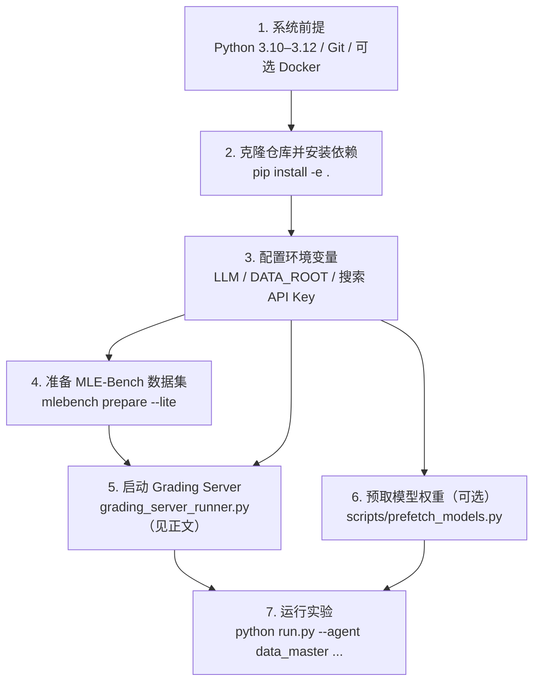

DataMaster 是一个基于 EvoMaster 框架构建的自主数据工程系统，其运行环境涉及 Python 依赖管理、多 LLM 供应商凭证注入、MCP 工具链配置、MLE-Bench 数据集准备以及 Grading Server 评测服务部署等多个层面。本页将系统性地引导你完成从代码克隆到可运行状态的全部准备工作，确保每个环节的依赖关系清晰可追溯。

> **📖 小白导读**
> - 这篇讲什么：把运行 DataMaster 之前要装的东西、要设的密钥、要下载的数据、要启动的评分服务一次讲清。
> - 读之前先知道：**Python 虚拟环境**（`.venv`，给项目单独准备的一套 Python 包，不污染系统）、**环境变量**（按名字存放的设置）、**API Key**（调用付费服务的密码）、**Docker**（把程序连同运行环境一起打包的容器技术，本页可选）。
> - 读完你能明白：先后顺序是什么；每个环境变量被谁读取；评分服务器到底是哪一个、怎么启动。
> - 重要提醒：本页下半部分的“评分服务器”有两个容易混淆的实现（MLE-Bench 自带的 Docker 版 vs DataMaster 自己的 `grading_server_runner.py`），原文把前者当成主线，已在正文纠正。

## 环境准备总览

整体环境准备过程可以理解为一条从底层到上层的依赖链：**系统级前提 → Python 安装 → 凭证注入 → 数据集准备 → 评测服务 → 模型预取**。下图展示了各步骤之间的先后关系与依赖路径：



理解这条依赖链的关键在于：DataMaster 的配置系统通过 `${VAR}` 占位符从环境变量中读取凭证和路径，因此**环境变量的正确设置是配置文件能够被正确解析的前提**。同时，Grading Server 必须在实验启动前运行，因为 MCP 工具在运行时会通过 HTTP 请求向其发送提交文件进行评分。（HTTP 请求：程序之间通过网址互相“打电话”；grading server 就是一个监听某个端口的小网站程序。）

Sources: [README.md](README.md#L101-L154), [README_CN.md](README_CN.md#L101-L154)

## 系统前提与 Python 环境

### Python 版本要求

DataMaster 要求 **Python ≥ 3.10 且 < 3.13**，这一约束定义在 `pyproject.toml` 的 `requires-python` 字段中。代码里确实大量使用 `str | None`、`list[str]` 这类 3.10+ 的类型注解写法（推断：这是下限 3.10 的原因之一）；上限 `<3.13` 的具体原因原文称“尚未适配 3.13 的部分 C 扩展变更”，在仓库中找不到依据（未验证）。原文所说 `match-case` 的使用也未验证。

| 约束项 | 要求 | 来源 |
|--------|------|------|
| Python 版本 | `>=3.10, <3.13` | `pyproject.toml` |
| 构建后端 | hatchling | `pyproject.toml` |
| 打包模块 | `evomaster` | `pyproject.toml` |
| 目标平台 | Linux（uv 环境限定） | `pyproject.toml` |
| 镜像源 | 阿里云 PyPI 镜像 | `pyproject.toml` |

`pyproject.toml` 中的 `[tool.uv]` 段落指定了 `environments = ["sys_platform == 'linux'"]`，表明依赖解析只针对 Linux 平台。整个仓库大量使用 `taskset`、`os.killpg`、`/proc/stat`、`/tmp` 等 Linux 专有机制，并依赖 nvidia 等包，因此 Windows/macOS 上并不能真正运行；原文“Windows 用户可用 pip 安装”的说法不可靠，已删除。（uv 是一个更快的 Python 包管理工具，本项目只是在 pyproject 里为它声明了平台。）

Sources: [pyproject.toml](pyproject.toml#L1-L6), [pyproject.toml](pyproject.toml#L538-L552)

### 安装步骤

官方推荐的安装流程如下：

```bash
git clone https://github.com/zhifan-zhou/DataMaster.git
cd DataMaster
python -m venv .venv
source .venv/bin/activate
pip install -e .
```

`pip install -e .` 会以**可编辑模式**安装项目，这意味着你对 `evomaster/` 目录下源代码的修改会立即生效，无需重新安装。安装过程会从 `pyproject.toml` 的 `dependencies` 列表中拉取全部依赖包——该列表有约 500 多行、基本都是 `==` 精确版本锁定的包，覆盖了 PyTorch、TensorFlow、HuggingFace Transformers、scikit-learn 等主流 ML 框架。

> **提示：** 由于依赖列表庞大，首次安装可能耗时较长（“15–30 分钟”为原文估计，未验证）。`pyproject.toml` 通过 `[[tool.uv.index]]` 配置了阿里云 PyPI 镜像（`https://mirrors.aliyun.com/pypi/simple/`）作为默认索引，该配置段是 uv 的设置，用普通 `pip install -e .` 时是否走这个镜像未验证（推断：pip 不读取 `[tool.uv]`，需自行配置 pip 镜像）。

Sources: [README_CN.md](README_CN.md#L101-L111), [pyproject.toml](pyproject.toml#L542-L544)

### 依赖层级关系

DataMaster 的依赖生态可以分为三个层级：

| 层级 | 用途 | 代表包 | 配置文件 |
|------|------|--------|----------|
| **核心框架** | Agent 运行时、配置管理、LLM 调用 | `pydantic`, `pyyaml`, `httpx`, `anthropic`, `openai` | `pyproject.toml` |
| **ML 工具链** | 模型训练、数据处理、特征工程 | `torch`, `transformers`, `scikit-learn`, `timm` | `pyproject.toml` |
| **MLE-Bench 评测** | 评测容器内的独立依赖环境 | `tensorflow==2.17.0`, `torch==2.2.0`, `fastai==2.7.17` | `mle-bench/environment/requirements.txt` |

需要注意的是，**MLE-Bench 的依赖列表（`mle-bench/environment/requirements.txt`）与 DataMaster 主项目的依赖列表是独立的**。MLE-Bench 的依赖安装在其 Docker 镜像构建过程中，使用 Conda 环境隔离，不会影响主项目的 Python 环境。

Sources: [requirements.txt](requirements.txt#L1-L200), [mle-bench/environment/requirements.txt](mle-bench/environment/requirements.txt#L1-L93), [mle-bench/environment/Dockerfile](mle-bench/environment/Dockerfile#L42-L57)

## 凭证管理与环境变量体系

DataMaster 的核心设计原则之一是**不将任何凭据存储在仓库中**。`.gitignore` 明确排除了 `.env`、`.env.*` 文件（`.env.example` 例外）以及所有可能包含敏感信息的运行时产物。所有凭证通过环境变量注入，配置文件中通过 `${VAR_NAME}` 占位符引用。

### 环境变量全景

下表列出了 DataMaster 运行所需的全部环境变量，按必要性分级：

| 环境变量 | 必要性 | 用途 | 注入位置 |
|----------|--------|------|----------|
| `DATA_ROOT` | **必需** | MLE-Bench 数据集根目录 | YAML `data_root` 字段、MCP `ML_MASTER_DATA_ROOT` |
| `LLM_MODEL` | **必需** | LLM 模型名称 | YAML `llm.*.model` 字段 |
| `LLM_API_KEY` | **必需** | LLM API 密钥 | YAML `llm.*.api_key` 字段 |
| `LLM_BASE_URL` | **必需** | LLM API 端点 URL | YAML `llm.*.base_url` 字段 |
| `ANTHROPIC_API_KEY` | 可选 | Anthropic Claude API 密钥 | YAML `llm.anthropic.api_key` |
| `ANTHROPIC_BASE_URL` | 可选 | Anthropic API 端点 | YAML `llm.anthropic.base_url` |
| `SERPER_API_KEY` | 可选 | Serper 网络搜索 API | MCP `search_web` / `search_scholar` 的 `env`（写的是 `${SERPER_API_KEY}`，见下文，MCP JSON 里不会被展开） |
| `HF_TOKEN` | 可选 | HuggingFace 访问令牌 | MCP `search_huggingface` 的 `env` |
| `HF_HOME` | 可选 | HuggingFace 缓存目录 | MCP `search_huggingface` 的 `env` |
| `HF_ENDPOINT` | 可选 | HuggingFace 镜像端点 | MCP 配置中默认设为 `https://hf-mirror.com` |
| `GITHUB_TOKEN` | 可选 | GitHub API 令牌 | MCP `search_github` 的 `env` |
| `COMPETITION_ID` | 可选 | MLE-Bench 自带 `mle-bench/environment/grading_server.py` 读取的竞赛 ID；DataMaster 自己的评分服务不使用 | MLE-Bench Docker 版评分服务 |
| `ML_MASTER_GRADING_SERVERS` | 运行时 | Grading Server 地址 | MCP 工具的 `env` 字段；`DataTreePlayground` 也会按 YAML 的 `grading_servers` 写入进程环境（playground.py:269） |
| `ML_MASTER_DATA_ROOT` / `ML_MASTER_DATA_EXPID` | 运行时 | 数据根目录 / 当前竞赛名 | `DataTreePlayground.setup()` 根据 YAML 的 `data_root`、`exp_id` 写入进程环境（playground.py:289-294） |

Sources: [README_CN.md](README_CN.md#L119-L128), [configs/ml_master/config.yaml](configs/ml_master/config.yaml#L7-L47), [configs/ml_master/mcp_config4data.json](configs/ml_master/mcp_config4data.json#L1-L53)

### 环境变量注入机制

DataMaster 的配置系统通过一个精巧的**两级注入机制**将环境变量传递到运行时：

**第一级：YAML 配置中的 `${VAR}` 替换。**（正则表达式：一种描述文字模式的写法，这里用来找出形如 `${名字}` 的片段。） `ConfigManager.load()` 方法在加载 YAML 配置文件后，会调用 `_substitute_env()` 函数，使用正则表达式 `\$\{([A-Za-z0-9_]+)\}` 匹配所有 `${VAR_NAME}` 占位符，并从 `os.environ` 中获取对应值进行替换。如果环境变量未设置，占位符会被替换为空字符串。

```python
# evomaster/config.py 中的核心替换逻辑
_ENV_PATTERN = re.compile(r"\$\{([A-Za-z0-9_]+)\}")

def _substitute_env(value: Any) -> Any:
    if isinstance(value, str):
        return _ENV_PATTERN.sub(
            lambda m: os.environ.get(m.group(1), ""),
            value,
        )
    if isinstance(value, dict):
        return {k: _substitute_env(v) for k, v in value.items()}
    if isinstance(value, list):
        return [_substitute_env(item) for item in value]
    return value
```

**第二级：`.env` 文件自动加载。** `ConfigManager` 在加载配置前会尝试使用 `python-dotenv` 库从配置目录向上搜索 `.env` 文件（若该库未安装则静默跳过，evomaster/config.py:20-24）。这意味着你可以在项目根目录创建一个 `.env` 文件，将所有环境变量集中管理，而无需在每次运行前手动 `export`。

```bash
# .env 文件示例（放在项目根目录，已被 .gitignore 排除）
DATA_ROOT=/data/mle-bench-lite
LLM_MODEL=deepseek-v3
LLM_API_KEY=sk-your-key-here
LLM_BASE_URL=https://api.deepseek.com/v1
SERPER_API_KEY=your-serper-key
HF_TOKEN=your-hf-token
HF_HOME=/data/hf_cache
```

`.env` 文件的搜索路径逻辑为：从 `config_dir` 开始，逐级向上遍历父目录，找到第一个 `.env` 文件即加载。如果未找到，则回退到 `load_dotenv()` 默认行为（搜索当前工作目录及其父目录）。

Sources: [evomaster/config.py](evomaster/config.py#L26-L48), [evomaster/config.py](evomaster/config.py#L212-L246), [.gitignore](.gitignore#L15-L21)

### MCP 配置中的凭证传递

MCP（Model Context Protocol）是一种让 agent 调用外部“工具服务”的协议；每个工具服务器是一个单独启动的子进程。MCP 工具配置文件是凭证传递的另一个关键路径，每个 JSON 定义一组工具服务器，每个服务器可以有自己的 `env` 字段。**原文称其中的 `${VAR}` 同样会被替换，这是错误的**：`_substitute_env` 只对主 YAML 调用（evomaster/config.py:242），MCP JSON 在 `evomaster/core/playground.py:1052` 是直接 `json.load`，之后只做了 `__EVOMASTER_WORKSPACES__` 占位符替换和 `ML_MASTER_GRADING_SERVERS` 的覆盖（:1158-1177），没有 `${...}` 展开，`StdioServerParameters(env=self.env)` 也直接传出。所以子进程拿到的 `ML_MASTER_DATA_ROOT`、`SERPER_API_KEY` 等很可能是字面量 `"${DATA_ROOT}"` 之类（依据读代码推断，未实测）；数据根目录另外已由 `setup()` 写入进程环境变量，但是否会被 JSON 里的字面量覆盖取决于 mcp 库的环境合并行为（未验证）。

以 `configs/data_master/base_all.json` 为例，它定义了 7 个 MCP 工具服务器：

| MCP 服务 | 用途 | 需要的环境变量 |
|-----------|------|----------------|
| `operate_submission_for_initial` | Initial 节点代码执行与提交 | `DATA_ROOT`, 竞赛 ID, Grading Server 地址 |
| `operate_submission` | Black/Red 节点代码执行与提交 | `DATA_ROOT`, 竞赛 ID, Grading Server 地址 |
| `memory_tree` | Memory Tree 文件系统接口 | `DATA_ROOT`, 竞赛 ID, Grading Server 地址 |
| `search_web` | 网络搜索 | `SERPER_API_KEY` |
| `search_github` | GitHub 仓库搜索 | `GITHUB_TOKEN`（可为空） |
| `search_huggingface` | HuggingFace 数据集搜索 | `HF_TOKEN`, `HF_HOME`, `HF_ENDPOINT` |
| `search_scholar` | 学术论文搜索 | `SERPER_API_KEY` |

`auto_config_exp.py` 脚本在生成任务级 MCP 配置时，设置竞赛 ID 和 Grading Server 地址；但仓库里现成的生成结果 `node_all_...json` 中 `ML_MASTER_DATA_ROOT` 仍是字面量 `"${DATA_ROOT}"`，并未替换为实际路径。例如，生成的 `node_all_detecting-insults-in-social-commentary.json` 中，`ML_MASTER_DATA_EXPID` 被设为 `"detecting-insults-in-social-commentary"`，`ML_MASTER_GRADING_SERVERS` 被设为 `"http://127.0.0.1:55496"`（而 `base_all.json` 模板里是 `5003`）。

Sources: [configs/data_master/base_all.json](configs/data_master/base_all.json#L1-L76), [configs/data_master/base_initial.json](configs/data_master/base_initial.json#L1-L26), [configs/data_master/base_datanode.json](configs/data_master/base_datanode.json#L1-L65), [configs/data_master/json_configs/detecting-insults-in-social-commentary/node_all_detecting-insults-in-social-commentary.json](configs/data_master/json_configs/detecting-insults-in-social-commentary/node_all_detecting-insults-in-social-commentary.json#L1-L76)

## LLM 供应商配置

DataMaster 的 LLM 抽象层在配置模型中声明了四种供应商：**OpenAI、Anthropic、DeepSeek、OpenRouter**（`LLMConfig.provider`）。配置文件中可以同时定义多个 LLM 实例，通过 `default` 字段指定默认使用的实例。

### LLM 配置结构

YAML 配置中的 `llm` 段落是一个字典，每个 key 是一个 LLM 实例名称，value 是该实例的配置参数。以下是一个包含三种供应商的配置示例（来自 `configs/ml_master/config.yaml`）：

| 配置项 | 类型 | 说明 | 默认值 |
|--------|------|------|--------|
| `provider` | `Literal["openai", "anthropic", "deepseek", "openrouter"]` | LLM 供应商标识 | 必填 |
| `model` | `str` | 模型名称 | 必填 |
| `api_key` | `str` | API 密钥 | 必填 |
| `base_url` | `str \| None` | API 端点 URL | `None` |
| `temperature` | `float` | 采样温度（0.0–2.0） | `0.7` |
| `max_tokens` | `int \| None` | 最大生成 token 数 | `None` |
| `timeout` | `int` | 请求超时（秒） | `300` |
| `max_retries` | `int` | 最大重试次数 | `3` |
| `retry_delay` | `float` | 重试间隔（秒） | `1.0` |

DataMaster 的 `config_base.yaml` 模板默认使用名为 `local_sglang` 的 LLM 实例，其 `provider` 设为 `"openai"`（兼容 OpenAI API 格式），适合接入任何兼容 OpenAI API 的本地或远程模型服务。注意：该服务必须支持 **function calling（函数调用：模型以结构化方式要求程序执行某个工具）**，且响应里要带 `usage`（token 用量）字段，否则可能报错（推断，见 LLM 抽象层一页）；另外 OpenAI 通道只透传 model/messages/temperature/timeout/max_tokens/tools/tool_choice，无法传 `top_p`、`stop`、`extra_body` 等参数。

Sources: [evomaster/utils/llm.py](evomaster/utils/llm.py#L168-L179), [configs/ml_master/config.yaml](configs/ml_master/config.yaml#L12-L47), [configs/data_master/config_base.yaml](configs/data_master/config_base.yaml#L12-L25)

### 常见 LLM 配置方案

| 方案 | provider | model 示例 | 适用场景 |
|------|----------|-----------|----------|
| OpenAI 官方 | `openai` | `gpt-4o` | 直接调用 OpenAI API |
| Anthropic Claude | `anthropic` | `claude-haiku-4-5-20251001` | 使用 Claude 系列模型 |
| DeepSeek | `deepseek` | `deepseek-v3` | 使用 DeepSeek API |
| 本地部署（vLLM/SGLang，即自己在 GPU 上跑开源模型的推理服务） | `openai` | 自定义 | 兼容 OpenAI API 的本地推理服务 |
| OpenRouter | `openrouter` | 任意 | 通过 OpenRouter 统一接入多模型 |

## MLE-Bench 数据集准备

DataMaster 本身**不包含** MLE-Bench（一个让 AI 去参加 Kaggle 比赛并打分的评测基准）数据集、Kaggle 竞赛数据或模型检查点。使用者需要单独准备 MLE-Bench 或 MLE-Bench Lite 环境，并将 `DATA_ROOT` 环境变量指向本地 benchmark 目录。

### 安装 mlebench 包

MLE-Bench 的集成代码位于 `mle-bench/` 目录中，需要单独安装：

```bash
cd mle-bench
pip install -e .
```

安装后，`mlebench` 命令行工具将可用，可以用于数据集准备和提交评分。

Sources: [mle-bench/README.md](mle-bench/README.md#L111-L116), [README_CN.md](README_CN.md#L171-L173)

### 数据集准备命令

| 命令 | 用途 | 预计耗时 |
|------|------|----------|
| `mlebench prepare --all` | 准备全部 75 个竞赛数据集 | ~2 天（mle-bench/README.md 原话 “two days”） |
| `mlebench prepare --lite` | 准备 Lite 子集（22 个低复杂度竞赛） | 数小时 |
| `mlebench prepare -c <competition-id>` | 准备单个竞赛 | 视数据量而定 |

准备数据集需要 Kaggle API 凭证。请将 `kaggle.json` 放置在 `~/.kaggle/` 目录下，这是 Kaggle API 的默认凭证搜索路径。

Sources: [mle-bench/README.md](mle-bench/README.md#L136-L158)

### Lite 子集竞赛列表

对于初次体验，推荐使用 Lite 子集。下表列出了 Lite 子集中的部分代表性竞赛及其数据量：

| 竞赛 ID | 类别 | 数据量 |
|---------|------|--------|
| `detecting-insults-in-social-commentary` | 文本分类 | 0.002 GB |
| `spooky-author-identification` | 文本分类 | 0.002 GB |
| `aerial-cactus-identification` | 图像分类 | 0.025 GB |
| `leaf-classification` | 图像分类 | 0.036 GB |
| `tabular-playground-series-may-2022` | 表格 | 0.57 GB |
| `dog-breed-identification` | 图像分类 | 0.75 GB |
| `aptos2019-blindness-detection` | 图像分类 | 10.22 GB |
| `siim-isic-melanoma-classification` | 图像分类 | 116.16 GB |

Sources: [mle-bench/README.md](mle-bench/README.md#L74-L99)

### DATA_ROOT 目录结构

`DATA_ROOT` 指向的目录应具有如下结构，这是 MCP 工具和配置文件所期望的标准布局：

```
${DATA_ROOT}/
├── <competition-id>/
│   └── prepared/
│       ├── public/              # 公开数据（训练集 + 描述文件）
│       │   ├── description.md   # 任务描述文件
│       │   ├── train.csv
│       │   └── ...
│       └── private/             # 私有数据（测试集答案，仅 Grading Server 可访问）
│           └── *.csv
├── <another-competition-id>/
│   └── prepared/
│       └── ...
```

实验运行时，`--task` 参数通常指向 `$DATA_ROOT/<competition-id>/prepared/public/description.md`，MCP 工具则通过 `ML_MASTER_DATA_ROOT` 和 `ML_MASTER_DATA_EXPID` 环境变量定位到对应的竞赛数据目录。

Sources: [README.md](README.md#L132-L154), [docs/grade_server_setup.md](docs/grade_server_setup.md#L186-L191)

## Grading Server 部署

Grading Server 是 DataMaster 评估闭环的核心组件。它接收 Agent 提交的 CSV 预测文件，使用 MLE-Bench 的评分逻辑进行验证，并返回验证结果。

### 评测容器方式（推荐）

**先说明**：下面这套 Docker 镜像与 `mle-bench/environment/grading_server.py` 是 MLE-Bench 官方“让 agent 在容器里自检提交格式”的评分服务，**并不是 DataMaster 搜索时实际使用的那个**。DataMaster 用的是 `playground/search_dataset_tools/operate_submission/grading_server_runner.py`（基于 `_submission_utils._create_app`，同样提供 `/validate`、`/health`，需要 `--data-root`），见下文“本地直接运行方式”。

MLE-Bench 提供了一个完整的 Docker 镜像，其中包含 Grading Server、Conda（Python 环境管理器）环境和所有评分依赖。构建命令如下：

```bash
cd mle-bench
docker build --platform=linux/amd64 -t mlebench-env -f environment/Dockerfile .
```

Dockerfile 的构建过程会创建两个 Conda 环境：`agent`（Python 3.11，包含完整 ML 依赖）和 `mleb`（用于运行 Grading Server）。容器启动时，`entrypoint.sh` 会用 `conda run -n mleb python /private/grading_server.py` 自动启动 Grading Server，监听在 `0.0.0.0:5003`。

| Dockerfile 构建阶段 | Conda 环境 | Python 版本 | 用途 |
|---------------------|-----------|-------------|------|
| 主体安装 | `agent` | 3.11 | Agent 代码执行环境 |
| 评分服务 | `mleb` | 3.11 | Grading Server 运行环境 |

Grading Server 的核心逻辑定义在 `mle-bench/environment/grading_server.py` 中，它是一个 Flask 应用，提供两个端点：

| 端点 | 方法 | 功能 |
|------|------|------|
| `/validate` | POST | 接收 CSV 提交文件，返回验证结果 |
| `/health` | GET | 健康检查，返回 `{"status": "running"}` |

Sources: [mle-bench/environment/Dockerfile](mle-bench/environment/Dockerfile#L1-L93), [mle-bench/environment/grading_server.py](mle-bench/environment/grading_server.py#L1-L44), [mle-bench/environment/entrypoint.sh](mle-bench/environment/entrypoint.sh#L1-L20)

### 本地直接运行方式

如果不需要完整的 Docker 隔离环境，原文给出的是直接运行 MLE-Bench 自带的 `grading_server.py`：

```bash
cd mle-bench/environment
export COMPETITION_ID="detecting-insults-in-social-commentary"
export PRIVATE_DATA_DIR="/data/mle-bench-lite"
python grading_server.py
```

**这与代码不符，需要注意**：该文件里 `PRIVATE_DATA_DIR = "/private/data"` 是写死的常量，**并不读取同名环境变量**（grading_server.py:10-11）；它只读 `COMPETITION_ID`，一次只服务一个竞赛，监听 `0.0.0.0:5003`。`mle-bench/run.sh` 里导出 `PRIVATE_DATA_DIR` 同样不会生效。因此这个脚本只适合在按 Dockerfile 布置好 `/private/data` 的容器里用。

对 DataMaster 而言，更贴近实际的做法是运行它自己的评分服务（该脚本以 `playground.…` 绝对导入，所以应从仓库根目录执行或设置 `PYTHONPATH`，这一点是推断）：

```bash
python playground/search_dataset_tools/operate_submission/grading_server_runner.py \
  --data-root $DATA_ROOT --host 127.0.0.1 --port 55496   # 端口要与 YAML 的 grading_servers 一致
```

该脚本参数为 `--data-root`（必填）、`--host`（默认 127.0.0.1）、`--port`（默认 5003）。Playground 启动时若发现服务不健康也会尝试自己拉起它，但那条路径目前写错（缺 `playground/` 一层，playground.py:195-201），会失败，所以建议手动先启动。

Sources: [mle-bench/run.sh](mle-bench/run.sh#L1-L10), [mle-bench/environment/grading_server.py](mle-bench/environment/grading_server.py#L11-L13)

### 端口配置与冲突检测

每个任务的 MCP 配置中都会指定 Grading Server 的地址和端口。`auto_config_exp.py` 脚本是交互式的：默认端口 5003，若被占用可选择自动向上查找可用端口（auto_config_exp.py:244-250、287-314）；但它只检查“此刻本机是否占用”，不保证多份配置之间不重复，所以仍需用下面的脚本检查。

```bash
# 检查所有 YAML 配置中的端口冲突
python scripts/check_port_conflicts.py configs/data_master/yaml_configs
```

该脚本递归扫描指定目录下的所有 YAML 文件，提取 `grading_servers` 字段中的端口号，并报告冲突情况。返回码 0 表示无冲突，1 表示存在冲突。

Sources: [scripts/check_port_conflicts.py](scripts/check_port_conflicts.py#L1-L169), [docs/grade_server_setup.md](docs/grade_server_setup.md#L1-L20)

## 模型权重预取（可选）

部分 MLE-Bench 任务的初始代码模板引用了预训练模型（如 ResNet、EfficientNet、BERT 等）。为了在实验运行时避免因下载模型权重而超时，建议提前执行模型预取。

### 预取清单

预取清单定义在 `configs/data_master/prefetch_models.json` 中，列出了所有初始代码模板引用的预训练模型标识符：

| 来源 | 模型列表 | 下载缓存位置 |
|------|----------|-------------|
| **timm** | `efficientnet_b0`, `efficientnet_b3`, `efficientnet_b5`, `tf_efficientnet_b3_ns`, `tf_efficientnet_b4_ns`, `convnext_base.fb_in22k_ft_in1k`, `convnext_base`, `vit_base_patch16_224` | `HF_HOME/hub` |
| **torchvision** | `resnet50`, `resnext50_32x4d`, `efficientnet_b0`, `efficientnet_b3`, `fasterrcnn_resnet50_fpn` | `TORCH_HOME` |
| **transformers** | `microsoft/deberta-v3-base`, `microsoft/deberta-v3-large`, `deepset/xlm-roberta-large-squad2`, `distilbert-base-uncased`, `t5-small` | `HF_HOME/hub` |

Sources: [configs/data_master/prefetch_models.json](configs/data_master/prefetch_models.json#L1-L34)

### 预取命令

```bash
.venv/bin/python scripts/prefetch_models.py \
  --manifest configs/data_master/prefetch_models.json \
  --env-from-mcp configs/data_master/json_configs/aptos2019-blindness-detection/node_all_aptos2019-blindness-detection.json
```

`--env-from-mcp` 参数可选，它从指定的 MCP 配置文件中读取 `operate_submission` 服务的 `env` 字段，将 `HF_HOME`、`HF_ENDPOINT` 等环境变量注入当前进程。脚本还会自动规范化 HuggingFace 相关的缓存路径环境变量（`HF_HUB_CACHE`、`TRANSFORMERS_CACHE`、`HF_ASSETS_CACHE`），确保不同库使用统一的缓存目录。

`--only` 参数可以限制只预取某一来源的模型：`all`（默认）、`timm`、`torchvision` 或 `transformers`。

Sources: [scripts/prefetch_models.py](scripts/prefetch_models.py#L1-L6), [scripts/prefetch_models.py](scripts/prefetch_models.py#L25-L60), [scripts/prefetch_models.py](scripts/prefetch_models.py#L196-L263)

## 任务级配置自动生成

虽然仓库已预置了 75 个竞赛的配置文件，但当你需要添加新竞赛或修改现有配置时，`scripts/auto_config_exp.py` 本意是提供一个交互式配置生成工具，设计上分三个步骤。**但当前它不可用**：脚本用 `string.Template.substitute` 渲染 `config_base.yaml`，却没有传 `use_red_node`、`use_memory` 两个变量，而模板第 285-286 行含有这两个占位符，会抛 KeyError；`black_mode` 不在模板里；第 3 步更新的 `run_mle.sh` 在仓库中并不存在（读代码得出，未实测）。仓库里现有的 75 份 YAML 是旧版模板生成的，不含 `ablation` 段。


该脚本读取 `configs/data_master/` 下的三个基础模板文件，通过 `string.Template` 替换占位符后生成任务级配置：

| 模板文件 | 生成文件 | 包含的 MCP 服务 |
|----------|----------|-----------------|
| `base_initial.json` | `initial_<exp>.json` | `operate_submission_for_initial`, `memory_tree` |
| `base_all.json` | `node_all_<exp>.json` | 全部 7 个 MCP 服务 |
| `base_datanode.json` | `data_node_<exp>.json` | `operate_submission`, `memory_tree` + 4 个搜索工具 |
| `config_base.yaml` | `config_<exp>.yaml` | 完整 YAML 配置（含 LLM、Agent、Session 等） |

生成的文件存放在 `configs/data_master/json_configs/<competition-id>/` 和 `configs/data_master/yaml_configs/<competition-id>/` 目录下。

Sources: [scripts/auto_config_exp.py](scripts/auto_config_exp.py#L14-L42), [scripts/auto_config_exp.py](scripts/auto_config_exp.py#L55-L122), [scripts/auto_config_exp.py](scripts/auto_config_exp.py#L424-L532)

## 环境验证清单

在完成以上所有步骤后，建议按照以下清单逐一验证环境是否就绪：

| 验证项 | 命令 | 预期结果 |
|--------|------|----------|
| Python 版本 | `python --version` | 3.10.x – 3.12.x |
| DataMaster 安装 | `python -c "import evomaster; print('OK')"` | 输出 `OK` |
| 环境变量 | `echo $DATA_ROOT $LLM_MODEL` | 输出非空路径和模型名 |
| 数据集存在 | `ls $DATA_ROOT/<competition-id>/prepared/public/description.md` | 文件存在 |
| Grading Server | `curl http://127.0.0.1:<YAML 里 grading_servers 的端口>/health` | 返回 HTTP 200（MLE-Bench 版返回 `{"status":"running"}`；DataMaster 版的响应体未核对） |
| 端口无冲突 | `python scripts/check_port_conflicts.py` | 退出码 0 |
| LLM 可达 | 在实验中查看 Agent 日志 | LLM 响应正常 |

## 下一步

环境准备完成后，你可以继续以下路径：

- **[MLE-Bench 数据集与任务输入准备](4-mle-bench-shu-ju-ji-yu-ren-wu-shu-ru-zhun-bei)** — 深入了解 MLE-Bench 数据集的结构、任务描述格式以及 `--task` 参数的多种传入方式。
- **[快速开始：运行第一个 DataTree 搜索任务](2-kuai-su-kai-shi-yun-xing-di-ge-datatree-sou-suo-ren-wu)** — 如果你跳过了快速开始页，现在可以回到那里执行第一个端到端实验。
- **[配置体系解析：YAML 配置、MCP JSON 与任务级配置生成](22-pei-zhi-ti-xi-jie-xi-yaml-pei-zhi-mcp-json-yu-ren-wu-ji-pei-zhi-sheng-cheng)** — 深入理解配置文件的完整结构和 `auto_config_exp.py` 的模板替换机制。
- **[Grading Server：评测服务器部署、健康检查与 API 接口](24-grading-server-ping-ce-fu-wu-qi-bu-shu-jian-kang-jian-cha-yu-api-jie-kou)** — 了解 Grading Server 的完整 API 文档和运维方案。

## 本文修订记录
- 原文称 MCP JSON 里的 `${VAR}` 也会被替换；实际只有主 YAML 调 `_substitute_env`（config.py:242），MCP JSON 是直接 `json.load`（core/playground.py:1052），已改正并说明可能传出字面量（未实测）。
- 原文把 `mle-bench/environment/grading_server.py` 当成评分服务主线，并称它读 `PRIVATE_DATA_DIR`；该文件把 `/private/data` 写死，不读此变量（grading_server.py:10-11）。已补充 DataMaster 实际使用的 `grading_server_runner.py` 及参数。
- 原文称 Windows 可用 pip 安装；仓库只能在 Linux 运行，已改正。`<3.13` 的理由、`match-case`、安装时长标为未验证。
- `auto_config_exp.py`：模板缺 `use_red_node`/`use_memory` 变量必抛 KeyError、`run_mle.sh` 不存在、端口检查并非全局去重，已写明（scripts/auto_config_exp.py:129、244-314）。
- 补充 `ML_MASTER_DATA_ROOT`/`ML_MASTER_DATA_EXPID` 的写入位置、LLM 服务必须支持 function calling、预取清单漏列的 `convnext_base.fb_in22k_ft_in1k`。
- 新增小白导读及虚拟环境、HTTP、Docker、conda、MLE-Bench 等术语解释。
