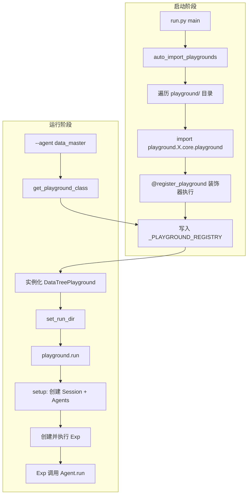
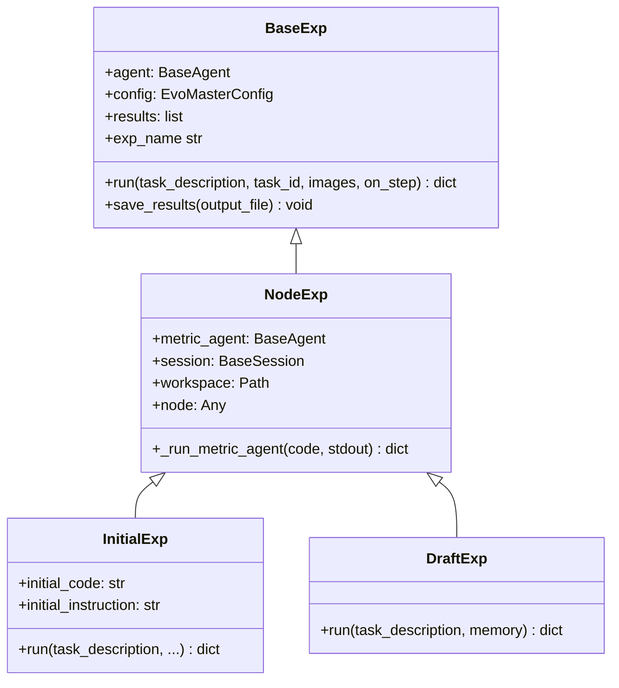

本文档面向需要在 EvoMaster 框架中进行二次开发的高级开发者，系统性地阐述如何通过注册机制扩展三层核心抽象——Playground（工作流编排层）、Exp（实验执行层）与 Agent（智能体执行层）。通过本指南，你将掌握从基类继承、装饰器注册到配置驱动的完整扩展路径，理解每一层的可覆盖钩子（hook）方法及其调用时机，从而在不修改框架核心代码的前提下实现自定义工作流。

> 📖 **小白导读**
> - 这篇讲什么：如果你想在这个框架里"加一套自己的工作流"（比如自己的搜索策略、自己的 agent），该继承哪个类、往哪里"登记"、配置文件怎么写，以及哪些地方会悄悄出错。
> - 先知道几个概念：**类与继承**（Python 里"在已有模板上改一部分"的写法）；**装饰器**（写在类上方的 `@xxx`，这里用来把类"登记"到一张名册里）；**注册表**（这张名册，本质是一个字典：名字 → 类）；**playground**（总导演类，负责搭环境、创建 agent、驱动流程）；**exp**（experiment，"一次具体的尝试"）；**agent**（"提示词 + 大模型 + 工具"的执行者）；**yaml**（配置文件格式）。
> - 读完能明白：注册的完整链路、每一步的真实接口、示例代码哪里需要改才能跑通，以及几个容易踩的坑：未注册时**静默回退**到 `BasePlayground`、自动导入发生在参数解析**之前**、`--parallel` 在 Windows 上的 spawn 问题、自定义 Agent 子类与 `copy_agent` 不兼容、agent 插槽名带 `_agent` 后缀。
> - 提醒：本框架只能在 Linux 上安装运行；本文示例没有被实际运行过，已标注需要自行补全的部分。

## 架构总览：三层抽象与注册机制

EvoMaster 的扩展体系建立在两个设计原则之上：**装饰器驱动的全局注册表**和**配置驱动的组件组装**。框架通过 `@register_playground` 装饰器将自定义 Playground 类注册到全局字典 `_PLAYGROUND_REGISTRY` 中，`run.py` 入口在启动时自动遍历 `playground/` 目录下所有子目录的 `core/playground.py` 模块并触发导入，使装饰器执行注册。运行时，`get_playground_class(agent_name)` 函数根据 `--agent` 参数从注册表中取出对应的 Playground 类进行实例化。



注册表的核心数据结构是一个简单的 `Dict[str, Type]` 映射，其中键为 agent 名称（如 `"data_master"`、`"ml_master"`），值为 Playground 类对象。如果某个 agent 名称未注册，系统会回退到 `BasePlayground` 作为默认实现。**这个回退是静默的**：`get_playground_class` 只打一条 INFO 级别日志（"Using BasePlayground for agent ... (no custom implementation registered)"），不会报错。所以只要名字写错（比如装饰器里是 `my-agent`，命令行写 `--agent my_agent`），或者你的 `core/playground.py` 在自动导入时抛了异常（只会打 WARNING，程序继续跑），程序都会"正常"跑起来，但用的是通用的 `BasePlayground`——它会从你的 yaml 里**随机挑一个 agent**（`self.agent = self.agents.get_random_agent()`）去跑一次 `BaseExp`，你自己写的流程完全没有执行。调试时先看日志里是不是出现了 `Using custom Playground`。

另外有两个和启动顺序、多进程相关的坑：

1. **自动导入发生在参数解析之前**：`run.py` 的 `main()` 第一件事就是 `auto_import_playgrounds()`，然后才 `parse_args()`。也就是说，不管你用 `--agent` 指定哪个名字，`playground/` 下**所有**子目录的 `core/playground.py` 都会被导入一遍（目录名以 `_` 开头的会跳过）；任何一个 playground 的依赖缺失，都会在每次启动时打出带堆栈的警告。
2. **`--parallel` 与 spawn**：`--parallel` 用 `ProcessPoolExecutor` 开子进程，每个子进程里再调用 `get_playground_class`（`run_tasks_parallel` → `run_single_task`）。Linux 默认用 fork（子进程复制父进程内存，注册表是带过去的）；Windows 和 macOS 默认用 spawn（子进程是全新的 Python，只重新导入 `run.py` 而不执行 `main()`），此时子进程里的注册表是空的，**会静默回退到 `BasePlayground`**（推断，由代码结构得出，未实测）。另外 `--parallel` 只在 `--task-file` 且任务数大于 1 时生效，进程数固定为 4（`max_workers=4`，没有命令行参数可改）。再次提醒本仓库只支持 Linux。

Sources: [registry.py](evomaster/core/registry.py#L1-L106), [run.py](run.py#L399-L436), [run.py](run.py#L330-L392)

## 注册自定义 Playground

### 装饰器注册机制

注册一个自定义 Playground 的最小操作是：创建一个继承自 `BasePlayground` 的类，并在类上使用 `@register_playground` 装饰器，传入一个唯一的 agent 名称。装饰器里的名字必须与命令行 `--agent` 传入的值**完全一致**（字符串精确匹配）。原文说"必须与目录名一致且使用连字符"并不准确：`registry.py` 的文档字符串确实建议名字与目录名一致，但代码并不强制；仓库里两个实际例子 `data_master`、`ml_master` 的目录名和注册名都是**下划线**。目录名真正起作用的地方有两处：(1) 自动导入按 `playground.{目录名}.core.playground` 查找，所以你的文件必须放在 `playground/<目录名>/core/playground.py`；(2) 提示词、自定义工具的路径解析是把 `config_dir` 里的字符串 `configs` 替换成 `playground`（`str(self.config_dir).replace("configs", "playground")`），所以配置目录 `configs/<名字>/` 要与 `playground/<名字>/` 同名，且路径里不能有别的 `configs` 子串。

下面的示例代码是最小骨架（原文漏了 `from pathlib import Path`，运行时会 NameError，已补上）：

```python
from pathlib import Path

from evomaster.core import BasePlayground, register_playground

@register_playground("my_agent")   # 必须与 --agent 的值一致；这里改成与目录名 my_agent 相同的下划线写法
class MyAgentPlayground(BasePlayground):
    def __init__(self, config_dir=None, config_path=None):
        if config_path is None and config_dir is None:
            config_dir = Path(__file__).parent.parent.parent.parent / "configs" / "my_agent"
        super().__init__(config_dir=config_dir, config_path=config_path)
```

装饰器内部逻辑很简单（"全局字典"就是模块里的 `_PLAYGROUND_REGISTRY`）：检查全局字典中是否已存在同名的注册项，若存在则发出警告并覆盖，随后将类对象存入 `_PLAYGROUND_REGISTRY[agent_name]`。这种设计允许后注册的模块覆盖先注册的模块，但会在日志中留下警告记录。

Sources: [registry.py](evomaster/core/registry.py#L27-L53), [playground.py (data_master)](playground/data_master/core/playground.py#L44-L54)

### BasePlayground 可覆盖方法一览

`BasePlayground` 定义了一套完整的生命周期模板方法，子类通过选择性覆盖这些方法来定制行为。以下是关键的可扩展点：

| 方法 | 调用时机 | 覆盖目的 |
|------|----------|----------|
| `__init__` | Playground 实例化 | 设置默认配置目录、声明 Agent 插槽、初始化消融开关 |
| `setup()` | `run()` 调用前 | 创建 Session、创建 Agents、确保环境就绪 |
| `_setup_session()` | `setup()` 内部调用 | 选择 Local 或 Docker Session 并打开会话 |
| `_setup_agents()` | `setup()` 内部调用 | 遍历配置创建所有 Agent 实例 |
| `_create_agent()` | `_setup_agents()` 内部调用 | 为单个 Agent 组装 LLM、工具、技能和提示词 |
| `_create_exp()` | `run()` 内部调用 | 创建 Exp 实例（默认返回 `BaseExp`） |
| `run()` | 入口调用 | 执行完整工作流（DataMaster/ML-Master 均完全覆盖） |
| `cleanup()` | `run()` 的 finally 块 | 清理资源（MCP 连接、Docker 容器、grading server） |
| `_configure_mcp_manager()` | MCP 初始化时 | 注入自定义路径适配器或工具过滤器 |
| `_create_custom_tool_instance()` | 自定义工具加载时 | 为需要构造参数的自定义工具提供实例化逻辑 |

Sources: [playground.py (base)](evomaster/core/playground.py#L128-L141), [playground.py (base)](evomaster/core/playground.py#L1011-L1025), [playground.py (base)](evomaster/core/playground.py#L1196-L1208)

### AgentSlots 与多 Agent 管理

`BasePlayground` 使用 `AgentSlots`（一个继承自 `dict` 的类）来管理多个 Agent 实例。该容器同时支持字典访问和属性访问，并通过 `declare()` 方法预声明插槽名称。在 `__init__` 中调用 `self.agents.declare("initial_agent", "black_agent", ...)` 可以预定义所有需要的 Agent 插槽，`_setup_agents()` 会自动根据配置中的 `agents` 字典为每个名称创建 Agent 并填充到对应插槽中。

DataMaster 的实现声明了五个插槽：`nouse_agent`、`initial_agent`、`black_agent`、`red_agent` 和 `metric_agent`。ML-Master 则声明了四个：`draft_agent`、`debug_agent`、`improve_agent` 和 `metric_agent`。这里要注意命名规则：YAML `agents` 下的键是不带后缀的名字（如 `initial`、`draft`），而 `_setup_agents()` 把创建好的 agent 存进插槽时用的是 `f"{键名}_agent"`（`setattr(self.agents, f"{agent_name}_agent", agent)`）。所以 YAML 里写 `initial:`，代码里取的是 `self.agents.initial_agent`；`declare()` 里写的名字必须是**带 `_agent` 后缀**的版本。如果 `declare` 了某个名字而 YAML 里没有对应键，该插槽会一直是 `None`，用属性访问时抛 `ValueError("Agent not initialized: ...")`；而且 `get_random_agent()` 可能随机挑到 `None`（推断）。

```python
# DataMaster 的 __init__ 中的插槽声明
self.agents.declare("nouse_agent", "initial_agent", "black_agent", "red_agent", "metric_agent")
```

Sources: [playground.py (base)](evomaster/core/playground.py#L67-L127), [playground.py (data_master)](playground/data_master/core/playground.py#L56), [playground.py (ml_master)](playground/ml_master/core/playground.py#L41)

### 完整 Playground 注册示例

以下是一个完整的自定义 Playground 注册示例，展示了从目录结构创建到类实现的完整流程。假设我们需要创建一个名为 `"my-experiment"` 的新实验框架，包含两个阶段：探索和优化。

**目录结构**：
```
playground/
  my_experiment/
    core/
      __init__.py
      playground.py          # 必须：包含 @register_playground 装饰器
      exp/
        __init__.py          # 定义 Exp 基类
        explore_exp.py       # 探索阶段实验
        optimize_exp.py      # 优化阶段实验
    prompts/
      explore/
        system_prompt.md
        user_prompt.md
      optimize/
        system_prompt.md
        user_prompt.md
configs/
  my_experiment/
    config.yaml              # 配置文件
```

**playground.py 骨架**：
```python
from evomaster.core import BasePlayground, register_playground
from pathlib import Path

@register_playground("my_experiment")
class MyExperimentPlayground(BasePlayground):
    def __init__(self, config_dir=None, config_path=None):
        if config_path is None and config_dir is None:
            config_dir = Path(__file__).parent.parent.parent.parent / "configs" / "my_experiment"
        super().__init__(config_dir=config_dir, config_path=config_path)
        self.agents.declare("explore_agent", "optimize_agent", "metric_agent")

    def setup(self):
        self._setup_session()
        self._setup_agents()
        # 自定义初始化逻辑...

    def run(self, task_description, output_file=None, images=None, on_step=None):
        try:
            self.setup()
            self._setup_trajectory_file(output_file)
            self._setup_raw_log_file()
            # 自定义工作流：先探索后优化
            # 取 agent 时用带 _agent 后缀的插槽名，例如 self.agents.explore_agent
            # ...
            return {"status": "completed"}
        finally:
            self.cleanup()
```

补充说明：`run.py` 跑完后会读取返回字典的 `status` 字段（单任务模式还会读 `steps`，缺失按 0 处理）。`run_single_task` 在调用 `run()` 之前会先调用 `playground.set_run_dir(run_dir, task_id=...)`，这一步由基类实现，决定轨迹文件、workspace 的位置。`BasePlayground.run` 的默认实现开头还会调用 `self.register_thread()`（用于按线程过滤日志），自己重写 `run` 时可以不调，只是日志过滤功能失效（推断）。另外骨架要求 `configs/my_experiment/config.yaml` 存在，否则 `ConfigManager` 加载会失败。

Sources: [playground.py (data_master)](playground/data_master/core/playground.py#L44-L63), [playground.py (ml_master)](playground/ml_master/core/playground.py#L32-L49), [run.py](run.py#L399-L436)

## 注册自定义 Exp

### BaseExp 基类结构

`BaseExp` 是所有实验的基类，定义了单次实验的通用执行逻辑。其核心方法是 `run()`，它接收任务描述，创建 `TaskInstance`，调用 `agent.run()` 执行，并将结果存入 `self.results` 列表。`exp_name` 属性自动从类名推断（去除 `Exp` 后缀），子类可覆盖此属性以自定义名称。



Sources: [exp.py](evomaster/core/exp.py#L97-L208), [exp/__init__.py (data_master)](playground/data_master/core/exp/__init__.py#L19-L36)

### 自定义 Exp 的实现路径

自定义 Exp 有两种集成方式：**通过 Playground 的 `_create_exp()` 方法创建**（适用于简单场景），或**在 Playground 的 `run()` 方法中直接实例化**（适用于多阶段复杂工作流）。

DataMaster 和 ML-Master 均采用第二种方式——在自定义的 `run()` 方法中根据搜索阶段动态创建不同类型的 Exp。以 ML-Master 为例（`stage` 的含义见第 27 篇），其 `_run_one_node` 方法根据 `stage` 参数（`"draft"` / `"debug"` / `"improve"`）选择并实例化对应的 Exp 类：

```python
def _run_one_node(self, *, stage, node, worker_agents, worker_workspace, ...):
    if stage == "draft":
        exp = DraftExp(worker_agents["draft"], worker_agents["metric"], 
                       self.session, worker_workspace, ...)
        return exp.run(task_description, memory=memory)
    if stage == "debug":
        exp = DebugExp(...)
        return exp.run(task_description, prev_code=prev_code, ...)
    exp = ImproveExp(...)
    return exp.run(task_description, best_code=best_code, ...)
```

这种模式的关键在于：Exp 不通过全局注册表管理，而是由 Playground 在运行时按需实例化。Exp 类的构造函数签名由子类自定义，但通常需要接收 `agent`、`metric_agent`、`session`、`workspace` 等核心依赖。

Sources: [playground.py (ml_master)](playground/ml_master/core/playground.py#L128-L185), [draft_exp.py](playground/ml_master/core/exp/draft_exp.py#L19-L57)

### NodeExp：DataMaster 的 Exp 基类模式

DataMaster 在 `exp/__init__.py` 中定义了一个 `NodeExp` 中间基类，继承自 `BaseExp`，添加了与 UCT 搜索节点相关的共享属性（`metric_agent`、`session`、`workspace`、`node`、`exp_index`）以及统一的 metric 评估方法 `_run_metric_agent()`。所有具体 Exp（`InitialExp`、`BlackExp`、`RedExp`）都继承自 `NodeExp`，这种模式使得搜索框架中所有节点类型的实验共享一致的评估接口。

`_run_metric_agent()` 方法支持两种评估模式：**默认模式**（使用验证集分数，通过 `metric_agent` 解析代码执行输出）和 **Test-feedback 模式**（使用测试集分数，通过 `grade_code_sync` 提交评分服务器并解析结果）。自定义 Exp 可以直接复用此方法进行指标解析。

Sources: [exp/__init__.py (data_master)](playground/data_master/core/exp/__init__.py#L19-L96), [initial_exp.py](playground/data_master/core/exp/initial_exp.py#L70-L100)

### 自定义 Exp 实现示例

以下示例已对照 `BaseExp.__init__(agent, config)`、`TaskInstance` 字段（`task_id/task_type/description/input_data/images/meta`）和 `Agent._prompt_format_kwargs` 核对过接口，可以运行；前提是 yaml 的 user prompt 里要有对应的 `{custom_param}` 占位符，否则多传的变量会被忽略。

```python
from evomaster.core.exp import BaseExp
from evomaster.utils.types import TaskInstance

class MyExp(BaseExp):
    """自定义实验：接收 agent 和额外参数"""
    
    def __init__(self, agent, config, workspace=None, custom_param=None):
        super().__init__(agent=agent, config=config)
        self.workspace = workspace
        self.custom_param = custom_param
    
    def run(self, task_description, task_id="exp_001", **kwargs):
        # 1. 组装提示词参数
        self.agent._prompt_format_kwargs.update({
            "task_description": task_description,
            "custom_param": self.custom_param,
        })
        
        # 2. 创建任务实例并执行
        task = TaskInstance(
            task_id=task_id, task_type="custom",
            description=task_description, images=[],
        )
        trajectory = self.agent.run(task)
        
        # 3. 返回结果
        return {
            "trajectory": trajectory,
            "status": trajectory.status,
            "steps": len(trajectory.steps),
        }
```

在 Playground 中使用此 Exp：

```python
def run(self, task_description, **kwargs):
    try:
        self.setup()
        exp = MyExp(
            agent=self.agents.my_agent_agent,   # yaml 里的键是 my_agent，插槽名是 my_agent_agent（原文写成 my_agent 会抛 AttributeError）
            config=self.config,
            workspace=Path(self.session.config.workspace_path),
            custom_param="value",
        )
        return exp.run(task_description)
    finally:
        self.cleanup()
```

Sources: [exp.py](evomaster/core/exp.py#L97-L175), [draft_exp.py](playground/ml_master/core/exp/draft_exp.py#L19-L57)

## 注册自定义 Agent

### Agent 类层次

EvoMaster 的 Agent 体系由两个核心类构成：`BaseAgent`（抽象基类）和 `Agent`（标准实现）。`BaseAgent` 定义了对话管理、轨迹记录、工具调用执行和上下文管理的完整框架，但将 `_get_system_prompt()` 和 `_get_user_prompt(task)` 声明为抽象方法。`Agent` 类通过支持从文件加载提示词模板来满足这两个抽象方法的要求（"抽象方法"就是父类只声明、必须由子类实现的方法），是目前所有 Playground 使用的具体实现。

```mermaid
classDiagram
    class BaseAgent {
        <<abstract>>
        +llm: BaseLLM
        +session: BaseSession
        +tools: ToolRegistry
        +config: AgentConfig
        +run(task, on_step) Trajectory
        +continue_run(user_message, on_step) Trajectory
        +_step() bool
        +_execute_tool(tool_call) tuple
        +_get_tool_specs() list
        +load_prompt_from_file(prompt_file, format_kwargs) str
        {abstract} _get_system_prompt() str
        {abstract} _get_user_prompt(task) str
    }
    
    class Agent {
        +_system_prompt: str
        +_user_prompt: str
        +_prompt_format_kwargs: dict
        +_get_system_prompt() str
        +_get_user_prompt(task) str
    }
    
    BaseAgent <|-- Agent
```

Sources: [agent.py](evomaster/agent/agent.py#L52-L65), [agent.py](evomaster/agent/agent.py#L1139-L1255)

### 标准方式：使用 Agent 类 + 配置文件

在绝大多数场景下，开发者无需编写自定义 Agent 类。`Agent` 类已支持通过 `system_prompt_file` 和 `user_prompt_file` 参数从文件加载提示词，并通过 `prompt_format_kwargs` 传入模板变量。`BasePlayground._create_agent()` 方法会自动从 YAML 配置中读取这些路径并组装 Agent 实例。

Agent 的创建过程在 `_create_agent()` 中完成，关键步骤包括：从配置中解析 LLM 参数并创建独立 LLM 实例、解析工具配置并注册工具、解析技能配置、解析提示词文件路径（相对于 playground 目录）、创建 `AgentConfig` 并实例化 `Agent`。每个 Agent 拥有独立的 LLM 实例以确保日志隔离。

```python
# BasePlayground._create_agent 中的关键逻辑
agent = Agent(
    llm=llm,                          # 独立 LLM 实例
    session=self.session,              # 共享 Session
    tools=self.tools,                  # 共享 ToolRegistry
    system_prompt_file=system_prompt_file,    # 从配置读取
    user_prompt_file=user_prompt_file,        # 从配置读取
    prompt_format_kwargs=prompt_format_kwargs, # 模板变量
    config=agent_cfg,                  # AgentConfig
    skill_registry=skill_registry,     # 技能注册表
    output_config=output_config,       # 输出配置
    config_dir=self.config_dir,        # 配置目录
    enable_tools=enable_tools,         # 是否暴露工具
    enabled_tool_names=enabled_tool_names,  # 启用的工具列表
)
```

Sources: [playground.py (base)](evomaster/core/playground.py#L788-L933), [agent.py](evomaster/agent/agent.py#L1146-L1198)

### 高级方式：继承 Agent 实现自定义逻辑

当需要在运行时动态生成提示词或实现自定义对话逻辑时，可以继承 `Agent` 类并覆盖 `_get_system_prompt()` 或 `_get_user_prompt()` 方法。自定义 Agent 类不需要注册到全局注册表——它在 Playground 的 `_create_agent()` 方法中被直接使用。但要注意下面这个**不兼容**：`BasePlayground.copy_agent()` 复制 agent 时，只有当 `agent.__class__.__name__ == 'Agent'` 才会复制 `_prompt_format_kwargs`、`_system_prompt`、`_user_prompt`；你的子类 `MyAgent` 名字不是 `Agent`，复制出来的 worker agent 会丢掉提示词（回退到默认系统提示词），并发场景下行为与原 agent 不同（静态阅读得出，未实测）。如果要在并行 worker 里用自定义 Agent，需要同时覆盖 `copy_agent`，或让子类也叫 `Agent`。

```python
from evomaster.agent import Agent, BaseAgent
from evomaster.utils.types import TaskInstance

class MyAgent(Agent):
    """自定义 Agent：动态注入运行时信息到系统提示词"""
    
    def _get_system_prompt(self) -> str:
        # 调用父类获取基础提示词（包含工作目录信息）
        base_prompt = super()._get_system_prompt()
        
        # 注入自定义运行时信息
        custom_info = f"\n\nCurrent experiment: {self._agent_name}"
        return base_prompt + custom_info
    
    def _get_user_prompt(self, task: TaskInstance) -> str:
        # 动态构建用户提示词（基类 Agent 对 KeyError 有兜底，这里没有，缺变量会直接抛错）
        if self._user_prompt:
            return self._user_prompt.format(
                task_id=task.task_id,
                task_type=task.task_type,
                description=task.description,
                input_data=task.input_data,
                **self._prompt_format_kwargs,
            )
        return f"Custom prompt for: {task.description}"
```

在自定义 Playground 中使用此 Agent：

```python
class MyPlayground(BasePlayground):
    def _create_agent(self, name, agent_config=None, llm_config=None, 
                      tool_config=None, skill_config=None):
        # 复用基类的组装逻辑获取依赖项
        if agent_config is None:
            agent_config = self._get_agent_config(name)
        if llm_config is None:
            llm_config = self._setup_agent_llm(name)
        # ... 其他依赖组装 ...
        # 注意：这里是示意代码（伪代码），不能直接运行——llm、system_prompt_file、agent_cfg 等变量
        # 都需要照抄 BasePlayground._create_agent（evomaster/core/playground.py 约 788-933 行）中的对应逻辑。

        # 使用自定义 Agent 类替代标准 Agent
        agent = MyAgent(
            llm=llm,
            session=self.session,
            tools=self.tools,
            system_prompt_file=system_prompt_file,
            user_prompt_file=user_prompt_file,
            prompt_format_kwargs=prompt_format_kwargs,
            config=agent_cfg,
            skill_registry=skill_registry,
            output_config=output_config,
            config_dir=self.config_dir,
            enable_tools=enable_tools,
            enabled_tool_names=enabled_tool_names,
        )
        agent.set_agent_name(name)
        return agent
```

Sources: [agent.py](evomaster/agent/agent.py#L1119-L1136), [agent.py](evomaster/agent/agent.py#L1220-L1255), [playground.py (base)](evomaster/core/playground.py#L788-L810)

### Agent 的并行复制：copy_agent 机制

在多 Worker 并行搜索场景中（worker 即并行干活的线程），`BasePlayground.copy_agent()` 方法用于创建 Agent 的副本（准确地说是**新建**一个同类对象，`AgentConfig` 做深拷贝，而不是浅拷贝）。复制后的 Agent 拥有独立的 LLM 实例和上下文管理器（`current_dialog`、`trajectory`、`_step_count` 均被重置），但共享 `session`、`tools`、`skill_registry` 等依赖。此方法在 ML-Master 的 `_create_worker_agents()` 中被使用，为每个 Worker 线程创建独立的 Agent 副本。

```python
def _create_worker_agents(self, worker_index: int) -> dict[str, Agent]:
    return {
        "draft": self.copy_agent(self.agents.draft_agent, new_agent_name=f"draft_worker_{worker_index}"),
        "debug": self.copy_agent(self.agents.debug_agent, new_agent_name=f"debug_worker_{worker_index}"),
        # ...
    }
```

Sources: [playground.py (base)](evomaster/core/playground.py#L935-L1009), [playground.py (ml_master)](playground/ml_master/core/playground.py#L101-L107)

## 配置文件驱动：YAML 配置结构

自定义 Playground 的运行依赖一套完整的 YAML 配置文件。配置文件位于 `configs/{agent_name}/config.yaml`，由 `ConfigManager` 加载并构建为 `EvoMasterConfig` 对象。配置支持 `${VAR}` 环境变量替换和 `.env` 文件加载（环境变量替换只作用于主 yaml；MCP 的 json 文件里的 `${VAR}` 不会被展开，子进程拿到的是字面量。变量未设置时在 yaml 里会静默变成空串）。

| 配置块 | 用途 | 关键字段 |
|--------|------|----------|
| `llm` | 多 LLM 供应商定义 | `default` 指定默认 LLM 名；每个供应商含 `provider`、`model`、`api_key`、`base_url` |
| `agents` | 多智能体配置 | 每个键为 agent 名称，值含 `llm`（引用名）、`max_turns`、`tools`、`context`、`system_prompt_file`、`user_prompt_file` |
| `session` | 环境会话配置 | `type: local/docker`；`local` 含 `working_dir`、`workspace_path`、`parallel`；`docker` 含 `image`、`volumes`、`gpu_devices` |
| `mcp` | MCP 协议工具配置 | `config_file` 指定 MCP JSON 配置路径；`enabled` 开关 |
| `skills` | 技能系统配置 | 顶层 `skills: {enabled, skills_root}` 在 `EvoMasterConfig` 里有定义，但在 `evomaster/core/playground.py` 里没有找到读取它的代码（推断：基本不起作用）；真正起作用的是每个 agent 下的 `skills:` 列表（`"*"` 表示全部）和可选的 `skill_dir`。DataMaster 的 agent 配置没有 `skills:` 键，所以没用到技能 |
| `logging` | 日志配置 | `level`、`format`、`log_path` |

**Agent 配置示例**（YAML）：
```yaml
agents:
  my_agent:
    llm: "openai"
    max_turns: 30
    tools:
      builtin: ["execute_bash", "str_replace_editor", "think", "finish"]
      mcp: "mcp_config.json"
    context:
      max_tokens: 128000
      truncation_strategy: "latest_half"
      preserve_system_messages: true
      preserve_recent_turns: 5
    system_prompt_file: "prompts/system_prompt.md"
    user_prompt_file: "prompts/user_prompt.md"
```

（原文这里写的是 `../../prompts/my_agent/...`。按真实解析规则：基准目录是 `playground/my_agent/`，相对路径拼在它后面；`../../` 会跑到仓库根目录的 `prompts/` 去，与上文目录结构不符。原文那种写法适用于 DataMaster 的任务 yaml，因为它们位于更深一层的 `configs/data_master/yaml_configs/<任务>/` 下。ML-Master 的 `config_simple.yaml` 用的就是 `prompts/draft/system_prompt.txt` 这种写法。）

提示词文件路径相对于"把 `config_dir` 里的 `configs` 替换成 `playground` 之后的目录"解析（对 `configs/my_agent/config.yaml` 就是 `playground/my_agent/`；绝对路径则原样使用）。`prompt_format_kwargs` 字段可在 YAML 中添加自定义键值对，这些值会在提示词模板的 `{placeholder}` 处被替换。

Sources: [config.py](evomaster/config.py#L136-L183), [config.py](evomaster/config.py#L313-L499), [config_base.yaml](configs/data_master/config_base.yaml#L1-L119), [playground.py (base)](evomaster/core/playground.py#L889-L905)

## 扩展工具链：注册自定义 Tool

### BaseTool 接口

自定义工具需要继承 `BaseTool` 抽象类，并定义两个类变量和一个参数类：`name`（工具名称，暴露给 LLM）、`params_class`（参数类，继承 `BaseToolParams`）以及 `execute()` 方法。参数类使用 Pydantic 模型定义，框架自动从其 JSON Schema 生成 LLM 函数调用规范。

下面的工具示例已对照 `BaseTool`/`BaseToolParams` 定义核对（`name` 和 `params_class` 为类变量，`execute(session, args_json)` 返回 `(观察文本, 信息字典)`），可以使用；`BaseToolParams` 的文档字符串会成为给大模型看的工具描述。

```python
from evomaster.agent.tools.base import BaseTool, BaseToolParams
from pydantic import Field
from typing import ClassVar

class MyToolParams(BaseToolParams):
    """执行自定义搜索操作。"""
    name: ClassVar[str] = "my_search"
    query: str = Field(description="搜索查询关键词")
    limit: int = Field(default=5, description="返回结果数量上限")

class MyTool(BaseTool):
    name: ClassVar[str] = "my_search"
    params_class: ClassVar[type[BaseToolParams]] = MyToolParams

    def execute(self, session, args_json) -> tuple[str, dict]:
        params = self.parse_params(args_json)
        # 执行搜索逻辑...
        return f"Found {params.limit} results for '{params.query}'", {"count": params.limit}
```

Sources: [base.py](evomaster/agent/tools/base.py#L53-L131), [tools/__init__.py](evomaster/agent/tools/__init__.py#L1-L59)

### 自动发现与配置驱动注册

`BasePlayground._register_custom_tools()` 方法实现了配置驱动的工具自动发现机制。当 YAML 配置中 `agents.X.tools` 下出现非 `builtin` 和非 `mcp` 的字段时，该字段被视为自定义工具配置。系统会推断 playground 目录下的 `tools/` 子目录，并尝试动态导入对应的 Python 模块。

```yaml
# 配置示例
agents:
  my_agent:
    tools:
      builtin: ["*"]
      my_search: "my_search"   # 自定义工具：键名 -> 模块名
```

系统查找路径为 `playground/{playground_name}/tools/{tool_name}.py`，动态导入后按字母顺序扫描模块里的名字，取**第一个**继承 `BaseTool`、不是 `BaseTool` 本身且有 `name` 属性的类（所以一个文件里只放一个工具类，且不要在文件里另外导入别的 `BaseTool` 子类，否则可能选错）。若工具类构造函数需要参数，需在 Playground 中覆盖 `_create_custom_tool_instance()` 方法（默认只会尝试无参构造，失败返回 `None` 并告警）。还有一个容易忽略的点：yaml 里写的**值**（如 `"my_search"`）既是模块文件名，也会被当成"启用的工具名"加入 `enabled_tool_names`，所以它必须与工具类的 `name` 完全相同，否则工具虽被注册，却不会暴露给大模型（由 `_create_agent` 的代码推断，未实测）。

Sources: [playground.py (base)](evomaster/core/playground.py#L630-L739), [config.py](evomaster/config.py#L362-L469)

## MCP 管理器定制钩子

`_configure_mcp_manager()` 是一个设计良好的扩展钩子（空实现），子类可覆盖它来注入自定义路径适配器或工具过滤逻辑。MCP 管理器在 `_setup_mcp_tools()` 中被初始化，该方法会解析 MCP JSON 配置、创建 asyncio 事件循环线程、异步连接服务器，并将工具注册到主 ToolRegistry 中。配置文件支持 `${VAR}` 环境变量替换和 `__EVOMASTER_WORKSPACES__` 路径占位符替换。

```python
class MyPlayground(BasePlayground):
    def _configure_mcp_manager(self, manager, mcp_config):
        # 注入自定义路径适配器
        manager.path_adaptor_factory = lambda: MyPathAdaptor()
        # 或：注入工具过滤器
        # manager.tool_include_only = {"tool_a", "tool_b"}
```

Sources: [playground.py (base)](evomaster/core/playground.py#L1027-L1142)

## 完整注册流程清单

以下表格汇总了二次开发时从零创建一个自定义 Playground 的完整步骤和对应的文件创建/修改清单：

| 步骤 | 操作 | 文件路径 |
|------|------|----------|
| 1 | 创建 playground 目录结构 | `playground/my_agent/core/` |
| 2 | 实现 Playground 类并注册 | `playground/my_agent/core/playground.py` |
| 3 | 实现 Exp 类 | `playground/my_agent/core/exp/` |
| 4 | 创建提示词模板 | `playground/my_agent/prompts/` |
| 5 | 创建配置文件 | `configs/my_agent/config.yaml` |
| 6 | （可选）创建自定义工具 | `playground/my_agent/tools/<模块名>.py`，yaml 中 `tools:` 下写 `键: "模块名"` |
| 7 | （可选）创建 MCP JSON 配置 | `configs/my_agent/mcp_config.json` |
| 8 | （可选）继承 Agent 类 | 在 `playground.py` 中或单独模块 |

启动命令为：
```bash
python run.py --agent my_agent --config configs/my_agent/config.yaml --task "任务描述"
```

`run.py` 的 `auto_import_playgrounds()` 函数会自动发现并导入 `playground/my_agent/core/playground.py`，触发 `@register_playground("my_agent")` 装饰器执行注册（这一步在 `parse_args()` 之前，且注册名必须与 `--agent` 值一致，见上文的静默回退说明）。如果不写 `--config`，默认读取 `configs/<agent>/config.yaml`；文件不存在会直接报错退出。随后 `get_playground_class("my_agent", config_path=...)` 从注册表中取出类并实例化。

Sources: [run.py](run.py#L399-L436), [run.py](run.py#L439-L549), [registry.py](evomaster/core/registry.py#L56-L84)

## 延伸阅读

- 理解三层架构的设计原理：[EvoMaster 三层架构：Playground / Exp / Agent](6-evomaster-san-ceng-jia-gou-playground-exp-agent)
- 了解 BasePlayground 的完整生命周期方法：[仓库目录结构与模块职责速览](5-cang-ku-mu-lu-jie-gou-yu-mo-kuai-zhi-ze-su-lan)
- Agent 基类的对话管理与上下文截断策略：[Agent 基类：对话管理、轨迹记录与上下文截断策略](19-agent-ji-lei-dui-hua-guan-li-gui-ji-ji-lu-yu-shang-xia-wen-jie-duan-ce-lue)
- 配置体系的完整解析：[配置体系解析：YAML 配置、MCP JSON 与任务级配置生成](22-pei-zhi-ti-xi-jie-xi-yaml-pei-zhi-mcp-json-yu-ren-wu-ji-pei-zhi-sheng-cheng)
- DataMaster 基线实现作为参考：[DataTree 搜索流程全解析：从初始化到并行搜索](7-datatree-sou-suo-liu-cheng-quan-jie-xi-cong-chu-shi-hua-dao-bing-xing-sou-suo)
- ML-Master 基线实现作为参考：[ML-Master 基线：MCTS 智能体与解决方案树设计](27-ml-master-ji-xian-mcts-zhi-neng-ti-yu-jie-jue-fang-an-shu-she-ji)
